# S-100 5.2.1 · 第 0 部分 · 概述

非官方机器翻译参考稿，尚未逐条人工校订。公式与代码保留原文，解释以英文规范为准。

## 官方 PDF 第 1 页

S-100

通用水道测量数据模型

第 5.2.1 版 — 2025 年 12 月

发布机构：国际海道测量组织（IHO）
地址：4b quai Antoine 1er，摩纳哥公国
电话：(377) 93.10.81.00
传真：(377) 93.10.81.40
电子邮箱：info@iho.int
网站：www.iho.int

## 官方 PDF 第 2 页

第 0 部分 — 概述

© 国际海道测量组织（IHO），2025 年。版权所有。

除《保护文学和艺术作品伯尔尼公约》（1886 年）允许的使用，以及下述情况外，未经 IHO 事先书面许可，不得翻译、以任何方式复制、改编、传播或商业利用本作品的任何部分。本出版物部分材料的版权可能属于其他权利人，翻译或复制这些材料须取得相应权利人的许可。

本文件或其部分内容可为一般信息目的进行翻译、复制或分发，但收费不得超过成本回收水平。未经 IHO 秘书处及其他版权持有人事先书面同意，不得以盈利或获取收益为目的销售或分发副本。

按上述条件复制、翻译或分发本文件或其部分材料时，须包含以下声明：

“IHO 出版物〔摘录出处：名称、版次〕中的材料，经代表国际海道测量组织（IHO）行事的 IHO 秘书处许可（许可编号：……／…）予以转载。IHO 对转载材料的正确性不承担责任；有疑义时，以 IHO 的正式文本为准。收录源自 IHO 的材料，不应被理解为 IHO 对本产品的认可。”

“本〔文件／出版物〕是 IHO〔文件／出版物〕〔名称〕的译文。IHO 未检查该译文，因此对译文的准确性不承担责任。有疑义时，应查阅〔名称〕的〔语言〕源文版本。”

未经 IHO 秘书处事先书面许可，不得在任何衍生产品中使用 IHO 标志或其他标识。

## 官方 PDF 第 3 页

S-100 – 第 0 编

概述

## 官方 PDF 第 4 页

本页特意留空

## 官方 PDF 第 5 页

中文目录（可用上方目录直接跳转）

前言 · 官方 PDF 7
引言 · 官方 PDF 14
0-1 范围 · 官方 PDF 15
0-2 本出版物使用的缩略语 · 官方 PDF 15
0-3 S-100 的目标 · 官方 PDF 16
0-4 S-100 各部分 · 官方 PDF 17
0-4.1 专用配置 · 官方 PDF 18
0-4.2 第 1 部分 — 概念模式语言 · 官方 PDF 18
0-4.3 第 2 部分 — IHO 地理空间信息注册簿管理 · 官方 PDF 19
0-4.4 第 2a 部分 — 概念与数据字典注册簿 · 官方 PDF 19
0-4.5 第 2b 部分 — 显示注册簿 · 官方 PDF 19
0-4.6 第 3 部分 — 通用要素模型 · 官方 PDF 19
0-4.7 第 4 部分 — 元数据 · 官方 PDF 19
0-4.8 第 5 部分 — 要素目录 · 官方 PDF 20
0-4.9 第 6 部分 — 坐标参考系 · 官方 PDF 20
0-4.10 第 7 部分 — 空间模式 · 官方 PDF 21
0-4.11 第 8 部分 — 影像与格网数据 · 官方 PDF 21
0-4.12 第 9 部分 — 显示 · 官方 PDF 21
0-4.13 第 9a 部分 — 显示（Lua） · 官方 PDF 21
0-4.14 第 10 部分 — 编码格式 · 官方 PDF 21
0-4.15 第 10a 部分 — ISO/IEC 8211 编码模式 · 官方 PDF 22
0-4.16 第 10b 部分 — GML 编码 · 官方 PDF 22
0-4.17  第 10c 部分 — HDF5 数据模型与文件格式 · 官方 PDF 22
0-4.18 第 11 部分 — 产品规范 · 官方 PDF 22
0-4.19 第 12 部分 — 维护 · 官方 PDF 22
0-4.20 第 13 部分 — 脚本 · 官方 PDF 22
0-4.21 第 14 部分 — 在线通信交换 · 官方 PDF 22
0-4.22 第 15 部分 — 加密与数据保护 · 官方 PDF 22
0-4.23 第 16 部分 — 互操作目录模型 · 官方 PDF 23
0-4.24 第 16a 部分 — S-100 产品的协调显示 · 官方 PDF 23
0-4.25 第 17 部分 — 信息交换目录的发现元数据 · 官方 PDF 23
0-4.26 第 18 部分 — 语言包 · 官方 PDF 23

## 官方 PDF 第 6 页

本页特意留空

## 官方 PDF 第 7 页

前言

S-100的开发 — 国际海道测量组织通用水道测量数据模型于2001年被纳入了国际海道测量组织工作方案. S-100由国际海道测量组织传输标准维护和应用开发工作组(TSMAD)开发,水道测量办公室,行业和学术界积极参与. S-100自2015年起由S-100工作组(S-100WG)进一步开发.

S-100提供了一个当代水道测量地理空间数据标准,可以支持各种与水道测量有关的数字数据来源,并与主流国际地理空间标准,特别是ISO 19100系列地理标准完全一致,从而使水道测量数据和应用更容易地融入地理空间解决方案.

S-100的主要目标是支持更多种类的与水道测量有关的数字数据来源、产品和客户,包括使用图像和网格数据、增强元数据规格、无限编码格式和更加灵活的维护制度。 这有助于开发超出传统水道测量范围的新应用,例如高密度水深测量、海底分类、海洋地理信息系统等。 S-100的设计是可扩展的,今后在获得、处理、分析、取用和提交水道测量数据方面,如3-D、时间变化数据(x、y、z和时间)和基于网络的服务等要求可以方便地加以补充。

S-100开发和维护程序的具体目的是允许非国际海道测量组织利益攸关方的直接投入,从而增加这些潜在用户为特定目的最大限度地利用水道测量数据的可能性。

S-100最终将取代S-57 — — 已确立的IHO数字水道测量数据传输标准。 尽管S-57有许多好的方面,但它有一些局限性:

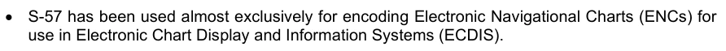

• S-57几乎完全用于电子图表显示和信息系统(ECDIS)所用的电子导航图表编码。


• S-57不是一个在地理信息系统领域得到广泛接受的当代标准。


• 它的维护制度不灵活。

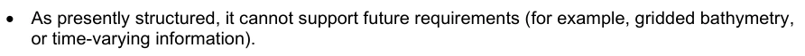

• 按照目前的结构,它不能支持今后的需要(例如网格测深,


· 将数据模型嵌入封装中,即文件格式,限制了使用更广泛的传输机制的灵活性和能力。


• 一些人认为,这是专门针对生产和交换的有限标准;

国际海道测量组织将认真监测从S-57向S-100的过渡,以确保现有的S-57用户,特别是ENC利益攸关方不会受到不利影响. S-57在可预见的将来将继续作为ENC数据的指定格式而存在.

与此同时,鼓励水道测量信息和数据的所有现有和潜在用户使用S-100作为新应用的基础,如果这些标准的特定要求尚未得到满足,则寻求对进一步发展标准的投入。

## 官方 PDF 第 8 页

二. 第0部分 -- -- 概览

文档控制

编辑数字日期参考

1.0.0 2010年1月 国际水道测量组织第83/2009号通知函,2009年12月04日

2015年6月2.0.0 国际海道测量组织第39/2015号通知函 2015年6月05日

2017年6月3日 3.0.0 2017年6月2日 IHO通知函 第32/2017号 2017年5月02日 4.0.0 2018年12月17日 IHO通知函 第60/2018号 2022年12月5.0.0 2022年12月12日 IHO通知函 第45/2022号 5.1.0 2023年10月12日 IHO通知函 第36/2023号 2023年10月31日 5.2.0 2024年6月5日 IHO通知函 第27/2024号 2024年6月07日 5.2.1 2025日 IHO S-100WG

5.2.1版实质性变动摘要

已生效的概要条款

从规范引用中删除了 URL 链接。 1-3

表1-4:从URI衍生型描述中删除了示例;修改了URN衍生型描述中的示例,以反映MRN格式;添加了Derived Type file URI.

```text
1-4.6
```

表1-4.4. 删去以下解释性案文

从规范引用中删除了 URL 链接. 2a-2

为属性 S100_CD_属性ValueType 添加了 URI 、 URL 和 URN 的值备注; 添加了缺少的值文件URI 。

```text
2a-4.2.9
```

澄清了S100_CD_属性约束类的属性精确度描述和注释,以描述该精确度指定了小数位数位后位数右后方的位数.

```text
2a-4.2.10
```

以一般网页参考资料取代了URL链接。 3-10

更正了表5-A-7和表5-A-8中的备注,以反映S100_FC_InformationType和S100_FC_FeatureType出自S100_FC_ObjectType,与图5-A-1一致.

附录5-A

## 官方 PDF 第 9 页

删除的语句,所有几何原始(GM_Primitive)都必须是至少一个GM_Aggregate的一部分.

```text
7-4.2.11.1
```

从规范性参考资料中删除了URL链接,并贯穿整个过程。

以一般网页参考取代了 URL 链接。 9-B-1

从规范引用中删除了 URL 链接. 9a-3

经修订的关于COCC-NCOR、SECC-NSEG和CCOC-NCCO的子域评论,以确认对于删除指示,不应有项目。

```text
10a-7.2.1.2, 10a-
7.2.4.2.3, 10a-
7.2.5.2.2
```

从引用中删除 URL 链接 。 10b-3

澄清所有 GML 数据集的文件扩展名必须是. GML. 10b-7

通过要求使用xlink:title来指定每个协会的具体类型,消除了GML中编码协会中的模糊.

```text
10b-8.4, 10b-8.4.1,
10b-9, 10b-10, 10b-
11.4, 10b-11.4.1
```

澄清了在要素目录中存在继承时定义的GML Schema元素的范围.

```text
10b-9
```

添加了新条款来澄清GML位置语法的限制,以简化ECDIS对数据的解析.

```text
10b-9.1
```

更正的子帐号:10b-10.1.3.1,10b-10.1.3.2

删除了说明,该说明意味着一个单一的GML数据集可能包含一个以上的产品.

```text
10b-11.1.1
```

在实例中添加了chemaLocation和s100dev.net;并增加了相应的补充指导,以确保这些指导一致地用于整个系统的适当运作。

```text
10b-11.1.1
```

修正后的例子使xlink:arcrole符合MRN格式. 10b-11.4.1

表10b-4:删除了字段编码规格版的值;从字段 Dataset主题分类中删除了值.

```text
10b-11.6.1
```

修正后图10b-12,同意表10b-4.10b-11.6.1中的改动

澄清说,“欧管处具体规定的URI SRS公约”是指“标准”大地测量坐标参考系的URL(http URI)与EPSG编码。

```text
10b-11.7
```

添加了说明,以澄清坐标顺序必须与定义的坐标参考系一致。

```text
10b-11.7
```

添加了新指南, 请求产品规范开发者使用 IHO 的 Schema 服务器来放置它们的 Schema 。

```text
10b-14
```

从信息参考中删除了 URL 链接 。 10c-4.2

claized 许可 Group_F 省略当前数据集未使用的可选属性 。

```text
10c-9.5
```

## 官方 PDF 第 10 页

iv 第0部分 -- -- 概览

修正的特性 属性表元素,从"id"到"fetature 属性表Key"的固定列名.

```text
10c-9.6.2; 10c-
9.11.1
```

表10c-12中经修改的注释,分节数据CodingFormat=2或9行网格起源;网格起源纬度;网格相距;网格相距,经度;网格相距,纬度,允许投放数据集的米.

```text
10c-9.7
```

修正属性时间的多式性点从强制性改为任择性(表10c-19)。

删除了附录11-B作为符合要求的产品规范的例子。

```text
11-1
```

整齐化,以便在整个S-100、其产品规范和数据验证中统一使用数据大小单位计量参考文献

```text
11-1, 11-2.1, 11-13
```

以一般网页参考资料取代了URL链接。

添加了参考S-100 第17部分第17-4.4.2条的新指南,用于提供交易所目录XSD文件的可选规定,其中产品规范进一步限制S-100所定义的交易所目录元素.

```text
11-15
```

将附录内容改为参考S-97版 2.0.0(正在开发)和S-100版 5.2.0.

```text
11-A, 11-C, 11-E
```

附录内容取而代之的是国际海道测量组织地理空间信息注册簿、产品规范注册簿所公布的产品规范。

```text
11-B
```

将附录内容取而代之的是国际海道测量组织地理空间信息登记册中的链接。

```text
11-D
```

修改条款,以反映S-100维修的搬迁情况 -- -- 向国际水道测量组织登记处提出的更改建议表。

```text
12-2
```

将附录内容改为参考S-97版 2.0.0(正在开发)和S-100版 5.2.0.

```text
12-A
```

从规范性参考资料中删除了URL链接和整个链接 13-3, 13-7.1

表13-7:经过修改的URI值标记,用于反映字符编码可以反映任何URI格式;添加缺失值文件URI.

```text
13-8.1
```

澄清了 AtproductionControlints 的参数精度指定了小数位数位位数到小数取位数的右后方的位数.

```text
13-8.1.1.1
```

从规范性参考资料中删除了URL链接,并在整个过程中删除了14-2、14-8.2.1

添加了新的规范参考 ISO/IEC 80000-13:2025. 14-2

从规范引用中删除了 URL 链接. 15-2

修改了规格,使数据加密具有可选性,因为数据制作人需要签署数据,但可能不负责加密.

```text
15-4.2
```

澄清了指令,即计划管理员将在所有数据服务器的公用密钥上签名,以创建其数字证书,用于保护计划的运作,而不论其是否进行加密.

```text
15-4.6
```

澄清了目录中的数字签名应在加密和压缩后被应用.xml.

```text
15-5.1, 15-8.11.1
```

## 官方 PDF 第 11 页

表15-7.4.4中的Xs:正整数格式

澄清在许可证.xml.15-7.4.4、15-7.4.6中文件名扩展是可选的

澄清许可证和目录的独立签名文件格式。 15-7.4.5、15-8.11.2

将图15-6更正为数据服务器和数字签名创建流程中“DS2”的命名一致。

```text
15-8.1
```

更正了实例 Exchange Set Catalogue 标题摘要,以将证书Ref和计划管理员id “root”替换为“IHO”。

```text
15-8.4, 15-8.6
```

纠正了“S100_SE-证书容器类型”的多重性[0.1]至[1](强制性)

```text
15-8.11.1
```

S100_SE_SignatureOnData 类属性数据的修改描述和备注。

```text
15-8.11.4
```

更正属性签名的语法Refer for class S100_SE_Signature OnSignature

```text
15-8.11.5
```

已更正的编号类型值的语法

从规范引用中删除了 URL 链接. 16-3

将 URL 链接替换为一般网页参考文献。 16-A-3

从信息参考中删除了 URL 链接 。 16a- 3. 2

将URL链接替换为一般网页参考。 16a-4.2.1

纠正了文件路径,从图17-5的左侧删除了第二个“/”;将表17-1的URI例子中的第二个“:/”改为“/”。

```text
17-4.3
```

修改数据集取消的规格,以指定更新的版号必须被设定为被取消单元格的版号;以及取消的目的。

```text
17-4.4.1, 17-4.5
```

添加了交换目录 XSD 文件的可选规定的新指南,其中产品规范进一步限制了S-100定义的交换目录元素.

```text
17-4.4.2
```

修改表S100_DatasetDiscoveryMetadata中版本的编号属性类型为正整数.

```text
17-4.5
```

在表S100_DatasetDiscoveryMetadata后添加了新的注释2,以澄清目录.xml中的数字签名应在加密和压缩后被应用. 在表S100_DatasetDiscoveryMetadata中添加了数字签名属性注释2的新注释.

```text
17-4.5
```

为表S100_DataCoverage(注1)所编译,提及EPSG代码的内容将以http URI格式.

```text
17-4.5
```

为表S100_数据封面所拼写(注1),协调位置必须用列表来表示("posList").

```text
17-4.5
```

为表S100_DataCoverage(注1)所拼写,对边框Polygon属性的坐标顺序必须与定义的坐标参考系一致.

```text
17-4.5
```

将表S100_目的中的新数据集值重新标记校正,以表示在覆盖或范围发生显著变化的情况下,可能会生成新的数据集。

```text
17-4.5
```

## 官方 PDF 第 12 页

六. 第0部分 -- -- 概览

修改了表S100_PresidentFile DiscoveryMetadata中版本编号属性的备注,以正确表示版本编号是用于支持文件而不是数据集.

```text
17-4.5
```

在表S100_DatasetDiscoveryMetadata之后添加了对新注2的参考,用于表S100_PresidentFileDiscoveryMetadata和表S100_CatalgueDiscoveryMetadata中数字符号Value属性的注释.

```text
17-4.5
```

从规范引用中删除了 URL 链接 。 18-2

## 官方 PDF 第 13 页

本页特意留空

## 官方 PDF 第 14 页

八. 第0部分 -- -- 概览

引言

标准应概括最佳做法方法和程序的使用,应包括关于如何实施高效生产方法和优化组织产品和服务质量的指导,还应通过使用共同接口使不同技术之间的互操作性得以实现。 此外,它还提供了一个组件框架,供感兴趣的社区用于开发自己的海洋地理空间产品和服务。

S-100标准是在通过开发和使用现有的IHO数字水道测量数据传输标准(称为S-57)而获得的经验的基础上,以后视为优势而得到制定的. S-100标准是使用一个面向对象的标记来被记录的,称为"统一建模语言"(UML). (虽然UML定义了9个类型的图表,但在S-100中只使用了类,对象和包图.

S-100标准提供了基于ISO 19100系列标准和规格的组件理论框架,这些标准和规格也被用作大多数当代地理空间标准制定活动的基础,并与其他标准制定举措如开放地理空间联合会(OGC)紧密相通.

国际海道测量组织还开发了一个相关的地理空间信息登记册,可以结合S-100标准使用。


• 国际海道测量组织数据生产者代码注册簿。


• S-100产品规范注册簿。

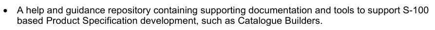

• 一个帮助和指导库,载有支持S-100产品规范开发的辅助文件和工具,如目录构建器。

国际海道测量组织GI登记册提供了必要的基础设施和机制,以管理和维持上述资源,并视需要予以扩大。

S-100号说明规定了一个注册簿及其注册簿的Schema和总体管理程序,国际水道测量组织注册簿是利用这些概念实施的。

## 官方 PDF 第 15 页

0-1 范围

S-100《IHO 通用水道测量数据模型》由一组相互关联的部分组成，为用户开发和维护水道测量相关的数据、产品及注册簿提供适用的工具和框架。这些标准针对水道测量及相关信息，规定了数据管理、处理、分析、访问、呈现，以及在不同用户、系统和地点之间以数字／电子形式传输数据的方法和工具。遵循这组地理空间水道测量标准，用户能够构建符合 S-100 要求的产品规范的各个组成部分。

S-100 在合理可行的范围内尽量符合 ISO/TC 211 地理信息系列标准，并在必要时作出适合水道测量要求的专门调整。

S-100 详细规定了各国海道测量机构之间及其他组织之间交换水道测量和相关地理空间数据，以及向制造商、航海人员和其他数据用户分发这些数据时应使用的标准。

S-100 包含多个部分，对 ISO 第 211 技术委员会制定的标准进行专用配置。ISO/TC 211 负责 ISO 地理信息系列标准。这些标准共同构成一个框架，用于开发使用地理信息的行业专用应用；S-100 就是这种应用的一个例子。

本标准规定了以下工作应遵循的程序：
1）建立和维护水道测量及相关信息的注册簿；
2）创建产品规范、要素目录，并定义通用要素模型；
3）使用专门面向水道测量要求的空间数据、影像与格网数据以及元数据。

0-2 本出版物使用的缩略语

2-D：二维
2.5D：二维半
API：应用程序编程接口
ASCII：美国信息交换标准代码
CRS：坐标参考系
CSL：概念模式语言
DEF：数据交换格式
DIS：国际标准草案
ECDIS：电子海图显示与信息系统
ECS：电子海图系统
ENC：电子航海图
EPSG：欧洲石油测量组织
FCD：要素概念字典
FDIS：国际标准最终草案
GFM：通用要素模型
GML：地理标记语言
HDF：层次数据格式
HSSC：IHO 水道测量服务与标准委员会（前身为 CHRIS）
IALA：国际航标协会（原文名称为 International Association of Lighthouse Authorities）
ICC：国际色彩联盟
IEC：国际电工委员会
IETF：互联网工程任务组
IHB：国际海道测量局

## 官方 PDF 第 16 页

0-2 本出版物使用的缩略语（续）

IHO：国际海道测量组织
IMO：国际海事组织
IOGP：国际油气生产者协会（原名 OGP）
ISO：国际标准化组织
ISO/TC211：ISO 地理信息／地球信息技术委员会
JPEG：联合图像专家组
MRN：海事资源名称
OCL：对象约束语言
ODP：开放分布式处理
OEM：原始设备制造商
OGC：开放地理空间联盟
OMG：对象管理组织
OSI：开放系统互连
RENC：区域 ENC 协调中心
RFC：征求意见稿
RNC：栅格航海图
RSS：推荐安全方案
SENC：系统电子航海图（System-ENC）
SKOS：简单知识组织系统
TC：技术委员会
TIFF：标记图像文件格式
TIN：不规则三角网
TS：技术规范
TSMAD：传输标准维护与应用开发工作组
S-100WG：S-100 工作组
SVG：可缩放矢量图形
UML：统一建模语言
URI：统一资源标识符
URL：统一资源定位符（原文展开为 Universal Resource Locator）
XLink：XML 链接语言
XMI：XML 元模型交换
XML：可扩展标记语言
XSD：万维网联盟 XML 模式定义
XSL：可扩展样式表语言

0-3 S-100 的目标

S-100 的目标是：
1）符合 ISO/TC 211 正在制定的新兴 ISO 地理信息标准；
2）支持种类更广泛的海洋或水道测量相关数字数据、产品及用户；
3）将数据内容与编码格式分离，使产品规范不依赖特定格式；
4）在可管理的范围内提供适应变化的灵活性。其意图是允许产品规范通过扩展来演进，而无需发布现有产品规范的新版本。
（本条目标列表续见下一页。）

## 官方 PDF 第 17 页

5) 提供由国际海道测量组织管理的符合ISO的注册簿,其中包含要素概念词典和产品要素目录等具有灵活性并能有管理的扩展的注册簿;

6) 为不同的用户群体提供单独的注册簿。

0-4 S-100 各部分

S-100包含多个由各种ISO 19100系列标准衍生出来的部件.

表0-1列出了各个部件、其相关部件编号和ISO 19100符合性。

表 0-1 — S-100 各部分

部分标题部分编号 ISO19100标准

概念学语言 S-100 第1部分 ISO 19103:2005,地理信息 - 概念学语言 ISO

管理国际海道测量组织地理空间信息注册簿S-100 第2部分 ISO 19135:2005,地理信息-地理信息项目登记程序

概念和数据词典注册簿 S-100 第2a部分 ISO 19135:2005,地理信息-地理信息项目登记程序

ISO 19126:2009,"地理信息-地貌概念词典和注册簿".

S-100 部分2b ISO 19135:2005, 地理信息-地理信息项目登记程序

ISO 19126:2009,"地理信息-地貌概念词典和注册簿".

ISO 19117:2012,"地理信息-平面"

Schema 应用的一般要素模型和规则

S-100 第3部分 ISO 19109:2005,地理信息-应用计划规则

S-100元数据 第4a部分 ISO 19115-1:2014,"地理信息-元数据",由"2018年第一修正案"所修改.

成像学和格纹数据元数据 S-100 第4b部分 ISO 19115-1:2014, 地理信息–元数据– 第1部分 : 基本原理. 经"修正案"1"2018年修订.

19115-2:2009. 地理信息-元数据- 第2部分:图像和网格数据的扩展

元数据-数据质量 S-100 第4c部分 ISO 19113,地理信息-质量原则

ISO 19114, 地理信息 -- -- 质量评估程序

ISO 19138, 地理信息 -- -- 质量计量

要素目录S-100 第5部分 ISO 19110:2005,地理信息 - 要素目录编制方法

坐标参考系 S-100 第6部分 ISO 19111:2007, 地理信息 - 通过坐标提供的空间参考

空间Schema S-100 第7部分 ISO 19107:2003,地理信息-空间计划

成像与格子数据 S-100 第8部分 ISO 19123:2007,地理信息-覆盖几何和函数的Schema

ISO 19129, 地理信息 -- -- 图像、网格和覆盖数据框架

## 官方 PDF 第 18 页

S-100显示 第9部分

平面(Lua) S-100 第9部分a Lua平面

编码格式 S-100 第10部分

ISO/IEC 8211 编码 S-100 部分 10a ISO/IEC 8211:1994,信息交换结构实施数据描述文件的规格

GML 编码 S-100 部分 10b ISO 19136:2007 地理信息 - 地理标记语言

HDF5 编码 S-100 部分 10c HDF5 数据模型和文件格式

产品规范 S-100 第11部分 ISO 19131:2008 地理信息-数据产品规范

S-100 维护程序 S-100 第12部分

S-100 脚本语言 S-100 第13部分 为基于 S-100 的产品规范提供脚本支持

S-100 Part 14指定了S-100的在线交换机制

加密和数据保护 S-100 第15部分 指定S-100产品加密和数据保护

互操作性目录模型 S-100 第16部分 定义创建S-100数据产品互通规则的框架

S-100产品S-100统一版画 第16a部分 具体规定不同S-100数据产品的图画和其他展示功能统一的原则

信息交换目录的发现元数据

S-100 第17部分 提供了描述和创建交换目录的规格,使用户能够识别、发现和管理S-100交换集的内容

语言包 S-100 第18部分提供了实施多语种支持的通用方法;以及用于主要使用的案例的信息化实例,即创建S-100要素目录的多语相支持.

0-4.1 专用配置

ISO 基础标准为希望将其用于实际应用的开发者提供了大量选项. 剖面图的概念提供了一个方法来修改基础标准,使其能满足具体的执行要求.

剖面图是一组或多组基本标准,并在适用的情况下,确定这些基本标准中为实现特定功能所必须的选定条款、类别、子集、选项和参数。ISO 19106描述了用于剖面分析ISO 19100系列标准的两级符合度。S-100的每个部分都记录了该部分在符合度说明中使用的级别。

S-100是一套ISO TC 211地理信息标准的剖面图. S-100标准核心部分与其ISO基础类之间的关系见表0-1.

0-4.2 第 1 部分 — 概念模式语言

这一部分定义了概念 schema语言和基本数据类型,供IHO社区使用,它将统一模型语言(UML)静态结构图和一组基本数据类型的定义组合起来,作为地理信息规格化的概念 schemata语言.

## 官方 PDF 第 19 页

0-4.3 第 2 部分 — IHO 地理空间信息注册簿管理

国际海道测量组织按照ISO 19135-地理信息项目登记程序,建立了一个注册簿,其中包含可扩展的注册簿数量,包括地貌概念、数据词典、显示和Meta数据,这一部分介绍了这些注册簿的内容、结构和管理。

0-4.4 第 2a 部分 — 概念与数据字典注册簿

概念注册簿规定了可用于描述地理或元数据信息的水道测量核心概念信息(定义、骆驼数据库等),使用注册簿存储水道测量定义大大提高了国际海道测量组织管理和扩展基于S-100的多产品的能力,这些产品可以在相对较短的时间内提供使用。 因此,注册簿通过公开登记项目,支持更广泛地使用这些物品;并增加其潜在用户的能见度;概念注册簿是将所有已登记概念作为“无国家”概念储存和管理的主要资源(即没有指定物品的类型,也没有界定概念对注册簿内其他概念的约束)。 每个概念应作为单一实例列入注册簿,并将用作数据词典注册簿和Meta数据注册簿概念的推导和取自的共同来源,用于模拟要素、属性等,供S-100产品规范使用。

数据词典注册簿扩展了概念注册簿(S-100 Part 2a)所储存的概念,包括了在注册簿内独立域中装订物品类型和要素的指定,从而使S- 100产品规范开发者能够开发出它们的数据模型,以最适合其代表现实世界的具体要求。

这一部分介绍注册簿的内容,并具体说明在建立、维持和出版指定给地理、水道测量和元数据信息项目的独特、明确和永久识别资料的词典时应遵循的程序。 为了达到这一目的,本部分具体规定了为登记项目提供识别和定义所必要的信息要素。

0-4.5 第 2b 部分 — 显示注册簿

这一部分描述了显示寄存器的内容。 一张显示 Register 指定了数据的显示。 数据的显示独立于数据, 但与数据密切相关。 这就是数据集中的属性驱动显示过程, 但是对于同一数据可能有许多不同的显示 。 使用注册簿来储存图画的各个方面将大大地提高国际海道测量组织管理和扩展基于S-100的多产品的能力,这些产品可以在较短的时间内提供使用。 该注册簿将通过公开提供和增加潜在用户的能见度来支持更广泛地使用已登记项目。

0-4.6 第 3 部分 — 通用要素模型

这一部分介绍了开发一种应用计划的规则,这是任何S-100产品规范的基本内容,对于创建应用计划同样至关重要的是通用要素模型,它是关于要素、要素要素和关联的概念模型,同时也介绍了信息类型的概念。 GFM是ISO 19109 规则中介绍的用于应用Schemas的GFM的专用配置.

0-4.7 第 4 部分 — 元数据

越来越多的海道测量组织收集、储存和归档大量数字数据,这些数据正在成为重要的国家资产。 需要确定数据资源的特点,并便利其发现、获取、检索和使用,以便用户能够了解数据资源的假设和局限性,并评估资源是否适合其预期用途。 此外,对水道测量数据质量的了解对于应用水道测量数据至关重要。

## 官方 PDF 第 20 页

数据保管人需要记录有关其数据(即元数据)特点和质量的信息,以便利发现、获取、检索和使用并确保可靠性。

ISO 19115-1、19115-2和19157提供了一个抽象的结构,通过界定资源的特点和质量元数据要素,以及建立一套共同的元数据术语、定义和扩展程序,来描述数字地理信息。

本部分还描述了如何使用ISO 19115-1、19115-2和19157元数据类别、要素和条件,并纳入了充电质量元数据的规则,还纳入了ISO 19113、19114和19157所述的质量计量。

0-4.8 第 5 部分 — 要素目录

要素目录是描述数据产品内容的文档,它使用一个或多个要素数据词典中的项目类型,例如要素和属性,一个要素分类目录的基本级别是按要素类型和信息类型划分的,任何一组包含要素的地理数据都应该有要素电子形式. 要素目录也可以遵守S-100这一部分的规格,独立于现有的地理数据组.

每个产品规范都定义了一个要素目录,特性和属性绑定在一个要素目录中,要素和属性的定义取自一个特性数据词典.

本部分定义了要素类型编目方法,还具体规定了要素类型的分类如何组织成一个要素目录并提交一组地理数据的用户,本部分适用于在之前未编目的域中创建要素类型目录,并修改现有的要素分类目录以适应标准惯例. 本部分适用于以数字形式表示的要素类型编目,其原理可以被扩展至其他地理数据形式的编目.

第5部分适用于类型一级地理要素的定义,这一国际标准不适用于每一类型个别情况的代表性。

0-4.9 第 6 部分 — 坐标参考系

这一部分适用于水道测量资料的制作者和使用者,其原则可以扩展到许多其他形式的地理信息,如地图、图表和文本文件。

这一部分界定了用坐标描述空间参照的概念方案,说明了定义1-、2-和3维空间坐标参考所需的最低数据,本节载有通过坐标系统和基准充分定义空间参照的所有必要要素。 报告也说明了将坐标从一个坐标参考系改为另一个坐标所需的信息,以及描述协调行动参数和方法所必须的所有要素。

坐标参考系信息可以使用本部分所定义的元素或参照坐标参考系的信息的注册簿进行充分列报,可按照ISO 19135管理坐标参考制度信息的注册簿(见第二部分).

国际海道测量组织没有计划实施坐标参考系注册簿,可用现有的坐标参考系的数据库的一个例子是IOGP地理学委员会大地测量小组委员会管理的EPSG大地测量参数数据集,可以通过名称空间EPGS和一个代码,如4326(即EPS:4326)来传达完整的CRS定义。 EPSG命名空间范围内的这个代码识别出基于WGS84 datum的椭圆坐标系统. EPSG数据库没有按照ISO 19135进行管理.

## 官方 PDF 第 21 页

0-4.10 第 7 部分 — 空间模式

这一部分定义了描述和操纵要素空间要素所必须的信息,它基于ISO 19107 - 地理信息 - 空间计划,然而S-100的空间要求不如ISO 19107. 这个专用配置包含了包含在S- 100中的ISO 19 107. 类的子集.

0-4.11 第 8 部分 — 影像与格网数据

这一部分确定了用于水道测量和相关应用的网格数据的内容模型,包括图像和网格的数据,并介绍了网格的组织、类型和相关元数据和空间参考。 图像和网格数据的编码和显示是S-100的这一部分的外部,尽管已识别出编码和绘图使用所识别内容模型的方式,这部分是基于ISO 19129图像、网格和覆盖数据框架。

0-4.12 第 9 部分 — 显示

这一部分具体规定了用于定义和组织S-100产品特有要素所需的符号和显示规则的显示模式.

0-4.13 第 9a 部分 — 显示（Lua）

这一部分界定了S-100 第九部分使用S- 100 第13部分所定义的脚本绘制机制实施图画所需的添加和修改. 产品中具体规定使用本部分所描述的图画目录的,也必须要求执行S- 100. 第13分部分.

0-4.14 第 10 部分 — 编码格式

这一部分涵盖了编码格式. S-100没有强制特定编码格式,因此由产品规范的开发者决定合适的编码标准并记录其所选择的格式. 编码信息的问题因已有的编码标准的范围而变得复杂. 表0-2提供了一份不完整的已存在的编码标准清单,从中可以按照要求将S-100作为扩展来开发出Semas.

表 0-2 – 示例编码标准

编码名称描述

ISO/IEC 8211 目前用于编码S-57ENC数据的编码标准.

GML 地理标记语言

XML 扩展标记语言

GeoTIFF 扩展 TIFF 规格,允许存储地理参考信息

HDF-5 分级数据格式版本 5

JPEG2000 联合摄影专家组 - 常用的相片图像压缩方法

成功的数据交换取决于在"要素目录"中定义的内容的知识,以及应用程序Schema中定义的数据集结构,以及所应用的编码规则.

## 官方 PDF 第 22 页

0-4.15 第 10a 部分 — ISO/IEC 8211 编码模式

这一部分具体规定了实施以ISO 8211格式编码的交换数据集所需的结构和物理构造.

0-4.16 第 10b 部分 — GML 编码

这一部分具体规定了实施地理标记语言数据格式所需的结构和物理构造.

0-4.17 第 10c 部分 — HDF5 数据模型与文件格式

这一部分具体规定了执行分级数据格式第5版(HDF5)所编码的交换数据集所需的结构和构造.

0-4.18 第 11 部分 — 产品规范

本部分解释产品规范,是ISO 19131数据产品规范的描述性IHO专用配置,并介绍了地理数据产品与水道测量和水道测量有关的要求的数据产品规范。

该专用配置的目的是确保任何数据产品规范结构明确而一致,该专用配置将符合国际海道测量组织S-100框架下所制定的所有其他标准。

产品规范是描述一个特定应用程序的所有要素、属性和关系,并将其映射到一个数据集,是对定义特定地理数据产品所需的所有要素的完整描述。

0-4.19 第 12 部分 — 维护

这一部分具体规定了维持和公布S-100各部分的程序,不包括维持S- 100注册簿,因为注册簿所有人规定了更新注册簿的程序,也不包括按照S- 100. 记录的产品规范的维持制度。

所有S-100产品规范将包括一个维修部分。

0-4.20 第 13 部分 — 脚本

这一部分定义了将脚本支持包含在以S-100为基础的产品中的标准机制. 脚本提供通过用Lua编程语言编写的脚本文件处理以S-100为基础的数据集.

0-4.21 第 14 部分 — 在线通信交换

这一部分介绍为指定在线信息交流所需的组件和流程,可以是一套可能具有连续性的数据或数据,后者又被称作“流数据”,数据需要更动态的信息流动;即除了交流主要作为文件处理的静态数据集之外。

0-4.22 第 15 部分 — 加密与数据保护

这一部分具体规定了S-100产品规范实施副本保护和(或)认证方法所需的机制、结构和内容。

## 官方 PDF 第 23 页

定义了数字签名制作的算法和方法,以及国际海道测量组织数据保护计划范围内的关键管理和身份保证所需的周围基础设施。

0-4.23 第 16 部分 — 互操作目录模型

这一部分界定了为S-100数据产品的操作制定规则的框架,包括统一的图形演示和警报及指示处理,可用于制定包含在互操作性目录中的系统特定规则,该目录是一类元产品,它描述了产品组如何同时使用和显示.

0-4.24 第 16a 部分 — S-100 产品的协调显示

这一部分具体规定了统一不同S-100数据产品的描述和其他列报功能的原则,目的是改进用户的经验并减少使用多S- 100数据产品的系统内的模糊不清之处。 报告还介绍了国际海事组织(海事组织)在国际海道测量组织(海道测量组织)内支持统一工作的相关指导和资源。 它不处理其他S-100部件(特别是第九和第九A部分)中涉及的显示过程、功能或架构,而是侧重于演示设计方面,如显示组织、颜色和符号。

0-4.25 第 17 部分 — 信息交换目录的发现元数据

这一部分为描述和创建让用户能够识别、发现和管理S-100交换集内容的交换目录提供了规格,更重要的是它利用了XML,使机器能够机器发现和交换海道测量组织通常制作的地理数据集的信息。 其目的是建立元数据记录,提供关于识别、空间和时间范围、质量、应用Schema、空间参考系统以及数字地理数据分布的信息,适用于数据集的编目、信息交换所活动以及地理和非地理资源的全面描述。

信息交换需要若干类元数据:关于交换目录总体的元数据;关于目录中每个数据集的元数据和关于构成包的支持文件的元数据的元数据。如果交换目录包含任何特性、相容性或互操作性目录,则有附加这些元数据的条款。

这一部分针对元数据应用的开发者和执行者,对地理信息标准化的原则和总体要求提供了基本理解,应与S-100条款第4a部分第4 a-4条-规范性参考条款所列举的标准一并使用。

0-4.26 第 18 部分 — 语言包

本部分详细介绍了S-100框架的XML元素的多语言支持如何实施,并描述了用于制作单个语言包的通用机制和结构,这些组合将执行任何XMR内容的翻译.

用于提供支持产品规范的 XML 资源多种语言实例, 供终端用户使用。 执行系统可以构建这些辅助资源的翻译实例。 这部分并非针对任何一类的 X ML 数据 。 它没有详细说明如何在S-100产品规范、数据集或它们可能提及的任何外部资源中添加多语言支持,它提供了一个通用机制,可用于S- 100框架基于XML的任何要素,以适应多语言执行。

## 官方 PDF 第 24 页

S-100的这一部分提供了实施这种支持的通用方法;以及用于主要用途的提供信息性实例,即为S-100要素目录创建多语种支持.


---

# S-100 5.2.1 · 第 1 部分 · 概念模式语言

非官方机器翻译参考稿，尚未逐条人工校订。公式与代码保留原文，解释以英文规范为准。

## 官方 PDF 第 25 页

S-100 – 第1编

概念模式语言

## 官方 PDF 第 26 页

5.2.1版实质性变动摘要

已生效的概要条款

从规范引用中删除了 URL 链接。 1-3

表1-4:从URI衍生型描述中删除了示例;修改了URN衍生型描述中的示例,以反映MRN格式;添加了Derived Type file URI.

```text
1-4.6
```

表1-4.4. 删去以下解释性案文

## 官方 PDF 第 27 页

中文目录（可用上方目录直接跳转）

1-1 范围 · 官方 PDF 29
1-2 符合性 · 官方 PDF 29
1-3 规范性引用文件 · 官方 PDF 29
1-4 S-100 UML 专用配置 · 官方 PDF 30
1-4.1 引言 · 官方 PDF 30
1-4.2 联合马列的一般使用 · 官方 PDF 30
1-4.3类 · 官方 PDF 30
1-4.4 属性 · 官方 PDF 30
1-4.5 基本数据类型 · 官方 PDF 31
1-4.5.1 一般考虑 · 官方 PDF 31
1-4.5.2 初级型 · 官方 PDF 31
1-4.5.3 复杂类型 · 官方 PDF 33
1-4.6 预定义的衍生类型 · 官方 PDF 37
1-4.7 假定类型 · 官方 PDF 37
1-4.8 编码清单类型 · 官方 PDF 37
1-4.9 关系和协会 · 官方 PDF 39
1-4.9.1 关系 · 官方 PDF 39
1-4.9.2 协会、组成和汇总 · 官方 PDF 39
1-4.10 定型观念 · 官方 PDF 41
1-4.10.1 班级/分类人员使用UML标准定型观念 · 官方 PDF 41
1-4.11 可选、有条件和强制性的属性和协会 · 官方 PDF 42
1-4.12 命名和名称空格 · 官方 PDF 42
1-4.13 说明 · 官方 PDF 43
1-4.14 包件 · 官方 PDF 43
1-4.15 S-100中的模型文件 · 官方 PDF 44

## 官方 PDF 第 28 页

本页特意留空

## 官方 PDF 第 29 页

1-1 范围

这一部分定义了IHO社区内使用的概念Schema语言和基本数据类型,它确定了统一建模语言(UML)静态结构图的组合,以及一组基本数据类型的定义作为用于地理信息规格化的概念Shema语言. (UMl是软件工程领域标准化的通用建模语. 它包括一组图形标记技术来创建特定系统的抽象模型. UML结合了实体关系图,工作流,对象建模和组件建模等数据建模概念中的最佳做法.

第二,本部分就如何利用UML建立标准化的地理信息和服务模式提供了指导方针,这些模式是实现互操作性目标的基础,由于本部分涉及UMR,因此除了S-100附件A(术语和定义)中包括这些术语外,还提供了一节,其中列有具体的UMle术语和的定义。

1-2 符合性

任何为说明S-100的这一部分内容而写的概念学概论,应符合第5款所载列的规则。 这一概论符合ISO 19106:2004第2类的规定。

1-3 规范性引用文件

本文件的应用需要下列参考文件:关于注明日期的参考文件,仅适用所引用的版本;关于未注明日期的文件,适用所参考文件的最新版本(包括修正案)。

ISO 19103:2005 (E), 地理信息-概念计划语言

ISO 8601:2004(E),数据要素和交换格式-信息交换-日期和时间的表示.

ISO 19136: 地理信息-地理标记语言

ISO 25964-1:信息和文献——"Thesauri"和"与其他词汇的互操作性" 第1部分:"Thesauri"用于信息检索.

ISO 25964-2:信息和文件——Thesauri和与其他软件的互操作性

词汇表—— 第2部分:与其他词汇的互操作性

OGC 10-129r1: 地理信息-地理标记语言(GML)-扩展图案和编码规则

OMG 统一建模语言(OMG UML),超结构,V2.1.2

RFC 3986,统一资源识别符(URI):通用语法. T. Berners-Lee, R.Fielding, L. Masinter. Internet Standard 66, IETF.

RFC 2141,URN语法. R. Moats. IETF RFC 2141,1997年5月.

RFC 8089,“文件”URI计划,2017年2月。

SKOS: SKOS – 简单知识组织系统 – 参考. W3C建议, 2009.

## 官方 PDF 第 30 页

1-4 S-100 UML 专用配置

1-4.1 引言

该条款规定了在地理信息领域使用UML的规则和准则。

子语序的结构如下:

(1) 联合马列的一般使用

(2) 类

3) 属性

(4) 基本数据类型

5) 预定义的衍生类型

6) 假定类型

7) 代码列表类型

8) 关系和协会

9) 定型观念

10) 可选、有条件和强制性的属性和协会

11) 命名和名称空格

12) 注解.

13) 包 装

14) S-100中模型的文献资料.

1-4.2 联合马列的一般使用

UML(统一模型语言)的使用方式应与UML 2. 规范模型必须使用类图和包图. 其他UMR图型可以信息化地使用,所有规范模型都必须包含属性,关联,以及相宜的数据类型定义等完整定义.

1-4.3类

一个类是对一组具有相同属性,操作,方法,关系,行为和约束的物体的描述. 一个类代表着一个正在被模拟的概念. 根据模型的类型,概念可能基于现实世界(对于一个概念模型),也可能基于平台独立系统概念之间的实施(对于规格模型)或平台特定系统概念(对于执行模型).

分类器是指包含其他类类类元素的类的概括,如数据类型,演员和组件. UML类有名称,一组属性,一组操作和约束. S-100操作中不使用,一个类可以参加协会.

按照S-100部分划分的类别被视为一种规格,而不是一种执行。

多重继承的使用应被最小化,因为它往往会增加模型的复杂性.

文摘类用斜体表示。

1-4.4 属性

属性的 UML 标记有:

选取性选择名称 : 选取性选择类型 选取性选择[多相] 选取性选择=初始值选择{财产-字符串}选取性选择

## 官方 PDF 第 31 页

一个属性必须在一个类及其超类型上下文中是独一无二的,否则就是衍生出的一个属性,即从超类型中重新定义的属性.

属性的能见度由表1-1中的符号显示. 保护的和私有的能受度通常不用于标准规格,必须使用适当的能受能受分的符号,协会使用相同的能受可受能见性符号.

表1-1——属性可见度

符号 说明

+ 公众知名度

# 受保护的能见度

- 个人知名度

/ 衍生属性

所有属性必须打入,类型必须存在,构建/定义类型必须始终指定一个类型,不存在默认类型.

如果没有给出明确的多重性,则假定为一.

一个属性可以定义默认值,当该类型对象创建时使用. 默认值由UML定义中的明确的默认值来定义.

可用下列属性:


仅读 – 属性的值不能被更改,必须关闭。

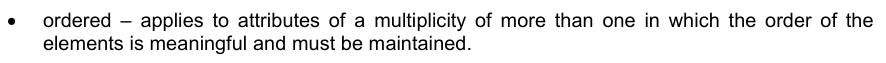

命令 – 适用于元素顺序有意义且必须维持的多个属性。

EXAMPLES + 中心: 点= (0. 0) {只读了} + 出处: 点 [0.. 1] // 多重0. 1 表示这是可选的 + 控制点 : 点 [2. *] {已订购了}

1-4.5 基本数据类型

1-4.5.1 一般考虑

基本数据类型分为两类:

1) 原始类型:代表值的基本类型,例如字符串、整数、布尔、日期、时间等。

2) 复杂类型:类型组合,例如计量类型和计量单位组合.

基本数据类型的再现在以下子语录中被描述.

S-100数据格式可能使用适当的内置或标准类型代表值. 例如,ISO 8211格式(Part 10a)代表字符串中所有主题要素属性的值,而不是使用ISO 9211签名整数,无签名整分数,或者S-100类型Integer或Real主题属性的被签名浮点表示.

1-4.5.2 初级型

以下原始类型在S-100 UML图中被支持.

## 官方 PDF 第 32 页

表 1-2 — 数据类型

名称描述

整数 A 签名整数,一个整数的表示是封装和用法的依赖.

实例29, -65547

无符号整数大于 0 。

无符号整数大于或等于0的整数。

由mantissa和expresents组成的Real A 签名真实(浮点)数字,真实的表示是封装和用法的依赖.

EXAMPLES 23.501, -1.234E-4, -23.0 (英语).

布尔 A 代表二进制逻辑的值。 该值可以是真也可以是假的 。

字符String A CharlieString是一个任意长度的字符序列,包括从被采纳的字符集的回放中取出重音和特有字符.

日期 A 给出了年份、 月份和日期的值。 日期的字符编码是遵循 ISO 8601 指定的日历日期格式( 完整表示, 基本格式) 的字符串。

19980918 (YYYYYMMDD) (英语).

在XML格式中,应该使用XML Schema标准类型来代替ISO 8601基本表示(这在XML中不是一个标准类型).

EXAMPLE: 1998-09-18 (英语).

时间 A 给出的时间在24小时钟系统中为1小时,分和次. 时间的字符编码必须是ISO 8601定义的基本格式的完整表示. 完整的表示表示意味着必须使用小时,分钟和秒. 基本格式表示忽略了分隔字符.

时间最好以世界时间坐标表示(UTC).

EXAMPLE 183059Z (英语).

时间可以表示为当地时间,给定的冲抵为协调世界时.

EXAMPLE 183059+0100 (英语).

时间可以表示为"当地时间",无需指定抵消世界协调时.

EXAMPLE 183059 (英语).

以日内瓦(在协调世界时前一个小时的冬季)和纽约(在协和世界时后五个小时的冬天)当地15小时过后27分46秒的完整时间表示以及表明当地时间尺度与协调世界后5小时的差别作为例子。

日内瓦:152746+0100

纽约:152746-0500

一项服务的服务时数,在日光节时影响协调世界时抵消的区域全年均可使用,可表示为当地时间,而无需指定抵销。

开幕时间:07.4500

闭幕式:161 500

在XML格式中,应该使用XML Schema标准类型来代替ISO 8601基本表示(这在XML中不是一个标准类型).

展览:18:30:59Z;18:30:59+01:00;18:30:59

DateTime A DateTime是日期和时间类型的组合. DateTime的字符编码必须遵循ISO 8601(见上文).

ExAMPLE: 19850412T101530 (英语).

在XML格式中,应该使用XML Schema标准类型来代替ISO 8601基本表示(这在XML中不是一个标准类型).

EXAMPLES: 1985-04-12T10:15:30; 1985-04-12T10:15+01:00; 1985-04-12T10:15:30Z

## 官方 PDF 第 33 页

S100_TrunctedDate A S100-TrundDate允许给出日期或部分日期。至少必须存在下列一个组件,其中省略的元素由格式确定的等同的连字符取而代之。

元件: 年整数从000到9999 MM 月整数在01−12(包括) DD D D D日整数 在01到28,29,30,或31(包括,如果指定的话)之间,与年和月值一致

这种类型可用于编码反复出现的即时(见第三编第3-8款)。

EXAMPLE 1 (ISO 8211, HDF5): YYYYMMDD 带有未指明的元件被连字符所取代,这样编码的长度总是8个字符:

```text
----1217 representing 17 December of any year
```

EXAMPL 2(XML):应该使用合适的XML Schema类型:

- 12-17代表任何一年的12月17日(符合XML类型gMonthDay)

第10b部分提供了GML数据集编码的进一步细节.

1-4.5.3 复杂类型

```text
1-4.5.3.1
UnlimitedInteger
```

图1-1 - 无限整数

一个签名的整数,其值可能是无限的。

1-4.5.3.2 矩阵

图1-2-矩阵

由真元素或整数元素组成的网格 。

## 官方 PDF 第 34 页

```text
1-4.5.3.3
S100_Multiplicity
```

图1-3-S-100-多元性

定义从下到上不等的多重范围。上方边界可能是无限的。

```text
1-4.5.3.4
S100_NumericRange
```

图1-4 — S100_ 数值范围

指定以下边界和上边界以及间隔的关闭类型为数字间隔。

除 ltSemiInterval 或 leSemiInterval外,所有关闭都必须使用下属性。除 gtSemiInterval 或 geSemiInterval外,所有关闭都必须使用上属性 。

注 单值间隔必须用上=下编码,并设置闭合点。

间隔的关闭由引用 S100_IntervalType 定义. 字面有以下含义: 时间轴 :

表1-3——间距类型

名称 说明 定义

打开间距( 下, 上) 下 < x < 上

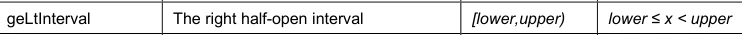

右半开间隔

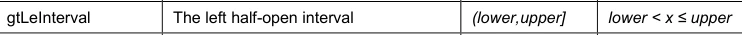

左半开间隔

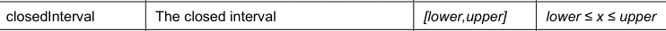

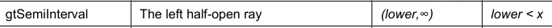

左半开光线

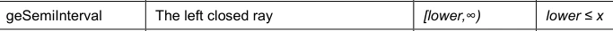

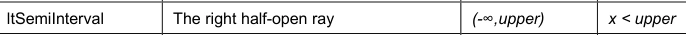

右半开光

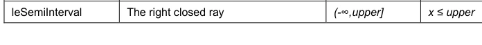

注 使用圆括号(或)的间隔,如一般间隔(下,上)或具体实例(2,4),称为开放间隔,而套接字中没有收起终点。使用方括号[或]的间隔取出一般间隔[下,出]或具体示例[-1,3]和[2,4]。

## 官方 PDF 第 35 页

中间部分使用正方和圆括号[和]或(和),如一般间隔(下,上)和[下,出)或具体例子[-1]和(2,4),称为半闭间隔或半开间隔。

注 以一个为终点的中间点称为射线或半行.

EXAMPLE 间隔"(10,42)"表示10至42之间的所有正数的集合,但不包括10或42,分别为间隔的首个和最后一个数字. 间隔 "[10, 42.]"包括了10至 42. 以及10和42之间的每个数字.

```text
1-4.5.3.5
S100_UnitOfMeasure
```

计量单位是一个定义明确的比方,其比方为一个比方。

在S-100中,计量单位由一个名称和可选的定义及符号组成。

图1-5-S100-Unit Off Measure

```text
1-4.5.3.6
S100_Measure
```

计量是计量的结果,计量是指对某一实体某些特征的大小,如长度或重量相对于计量单位的估算,计量由实际的等分(值)和计量单位所组成.

```text
1-4.5.3.7
S100_Length
```

以距离作为整体的测量,例如曲线长度,或者以多边形作为边界长度的周长.

```text
1-4.5.3.8
S100_Angle
```

将一行或平面与一行或平面相接而成的巧合需要的旋转量,一般以弧度或度来测量.

```text
1-4.5.3.9
S100_IndeterminateDate
```

不确定瞬间是指与短时格式指定的日期相关的瞬间。允许的时间关系是“先”和“后”,并分别表明瞬间是在日期-时间部分指定的时间瞬间之前或之后。

## 官方 PDF 第 36 页

图1-6 — S100_ 不定日期

示例(信息):1950年以前一个未知瞬间提交的海员报告,由一份属性报告提交,其分属性如下:

子属性值

在1950年1月1日之前的一段不确定时间,

价值1950年 -- --

```text
1-4.5.3.10 S100_TM_Instant
```

S100_TM_Instant代表了时间即时的ISO19108概念. 时间即时是代表时间位置的0维几何原始. [ISO 19108: 2002].

角色名称 名称描述 多重数据类型备注

S100_TM_即时 A 类时间点。 多个点可以指定为用于代表重复出现的即时的截取日期

```text
--

One of date,
time or dateTime
must be
populated
```

日期或缩短日期(见表1-2)

```text
0..1
S100_TruncatedDat
e
```

A 时间(见表1-2)

日期 日期 日期 日期 日期 日期 日期 日期 日期 日期 日期 日期 日期 日期 日期 日期 日期 日期 日期 日期 日期 日期 日期 日期 日期 日期 日期 日期 日期 日期 日期 日期 日期 日期 日期 日期 日期 日期 日期 日期 日期 日期 日期 日期 日期 日期 日期 日期 日期

```text
1-4.5.3.11 S100_TM_Period
```

S100_TM_Period代表了时间段的ISO19108概念. 时间段是一维几何原始,代表时间范围. [ISO19108: 2002].

角色名称 名称描述 多重数据类型备注

S100_TM_Period A级 时间范围.

```text
--

Single value
intervals are
encoded with
begin = end and
closure =
closedInterval
(or omitted)
```

属性关闭 An S100_IntervalType。 默认是关闭的Interval

```text
0..1
S100_IntervalType
```

属性开始于 0. 1 S100_TM_即时

属性结束周期为 0. 1 S100_TM_即时

## 官方 PDF 第 37 页

1-4.6 预定义的衍生类型

衍生出的类型由基本类型或其他衍生出类型通过限制允许值的范围而产生,S-100定义了以下衍生出类别,产品规范可以定义其他衍生出种类.

表1-4——预定义衍生类型

名称描述来源

URI 统一资源标识符的定义为 RFC 3986. URI 的字符编码必须遵循 RFC 3986 所定义的语法规则.

```text
CharacterString
```

URL 统一资源定位器(URL)是一种URI,它通过描述其主访问机制(RFC 3986)提供了定位资源的手段.

http://registry.iho.int 互联网档案馆的存檔,存档日期2013-12-22.

URI (美国)

URN A 持久,位置独立,资源标识符,遵循了RFC 2141中指定的URN的语法和语义.

EXAMPLE urn:mrn:iho:例:为:a:识别器

URI (美国)

fileURI A fileURI识别一个存储在一个结构化对象命名和访问环境上的一个对象(一个"文件系统")(RFC 8089).

EXAMPLE 文件:/path/to/a/文件

URI (美国)

1-4.7 假定类型

被列举的类型声明定义了 mnemonic 单词的有效标识符列表。 被列举类型属性只能取自此列表的值 。

实例

图 1-7 — 枚举

数字是模拟成定型为 QQ 的类。 计数类只能包含代表计数值的简单属性。 计算类中的其他信息无效。 点数是用户定义的数据类型, 其实例构成一个命名的字元值列表。 通常, 既要宣布计数名称, 也要宣布其字元数值 。 点数类型的扩展将意味着对Schema的修改。

1-4.8 编码清单类型

编码清单类型可用于产品规范一级无法知晓其成员身份的公开点数,用于信息模型碎片再利用,或用于更有效的目录管理。

(a) 在申请一级成员不通晓的枚举

Schema; (b) 外部当局定义或控制的清单; (c) 多个S-100域共同的列表; (d) 如果一组允许的数值需要扩展,而不对数据作重大修改

规格; e) 可能使要素目录条列或通俗易懂的潜在值的长列表。

## 官方 PDF 第 38 页

例如,ISO 19115(Metadata)定义了几个代码列表,因为它需要定义被列举的由域和情况决定的成员类型(例如分布介质).

代码列表类型声明必须是以下3种类型之一: 1.

1)开放式的点数,是有效密钥-值组合(即代码-值映射)的列表,并有允许用户社区以指定格式提供被允许的值的规定. 2)闭塞词典,是按已知格式的密钥-值组合的词典(vocabulary),由统一资源识别器可识别,并且可以通过应用标准现代技术定位资源而定位,无法提供附加值. (3) 开放式词典,是按上述定义由统一资源识别器可识别的已知格式的按键-值组合词典(vocabulary),附加但书,可以提供符合特定格式的额外值。

代码列表是模拟成定型为 QQS100_代码列表 的类。 第一种类型的代码列表必须列出已知的字元作为属性。 在第二和第三类中,没有列出属性,但词汇是由URI识别的。一个代码列表分类器必须带有标记的值,定义其表达性,扩展性,以及预期的编码。图1-8显示了3个代码列表的例子:

1) 垂直数据编码列表是仿照可扩展的编目(以标记值编码列表Type=“开放式编目”为标志)的编码列表的一个例子,可按“其他:......”的表值来扩展,以标记出值编码=“其他:“某”为标的值编码”的表格:[某]。 2) ENCProducerCodes编码列表是外部词典所模拟的代码列表的一个例子,它只能取出该词典中的值(以被标记的值编码列表Type="已关闭的字典"来表示). 字典由被标记值的URI=http://www.iho.int/proputers/enc/ver1_5来识别. 3) 机构代码表是外部词典所模拟的代码表的例子,它可以取出附加值(用标记值代码表Type=“开口词典”表示),词典用标记价值URI=http://www.iho.int/general/ver1_5来识别,该列表可以用“其他:......”表格的数值来扩展,用标记数值编码=“其他:“某”表示。

图1-8 – 代码列表

执行(和特定的编码)被允许脱离编码提示. 不同的执行可能使用不同的编码方案(和将表格翻译为其他编码方案). 例如,为ISO 8211编码编制一个要素目录,可以将一个字典转换成XML片段,将其合并为(或XCluding'd in) XML要素目录(显然需要额外的程序来维护). 这样XMI/GML编码就可以使用该词典,同时仍然允许其他编码在其限制范围内发挥作用.

## 官方 PDF 第 39 页

1-4.9 关系和协会

1-4.9.1 关系

图1-9——不同类型的关系.

UML中的关系是模型要素之间的具体语义联系,关系类型包括关联、通论、聚合/组合、元关系、流等,以及依附关系下划分的几种类型。在ISO 19103中,“关系”这一总术语与更具体的“关联”一词有明确的区分。 两者都对类联系作了界定,但关联只留给那些在现实中是证明联系的关系。 “一般化”和“依赖性”是类关系。 “隔离”和其他对象关系的对象更严格地称为“协会”。 在任何情况下,使用最限制性的术语总是适当的,因此,在谈论可即时处理的关系时,使用“协会”一词。

在S-100中,一般化、依赖和完善按照UML的标准标记和用法使用,在下列关联、汇总和组成方面的用法中作进一步说明。

1-4.9.2 协会、组成和汇总

UML中的关联,是指两个或多个分类器(例如类,界面,类型,.)之间涉及其实例间连接的语义关系.

社团用于描述两个或两个以上阶级之间的关系,除了普通社团之外,UML定义了两种特殊类型的社团,称为集合和组成,这三种类型的语义不同,一般社团必须用来代表两个阶级之间的一般关系. 汇总和组成协会必须用来建立两个阶层之间的部分关系。

二进制关联有一个名称和两个关联端. 关联端有一个角色名,一个多语种,和一个可选的聚合符号. 关联端必须总是与一个类相接.

图1-10——协会

图1-10显示一个名为"A"的关联,并带有其两个相邻端. 角色名用于识别一个关联的结束,角色名r1识别与被命名为类的连接到2的关联端. 一个关联端的多端可以是正 1 (1),零相或相邻(0. 1),一相或多相邻(1. *),零接相邻 (0. *)或相接相接(n.m). 从班级来看,相反关联-端的角色名可以识别目标班级的角色。我们说

## 官方 PDF 第 40 页

类2 与 r2 角色所识别的1 类有关联, 并且是 完全一个的多类。 另一方面, 我们可以说, 类1 与 class2 关系, 由 r1 角色名称所识别, 且 杂多为 0 或 更多。 在实例模型中, 我们说 类 1 对象 是指 零 或 多为 clas斯2 对象, 而类2 有 确切的 1 类 对象的 。

图1-11——多重性的特点

可以在一端参与社团(或属性)的例数见图1-11.

集合关联是两个类之间的关系,其中一个类扮演容器的角色,另一个类扮演一个被集合者的角色. 图1-112显示了一个集合的例子. 关联端接近1级的菱形集合符号表示1级是由3级组成的集合. 意思是3级是1级的一部分. 在实例模型中, 第1类对象将包含一个或更多类3对象。 当被封存对象(代表容器对象的部件)在没有容器对象的情况下存在时, 集合关联必须使用。 集合是关联部分的象征性短形式, 但没有明确的语义。 它允许在多个集合中共享相同的对象 。 如果需要更强的集合语义,则必须使用下文所述的成分,也可以在钻石成型端界定角色名称和多面性。

图1-12——汇总

组成关联是一个强聚合体。在组成关联中,如果一个容器对象被删除,那么其所有被封装对象也被删除。当代表容器对象部件的物体没有容器对象的情况下,则不能存在组成关联。图1-13显示一个组成关联,其中钻石形状的成分符号具有固态填充。 这里的类1对象由一等或多等的类4对象组成,除非类1的对象也存在,否则类4物体就无法存在. 需要的(被隐含的)多等物总是一个,被包含者,或部分不能由多个所有者共享.

也可以在钻石形状端界定角色名称,但最多只能是多重性,组成必须具有封存的语义作用,使用组成时应谨慎,特别是,在提出这种限制之前,应先从各种必须用角度考虑不同的要求。 组合构筑物的必须用必须在模型(而不是范围)的背景下考虑,其上下文是指必须用程序必须一致的必须用领域,目的是防止不同必须用程序对构成有不同要求的问题。

## 官方 PDF 第 41 页

图1-13——组成情况(总数)

所有协会都有为两端协会定义的要领。 至少要定义一个角色名。 如果只定义一个角色名, 默认另一个是 inv_ 作用名 。

所有代表关系方向的关联端(roles)必须命名,否则协会本身也必须被命名. 关联端的名称(角色名)必须在一个类及其超类型的背景下是独有的. 协会的方向必须指定,如果方向没有指定,则假定为双向关联. 如果打算成立单行会,则会的方向可以由行尾一箭来标出,如果只命名了会,则会的方向必须明确.

每个UML协会都有可导航属性,可以表明协会中哪个玩家直接访问关联对等角色. 无标记协会的默认逻辑是双向的,没有表示可导航性的协会是双相的,因为两个参与者都具有对等的角色的同等准入权. 双向导航在许多客户端-服务器操作中并不常见或必要. 与此相反的例子是通知服务,服务器经常在规定的事件上煽动通信。使用引入不合理的软件包依赖关系的双向关系应被最小化。当需要时,则使用单向关系。

如果关联可以向特定方向导航,模型必须提供适合目标对象相对于源对象的作用的"作用名",因此在双向关联中,将提供两个角色名,默认角色名是“目标类名>”,其中从源类中引用目标类(在许多UML工具中,这是默认名称). 社团名称具有次要的意义,实际上更是为了文献目的,但有时它们可以用来在支持社团作为一等公民概念的环境中产生社团管理对象。

多重关系是指某个对象可以参与的某种特定关系的数量. 如果关联端无法通航,对它施加多重限制需要执行来跟踪其他对象对关联的使用(或通过查询获得多相性). 如果这对模型很重要,那么该协会就必须双向通航,以使强制措施的执行更可行。 换句话说,单向关系意味着对非通航端采取某种“不关心”的态度。

N-ary关系,对于N > 2, 尽可能避免, 以减少复杂程度。 协会的多重性被指定为UML 多重规格。 角色名称的关联可被视为类似于对所涉两个类别属性的定义, 并有额外的制约, 即更新和删除对双方的处理一致。 对单向协会来说,它因此相当于属性定义,S-100的建议是对所有情况使用关联标记,但涉及基本数据类型属性的情况除外。

1-4.10 定型观念

1-4.10.1 班级/分类人员使用UML标准定型观念

在S-100中使用了下列定型观念:

a) Interface 定义一组由具有此功能的对象支持的操作

界面.b) 用于指定实例域(对象)的定型类,

一个类型可能具有属性和关联。\ Enumeration\ A 数据类型,其实例构成一个已命名的正文值列表。

引用名称及其字面值被宣告。 数字是指一个类中一个非常了解潜在值的简短列表。 经典实例是布尔, 其潜在值只有2 (或3) TRUE, FALSE (和 NULL) 。 大多数的引用将编码为一组连续的整数, 除非另有说明。 实际编码通常只对编程语言编译器有用 。 在取自ISO 19100标准的S-100代码列表中,被归类为计数.

## 官方 PDF 第 42 页

(d) 例为类的“MetaClass ” A类。

元模型构建。元类的含义是对象类,其主要目的是持有关于另一个类的元数据。例如,“元类型”和“属性类型”是“元”和 “属性”的元类别。' (e) 缺少特性(独立存在和)的一组值的描述符。

数据类型包括原始的预定义类型和用户定义类型。因此,DataType是一个类,其操作很少或没有,其主要目的是持有另一个类的抽象状态,用于传输、存储、编码或持续存储。 f) QQCodelist *_A 数据类别,其实例构成一个已命名的字词列表,其中部分或全部成员可能不得而知。 代码列表名称在应用程序Schema中被宣告。列表成员可以被描述为(一) 代码和相应字元列表,其中可附加一个模式,允许符合某种格式的额外值,或者(二) 指向由代码/文学映射列表组成的资源。该资源被称为词汇或词典。 代码列表声明所附加的标记值表示使用什么形式和资源的位置(一般作为URI). 代码清单只当一个目录不能使用或者没有效率(例如,如果规格作者不知道完整的数值清单或者允许的数值清单很长,波动多,由另一个权威控制,和/或由多个域共享)时才应该使用.

1-4.11 可选、有条件和强制性的属性和协会

在UML中,所有属性都是每个默认的强制属性. 可能显示属性和关联角色名称的多重性提供了描述可选和有条件属性的方法.

默认是强制性的, 因此不需要指定。 如果指定了 . 1 或 . * 的多重属性, 则意味着该属性可能存在或可能被省略。 有条件的属性必须在 OCL 中显示为带有约束声明的可选属性。 该条件应与 类声明 一起表示 OC L 约束 。 这意味着无效值必须在实例模型中被表示,例如一个位置持有者元素或一个无效值。可选或有条件的属性绝不必须具有定义的默认值。

属性可以被定义为条件性,意思是它根据其他属性是可选的. 依赖性可能是其他(可选)属性的存在依赖性,也可能是其他属性的值,有条件的属性被显示为可选性,并附有有条件的表达. 该条件必须被写入与属性直接相关的注释中,或者与一行上的属性的类和名称直接相通. 有条件的属性永远不能有设定的默认值.

如果未说明,关联的默认多为0.*,属性的默认多为1.

1-4.12 命名和名称空格

所有类必须有独有的名称。 所有类都应该在一个包内定义。 类名应该从大写字母开始。 类别不得有一个基于外部使用的名称, 因为这可能限制重复使用。 分类名称不得包含空格。 将一个类名中的单词组合起来。 名称中的每个子词应该从一个大写字开始, 如“ Xnnnymmm ” 。

为了确保类名的全局性,所有类名都必须用双亚法前缀来定义. Bialpha前缀允许使用_后-后,例如GM_Object. 几何模型使用双亚入前缀(GM和TP). 其他前缀必须定义为其它区域.

社团名称必须在一个阶级及其上层类型的背景下独有,否则就必须从中衍生出.

属性名称应先从小写字母开始。示例:第一Name, 最后Name

精确的技术名称应用于属性和操作,以避免混淆。例如:αCodeIdentifer, dateOfLastCchange

## 官方 PDF 第 43 页

文件栏应被广泛用来描述要素。

不要在属性名称内重现类名。 如果可能, 请缩短名称。 例如: 类 S- 100_ WorkingGroup, 属性工作组Name

命名公约主要出于可读性、一致性等各种原因,并作为防止对案件有敏感认识的约束的一种保护。

1) 对类,属性使用精确而易懂的技术名. 示例:索引不是 i

2)对于属性和关联角色,只利用第一个词后的第一个字母,该词以一个名称合并. 资本化一个类别,软件包,类型特性和关联名称的每个名称的第一个字母. 例:计算Partial erivatives(不计算Pritic deferentires或COMPUTEPARTIALDERIVATIONS) 例(不是协调转换) 坐标转换(不协调转换出)

3)保持名称的简短,如果可以理解,则使用标准缩写,跳过前置位置,如果动词没有显著地增加名称的含义,则去掉动词.

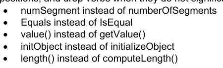

UML 命名范围包含: package: className , 允许在不同包中定义同类名。 然而, 许多 UMR 工具目前不允许这样做 。 因此, 采用了更具限制性的命名惯例 :

1)虽然该型号对案件敏感,但所有类名在对案件不敏感时都应该是独有的.

2)类名应在整个模型中独有(以免给许多UML工具造成问题).

3) 包名应在整个模型中独有(出于同样的原因).

4) 应尽一切努力,消除立即提出同一概念的多类人。

1-4.13 说明

备注框用于对模型的一般或特定项目(即类别或协会)进行评论。

图1-14——示例说明

1-4.14 包件

UML 包是一个用于组合子包、类及其关联的申报的容器。 UMR 中的包结构可以使子包,类申报和关联分级。 包必须用来代表一个Schema 。

## 官方 PDF 第 44 页

图1-15——示例包结构

Schema模型中的包,类和属性可以通过有限定的名称来识别. 限定名称的形式是: name1::name2:::nname3 其中名1是最外层包的名称,名2是出现在名1的命名空间内的名称,而名3是出现在取名空间内的名字. 标准UML"::"符号应作名分隔符. 这个命名空间等级的深度没有限制.

EXAMPLE 在空间示意图中有一个子包,名为几何定义一个叫GM_Object的类。这个类与角色名SSS(空间参考系统)有关联。这个关联的完全合格名称是: Space.Geometry :: GM_objecting.SRS 。

1-4.15 S-100中的模型文件

除了图外,还需要记录模型的语义。需要解释属性、关联、操作和约束的含义。这是通过上下文表进行的。每个类都定义了上下文表格;它有以下一栏:

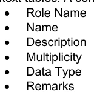

角色名栏指定此行中该类属性的描述。 可能的值为 :

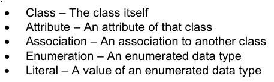

属性 – 该类协会的属性 – 与另一个类的关联 编号 – 所枚举的数据类型 literal – 所枚举数据类型的值

名称列包含属性名称。 对于关联, 这是给定类所用的角色名称。 在描述栏中, 属性的语义被给出。 多重

## 官方 PDF 第 45 页

栏中包含类中属性的发生次数。此栏中还描述了哪些属性是强制性的,哪些是可选的。“数据类型”栏中包含了属性数据类型的名称。在备注栏中,可以表示关于属性的附加信息。这包括限制或条件。 对于所列举类型的文档,不使用多功能和数据类型栏。

以下例子说明了上下文表的使用:

图1-16——上下文表格的使用

角色名称 名称描述 多重数据类型备注

A. 开展一些有益工作的专家组

```text
-
-
```

属性名称 工作组名称

```text
1
CharacterString
```

负责工作组的组织

```text
1
CI_ResponsibleParty
```

如此之多的人在世界各地旅行的原因

```text
1
CharacterString
```

协会成员 指定为团体捐款的人

1.* 个人

角色名称 名称描述 多重数据类型备注

A类人 --

属性名称 1 字符串

首字母属性Name 人物名

```text
1
CharacterString
```

属性 中间 Initial 人物的中间首字母

0.1 字符

属性日期 OffBirth 该人出生日期

1 日期

## 官方 PDF 第 46 页

协会工作组 A工作组

```text
0..*
WorkingGroup
```

角色名称 名称描述 多重数据类型备注

A类 描述个人在工作组中的成员资格

```text
-
-
```

个人在工作组中的作用

0.1 WG_Lole 普通成员没有角色

代表工作组人员所代表的组织

```text
1
CI_ResponsibleParty
```

角色名称说明

命名 WG_ Role 人们可以在工作组中扮演的角色

总理

文学副官 他最好的朋友

文秘 可怜的男人(或女人)总得在键盘上放出指头


---

# S-100 5.2.1 · 第 2 部分 · 注册簿管理

非官方机器翻译参考稿，尚未逐条人工校订。公式与代码保留原文，解释以英文规范为准。

## 官方 PDF 第 47 页

S-100 – 第2编

注册簿的管理

## 官方 PDF 第 48 页

5.2.1版实质性变动摘要

已生效的概要条款

## 官方 PDF 第 49 页

中文目录（可用上方目录直接跳转）

2-1 范围 · 官方 PDF 51
2-2 符合性 · 官方 PDF 51
2-3 规范性引用文件 · 官方 PDF 51
2-4  一般概念 · 官方 PDF 52
2-4.1 书记官处 · 官方 PDF 52
2-4.1.1 登记处所有人 · 官方 PDF 52
2-4.1.2 书记官处管理员 · 官方 PDF 52
2-4.2 注册簿 · 官方 PDF 52
2-4.2.1 国际水道测量组织地理空间信息注册簿内的注册簿 · 官方 PDF 52
2-5 注册簿管理中的角色与职责 · 官方 PDF 52
2-5.1 注册簿所有人 · 官方 PDF 52
2-5.2 注册簿管理员 · 官方 PDF 53
2-5.3 注册簿用户 · 官方 PDF 53
2-5.4 域控制体 · 官方 PDF 53
2-5.5 行政管制机构 · 官方 PDF 53
2-5.6 提交组织 · 官方 PDF 53
2-5.6.1 合格的提交组织 · 官方 PDF 53
2-5.7 提案的处理 · 官方 PDF 53
2-5.7.1 增加已登记的物项 · 官方 PDF 54
2-5.7.2 澄清已登记项目 · 官方 PDF 54
2-5.7.3 超期分发已登记物品 · 官方 PDF 54
2-5.7.4 已登记物品的退役 · 官方 PDF 54
2-6 注册簿管理员必须履行的职责 · 官方 PDF 54
2-6.1 提案的合法性 · 官方 PDF 54
2-7 提案流程 · 官方 PDF 55
2-7.1 核准程序 · 官方 PDF 56
提案的撤回 · 官方 PDF 58
2-7.1.2 上诉 · 官方 PDF 58
2-7.2 提交组织名单 · 官方 PDF 58
2-7.3 出版情况 · 官方 PDF 58
2-7.4 廉正 · 官方 PDF 59
2-8 注册簿模式 · 官方 PDF 59
2-8.1 引言 · 官方 PDF 59
2-8.2 S100_RE_注册 · 官方 PDF 61
2-8.3 S100_RE_登记项目 · 官方 PDF 61
2-8.4 S100_RE_项目现状 · 官方 PDF 62
2-8.5 S100_RE_参考来源 · 官方 PDF 63
2-8.6 S100_RE_类似来源 · 官方 PDF 63
2-8.7 S100_RE_参考文献 · 官方 PDF 64
2-8.8 S100_RE_管理信息 · 官方 PDF 64
2-8.9 S100_RE_提案类型 · 官方 PDF 65
2-8.10 S100_RE_提案现状 · 官方 PDF 65

## 官方 PDF 第 50 页

本页特意留空

## 官方 PDF 第 51 页

2-1 范围

S-100的这一部分规定了在维持和公布分配给地理、水道测量和元数据信息的独特、明确和永久识别资料注册簿时应遵循的程序,并为此目的,这一部分说明了注册簿及其注册簿的管理作用和责任。 国际海道测量组织地理空间信息登记处及其注册簿的具体行政细节载于国际海道测量组织出版物S-99。

2-2 符合性

此剖面符合ISO 19106:2004中的第二级. 以下是关于该剖面与ISO 19135:2005不同的专业和通论的简要说明.

1) S100_RE_Register限制属性替代语言的使用.

2) S100_RE_Register 项目限制属性字段Of应用和可替代Expression的使用.

3) S100_RE_注册项目将属性描述重命名为备注.

4)S100_RE_ManagementInfo是一个新类,它合并了类RE_决策状态,S100_RE_提议Type,S100_RE_附属组织,S100_RE_项目状态和Re_Disposition.

5)S100_RE_ProposalType是一个将ISO 19135类RE-Addition Information,RE-Clarification Information,RE-修正Information和RE-修正Type合并而成的新类.

2-3 规范性引用文件

ISO 19126:2009,"地理信息-地貌概念词典和注册簿".

ISO 19135:2005,"地理信息-地理信息项目登记程序".

ISO 8601:2004,数据元素和交换格式 - 信息交换 - 日期和时间的表示

IHO S-99,国际HO地理空间信息登记册的组织和管理业务程序

## 官方 PDF 第 52 页

2-4 一般概念

2-4.1 书记官处

注册簿是注册簿或注册簿系列所维持的信息系统。

2-4.1.1 登记处所有人

登记所有人有权托管注册簿并制订查阅政策,登记所有人决定是否必须在注册簿上托管拟议的注册簿。

2-4.1.2 书记官处管理员

书记官处管理员负责书记官处的日常运作,其中包括:

1) 为注册簿管理人员、管制机构和注册簿用户提供注册簿访问权;

(2) 确保用户随时可以获取与注册簿所列物品有关的资料,这些物品具有有效、无效、澄清、取代、退役或处理的性质;

3) 接受建议并转交所有注册簿管理人员;以及

4) 管理解决持续的URI识别符以获得适当资源,但只有在登记服务器上提供解析服务时才能这样做。

2-4.2 注册簿

注册簿只是管理的清单,比固定文件更容易保存,因为注册簿需要增加新的项目;注册簿中的现有项目可以澄清、替换或退役;每个注册簿项目都有一个或多个相关日期,说明其状况何时发生变化。 这意味着在特定日期界定的产品规范可在某一具体时间点参照注册簿中的某一物品。

2-4.2.1 国际水道测量组织地理空间信息注册簿内的注册簿

在国际海道测量组织地理空间信息注册簿结构内实施了下列注册簿,并在所附参考资料中全面介绍了这些注册簿:

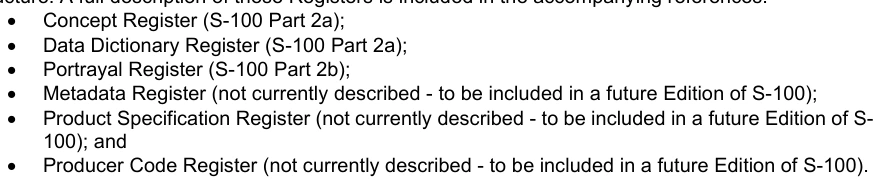

元数据注册簿(目前没有说明,将列入S-100的未来版);产品规范注册簿(现在没有说明 -- -- 将列入未来的S-生产者代码注册簿的版本)(目前没有叙述 -- -- 要列入未来的 S-100 版)。

国际海道测量组织地理信息登记处的业务和管理程序说明,进一步扩展了下列条款所描述的一般概念,载于国际海道测量组织的出版物S-99-国际水生物学组织地理空间信息登记处的组织和管理业务程序。

2-5 注册簿管理中的角色与职责

2-5.1 注册簿所有人

注册簿所有人是一个组织,它:

(1) 在注册簿内设立一个或多个注册簿;

2) 负责管理、传播和掌握这些注册簿的知识内容;

3) 可任命另一组织担任注册簿管理员;

4) 应制定程序,处理提交组织提出的建议和申诉。

## 官方 PDF 第 53 页

2-5.2 注册簿管理员

注册簿管理员负责管理注册簿,其中包括:

(1) 与其他注册簿管理人员、提交组织、相关管制机构、注册簿所有人和注册簿管理人进行协调;

(2) 在注册簿内保存各种物项;

3) 维持和公布提交组织名单;

4) 分发包含注册簿说明和如何提交提案的整套资料;

5) 向注册簿所有人和/或管制机构提供定期报告,每份报告应说明自上次报告以来收到的建议和作出的决定,这些报告之间的间隔不得超过12个月。

注册簿管理员可以管理多个注册簿。

2-5.3 注册簿用户

注册簿用户是有意访问或确定注册簿内容的任何人或组织。

2-5.4 域控制体

注册簿领域管制机构是由注册簿所有人任命的技术专家组,负责决定修改注册簿内容的建议是否可以接受,该小组必须由构成注册簿内容的相关领域的专家组成,因此,注册簿领域管理局由每个领域至少一名代表组成,协助注册簿内容。

2-5.5 行政管制机构

行政管制机构必须由注册簿内每个领域的代表组成,欧洲中央银行将监测注册簿管理人并提供咨询意见,并充当注册簿程序的任何决定或争端的仲裁人,如果无法达成解决办法,欧洲央行可要求国际水道测量服务和标准委员会(水道测量委员会)作出决定。

2-5.6 提交组织

2-5.6.1 合格的提交组织

提交组织是指按照注册簿所有人确定的标准有资格提议修改注册簿内容的组织,注册簿管理人必须确定提交组织是否符合注册簿所有人制定的标准。 经核准的提交组织应至少有一名代表被任命代表其向注册簿提交提案(可同注册簿管理人协商任命多个提交组织的代表)。

2-5.7 提案的处理

提交申请的组织可提出增补、澄清、补会和注销已登记项目的请求。

## 官方 PDF 第 54 页

2-5.7.1 增加已登记的物项

增列是将一个新项目列入注册簿,说明一个概念,即注册簿中已经存在的有效或处理项目没有充分描述。

2-5.7.2 澄清已登记项目

澄清更正了拼写、标注、语法或内容或措辞的改进等错误,澄清不得导致对登记项目的任何实质性语义改动,可以澄清的三个特征是定义、其他参考和说明。

2-5.7.3 超期分发已登记物品

超会是指任何可能导致实质性地语义改变现有有效项目的提案,例如更改某一项目的名称或其骆驼目识别标志;或改变《显示注册簿》中某一项目的形象。 原项目应保留在注册簿中,但必须注明其被取代的日期并注明被取代的项目。

2-5.7.4 已登记物品的退役

退休应受到下列因素的影响:将物品留在注册簿;在物品上标出其退役;以及包括退休日期。

2-6 注册簿管理员必须履行的职责

1) 接收本组织代表提出的建议;

(2) 审查完整性建议;

3) 如果提案不完全,则将提案退回提交组织的代表;

4) 在注册簿内核实类似的建议;如果类似,注册簿管理人应同提交组织代表联系;

5) 在收到提案后两个日历周内与其他注册簿管理人员协调;

6) 产生一份建议书管理记录,其地位定为 " 转让 " ;

7) 启动批准程序。

2-6.1 提案的合法性

注册簿管理人必须采用下列标准确定该建议书是否完整,并在下列情况下否决该建议书:

(1) 提交者不是合格的提交组织代表;

(2) 拟议物项不属于分配给该注册簿管理人的物项类别;

3) 拟议项目不属于注册簿的范围;或

(4) 拟议项目已经提出。

## 官方 PDF 第 55 页

2-7 提案流程

图2-1-提议程序-概念注册簿

## 官方 PDF 第 56 页

图2-2 – 提案过程 – 数据词典注册簿

2-7.1 核准程序

上文图2-1和图2-2说明了确定投标书可接受性的程序,必须按S-99的规定,在注册簿所有人规定的期限内完成。

注册簿管理员应确保:

(1) 如果提议澄清或留存注册簿项目,将项目现状定为“处理”;并将提议转交注册簿领域管制机构;或

## 官方 PDF 第 57 页

(2) 如果提议登记新项目或登记现有项目:a) 向新项目和替代项目指定项目标识符;b) 将项目现状定为“处理”项目;c) 将该提议转交注册簿域管制机构。

注册簿域管制机构应:

(1) 决定不加修改地接受提案;接受提案,但须与提交组织谈判作出修改;或不接受提案。

(a) 有关物项的规格不完整或无法理解;

(c) 拟议项目不属于注册簿所列项目类别; (d) 拟议物项不属于本注册簿的范围;或 (e) 提议的理由不充分。

(2) 根据S-99,在注册簿所有人规定的时限内,将决定和决定的理由通知注册簿管理人。

注册簿管理员应:

(1) 如果提交组织与注册簿域管制机构之间需要就域管制机构的指定作为接受条件的提案的修改进行谈判,则充当联络点;

(2) 将处理提案的结果通知提交组织的代表。

如果注册簿领域管制机构的决定是肯定的,注册簿管理人应根据注册簿的政策:

1) 完成提案管理记录,将提案现状定为“接受”;并修正日期为域管制机构作出决定之日;

(2) 对注册簿项目的内容作出经核准的修改;和

3) 将注册簿项目状态设为“有效”项目。对于超会或退休提案,被替换或退休项目的状况酌情设为“超会”或“退休”。

如果注册簿域管制机构的决定是否定的,注册簿管理人应:

(1) 更新建议书管理记录,规定建议书的状况为`被拒';修改日期为域管制机构作出决定之日;以及

(2) 向提交组织通报对域管制机构的决定提出上诉的截止日期。

提交组织代表应:

(1) 与注册簿域管制机构谈判,就域管制机构规定接受的条件对其提案的修改;

(2) 在各自提交组织的社区或组织内,公布注册簿管理员向其转递的域管制机构就提案作出的决定。

注册簿管理员应:

1) 向公众传播审批结果。

## 官方 PDF 第 58 页

提案的撤回

提交组织代表可在核准过程中的任何时候决定撤回一项提案。

注册簿管理员应:

(1) 将提案管理记录提案从“尚未确定”改为“撤回”。

2-7.1.2 上诉

提交申请的组织代表如果不同意注册簿域管制机构的决定,可向注册簿执行管制机构提出申诉,拒绝关于注册簿中某一物品的增列、澄清、超期存放或留存的建议,申诉应至少说明情况;申诉的理由;如果申诉不成功,应说明影响。 如上文图2-1和图2-2所示,上诉程序已纳入总体提案进程。

提交组织应:

(1) 确定关于登记提案的决定是否可以接受;和

2) 如果不是,则向注册簿管理员提出上诉。

注册簿管理员应:

1) 将上诉转交注册簿执行管制机构。

注册簿执行管制机构应:

(1) 按照既定程序处理上诉;

(2) 决定接受或驳回上诉;

3) 将结果退还注册簿管理员。

注册簿管理员应:

1) 更新提案管理记录栏的提案现状和修正日期;

2) 更新注册簿项目的现状;

(3) 向注册簿领域管制机构和提交组织代表提供该决定的结果。

提交组织的代表应:

1) 在其提交组织社区或组织内公布呼吁的结果。

2-7.2 提交组织名单

注册簿管理员应保持并公布一份注册簿专有名单,列出所有有资格提交组织,这些组织可就其管理的每一注册簿的内容提出修改建议;每一名单必须包括每个提交组织代表的姓名和联系资料;注册簿应载有成为提交组织的申请。 登记所有人将负责接受或拒绝申请。

2-7.3 出版情况

注册簿管理员应确保用户随时可以获取注册簿中有效、澄清、替换或已取出的物品的信息,提供这种信息的方法可能取决于用户界成员的要求。

## 官方 PDF 第 59 页

2-7.4 廉正

注册簿管理员应确保,对所管理的每个注册簿:

(1) 登记过程的所有方面都按照良好的商业做法处理;(2) 注册簿的内容准确;(3) 只有经授权的人才能修改注册簿的内容。

书记官处管理人应利用信息技术最佳做法,确保书记官处的安全和完整。

2-8 注册簿模式

2-8.1 引言

本条款规定的计划描述了国际海道测量组织地理空间信息注册簿的结构。

关于注册簿和注册簿中物品的资料必须为:

1) 通过注册簿的联机接口可以访问;2)注册簿的任何副本都包括在内;3)注册簿的任何资料包都包括在内。

图2-3 - 注册簿计划

## 官方 PDF 第 60 页

本页特意留空

## 官方 PDF 第 61 页

```text
2-8.2 S100_RE_Register
```

S-100_RE_登记簿专门列出关于注册簿本身的资料。

角色名称 名称描述 穆特 数据类型 注释

S100_RE 类登记 - -

属性名称 注册簿名称 1 字符排序 注册簿内的独特性

属性操作语言 本注册簿使用的语言 1 RE_ Locale

属性内容 内容摘要 1 字符串

互联网上注册簿接口的链接

```text
1
CI_OnlineResource
```

上次更改登记日期

1 日期

登记项目 登记项目 0.* S100_RE_登记项目

```text
2-8.3 S100_RE_RegisterItem
```

S100_RE_Register项目类别带有所有类型已登记项目的共同特性。特定域扩展可以添加在S-100的适当部分;例如,第2a部分-概念和数据词典注册簿。

角色名称 名称描述 穆特 数据类型 注释

S100_RE 类 _ 注册项目 - - 类是抽象的

属性项目标识符 每一个项目在注册簿中都有自己的独有标识符

1 整数

属性名称 : 它表示的项目概念的 Succinct 表达式

```text
1
CharacterString
```

属性定义应准确说明项目实现的概念的性质、性质、范围或基本品质。

0.1 概念、数据词典、外观和元数据注册簿的字符串

属性注释 补充信息 0.1字符串

属性项目现状 注册项目的存在状态

```text
1
S100_RE_ItemStatus
```

属性别名,用于项目 0. * 字符串

使用骆驼标记来识别此项的 Case

```text
0..1
CharacterString
```

## 官方 PDF 第 62 页

角色名称 名称描述 穆特 数据类型 注释

属性定义来源 定义的来源 0.1 字符串

属性参考 定义中位置的标识符

```text
0..1
CharacterString
```

属性相似度 To Source 定义相对于定义的更改类型,因为它存在于定义源中

```text
0..1
CharacterString
```

提议的主要理由,包括提议如何使用

0.1 从S-100_RE_管理Info中继承的字符

拟议修改的案文 0.1 字符顺序继承自S-100_RE_管理Info

协会登记包含项目1的注册簿S100_RE_注册

关联参考源 源信息 项定义取自.

```text
0..1
S100_RE_ReferenceSourc
e
```

参考其他相关标准或文件

0.* S100_RE_参考例如INT1或M4

说明注册簿中物品管理情况的成套资料

```text
1..*
S100_RE_ManagementInf
o
```

```text
The camelCase must:
```

1)为复合词,将单词无空格地相接,并在复合词中被资本化.

(2) 在书记官处内是独一无二的。

3) 与UTF-8字符编码相容(参考ISO/IEC 10646),有大写字符A-Z,小写字符A-z和数字为0-9.

4)概念必须从小写a-z开始.

例 1 信标 Cardinal 是 Camel 概念的标志

例 2 类 OffLandmark 是 Camel 概念的标识符 类 Landmark

```text
2-8.4 S100_RE_ItemStatus
```

点名S100_RE_项目现状说明注册簿项目的登记情况。

项目名称说明

```text
Enumeration
S100_RE_ItemStaus
```

## 官方 PDF 第 63 页

物品已输入注册簿,但域管制机构正在评估提案。

该物品已被接受,建议使用,没有被替换或退役。

项目已被一个或多个项目所取代,不再建议使用

物品已输入注册簿,但域管制机构没有接受添加该物品的提议。

已决定不再建议使用该物品,但又没有被另一物品所取代。

已澄清项目,不再建议使用

```text
2-8.5 S100_RE_ReferenceSource
```

S-100_RE_ReferenceSource 分类具体说明了从外部文件或注册簿取自的关于注册簿项目来源的信息。

角色名称 名称描述 穆特 数据类型 注释

类 S100_RE_参考来源 - -

引用源文档中位置的标识符

```text
0..1
CharacterString
```

属性源文档 源文档 1 CI_ Citation

属性相似性 表示定义与源文档的关系

```text
1
S100_RE_SimilarityToSou
rce
```

```text
2-8.6 S100_RE_SimilarityToSource
```

引用 S100_RE_同源(Simularity To Source) 表示相对于外部来源中的项目规格对项目规格所做的更改类型.

项目名称说明

```text
Enumeration
S100_RE_SimilarityToSou
rce
```

## 官方 PDF 第 64 页

项目名称说明

字面上完全相同,对定义未作修改

定义的样式已经改变,以与输入定义的注册簿中其他定义的样式和结构相匹配

定义包括外部来源的规格中没有明确的关于上下文的信息

登记项目的定义被概括为具有比外部来源中指定的项目更广泛的意义

注册簿项目的定义是专门界定的,其含义比外部来源所指明的项目更为狭窄。

未具体说明注册簿项目与外部来源类似项目之间的差异的性质

```text
2-8.7 S100_RE_Reference
```

S-100_RE_Reference 类别具体规定了外部文件或注册簿中某一登记项目的来源和(或)分界线的信息。

角色名称 名称描述 穆特 数据类型 注释

S100_RE级_参考 --

引用源文档中位置的标识符

```text
0..1
CharacterString
```

属性源文档 源文档 1 CI_ Citation

```text
2-8.8 S100_RE_ManagementInfo
```

S100_RE_ManagementInfo 类指定了注册项的管理记录。

角色名称 名称描述 穆特 数据类型 注释

```text
Class
S100_RE_ManagementInfo
```

```text
-
-
```

属性提案类型 1 S100_RE_提案提案类型

提案的提案国 1 字符串

描述拟议修改的案文 1 字符串

## 官方 PDF 第 65 页

角色名称 名称描述 穆特 数据类型 注释

提议的主要理由,包括提议如何使用

```text
1
CharacterString
```

接受建议日期被接受

建议提出日期 1

修改后的提案裁定日期 1

说明关于增列或修改注册簿项目的提案的处理情况

```text
1
RE_ProposalStatus
```

属性控制 BodyNots 补充管理信息 0.* 字符串

```text
2-8.9 S100_RE_ProposalType
```

S100_RE_提议Type物种的登记项目提案类型。

项目名称说明

```text
Enumeration
S100_RE_ProposalType
```

增列字数 增列入注册簿

对注册簿中某一物品的无实质性改动

字面超会 本项被另一个项所取代,不再建议使用.

已决定不再建议使用该物品,但并未被另一物品所取代。

```text
2-8.10 S100_RE_ProposalStatus
```

S100_RE_提议状态清单规定了关于增加或更改登记项目的提案的处理情况。

项目名称说明

```text
Enumeration
S100_RE_ProposalStatus
```

提交组织已提交提案

注册簿管理员请域管制机构审查该提议。

## 官方 PDF 第 66 页

项目名称说明

注册簿管理员已请提交组织补充提议

字面上接受 控制机构接受这个提议

字面上拒绝了 控制机构没有接受这个提议

提交组织已撤回提案

域管制机构已请提交组织对提案作补充

提交组织已提出上诉

登记管理员已将上诉转交行政管制机构。

行政管制机构已接受上诉。

上诉被驳回 行政管制机构不接受上诉


---

# S-100 5.2.1 · 第 2a 部分 · 概念与数据字典注册簿

非官方机器翻译参考稿，尚未逐条人工校订。公式与代码保留原文，解释以英文规范为准。

## 官方 PDF 第 67 页

S-100 – 第2编a

概念与数据字典注册簿

## 官方 PDF 第 68 页

5.2.1版实质性变动摘要

已生效的概要条款

从规范引用中删除了 URL 链接. 2a-2

为属性 S100_CD_属性ValueType 添加了 URI 、 URL 和 URN 的值备注; 添加了缺少的值文件URI 。

```text
2a-4.2.9
```

澄清了S100_CD_属性约束类的属性精确度描述和注释,以描述该精确度指定了小数位数位后位数右后方的位数.

```text
2a-4.2.10
```

## 官方 PDF 第 69 页

中文目录（可用上方目录直接跳转）

2a-1 范围 · 官方 PDF 71
2a-1.1 符合性 · 官方 PDF 71
2a-2 规范性引用文件 · 官方 PDF 71
2a-3 一般概念 · 官方 PDF 72
2a-3.1 注册簿 · 官方 PDF 72
2a-3.2 与ISO登记和要素概念词典模型的关系 · 官方 PDF 72
2a-3.3 概念注册簿 · 官方 PDF 73
2a-3.4 数据词典注册簿 · 官方 PDF 73
2a-3.5 要素目录 · 官方 PDF 74
2a-4 IHO 概念与数据字典注册簿 · 官方 PDF 74
2a-4.1 已登记的物项细目 · 官方 PDF 74
2a-4.1.1 国际水道测量组织概念注册簿 · 官方 PDF 74
2a-4.1.2 国际海道测量组织数据词典注册簿 · 官方 PDF 74
2a-4.2 国际海道测量组织概念和数据词典注册簿的数据模型 · 官方 PDF 75
2a-4.2.1 UML 型号 · 官方 PDF 75
2a-4.2.2 S100_RE_注册 · 官方 PDF 77
2a-4.2.3 S100_CD_登记项目 · 官方 PDF 77
2a-4.2.4 S100_CD-Feature (中文(简体) ). · 官方 PDF 77
2a-4.2.5 S100_CD_FeatureUservationType 互联网档案馆的存檔,存档日期2013-12-20. · 官方 PDF 77
2a-4.2.6 S100_CD_属性 · 官方 PDF 78
2a-4.2.7 S100_CD_简单属性 · 官方 PDF 78
2a-4.2.8 S100_CD ⁇ 规格 · 官方 PDF 78
2a-4.2.9 S100_CD_属性值 · 官方 PDF 80
2a-4.2.10 S100_CD_属性约束 · 官方 PDF 80
2a-4.2.11 S100_CD_复杂属性 · 官方 PDF 81
2a-4.2.12 S100_CD_属性使用 · 官方 PDF 81
2a-4.2.13 S100_CD_已实现的数值 · 官方 PDF 81
2a-4.2.14 S100_CD_资讯 · 官方 PDF 82
2a-4.2.15 S100_概念 · 官方 PDF 82
附录2a - A · 官方 PDF 83
复杂属性示例（资料性） · 官方 PDF 83

## 官方 PDF 第 70 页

本页特意留空

## 官方 PDF 第 71 页

2a-1 范围

国际海道测量组织地理空间信息登记处载有一些注册簿,其中一些是根据概念注册簿的内容编制的,概念注册簿规定了可用于描述地理或元数据信息的水道测量核心概念信息(定义、骆驼Case等)。 利用注册簿储存水道测量定义大大提高了国际海道测量组织管理和扩展基于S-100的多产品的能力,这些产品可以在较短的时间内提供使用,因此注册簿支持更广泛地使用已登记项目,公开提供这些产品;并提高潜在用户的能见度。 概念注册簿是将所有已登记的概念作为“无国家”概念加以储存和管理的主要资源(即没有指定某一种类的物品,也没有界定概念对注册簿内其他概念的约束力)。 每个概念应作为单一实例列入注册簿,并将用作数据词典注册簿和Meta数据注册簿概念的推导和取自的共同来源,用于模拟要素、属性等,供S-100产品规范使用。

数据词典注册簿扩展了概念注册簿所储存的概念,包括了在注册簿内各独立域中装订物品类型和要素的指定,从而使S-100产品规范开发者能够开发出它们的数据模型,以最适合其代表现实世界的具体要求。

这一部分介绍概念和数据词典注册簿的内容,并具体说明在建立、维持和出版分配给地理、水道测量和元数据信息项目的独特、明确和永久识别资料注册簿时应遵循的程序。 为了达到这一目的,本部分具体规定了为登记项目提供识别和定义所必要的信息要素。

2a-1.1 符合性

这个剖面符合ISO 19106:2004中的相容性第2类. 以下是对剖面与ISO 19126:2008不同专业和通称的简要说明.

1) 引入了新类,S100_CD_Information.

2)新班,S100_CD_Feature和S100_CD_Information被引入.

3)引入了新类,S100_CD_属性约束.

4) 类FC_FeatureAttize是专为抽象类S100_CD_Attize.

5) 引入了新类,S100_CD_SimpleAttize和S100_CD_ComplexAttize.

6)类 CD_继承关系,CD_Feature Operation CD_Binding,CD_Control和CD_BoundFeatureAttroduction 不使用.

2a-2 规范性引用文件

本文件的应用需要下列参考文件:关于注明日期的参考文件,仅适用所引用的版本;关于未注明日期的文件,适用所参考文件的最新版本(包括修正案)。

ISO 19135:2005,"地理信息-地理信息项目登记程序".

ISO 19126:2009,"地理信息-地貌概念词典和注册簿".

ISO 8601:2004, 数据元素和交换格式 - 信息交换 - 日期和时间的表示

ISO/IEC 10646:2017,"信息技术-通用编码字符集"(UCS)

RFC 3986,统一资源识别符(URI):通用语法. T. Berners-Lee, R.Fielding, L. Masinter. Internet Standard 66, IETF.

RFC 2141,URN语法. R. Moats. IETF RFC 2141,1997年5月.

## 官方 PDF 第 72 页

W3C XML Schema 第2部分:数据类型 第2版,附录 F正则表达式.

2a-3 一般概念

2a-3.1 注册簿

如第二部分所述,注册簿只是管理下的清单,比固定文件更容易保存,因为注册簿需要增加新项目,注册簿中的现有项目可以澄清、替换或取出,每个注册簿项目都有一个或多个相关日期,说明其状况何时发生变化。 这意味着,在特定日期界定的产品规范可在特定时间点参照注册簿中的某一物品。

2a-3.2 与ISO登记和要素概念词典模型的关系

ISO 19126和ISO 19135类型在IHO GI注册中的实现情况如下图2a-1所示,该图描绘了ISO类型(有灰色背景的元素);已实施的S-100注册模型类(有棕色背景的条目);以及包含IHOC GI登记的两个注册项目(有白色背景的文档). 注册簿本身是在国际海道测量组织GI注册簿网站的不同部分内实施的,每个网站都可通过网站导航菜单访问。

ISO类型"Feature Conference Dyctionary"包含要素和属性类型的定义,被作为"数据词典"在IHO GI注册(图2a-1中的S100_DataDictionary Register)中被执行. 数据词典注册簿载有要素、信息类型、属性(包括简单和复杂)的定义,以及枚举的用于点数和S-100_代码列表属性的数值(见S- 100 Part 1, 第1-4.7和1-4.8条)。

国际海道测量组织全球倡议注册簿还实施“概念注册簿”(S100_ConceptRegister in 图2a-1),可理解为一种术语词汇表,其中包含定义和来源,概念注册簿中的个人条目由S100-Conference类别代表,概念登记与数据词典注册簿分开。 然而,数据词典注册簿条目取自概念注册簿条目,第2a-3.3和2a-4.1.1条对概念注册簿作了进一步说明。

协会和角色的注册簿目前没有在IHO GI注册簿内实施,因此相应的ISO类型没有包括在图2a-1中,此外,IHOC GI书记官处还包括了额外的注册簿(用于显示,出品人代码,产品规范和元数据),这些没有在图2 a-1中显示.

## 官方 PDF 第 73 页

图2a-1 – S-100登记类别与ISO 19126/ISO 19135型号的关系

2a-3.3 概念注册簿

概念注册簿规定了可用于描述地理、水道测量和元数据信息的独特、独立的概念定义。这些概念在概念注册簿中登记,然后可以在数据词典或Meta数据注册簿中使用,以制定一个要素目录。 与数据词典注册簿不同,概念注册簿不规定关联;也不界定概念的类型或与其他概念的约束。 从这个角度看,概念登记处登记的项目基本上是“无清单的”,这允许灵活地使用概念进行适当的数据建模,以满足产品规范的要求。

此类地理空间信息注册簿可作为其他地理信息界作为相互参照系统的一部分而建立的类似注册簿的参考来源。

2a-3.4 数据词典注册簿

数据词典注册簿规定了可用于描述地理、水道测量和元数据信息的要素、属性、所列举的数值和信息类型等独立定义。 数据词典可以用来指定概念注册簿中定义的某一项目的类型(例如特性、属性和列举值);并定义推荐的关联和属性/要素约束,以利开发要素目录。概念注册簿中的物项只能在数据词法典注册簿中针对每个类型登记一次,以支持互操作性。

## 官方 PDF 第 74 页

这种地理空间信息数据词典可作为其他地理信息社区作为交叉参考系统的一部分而建立的类似数据词词典或注册簿的参考来源。

2a-3.5 要素目录

要素目录是描述数据产品内容的文档,它使用一个或多个数据词典中的项目类型,例如特性和属性,将它们绑在一起,此外,还可以指定属性的计量单位和格式描述. 特性分类在S-100 第5部分中详细描述.

2a-4 IHO 概念与数据字典注册簿

2a-4.1 已登记的物项细目

2a-4.1.1 国际水道测量组织概念注册簿

以下是概念注册簿中用以描述和管理水道测量、海洋和元数据信息的详细信息:

1) 项目名称

(2) 项目标识符

3) 项目状况

4) 别名

(5) 骆驼案

6) 定义

7) 定义来源

8) 定义

9) 与来源的相近性

10) 备注

11) 提案类型

12) 继承人.

13) 预处理器

14) 提交组织

15) 拟议日期

16) 接受日期

17) 修正日期

18) 拟议变动

19) 理由说明

这些细节取自S-100_RE_登记项目和S-100_RE_管理信息(见下文条款2a-4.2和第二部分条款2-8.3和2-8.8)。

2a-4.1.2 国际海道测量组织数据词典注册簿

以下为概念注册簿中可登记在数据词典注册簿中的物品类型:

1) 要素 – 取自现实世界现象.

2) 属性 – 要素概念的要素.

## 官方 PDF 第 75 页

3) 假设价值 – 构成属性范畴的一组相互排斥的价值之一.

4)信息 – 一个可识别的对象,包含属性,关联到其他信息概念,但没有空间信息.

5) 代码列表 — 一个开放式的列表,或者一个词汇的标识符(介于代码,标签和定义之间的映射).

2a-4.2 国际海道测量组织概念和数据词典注册簿的数据模型

2a-4.2.1 UML 型号

下图显示了IHO概念和数据词典注册簿的UML信息模型:

图 2a-2 — IHO 概念与数据字典注册簿

## 官方 PDF 第 76 页

本页特意留空

## 官方 PDF 第 77 页

```text
2a-4.2.2
S100_RE_Register
```

S-100 Part 2 第2-8.2条载有S-100 Part 2第2至8.2条,详细内容见S-100第2部分第2至8节。

```text
2a-4.2.3
S100_CD_RegisterItem
```

S100_CD_注册项目是S100_RE_注册项目的专有项目,具有第2a-4.1.1.条所列所有类型注册项目的共同特征,该类被包括在模式中,以与第2b部分保持一致,其中类似扩展(S100-PR_注册的项目)定义了额外的属性.

角色名称 名称描述 :

类 S100_CD_注册项目扩展 S100_RE_注册项目 - - 摘要类

```text
2a-4.2.4
S100_CD_Feature
```

此类取自 S100_RE_Register 项目通过中间超类。 它定义了以下附加属性 :

角色名称 名称描述 :

数据词典中的 Class S100_CD_Feature A 要素类型 - 从 S100_概念中衍生出来的

属性特性 UseType 特性类型 1 S100_CD_ FeatureUseType 的预定用途

协会作用

引用此特性类型与

```text
0..*
S100_CD_Feature
```

关联概念参考 S100_Concept as the base class 1 S100_Concept Notes 属性骆驼Case是该类的强制.

```text
2a-4.2.5
S100_CD_FeatureUseType
```

项目名称说明

编号 S100_CD_ FeatureUse Type 特性类型

文字地理具有真实世界实体的描述性特征

与包含与要素有关的信息的信息类型不同,

文字制图包含关于真实世界实体的制图表现(包括文字)的信息

主题 专题分组

## 官方 PDF 第 78 页

```text
2a-4.2.6
S100_CD_Attribute
```

属性可以是简单或复杂的。简单的属性带有特定值,如日期。复杂的属性是其他属性的组合,无论是简单还是复杂的属性。复杂的特性实例载于附录2a-A。这一类来源于S100_RE_Register Project,通过中间超类,并描述了所有属性类型的共同特征。

角色名称 名称描述 :

S100_CD类 数据词典中所有属性类型的属性基类 - 从S100_概念中衍生出来

关联概念参考 S100_Concept as the base class 1 S100_Concept Notes 属性骆驼Case是该类的强制.

```text
2a-4.2.7
S100_CD_SimpleAttribute
```

角色名称 名称描述 :

S100_CD 类 数据词典中的简单属性类型 - 从S100_CD_属性中衍生出来

属性值 说明值的表示、解释和结构

1 S100_CD_属性值

具体数量,如长度、体积、深度、重量等

```text
0..1
S100_CD_QuantitySpecification
```

属性类型0.1 S100_CD_属性约束的关联约束必须与数据Type一致 如果值Type是S100_代码列表,则必须完全真实的有以下之一: 1.

1) 有一个相关的S100_RE_Reference 与一个词典的命名空间,列在IHO GI注册.

2) 属性至少有一个S100_CD_EncumentedValue相关.

条件1为“开放式词典”或“封闭词典”,提供了“开放式取出”类型编码清单的所枚举值。

```text
2a-4.2.8
S100_CD_QuantitySpecification
```

项目名称说明

数量计量类型

角移随时间变化的瞬间速率

从ISO 19103

## 官方 PDF 第 79 页

项目名称说明

任何二维几何物体物理范围的测量

从ISO 19103

单位体积的字形密度;单位面积的数;又:特重力(S-32). 声调密度是同线声调和声调的行距(S-32).

“敏感性”可以在不同意义上使用,计量单位和属性定义必须明确说明意图是什么。

时间间隔

单位时间的振动或周期数 IHO S-32

物体最长的维度; 沿线或曲线测量的相距

物体惯性值的数值度量;物体所包含物质的数量,而不论其批量或体积如何

平面 平平面 一般用弧度或度测量的使一行或一平面与一平平相巧合所需的旋转量

从 ISO 19103 “相干”

工作或转移能的活性能率;放大S-32 指“放大能:光学仪器所见线性维度的明显长度与无辅助眼所见的长度之比”。

单位面积的单位压力

盐分盐分量 测量溶解盐量 IHO S-32(缩略语)

平时位置变化的平时速度 Rte 通常使用简单的公式计算, 在一个特定时间间隔中位置的变化。 速度是一个平时物理量, 有等分量, 但没有方向。 与“ 速度” 相抗, 它是一个既有等分也有方向的矢量量 。 ( 由 ISO 19103 “ 速度 ” 缩写)

温度 热度或程度 IHO S-32

任意三维几何天体物理空间的测量

从ISO 19103

物体因重力而经历的力

数量与本项清单中其他单数不同的数量

## 官方 PDF 第 80 页

```text
2a-4.2.9
S100_CD_AttributeValueType
```

项目名称说明

简单属性的数值类型 S100_CD_属性变量

字形布尔真假

可扩展和订约的预定值清单

含有定义范围、单位和格式的数值

实际浮点数

文字文本 A 字符序列

字符编码必须遵循ISO 8601规定的日期格式

字符编码必须遵循ISO 8601规定的时间格式

文字日期 时间字符编码必须遵循ISO 8601规定的日期和时间格式

字面URI字符编码必须遵循RFC 3986规定的URI格式

通用形式的 URI; 允许编码任何形式的 URI

文字 URL 字符编码必须遵循 RFC 3986 指定的 URL 格式

URL是一个URI类(RFC 3986).

字面URN字符编码必须遵循RFC 2141所定义的URN格式

URN是一个URI类(RFC 3986).

字面文件URI 字符编码必须遵循 RFC 8089 定义的文件URI 格式

fileURI是URI类(RFC 3986)下的一种URI类型.

词汇表的字面S100_代码列表 开放目录或条目标识符

S100_Truncted Date 日期的缩略语格式

```text
2a-4.2.10 S100_CD_AttributeConstraints
```

角色名称 名称描述 :

类 S100_CD_属性约束 简单属性的制约 - -

属性字符串Length应作为正整数( 即大于零) 表示, 该整数指定可指派给

```text
0..1
PositiveInteger
```

## 官方 PDF 第 81 页

文本属性类型。如果未指定,则文本长度将不受限制

属性文本 Pattern A字符串, 它指定了对可指定属性的文本值结构的一种或多种限制的方案。 需要使用正则表达式来实现 。 W3C XML Schema Part2: Datasets Second Edition, 附录 F (Regular Expressions) 用于定义本标准中的文本模式

```text
0..1
CharacterString
```

属性范围 指定允许的数字值范围 . 1 S100_ 数值范围

属性精度指定小数点右侧的最大位数

0.1 非负数集成器,又称分数分数或小数位数

```text
2a-4.2.11 S100_CD_ComplexAttribute
```

角色名称 名称描述 :

类 S100_ CD_ 复杂属性 数据词典中的复杂属性类型 - - 从 S100_ CD_ 属性中衍生出来

关联子属性 引用子属性 1.. * S100_CD_属性特征由S100_CD_属性Usage定义

```text
2a-4.2.12 S100_CD_AttributeUsage
```

此类指定了复杂属性类型与其子属性之间关联的特征.

角色名称 名称描述 :

```text
Class
S100_CD_AttributeUsage
```

复杂属性与其子属性之间关联的特征

```text
-
-
```

属性多倍性 子属性的发生次数 1 S100_多相性

属性顺序布尔值,表示复杂属性的子属性是否处于特定顺序

1 布尔 它仅适用于子属性的多值 > 1

```text
2a-4.2.13 S100_CD_EnumeratedValue
```

此类由S100_RE_Register Project通过中间超类产生,并描述所列举的数值类型的特性.

## 官方 PDF 第 82 页

角色名称 名称描述 :

S100_CD 类 数据词典中已列出的数值类型的假设值特征

```text
-
-
```

属性数code 指定域内唯一值的正整数

```text
1
PositiveInteger
```

关联属性指定此属性类型项目为域值

1 S100_CD_Simplication 只在S100_CD类属性值 Type = 引用或S100_代码列表时才适用

关联概念参考文献 S100_概念为基础类 1 S100_概念

```text
2a-4.2.14 S100_CD_Information
```

角色名称 名称描述 :

S100_CD_数据词典中信息类型特征

```text
-
-
```

关联区分 类似信息类型与0. * S100_CD_Information

关联概念参考 S100_Concept as the base class 1 S100_Concept Notes 属性骆驼Case是该类的强制.

```text
2a-4.2.15 S100_Concept
```

S-100-概念类别确定了概念注册簿所需的资料,详见第2a-3.3条。

角色名称 名称描述 :

S100类_ 接受自然界的物体、信息或现象的定义

```text
-
-
```

## 官方 PDF 第 83 页

附录2a — 复杂属性的示例

注:以下示例并不反映任何S-100产品规范中的灯光建模。

光可能有多个扇区,它们都具有相同的光特性和相序,其他常见的属性有高高和名.

在复杂属性中描述一个扇区的所有属性都是结构化的"光扇区".

“光线韵律”的复杂属性也得到界定。

“光部门”中使用的简单属性是:

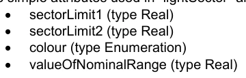

因此,复杂的属性是:

特征值

名称 :

定义 A 扇区是从中心到环线所划出的两个正线之间的圆圈部分。 (高级学习者词典, 第2版)。

备注n/a

```text
camelCase
lightSector
```

别名 LITSEC

子属性绑定

caamCase 识别符 相继多

```text
sectorLimit1
1
n/a
```

```text
sectorLimit2
1
n/a
```

颜色 1 不详

注:复数和序数在复数和子属性之间的属性中。

“光之韵律”包括:

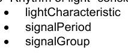

特征值

名称: 光线韵律

定义

备注n/a

```text
camelCase
rhythmOfLight
```

别名RHYLGT

子属性绑定

骆驼Case 识别器复数相继

```text
lightCharacteristic
1
n/a
```

## 官方 PDF 第 84 页

```text
signalPeriod
0..1
n/a
```

信号组0.1 n/a 描述光节的第二种方式是“信号序列”,因为它是用S-57 SIGSEQ属性来做的。信号序列由信号在开或关(这里是光或日蚀)的间隔组成。

特征值

名称 : 信号序列间隔

定义 tbd。

备注n/a

```text
camelCase
signalSequenceInterval
```

别名 SGSQIN

子属性绑定

骆驼Case 识别器复数相继

```text
signalStatus
1
n/a
```

持续时间 1 n/a 信号序列只是这些间隔的顺序列表。

特征值

名称信号序列

为所有“光的特性”确定由光和日食间隔占用的时间顺序(取自S-57版3.1,附录A-第二章,第2.191页,2000年11月)。

备注n/a

```text
camelCase
signalSequence
```

别名SIGSEQ

子属性绑定

caamCase 识别符 相继多

信号序列Interval 1.. * True A光线物体现在包括:

灯:

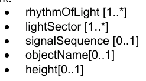

这一定义将列入要素目录,尽管属性的定义取自概念注册簿。


---

# S-100 5.2.1 · 第 2b 部分 · 显示注册簿模型

非官方机器翻译参考稿，尚未逐条人工校订。公式与代码保留原文，解释以英文规范为准。

## 官方 PDF 第 85 页

S-100 – 第2编b

显示注册簿

## 官方 PDF 第 86 页

5.2.1版实质性变动摘要

已生效的概要条款

## 官方 PDF 第 87 页

中文目录（可用上方目录直接跳转）

2b-1 范围 · 官方 PDF 89
2b-1.1 符合性 · 官方 PDF 89
2b-2 规范性引用文件 · 官方 PDF 89
2b-3  一般概念 · 官方 PDF 90
2b-3.1 注册簿 · 官方 PDF 90
2b-3.2 显示注册簿 · 官方 PDF 90
2b-3.3 显示目录 · 官方 PDF 90
2b-4 IHO 显示注册簿 · 官方 PDF 90
2b-4.1 已登记物品的类型 · 官方 PDF 90
2b-4.2 显示注册簿的数据模型 · 官方 PDF 91
2b-4.2.1 UML 型号 · 官方 PDF 91
2b-4.2.2 S100_PR_注册 · 官方 PDF 93
2b-4.2.3 S100_PR_注册域 · 官方 PDF 93
2b-4.2.4 S100_PR_用户 · 官方 PDF 93
2b-4.2.5 S100_PR_登记管理器 · 官方 PDF 94
2b-4.2.6 S100_PR_注册组织 · 官方 PDF 94
2b-4.2.7 S100_PR_登记许可证 · 官方 PDF 94
2b 4.2.8 S100_PR_管理信息 · 官方 PDF 95
2b-4.2.9 S100_PR_附文 · 官方 PDF 95
2b-4.2.10 S100_PR-登记项目 · 官方 PDF 95
2b-4.2.11 S100_PR_视觉项目 · 官方 PDF 96
2b-4.2.12 S100_PR-符号 · 官方 PDF 96
2b-4.2.13 S100_PR_线条斯泰尔 · 官方 PDF 96
2b-4.2.14 S100_PR_区域过滤器 · 官方 PDF 97
2b-4.2.15 S100_PR_位图 · 官方 PDF 97
2b-4.2.16 S100_PR_项目计划 · 官方 PDF 97
2b-4.2.17 S100_PR_彩色托肯 · 官方 PDF 98
2b-4.2.18 S100_PR_彩色Palette (英语). · 官方 PDF 98
2b-4.2.19 S100_PR_Palette 项目 · 官方 PDF 99
2b-4.2.20 S100_PR_DisplayMode (英语). · 官方 PDF 99
2b-4.2.21 S100_PR_维温集团Layer · 官方 PDF 99
2b-4.2.22 S100_PR_维温集团 · 官方 PDF 99
2b-4.2.23 S100_PR_演示计划 · 官方 PDF 100
2b-4.2.24 S100_PR_丰特 · 官方 PDF 100
2b-4.2.25 S100_PR_画取优先 · 官方 PDF 100
2b-4.2.26 S100_PR_文本页 · 官方 PDF 100
2b 4.2.27 S100_PR_彩色value(英语:S100_PR_Clorual Value) · 官方 PDF 101
2b-4.2.28 S100_PR_SRGB value (中文(简体) ). · 官方 PDF 101
2b-4.2.29 S100_PR_CIEVALue (中文(简体) ). · 官方 PDF 101
2b 4.2.30 S100_PR_Alert (英语). · 官方 PDF 102
2b-4.31 S100_PR_AlertInfo 互联网档案馆的存檔,存档日期2013-12-02. · 官方 PDF 102
2b-4.2.32 S100_PR_优先级 · 官方 PDF 102
2b-4.2.33 S100_PR_解析器 · 官方 PDF 103
2b 4.2.34 S100_PR_Alert 高亮度 · 官方 PDF 103
2b-4.2.35 S100_PR_国家语言标准 · 官方 PDF 104
2b-4.2.36 S100_PR_FileType（条款） · 官方 PDF 104
2b-4.2.37 S100_PR_风向 · 官方 PDF 104
2b-4.2.38 S100_PR_图像Type · 官方 PDF 104
2b-4.2.39 S100_PR_优先级 · 官方 PDF 105
2b-4.40 S100_PR_平面图 · 官方 PDF 105
2b-4.2.41 S100_PR_高清风格 · 官方 PDF 105

## 官方 PDF 第 88 页

本页特意留空

## 官方 PDF 第 89 页

2b-1 范围

国际海道测量组织地理空间信息登记处载有若干注册簿,其中之一是用于显示的;显示注册簿登记了用于构建Portranyal目录的组件;如果提供了要素目录和符合要求的数据,则从已登记组件中构建的Portaryal目录将把要素和属性转化为显示。

数据的显示独立于数据,但与数据密切相关。也就是说,数据集中的属性驱动了显示过程,但对于同一数据可能有许多不同的显示。

使用注册簿来存储图案组件可以提高国际海道测量组织管理和扩展基于S-100的产品图案的能力。该注册簿支持更广泛地使用已登记项目,公开它们,并增加它们对显示目录开发者的能见度。本部分介绍Portayal Register的内容。

2b-1.1 符合性

本专用配置符合ISO 19106:2004第2类的相容性.

2b-2 规范性引用文件

本文件的应用需要下列参考文件:关于注明日期的参考文件,仅适用所引用的版本;关于未注明日期的文件,适用所参考文件的最新版本(包括修正案)。

ISO 19135:2005,"地理信息-地理信息项目登记程序".

ISO 19126:2009,"地理信息-地貌概念词典和注册簿".

ISO 19117:2012,"地理信息-平面"

## 官方 PDF 第 90 页

2b-3 一般概念

2b-3.1 注册簿

如第二部分所述,注册簿只是管理下的清单,比固定文件更容易保存,因为注册簿需要增加新项目,注册簿中的现有项目可以澄清、替换或取出,每个注册簿项目都有一个或多个相关日期,说明其状况何时发生变化。 这意味着,在特定日期界定的产品规范可在特定时间点参照注册簿中的某一物品。

2b-3.2 显示注册簿

平面目录指定了用于构建平面分类目录的独立组件组,如颜色,符号和字体等. 注册簿还指定了上下文参数,取景组,显示平面以及可选的提醒目录中使用的组件等辅助项目.

平面注册簿可细分为不同的域;并可用于开发平面目录。平面名录与平面分类目录不同,平面登记并不定义显示规则,也不将显示或提示/提示与要素相绑定。

此类描述信息注册簿可作为其他地理信息界作为相互参照系统的一部分所建立的类似注册簿的参考来源。

2b-3.3 显示目录

显示 Catalogue 包含将要素映射到符号的显示规则;以及可选的提醒/提示规则,它也包含符号定义,颜色定义,描述参数和显示管理概念. Portrahyal Gatarogues 详见S-100 第9部分.

2b-4 IHO 显示注册簿

2b-4.1 已登记物品的类型

下列是可登记的物品类型:

1) 位图

2) 颜色值

3) 颜色托肯

4) 彩色调色板

5) 符号

6) 行样式

7) 区域填充

8) 字体

9) 查看组

10)取景组图层

11) 显示模式

12) 显示平面

13) 背景参数

14) 符号Schema

15)行样式Schema

## 官方 PDF 第 91 页

16) 填充区Schema

17) 平相图.

18) 色彩专用配置Schema

19) 绘制优先权

20) 警报

21) 警报信息

22) 警示要点

2b-4.2 显示注册簿的数据模型

2b-4.2.1 UML 型号

图2b-1和图2b-2分别显示了水道测量显示注册簿的注册簿管理和信息模型:

图2b-1 – 平面注册簿管理模式

## 官方 PDF 第 92 页

图2b-2 – 平面注册簿信息模型

## 官方 PDF 第 93 页

```text
2b-4.2.2
S100_PR_Register
```

注册者是S100-RE-注册者,由“所有者”和“域”组成。 组织可能拥有专门的注册,注册者则针对特定领域。

角色名称 名称描述 穆特 数据类型 注释

类 S100_PR_注册 显示 注册扩展为 S100_RE_注册

- S100_RE_Register Inherits S100_RE_Register 项目的所有特性,并带有域名和所有者扩展

负责管理注册簿内容的组织

```text
1
S100_PR_RegisterOrganization
```

关联领域 注册簿主要针对的领域

```text
1
S100_PR_RegisterDomain
```

```text
2b-4.2.3
S100_PR_RegisterDomain
```

这一类说明注册簿的要领。

角色名称 名称描述 穆特 数据类型 注释

S100_PR_注册域定义 - -

域名 1 字符串的属性名称

属性描述域 1 字符串描述

```text
2b-4.2.4
S100_PR_User
```

这一类代表注册簿的用户。

角色名称 名称描述 穆特 数据类型 注释

S100_PR_注册用户标识 - -

先属性Name 用户 1 字符串的首名Name

属性后端Name 用户 1 字符串的姓

属性创建 Date 日期用户输入 1 日期

用户 1 字符串的属性电子邮件

协会组织 参考组织 1 S100_PR_注册组织

## 官方 PDF 第 94 页

```text
2b-4.2.5
S100_PR_RegisterManager
```

这一类人员包括一名注册簿管理员以及目前的状况和时间段。

角色名称 名称描述 穆特 数据类型 注释

S100_PR_登记管理员 类别 显示注册簿的管理者 - -

属性启动 日期 管理器的起始日期 1

属性结束日期 管理员任务结束日期 0. 1

如果管理器目前活动 1 布尔, 则属性活动旗

协会注册 管理者管理 1 S100_PR_注册

关联用户 是管理器 1 S100_PR_用户

```text
2b-4.2.6
S100_PR_RegisterOrganization
```

这一类代表了登记组织。

角色名称 名称描述 穆特 数据类型 注释

S100_PR-登记组织定义 -

属性短名Name 缩写或简单形式名 1 C字符串

属性全名Name 组织全名 1 字符串

```text
2b-4.2.7
S100_PR_RegisterPermissions
```

用于向注册员用户分配权限的类。

角色名称 名称描述 穆特 数据类型 注释

类 S100_PR_注册注册用户权限 - -

属性读取权限读取注册项 1布尔

属性写入权限 :

属性控制 Body 用户是控制机构 1 布尔部分 2 注册管理

协会注册 管理者管理 1 S100_PR_注册

关联用户 是管理器 1 S100_PR_用户

## 官方 PDF 第 95 页

```text
2b-4.2.8
S100_PR_ ManagementInfo
```

这个类是S100_RE_ManagementInfo类的描述扩展,其中引用了组织对象和可能的附件.

角色名称 名称描述 穆特 数据类型 注释

S100_PR_管理信息扩展 S100_RE_管理信息 - S100_RE_管理信息

协会组织 提交登记条目 1 S100_PR_登记组织

关联附件 附加文件或文件 0. * S100_PR_Attachment

```text
2b-4.2.9
S100_PR_ Attachment
```

此类处理附件.

角色名称 名称描述 穆特 数据类型 注释

类 S100_PR_ 附件 持有附件文件 - -

附件 1 字符串的名称

属性类型 附件 1 S100_PR_FileType

属性文件附件 1 Blob

```text
2b-4.2.10 S100_PR_ RegisterItem
```

S100_PR_Register项目类是S100_RE_Register项目类的一个专门项目,它携带一个有效的XML标识符,用于显示目录.

角色名称 名称描述 穆特 数据类型 注释

S100_PR_注册项目扩展项目 S100_RE_注册项目 - S100_RE_注册项目

属性 xmliID 有效 XML 标识字符串 1 字符串

属性描述 国语描述 0.* S100_PR_国家语言语言结构 提供 S100-RE_登记项目定义属性 替代语言,支持 显示 Catalogue 语言独立描述的人群

## 官方 PDF 第 96 页

```text
2b-4.2.11 S100_PR_ VisualItem
```

S100_PR_Register 项目的抽象专门化, 以表示“ 符号 ” 、 “ 线条” 和“ 区域过滤 ” 或者“ pixmap ” ( small) 。 视觉项目各有一个 XML 标识字符串和 XMR 文档, 定义项目细节, 以及一个预览图像和一个带有维度的工程图像 。

角色名称 名称描述 穆特 数据类型 注释

S100_PR_Visual 项目摘要类,代表符号或行样式等图形元素

```text
-
S100_PR_ RegisterItem
```

属性项目 详细介绍项目 0. 1 Blob 的 XML 文件

属性预览图 0. 1 项的预览图像

具有0.1 Blob测量的工程图像

属性预览 Type 预览图像的文件类型 0. 1 S100_PR_ ImageType 如果预览图像被包含在内,则需要文件类型

属性工程图像Type 工程图像的文件类型 0. 1 S100_PR_ImageType 需要,如果工程图像是人所居住的

关联项目Smeta XML 用于验证项目1的 S100_PR_项目Smeta

关联颜色托肯 视觉项目 0. * S100_PR_ 色彩托肯在编集 显示 目录时需要识别依赖性

```text
2b-4.2.12 S100_PR_ Symbol
```

S100_PR_Symbol级是S100_PR-Visual 项目的一个专业,用于根据第九部分显示注册一个符号.

角色名称 名称描述 穆特 数据类型 注释

S100_PR_符号符号可视化项目 - S100_PR_视觉项目

```text
2b-4.2.13 S100_PR_ LineStyle
```

S100_PR_LineStyle级是S100_PR-Visual Projects级的一个专业,用于根据第九部分显示注册一种行式.

角色名称 名称描述 穆特 数据类型 注释

类 S100_PR_ LineStyle 线条样式视觉项目 - S100_PR_视觉项目

关联符号符号由行样式0. * S100_PR_用于识别依赖关系的符号使用

## 官方 PDF 第 97 页

```text
2b-4.2.14 S100_PR_ AreaFill
```

S100_PR_AreaFill是S100_PR_Visual项目的一个专业,用于根据第九部分显示来注册一个填充区域.

角色名称 名称描述 穆特 数据类型 注释

类 S100_PR_ 区域填充可视项目 - S100_ PR_ 视觉项目

区域填入 0. * S100_PR_用于识别依赖关系的符号的关联符号

```text
2b-4.2.15 S100_PR_ Pixmap
```

S100_PR_Pixmap是S100_PR_Visual Projects的一个专业,用于按照第九部分 显示 来注册一个像素映射.

角色名称 名称描述 穆特 数据类型 注释

类 S100_PR_ Pixmap Pixmap 视觉项目 - S100_PR_视觉项目

```text
2b-4.2.16 S100_PR_ ItemSchema
```

S100_PR_ProjectSchema是S100_PR_Register项目的一个专业,根据第九部分的显示注册了一个绘图项目.

角色名称 名称描述 穆特 数据类型 注释

类 S100_PR_ XML 描述项目的项目Schema - S100_PR_登记项目

属性 xmlSchema XML schema 从第9部分 显示 作为 Blob 1 Blob Schema 存储

```text
2b-4.2.16.1
S100_PR_ SymbolSchema
```

该类是S100_PR_ProjectSchema的一个专业,用于注册Part 9 显示符号schema.

角色名称 名称描述 穆特 数据类型 注释

类 S100_PR_符号Schema 符号Schema - S100_PR_项目Schema

```text
2b-4.2.16.2
S100_PR_ LineStyleSchema
```

该类是S100_PR_ProjectSchema的一个专业,用于注册Part 9 显示行样式schema.

角色名称 名称描述 穆特 数据类型 注释

S100_PR_LineStyleSchema 线条样式 schema - S100_PR_项目Schema

## 官方 PDF 第 98 页

```text
2b-4.2.16.3
S100_PR_ AreaFillSchema
```

该类是S100_PR_ProjectSchema的一个专业,用于注册Part 9 显示区域填充schema.

角色名称 名称描述 穆特 数据类型 注释

类 S100_PR_地区FillSchema 区域填充 schema - S100_PR_项目Schema

```text
2b-4.2.16.4
S100_PR_ PixmapSchema
```

该类是S100_PR_ProjectSchema的一个专业,用于注册Part 9 显示 pixmap schema.

角色名称 名称描述 穆特 数据类型 注释

类 S100_PR_ PixmapSchema- S100_Pr_项目Schema

```text
2b-4.2.16.5
S100_PR_ ColourProfileSchema
```

该类是S100_PR_ProjectSchema的一个专业,用于注册第9部分色彩剖面图.

角色名称 名称描述 穆特 数据类型 注释

类 S100_PR_彩色ProfileSchema 色彩描述图 - S100_PR_项目Schema

```text
2b-4.2.17 S100_PR_ColourToken
```

类 S100_PR_彩色托肯是类 S100_PR_Register 项目的一个专业。一个彩色符号定义了多个彩色值的单一引用,每个彩色调色板都与单个彩色调色板相关联。

角色名称 名称描述 穆特 数据类型 注释

类 S100_PR_彩色托肯 色彩符的定义 - S100_PR_注册项目

颜色值的标识符 1 字符串

关联值 与此符号相关的颜色 1. * S100_ PR_ Palette 项目用于识别依赖性

如果打算供欧洲残疾信息系统使用,则多重性为3.*。

```text
2b-4.2.18 S100_PR_ColourPalette
```

S100_PR_彩色Palette是S100_PR_注册项目的一个专业.

## 官方 PDF 第 99 页

角色名称 名称描述 穆特 数据类型 注释

S100_PR_彩色调色板定义 - S100_PR_注册项目

```text
2b-4.2.19 S100_PR_PaletteItem
```

S100_PR_Palette 项目类是S100_PR_注册项目类的一个专业,它为彩色调色板内的彩色符号提供了一个颜色值。

角色名称 名称描述 穆特 数据类型 注释

S100_PR_Palette 项目 彩色调色板条目的定义 - S100_PR_注册项目

属性透明 0.1 实际范围为 [0, 1], 默认范围为 0( opaque)

属性颜色 颜色值 1 S100_PR_颜色值

关联调色板 与本项目 1. * S100_PR_彩色Palette 用于识别依赖性

```text
2b-4.2.20 S100_PR_DisplayMode
```

这是S100_PR_Register项目类的一个专业,它用来根据第9部分 显示 来注册一个显示模式.

角色名称 名称描述 穆特 数据类型 注释

S100_PR_DisplayMode 类 用于注册显示模式 - S100_PR_注册项目 请参见 第 9 部分 移植

```text
2b-4.2.21 S100_PR_ViewingGroupLayer
```

这是S100_PR_Register类项目的一个专业,它用来根据第9部分 显示 来注册一个查看组层 。

角色名称 名称描述 穆特 数据类型 注释

类 S100_PR_ ViewingGroupLayer 用于注册查看组层 - S100_PR_注册项目 参见 第 9 部分 移植

关联显示模式 A 显示模式, 可能包括此层 0. * S100_ PR_ DisplayMode 用于识别依赖性

```text
2b-4.2.22 S100_PR_ViewingGroup
```

这是S100_PR_Register项目类的一个专业,它用来根据第九部分显示注册一个查看组.

角色名称 名称描述 穆特 数据类型 注释

S100_PR_Viewing Group 用于注册查看组的类 - S100_PR_注册项目 参见 第 9 部分 移植

## 官方 PDF 第 100 页

属性基础模式表示观看组应始终在.

0.1 布尔默认是虚假的

关联取景组 Layer A取景组层,其中可能包括此取景组

0.* S100_PR_ViewingGroupLayer 用于识别依赖性

```text
2b-4.2.23 S100_PR_DisplayPlane
```

这是S100_PR_注册项目的一个专业。

角色名称 名称描述 穆特 数据类型 注释

S100_PR_DisplayPlane 类 显示平面定义作为“DisplayPlane” 类型的寄存项的具体内容

- S100_PR_登记项目,见第九部分显示

用于排序显示平面的绘图顺序 1 整数

```text
2b-4.2.24 S100_PR_Font
```

这是 S100_PR_Register 项目的一个专业。 曾经注册一个字体文件, 用于 显示 Catalogue 。

角色名称 名称描述 穆特 数据类型 注释

S100_PR_Font 类 字体文件定义的具体内容为“ font” 类型的注册项

- S100_PR_登记项目,见第九部分显示

属性字体 File A 字体文件, 包含在绘图目录 1 Blob 中

属性字体 Type 字体文件类型 1 S100_PR_FontType 最初限制在 True Type 字体

```text
2b-4.2.25 S100_PR_DrawingPriority
```

S100_PR_Drawing Priority是S100_PR_RegisterProject的一个专业.

角色名称 名称描述 穆特 数据类型 注释

S100_PR_ Drawing Priority 用于注册绘图优先级, 用于 显示 目录

- S100_PR_登记项目,见第9部分

属性优先级用于排序显示平面内的绘图指令

1 整数

```text
2b-4.2.26 S100_PR_ContextParameter
```

S100_PR_ContextParameter是S100_PR_注册项目的一个专业.

## 官方 PDF 第 101 页

角色名称描述。 数据类型备注

```text
Class
S100_PR_ContextParamet
er
```

上下文参数的具体内容,作为 " ContextParemeter " 类型的登记项

- S100_PR_登记项目,见第9部分

属性参数Type 上下文参数1的数据类型 S100_PR_ParameterType

属性默认值 Value 默认值或初始值 . 1 字符串

```text
2b-4.2.27 S100_PR_ColourValue
```

在一个或多个颜色空格中识别颜色值。

角色名称描述。 数据类型备注

类 S100_PR_ 色彩值描述一个或多个颜色空格中的颜色值

- 必须有至少一个颜色值

属性 sRGB 在 sRGB 色彩空间中的颜色值为 0. 1 S100_PR_SRGBValue

属性 cie CIE 色彩空间中的颜色值为 0. 1 S100_PR_ CIEValue

```text
2b-4.2.28 S100_PR_SRGBValue
```

识别 sRGB 色彩空间中的颜色值。

角色名称描述。 数据类型备注

S100_PR_SRGBValue A 类在 SRGB 色彩空间中的颜色值 - -

红色1整数范围为[0,255]

绿色1整数范围为[0,255]

属性 蓝色 1 整数范围为 [0, 255]

```text
2b-4.2.29 S100_PR_CIEValue
```

识别 CIE 色彩空间中的颜色值。

角色名称描述。 数据类型备注

S100_PR_CIEValue A 类在 CIE 色彩空间中的颜色值 - -

色度 1 的属性 x 组件 真正的范围 [0]

色度的属性 y 成分 1 实际范围 [0, 1]

## 官方 PDF 第 102 页

以 cd/ m2 1 计的属性 L 亮度

```text
2b-4.2.30 S100_PR_Alert
```

S100_PR_Alert是S100_PR_Register项目的一个专业,一个提醒与显示 Catalogue规则的特性有关.

角色名称描述。 数据类型备注

类 S100_PR_Alert 提供了优先级,消息,以及图形突出显示相关的取景组.

- S100_PR_登记项目 路由监视器或路由规划必须在场

属性路由监视器描述在路由监测过程中提示的属性

```text
0..*
S100_PR_AlertInfo
```

属性路由 Plan 在路由规划中描述提醒的属性

```text
0..*
S100_PR_AlertInfo
```

```text
2b-4.2.31 S100_PR_AlertInfo
```

角色名称描述。 数据类型备注

S100_PR_AlertInfo 类 提醒的属性 - -

属性优先级 警示 1.. * S100_PR_AlertPriority 多功能支持用户选择优先级

关联 msg 提醒激活时显示的邮件 1 S100_PR_ 提醒信

关联突出显示 支持正在显示图形突出显示 0. 1 S100_PR_ Alert 高亮

```text
2b-4.2.32 S100_PR_AlertPriority
```

角色名称描述。 数据类型备注

S100_PR_优先级 提醒的优先权 - -

属性优先级 优先级值 S100_PR_ 优先级

属性默认 表示此优先级为默认 0. 1布尔默认为虚假

属性可选 表示向用户披露此优先级是可选的 0. 1 布尔默认是虚假的

## 官方 PDF 第 103 页

```text
2b-4.2.33 S100_PR_AlertMessage
```

S100_PR_AlertMessage 是 S100_PR_Register 项目的一个专业。 信件在任何相关的提醒激活时都会显示 。

角色名称描述。 数据类型备注

类 S100_ PR_ 提醒信息 A 消息与一个或多个提醒相关 - S100_ PR_ 注册项目

以一种或多种语言属性文本信件 1.. * S100_PR_ NationalLangageStr ing

必须提供英文留言

关联图标 A 符号要用文本或代替文本显示. 0. 1 S100_PR_Symbol

```text
2b-4.2.34 S100_PR_AlertHighlight
```

S100_PR_Alert高亮是S100_PR_Register项目的一个专业. 高亮显示将查看组与提醒信息关联,允许用户禁用一个或多个活动 S100-PR-Alerts 的图形突出显示 。

角色名称描述。 数据类型备注

S100_PR_Alert 高级助理显示带有提醒的参数 - S100_PR_Register 项目

属性样式 覆盖图表区域显示的图形突出显示样式

0.1 S100_PR_ 高亮样式 当空出时, 从提醒优先级推断出样式

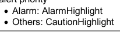

属性可选 说明是否允许关闭突出显示是可选的

0.1 布尔默认是虚假的

关联取景组 与提醒出景点相关联的取景组( 显示 Catalogue 规则生成执行取景点的绘图指令)

1..* S100_PR_ViewingGroup 多个取景组的存在,可以将特定特性类型所触发的提示突出化为独立禁用.

例如, " 被禁地 " 倡议支持在继续强调其他被禁地的同时,对 " 海平面 " 着陆区进行强调。

当提供多个取景组时,应当考虑提供一个取景组层来同时切换所有取景组.

关联 msg 在任何查看组禁用时显示一个要显示的消息

```text
0..1
S100_PR_AlertMessage
```

## 官方 PDF 第 104 页

```text
2b-4.2.35 S100_PR_NationalLanguageString
```

角色名称描述。 数据类型备注

```text
Class
S100_PR_NationalLangua
geString
```

国家语言专用文本 -- --

以国家语言 1 字符串属性文字 A 字符串

属性语言 ISO 639-2/T 3个字母语言代号为 5.1 字符串默认为 “eng”

```text
2b-4.2.36 S100_PR_FileType
```

名称描述代码注释

编号 S100_PR_FileType 文件的类型和格式。 -

值 docx Office 打开 XML 文档 - 基于 Zip 和 XML 的文件格式。不要与 OpenOffice 格式或通用 XML 相混淆

值 zip Zip 归档格式 -

值 xlsx 办公室 Open XML 工作手册 - 基于 Zip 和 XML 的文件格式用于电子表格。 不可与 OpenOffice 格式或通用 XML 相混淆

```text
2b-4.2.37 S100_PR_FontType
```

名称描述代码注释

编号 S100_PR_FontType A字体规格 -

值 ttf TrueType 字体 -

```text
2b-4.2.38 S100_PR_ImageType
```

名称描述代码注释

编号 S100_PR_ ImageType 图像规格 -

值 jpg JPEG 2000 图像编码系统 -

值 png 可移植网络图形格式 -

值 tif 标记图像文件格式 -

## 官方 PDF 第 105 页

```text
2b-4.2.39 S100_PR_AlertPriorityType
```

名称描述代码注释

编号 S100_PR_AlertPriority Type 定义一个提醒的可能优先级 。 -

价值警报 说明需要桥梁小组立即注意和采取行动的条件

- 从MSC.252(83) 19.1.2。

价值警告表明条件已发生变化,应出于不立即发生危险但如不采取行动则可能发生危险的预防原因提出。

- 从MSC.252(83) 19.1.3。

价值警告表明一个条件,它不值得提出警报或警告,但仍需要注意,而且不能从对情况或特定信息的通常考虑出发。

- 从MSC.252(83) 19.1.4。

显示正常信息和条件 -- -- 从MSC.252(83)附录1

```text
2b-4.2.40 S100_PR_ParameterType
```

S100_PR_ParameterType的取名定义和成员与第9部分第9-13.3.30分款中的参数Type相同.

```text
2b-4.2.41 S100_PR_HighlightStyle
```

名称描述代码注释

编号 S100_PR_高亮样式 定义提醒时可能的图形突出显示样式 -

红色突出亮相 - IEC 62288:2014 表A.3 导航符号,条目3.5b

红色突出亮相 - IEC 62288:2014 表A.3 导航符号,条目3.5c

## 官方 PDF 第 106 页

本页特意留空


---

# S-100 5.2.1 · 第 3 部分 · 通用要素模型与应用模式规则

非官方机器翻译参考稿，尚未逐条人工校订。公式与代码保留原文，解释以英文规范为准。

## 官方 PDF 第 107 页

S-100 – 第3编

Schema 应用的一般要素模型和规则

## 官方 PDF 第 108 页

5.2.1版实质性变动摘要

已生效的概要条款

以一般网页参考资料取代了URL链接。 3-10

## 官方 PDF 第 109 页

中文目录（可用上方目录直接跳转）

3-1 范围 · 官方 PDF 111
3-2 符合性 · 官方 PDF 111
3-3 参考文献 · 官方 PDF 112
3-4  上下文 · 官方 PDF 113
3-4.1 物体 · 官方 PDF 113
3-4.2 一般要素模型的衍生 · 官方 PDF 113
3-5 定义要素与信息类型的原则 · 官方 PDF 113
3-5.1 可识别物体 · 官方 PDF 113
3-5.1.1 要素 · 官方 PDF 113
3-5.1.2 信息类型 · 官方 PDF 113
3-5.2 通用要素模型 · 官方 PDF 113
3-5.2.1 引言 · 官方 PDF 113
3-5.2.2 全球调频的目的 · 官方 PDF 114
3-5.2.3 GFM的主要结构 · 官方 PDF 114
3-5.2.4 S100_GF_NamedType (中文(简体) ). · 官方 PDF 114
3-5.2.5 S100_GF_对象类型 · 官方 PDF 115
3-5.2.6 S100_GF_FeatureType (英语). · 官方 PDF 115
3-5.2.7 S100_GF_财产公司 · 官方 PDF 116
3-5.2.8 S100_GF_属性类型 · 官方 PDF 116
3-5.2.9 S100_GF_协会 · 官方 PDF 117
3-5.2.10 GF_业务 · 官方 PDF 117
3-5.2.11 S100_GF_协会 · 官方 PDF 117
3-5.2.12 S100_GF_信息技术 · 官方 PDF 118
3-5.2.13 S100_GF_Feature Association Type（条款） · 官方 PDF 118
3-5.2.14 S100_GF_信息技术协会 · 官方 PDF 119
3-5.2.15 S100_GF_约束 · 官方 PDF 119
3-5.3 要素类型的属性 · 官方 PDF 120
3-5.3.1 引言 · 官方 PDF 120
3-5.3.2 S100_GF_理论属性Type · 官方 PDF 120
3-5.3.3 S100_GF_复杂属性类型 · 官方 PDF 121
3-5.3.4 S100_GF_简单属性Type · 官方 PDF 121
3-5.3.5 S100_GF_空间属性图案 · 官方 PDF 121
3-5.3.6 GF_临时属性类型 · 官方 PDF 122
3-5.3.7 GF_气象数据属性类型 · 官方 PDF 122
3-5.3.8 GF=质量属性类型 · 官方 PDF 122
3-5.3.9 GF_位置属性类型 · 官方 PDF 122
3-5.3.10 S100_已运行 DateAttroduction Type · 官方 PDF 122
3-5.3.11 S100_GF_代码列表属性类型 · 官方 PDF 122
3-5.3.12 S100_GF_编号Type · 官方 PDF 123
3-5.4 所命名类型之间的关系 · 官方 PDF 123
3-5.4.1 引言 · 官方 PDF 123
3-5.4.2 GF_遗产关系 · 官方 PDF 123
3-5.4.3 S100_GF_协会 · 官方 PDF 124
3-5.4.4 信息类型的联系 · 官方 PDF 124
3-5.4.5 关联目的默认名称 · 官方 PDF 124
3-5.5 要素类型的行为 · 官方 PDF 125
3-5.6 约束 · 官方 PDF 125
3-6 应用模式规则（ISO 19109 第 8 条） · 官方 PDF 125
3-6.1 应用建模过程(ISO 19109 第8.1条) · 官方 PDF 125
3-6.2 施埃马案(ISO 19109 第8.2条) · 官方 PDF 125
36.2.1 应用Schemas的概念学语言 · 官方 PDF 125
3.6.2.2 主要规则 · 官方 PDF 125
-6.2.3 确定应用程序Schemas · 官方 PDF 125
3.6.2.4 应用程序Schema的文档 · 官方 PDF 126
3-6.3 《统一仲裁示范法》中施以舍马规则(ISO 19109 第8.3条) · 官方 PDF 126
3-6.3.1 主要规则(ISO 19109 第8.3.1条) · 官方 PDF 126
3-6.4 统一马列标准Schemas的域名简介(ISO 19109 第8.4条) · 官方 PDF 127
3.6.4.1 在标准Schema中添加信息的规则 · 官方 PDF 127

## 官方 PDF 第 110 页

中文目录（可用上方目录直接跳转）

限制使用标准Schemas · 官方 PDF 127
36-6.4.3 元数据Schema的使用规则(ISO 19109 第8.5条) · 官方 PDF 127
暂行规则(ISO 19109 第8.6条) · 官方 PDF 127
3-6.5 空间规则(ISO 19109 第8.7条) · 官方 PDF 127
3.6.5.1 一般空间规则(ISO 19109 第8.7.1条) · 官方 PDF 127
3.6.5.2 空间属性 · 官方 PDF 127
空间质量 · 官方 PDF 128
3-6.5.4 代表要素空间属性的几何集合和复合体 · 官方 PDF 128
3-6.6 分类规则(ISO 19109 第8.8条) · 官方 PDF 129
3-6.6.1 导言(ISO 19109 第8.8.1条) · 官方 PDF 129
根据要素目录(ISO 19109 第8.8.2条)提出的施特马申请 · 官方 PDF 129
3-6.6.3 字符编码 · 官方 PDF 129
3-6.7 编码清单 · 官方 PDF 129
3-7 覆盖数据的应用模式（资料性） · 官方 PDF 130
3-7.1 引言 · 官方 PDF 130
3-7.2 文字数据 · 官方 PDF 130
3.7.3 可变单元格大小网格 · 官方 PDF 131
3-7.4 面向要素的影像 · 官方 PDF 132
3-8 S-100 时间框架 · 官方 PDF 133
3-8.1 时间定义 · 官方 PDF 133
3-8.2 时间关系 · 官方 PDF 134
3-8.3 时间间隔和期间模型的解释 · 官方 PDF 134
3-9 截短日期使用的格式专用类型 · 官方 PDF 135
3-10 实例标识符 · 官方 PDF 135
3-10.1 利用实例识别资料 · 官方 PDF 136

## 官方 PDF 第 111 页

3-1 范围

这一部分介绍了通用要素模型(GFM),它是要素、要素要素和关联的概念模型,还描述了开发应用Schema的规则,这是任何基于S-100的产品规范的基本部分。

本部分的范围包括:

1) 从现实出发对要素及其特性进行概念建模;

(2) 信息类型及其属性的概念建模;

3) 施克马法适用的定义;

4) Schema申请规则;

下述是范围以外的情况:

1) 在目录中反映要素类型及其属性和信息类型及其属性;

(2) 元数据的表述;

3) 将一个应用程序Schema映射到另一个应用程序的规则;

4) 在计算机环境中实施应用程序Schema;

5) 计算机系统和应用Schema软件设计;

6) 方案拟订。

本文件没有涉及计算机系统、软件设计和编程。

3-2 符合性

这个剖面符合ISO 19106:2004中的相容性第2类. 以下是S-100通用要素模型与ISO 19109相异的专业和通称的简要说明.

1)引入了新的S100_GF_NamedType.

2)作为S100_GF_NamedType的特长引入了新的S100_GF_ObjectType.

3)作为S100_GF_ObjectType的专攻引入了新的S100_GF_信息Type,它受限制于与S100_GF_ThematicAttroductType的关联.

4)S100_GF_FeatureType是S100_GF_ObjectType的一个专业.

5)S100_GF_属性Type是GF_属性Type的一个专业,因为它在S-100中是抽象的.

6) 新抽象的S100_GF_SimpleAttizeType被引入为S100_GF_ThematicAtizeType的特有.

7) GF_操作没有被使用.

8) GF_继承关系不使用;要素继承由社团继承来代表.

9)不使用关联属性OffAtPritics. S-100中使用了复杂属性的概念来履行相类似的功能.

10) S100_GF_AssociationType 不使用GF_AssociationType和GF_FeatureType之间的通缩关联,而是S100_GF_NamedType的特有化.

11) S100_GF_ AssociationType通过UML聚合关系与S100_GF_ThematicAttizeType相接,这意味着协会可以具有描述性特征.

## 官方 PDF 第 112 页

12) 新的元类S100_GF_Feature AssociationType和S100_GF_Information AssociationType作为S100_GF_AssociationType的专攻引入.

13) ISO 19109中GF_FeatureType/GF_AssociationType关系的关联角色Between实现如下:

a) S100_FeatureType/S100_GF_Feature AssociationType中的角色链接

关系;

(b) S100_InformationType / S100_GF_ Information AssociationType 的角色链接

关系;

(c) S100_ObjectType / S100_ Information AssociationType关系的角色信息链接.

这意味着只包含要素类型的社团具有语义和多重限制,这些限制与至少包含一种信息类型的社团不同.

14) GF_Location 属性Type,GF_Temperal 属性Type,GF_MetaData 属性Type和GF ⁇ -质量属性Type不使用.

以下案文酌情进一步提及或解释上述改动。

3-3 参考文献

ISO 8601:2004, 数据元素和交换格式-信息交换-日期和时间的表示

ISO 19106:2003,"地理信息-地理信息-简介".

ISO 19108:2002, 《地理信息 -- -- 时间方案》(经技术更正1 -- -- 2006年更正)

ISO 19107:2003, 地理信息 -- -- 空间计划

ISO 19109:2005, 地理信息 - 应用计划规则

ISO 19110:2005, 地理信息 -- -- 要素编目方法

ISO 19115-1:2018,地理信息-元数据-第一部分-基本原理(由"2018年第1号修正案"更新)

ISO/CD 19115-2, 地理信息 - 元数据 - 第2部分 - 图像和网格数据的扩展

## 官方 PDF 第 113 页

3-4 上下文

3-4.1 物体

地理应用的数据内容是根据真实世界要素的视角和特定应用的要求来定义的。内容按照对象来排列。本文件考虑两类对象:

1) 要素 – 要素与要素属性一起被定义.

2)信息类型 –信息类型用于在要素和其他信息类型之间共享信息. 信息类型只有主题属性属性.

GFM为这些对象提供了概念模型,对象类型的定义被保存在一个"要素目录"中. GFM还充当要素目录的概念模型.

3-4.2 一般要素模型的衍生

必须在S-100产品中使用的种类的概念模型在本文件中被介绍,它被称为GFM并取自ISO 19109通用要素模型,通过实现它的分级(图3-1).

3-5 定义要素与信息类型的原则

3-5.1 可识别物体

3-5.1.1 要素

一个要素是真实世界现象的抽象表现. 要素有两个方面 — — 地能类型和地能实例. 特能类型是一个类,定义在一个地能目录中. 个地能的实例是地能类型的单一发生,在数据集中作为对象来表示.

3-5.1.2 信息类型

信息类型是对象的类别,在要素目录中定义。信息类型的实例是数据集中可识别的信息单位。信息类型只有主题属性属性。信息类别的实例可能与一个或多个要素实例或其他信息类型实例相关联。

图表注释可作为信息类型模式。

3-5.2 通用要素模型

3-5.2.1 引言

此子语法识别并描述用于定义要素和信息类型及其关系的概念,这些概念被用一个名为GFM的概念模型来表达.

## 官方 PDF 第 114 页

图3-1 – 一般要素模型

3-5.2.2 全球调频的目的

GFM是要素和信息类型及其属性分类的基础,GFM也作为要素目录结构的基础.

3-5.2.3 GFM的主要结构

图3-1显示了S-100 GFM的UML模型.

以下条款界定了全球调频机制的要素。

```text
3-5.2.4
S100_GF_NamedType
```

S100_GF_NamedType 类不是从ISO 19109 实现的,而是专门为 S-100 GFM 引入的. 这是S100_ GF_ObjectTy Pe 和 S100-GF- AssociationTyope 类的抽象超级类. 引入这一类的用意是显示对象类型和关联类型在 S- 100 内部的共性. 这两个类型都是 S- 100. 数据 Schemas 的核心可识别对象.

## 官方 PDF 第 115 页

```text
Table 3-1— S100_GF_NamedType
```

角色名称描述。 类型

S100_GF_ NamedType 抽象基类,用于 GFM 内的对象类型和关联类型

```text
-
-
```

属性类型Name 命名类型的名称。 名称必须在命名空间中独有

```text
1
CharacterString
```

描述命名类型 1 字符串的定义

属性是 Abstract 如果真, 命名类型会起到抽象的超类型。 无法创建抽象类型的实例 。

1 布尔

角色受约束By 该角色指定对命名类型进行约束

```text
0..*
S100_GF_Constraint
```

```text
3-5.2.5
S100_GF_ObjectType
```

S100_GF_ObjectType类不是从ISO 19109中实现的,而是专门为S-100 GFM引入的. 它是S100_FeatureTy Pe和S100-GF-InformationTyke类的抽象超级类. 引入这一类的用意是显示要素类型与信息类型之间的共通性,特别是这些类通过信息协会与信息类别连接的能力.

```text
Table 3-2— S100_GF_ObjectType
```

角色名称描述。 类型

S100_GF_ 对象抽象基类,用于 GFM 内的对象类型

```text
-
-
```

角色信息链接链接到描述与信息类型实例关系的信息协会

```text
0..*
S100_GF_Information
AssociationType
```

```text
3-5.2.6
S100_GF_FeatureType
```

S100_GF_FeatureType 类是ISO 19109 类 GF_FeatureType 的实现,它与ISO 类有如下不同:

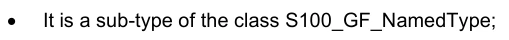

它是S100_GF_NamedType类的一个子类型;

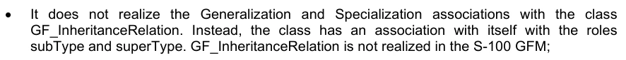

它没有实现与类GF_继承关系(Class GF-100 GFM)的通化和专门化协会,相反,该类与自己的角色有子Type和超级Typ的关系. GF_遗产关系在S-100GFM中没有实现; 与"超"关系(GFS-10-100),即"超能"关系.


超级Type的多为0.1来代表一个特性最多可能有一个超级Type的概念,这是为了防止S-100中的多位继承;


S100_GF_PropertyType(GF_PropertyType的S-100实现)中的角色OfCharacteristics的多面性由0..*改为1.*. S-100特性必须具有

## 官方 PDF 第 116 页

```text
Table 3-3— S100_GF_FeatureType
```

角色名称描述。 类型

S100_GF_FeatureType A类,用于抽象地表现真实世界现象

```text
-
-
```

角色超音速类型 此特性类型来源于的更通用的特性类型

```text
0..1
S100_GF_Feature
Type
```

角色子 Type 从此特性类型衍生出更具体的要素类型

```text
0..*
S100_GF_Feature
Type
```

角色链接 Between A 连接到指定一个特性类型与同一个或另一个特性类型之间的关系的特性关联

```text
0..*
S100_GF_Feature
AssociationType
```

描述要素类型要素的属性和作用

```text
1..*
S100_GF_Property
Type
```

```text
3-5.2.7
S100_GF_PropertyType
```

S100_GF_PropertyType 类是ISO 19109 类 GF_PropertyType 的一种实现,它与 ISO 类有以下不同:

1) 与 S100_GF_FeatureType 关联的多相性从 1 被更改为 1..*,这一变化代表了 S-100 要素目录中描述要素和属性的方式. 属性类型定义可以用于一个或多个要素类型定义; 属性类别定义可以使用 .

2)与S100_GF_FeatureType关联的关联类型,由于上述多相性的变化而由组成改变为聚合.

表3-4——S100_GF_财产公司

角色名称描述。 类型

S100_GF_PropertyType 特性类型所有属性的抽象基础类。这些属性和角色

```text
-
-
```

属性成员Name 属性或角色的名称 1 字符串

属性定义 描述要素类型的属性或作用

```text
1
CharacterString
```

角色受限 角色指定对财产施加限制

```text
0..*
S100_GF_Constraint
```

```text
3-5.2.8
S100_GF_AttributeType
```

S100_GF_属性Type 类是 GF_属性Type 的 S- 100 实现。 它与 ISO 19109 类基本相同,但有如下不同:

1)关联属性OfAtproject在S-100 GFM中没有实现. S-100转而引入了复杂属性的概念. 复杂属性在ISO 19109子clause 7.4.

## 官方 PDF 第 117 页

```text
Table 3-5— S100_GF_AttributeType
```

角色名称描述。 类型

S100_GF_属性Type 特性类型所有属性的抽象基类。在这个模型中有两个子类:主题属性和空间属性

```text
-
-
```

属性值 Type 属性值的数据类型 1 字符串

属性域 OffValues 描述一组值。 对于代码列表类型来说,这可能是一个识别词典或“vocabulary”的URI

```text
1
CharacterString
```

特性类型单一实例可能相关的属性实例数

```text
1
S100_Multiplicity
```

```text
3-5.2.9
S100_GF_AssociationRole
```

S100_GF_AssociationRole级是ISO 19109 Class GF_AssociationRole的S-100实现.

表3-6——S100_GF_协会

角色名称描述。 类型

S-100_GF_协会在社团中使用的角色

关联内可能相关的对象数量

```text
1
S100_Multiplicity
```

```text
3-5.2.10
GF_Operation
```

S-100 GFM中没有实现类GF_操作,因为S-100只支持数据传输模型. Dataset不能包含操作.

```text
3-5.2.11
S100_GF_AssociationType
```

S100_GF_AssociationType 类是 ISO 19109 类 GF_ AssociationType 的 S-100 实现。 它与 ISO 19109 类有如下不同:

1)ISO 19109 GFM 型号 GFS_ AssociationType 是以 GF- FeatureTyope 类的子类型,这样做的原因在 ISO 19 109. 条款 7.3.9. 的注1中列出. S-100 型没有将该类作为 S100_GF_FeaturalTy Pe 的子类型的模型. S-1100 特性类型之间的关联不被视为真实世界现象的抽象. 这种GFM建模方法的结果是,唯一可以拥有的属性协会是主题属性.

2)角色的多称是0.2而不是1.*. 下限为0,表示角色是默认角色"来源"或"目标"之一,这一点从应用Schema的语义学中可以明显看出协会类型的名称以及参与的要素或信息类的名称. 上限表示S-100不允许拥有两个以上参与类的协会.

```text
Table 3-7— S100_GF_AssociationType
```

角色名称描述。 类型

S100_GF_协会Type文摘基础课 专题协会和信息协会

```text
-
-
```

描述关联的主题属性

```text
0..*
S100_GF_ThematicAttributeType
```

角色角色Name 描述协会目的的角色

```text
0..2
S100_GF_AssociationRole
```

## 官方 PDF 第 118 页

```text
3-5.2.12
S100_GF_InformationType
```

S100_GF_InformationType是S-100内部信息类型的类. 信息类型是一个可以识别的对象,它可以和特性相联,以便携带与相关特性相相特异的信息. 一种信息类型的示例可能是"图表注释". 消息类型也可以互相相联. 可以在有与信息类型相关的进一步补充资料或需要翻译信息时这样做,例如,带有图表注释的主要信息对象可能包含英文文本,而相关的补充信息对象也可能包含德语文本。

信息类型的特点只能由主题属性类型来携带。因此,S100_GF_信息Type只与S100-GF-主题属性Tyke相关,而不是更通用的S100 _GF:PropertyTy Pe类。信息类型关联的模型是S100型信息协会Tyope。

表3-8-S100_GF_信息类型

角色名称描述。 类型

```text
Class
S100_GF_Information
Type
```

带有其他物体补充资料的可识别物体的类型

```text
-
-
```

角色超主题 此信息类型来源的更通用的信息类型

```text
0..1
S100_GF_ InformationType
```

角色子 Type 此信息类型衍生出更具体的信息类型

```text
0..*
S100_GF_ InformationType
```

角色链接 Between A 链接到指定一个对象类型与这个信息类型之间关系的信息协会

```text
0..*
S100_GF_Information
AssociationType
```

描述信息类型特征的主题属性

```text
1..*
S100_GF_Thematic
AttributeType
```

作用 社团对提供补充资料的其他信息类型的作用

```text
0..*
S100_GF_AssociationRole
```

```text
3-5.2.13
S100_GF_FeatureAssociationType
```

S100_GF_Feature AssociationType类并非从ISO 19109中实现,而是专门为S-100 GFM引入. 原因在于在S- 100中区分了两类协会:要素会和信息会。它们都与模型有明显不同,也不同。这一类描述要素相通。 要素关联是描述要素类型两个实例之间的关系,可以被主题属性所所所取为要素,通常具有两个角色. 角色描述关系的结束,因为这种关系通常不相对.

## 官方 PDF 第 119 页

```text
Table 3-9— S100_GF_FeatureAssociationType
```

角色名称描述。 类型

```text
Class
S100_GF_Feature
AssociationType
```

用于描述两种要素类型之间关系的类

```text
-
-
```

角色超Type 这个特性关联来源于的更通用的特性关联

```text
0..1
S100_GF_Feature
AssociationType
```

角色子Type 由此特性关联衍生出更具体的要素关联

```text
0..*
S100_GF_Feature
AssociationType
```

角色包括这个关系包含的要素类型

```text
1..*
S100_GF_FeatureType
```

```text
3-5.2.14
S100_GF_InformationAssociationType
```

S100_GF_信息协会Type类并非从ISO 19109中实现,而是专门为S-100 GFM引入的. 原因在于在S- 100中区分了两类协会:要素协会和信息协会。它们都与模型不同,而且各不相同。这一类描述信息协会 。 信息关联是指描述任意对象与为该对象提供额外信息的信息类型之间的关系,这种关系可以被主题属性和角色所所所取为.

```text
Table 3-10— S100_GF_InformationAssociationType
```

角色名称描述。 类型

```text
Class
S100_GF_Information
AssociationType
```

用于描述对象与信息类型之间关系的类

```text
-
-
```

角色超Type 信息关联来源于此的更通俗的信息关联

```text
0..1
S100_GF_
InformationAssociationType
```

角色子Type 由此特性关联衍生出更具体的要素关联

```text
0..*
S100_GF_
InformationAssociationType
```

角色包括关系中包含的信息类型

```text
1..*
S100_GF_InformationType
```

角色信息 信息协会中作为客户对象的对象类型

```text
1..*
S100_GF_ObjectType
```

```text
3-5.2.15
S100_GF_Constraint
```

S100_GF_Controlint是ISO 19109 Class GF_Controlint 的一种实现,它与S100_GF_NamedType的关联,而不是ISO 19109的关联到GF_Feature_Type.

```text
Table 3-11— S100_GF_Constraint
```

角色名称描述。 类型

S100_GF_ 约束可能与指定类型或其属性相关的约束类

```text
-
-
```

自然语言和/或正式标记中描述的制约

```text
1
CharacterString
```

## 官方 PDF 第 120 页

3-5.3 要素类型的属性

3-5.3.1 引言

这一条款更详细地描述了要素属性和信息类型的作用.

图 3-2 — 属性

```text
3-5.3.2
S100_GF_ThematicAttributeType
```

S100_GF_ThematicAttizeType 类是ISO 19109 Class GF_ Thematic阿特普的实现. 主题属性类型带有ISO 19 109. 条款7.4.3–7.4.7所指定对象以外的对象的描述性特征. 这一类在以下方式上与ISO 1910 类不同: 主题特性类型 主题类型 :

1) GF_理论属性Type在ISO 19109被定义为混凝土类. S-100 GFM实现是一个抽象类,有两个混凝土子类——S100_GF_SimpleAt属性Type和S100_GF_ComplexAt属性Type.

## 官方 PDF 第 121 页

2) 时间信息必须具有其价值类型,由使用原始时间类型的组合的各类类型来定义:日期、时间、日期时间、S100_TruncatedDate或复杂结构。

```text
Table 3-12— S100_GF_ThematicAttributeType
```

角色名称描述。 类型

```text
Class
S100_GF_
ThematicAttributeType
```

空间属性以外的所有属性的抽象基类

```text
-
-
```

```text
3-5.3.3
S100_GF_ComplexAttributeType
```

S-100 GFM中引入了S100_GF_ComplexAppilityType类. 复杂属性是其他属性的构成,要么简单要么复杂.

```text
3-5.3.4
S100_GF_SimpleAttributeType
```

类 S100_GF_SimpleAttizeType 是在 S-100 GFM 中引入的. 一个简单的属性类型带有一个被命名类型的描述性特征.

```text
3-5.3.5
S100_GF_SpatialAttributeType
```

S100_GF_空间属性Type 是ISO 19109 类 GF_ 空间属性 Type 实现。空间属性类型必须以 GM_Object作为其值类型。 GM-Obition及其子类型的定义在空间学主题S-100 第7部分中被定义.

注:S-100第5部分描述的要素目录和第十部分描述的编码中,S-100_GF_空间属性Type类别只得到部分执行.

```text
Table 3-13— S100_GF_SpatialAttributeType
```

角色名称描述。 类型

```text
Class
S100_GF_
SpatialAttributeType
```

代表空间属性的类别,用于表达要素类型的空间要素

```text
-
-
```

最小尺度的分母,用于要素类型的例子(例如,用于描述)

```text
0..1
PositiveInteger
```

属性缩放( maximum) 最大缩放的分母, 引用的几何可以用于要素类型的实例( 例如, 用于描述)

```text
0..1
PositiveInteger
```

描述要素类型实例的几何对象

```text
1
GM_Object
```

显示被遮盖或被截断的空间原始物或物体的参考文献

```text
0..*
S100_MaskReference
```

遮盖或调出必须提供被遮盖的原始或调出的原始物的识别符,以及说明被引用的原始物是否被遮罩或调取为遮罩参考物属性。遮罩参照物属性的结构由S100_GF_MaskReference类型定义,如下表3-14所示.

不同S-100格式的遮罩引用的实施情况,在相应的数据格式规范中有所规定(ISO 8211数据格式为10a部分,GML格式为 10.b部分),并可能使用核心规格所构建的构件. 例如,S-100 GML格式使用GML类型ReferenceType,对xlink:href和xlin克:role属性的允许值有限制;ISO 8211格式使用无符号整数,包含一个空间物体的记录标识符和遮罩指示值的数值编码.

遮盖属性所引用的空间物体必须是构成空间属性同一实例所引用的空间物体的GM_对象的组成部分之一.

## 官方 PDF 第 122 页

它们可能是任何层次的组件,例如组件等的组件(即被遮盖或被截断的几何必须成为空间属性特定实例几何的一部分. ) .

产品规范应把遮盖的使用限制在特定的空间类型,例如,限制在曲线。

```text
Table 3-14— S100_GF_MaskReference
```

角色名称描述。 类型

类 S100_GF_ MaskReference 引用被遮盖或被截断的空间原始。模型基于 gml: reference 但限制允许的属性, 并强制标识符和角色

```text
-
-
```

```text
Attribute
spatialRef
```

(别名xlink:href)

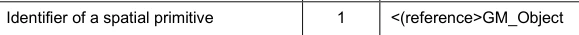

```text
Attribute
maskIndicator
```

(别名 xlink: 作用)

表示一个空间原始是被数据集限制所掩盖还是被截断

1 编号 S100_GF_任务指示器Ty pe

```text
Table 3-15— S100_GF_MaskIndicatorType
```

名称描述代码注释

编号 S100_GF_任务指示器 Type 表示数据集限制的遮盖或调取

```text
-
-
```

在数据集限制下, 空间原始被截取

```text
1
```

空间原始的显示被压制

```text
2
```

```text
3-5.3.6
GF_TemporalAttributeType
```

ISO 19109类GF_Temperal AttizeType在S-100 GFM中并未明确实现. Temperary信息必须使用主题属性类型S100_GF-ThematicAttisticTyke来进行模型化(详见第36-4.4条)。

```text
3-5.3.7
GF_MetadataAttributeType
```

ISO 19109 类 GF_Metadata 属性Type 在 S-100 GFM 中未明确实现. 元数据类型必须使用复杂的主题属性来进行模型化,这些属性实现类型来自 S- 100 部分 4a 元数据的组件. 复杂主题属性必须在一个要素目录中定义.

```text
3-5.3.8
GF_QualityAttributeType
```

ISO 19109 类 GFQ-质量属性Type 在 S-100 GFM 中没有明确实现. 质量元数据类型必须使用复杂的主题属性来进行模型,这些属性实现类型来自 S- 100 部分 4c 附录 4 C-A 数据质量. 复杂主题属性必须在一个要素目录中定义.

```text
3-5.3.9
GF_LocationAttributeType
```

ISO 19109 类 GF_Location 属性Type在S-100 GFM中未实现.

```text
3-5.3.10
S100_TruncatedDateAttributeType
```

S100_TruncedDatePriticalType 类是用于模拟日期值,其中省略了一个或多个较重要的组件。这允许部分日期,例如用于重复期。

```text
3-5.3.11
S100_GF_CodelistAttributeType
```

S100_GF_Codelist 属性Type 类在 S-100 GFM 中被引入,用于模拟 S-100 代码列表。代码列表属性必须和任意一个计数相关联(对于开放的计数)

## 官方 PDF 第 123 页

代码列表)或字典(用于开口和闭口字典代码列表),但两者不兼而有之. 字典的结构由外部的规格来定义.

```text
Table 3-16— S100_GF_CodelistAttributeType
```

角色名称描述。 类型备注

```text
Class
S100_GF_
CodelistAttributeType
```

S100_代码列表属性的抽象基础类

```text
-
-
-
```

标签代码列表 Type 代码列表类型 1 字符串必须包含: 开放式目录 开放式词典 封闭词典

Tag URI 为打开或关闭的字典代码列表识别词典

0.1 只为打开或关闭的字典代码列表设置字符串

额外值的标记编码提示

0.1 字符串只用于打开的引用或打开的字典代码列表

```text
3-5.3.12
S100_GF_EnumerationType
```

S100_GF_EnumerationType和S100_FFU_EnumerantClass 一起模型,用于定义一个点数属性的允许值及其语义。一个点取类型的实例可以定义一个出点或代码列表属性的一组允许值,或者两者兼有。

3-5.4 所命名类型之间的关系

3-5.4.1 引言

本子语句更详细地描述对象类型之间的关系,关系分类如下:

1) 要素类型和信息类型的通论/专业.

2) 要素类型与信息类型之间的关联。

```text
3-5.4.2
GF_InheritanceRelation
```

类GF_继承关系在S-100 GFM中并未实现,但通过在类S100_GF-FeatureType和类S 100_Gf_IntelligenceTy Pe上使用一个相同的关联来允许对象继承(见图3-3). 关联的超Typ端的多端性使得子类型可能只有一个超类型,这是为了防止多位继承的建模. 继承关系协会是仿制混凝土类,而不是抽象类S100_GF_NamedType。这阻止了从信息类型继承的要素类型,反之亦然。

继承关联只存在于被命名类型(类)之间,而不存在于被命名类型实例(即在一个数据集中发生的实体)之间.

## 官方 PDF 第 124 页

图3-3——专业和普通化协会

```text
3-5.4.3
S100_GF_AssociationType
```

关联由S100_GF_协会Type类定义,有两种角色和定义. ISO 19109类 GF_AggregationTy Pe, GF-Sparatical AssociationTye, 和 GFS- 100 GFM 中未明确实现。 这些类别只有在允许协会携带属性的情况下才能使用。 ISO 19.109 GFm 允许这样做, 因为 GFL_协会 Type 是 GF _ FeatureTyope 的子类型 。 然而,S100_GF_AssociationType并不是S100_GF_FeatureType的子类型.

3-5.4.4 信息类型的联系

S- 100 GFM 中引入了 S100_GF_ObjectType 和 S100 _GFL_ InformationTy Pe 之间的关联。 角色附加信息是 S-100 GFm 中该关联的默认, 并意味着对一个被命名的类型有额外的信息 。

3-5.4.5 关联目的默认名称

必须用程序Schemas可以指定关联目的的名称(作用名). 如果未明确提供名称,则使用下列默认值.

(1) 如果只给一个协会的一端以“<作用名>”的明确名称,则另一端必须有一个默认名称“inv- ⁇ rolename>”。

2)如果协会的两端都没有被赋予明确的名称,默认的角色名称为""目标类名"",其中目标类从源类中被引用.

3)上述规则可能不会导致每个关联端在应用程序Schema中产生一个单独的名称,因此产品规范在必要时可以定义不同的规则或附加规则.

4)如果需要标准名称,可以使用下列默认名称来代替上列的.

a. “额外信息”是社团从功能到功能的默认角色名称。

b. 要素/地貌或信息/信息协会,仅可通航于一种

方向可以使用“源”和“目标”的默认端名。“关联”的名称可以在双向协会的两端使用。

## 官方 PDF 第 125 页

产品规范可能将个别的默认和标准默认混合在一起,但必须明确适用于任何特定关联端的名称。

3-5.5 要素类型的行为

要素类型的行为由可能发生在或可能发生在要素类型上的操作来描述. 操作仅适用于互操作性模型,不适用于数据传输模型.

3-5.6 约束

限制通过具体说明允许或不允许的数据组合来限制必须用中防止产生错误数据的自由,必须用程序Schema应明确确定限制。

只有被命名的种类和属性可能存在限制.

3-6 应用模式规则（ISO 19109 第 8 条）

3-6.1 应用建模过程(ISO 19109 第8.1条)

应用Schema有两个目的:

1)它实现了对特定应用领域内数据内容和结构的共同而正确的理解.

2) 第二,它可能提供一个计算机可读的Schema,用于应用自动数据管理机制。

这两个角色意味着创建应用程序Schema的分步进程。步骤可以简单描述为:

1) 调查预期应用领域的要求(未完成论述)

2) 以GFM中定义的概念为应用的概念模型,这项任务包括确定要素类型、特性和制约因素。

3)必要时用正式的建模语言描述必须用程序Schema的元素. S-100必须用程序Schemas必须按照S-100的这一部分所定义的规则使用UML进行描述.

4)将正版应用Schema与其他标准化的Schemas,(Spacial Schema,Quality Schema等)整合为一个完整的应用Schema.

3-6.2 施埃马案(ISO 19109 第8.2条)

36.2.1 应用Schemas的概念学语言

如果使用概念语言来设计一个S-100必须用程序Schema,那么这一定是UML.

3.6.2.2 主要规则

必须用程序Schema的数据结构应仿照必须用程序Schema。

应用程序 Schema 中用于数据传输的所有类都是可即时使用的。 这意味着整合类不得被定型的 QQ接口 。

-6.2.3 确定应用程序Schemas

1) 每一必须用程序Schema的识别必须包括名称和版本。

## 官方 PDF 第 126 页

必须用程序Schema描述特定数据集的内容。必须定义一个S-100必须用程序Schemas的独特名称和版本定义系统。

2) 在UML中,必须用Schema必须在PACKAGE中描述,其中应标有必须用Schema的名称和PACKAGE文件所记载的版本.

3.6.2.4 应用程序Schema的文档

1) 必须用Schema必须加以记录,必须界定S-100必须用Schemas的用法,以确保S-100产品规范的一致性。

2) UML 中的应用程序Schema的文档可以使用用于创建应用程序Schema的软件工具中的文档设施,如果可以输出这些信息的话.

3) 如果CLAS或其他UML组件与要素目录中的信息相对应,则该目录的参考文献必须被记录.

4)必须用程序Schema中要素类型的文档必须收录在从GFM中衍生出的结构的目录中,例如按照S-100 第5部分编成的目录,这可以采用文本格式或XML并附有用于创建文本版本的样式表(XSLT).

3-6.3 《统一仲裁示范法》中施以舍马规则(ISO 19109 第8.3条)

3-6.3.1 主要规则(ISO 19109 第8.3.1条)

UML中的应用Schemas的主要规则是:

1) S100_GF_NamedType的例子应作为CLAS来执行.

2) S100_GF_ObjectType的例子应作为CLAS来执行.

3) S100_GF_FeatureType的例子应作为CLAS来执行.

4) S100_GF_InformationType作为CLAS执行的例子.

5) S100_GF_Feature AssociationType的一个例子,在与作为CLASS执行的S100_FEtatureTy Pe的事例相关联时,可以起到链接Between的作用. 它应作为下列案例之一执行: a)案例1:与任何案例无关的S 100_FeiatureAssociatype的事例.

S100_GF_理论属性Type的例应作为这些分类之间的ASSOCION执行。 b) 案例2:与一个或一个相关联的S100_Feature协会Type的例。

更多的S100_GF_主题属性图案应作为ASOCIATION CLAS执行;相关的S100_GF_主题属性图案应作为ASOCIATIBUTES执行.

6) S100_GF_信息协会Type 的例子具有信息链接的作用,与作为CLASES执行的S100_ GF_FeatureTy Pe 或S100-GF-信息协会的情况有关。它应执行以下情况之一:(a) 案例1:与任何信息协会无关的S 100_信息社团Tyke的例子

S100_GF_主题属性Type的例子应作为这些分类之间的ASSOCION执行。 b) 案例2:与一个或一个相关联的S100_信息协会Type的例子。

更多的S100_GF_主题属性图案应作为ASOCIATION CLAS执行;相关的S100_GF_主题属性图案应作为ASOCIATIBUTES执行.

7) S100_GF_属性Type的示例应作为ATTRIBUTE执行.

8) S100_GF_SimprojectType的例子应作为ATTRibUTE执行.

## 官方 PDF 第 127 页

9) S100_GF_ComplexAtriptitionType 实例应作为 CLAS 执行. 即时CLAS必须有 S100-GF-Simptributype和/或 S-100-FF_complex阿特利布特 的一个或多个实例。

10) 社团继承关系的例子应以UML一般关系为代表。

3-6.4 统一马列标准Schemas的域名简介(ISO 19109 第8.4条)

3.6.4.1 在标准Schema中添加信息的规则

标准Schemas不得在应用Schemas中扩展. 标准Schemas是S-100中记载的,例如空间Schema,Feature Catalogue Schema等.

限制使用标准Schemas

对于一些标准Schemas,例如S-100 第7部分(Spatial Schema),可以重新定义Sche马,这样只有部分ScheMa才会被使用,并且只能使用部分类别和关系的定义.

1)标准Schema的限定配置规格必须在新的UML包中进行描述,从标准Sjema中复制实际定义(类和关系). 类别内属性和操作可以省略.

2) 标准Schema的削减应符合实际标准的符合条款。

36-6.4.3 元数据Schema的使用规则(ISO 19109 第8.5条)

S100 Part 4 定义的元数据 Schema 是元数据组的应用程序 Scheme. 元数据是描述并记录数据的数据. 地理学数据元数据通常提供其识别,范围,质量,空间和时间方面,空间参考和分布的信息.

元数据类型应作为实现S100 第4部分要素的复杂属性加以实施,因此元数据属性必须为主题属性类型.

暂行规则(ISO 19109 第8.6条)

S-100不包括ISO 19108的配置. 时间属性必须使用日期,时间或日期时间, S100_TrunctedDate, 或使用这些时间类型组合的复杂属性来进行模型化, 这些类型的使用使属性成为S100_GF_SimpleAttizitionType或S100-GF-ComplexAtizedTyope的示例, 酌情进行.

3-6.5 空间规则(ISO 19109 第8.7条)

3.6.5.1 一般空间规则(ISO 19109 第8.7.1条)

空间属性类型的值域应符合S-100 第7部分给出的规格,该部分提供概念Schemas来描述要素的空间要素并有一套与这些Schemas相符合的空间操作员.

S-100 第7部分明确排除了地貌原始人,因此,ISO 19109第8.7条中规定的地貌规则与本专用配置无关。

3.6.5.2 空间属性

1) 要素的空间要素必须用一个或多个空间属性来描述. 在必须用学中,要素属性的空间属性是要素要素属性的子类型(见5.3),其值的分类学在S-100 第7部分中被定义.

2) 空间属性应以两种方式之一在必须用程序Schema中得到体现:(a) 案例1:作为代表要素的UML CLAS的ATTRibUTE,在这种情况下

ATTRIBUTE应取取空间中确定的一个空间物体,即ISO 19107,作为其价值的数据类型;或

## 官方 PDF 第 128 页

(b) 案例2:作为代表要素的类别之间的UML协会,

由"空间学"所定义的空间物体之一,ISO 19107.

3)空间属性必须取一个空间物体作为其价值. 空间物体被归类为几何物体,被子分类为原始物体,复合物或聚合物(指几何对象). 太空属性的价值类型必须是第七部分所描述的种类或其子类型.

空间质量

空间物体的定位质量必须采用一种方式描述,即与S100_GF_InformationType相联,后者与带有定位精度的S100_GF_ThematicAttizeType相接。

3-6.5.4 代表要素空间属性的几何集合和复合体

3-6.5.4.1 引言

许多要素的空间配置不能由单一的几何原始来表示. GM_Aggregate和GM_Complex 类型支持对要素等要素进行表示.

3-6.5.4.2 几何总和

S-100的空间剖面只支持GM_多点几何集合类型. GM_多点应被作为代表要素的空间属性值作为一组点.

3.6.5.4.3 几何复合体

几何复合体用于代表一个要素的空间要素,作为一组相通的几何原始物. 此外, GM_Complex 的实例允许不同要素的相通性共享几何原物. GM-Primitives在GM_complex中并没有明确的联系; GM同Primmitives之间的连接可以从坐标数据中推导出来.

1) GM_Complex 用作代表一个要素的空间属性的值,作为连接的 GM-Objects 集合,除其边界外,它们是脱节的. GM__Compless 的子类可以被指定来限制 GM–Complce 用于代表特定空间配置的结构.

2) 具有几何要素的要素应作为GM_Complex在更大的GM_Complex内具有亚复合物的要素来表示.

3.6.5.4.4 几何复合材料

几何复合体是一款具有几何原始体所有特性的几何综合体,除了由同类型较小的几相原始体所组成外,几何合成体被用来代表由同等几何体组成的更小的几分天体所组成的复杂要素. 一种GM_复合物必须用来代表具有几何原始几何特性的复杂要素。

3.6.5.4.5 分享几何要素

不同的要素在似乎占据相同位置时可以部分或完全共享相同的几何. 要共享一个共同的几何要素,空间要素属性必须共享一个或多个GM_Objects.

共享几何有两种方式。 当两个要素实例都采用GM_Object与空间属性值相同的实例时, 完全共享就会发生。 可以通过在应用程序Schema中说明限制, 而要求或排除这种情况。 如果没有这种限制, 必要时可以这样做 。

1) 必须用程序Schema可能要求两个或两个以上要素类型的实例完全分享其几何要素,包括代表这些要素的GM_对象必须平等的制约。

## 官方 PDF 第 129 页

2) 应用程序Schema可能排除两个或两个以上要素类型的实例,因为其中包含一个限制,即代表这些要素的GM_对象不相等。

3-6.6 分类规则(ISO 19109 第8.8条)

3-6.6.1 导言(ISO 19109 第8.8.1条)

要素目录是一个描述对特定领域具有重大意义的真实世界现象的存储器。要素目录方法提供了代表这些现象的数据分类的详细组织情况,这样所产生的信息就尽可能明确、可理解和有用。

根据要素目录(ISO 19109 第8.8.2条)提出的施特马申请

S-100必须用程序Schema必须完全由执行S-100要素目录描述的要素目录提供的定义来构建.

3-6.6.3 字符编码

数据集中使用的字符编码必须在必须用程序Schema中定义。如果使用了多个字符编码,必须用程序Schema应记录数据集如何使用这些编码。

3-6.7 编码清单

使用代码列表类型属性的必须用程序Schemas必须包括下面表3-17所指定的带有标记的CLAS. 代码列表类型在第一部分中描述.

表 3-17——代码列表类型的标记

代码列表类型标记和值

打开计数码列表Type=打开计数

编码=其他: [某

已关闭词典代码列表Type=已关闭词典

```text
URI=<dictionary URL>
```

打开词典代码列表Type=打开词典

```text
URI=<dictionary URL>
```

编码=其他:[某 编码的规范形式必须是以下格式的字符串:

以 " other " 二字后加上一个结号和一个空格字符(即 " other: " ),然后用一个空格分隔出一个或多个字母字符串。

规范模式中指定了以下“其他:”部分(使用XML Schema 1.0/1.1模式):

```text
[a-zA-Z0-9]+( [a-zA-Z0-9]+)*
```

注意左括号后为一空格,图案以星号结尾.

实例:

表3-18——代码列表属性的"外"值示例.

```text
other: loxodromic
allowed
```

其他: 不允许使用( 包含字符 ⁇ )

```text
other: German Shipping Regulations
allowed
```

## 官方 PDF 第 130 页

```text
other: German  Shipping Regulations
not allowed (2 consecutive spaces)
```

```text
German Shipping Regulations
not allowed (does not begin with “other: “)
```

```text
other: 287
allowed
```

其他: 1,3,5-Trinitroperhydro-1,3,5-三 ⁇ 不允许使用(连字符和逗号字符不在允许的集合中)

3-7 覆盖数据的应用模式（资料性）

3-7.1 引言

用于应用Schemas的这个规则集针对面向要素数据的应用Schemas。但是,应用Schemas也可能被定义为覆盖。

本节包括应用程序Schemas如何定义图像和网格数据的例子。应用程序Sjemas的组件在ISO 19123中定义,而不是ISO 19109。但是,覆盖可能基于要素类型要素,在这种情况下,其概念上类似于要素收集。下面讨论这些面向要素的覆盖。

3-7.2 文字数据

此应用程序 Schema 定义了与关联元数据相连接的四边网格覆盖。 元数据被泛指到 ISO 19115-1和 19115-2。 此Schema 中没有对元数据进行特定选择 。 此 Schemma 可以同时用于“ 矩阵” 和“ raster” 数据, 并且可以按照所选的元数据 。

被网格化的数据由单一的特性——"图像"或"矩阵"以及取自MD_Metatadata(或MI_Mettata)的相关元数据组成. CV_Coverage(即其相关子类型,例如CV_ ContinentrilatoralGridCoverge)是被网克化数据集的空间属性,它定义了覆盖函数所"覆盖"的一个区域. 对于此应用程序 Schema 定义的连续覆盖, 覆盖函数会根据插值函数返回覆盖区域每个点的值。 网格值矩阵是一组驱动插值功能的值, 它就是通过线性扫描( x,y) 横向规则所穿越的格子。 空间参考由坐标参考系定义 。

此模板应用程序Schema支持大多数图像和被网格化的数据应用程序.

## 官方 PDF 第 131 页

图3-4 – 四边网格覆盖的模板应用程序Schema

3.7.3 可变单元格大小网格

此应用程序Schema 描述一个可变单元格大小的网格( ISO 19123) 。 转录顺序是Morton 顺序, 以便支持三个( 或更多) 维度。 这对水道测量数据特别有用, 因为大量的声纳数据导致3D 网格中覆盖了广泛的底部, 但同样深度的网块可以很容易地被聚合起来。

## 官方 PDF 第 132 页

图3-5 — Reimann 网格覆盖的模板应用程序Schema

3-7.4 面向要素的影像

所有被格网化的数据集都是面向要素的,因为覆盖是要素的子类型,这意味着整个被格法化的数据收集集可以被认为是单一的要素,一个要素结构可以两种不同的方式应用于被格地化的数据,首先,一个离散覆盖可以携带一个要素代码作为属性. 例如,与邮政编码系统相对应的覆盖将包含每个邮政编码的离散值,但仍完全覆盖国家. 应用程序Schema中唯一的区别是离散覆盖和要素之间的关系.

下图3-6中的应用软件Schema模板既描述了“分点”又描述了“相克网点”的覆盖类别。 典型的产品规范将视需要的覆盖类型选择一种或另一种(或两种)。

## 官方 PDF 第 133 页

图3-6-面向要素的离散覆盖

建立要素结构的第二种方法是开发包含许多单独但相邻的覆盖的复合数据集,覆盖可能是连续的或离散的,这与每个要素都有自己几何和属性的"媒介"数据集的构成方式非常相类似,事实上矢量数据可能与同一组数据集的覆盖数据相混合. 应用程序 Schema 仅允许多个特性实例 。

网格等几何元素可能由多个要素共享,而要素可能通过ISO 19109通用要素模型允许的成分或其他关系来相联. 复杂的要素可能既包括连续网格覆盖,也包括多边边界等矢量数据. 面向要素的数据集既可以包含声纳所收集的海洋连续覆盖,也可以包含与导航辅助物相适应的点和线要素。地形原始可能涉及所有要素,从而可以有一些有趣而有用的结构。 光栅纳通图可能包含额外的矢量数据,描述导航辅助器,危险和危险区,这些区域不是"可被"地"地,因为它们没有被描绘出,而是活跃于使用光栅能纳通相图,因此航海家可以确定一艘船是否在危险区内,或者履行其他ECDIS功能.

3-8 S-100 时间框架

3-8.1 时间定义

S-100不包括ISO 19108的完整配置. 时间属性必须使用原始类型 Date; 时间或日期 Time; S100_TruntedDate; S 100_IndicenteDate ; 或使用这些时间类型组合的复杂属性来进行模型化. 这些类型的使用使属性成为S100_GF_SimpleAtroductedType的实例或S100-GF-ComplexAtrictTy Pe的组件, 酌情.

时间即时通常定义为协调世界时或当地时间,使用Gregorian日历标准地抵消到协调世界分会或时区. 因此,S-100不执行任何ISO 19108 第5.3节 Tempolar Reference Systems的规定.


ISO 19108意义(ISO 19108 5.2.3.2)中的S-100 “即时”作为单一S-100日期、时间或日期时间执行(见S-100第一部分第1-4.5.3.10 S100_TM_即时)。

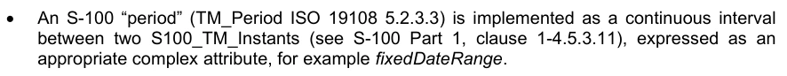

S-100“期”(TM_Period ISO 19108 5.2.3.3)作为两个S-100_TM_Instants之间的连续间隔执行(见S- 100 Part 1 第1至4.5.3.11条),作为一个适当的复杂属性,例如固定距离。

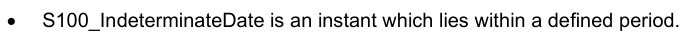

S100_ 不确定时间是位于一个规定期限内的瞬间 。

## 官方 PDF 第 134 页

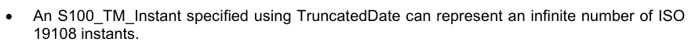

使用 TrncatedDate 指定的 S100_TM_ 即时可以代表无限数量的 ISO

3-8.2 时间关系

S-100没有完全执行ISO 19108的时间地貌的规定,也没有执行时间相对位置;然而,必须使用ISO 19 108. TM_Relatitial Patition 值来界定和描述两个S-100即时和/或期值A和B之间的关系,如下表3-19所显示。 只有标有 (______) 的条目才能在 S100_TM_Instant 是 S100_IndicenteDate 时被有意义地定义,它以有界限的起始或结尾的不确定格式表示.

表3-19——时间值之间的关系(来自ISO 19108 5.2.3.5 TM_Relative)

职位)

A~B A (单 S100_TM_即时) A (单 S100_TM_Period) (单 S100-即时) A (单 S100_TM_Period) (单 S100-即时)

```text
B (Single
S100_TM_Instant)
```

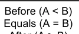

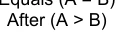

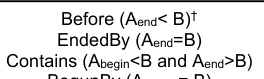

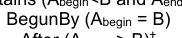

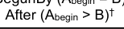

```text
B (Single
S100_TM_Period)
```

```text
Before (A<Bstart)†
```

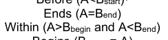

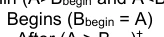

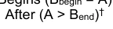

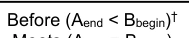


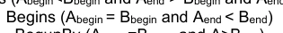

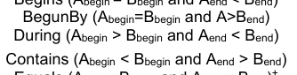


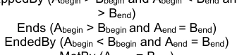

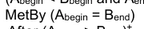

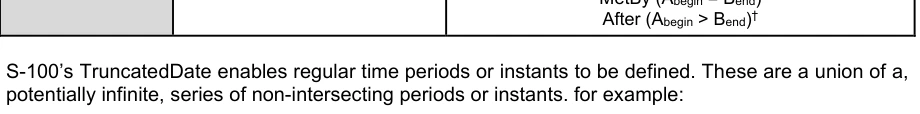

```text
“2021---05” = { 2021-01-05, 2021-02-05, 2021-03-05, 2021-04-05, 2021-05-05, 2021-06-05, 2021-07-
05, 2021-08-05, 2021-09-05, 2021-10-05,2021-11-05,2021-12-05}
```

截断日期可以定义一系列的时段. 以特长格式(B)定义的一组日期(即关系A-B)的单一TM_Instant或TM_Period(A)之间的关系在下文表3-20中界定(限定词“'”指“为所有人”,并指B内部的所有TM_ Periods(注意某些关系(在B之前/之后)),当B是一组没有限定的正常时间段时,可能不加以界定)。

表3-20——时间值与缩短日期之间的关系

A~B A (单机TM_即时) A (单机TM_Period)

```text
Bn (Multiple
TM_Periods)
```


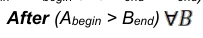

3-8.3 时间间隔和期间模型的解释

周期的起止瞬间(和间隔)必须包括在周期(或间隔)中,除非产品规范具体说明了不同的解释。这是基于ISO 8601:2004§ 2.1.3,该分节将时间间隔定义为“由两个瞬间所分出的时间轴部分”,并规定“A”

## 官方 PDF 第 135 页

时间间隔包括两个限制瞬间之间的所有瞬间,除非另有说明,两个限制即时本身”。 不允许使用“在”或“在“之后”的属性进行间隔。起始和结束瞬间由最小颗粒度的日期/时间组成部分来定义。 例如,如果月份是结束瞬间给出的最小组件,则结束瞬后是整个月份,而间隔则会于月中最后一天结束。例如: 使用此选项来使用降低的准确度表示或切换的Date类型来编码间隔,则导致表3-21. 该表格还说明如何处理跳跃年的特殊情况。

表3-21——期间实例

```text
<S100_TruncatedDateAttributeType>
```

```text
periodStart
```

----01-0000 1月1日至2月29日24:00跳跃年和2月28日跳跃年和2月28日跳跃年

未编码的年份和天数

```text
<S100_TruncatedDateAttributeType>
```

```text
periodEnd
```

```text
----02--
```

未编码的年份和天数

```text
<S100_TruncatedDateAttributeType>
```

```text
periodStart
```

--0101 000 000,每年1月1日至2月28日24:00,没有编码

```text
<S100_TruncatedDateAttributeType>
```

```text
periodEnd
```

```text
----0228
```

未编码的年份

```text
<S100_DateAttributeType>
```

```text
dateStart
```

2012.01050000:2012年1月5日-2012年6月18日24:00 <S100_DateAttroducationType> 互联网档案馆的存檔,存档日期2012-12-05.

```text
dateEnd
```

```text
20120618
```

3-9 截短日期使用的格式专用类型

数据格式可以使用该格式支持的特定类型,以便包含切入值。如果出现这种情况,格式描述必须指定S100_TrunctedDatePatroductionType值和格式特定类型的值之间的映射。

示例:基于 XML 的编码可以使用 gMonthDay 简单的属性类型( 这是一种 XML Schema 内置类型) 作为“ 每年12月 17 日” 的等同表示 :

```text
xs:gMonthDay: --12-17
```

这相当于 ----1217数据格式中严格遵循S-100的值.

3-10 实例标识符

实例识别器应使用海洋资源名称概念和命名空间,MRN名称空间由国际灯塔当局协会通过其海洋资源名称网页进行管理,该网页还载有适用于MRM概念的整套规则的参考文献。 最顶端的名称空间urn:mrn 仍然固定,后续的名称空间由冒号分隔出,并通过应用程序程序在网站上解释。任何希望发布MRN符合标识符的组织都应该向IALA申请名称空间,或者已经注册了名称空间的组织申请名称.

例如,IHO申请命名空间,随后在urn:mrn:iho命名空间下给予所有成员国一个子名空间;对于NOAA来说,这可以是urn:mrn:iho:us和用于CHS.

## 官方 PDF 第 136 页

这可以是骨灰:mrn:iho:ca. NOAA和CHS随后将根据需要并在MRN规则范围内管理各自的命名空间.

以下规则适用于MRN命名空间.

所有使用"mrn" NID的URN的命名空间特定字符串(NSS)必须具有以下结构: 1.

```text
<URN>   ::= "urn:mrn:" <OID> ":" <OSS>
<OID>   ::= 1*(ALPHA / DIGIT) ; Organizational ID
<OSS>   ::= <OSNID> ":" <OSNS> ; Organizational specific string
<OSNID> ::= 1*(ALPHA / DIGIT / "-") ; Organizational specific namespace ID
<OSNS>  ::= 1*<URN chars> ; Organizational specific namespace string

DIGIT   ::= %x30-39 ; 0-9
ALPHA   ::= %x61-7A ; a-z

Basics of the ABNF notation used:
```

" 字元(tterminal ch字符串);引文中不包含的词为非terminars / 备选案文 ()表示一个序列组,作为单个的替代物使用,或作为单个重复组 <a ⁇ b> 表示下个词或组至少可以重复<a>,最多重复"b";默认值分别为0和无穷;注释.

整个URN都是对案例不敏感.

```text
<URN chars>
As defined in RFC2141
```

指定独特的组织ID的过程由IALA管理. 详情和申请过程可以参见IALA的"海洋资源名"(MRN)网页.

3-10.1 利用实例识别资料

当它需要能够发现产品之间相同事物的事例时,无论是同一产品规范还是不同产品规范之间,都需要至少使用一个实例标识符。在需要共同识别的要素类型或信息类型的所有类别实例中,此实例标识码必须是一个属性。 属性必须称为互操作性识别器并必须是URN类数据.


---

# S-100 5.2.1 · 第 4a 部分 · 元数据

非官方机器翻译参考稿，尚未逐条人工校订。公式与代码保留原文，解释以英文规范为准。

## 官方 PDF 第 137 页

S-100 – 第4编a

元数据

## 官方 PDF 第 138 页

5.2.1版实质性变动摘要

已生效的概要条款

## 官方 PDF 第 139 页

中文目录（可用上方目录直接跳转）

4a-1 范围 · 官方 PDF 141
4a-2 符合性 · 官方 PDF 141
4a-2.1 本专用配置与其他标准相一致 · 官方 PDF 141
4a-2.2 后向相容性 · 官方 PDF 142
4a-3 与本专用配置的符合性 · 官方 PDF 142
4a-4 规范性引用文件 · 官方 PDF 142
4a-4.1 专用配置定义 · 官方 PDF 142
4a-4.2 资料性参考文献 · 官方 PDF 142
4a-5 要求 · 官方 PDF 142
4a-5.1 商业目的和预期用途 · 官方 PDF 142
4a-5.2 描述地理数据和其他资源的元数据 · 官方 PDF 144
4a-5.3 义务/条件 · 官方 PDF 144
4a-5.4 最低元数据要求 · 官方 PDF 145
4a-5.5 S-100合同类别 · 官方 PDF 151
4a-5.5.1 第1类 - IHO S-100物体型号符合要求 · 官方 PDF 151
4a-5.5.2 第2类 -- -- 符合非标准编码的IHO S-100 · 官方 PDF 151
4a-5.5.3 第3类 -- -- IHO S-100符合标准编码 · 官方 PDF 151
4a-5.5.4 第4类 -- -- 国际海道测量组织S-100和海事组织统一显示 · 官方 PDF 151
4a-5.6 建议用于地理数据集的元数据 · 官方 PDF 151
4a-5.7 变化和偏好 · 官方 PDF 154
4a-5.7.1 元数据元素元数据识别符 · 官方 PDF 154
4a-5.7.2 元数据元素母元数据 · 官方 PDF 154
4a-5.7.3 数据集的地理范围 · 官方 PDF 154
4a-5.7.4 数据和日期 时间信息 · 官方 PDF 154
4a-5.7.5 元数据扩展信息 · 官方 PDF 154
4a-5.8 服务元数据 · 官方 PDF 155

## 官方 PDF 第 140 页

本页特意留空

## 官方 PDF 第 141 页

4a-1 范围

第4a、4b和4c部分所述的S-100元数据专用配置为描述、验证和交换海道测量组织共同制作的地理数据集的元数据提供了一个规格。 其目的是建立元数据记录,提供关于识别、空间和时间范围、质量、应用Schema、空间参考系统以及数字地理数据分布的信息,适用于数据集的编目、信息交换所活动以及地理和非地理资源的全面描述。 虽然它主要是为了描述数字地理数据,但也可用于描述其他资源,如图表、地图、图像、文字文件和非地理资源,它规定了属性、属性类型、要素、要素类型、特性类型、收集硬件、收集会议、数据集、数据集系列、非地理数据、财产类型、字段会议、软件和服务。 需要注意的是,这个配置并不限于ISO 19115-1代码列表MD_ScopeCode QQCodeColist *=(ISO 191115-1-B.3.28)所列出的资源,如果需要,可以扩展以包括额外资源.

这个专用配置基于ISO 19115-1元数据以及19115 第2部分 — 图像和网格数据元数据。它也考虑到了ISO/TS 19115-3元数据 — XML Schema执行基本概念。

ISO 19115-1提供了一个抽象的结构,通过定义元数据元素和建立一套通用的元数据术语,定义,扩展程序来描述数字地理信息. ISO/TS 19115-3提供了一种eXtensable Markup Language(XML) ISO 19.115-1的应用,并指导了剖面图和扩展.

该文件针对元数据应用程序的开发者和实施者,提供了对地理信息标准化的原则和总体要求的基本理解,应与第4a-4条-规范性参考条款下的标准一并使用。

下列相关文件载有关于S-100元数据实施、编码和质量原则的进一步资料:

(1) S-100 第4b部分 -- -- 图像学元数据扩展和网格数据;

(2) S-100 第4c部分 -- -- 元数据质量原则;

3) 附录4a-C -- -- 元数据执行。

4a-2 符合性

4a-2.1 本专用配置与其他标准相一致

除了ISO 19115-1所列出的元素外,该剖面图还采用了所有相关的19115-1义务和条件,但元数据识别元素除外,该元素已从可选性改为强制性. 这样做是为了通过确定重复的元数据记录实例,以及界定儿童元数据的记录与其母元数据纪录的关系,促进元数据数据的落实和管理,任何元数据等级关系的细节将在产品规范中详细介绍。

考虑到上述变化,以及ISO 19106:2004中记录的要求,本剖析满足了符合第11类的要求. 剖析是ISO 19115-1的群相剖析2,并包括了基准标准3允许的扩展.

这个配置包括了父元数据作为地理数据集的核心元数据元素。如果数据集元数据记录有母元数据记录,则这个元素成为强制性的,因此

1 符合第2节所描述的符合第1类和附录B.3 具有特殊性特征的描述实例(ISO 19106:2004). 2 单一基准标准的描述可包含一个子集,相当于整个基准标准,即一个子组可以等于整体(106:2005, 第15页). 3 这符合附件C(ISO 19.115-1:2014)所包括的规则.

## 官方 PDF 第 142 页

有关 XML 执行情况的指导载于附录4a-C。

4a-2.2 后向相容性

根据ISO 19115-1:2014,ISO继续提供由ISO 19115:2003/Cor 1:2006产生的UML模型供使用. 后向相容性将使用变相服务提供.

4a-3 与本专用配置的符合性

声称符合本专用配置的任何元数据应:

(1) 内容符合ISO 19115-1附件B中的数据词典定义(包括ISO 1915-1 修正案1:2018所要求的修改),但具有强制性义务的元数据要素元数据识别符除外;

(2) 验证XML文件实例以证明符合S-100元数据专用配置Schemas,这些实例可在国际海道测量组织网站的Profiles查阅。

此配置文件的所有产品特定执行必须提供可扩展样式表语言(XSL)转换文件/资源,可以将 XML 文件实例翻译为S-100元数据配置文件 XMl 格式。这些生成的 XMR 文件实例必须使用 ISO/TS 19115-3 XSD 验证.

4a-4 规范性引用文件

本文件的应用需要下列参考文件:关于注明日期的参考文件,仅适用所引用的版本;关于未注明日期的文件,适用所参考文件的最新版本(包括修正案)。

4a-4.1 专用配置定义

用于定义S-100元数据配置的参考文献如下:

ISO 19115-1:2014,"地理信息-元数据" 第1编-基本原理.

ISO 19115-1/Amdt01:2018,地理信息-元数据-第一部分-基本原理(修正案1)

ISO 19115-2:2009,地理信息-元数据- 第2部分:图像和网格数据的扩展

ISO 19119:2016, 地理信息–服务

ISO/TS 19115-3:2016,地理信息-元数据-基本概念的XML计划实施

4a-4.2 资料性参考文献

ISO 19115:2003, 地理信息-元数据

ISO 19115:2003/Cor.1:2006,地理信息-元数据(技术更正1)

ISO/TS 19139:2007, 地理信息-元数据-XML schema执行.

4a-5 要求

4a-5.1 商业目的和预期用途

元数据可以满足一些用途:

## 官方 PDF 第 143 页

1)数据发现 - 内容和质量的简要说明,联系方式,线下分布和线上参考(URL)供线上取景.

2) 数据的使用 -- -- 关于数据覆盖面、维护、内容和数据创建细节的更广泛信息,包括更多的联系、分发和质量细节。

3) 数据适配性 — — 更多关于使用、限制、格式、年龄和范围的细节。这一级元数据帮助用户确定数据是否适合使用。

4) 数据共享 - 关于数据内容,传输格式和空间代表的进一步细节.

5)数据管理 — — 最详细的元数据层次,包括数据质量制度和数据质量测试结果的信息。 有时,当数据在组织之间交换时,这类信息很重要。

图4a-1-商业目的

以上图4a-1说明了不同用户群需要的元数据类型之间的关系,以及本剖面图的范围. 每个基于S-100的产品规范将描述支持数据使用,数据共享和数据管理所需的源和要素级元数据. 对综合元数据的要求更高(如图4a-1中的“Doers”所说明),需要进一步的归属,以便进行源头选择和要素分析。

ISO 19115-1没有提供描述图像所需的全部元数据,这已经包含在ISO 191115的第二部分中,其中包含了描述图像和网格数据所需的元素. ISO 19130 – “图像和被网格化的数据的传感器和数据模型”是与ISO 19115 第2部分有关的重要标准,因为它具体规定了支持可地理参照图像地理定位所需的信息,包括传感器模型定义的传感器描述和相联物理信息、配位功能和地面控制点。 它描述了传感器测量和地理学信息如何逻辑地联系在一起,特别是ISO 19130描述了水道测量声纳要求的传感器和数据模型以及相关的元数据,这将在相关的产品规范中加以描述。

ISO 19115-1的XML执行,它描述了ISO 19115-1中抽象的UML模型如何被转换为XML,在ISO出版物ISO/TS 19115-3中被记录.

虽然这一专用配置主要基于上述标准,但还需要提及其他标准(见第4a-4节)。

此配置文件定义 :

## 官方 PDF 第 144 页

(1) 强制性和有条件的元数据部分、元数据实体和元数据要素;

2) 任何资源的最低元数据要素集,以便符合本专用配置;

3) 地理数据集的核心元数据;

4) 可选元数据要素,以便能对资源进行更广泛的标准描述;以及

5) 扩大《专用配置》以满足专门需要的选择。

专用配置的实施基于ISO/TS 19115-3:2016,包括:

(1) 使用ISO/TS 19115-3:2016 XSD;

2) XML 包含执行ISO 19115-1:2014代码列表的词典文件(ISO 19115-1:2014代码列表格式的XML数据词典);以及

3) S-100地理学界识别码列表的XML数据词典 4.

虽然UML类S100_Metadata特别类MD_Metatadata,但该专有类只涉及母类的限制,因此,为了XML的执行目的,MD-Metatata元素应被用于支持与其它ISO 19100地理信息标准的互操作性.

4a-5.2 描述地理数据和其他资源的元数据

该剖析法确定了描述数字地理数据和资源所需的元数据,并适用于独立的数据集,数据集汇总,地理要素,要素类别和属性. 元数据通过创建XML文档实例来记录,这些实例根据S-100元数据剖析XSDs验证,以及相关的代码列表和引用.

如果产品规范扩展了本剖面图的元数据,则必须遵循附录4a-D中的规则,产品规范必须提供元数据Schema来验证元数据.

元数据记录必须包含符合本专用配置所必需的最低限度核心要素(见第4a-5.3条),还确定了为发现目的需要的一些额外要素,附录4a-C对此作了说明。

质量信息对于评估数据集或资源是否适合使用十分重要,因此,质量元数据已在第4c部分被记录下来。

4a-5.3 义务/条件

已列出义务说明,以说明元数据实体或要素是否必须加以记录,或是否有条件或无条件留给元数据编码器斟酌决定,这一说明可能具有以下价值:M(强制性)、C(有条件)或O(任择性)。

强制性(M)义务是指必须记录元数据类别或元数据要素。

有条件的(C)义务规定了一种电子管理条件,即至少必须有一个元数据类别或元数据要素。

1) 表示两个或两个以上选项之间的选择,至少一个选项是强制性的,必须记录在案。

4 引用要提供的地理标识符代码列表,它们并不出现在ISO 19115 代码列表中. 5 Enuction:一个固定的已命名文字值的有效标识符列表. 被枚举类型的属性只能取自此列表的值(出自:ISO 19136:__,地理信息-地理标记语言 (GML)).

## 官方 PDF 第 145 页

2) 如果已记录到另一个元件,则记录一个元数据类或元数据元素.

3) 如果记录了另一个元数据要素的特定值,则记录一个元数据要素。

如果对条件的答案是肯定的,那么元数据实体或元数据元素必须是强制性的.

可选(O)义务是指元数据类或元数据元素可能被记录或没有记录. 可选的元数据类别和可选元数据要素已被定义,为那些想要完整记录其数据的人提供指南. (使用这组共同的被定义要素将有助于促进全世界地理数据用户和制作者之间的互操作性. )如果不使用可选类别,该类别内包含的要素(包括强制性要素)也将不使用.可选类别的可能具有强制性要素;这些要素只有在使用可取实体时才成为强制性要素.

4a-5.4 最低元数据要求

记录元数据的最低要求包括一些必须完成的元素,以便符合本配置文件,必须指出,这一义务并非对所有元素都具有强制性,但某些有条件的元素在某些条件下(例如资源Type)可能成为强制性的.

表4a-1列出了数据集和其他资源应完成的最低限度元数据要素,这些要素也构成表4a-2所列地理数据集最低限度元数据的一部份。

## 官方 PDF 第 146 页

本页特意留空

## 官方 PDF 第 147 页

表4a-1——地理数据集和其他资源的最低元数据

名称路径数据集 其他资源

元数据文件标识符 MD_Metadata.metadata 标识符 > MD_标识符.code M

元数据语言 MD_Metadata.default Locale > PT_locale. language

```text
C
```

(如果编码过程没有定义则有文件记录)

C(与数据集相同)

元数据字符集 MD_Metadata.default Locale > PT_locale.character Encoding

C(如果ISO 10646-1没有使用,也没有被编码过程所定义,则有文件证明)

C(与数据集相同)

元数据文件父标识符 MD_Metadata.parentMetadata > CI_Citation.identifer

C(如果存在较高层次的等级,则加以记录)

C(与数据集相同)

负责元数据信息的一方

MD_Metadata. contact > CI_Responsibility.CI_Individual (表4a-2) 或 MD_Metadata. contact > CI_Responsibility.CI_Organization (表4a-3) 互联网档案馆的存檔,存档日期2013-12-11.

M(必须记录组织或个人)

M(与数据集相同)

与元数据 MD_Metadata.dateInfo > CI_Date相關的日期

M(规定设定日期,可能提供其他日期)

M(与数据集相同)

资源标题 MD_Metadata. identificationInfo > MD_DataIdentification. 引用 > CI_Citation.title M (见注2)

资源参考日期

MD_Metata. identificationInfo > MD_DataIdentification. 引用 > CI_Citation.date > CI_Date.date.

管理(见附注2)

资源参考日期类型

MD_Metadata. identificationInfo > MD_DataIdentification. 引文使用过时参数coauthors (帮助) CI_Citation.dateType > CI_DateTypeCode

管理(见附注2)

描述资源MD_Metadata. identificationInfo > MD_DataIdentification.abstract M (见注2) 的摘要

## 官方 PDF 第 148 页

名称路径数据集 其他资源

资源默认语言

MD_Metata. identificationInfo > MD_DataIdentification.default Locale > PT_locale. language.

```text
M
```

C( 仅在使用 MD_ DataIdentification 时使用)

资源默认字符集

MD_Metadata. 身份识别Info > MD_数据识别.default Locale > PT_local.character Encoding (中文(简体) ).

C(未使用UTF-8的文档)

C(未使用UTF-8的文档)

主题类别 MD_Metadata. 识别Info > MD_数据识别. topicCategory M

C(如果资源Type = " 系列 " 专题是强制性的)

资源的地理位置(按说明)

MD_Metadata. 身份识别Info > MD_DataIdentification.extent > EQXXXXGraphicDescription.geographic Identification > MD_IDification.code.

C(见附注3和4)

O(见附注4)

西经度

MD_Metata. 识别Info > MD_DataIdentification.extent > EQXXXGraphic BoundingBox. WestBondLongitud e (中文(简体) ).

C(见附注3和4)

O(见附注4)

东经

MD_Metadata. 识别Info > MD_DataIdentification.extent > EQXXXGraphic BoundingBox. EastBondLongitud e (中文(简体) ).

C(见附注3和4)

O(见附注4)

南纬

MD_Metadata. 身份识别Info > MD_DataIdentification.extent > EQXX外接 EQQGraphic BoundingBox. SouthBondLat自相通.

C(见附注3和4)

O(见附注4)

北纬

MD_Metadata. 识别Info > MD_DataIDentification.extent > EQQX外接 EQQGraphic BoundingBox. NorthBondLatth

C(见附注3和4)

O(见附注4)

提供元数据的资源范围/类型名称

MD_Metadata.metadataScope > MD_MetadataScope.resourceScope > MD_ScopeCode(代码列表-ISO 19115-1) 互联网档案馆的存檔,存档日期2013-12-22.

M (默认 = “数据集”) M

提供元数据的资源范围说明

MD_Metadata.metadataScope > MD_MetadataScope.name O

## 官方 PDF 第 149 页

注1 ISO 10646-1 - 信息技术-通用多管编码字符集(UCS).

注2 如果等级等级级=`服务',则可以使用MD_服务标识来代替MD_数据标识。

注3 地理数据集包括地理边界框(西经、东经、南纬和北纬)的元数据或地理描述标识符(建议使用地理界限框 -- -- 见条款4a-5.7.3)。

注4 如果存在西经、东经、南纬或北纬的任何一种,其余三种也必须完成。

表4a-2——个人

名称路径数据集 其他资源

个人名称 CI_ dividual.name

C(如果 " 位置名称 " 和 " 未记录的 " 当事方识别符 " ,则有文件证明)

C(与数据集相同)

个人在组织中的地位 CI_Individual.positionName

C(如果 " 名称 " 和 " 未记录的 " 缔约方识别符 " 有文件证明)

C(与数据集相同)

个人联系信息 CI_dividual > contactInfo > CI_Contact M(见附注6)

M(见附注6)

CI_dividual. Party 的识别符

C(如果 " 姓名 " 和 " 位置 " 没有文件,则有文件证明)

C(与数据集相同)

## 官方 PDF 第 150 页

表4a-3——组织

名称路径数据集 其他资源

组织名称。

C(如果 " 位置名称 " 没有记录,请见注5)

C(与数据集相同)

个人在组织组织中的地位. 位置Name

C(如果 " 姓名 " 没有文件记载,见注5)

C(与数据集相同)

CI_Organization. contactInfo > CI_Contact M(见附注6)的联系信息

M(见附注6)

在命名的组织中的个人 CI_Organization.个人 > CI_Individual M M

CI_Organization. Party Identifer 政党的识别符

C(如果 " 姓名 " 和 " 位置 " 没有文件,则有文件证明)

C(与数据集相同)

注5 S-100对ISO 19115-1作了限制,因为记录CI-Organization的 " logo " 属性不足以省略 " 名称 " 和 " 位置名称 " 。

注 6. CI_Contact属性电话/地址/在线资源/联系指令中至少有一个必须记录在案。

## 官方 PDF 第 151 页

4a-5.5 S-100合同类别

在执行S-100支持时,不同的系统可能对S- 100产品有不同的要求,并且它们遵守S- 100. 框架. ECDIS可能需要非常高的遵守程度;而报告系统则可能要求较低的遵守程度,例如不需要S- 99. 为了便于交流产品规范的意图,以及由此产生的产品,可以宣布S-100遵守类别,界定了四个类别。

4a-5.5.1 第1类 - IHO S-100物体型号符合要求

产品规范中包含一个物体模型,该模型作为要素目录从IHO S-100 GI注册处获得,并符合S-100空间模型(S-100 Parts 7 and 8).

4a-5.5.2 第2类 -- -- 符合非标准编码的IHO S-100

产品规范符合S-100 第11部分的最低要求,产品规范规定了S- 100 第10部分编码方法中的哪一种;或者规定了另一种编码,包括它如何将它映射到S- 100. GFM. 元数据按照S-1000 第4部分是第4部分的剖面图,或者按照第4分规则的扩展.

4a-5.5.3 第3类 -- -- IHO S-100符合标准编码

作为二级,有下列限制:

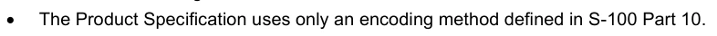

产品规范只使用S-100 第10部分所定义的编码方法.

4a-5.5.4 第4类 -- -- 国际海道测量组织S-100和海事组织统一显示

作为第三级,有下列限制:

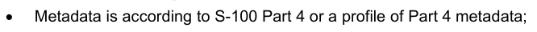

元数据是根据S-100第4部分或第4部分元数据的专用配置;

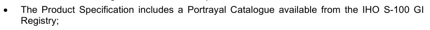

产品规范包括一个取自IHO S-100 GI的相接目录

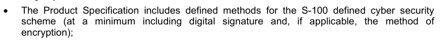

产品规范包括S-100定义的网络安全计划的定义方法(至少包括数字签名,如果适用的话,包括方法)。


测试材料被嵌入产品规范或测试材料中,单独装入包件中,测试案例和相关材料至少可以与IHO相比.

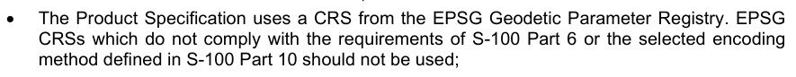

产品规范使用来自EPSG大地测量参数登记册的CRS. EPSG CRS不符合S-100 第6部分的要求或S- 100 第10部分所定义的选定编码方法不应使用;


产品规范酌情包括国际海道测量组织S-100GI登记处提供的警报和指示目录;以及


如果适当,产品规范符合国际海道测量组织S-100GI登记处提供的互操作性目录。

4a-5.6 建议用于地理数据集的元数据

虽然ISO 19115-1定义了广泛的元数据要素,但只使用其中的一个子集,但是,数据集必须保留最低限度的元数据元素(见表4a-1),但在描述地理数据集时,建议使用额外的元数据元数据内容(除地理数据集的最低要求外)。 这套元数据包括最低限度的元数据和一些额外的可选要素,被称为推荐元数据. 表4a-4列出了描述数据集所需的推荐元数据和通常为目录目的的元数据。本列表包含解答下列问题的元数据的元数据: 元数据 元元数据

(1) “是否存在关于某一具体专题的数据集(“什么”)?”

2) `具体地点(“何处”)?

3) `特定日期或期间(“何时”)?

## 官方 PDF 第 152 页

4)`了解更多数据集或订购数据集的联络点(“谁”)?”

通过使用下文所描述的核心元数据,互操作性将得到加强,潜在用户应能毫不含糊地理解地理数据集或资源的特点。

表4a-4——推荐的地理数据集元数据

名称路径义务

此元数据记录的独特标识符

```text
MD_Metadata.metadataIdentifier >
MD_Identifier.code
```

```text
M a
```

元数据语言 MD_Metadata.default Locale > PT_locale.language C b

元数据字符集 MD_Metadata.default Locale > PT_locale.character Encoding

```text
C c
```

元数据文件父标识符

```text
MD_Metadata.parentMetadata >
CI_Citation.identifier
```

```text
C d
```

负责元数据信息的一方

MD_Metata. contact > CI_Responsibility.CI_Dividual或MD_Metata. contact > CI_Responsibility.CI_Organization 互联网档案馆的存檔,存档日期2013-12-02.

```text
M
```

与元数据 MD_Metatadata.dateInfo > CI_Date M有关的日期

元数据标准名 MD_Metadata.metadataStandard > CI_Citation.title O

元数据标准版本 MD_Metadata.metadataStandardVersion O Dataset标题 MD_Metadata. identificationInfo > MD_DataIdentification. 引文使用过时参数coauthors (帮助) CI_Citation. title.

```text
M
```

数据集参考日期MD_Metadata. identificationInfo > MD_DataIdentification. 引文使用过时参数coauthors (帮助) CI_Citation.date

```text
M
```

资源标识符 MD_Metatadata. identificationInfo > MD_DataIDentification. 引用 > CI_Citation.identifer > MD_IDentification.code.

```text
O
```

数据摘要

```text
MD_Metadata.identificationInfo >
MD_DataIdentification.abstract
```

```text
M
```

资源联系点 MD_Metadata. identificationInfo > MD_DataIDentification.point Of Contact > CI_责任

```text
O
```

空间表示类型 MD_Metadata. identificationInfo > MD_DataIDentification.spatialRepresentation Type

```text
O
```

数据集的空间分辨率

MD_Metata. identificationInfo > MD-DataIDentify.spatialSecretion > Md_Secondate. sparatesement. speakers. sarread. 或 MD _Se克勒. sariel. 等同比例或 Md _Shelp.vertical 或MD_Shollect.angularDistance 或 mD_shoel.le.film.

```text
O e
```

数据集语言 MD_Metadata. 识别Info > MD_DataIdentification. language.

```text
M
```

数据集字符集 MD_Metadata. identificationInfo > MD_DataIDentification.default Locale > PT_locale.character 编码

```text
C f
```

数据集主题类别 MD_Metadata. identificationInfo > MD_IDentification.topicCategory

```text
M
```

## 官方 PDF 第 153 页

名称路径义务

数据集的地理位置(以4个坐标或说明表示)

MD_Metadata. 身份识别Info > MD_IDentification.extent > EQXXXXXXGraphic BroundingBox或EQXGraphicDescription

```text
C g, h
```

数据集的时间范围信息

MD_Metadata. 身份识别Info > MD_IDination.extent > EQQExtent.timorElement

```text
O
```

数据集的垂直范围信息

MD_Metadata. 身份识别Info > MD_DataIdentification.extent > EQQX外向.vertical Element > EQQVERTCAL外向

```text
O
```

线性 MD_Metadata.resourceLineage > LI_Lineage O

参考系统 MD_Metadata. 参考系统SystemInfo > MD_ReferenceSystem. 参考系统Systemdentifer > RS_IDifier

```text
O
```

发行格式 MD_Metata.distributeInfo > MD_分送 > MD_格式

```text
O
```

在线链接到资源 MD_Metata.distributeInfo > MD_Distribute > MD_Digital Transfer Option.onLine > CI_OnlineResource

```text
O
```

资源获取和使用方面的制约因素

MD_Metadata. 身份识别Info > MD_数据识别 > MD_Controlints.useLimitations and/或MD_Legal Controls and/或MD_Sense Controls

```text
O
```

提供元数据的资源范围/类型名称

```text
MD_Metadata.metadataScope >
MD_MetadataScope.resourceScope
```

```text
C i
```

(a) 《专用配置》对元数据要素元数据识别符规定了强制性义务。

(b) 语言:如果编码过程没有定义,则用文件记录。

c) 字符编码:如果UTF-8没有使用且没有由编码定义,则记录

进程。

(d) 如果存在更高层次的等级级别(例如,地理 " 数据集 " ),则记录

”是“系列”的一部分。

(e) 偏好距离,而不是等同的尺度,因为比额在下列时间段会发生变化:

屏幕上的大小不同。如果有的话,必须记录距离或等同的大小。

f)字符集:如果ISO 10646-1没有被使用,则记录.

(g) 包括地理边框(范围)或地理描述(是)

建议使用地理界限框----见第4a-5.7.3条。

(h) 如果有西经、东经、南纬或北纬的任何一处存在,则

其余三个也必须完成。

(一)如果资源Scope不等于"数据集",则名称是强制性的.

资料来源:改编自表3 -- -- 地理数据集核心元数据(ISO 19115:2005)。

强制性属性是可忽略的。

## 官方 PDF 第 154 页

4a-5.7 变化和偏好

4a-5.7.1 元数据元素元数据识别符

元数据元素元数据识别符的义务在ISO 19115-1中是“可选的 ” , 但是这个配置文件适用更严格的义务,并定义了扩展,使该义务成为“强制性的 ”。 每个产品规范将为创建文件标识符提供规则。

例如,这可以支持父母与孩子元数据记录之间的联系. 儿童母元数据/CI_Citation.identifer元素的标识码与父母元数据识别符元素的识别码相同,从而支持了元数据的记录之间的分级关系.

4a-5.7.2 元数据元素母元数据

元数据元素父元数据(有条件的义务)作为描述剖析中地理数据集的推荐元数据要素被列入其中,在某些情况下,这个元数据元数据是强制性的,例如,在某些情况下数据集元数据可能是数据集序列的一部分,在这种情况下,母元数据必须被包含在内.

元数据范围的概念允许在一个以上的元数据记录中描述数据集。数据集可能是集合的一部分,在这种情况下,数据集可以在两个元数据的记录中描述:作为自身数据集和集合的一部分。数据集也可能是比较离散的。例如,一个图表可以单独描述,也可以作为集合或(图集)的一部分描述。 有关组织可选择为每一图表制作元数据记录并收集元数据(图表系列),关于元数据范围及其实施情况的进一步资料载于ISO 19115-1附件D和附件E。

4a-5.7.3 数据集的地理范围

ISO 19115-1的空间范围条件决定,如果资源范围是 ' 数据集 ' 那么地理界限框或地理描述是强制性的(ISO 191115-1表B.3),为了使空间搜索更加有效,建议将范围描述为地理界限盒,而不是地理描述。 仅仅完成地理描述代码可能无法满足空间搜索的需要,因为范围可能模糊不清(例如,`法国 ' 可能只指大陆,也可能包括所有外部领土 ) 。 但是,在其他情况下,地理描述被明确界定,并且能够提供更有效的描述手段。 因此,产品规范必须具体说明数据集的地理范围如何描述。

4a-5.7.4 数据和日期 时间信息

元数据和实际数据的日期必须提供。在 MD_Metadata 中,元数据有一个日期戳。在作为 MD-IDnation 的一部分提供的引用中,数据集有制作、发布或修订日期。这些日期不一定相同。 在某些情况下,可以提供一组元数据,用于多组数据,这些数据可能在不同时间已经制作、发布或修订,对相关来源日期的需要不限于数字或地理数据,通过再处理数据获得结果的用户需要知道他们使用的数据的版本。

4a-5.7.5 元数据扩展信息

S100_Metadata类特别 MD_MeTadata 类,将元数据识别器的义务从可选限制为强制. 表4a-5和4a-6提供了S100_Metata扩展的相关信息. 附录4a-A提供了修改后UML图,数据词典的修改值在附录4A-B(表B-1 - 数据词条ISO 19115的修改)中提供.

表4a-5——S100_Metadata的元数据扩展名

```text
MD_MetadataExtensionInformation
```

```text
MD_ExtendedElementInformation
```

```text
name
S100_Metadata
```

MD_Metatadata 的 S- 100 元数据专用配置

## 官方 PDF 第 155 页

强制性

条件

```text
dataType
specifiedClass
```

```text
maximumOccurrence
1
```

```text
domainValue
```

```text
parentEntity
MD_Metadata
```

规则新类

MD_Metadata 扩展理由,包括更改文件标识符的义务

来源组织Name 国际海道测量组织角色拥有者

概念名称,项目名称(在IHO GI 登记簿中)

代码语言中性标识符(编码在 IHO GI 注册处)

表4a-6- S100_Metadata 元数据扩展名

```text
MD_MetadataExtensionInformation
```

```text
MD_MetadataElementInformation
```

```text
name
metadataIdentifier
```

ISO 19115-1:2014 表B.2

义务强制

条件

```text
dataType
Class
```

```text
maximumOccurrence
1
```

```text
domainValue
MD_Identifier
```

```text
parentEntity
S100_Metadata
```

将义务改为强制性

确保文件标识符总是被输入

来源组织Name 国际海道测量组织角色拥有者

概念名称,项目名称(在IHO GI 登记簿中)

代码语言中性标识符(编码在 IHO GI 注册处)

4a-5.8 服务元数据

用于发现服务的元素列表为表4a-7. 元素与数据集的元素相似,只是SV_ServiceIDentification取代了MD_DataIDentation,在文档中增加了两个条件元素,用于记录服务与数据集之间的耦合(如果有的话).

此版本的S-100服务元数据配置文件不记录服务提供的操作,因此,该配置文件省略了ISO 19115-1中定义的与操作信息相关的可选元数据元素和属性.

表4a-7——用于发现服务的元数据

名称路径义务

此元数据记录的独特标识符

```text
MD_Metadata.metadataIdentifier >
MD_Identifier.code
```

```text
M a
```

## 官方 PDF 第 156 页

名称路径义务

元数据语言 MD_Metadata.default Locale > PT_locale.language C b

元数据字符集 MD_Metadata.default Locale > PT_locale.character Encoding

```text
C c
```

元数据父标识符 MD_Metadata.parentMetadata > CI_Citation.identifer

```text
C d
```

负责元数据信息的一方

MD_Metata. contact > CI_Responsibility.CI_Dividual或MD_Metata. contact > CI_Responsibility.CI_Organization 互联网档案馆的存檔,存档日期2013-12-02.

```text
M
```

与元数据相关的日期(创建日期) MD_Metata.dateInfo > CI_Date M

元数据标准名 MD_Metadata.metadataStandard > CI_Citation.title O

元数据标准版本 MD_Metadata.metadataStandard > CI_Citation.edition O

服务标题 MD_Metadata. identificationInfo > SV_ServiceIdentification. 引用 > CI_Citation.title.

```text
M
```

用于识别服务的日期

MD_Metadata. identificationInfo > SV_ServiceIdentification. 引用 > CI_Citation.date.

```text
M
```

资源标识符 MD_Metadata. identificationInfo > SV_ServiceIdentification. 引用 > CI_Citation.identifier > MD_IDification

```text
O
```

资源抽象 MD_Metadata. 识别Info > SV_ServiceIDination.abstract

```text
M
```

责任方 MD_Metadata. identificationInfo > SV_ServiceIdentification. point Of Contact > CI_责任

```text
O
```

空间表示类型 MD_Metadata. identificationInfo > MD_DataIDentification.spatialRepresentation Type

```text
O
```

数据集的空间分辨率

MD_Metata. identificationInfo > MD-IDentify.spatialSecretion > Md_Secondate. sparates. speakers 或 MD"决议"的距离,等同"比例"或"MD"的分辨率. 垂直"或MD_Sholution.angularDistance"或 "MD-Shelp-Sechineter.level"的缩写.

```text
O e
```

数据集语言 MD_Metadata. identificationInfo > MD_DataIdentification.default Locale > PT_locale. language.

```text
M
```

数据集字符集 MD_Metadata. identificationInfo > MD_DataIDentification.default Locale > PT_locale.character 编码

```text
C f
```

服务主题类别 MD_Metadata. identificationInfo > SV_ServiceIdentification.topicCategory

```text
M
```

服务的地理位置(按四个坐标或说明)

MD_Metadata. 身份识别Info > SV_ServiceIdentification.extent.geographic Element > EQQGraphicExtent > EQQGraphic BroundingBox或EQQGraphicDescription

```text
C g, h
```

服务的时间范围

MD_Metadata. 身份识别Info > SV_ServiceIDification.extent > EQXext.temperal Element

```text
O
```

## 官方 PDF 第 157 页

名称路径义务

数据集的垂直范围信息

MD_Metadata. 识别Info > SV_ServiceIDentification.extent > EQQX外向.vertical Element > EQXVERTCAL外向

```text
O
```

线性 MD_Metadata.resourceLineage > LI_Lineage O

参考系统 MD_Metadata. 参考系统SystemInfo > MD_ReferenceSystem. 参考系统Systemdentifer > RS_IDifier

```text
O
```

发行格式 MD_Metata.distributeInfo > MD_分送 > MD_格式

```text
O
```

在线链接 MD_Metadata. identificationInfo > SV_ServiceIDentification. 引用 > CI_Citation. 在线资源 > CI_在线资源

```text
O
```

资源获取和使用方面的制约因素

MD_Metadata. 身份识别Info > SV_ServiceIDentification > MD_约束.useLimitations and/或MD_ligal Controls and/或MD_security Controls

```text
O
```

资源范围 MD_Metadata.metadataScope > MD_Scope.resourceScope

```text
C i
```

运行的数据集

MD_Metata > SV_ServiceIDentification. 已操作的Dataset > CI_Citation

```text
C j
```

运行于 MD_Metadata > SV_ServiceIDination. opeersOn > MD_IDinfer

```text
C j
```

(a) 专用配置对元数据要素元数据识别器规定了强制性义务

(b) 语言:如果编码过程没有定义,则用文件记录。

c) 字符编码:如果未使用且未被编码所定义的 UTF-8 则记录

进程。

(d) 如果存在更高层次的等级级别,则有文件证明(例如,如果地理`数据集 ' )

”是“系列”的一部分。

(e) 偏好距离,而不是等同的尺度,因为比例表在提交时会有所变化,

屏幕上的大小不同。如果有的话,必须记录距离或等同的大小。

f)字符集:如果未使用UTF-8,则记录.

(g) 包括地理界限框(范围)或地理描述(是)

建议使用地理界限框----见第4a-5.6.3条。

(h) 如果存在西经、东经、南纬或北纬的任何一种,则

其余三个也必须完成。

(一) 对非数据集的资源实行强制性规定。

(j) 提及服务运行的资源。对任何一种资源,要么使用 " 运行的数据集 " ,要么使用 " 运行的数据集 " (即不得将两者用于同一资源)。

## 官方 PDF 第 158 页

本页特意留空

## 官方 PDF 第 159 页

附录4a-A 元数据Schema类信息

(规范)

S-100元数据专用配置中包含的元数据结构,参照UML图来定义,这些图可以识别ISO 19115-1:2014中包含的各种元数据包和类别(并被"修正案"1"ISO 1915-1:2018"进一步修改.

新的分类S100_Metadata显示了与MD_Metadata及其相關的元数据类的关系. 为本Profile元数据Schema类取代了ISO 19115-1中的等同图4.

资料来源:根据ISO 19115-1:2014调整。

图4a-A-1-元数据Schema类

## 官方 PDF 第 160 页

本页特意留空

## 官方 PDF 第 161 页

附录4a-B

数据词典

(规范)

ISO 19115-1:2014附件B中的数据词典(并被ISO 191115-1: 2014/Amdt1:2018进一步修改)描述了ISO 1915-1中包含的UML包图所识别出元数据的特点.

表4a-B-1列出了数据词典的修改,这些修改是为了确认本专用配置中引入的元数据元素元数据识别符的延伸。 该表所载资料取代或补充了B.2附件B、ISO 19115-1:2014和ISO 1915-1: 2014/Amdt1:2018中提供的信息。

表4a-B-1——数据词典的修改 ISO 19115-1:2014

名称/ 角色名称定义 Ob Max Occ 数据类型注释

1 MD_ 元数据根实体, 定义资源或资源的元数据

M 1 类 见B.2,附件B,ISO 19115-1:2014

1.1 S100_Metadata 根实体,用于定义资源或资源的元数据

M 1 类专业 MD_ Metata 类

2 元数据标识符 此元数据文件的独有标识符

M 1 字符串自由文本( 已更改)

从任择义务到强制性义务)

Ob = 义务/条件; Max Occ = 最大发生量

## 官方 PDF 第 162 页

本页特意留空

## 官方 PDF 第 163 页

附录4a-C 元数据实施

(规范)

背景 ISO 19115-1:2014 定义了一组元数据元素的内容,定义,数据类型和固有依赖关系. 元数据逻辑模型指定了内容而不是执行形式或列报形式. 资源管理中的首要目标是获取元数据及其描述的相关资源的能力. 这需要使用通用编码方法的软件实施来实现元数据的业务使用.

需要执行"配置"以证明符合. ISO/TS 19115-3:2016是ISO 19115-1:2014的XML Schema执行,可以用来证明部分遵守ISO 191115-1: 2014和S-100元数据配置. IHO已经制定了额外的Schematron规则来强制实施元数据识别元素的额外限制. 通过验证XML文件实例,对照ISO/TS 19115-3:2016 XML Schema定义(XSD)和S-100 Schematron元数据规则,证明遵守了这个配置文件.

虽然S100_Metadata类专门使用MD_Metatadata等,但该专业仅涉及限制元数据识别器从可选到强制. 因此,S-100元数据的S-ML实例必须使用Md_Medata根元,而不是S- 100元数据的 S-Ml 实例,以确保与ISO标准和软件工具的互操作性.

所支持的地理数据外观:将一组相关文件编目在一个可发现的系列中的概念是地图目录的常见做法,有了数字空间数据,数据集的定义就更成问题,并反映了原组织的机构环境和软件环境。 常见的元数据可以被衍生出一系列相关的地理数据集,而这种元数据一般是相关的,也可以被每个数据集实例所继承. 用于支持目录系统内地理数据的这种元数据的继承的软件可以简化数据输入,更新和报告.

执行元数据收集时可以使用可重复使用的元数据有潜在的分级。通过创建几个抽象层次,链接的分级可以帮助过滤用户查询或将用户查询锁定到所要求的详细层次。分级并不一定应该被解释为需要在线管理多个元数据副本。 相反地,一般元数据的定义可以由空间特定元数据加以补充,在被询问时,这些元数据要么继承要么超越一般情况。

通过使用指针,这种方法可以减少一个站点管理的元数据的冗余,并提供用户对持有量的不同看法。这些"指针"由XLink属性在XSD中执行.

元数据文档元素和其他元数据文件中元素之间的依赖可能存在,允许元数据在分级层次之间继承. 元数据的文档元素和标准注册簿的资源之间可能存在依赖,允许不复制内容而再使用标准资源. 无论是出于何种目的,都可以通过使用XLink属性来明确依赖性,这些属性在XML 表示式中大多数属性元素上都有所存在. XLink:href用于指向被再使用的资源. X Link:arcrole用于表示被再利用的类型. XC:作用用于指出被再使用的资源的性质.

## 官方 PDF 第 164 页

本页特意留空

## 官方 PDF 第 165 页

附录 4a-D 元数据扩展

(规范) 这些规则是对ISO 19115-1:2014附件C中规定的元数据扩展规则的修改,这些规则意在作为如何扩展S-100元数据的共同规则,旨在创建一个给实施者提供可预测性的共同进程.

扩展类型

允许下列类型的延期:

1) 增加一个新的元数据包;2) 创建一个新的元数据的编码列表来取代一个已被列为域值的"自由文本"的现有元数据元件的域;3) 建立新的元数据编码列表元件(扩展一个编码列表);4) 添加一个新的元件元件;5) 新增一个新的元项目类; 6) 对现有元数据要素规定更严格的义务;7)对现有元数据要素规定更严格的领域。

创建扩展名时

在扩展元数据创建之前,必须仔细审查ISO 19115-1内部现有的元数据,以确认不存在合适的元数据。如果ISO 19115/1内部存在合适的元数据的,那么必须使用它。对于每个扩展元数据的包,类和(或)元素,必须定义名称,定义,义务,条件,最大发生量,数据类型,以及域值. 关系应加以界定,以便确定一个结构和Schema。关系必须足够明确,以便清楚扩展元数据与S-100的各个组成部分,包括用于创建扩展元数据的产品的现有元数据的关系。

创建扩展的规则

1) 扩展元数据要素不得用于改变已存在要素的名称,定义或数据类型.

(2) 扩展元数据可被定义为类别,并可能包括扩展元数据要素和现有的元数据要素作为组成部分。

(3) 允许延长,以对现有元数据要素规定比标准要求更严格的义务。 (标准中可选的元数据要素在延长时可能是强制性的)。

(4)允许扩展包含域比标准限制性更强的元数据元素。 (其域在标准中具有自由文本的元数据的元素可能在配置文件中有一个封闭的合适值列表.

5)允许扩展以限制标准允许的域值的使用. (如果标准包含已存在的元数据元素域中的5个值,扩展可以指定其域由3个域值组成. 扩展需要用户从3个被域值中选择一个值. )

6) 允许扩展以扩大编码列表或所列举列表中的数值数量; 禁止扩展编码列表,甚至禁止在配置图中扩展所列举的列表; 当必须扩展时,应注意尽量减少其他条目的数量; 此外,扩展编码清单或所列出的列表应公布或以其他方式提供。

7) 延期不得允许任何S-100所不允许的行为。

8) 文件的参考材料在格式化后必须为URI型.

## 官方 PDF 第 166 页

注:对于S-98所述S-100 ECDIS中使用的产品规范,这些扩展规则不适用于S- 100 第17部分所述的交易所目录专用配置,因为这些产品的第17部分只能限制在产品规范一级。


---

# S-100 5.2.1 · 第 4b 部分 · 影像与格网数据元数据

非官方机器翻译参考稿，尚未逐条人工校订。公式与代码保留原文，解释以英文规范为准。

## 官方 PDF 第 167 页

S-100 – 第4编b

影像与格网数据元数据

## 官方 PDF 第 168 页

5.2.1版实质性变动摘要

已生效的概要条款

## 官方 PDF 第 169 页

中文目录（可用上方目录直接跳转）

4b-1 范围 · 官方 PDF 171
4b-2 规范性引用文件 · 官方 PDF 171
4b-2.1 资料性参考文献 · 官方 PDF 171
4b-3  影像与格网数据元数据 · 官方 PDF 172
4b-3.1 相关ISO标准 · 官方 PDF 172
4b-3.2 元数据包 · 官方 PDF 172
4b-3.2.1 元数据实体集用于图像学 · 官方 PDF 174
4b-3.2.2 图像学数据质量信息 · 官方 PDF 174
4b-3.2.3 图像学空间代表信息 · 官方 PDF 174
4b-3.2.4 图像学的内容信息 · 官方 PDF 174
4b-3.2.5 图像学的获取信息 · 官方 PDF 175
4b-4 UML 图与数据字典 · 官方 PDF 175

## 官方 PDF 第 170 页

本页特意留空

## 官方 PDF 第 171 页

4b-1 范围

第4a、4b和4c部分的一般范围已在第4a部分开头作了说明,具体涉及管理大量图像和网格数据的要求日益增加,而大多数海道测量组织除了处理矢量数据外,还有这种要求。 有许多不同的图像和网格数据格式,这类数据集经常被存储在分布式系统中,导致数据发现,管理和交换等出问题.

图像和网格数据的生产遵循通常从数据收集、扫描图表和参考文件以及其他感知方法开始的过程,这些类型的数据集经常被用于纸上图表、电子导航图表、Raster导航图表和航海出版物的制作。 它们的生产过程需要记录下来,以便维持对最终产品的质量控制,此外,关于测量过程几何学的元数据以及测量设备的特性需要保留在原始数据中,以支持生产和维护过程。

这个元数据S-100的部分基于ISO 19115-2:2009.

4b-2 规范性引用文件

下列引用文件对本文件的应用不可或缺。对于注明日期的参考文献,仅适用所引用的版本。对于未标明日期的参考资料,适用所参考文件的最新版本(包括任何修正)。

ISO/TS 19103, 地理信息——概念计划语言

ISO 19107:2003, 地理信息-空间计划.

ISO 19115-1:2018,"地理信息-元数据" 第1部分-"基本原理"(以"ISO 19115-1:2014"发表,后由"2018年第1号修正案"修改).

ISO 19115-2:2009,地理信息-元数据- 第2部分:图像和网格数据的扩展

ISO 19119:2016, 地理信息–服务

ISO/TS 19115-3:2016,地理信息-元数据-基本概念的XML计划实施

ISO 19157:2018,"地理信息-数据质量"(被公布为ISO 19157:2013,由"2018年修正案"1所修改).

IHO S-61 Raster导航图产品规范

4b-2.1 资料性参考文献

以下参考文献已被后期版本所取代,或有用,但并非规范性的:

ISO 19115:2005, 地理信息-元数据.

ISO/TS 19139,地理信息-元数据-XML计划实施.

ISO 19119:2005, 地理信息-服务

## 官方 PDF 第 172 页

4b-3 影像与格网数据元数据

ISO 19115-1确定描述数字地理学数据所需的元数据,本节所描述的扩展则确定描述数码地理学图像和被网格化的数据所需的元数据和数字地学图像和已网格相式元数据也可以提供数据集的汇总.

4b-3.1 相关ISO标准

ISO 19115-1是适用于所有地理数据集的一般元数据标准,它确定了一组来自许多元数据要素的核心元数据,并规定了使用这些元数据的条件(即强制性、有条件或可选性)。 尽管ISO 19115-1中有一些服务元数据(特别是在识别领域),但大部分服务元数据的定义是在ISO 19119(Services)中. ISO 191115对描述空间和时间Schemas的有限元数据做出了规定.

ISO 19115-2扩展了ISO 191115中定义的元数据,并确定了描述图像和网格数据所需的额外元数据(如数据质量,空间代表,内容和获取信息等). 它提供了有关用于获取数据的测量设备的特性、设备所使用的测量过程的几何特征以及用于使原始数据数字化的生产过程的信息。

地缘定位信息是图像所需的非常重要的元数据组成部分. ISO 19115-1和19115-2可能没有包含足够的地缘分布元数据用于图像和被网格化的数据,因此可能有必要参考ISO 19130. 该标准具体规定了支持地缘位置所需的额外信息,并定义了传感器测量和地缘划分信息如何逻辑关联. ISO 19130中的地理参考信息是ISO 19115-2中描述的子集. 为了开发出一整套图像元数据,可能需要将ISO 191115-1和19115-2的相关部分与ISO 191330中的地理定位信息或传感器属性相融合.

ISO 19115-3 - XML Schema执行基本概念,通过定义新的约束类型来扩展ISO 191115-1和19115-2,这些约束类型可以进一步完善执行的元数据要素,它也定义了用于从ISO抽象UML模型中衍生出XMLschema的规则.

4b-3.2 元数据包

ISO 19115-1所载包与地理空间图像和网格数据的扩展之间的关系在下图4b-1中列示,其他包的依赖性也在图中显示. ISO-19115-2包显示为无填,ISO 1915-1包为灰色填,而其他(ISO 19107 (地心测量),ISO-19157 (数据质量)和ISO 19103 (概念斯克马语言))则显示为其他颜色. 这些元数据扩展已使用UML模型和一个数据词典作了充分记录,分别载于ISO/TC211 19115-2-附件A和附件B。

## 官方 PDF 第 173 页

图4b-1——元数据包(取自ISO 19115-2:2018)

也必须指出,为确保全球独有性,ISO/TS 19103要求所有类名都必须由双阿尔法前缀来定义,该前缀可以识别一个类所属于的包. ISO 19115系列使用前缀MD(Metadata),CI(Citation),DQ(Data质),EX(Extent)和LI(Lineage). 为了区分ISO 19115-1和ISO 191115-2(图像和被网格化数据的扩展)中使用的类别,MI前缀用于图像和已网格元数据,LE和QE分别用于扩展线和数据质量类(数据质量级现在由ISO 19157定义. )表4b-1包含用于元数据的类的包标识符列表.

表4b-1-UML 包的标识符

标识符信息类型标准

MD 元数据 ISO 19115-1

MI 图像学元数据 ISO 19115-2

DQ 数据质量ISO 19157

QE 数据质量扩展 ISO 19115-2

CI 引用 ISO 19115-1

LI 线性 ISO 19115-1

LE 图像学扩展线程 ISO 19115-2

ISO 19115-1 范围

GM 几何 ISO 19107

MX元数据 — XML Schema ISO/TS 19139

## 官方 PDF 第 174 页

PT 多语言文字 ISO/TS 19103

RS 参考系统 ISO 19115-1

SC 空间坐标 ISO 19111

SV 服务元数据 ISO 19115-1

4b-3.2.1 元数据实体集用于图像学

MI_Metadata是MD_MeTadata的一个子类,它汇总了可选实体 MI-Acquistitual Information. 分别见ISO 19115-2中的A.2.1和B.2.1节,以获取补充描述信息和数据词典.

4b-3.2.2 图像学数据质量信息

关于制作图像或网格数据集所使用的来源和生产过程的信息已被列入一个额外的图像学数据质量包,因为ISO 19115-1只规定了对质量的一般评估。 ISO 19115-2,A.2.2和B.2.2节以及ISO 19157分别提供了分类和相关数据词典的更详细描述.

1)QE_CoverageResult是D ⁇ Result和汇总信息的一个指定子类,用于报告覆盖范围的数据质量,它基于ISO 19115和ISO 19139的概念.

2) QE_Usibility 是指定的 DQQElement 子类,旨在提供用户特定性.

3) 关于某一数据集是否适合某一特定应用的高质量信息。

4) LE_ProcessStep是LI_ProscessStop中指定的子类,并包含关于用于生成数据的算法和处理过程历史的附加信息. LE-ProcustStep聚合了以下实体: 数据类型:

(a) LE_Processing,描述程序(例如所使用的软件、参数和

处理文档),该算法用于从源数据生成数据. LE_Processing acroups LE-Agorithm,它描述了从源数据的获取数据的方法; (b) LE _ProcustStepReport识别了描述处理的外部信息.

数据; c) LE_Source是 LI_Source 指定的子类,并描述 a 的输出

进程步骤。

4b-3.2.3 图像学空间代表信息

本套件包含关于用于表示空间信息的机制的信息。本套件定义了以下实体:

1) MI_Georected包含检查点信息,以进一步具体说明图像或被网格化的数据的地理校正细节。它聚合了MI_GCP;

2) MI_GeoReferenceable 规定包含可用于地理定位数据的额外信息,它汇总了MI_Geolocation Information.

4b-3.2.4 图像学的内容信息

虽然这个包是ISO 19115-1的一部分,但为了更好地满足图像和网格数据的需要,已经包括了下列实体:

1) MI_Band(MD_Band的子类) - 为在图像和被网格化的数据集中指定单个波长波段的属性而定义附加属性;

2) MI_ ImageDescription(MD_ ImageDescription的子类) - 用于聚合 MI_ RangElementDescription;

3) MI_CoverageDescription(MD_CoverageDescription的子类) - 用于聚合 MI_RangeElementDescription ;

4) MI_RangElementDescription - 用于提供覆盖数据集中使用的射程元素.

## 官方 PDF 第 175 页

4b-3.2.5 图像学的获取信息

MI_Accessition Information是以下实体的汇总: MI_Accessition Information.

1) MI_仪器(用于获取数据的测量仪器);

(2) MI_业务,(数据所贡献的整个数据收集程序);

3) MI_Platform(数据取自的平台);

4) MI_目标(拟观测对象的特征和几何);

5) MI_要求(用来得出购置计划的用户要求);

6) MI_Plan(为获取数据而实施的购置计划).

还需要另外两个类别,提供关于获取数据的信息。

1) MI_Event 描述在数据获取过程中发生的重大事件。事件可以与操作、目标或平台通过相联;以及

2) MI_PlatformPass 识别平台在数据获取过程中取得的某一特定通行证,用于为某一事件和特定目标的数据获取提供辅助识别信息.

4b-4 UML 图与数据字典

图像和被网格化的数据的元数据Schemas以UML类图的形式被收录到ISO 19115–2(附件A)中. 这些图可以增强ISO 19115-1中显示的UML图.

ISO 19115-2,附件B载有附件A所定义的元数据Schemas的要素和实体定义。 字典与附件A中图表一起,结合了ISO 19115/1中UML图表和数据词典,可以充分定义元数据的总抽象模型。

ISO 19115-1规定的编号及其值是规范的,对编号的用户扩展必须遵循ISO 19115-1和S-100附件4a-E所描述的规则.

## 官方 PDF 第 176 页

本页特意留空


---

# S-100 5.2.1 · 第 4c 部分 · 数据质量元数据

非官方机器翻译参考稿，尚未逐条人工校订。公式与代码保留原文，解释以英文规范为准。

## 官方 PDF 第 177 页

S-100 – 第4编c

元数据 - 数据质量

## 官方 PDF 第 178 页

5.2.1版实质性变动摘要

已生效的概要条款

## 官方 PDF 第 179 页

中文目录（可用上方目录直接跳转）

4c-1 范围 · 官方 PDF 181
4c-2 参考文献 · 官方 PDF 181
4c-3  内容 · 官方 PDF 182
4c-3.1 ISO 19138 质量计量和UML类 · 官方 PDF 182
4c-3.2 核心元数据 · 官方 PDF 182
水道测量质量元数据专用配置：UML 图 · 官方 PDF 183
水道测量质量元数据专用配置：数据字典 · 官方 PDF 185
水道测量质量元数据属性定义 · 官方 PDF 191

## 官方 PDF 第 180 页

本页特意留空

## 官方 PDF 第 181 页

4c-1 范围

第4a、b和c部分的一般范围已在第4a部分开头说明,该部分是元数据质量指导,包括ISO 19113、19114和19138所述的质量措施,并符合ISO 19106地理信息-概况,其中说明了编制19100系列标准简介的规则。 本指南适用于国际海道测量组织水道测量数据集、数据集系列以及个别要素和要素特性,旨在满足水道测量要求并描述如何记录数字地理数据质量信息。

本部分的目的是:

1) 向数据生产者提供适当的信息,使其地理数据具有适当的特征;

(2) 使用户能够确定持有的地理数据是否对他们有用。

它定义:

(1) 强制性和有条件的元数据部分、元数据实体和元数据要素;

2)可选元数据要素,以更详细地描述地理数据.

虽然本文件基本上以上述标准为依据,但酌情提及了其他标准。 (见第4c-2节参考资料)。

4c-2 参考文献

以下规范性文件载有一些规定,通过本案文的参考,这些规定构成本元数据指南的规定。

ISO 19104, 《地理信息-术语》

ISO 19106, 地理信息 – 简介

ISO 19107, 地理信息 – 空间计划

ISO 19108, 地理信息 – 时间计划

ISO 19115:2003, 地理信息-元数据

ISO 19113, 地理信息-质量原则

ISO 19114, 地理信息 – 质量评价程序

ISO 19138, 地理信息-质量衡量标准

ISO 19139 地理信息 – 元数据 – XML schema 执行(初步技术规格草案).

ISO 639, 语言名称代表代码

ISO 3166-1, 国家及其分支名称代表编码 -- -- 第1部分:国家编码

ISO 8601:2000, 数据元素和交换格式 -- -- 信息交换 -- -- 日期和时间的表示

ISO 639-1:2002,语言名称代表代码 - 第1部分:Alpha-2代码

ISO 639-2:1998,语言名称代表代码 -- -- 第2部分:Alpha-3代码

## 官方 PDF 第 182 页

4c-3 内容

ISO 19115定义了近300个元数据元素,其中包括一组核心元数据要素. S-100 Part 4c(Metadata)概括地描述了这些元素在S-100内部的用法,然而,为了充分描述水道测量数据需要额外的元素. 本文描述了ISO 19138所定义和描述的质量计量要素.

4c-3.1 ISO 19138 质量计量和UML类

国际海道测量组织质量元数据指南包含水道测量要求的可选质量元数据的元数据元素,还有19115个元素可供使用;然而,这些元素可能不被不符合此配置的系统识别出. 本配置中使用的元数据包以"统一建模语言"(UML)类图表显示于附录4c-A.

S-100质量度量衡分级结构出自ISO 19115地理信息元数据. S- 100质量分级中描述的属性各对应独立的质量度量,这些措施的完整描述载于ISO 19138地理信息数据质量分等分级.

所有S-100质量计量都是有意的可选的,这样可以对不同类型的数据使用不同的计量. 当多个属性以不同的方式描述同一计量时,要么只使用一种计量,要么必须用一致的方式描述计量.

其他质量措施可在ISO 19138附件B所述的质量措施注册簿中加以说明。

4c-3.2 核心元数据

核心元数据元素在S-100 第4a部分中被描述. 数据集和要素质量元数据可以链接到一个更高层次的域上,所有这些层次都可以在一个文件或单独的元数据文件中提供.

## 官方 PDF 第 183 页

附录 4c-A 水道测量质量元数据专用配置, UML 图

（资料性）

图4c-A-1——数据质量UML(来自ISO 19115)

图4c-A-2——数据质量计量登记UML(取自ISO 19138)

## 官方 PDF 第 184 页

本页特意留空

## 官方 PDF 第 185 页

附录 4c-B 水道测量质量元数据专用配置,数据词典

(规范)

下面的水道测量元数据目录表取自ISO 19115标准.

该表载有以下信息:

1) 第1栏"ISO行号"指ISO 19115标准的行号,但由于本剖面图并未使用所有19115个元素,行号可能并不总是相接相接.

2) 名称/作用名称是指定给元数据实体或元数据元素的标签,其他栏目可以给出其他语言的名称或含义.

3) 定义一栏对元数据实体/要素作了说明。

4)义务描述符提供一种说明,说明元数据实体或元数据要素是否始终必须被记录,或者有时只能被记录下来,这种描述符可能具有以下值:M(强制性),C(有条件),或O(可选).

5) 发生量栏指定了元数据实体或元数据元素可能拥有的最大实例数。单点出现数用“ 1” 表示;重复出现数以“ N” 来表示。允许非一个固定数字出现数,并将用相应的数字(即“ 2” 、“ 3”...etc)来表示 。

6)数据类型指定了一组代表元数据元素的特异性值;例如:整数,真数,字符串,日期时,和布尔等. 数据类型属性也用于定义元数据实体,定型和元数据关联.

7) 域-对于一个实体,域指该实体所覆盖的行号.

## 官方 PDF 第 186 页

本页特意留空

## 官方 PDF 第 187 页

ISO 线

没有。

名称/ 角色

名称

定义义务

数据类型域

B.2.4 数据质量信息

B.2.4.1 概况

78 DQQD 数据质量 数据质量范围规定数据的质量信息.

使用引用对象中的义务

使用引用对象的最大出错

```text
Aggregated Class
(MD_Metadata)
```

79-81号线

79 范围 数据质量信息所适用的具体数据

M 1 类 DQQ 范围 QQDataType ⁇ (B. 2.4.4)

80 角色名称:报告

范围所指定数据的定量质量信息

C/ 系系没有提供?

N 协会 DQQElement QQAbstract ⁇ (B 2.4.2)

81 角色名: 外系

关于范围所指定数据种类的非定量质量信息.

C / 报告未提供?

1 自由线协会(B 2.4.1)

B.2.4.2 家族信息

B.2.4.2.1 概况

82 LI_线程信息 构建由范围或缺乏对行系的了解所指定数据所使用的事件或源数据

使用引用对象中的义务

使用引用对象的最大出错

```text
Aggregated Class
(DQ_DataQuality)
```

83-85号线

83份说明 数据生产者对数据集的分界知识的一般解释

C / (DQQDataQuality.sco pe.DQQSCope.level = “数据集”或“系列”)?

1 字符串自由文本

84 角色名: 进程Step

关于范围所指定数据创建过程中的事件的信息

C. 如果未提供说明和资料来源,则必须提供?

N 协会LI_ProcessStep(B.2.4.1.1.1)

85 角色名:来源

关于创建范围所指定数据的源数据的信息

C / 如果声明和处理程序不提供,则必须这样做?

N 自由-来源协会(B.2.4.1.2)

## 官方 PDF 第 188 页

ISO 线

没有。

名称/ 角色

名称

定义义务

数据类型域

B.2.4.2.2 进程步骤信息

86 LI_ProcessStep 关于范围所指定数据创建过程中的事件的信息

使用引用对象中的义务

使用引用对象的最大出错

```text
Aggregated Class
(LI_Lineage)
```

86-91号线

87 描述事件,包括相关参数或可容忍性

M 1 字符串自由文本

88 进程步骤的要求或目的 O 1 字符串自由文本

进行程序步骤的日期、时间或范围

O 1 类日期时间(B.4.2)

90 与程序步骤有关的个人和组织的身份和联系方式

O N 类 CI_ 责任方 QQDataType ⁇ (B.3.2)

91 角色名称:来源

关于创建范围所指定数据的源数据的信息

O N 协会 LI_来源(B.2.4.1.2)

B.2.4.2.3 来源资料

92 LI_关于创建范围所指定数据所使用的源数据的来源信息

使用引用对象中的义务

使用引用对象的最大出错

```text
Aggregated Class
(LI_Lineage)
```

93-98号线

93 描述 来源数据C/源代码的详细描述 extent not

提供?

1 字符串自由文本

```text
94
scaleDenominat
or
```

源地图上代表分数的解码器

O 1 类 MD_ 代表方略 QQDataType ⁇ (B. 2.2.3)

```text
95
sourceReferenc
eSystem
```

源数据所使用的空间参考系统 O 1 Class MD_ReferenceSystem(B.2.7)

96 源数据建议参考

O 1 类 CI_Citation QQDataType ⁇ (B.3.2)

97 源数据空间、垂直和时间范围的信息

C/描述不是N类 E-X Extent + 数据类型 (B.3.1)

## 官方 PDF 第 189 页

ISO 线

没有。

名称/ 角色

名称

定义义务

数据类型域

提供?

98 角色名: 源代码

源数据创建过程中的事件信息

O N 协会LI_ProcessStep(B.2.4.1.1)

B.2.4.2 数据质量要素信息

99 DQQEEFENT 适用于数据质量范围所指定数据的测试类型

使用引用对象中的义务

使用引用对象的最大出错

总分类线 100-107

```text
100
nameOfMeasur
e
```

数据应用的测试名称 O N 字符串自由文本

```text
101
measureIdentific
ation
```

代码识别已注册的标准程序 O 1 Class (19138 List) MD_Identifer. IHO_DqMeasure QX DataType ⁇ (B.2.7.2)

```text
102
measureDescrip
tion
```

O 1 字符串自由文本

```text
103
evaluationMetho
dType
```

用于评价数据集质量的方法类型

O 1 类 D 评估 方法 TypeCode + 编号 (B.5.6)

```text
104
evaluationMetho
dDescription
```

描述评价方法 O 1 字符串自由文本

```text
105
evaluationProce
dure
```

程序信息参考 O 1 City CI_Citation QXDataType ⁇ (B 3.2)

106 数据质量计量标准适用日期或范围

O 1 类日期时间(B.4.2)

107 结果 采用数据质量计量或根据特定可接受的符合质量水平评估所得价值(或一套价值)获得的价值(或一套价值)

M 二等兵D- Result· DataType- (B. 2.4.3)

## 官方 PDF 第 190 页

本页特意留空

## 官方 PDF 第 191 页

附录4c-C 水道测量质量元数据属性定义

```text
DQ_AbsoluteExternalPositionalAccuracy
```

报告的协调值与被接受为或真实的值的相近。 [标 ISO 19115]

公共属性 :

```text
meanValuePositionalUncertainties[0..1] : Real
```

一组位置的定位不确定性的平均值,其中定位不确定性被定义为被测量位置与被认为是对应真实位置之间的距离。 [从ISO 19138 缩写出

```text
meanExcludingOutliers[0..1] : Real
```

位置不确定性的平均值,不包括外部值。对于距离不超过所定义阈值的一组点,其测量位置与被认为是相应真实位置之间的相距的计算平均值。 [从ISO 19138 中推算出来]

```text
numberOfPositionalUncertaintiesAboveThreshold[0..1] : Integer
```

一组位置高于某一阈值的位置不确定性数。 错误的定义是测量位置与被认为是对应真实位置之间的距离 。 [从ISO 19138 缩写出]

```text
rateOfPositionalErrorsAboveThreshold[0..1] : Real
```

相对于所测量位置总数,一组位置的某一阈值以上位置不确定性的数目。错误的定义是:所测量的位置与被认为是相应真实位置之间的距离。 [从ISO 19138 中校对]

共变 Matrix [0. 1]: 真实矩阵

对称平方矩阵与这些坐标之间主要对角和对角坐标相差的点位相差取出离对角元素。 [从ISO 19138 引出

```text
linearErrorProbable[0..1] : Real
```

由正值以概率为50%的上下限定义的间隔的半长。 [从ISO 19138 缩写出]

```text
standardLinearError[0..1] : Real
```

由上下限定义的间隔的半长,真实值以68.3%的概率为单位. [从ISO 19138 。

```text
linearMapAccuracy2Sigma[0..1] : Real
```

由上下限定义的间隔的半长,其中真实值为概率90%。[从ISO 19138 。

```text
linearMapAccuracy3Sigma[0..1] : Real
```

以95%概率为正值的上下限定义间隔的半长. [从ISO 19138 。

```text
linearMapAccuracy4Sigma[0..1] : Real
```

以99%概率为正值的上下限所定义的间隔的半长. [从ISO 19138 缩写出].

```text
nearCertainityLinearError[0..1] : Real
```

以99.8%的概率值为正值的上下限定义的间隔的半长. [从ISO 19138 缩写出].

RMSError [0. 1]: 真实的

标准偏差,即真实值不是从观测结果中估算,而是先入为主。[从ISO 19138 。

```text
circularStandardDeviation[0..1] : Real
```

## 官方 PDF 第 192 页

半径描述一个圆圈,真实点位置位于39.4%的概率. [从ISO 19138 缩写出].

```text
circularErrorProbable[0..1] : Real
```

半径描述一个圆,真实点位置位于50%的概率上. [从ISO 19138 缩写出].

```text
circularMapAccuracyStandard[0..1] : Real
```

半径描述一个圆圈,真实点位置与90%的概率相接. [从ISO 19138 缩写出].

```text
circularError95[0..1] : Real
```

半径描述一个圆圈,真实点位置位于95%的概率上. [从ISO 19138 缩写出].

```text
circularNearCertaintyError[0..1] : Real
```

半径描述一个圆圈,其中真实点位置的概率为99.8%. [从ISO 19138 缩写出].

```text
RMSErrorPlanimetry[0..1] : Real
```

绕出一个特定点的圆圈的半径,其中正值与正值同为P. [从ISO 19138分出].

CMASEOR [0. 1]: 真实的

数据坐标的绝对水平精确度,以环形误差表示,概率为90%,因为存在偏差,按照ISO 19138. [从ISO 19 138. 中调出] 表D.48的等式.

```text
ACE_CE90[0..1] : Real
```

数据坐标的绝对水平精确度,以环形误差表示,概率为90%,因为存在偏差,根据ISO 19138. [从ISO 19 138. 中分出] 表D.49中的等式.

```text
uncertaintyEllipse[0..1] : Record
```

带有两轴的2D椭圆,表示一二一分点最高和最低不确定性的方向和大小. 数据值是真实数字记录,对应"phi"主要半轴的轴承,以及"a"和"b"两个轴的长度,按照ISO 19138. ISO 表D.50中的等式排列. [从ISO 19138. 中校对].

```text
confidenceEllipse[0..1] : Record
```

带有两个主轴的2D椭圆表示一个2D点最高和最低不确定性的方向和大小. 数据值是真实数字的记录,对应"phi"主要半轴的轴承,以及"a"和"b"两个轴的长度,按照ISO 19138年D.51表的等式和一个意义级参数. [从ISO 19 138. 中缩写出].

```text
DQ_AccuracyOfATimeMeasurement
```

某一项的时间引用正确性(报告时间测量错误)。 [标 ISO 19115]

公共属性 :

```text
attributeValueUncertaintyMean[0..1] : Real
```

数据质量测量值表示不确定性的属性值,其中由上下限定义的间隔长度的一半,其中定量属性的真实值为50%的概率. [从ISO 19138 中推算出]

```text
attributeValueUncertainty1Sigma[0..1] : Real
```

此数据质量测量表示不确定性的属性值,其中由上下限定义的间隔长度的一半,定量属性的真实值的概率为68.3%. [从ISO 19138 中调出]

```text
attributeValueUncertainty2Sigma[0..1] : Real
```

## 官方 PDF 第 193 页

数据质量测量值表示不确定性的属性值,其中由上下限定义的间隔长度的一半,量化属性的真实值的概率为90%. [从ISO 19138 中调出]

```text
attributeValueUncertainty3Sigma[0..1] : Real
```

数据质量测量值表示不确定性的属性值,其中由上下限定义的间隔长度的一半,定量属性的真实值为95%的概率. [从ISO 19138 中推算出]

```text
attributeValueUncertainty4Sigma[0..1] : Real
```

数据质量测量值表示不确定性的属性值,其中由上下限定义的间隔长度的一半,其中定量属性的真实值为99%的概率. [从ISO 19138 中调出]

```text
attributeValueUncertainty5Sigma[0..1] : Real
```

数据质量测量值表示不确定性的属性值,其中由上下限定义的间隔长度的一半,定量属性的真实值的概率为99.8%. [从ISO 19138 中推算出]

```text
DQ_CompletenessCommission
```

数据集中存在的过量数据。 [如果 ISO 19115]

公共属性 :

```text
excessItem[0..1] : Boolean
```

这一数据质量测量表明数据中存在不正确的项目。 [从ISO 19138 缩写]

TRUE 表示项目超过此值的 Boolean 。

```text
numberOfExcessItems[0..1] : Integer
```

这个数据质量测量表示数据集中本不该在数据集中的项目数量. [从ISO 19138 中校对.

这是INTEGER对多余物品数目的计算。

```text
rateOfExcessItems[0..1] : Real
```

该数据质量计量表示数据集中与应当存在的项目数量相比的多余项目数量。 [从ISO 19138 缩写]

这是一个RATE,是一个比率,以真实数字表示,代表与该比率的分母和分母相对应的合理分数。

例如,如果有5个测量值和4个有效值,则比率为5/4,报告的比率为1.25。

```text
numberOfDuplicateFeatureInstances[0..1] : Integer
```

此数据质量测量表示数据中要素实例的精确重复总数。 这是用重复的几何数据提取的数据中所有项目的倒数 。 [从ISO 19138 中校对]

这是代表错误计数的整数 。

```text
DQ_CompletenessOmission
```

数据集中缺少此数据。 [per ISO 19115]

公共属性 :

```text
missingItem[0..1] : Boolean
```

这个数据质量测量是一个指标,它显示数据中缺少一个特定项目。 [从ISO 19138 缩写]

这是一个布尔, TRUE 表示缺少一个项目 。

```text
numberOfMissingItems[0..1] : Integer
```

此数据质量测量表示数据集中应当已缺失的所有项目的计数。 [从ISO 19138 中校对]

## 官方 PDF 第 194 页

这是INTEGER 丢失物品数目的倒数。

```text
rateOfMissingItems[0..1] : Real
```

该数据质量测量值表示数据集中与本应存在的项目数量相比的缺失项目数量。 [从ISO 19138 缩写出]

这是一个RATE,是一个比率,以真实数字表示,代表与该比率的分母和分母相对应的合理分数。

例如,如果有3个测量值,需要5个数值,则比率为3/5,报告的比率为0.6。

```text
DQ_ConceptualConsistancy
```

遵守概念学规则。 [标 ISO 19115]

公共属性 :

```text
conceptualSchemaNonCompliance[0..1] : Boolean
```

这一数据质量计量表明,某一项目不符合相关概念Schema的规则。 [从ISO 19138 中

这是一个布尔语,其中TRUE表示某个项目不符合概念Schema的规则.

```text
conceptualSchemaCompliance[0..1] : Boolean
```

这一数据质量计量表明,某一项目符合相关概念Schema的规则。 [取自ISO 19138]

这是一个布尔语,TRUE表示某个项目符合概念Schema的规则。

```text
numberOfNonCompliantItems[0..1] : Integer
```

此数据质量计量是数据集中所有不符合概念Schema规则的项数。如果概念Shema明确或暗示地描述了规则,则必须遵循这些规则。例如,违反这些规则的行为;可能是在定义的容忍度、特性重复和特性无效重叠中放置特性无效。 [从ISO 19138 中校对]

这是整数。

```text
numberOfInvalidSurfaceOverlaps[0..1] : Integer
```

此数据质量测量是数据内错误重叠的总数。 哪些表面可能重叠, 且不能重叠, 这取决于应用。 并非所有重叠的表面都必然是错误的。 在报告此数据质量统计时, 与非法重叠的表层相对应的要素类别也必须报告。 [从ISO 19138 中校对]

允许的地貌水平在ISO 19107地理信息空间示意图的IHO/DGIWG联合专用配置中有所描述,该类数据产品的产品规范中定义了哪些特定的地貌结构可以使用特定数据集,例如IHOC S-101的"Chan Node Topologic".

此为错误计数 。

```text
nonComplianceRate[0..1] : Real
```

该数据质量计量显示数据集中与数据集中预计项目总数相比不符合概念Schema规则的项目数量。 [从ISO 19138 缩写出

这是一个RATE,是一个比率,以真实数字表示,代表与该比率的分母和分母相对应的合理分数。

例如,如果有5个项目不符合规定,而且数据集中有100个项目,则比率为1/100,报告的比率为0.05。

```text
complianceRate[0..1] : Real
```

## 官方 PDF 第 195 页

该数据质量测量表明数据集中符合概念Schema规则的项目数量与数据集中预计项目总数相比。 [从ISO 19138 调整

这是一个RATE,是一个比率,以真实数字表示,代表与该比率的分母和分母相对应的合理分数。

例如,如果数据集中有95项符合规定,100项符合规定,则比率为95/100,报告的比率为0.95。

```text
DQ_DomainConsistancy
```

值域的遵守 。 [如果 ISO 19115]

公共属性 :

```text
valueDomainNonConformance[0..1] : Boolean
```

这一数据质量计量表明某一项与其值域不符。 [从ISO 19138 缩写出]

这是一个布尔, 其中TRUE 表示一个项目不符合其值域 。

值域遵守 [0. 1]:布尔

这一数据质量计量表明某一项目符合其值域。 [从ISO 19138 缩写出]

这是布尔语, TRUE 表示符合其值域的项目 。

```text
numberOfNonconformantItems[0..1] : Integer
```

此数据质量测量是数据集中所有不符合其值域的项目的计数. [从ISO 19138 中调出]

这是整数。

```text
valueDomainConformanceRate[0..1] : Real
```

该数据质量计量表示数据集中与其值域相对应的数据集项目总数相符合的项目数。 [从ISO 19138 缩写出]

这是一个RATE,是一个比率,以真实数字表示,代表与该比率的分母和分母相对应的合理分数。

例如,如果数据集中有95项符合规定,100项符合规定,则比率为95/100,报告的比率为0.95。

```text
valueDomainNonConformanceRate[0..1] : Real
```

该数据质量计量表示数据集中与其值域不符的项目数与数据集中项目总数相比. [从ISO 19138 缩写出]

这是一个RATE,是一个比率,以真实数字表示,代表与该比率的分母和分母相对应的合理分数。

例如,如果数据集中有5个符合要求的项目,而且有100个项目,则比率为1/100,报告的比率为0.05。

```text
DQ_FormatConsistancy
```

按照数据集的物理结构存储数据的程度。 [Per ISO 19115]

公共属性 :

```text
physicalStructureConflicts[0..1] : Integer
```

此数据质量度量是数据集中与数据集物理结构相冲突而存储的所有项目的计数. [从ISO 19138 中调出]

这是整数。

## 官方 PDF 第 196 页

```text
physicalStructureConflictRate[0..1] : Real
```

此数据质量测量表示数据集中与数据集物理结构相冲突被除以项目总数的项目数量. [从ISO 19138 缩写出]

这是一个RATE,是一个比率,以真实数字表示,代表与该比率的分母和分母相对应的合理分数。

例如,如果有3个项目处于冲突之中,而且数据集中有100个项目,那么比率为3/100,报告的比率为0.03。

```text
DQ_GriddedDataPositionalAccuracy
```

网格化数据位置值对被接受为或真实的值的接近度。 [Per ISO 19113]

公共属性 :

```text
circularStandardDeviation[0..1] : Real
```

半径描述一个圆圈,真实点位置位于39.4%的概率上. [从ISO 19138 缩写出]

```text
circularErrorProbable[0..1] : Real
```

半径描述一个圆圈,其中真实点位置的概率为50%. [从ISO 19138 缩写出]

```text
circularMapAccuracyStandard[0..1] : Real
```

半径描述一个圆圈,真实点位置位于90%的概率上。 [从ISO 19138 缩写出]

```text
circularError95[0..1] : Real
```

半径描述一个圆圈,其中真实点位置的概率为95%. [从ISO 19138 缩写出]

```text
circularNearCertaintyError[0..1] : Real
```

半径描述一个以99.8%的概率为正点位置的圆. [从ISO 19138 缩写出]

```text
RMSErrorPlanimetry[0..1] : Real
```

绕出一个特定点的圆圈的半径,其中正值与正值同为P. [从ISO 19138 缩写出]

CMASEOR [0. 1]: 真实的

数据坐标的绝对水平精确度,以环形误差表示,概率为90%,因为存在偏差,根据ISO 19138中的表D.48等式. [从ISO 19 138.

```text
ACE_CE90[0..1] : Real
```

数据坐标的绝对水平精确度,以环形误差表示,概率为90%,因为存在偏差,按照ISO 19138中表D.49的等式. [从ISO 19 138.

```text
uncertaintyEllipse[0..1] : Record
```

带有两个主轴的2D椭圆表示一个2D点最高和最低不确定性的方向和大小. 数据值是真实数字的记录,对应"phi"主要半轴的轴承,以及"a"和"b"两个轴的长度,按照ISO 19138中表D.50的等式排列. [从ISO 19 138.

```text
confidenceEllipse[0..1] : Record
```

带有两个主轴的2D椭圆,表示一个2D点的最高和最低不确定性的方向和大小. 数据值是真实数字的记录,对应"phi"主要半轴的轴承,以及"a"和"b"的两轴长度,按照ISO 19138 表D.51中的等式和意义级参数. [从ISO 19 138. 中调出]

## 官方 PDF 第 197 页

```text
DQ_NonQuantitativeAttributeAccuracy
```

非定量属性的正确性。 [按 ISO 19115]

公共属性 :

```text
numberOfIncorrectAttributeValues[0..1] : Integer
```

此数据质量测量值是数据集相关部分内错误属性值的总数。 它是所有属性值在值不正确时的计算值。 [从ISO 19138 中校对]

```text
rateOfCorrectAttributeValues[0..1] : Real
```

此数据质量度量表示相对于属性值总数正确的属性值的数量. [从ISO 19138 缩写出]

这是一个RATE,是一个比率,以真实数字表示,代表与该比率的分母和分母相对应的合理分数。

例如,如果数据集中共有97个正确的属性值,总共有100个属性值,那么该比率为97/100,报告的比率为0.97。

```text
rateOfIncorrectAttributeValues[0..1] : Real
```

此数据质量度量表示相对于属性值总数分配不正确的值的属性值数. [从ISO 19138 缩写出]

这是一个RATE,是一个比率,以真实数字表示,代表与该比率的分母和分母相对应的合理分数。

例如,如果数据集中有3个不正确的属性值,且共有100个属性值,则比率为3/100,报告比率为0.03。

```text
S100_QualityMetadata
```

```text
DQ_QuantitativeAttributeAccuracy
```

定量属性的准确性。 [ ISO 19115]

公共属性 :

```text
attributeValueUncertaintyMean[0..1] : Real
```

数据质量测量值表示不确定性的属性值,其中由上下限定义的间隔长度的一半,其中定量属性的真实值为50%的概率. [从ISO 19138 中推算出]

```text
attributeValueUncertainty1Sigma[0..1] : Real
```

此数据质量测量表示不确定性的属性值,其中由上下限定义的间隔长度的一半,定量属性的真实值的概率为68.3%. [从ISO 19138 中调出]

```text
attributeValueUncertainty2Sigma[0..1] : Real
```

数据质量测量值表示不确定性的属性值,其中由上下限定义的间隔长度的一半,量化属性的真实值的概率为90%. [从ISO 19138 中调出]

```text
attributeValueUncertainty3Sigma[0..1] : Real
```

数据质量测量值表示不确定性的属性值,其中由上下限定义的间隔长度的一半,定量属性的真实值为95%的概率. [从ISO 19138 中推算出]

```text
attributeValueUncertainty4Sigma[0..1] : Real
```

数据质量测量值表示不确定性的属性值,其中由上下限定义的间隔长度的一半,其中定量属性的真实值为99%的概率. [从ISO 19138 中调出]

```text
attributeValueUncertainty5Sigma[0..1] : Real
```

数据质量测量值表示不确定性的属性值,其中由上下限定义的间隔长度的一半,定量属性的真实值的概率为99.8%. [从ISO 19138 中推算出]

## 官方 PDF 第 198 页

```text
DQ_RelativeInternalPositionalAccuracy
```

数据集中要素相对位置与各自被接受为或真实的相对位置相近。 [标 ISO 19115]

公共属性 :

```text
relativeVerticalError[0..1] : Real
```

在同一数据集或同一地图/图上对一个解析特性随机错误的评价。这是两个高地中与一个共同的垂直基准有关的随机错误的一个函数。 [从ISO 19138 中校对]

```text
relativeHorizontalError[0..1] : Real
```

对同一数据集或同一张地图/图中一个特性横向位置到另一个特性的随机误差的评价。 [从ISO 19138 中校对]

```text
DQ_TemporalConsistancy
```

如果报告命令的事件或序列是否正确。 [标 ISO 19115]

公共属性 :

```text
temporalConsistencyStatement[0..1] : CharacterString
```

这是时间测量一致性的定性说明。没有为这个数据质量子要素提供定性衡量。 [从ISO 19138 中校对]

```text
DQ_TemporalValidity
```

时间数据的有效性。 [标 ISO 19115]

公共属性 :

```text
valueDomainNonConformance[0..1] : Boolean
```

这一数据质量计量表明某一项与其值域不符。 [从ISO 19138 缩写出]

这是一个布尔, 其中TRUE 表示一个项目不符合其值域 。

```text
valueDomainConformance[0..1] : Boolean
```

这一数据质量计量表明某一项目符合其值域。 [从ISO 19138 缩写出]

这是一个布尔语, TRUE 表示一个项目符合其值域 。

```text
numberOfNonConformantItems[0..1] : Integer
```

此数据质量测量是数据集中所有不符合其值域的项目的计数. [从ISO 19138 中调出]

这是整数。

```text
valueDomainConformanceRate[0..1] : Real
```

该数据质量计量表示数据集中与其值域相对应的数据集项目总数相符合的项目数。 [从ISO 19138 缩写出]

这是一个RATE,是一个比率,以真实数字表示,代表与该比率的分母和分母相对应的合理分数。

```text
valueDomainNonConformanceRate[0..1] : Real
```

该数据质量计量表示数据集中与其值域不符的项目数与数据集中项目总数相比. [从ISO 19138 缩写出]

这是一个RATE,是一个比率,以真实数字表示,代表与该比率的分母和分母相对应的合理分数。

例如,如果数据集中有5个符合要求的项目,而且有100个项目,则比率为1/100,报告的比率为0.05。

## 官方 PDF 第 199 页

```text
DQ_ThematicClassificationCorrectness
```

比较指定要素的类或其属性到一个讨论的宇宙。 [Per ISO 19113]

例如:地真或参考数据集.

公共属性 :

```text
numberOfIncorrectlyClassifiedItems[0..1] : Integer
```

此数据质量测量是错误分类的特性数的倒数. [从ISO 19138 缩写出]

这是整数。

```text
miscalculationRate[0..1] : Real
```

这个数据质量测量值表示相对于应该存在的特性数量而言被错误分类的特性数量. [从ISO 19138 中校对.

这是一个RATE,是一个比率,以真实数字表示,代表与该比率的分母和分母相对应的合理分数。

例如,如果有1项被错误地分类,而且数据集中有100项,则比率为1/100,报告的比率为0.01。

错误分类Matrix[0.1]:整数矩阵

此数据质量测量是整数的矩阵,表示第(一)类被分类为(j)类的项目数量. 错误的分类矩阵是一个四相矩阵,其中n列和n行为n表示考虑的类别数量. MCM (i,j)=(#第(i)类中被分类到(j")类项目的数量. 错分类矩阵的对角元素包含正确分类的项目,离对角项目包含错分类错误的数量. [从ISO 19138 中校对]

相对偏差Matrix [0. 1]: 真实矩阵

此数据质量计量表是实数矩阵,表示第(一)类被分类为(j)类的项数除以第(i)类中的项目数* 100个作为百分比表示。错误的分类矩阵有n栏和n行,其中n行表示考虑的类数。 RMCM(一,j) = (# 第(一)类项目被分类为(j)类/ 第(一)类项目数量) *100. [从ISO 19138 缩写出]

```text
kappaCoefficient[0..1] : Real
```

这个数据质量测量是实数系数,通过去除错误的分类来量化分配到类的约定比例. [从ISO 19138 中调出.

```text
DQ_TopologicalConsistency
```

要素几何表示的地理学一致性测量。 [从ISO 19138 中校对

注:在ISO 19115中,这是“一个数据集明确编码的地貌特征的更正”,但ISO 19138指出,这些措施“将不作为使用ISO 19107中具体规定的地理学对象来表示地貌明确描述的一致性的尺度”,S-100没有明确编码几何学。

公共属性 :

```text
numberOfFaultyPointCurveConnections[0..1] : Integer
```

此数据质量测量是数据集中错点曲线连接数的倒数。 不同曲线触碰时, 存在点曲线链接。 这些曲线具有内在的地貌关系, 必须反映真实的星座。 例如, 当只必须有一个时, 有两条点曲线关联。 [从ISO 19138 中校对]

这是整数。

## 官方 PDF 第 200 页

```text
rateOfFaultyPointCurveConnections[0..1] : Real
```

此数据质量测量值表示与假定的链接-节点连接数相比的错接链接-節點接通數. 此数据品质测量值给出了与点曲线连接总数相比的错误点-曲线接通. [从ISO 19138 中校对]

这是一个RATE,是一个比率,以真实数字表示,代表与该比率的分母和分母相对应的合理分数。

例如,如果有2个项目是错误的链接-节点连接,而且数据集中有100个连接,那么比率为2/100,报告的比率为0.02.

```text
numberOfMissingConnectionsUndershoots[0..1] : Integer
```

此数据质量度量是参数容忍度范围内的数据集中由于射出不足而不匹配的项数. [从ISO 19138 中调出]

这是整数。

```text
numberOfMissingConnectionsOvershoots[0..1] : Integer
```

此数据质量测量是参数容忍度范围内的数据集中因射出过多而不匹配的项数. [从ISO 19138 中调出]

这是整数。

```text
numberOfInvalidSlivers[0..1] : Integer
```

此数据质量测量是数据集中所有为无效 sliver 表面的项的计数. liver 是相邻表面没有适当数字化时发生的一个意外区域. 相邻地表的边界可能会无意地相隔或相重叠, 从而造成地理学错误. [从ISO 19138 中缩放]

这是整数。

```text
numberOfInvalidSelfIntersects[0..1] : Integer
```

此数据质量测量是数据集中与它们非法相交的所有项目的计数。 [从ISO 19138 缩写]

这是整数。

```text
numberOfInvalidSelfOverlaps[0..1] : Integer
```

此数据质量测量是数据集中非法自重叠的所有项目的计数。 [从ISO 19138 缩放]

这是整数。


---

# S-100 5.2.1 · 第 5 部分 · 要素目录

非官方机器翻译参考稿，尚未逐条人工校订。公式与代码保留原文，解释以英文规范为准。

## 官方 PDF 第 201 页

S-100 – 第5编

要素目录

## 官方 PDF 第 202 页

5.2.1版实质性变动摘要

已生效的概要条款

更正了表5-A-7和表5-A-8中的备注,以反映S100_FC_InformationType和S100_FC_FeatureType出自S100_FC_ObjectType,与图5-A-1一致.

附录5-A

## 官方 PDF 第 203 页

中文目录（可用上方目录直接跳转）

5-1 范围 · 官方 PDF 205
5-2 符合性 · 官方 PDF 205
5-3 规范性引用文件 · 官方 PDF 205
5-4 主要要求 · 官方 PDF 206
5-4.1 要素目录 · 官方 PDF 206
5-4.2 信息要素 · 官方 PDF 206
5-4.2.1 引言 · 官方 PDF 206
5-4.2.2 已命名类型 · 官方 PDF 206
5-4.2.3 属性 · 官方 PDF 209
5-4.2.4 要素协会 · 官方 PDF 209
5.4.2.5 约束 · 官方 PDF 209
5-4.2.6 定义和资料来源参考 · 官方 PDF 211
5-4.2.7 完整性 · 官方 PDF 212

## 官方 PDF 第 204 页

本页特意留空

## 官方 PDF 第 205 页

5-1 范围

本部分为一组地理数据中真实世界现象的分类的组织和报告提供了标准框架,界定了要素类型分类方法,并具体规定了它们如何编为一个要素目录,并提交给一组地理数据的用户。 这种方法适用于在以前未编目的域中创建要素类型目录,并用于修订现有的要素目录以遵守标准惯例,适用于以数字形式表示要素类型的目录,其原则可以被扩展至其他地理数据形式的目录.

每一产品规范应规定一个要素目录。

这一部分适用于类型层面的地理要素定义,但不适用于每种类型个案的表述。

5-2 符合性

此剖面符合ISO 19106:2004中的相容性第2类. 以下是描述该剖面与ISO 19110不同的专业和通称的简要说明.

1)引入了新的抽象类,S100_FC_Project,S100_FC_NamedType,和S100_FC_ObjectType.

2) 引入了新类,S100_FC_InformationType.

3)新类 S100_FC_FeatureBinding,S100_FC_InformationBinding和S100_FC_AttroductionBinding被引入.

4)引入了新类,S100_CD_属性约束.

5) 类FC_FeatureAttize是专为抽象类S100_FC_Attize.

6) 引入了新类,S100_FC_SimpleAttization和S100_FC_ComplexAttization.

7) FC_继承关系类,FC_ feature Operation类,FC_Binding类,FC_Control类和FC_BoundFeatureAttropt类不使用.

以下案文酌情进一步提及或解释上述改动。

5-3 规范性引用文件

本文件的应用需要下列参考文件:关于注明日期的参考文件,仅适用所引用的版本;关于未注明日期的文件,适用所参考文件的最新版本(包括修正案)。

ISO 19110:2005, 地理信息-要素编目方法

## 官方 PDF 第 206 页

5-4 主要要求

5-4.1 要素目录

基于 S-100 的要素目录将一对或多组地理数据中所代表的现实抽象化作为定义的现象分类. 要素分类目录中的基本分类层次是要素类型. 特有和属性绑定在一个要素名录中. 所取要素和属性的定义取自要素概念词典. 任何包含要素的一组地理数据,都必须有电子形式(例如XML)的要素目录,要素分类表也可以遵守S-100中这一组成部分的规格,而不受任何现有的要素数据组的影响。

5-4.2 信息要素

5-4.2.1 引言

以下条款对要素目录信息元素规定了一般和具体的要求. 要素分类目录一般包括一个被命名类型列表,一个被指名类型属性列表,以及两个类型如何连通的信息,此外,它还包含一个定义的来源列表. 该模型主要以ISO 19110标准为基础,但这一模型既有扩展也存在差异.

要素类型有两大扩展:信息类型和复杂属性。要在一个数据集内实现数据建模的更大灵活性,就必须定义信息复杂的结构。两个扩展允许创建这些结构。虽然复杂属性定义了一个被命名类型的复杂要素,但信息类型可以共享。

与要素类型不同,它们只是真实世界现象的抽象,信息类型只是可共享的结构化信息。在一个地理数据集中,它们会与要素类别或其他信息类型相联。这两种类型:要素和信息,都有许多共同的要素。这都是通过从一个共同的抽象基础类别:命名类型来适应的。

复杂的属性是其他属性的集合,这些属性可能简单或复杂.

内容的安排可能因格式不同而不同,例如被打印出的文件,XML,超文本等.

5-4.2.2 已命名类型

5-4.2.2.1 共同特点

特性和信息类型从抽象类S100_FC_NamedType继承(见下文第5-4.2.2条)。该类描述所有共同的特性,例如名称和相应的类型的定义。此外,必须定义该类型的代码。此代码日后将用于在地理数据集中识别一个被命名类型的实例。 如果该定义取自也给出的要素概念词典.

要素和信息类型可以来自其他要素或信息类型,包括一些类型是抽象的,这意味着在一个数据集中不能出现此类类型的情况。命名类型可以具有属性要素,与之相關的信息类型也可以提供补充信息。 前者由属性约束所定义,而后者由信息约束所实现。

5-4.2.2 继承

在数据建模中,继承是使用已经定义的种类形成新类型的一种方法. 被称作衍生类型(或子类型)的新类型,接管(或继承)原有类型属性,被称作基类型(或者超类型). 衍生类型可能定义新的额外属性,但也改变已存在的属性,后者被称作压倒性. 用于指定像名称和定义这样的子类型具有独特的属性值,但是,仅包含超类型中的共同特性,则避免将像属性绑定这样的特性凌驾于一切之上。在要素目录的范畴中,特性和信息类型都可以从其他特性或信息类型中衍生出来。但是特性类型无法被衍生出来 。

## 官方 PDF 第 207 页

从信息类型或反之亦然。为超级类型定义的属性和关联也将属于子类型。子类型的定义通常被重新定义。在这个标准继承的背景下,将永远是简单的,这意味着每个类型不能从一个以上的超级类型中产生。

EXAMPLE 1 红外线和横向浮标可能取自(抽象)型浮标。超型已经定义了颜色、形状、名称和相联性等属性,以示灯光或上方标记。衍生类型只添加对专业类型有效的特殊信息,例如红外線或横向标记。

继承构建了等级结构,如果结构过于复杂或不够成熟,就可能难以管理,一般来说,让继承树的深度尽可能地浅出是良好的设计做法。 另一方面,有时继承树通过分组来简化模式,这些类型来源于相同的基本概念,具有相同的特征,因此即使在多层次的继承也应酌情使用.

要素目录中类型之间的继承关系一般对应"应用舍马"中的继承关系. 确定何时使用继承以及信息建模问题在什么程度和级别上都是问题,应用Schema设计师和项目团队应当考虑到应用Shema和要素目录复杂度,维护,应用要求等因素加以解决.

EXAMPLE 2 在ENC产品规范的信息模型中,所有地理要素类型都与信息类型相接并具有与地图要素文本协会相接的功能。为所有地理要素定义一个通用的超级类型,可以使这两个约束对超类型进行,而不是在每个地理要素类别中重复。

EXAMPLE 3: 在“导航辅助”产品规范应用软件Schema中,定义不同类型信标的类别具有许多相同的属性,另外,定义不同类型的浮标的类别的类别具有相同的特性,因此,对超型通用布依和通用比取进行了定义。 此外,浮标和信标都可以作为结构对象,还有其它要素也可以发挥结构对象的作用,因此对通用结构要素引入了另一种超型. AidsToNavigation, Structure Object, CommonBuoy, and CommanBeacon都是抽象类. 结构/设备协会是在结构与设备类之间形成的,适用于这些类的所有子类型,例如,任何Credin Buy都可以在结构/装备协会中与任何子类型的设备担任母角色。

## 官方 PDF 第 208 页

图5-1 – 继承实例

5-4.2.2.1. 产品规范的考虑(说明)

一般来说,随着越来越多的概念可以归入更高一级的概念,或者随着类似类型之间共有更多的特征,或者即使几种不同类型具有某些特征,继承的需要也随之增加。

将继承排除在要素目录之外的优点主要是结构简化(并因此更简单的处理),因为抽象类型和继承等级不需要实施;在S-100基于产品规范中,被继承的被列举属性可以有不同子类型允许的数值的不同列表. 缺点包括(可能)要素目录的体积增加,特别是许多要素或信息类型具有共同属性或关联,维护的复杂性也增加(名义上绑定于超类型的属性的更新必须在各级对每个子类型进行,在要素分类目录发布前必须检查). 另外,继承是面向对象编程中常见的范例,对于执行来说可能不是一个重要问题.

5-4.2.2.3 要素类型

要素类型是要素目录中分类的基本层次,除了共同的要素外,它们还定义了要素使用类型来分类它们。要素类型可能通过要素关联与其他要素类型相关联。这将通过要素约束来定义,该约束将指定关联关系以及用于与另一个要素类型关系的作用。

## 官方 PDF 第 209 页

5-4.2.2.4 信息类型

信息类型是数据集中复杂的信息块,可以由许多其他要素或信息类型共享. 关于它们的结构,也可以看作是没有几何属性的要素类型,其结构与要素类型相类似,被归类为单独的项目类型.

5-4.2.3 属性

5-4.2.3.1 共同特征

要素和信息类型属性是属性和关联角色,尽管后者仅适用于要素类型,共同的要素包括名称,定义,注释等. 可能定义一个要素概念词典的参考.

5-4.2.3.2 属性

属性带有特性和信息类型的特性。 与信息类型不同, 它们不能在不同实例之间共享。 也就是说, 属性的一例属于一个特性或信息类型。 在这个标准中, 有两种不同的属性: 简单和复杂 。 简单属性携带值本身,而复杂的属性是其他属性的集合来达到复杂而分级的数据结构.

5-4.2.3 简单属性

简单的属性被设计为带有一个值。 在要素目录中, 值的域名必须指定。 所有属性值都是值类型。 部分 2a-4.2. 9 包含完整的值类型及其定义列表。 如果该值类型是“ 开放式目录” 类型, 则将定义“ 已存在的值” 的编码列表 。 对于开口或闭口字典的编码清单,将提供一个URI,以表示“词典”(或“vocabulary”)的定义。

此外,价值域还可能受到下列因素的限制:

1) 案文长度;

(2) 结构化文本的格式规格;

3)一个数值范围.

详情见附录5-A。

5-4.2.3.4 复杂属性

复杂属性是指其他属性的组合,既简单又复杂,通过属性绑定来定义.

5-4.2.3.5 协会的作用

关联角色描述从一个要素类型到另一个要素类型关系的性质。在这个标准中,每个关联都有两个完全相同的角色。 两者中任何一个或两个都可能是默认的。 必须用程序 Schemas 的文档必须指定默认名称所用的规则 。 默认名称的不同规则可能适用于同一必须用程序Schema中的不同协会,但每个角色都必须有一个明确的名称,无论是明确的角色名称还是默认的角色名称.

5-4.2.4 要素协会

要素相關會描述要素類型之间的关系. 地要素所關接有名,定義,註解等. 每個相關会使用两个角色来定义对关系的直接使用. 任一或两个角色可能都是第三部分所描述的默认.

EXAMPLE 1 Structure – Equipment 是一个具有两个角色的关联的例子.

EXAMPLE 2 The Authority – ContactDetails是类管理局和ContactDetails之间关联的一个例子,它使用两个默认角色.

5.4.2.5 约束

5-4.2.5.1 属性约束

属性约束存在下列使用案例:

## 官方 PDF 第 210 页

1. 界定要素类型的属性;

2. 界定信息类型的属性;

3. 界定特色协会的属性;

4. 界定信息协会的属性;

5. 界定复杂属性的属性汇总。

绑定指定了目标属性和属性的多相性。 多相性表示可以使用多少个属性实例。 绑取用于定义属性是强制的( 1..n) 还是可选的( 0. n)。 如果多相相性允许不止一个属性实例, 布尔旗表示属性序列是否具有意义 。

如果属性是一个简单的属性,具有"Enumeration"的数据类型,则可以指定一个允许值列表. 空列表表示,在"要素目录"中定义的属性的所有值都是有效的.

5-4.2.5.2 要素装订

特性约束描述两种特性类型之间的关联。每个特性约束包含在要素目录中“源”特性类型的类型定义中,并描述特性类型(“目标”)与来源特性类型的关系。特性约束指定:


专题协会的名称;

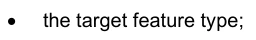


目标要素类型相对于源要素的作用(“作用”是指目标上关联端的名称);


目标(普通联系、汇总或组成)的关联类型;


目标要素类型的多面性。

EXAMPLE:交通分离Scheme 特性类型与交通分离schemeLanePart 特性相接,由交通分离斯chemeAgregation协会负责,这个关联是一个聚合,在下图5-2 UML图中被描绘: 交通分离-SchemleLane Part 要素 : 与交通隔离Schemale-Aggrecation 关联的功能 .

图5-2 – 交通分离计划 交通分离计划 交通分离计划 交通分离计划 交通分离计划 交通分会 交通分会 交通分会 交通分会 交通分会 交通分会 交通分会 交通分会 交通分会

根据UML公约,在交通分离计划(TrafficSeparationScheme)端的钻石是指交通分离计划中的"整体"或"集装箱",而交通分离SchemleLanePart是"部分"或 "集装箱". XML要素目录中各要素类型中的要素绑定有: .

```text
In the TrafficSeparationScheme:
```

## 官方 PDF 第 211 页

```text
<S100FC:featureBinding roleType="association">
```

```text
<S100FC:multiplicity>
```

```text
<S100Base:lower>0</S100Base:lower>
<S100Base:upper xsi:nil="true" infinite="true"/>
</S100FC:multiplicity>
<S100FC:association ref="TrafficSeparationSchemeAggregation"/>
<S100FC:role ref="consistsOf"/>
<S100FC:featureType ref="TrafficSeparationSchemeLanePart"/>
</S100FC:featureBinding>
```

```text
In TrafficSeparationSchemeLanePart:
```

```text
<S100FC:featureBinding roleType="aggregation">
```

```text
<S100FC:multiplicity>
```

```text
<S100Base:lower>0</S100Base:lower>
<S100Base:upper xsi:nil="false" infinite="false">1</S100Base:upper>
</S100FC:multiplicity>
<S100FC:association ref="TrafficSeparationSchemeAggregation"/>
<S100FC:role ref="componentOf"/>
<S100FC:featureType ref="TrafficSeparationScheme"/>
</S100FC:featureBinding>
```

请注意,数据格式可能会对绑定是否在数据集中任何一个参与的要素实例中实际被编码造成限制.

5-4.2.5.3 信息约束

约束信息描述一个要素与信息类型或两个信息类型之间的关联。每个约束信息包含在要素目录中“源”要素或信息类型的类型定义中,并描述一个信息类型(“目标”)与源类型的关系。

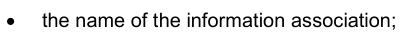

信息协会的名称;

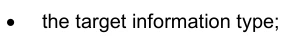

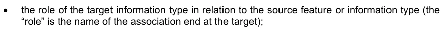

目标信息类型相对于源特性或信息类型的作用(“作用”是指目标所在的关联端的名称);

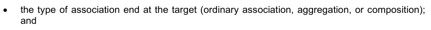

目标(普通联系、汇总或组成)的关联类型;


目标信息类型的多重性。

XML要素目录中的结构与第5-4.2.5.2条的例子相类似,只是其中一种或两种类型都将是信息类型,而XML将用于“信息Binding”而不是“featureBinting”。

至于要素约束,数据格式可能会对约束是否在数据集中任何一个参与的要素实例中实际被编码施加限制(例如,对于将要素与信息类型相连接的信息关联,约束仅在要素实例中得到编码,因此"要素目录"可能不包括在信息类型中,仅包含要素类型中的约束).

5-4.2.6 定义和资料来源参考

5-4.2.6.1 定义来源

这是用于“要素目录”定义的源文档列表, 它们是用引用信息给出的。 通常, 定义来自“ 要素概念词典”, 但其他来源是可能的。 定义来源于“ 物物目录 ” 也是有效的; 在这种情况下, 将不提及定义来源 。

5-4.2.6.2 定义参考

这些信息带有定义源的链接,它指向定义源,并通过标识符定义该源的位置。如果源是作为注册符保存的特性概念词典,则此参考符将是项目标识符。

## 官方 PDF 第 212 页

5-4.2.7 完整性

以下模型(附录5-A(规范),图5- A.1)中指定了要素分类信息的代表模板。 根据本模板编写的要素目录应记录特定地理数据组中的所有要素类型和信息类型。要素目录必须包括指定的识别信息。 要素目录必须包括数据所包含所有要素和信息类型的定义和描述,包括与每个要素类型相通的数据所包含的任何要素属性和要素关联. 为确保不同应用的要素目录内容的可预测性和可比性,建议要素分类目录只包括下文附录5-A(规范)所显示的表格中指定的要素.

## 官方 PDF 第 213 页

附录5-A 要素目录模型

(规范)

本附录介绍S-100要素目录. 图5-A-1是模拟于UML的S- 100要素分类目录,表5- A-1至5-a-20则以所显示的模型来说明要素列表的结构.

## 官方 PDF 第 214 页

本页特意留空

## 官方 PDF 第 215 页

图5-A-1 – 要素目录-UML模型

## 官方 PDF 第 216 页

表5-A-1——S100_FC_FeatureCatalogue 互联网档案馆的存檔,存档日期2013-12-22.

角色名称 名称描述 :

S100_FC_FeatureCatalogue A要素目录包含其识别和联系信息,以及一些要素类型的定义和这些定义所需的其他信息

```text
-
-
-
```

此要素目录 1 字符串的属性名称

属性范围 本要素目录所定义的要素类型主题域

```text
1
CharacterString
```

属性字段( Of) 描述此要素目录可能用于何种用途

```text
0..1
CharacterString
```

属性版本 此要素目录的版本号, 它可能既包括主要版本号或字母, 也包括一个小发布号或信件的序列, 如 “3. 2. 4a ”。 此属性的格式可能因目录编制部门而异 。

```text
1
CharacterString
```

属性版本 Date 本要素目录 1 的生效日期

属性产品 Id 用于目录的产品标识

```text
1
CharacterString
```

对本要素目录的知识内容负有主要责任的个人或组织的名称、地址、国家和电信地址

1 CI_责任 CI_责任>CI_Indiv idual 或

```text
CI_Responsibility>CI_Org
anisation
```

角色项 由此要素目录定义的项目列表; 项目为要素类型,信息类型,要素关联,信息关联,属性,以及角色

```text
1..*
S100_FC_Item
Aggregation
```

角色定义 来源 由此要素目录所定义的项目和所列出的值定义的来源列表。 这些来源通常为特性数据词典

```text
0..*
FC_DefinitionSource
Aggregation
```

## 官方 PDF 第 217 页

角色分类 要素目录分类0.1 MD_分类码 1 未分类码 2 限制 3 保密 4 密 5 高密 6 敏感而未分类 7 被官方使用 仅8 被保护 9 受限分发

表5-A-2——FC_定义来源

角色名称 名称描述 :

FC类_定义来源类,指定定义的来源 - - -

来源 来源的实际引用,足以识别文件以及如何获取文件

```text
1
CI_Citation
```

表5-A-3-FC_定义参考

角色名称 名称描述 :

FC 类_ 定义参考类, 将数据实例与定义源链接

```text
-
-
-
```

属性源标识符 信息 查找源文档中的定义。 此信息的格式针对源文档的结构

1 字符串 包括词典类型代码列表属性使用的在线词典或“vocabularys”

角色定义来源 定义的来源 1 FC_定义来源

表5-A-4——S-100_FC_项目

角色名称 名称描述 :

S100_FC_项目摘要基础类,定义了要素目录中所有项目的共性;项目是要素类型,信息类型,要素关联,信息关联,属性和角色.

- 文摘类

## 官方 PDF 第 218 页

属性名称 : 1 字符串

属性定义 自然语言中命名类型的定义 1 字符串

要素目录中唯一识别命名类型属性代码

```text
1
CharacterString
```

关于项目0.1的属性注释 进一步解释

属性别名 0. * 字符串

角色定义 参考 定义源的链接 0.1 FC_定义参考

表5-A-5 — S100_ FC_ NamedType

角色名称 名称描述 :

S100_FC_Named Type 抽象基础类,用于定义要素类型和信息类型的共同属性

- 文摘类

属性 isAbstract 表示在地理数据集中是否可以存在这种命名类型的实例。摘要类型不能被即时化,而是作为其他(非抽象)类型的基础类。

1 布尔

角色属性 Binding 描述此命名类型特征的属性绑定列表

```text
0..*
S100_FC_AttributeBinding
Aggregation
```

表5-A-6 — S100_FC_ObjectType

角色名称 名称描述 :

S100_FC_ObjectType 抽象基础类,用于定义要素类型和信息类型的共同属性

- 摘要类;取自S100_FC_NamedType

角色信息 Binding 可以通过信息协会与该对象类型相链接的信息类型绑定列表

```text
0..*
S100_FC_InformationBinding
Aggregation
```

## 官方 PDF 第 219 页

表5-A-7——S100_FC_信息泰普

角色名称 名称描述 :

定义信息类型所有属性的 S100_FC_信息类型类

- 衍生自S100_FC_ObjectType

角色超类型表示信息类型, 并会从它的超类型中继承所有属性 : 名称、 定义和代码通常会被子类型所覆盖, 尽管子类型中可能添加新的属性 。

```text
0..1
S100_FC_InformationType
```

角色子类型( Type) 表示从信息类型得到的信息类型

```text
0..*
S100_FC_InformationType
```

表5-A-8——S100_FC_FeatureType (中文(简体) ).

角色名称 名称描述 :

S100_FC_FeatureType 类,定义一个要素类型的所有属性 - - 从 S100_FC_ObjectType 中衍生出来的

属性特性 UseType 此特性的用法类型为 1 S100_CD_ FeatureUseType

特性类型允许的 0 或 以上空间原始物的组合

```text
0..*
S100_FC_SpatialPrimitiveType
```

角色要素 Binding 要素类型绑定列表,通过要素协会可以与该要素类型相通

```text
0..*
S100_FC_FeatureBinding
Aggregation
```

角色超类型表示特性类型, 其特性类型将继承其超级类型的所有属性: 名称、 定义和代码通常会被子类型所覆盖, 尽管子类型可能添加新的属性

如果允许的初级体在子类型中存在,它会凌驾于任何超级类型的允许初级体中

```text
0..1
S100_FC_FeatureType
```

作用子类型 表示从特性类型中衍生出来的特性类型

```text
0..*
S100_FC_ FeatureType
```

示例:如果超型允许点和地段原始人,而子型只允许曲线原始人时,子型的实例必须说明有曲线空间对象的位置. 子型的子型将只取行原始人取用线性原始人除非他们指定了自己的允许原始人.

## 官方 PDF 第 220 页

表5-A-9——S100_FC_信息协会

角色名称 名称描述 :

S100_FC_Information Association Association An information 描述对象(地貌或信息类型)与信息类型之间的关系

- 从S100_FC_NamedType个人产品规范中衍生出来,可能会限制方向性

角色角色 协会角色 0.2 S100_FC_ ole 默认角色名缺失时

产品规范可进一步限制

角色超Type 表示信息关联的出自信息关联。子类型将继承其超类型的所有属性: 名称、定义和代码通常被子类型所覆盖, 尽管子类型中可能添加新的属性 。

```text
0..1
S100_FC_InformationAssociation
```

角色分类是指信息协会衍生的信息协会.

```text
0..*
S100_FC_InformationAssociation
```

表5-A-10——S100_FC_Feature协会

角色名称 名称描述 :

类 S100_FC_Feature Association 特性关联描述两种特性类型之间的关系

要素关联是双向的,每个方向都有单独的作用

```text
-
-
```

作用 协会的作用 . 2. S100_FC_Role

角色超类型表示特性关联, 由此产生特性关联。 子类型将继承其超级类型的所有属性 : 名称、 定义和代码通常会被子类型所覆盖, 尽管子类型可能添加新的属性 。

```text
0..1
S100_FC_FeatureAssociation
```

角色子Type指由特写协会衍生出来的特写协会.

```text
0..*
S100_FC_FeatureAssociation
```

## 官方 PDF 第 221 页

表5-A-11——S100_FC_Role (中文(简体) ).

角色名称 名称描述 :

S100_FC_Role 类 A 角色,可用于主题协会或信息协会

- 摘自S100_FC_项目

表5-A-12——S100_FC_属性

角色名称 名称描述 :

类 S100_FC_属性 两类属性的抽象基础类: 简单属性和复杂属性。属性带有命名类型的特性 。

- 摘自S100_FC_项目摘要

表5-A-13——S100_FC_简单属性

角色名称 名称描述 :

S100_FC_带有值的简单属性属性 - 从S100_FC_属性衍生出来

属性值 Type 此特性属性的值类型 1 S100_CD_ 属性瓦卢特普

用于此特性属性值的计量单位属性uom

```text
0..1
S100_UnitOfMeasure
```

数量规格: 0.1 S100_CD ⁇ 数量规格

作用约束 可能适用于属性0.1 S100_CD_属性约束 组成

列出的属性域上列表的值的值组

```text
0..*
S100_FC_ListedValue
Composition.
```

仅在值为编号或S100_代码列表(带有代码列表Type=打开的计数)时才适用.

表5-A-14——S100_FC_复合属性

角色名称 名称描述 :

类 S100_FC_ComplexAtize 复杂属性 由列表的子属性组成,这些属性既可以是简单又复杂的属性.

- 衍生自S100_FC_属性

作用子属性Binding 子属性绑定列表 1.. * S100_FC_属性Binding 聚合

## 官方 PDF 第 222 页

表5-A-15——S100_FC_挂牌牌牌坊

角色名称 名称描述 :

类 S100_FC_ListedValue 已列出属性域的值,包括其代码和定义

```text
-
-
```

特性标签 说明性标签,唯一地识别特性属性的一个值

```text
1
CharacterString
```

自然语言上所列值的定义

```text
1
CharacterString
```

属性代码 数字代码,用于对相应的要素属性唯一识别上市值

```text
1
PositiveInteger
```

属性注释 关于上列数值的进一步解释 0.1 字符串

属性化名此列表值的等同名称 . * 字符串

角色定义 参考 定义源的链接 0.1 FC_定义参考

```text
Table 5-A-16— S100_FC_AttributeBinding
```

角色名称 名称描述 :

S100_FC_属性Binding 类,用于描述一个属性如何绑定在特定命名类型或复杂属性上的具体特征

```text
-
-
```

属性 多重 定义属性可有多少个实例成为命名类型或复杂属性的一部分

```text
1
S100_Multiplicity
```

属性顺序描述属性序列是否有意义

1 布尔只应用到可能不止一次发生的属性

属性 可见度 表示一个属性在终端用户系统中的预期能见度

```text
0..1
S100_FC_AttributeVisibility
```

角色允许属性的可允许值

0.* S100_FC_ListedValue 仅适用于数据类型计数的属性

角色属性 绑定在项目或复杂属性上的属性

```text
1
S100_FC_Attribute
```

## 官方 PDF 第 223 页

表 5-A-17——S100_FC_InformationBinding (中文(简体) ).

角色名称 名称描述 :

S100_FC_InformationBinding 类描述信息类型使用命名类型

```text
-
-
```

定义目标信息类型可链接到一个命名类型的实例的多功能

```text
1
S100_Multiplicity
```

属性角色 Type 关联结束的性质 1 S100_FC_RoleType

角色角色 用于约束的角色,必须是用于约束的社团的一部分,并定义了社团的终结.

```text
0..1
S100_FC_Role
```

角色协会 用于约束的协会; 也界定角色

```text
1
S100_FC_InformationAssociation
```

角色信息 Type 目标信息类型 1.. * S100_FC_InformationType

表5-A-18——S100_FC_FeatureBinding (中文(简体) ).

角色名称 名称描述 :

S100_FC_FeatureBinding 类通过特性关联描述从一个特性类型到另一个特性类型的关系

```text
-
-
```

属性多向性 定义目标要素类型中有多少例可以与源要素类型中的一个实例相链接

```text
1
S100_Multiplicity
```

属性角色 Type 关联结束的性质 1 S100_FC_RoleType

角色要素 Type 目标要素类型 1.. * S100_FC_FeatureType

角色角色 用于约束的角色,必须是用于约束的社团的一部分,并定义了社团的终结.

```text
1
S100_FC_Role
```

角色协会 用于约束 1 S100_FC_ Feature Association 的协会

## 官方 PDF 第 224 页

表5-A-19——S100_FC_RoleType 互联网档案馆的存檔,存档日期2013-12-20.

项目名称说明

编号 S100_FC_RoleType 定义关联端的类型(即“作用”)

相通端是一个普通的链接。 (在UML术语中,角色类型是"aggregationKind=普通",图中的链接没有菱形)

此端的对象可能是参加普通协会、集合或组成

相通端是一个 UML 相通端(在UML 术语中,角色类型是 “相通端” , 相通端的相通端有一个未填入的相通端) 。

这一端的客体是集合协会中的“所有人”、“整体”或“集装箱”

相接端是一个 UML 聚合(在UML 术语中,角色类型是 “ 相接基德=相接基” , 相接端的相接端有一个已填充的相接基德) 。

这一端的客体是组成协会中的“所有人”、“整体”或“集装箱”。

注:如果协会的一端是“综合”或“组合”,则另一端必须编码为“协会”。

表5-A-20——S100_FC_空间初级型

项目名称说明

编号 S100_FC_Spaceal Primmitive Type 指定允许使用带有要素实例的空间原始物

字形点 空间原始 GM_ 点

字形点 Set 点集 空间原始 GM_多点

线性曲线 曲线 空间 原始 GM_ Orientable Curve

表面空间原始 GM_ 生态可碎面

覆盖空间原始 CV_封面

字面上没有图形 要素类型与实例位置的空间原始无关

在某些情况下,需要明确声明实例位置没有空间原始物。参见S100_FC_FeatureType中的子类型和超级类型的规则

表5-A-21——S100_FC_可视性

项目名称说明

S100_FC_属性 表示一个属性在终端用户系统中的预期能见度

生产系统应被视为有别于终端用户系统,不得以与终端用户系统相同的方式限制属性能见度

所有用途的可视性特性可见度

## 官方 PDF 第 225 页

在某些用途中保护可视性特性的能见度。产品规范中要定义的细节

个人可视性特性的能见度是私人的,不应在生产环境之外显示。

## 官方 PDF 第 226 页

本页特意留空


---

# S-100 5.2.1 · 第 6 部分 · 坐标参考系

非官方机器翻译参考稿，尚未逐条人工校订。公式与代码保留原文，解释以英文规范为准。

## 官方 PDF 第 227 页

S-100 – 第6编

坐标参考系

## 官方 PDF 第 228 页

5.2.1版实质性变动摘要

已生效的概要条款

## 官方 PDF 第 229 页

中文目录（可用上方目录直接跳转）

6-1 范围 · 官方 PDF 231
6-2 规范性引用文件 · 官方 PDF 231
6-3  包概述 · 官方 PDF 232
6-3.1 包图 · 官方 PDF 232
6-4 包的详细说明 · 官方 PDF 233
6-4.1 识别对象包 · 官方 PDF 233
6-4.1.1 S100_IO_识别对象 · 官方 PDF 233
6-4.1.2 类别详情 · 官方 PDF 233
6-4.2 坐标参考系包 · 官方 PDF 234
6-4.3 单一计算机辅助系统 · 官方 PDF 234
6-4.3.1 化合物CRS · 官方 PDF 235
6-4.3.2 类别详情 · 官方 PDF 235
6-4.4 坐标系统包 · 官方 PDF 236
6-4.4.1 类别详情 · 官方 PDF 237
6-4.5 数据包 · 官方 PDF 239
6-4.5.1 类别详情 · 官方 PDF 240
6-4.6 协调行动一揽子计划 · 官方 PDF 241
6-4.6.1 类别详情 · 官方 PDF 243

## 官方 PDF 第 230 页

本页特意留空

## 官方 PDF 第 231 页

6-1 范围

S-100标准是为水道测量信息的制作者和使用者设计的,但其原则可以扩大到许多其他形式的地理信息,包括地图和文本文件。

S-100标准中对象的位置通过坐标来定义。这些坐标与位置相关。本部分介绍通过坐标系统和基准充分定义参考的所有必要要素。 它用坐标来定义空间参考的概念Schema,并描述定义1-、2-和3维空间坐标参考所需的最低数据。

除了定义坐标参考系所必需的要素外,本部分还描述了将坐标从一个坐标参考系中转换到另一个坐标的操作,其中包括数据转换和地图预测操作.

坐标参考系以及界定这些系统的单一要素可在注册簿中登记,或由组织在文件中加以界定,本部分介绍如何确定这些要素。

坐标参考系不得在本部分范围内随时间而改变。

6-2 规范性引用文件

下述引用文件对本文件的应用不可或缺。对于注明日期的参考文献,只适用所引用的版本。对于未标明日期的参考资料,适用所参考文件的最新版本(包括任何修正)。

ISO 19111:2007, 地理信息——通过坐标提供空间参考

ISO/TS 19103, 地理信息——概念计划语言

ISO 19115, 地理信息-元数据

## 官方 PDF 第 232 页

6-3 包概述

6-3.1 包图

图6.1显示了本部分所使用的软件包及其依赖性.

图6-1——中央RS软件包

使用坐标参考空间物体的要素在五个包中描述,所有包都依赖于“已识别对象”包,该包描述了将要素与外部定义联系起来的机制。

它还保证每个元素都可以被单独命名,以便在数据集或软件必须用程序中识别出. 为了方便使用类名的工作,每个包必须使用其类和数据类型的前缀. 下文表6-1显示了各种包的前缀:

表6-1——软件包前缀

软件包名前缀

识别对象 IO

坐标参考系SC

坐标系统 CS

数据 CD

CC 坐标操作

## 官方 PDF 第 233 页

6-4 包的详细说明

6-4.1 识别对象包

图6-2——已识别对象类图.

注:如果包的类图显示的是另一包的类别或类型,则将显示灰色背景。在这种情况下,不显示该类的所有细节;完整的细节将在类所属的包的分类图中加以说明。

```text
6-4.1.1
S100_IO_IdentifiedObject
```

本部分的每个类别都旨在有一个能够被识别和/或识别出来自S100_IO_被识别对象的外源的机制.

与 ISO 19111 不同,此类不是从外部文档中衍生出来的,而是使用外部标准定义的成员。此外,本部分没有其他类别来自外部标准。如果在 ISO 19.111 中这些类别继承了基本成员,则这些成员将被引入到适当的包图中。 这应提高这一组成部分的可读性,并避免在不绝对需要的情况下出现多重继承。

6-4.1.2 类别详情

表6-2——IO类的属性_识别对象

名称类型卡。 描述

名称 RS_ 识别符 1 用于识别对象的主名

标识符 RS_标识符 0.1 引用对象(外部)定义的标识符

别名通用名 0. * 该对象的替代名称

注释字符串0.1 对象的评论或信息 RS_识别器类型(取自ISO 19115) 有三部分:

1) 权威:CI_Citation [0.1];

2) 代码:字符串;

3) 代码空间:字符串 [0.1] version:字符串 [0.1].

## 官方 PDF 第 234 页

CI_Citation类型也在ISO 19115中被定义,详见该条目.

6-4.2 坐标参考系包

图6-3——坐标参考系类图.

此套件描述了所有坐标参考系所使用的基础类和所有由此组件支持的衍生子类。该图还显示了与其他套件中的类的关系。

坐标参考系是一个以基准与现实世界相接的坐标系统,一般来说,真实世界将是地球,尽管原理不仅限于地球. 坐标参考系(CRS)要么是单一的CRS,要么是复合的CSR.

6-4.3 单一计算机辅助系统

单个CRS由坐标系统和相关基准定义. S-100 支持以下类型的单个CRS:

1) 大地测量成像成像仪;

2) 预测的中央RS;

3) 纵向计算机辅助系统;

```text
4) ImageCRS.
```

## 官方 PDF 第 235 页

大地测量 CRS 与大地测量基准相关联,通常使用椭圆坐标系统(地经度,地经和地高等为3D). 大地测定 CRS也可以使用笛卡尔坐标系统 (3D,固定在地上). 在数据集中很少使用笛卡儿系统所引用的坐标,但在某些坐标转换过程中作为中间坐标使用.

预测的CRS是一种衍生的CSR,其基础是大地测量CRS,并使用地图投影进行坐标转换,其基本坐标系统总是笛卡尔坐标系统,预计的CRS经常被用于国家坐标系统。

垂直 CRS 是一个用于报告深度或高度的1D CRS,并与垂直基准相联. 椭圆形高地无法用垂直 CSR 捕获. Ellipsoidal 高地是大地测量 CRS 三维坐标图盘的组成部分,不能独立存在.

图像 CRS 与描述图像坐标系统与图像的关系的图像数据数据相关,这种关系独立于图像是否地理参照。地理参照是通过将图像 CSR 转换为大地测量或预测的 CRS来进行的。

6-4.3.1 化合物CRS

复合式CRS是两个或两个以上单个CRS的组合,尽管使用两个以上组件的可能性很小. 复合CRS的各个组件必须独立. 符合它们相配的坐标不能通过某种坐标操作从一个CRS变为另一个CRS,两个CRS就独立了. 例如,一个水平和垂直CRS都是独立的,而两个垂直CSR则不是独立的. 不允许将复合式CRS嵌入,这意味着所有组件必须是单一的CRS.

数据集中的每个位置, 与类 DirectPosition 相接, 必须绑定在 CRS 上。 如果数据集中对每个位置使用不同的垂直数据, 则必须定义垂直坐标系统。 这些垂直坐标系可以用作复合坐标系统中的组件来描述三维坐标 。

如果一个数据产品规范允许选择大地基准,即使在特定数据集中只允许一个数据,也必须指定转换方法,使数据集能够在必须用程序中一起使用.

6-4.3.2 类别详情

表6-3-SC_CRS类的属性

名称类型卡。 描述

1.* 说明使用量或使用限制,本计算机辅助系统对其有效

cRS 有效的区域或区域

表6-4——SC-SingleCRS类的属性

名称类型卡。 描述

CD_Datum 0.1 与计算机辅助系统相关联的计算机辅助系统的计算机辅助程序。计算机辅助设备必须具有适当的类型(垂直或水平)。除了预测的计算机专用系统外,不可对其加以具体说明。 预测的软件辅助系统使用其基础计算机辅助程序的计算机辅助设施。

坐标System CS_坐标System 1 用于 CRS 的坐标系统

表6-5——SC-GeneralDerivedCRS类属性

名称类型卡。 描述

转换 CC_ Operation 1 坐标转换方法,将坐标从基数转换为所衍生的 CRS(例如地图投影)

## 官方 PDF 第 236 页

表6-6——SC_预测的CRS类属性

名称类型卡。 描述

BaseCRS SC_GeodeticCRS 1 用于计算成份的大地测量式CRS,特别是基准式CRS的基准数据也用于计算成份的CRS。

6-4.4 坐标系统包

图6-4——"坐标系统"类图.

坐标系由非重复的、顺序排列的坐标轴组成。轴数应等于CRS所描述的几何空间的维数。坐标轴的顺序与使用该坐标系的CRS描述的每个坐标图中的坐标顺序相同。

本部分定义了四种类型的坐标系统:

(1) 笛卡尔坐标系统;

2) 轴坐标系统;

3) 椭圆坐标系统;

4)垂直坐标系统.

每个轴由方向,值范围以及所使用的计量单位来定义.

笛卡尔坐标系统是带有正弦直轴的二维或三维坐标系统,所有轴的长度单位必须相同.

外接坐标系统是二维或三维坐标系统,有直轴不一定为正交,所有轴的长度单位应相同.

椭圆坐标系是二维或三维坐标系,它描述椭圆表面或附近坐标,坐标为:大地纬度、地经度和(以三维为例)椭圆高度。

## 官方 PDF 第 237 页

大地纬度是赤道平面到椭圆形到椭圆形通过某一点的角,向北被视作正向.

大地经度是从正中线平面到给定点平面的角,向东被作为正中线.

椭圆高地是从椭圆上到这个点沿椭圆上行所测量出的一个点的相去,如果是上行或椭圆外行所测量出正相.

垂直坐标系统是用来记录点高或深度的一维坐标系统。这样的坐标系统通常取决于地球的重力场。下表指定了可使用特定类型的坐标系统的CRS的类型。

表6-7-用于不同CRS的坐标系统

坐标参考系 坐标参考系

CRS 椭圆坐标系统

笛卡尔坐标系统

```text
2, 3
```

```text
3
```

预计的CRS笛卡尔坐标系统2

CRS 垂直坐标系统 1

图像 CRS 笛卡尔坐标系统

Affine 坐标系统

```text
2
```

```text
2
```

6-4.4.1 类别详情

表6-8——CS-坐标系的属性

名称类型卡。 描述

轴 CS_坐标轴 1.3 坐标系统的轴,顺序与相应位置坐标的顺序相同。数字等于坐标系统描述几何的空间的尺寸。

表6-9—— CS- 坐标轴的属性

名称类型卡。 描述

此坐标系统轴所用的轴式Symbol CharlesString 1 缩写。

轴向 CS_轴向 1 坐标系统轴向。 对于一个被地球固定的坐标系统来说, 值常常是近似值, 意在为轴向提供人类可解释的含义 。

最小值为双0.1 轴的计算单位中允许该轴的最低值

最大值为双0.1 轴的计量单位中允许此轴的最大值

范围表示 CS_ RangeMeaning 0.1 数值范围的含义。

S100 计量单位 1 此轴的计量单位

## 官方 PDF 第 238 页

表 6-10-CS-轴心计算法的计数类型的定义

名称描述

在大地测量或预测的CRS中,北部通过大地测量基准来界定。

东轴正向 90° ( ⁇ /2 弧度) 从北向顺时针方向

南轴正向从北方向顺时针180°( ⁇ 弧度)

西轴正向为270°/3 ⁇ /2弧度) 从北向顺时针方向

轴向上升 相对于重力

轴向下 相对于重力正向下

地心X轴正向从模拟地球中心到赤道与正中线相接处的赤道平面

地心轴正向从模拟地球中心向赤道平面向赤道和地心线相接点向东走去

地心轴正向从地心模型中心与自转轴平行并朝北极方向移动

显示左向轴正向 。

显示正轴正向显示

显示 Up 轴正向显示

显示下轴正向下显示

表6-11——CS_RangeMeaning的计数类型定义.

名称描述

精确的包含 minValue 和 maxValue 之间的任何值都是有效的

环绕轴以在分数和最大值相绕的值相连续。具有相同含义的值重复了modulo(最大值-分数)。这方面的一个例子是大地经度;轴被定义为圆,而数值则被包围在 +(±180°)周围。

## 官方 PDF 第 239 页

6-4.5 数据包

图6-5——达通类图.

基准是一个参数或一组参数,用来定义一个坐标系统的起源位置,尺度和取向. S-100描述了三类基准:

(1) 大地测量基准;

(2) 纵向基准;

3) 图像基准。

大地基准确定二至三维坐标系统与地球的关系,通过椭圆形作为地球模型,由原始地线作为大地经度的起点。

垂直基准确定与地心重力相关的高度或深度之间的关系,用于参照垂直坐标系统,这种关系可能相当复杂。

椭圆形高地被视为与大地测量基准参照的三维椭圆形坐标系统有关,不能被垂直基准参照。

图像基准修正坐标系统和图像之间的关系。 这与图像是否地理参照无关。 图像 CS 用于定位图像中的位置, 而不是物体在现实世界中的位置 。

一般椭圆形是笛卡尔座标中给出的四相地表,由: .

## 官方 PDF 第 240 页

在a,b,c被称作椭圆形的半轴.

在大地测量学上,两个半轴是等分(a=b)和大于(c)的. 这个数字也叫取上位平面平面的平面石. S-100中,这个特例使用椭圆形来表示,两个正轴表示半主轴(a)和半小轴(b),并有大于(b)。

椭圆可按其两个半轴或以半主轴和半主轴来定义。

倒平调:

如果两个半轴均等, 椭圆是一个球体。 在这种情况下, 反平平面没有定义 。 (平面为 0 )

要定义大地经度(圆)轴上的出处,使用主经度,是其他经度的出处。

6-4.5.1 类别详情

表6-12——类CD属性_数据

名称类型卡。 描述

字符串 1..* 本基准对其有效的使用或使用限制说明

锚定字符串0.1 可能包括已查明点或点的坐标的描述,说明将坐标系统锚定在地球或备用物体上的关系

对于大地测量基准来说,这被称为基本点

对于一个图像基准,它通常是图像或图像中心的一角

实现 Epoch 日期为 0. 1 此基准定义生效的时间

域名:EQXX . 1 此数据有效的区域或区域

表 6-13 - 类 CD_ Ellipsoid 属性

名称类型卡。 描述

半主轴长度 1 椭圆形半主轴长度

第二Parameter CD_第二Parameter 1 定义椭圆的第二个参数,或者半小轴的长度,或者椭圆的倒平

表6-14——工会属性 CD_第二Paremeter

名称类型卡。 描述

反向平分双0.11 椭圆平分:

半微分轴长度为0.1椭圆形半微分轴长度

如果椭圆形是一个球体, 则为 . 1 。

表6-15——类CD的属性_PrimeMeridian

名称类型卡。 描述

从格林尼治地平线测得的地平线经度,正向东

1 必须确定一个成员。

## 官方 PDF 第 241 页

表6-16 CD类属性_地极数据

名称类型卡。 描述

椭圆平面 CD_ Ellipsoid 1 此数据时用作地球模型的椭圆平面

primeMeridian CD_PrimeMeridian 1 此数据的首要介质

表 6-17 — 类 CD_ Image Datum 的属性

名称类型卡。 描述

像素InCell CD_像素InCell 1 图像网格与图像数据属性关联方式的规格

表 6-18 — 盘点 CD_ 像素InCell 的定义

名称描述

单元格Center 图像坐标系统的由来是网格单元格或图像像素的中心

单元格Corner 图像坐标系统的由来是网格单元格的一角,或相邻图像像素中心之间的半程

6-4.6 协调行动一揽子计划

图6-6——坐标行动等级图.

坐标操作转换坐标,指一个坐标参考系来表示另一个坐标参考系的坐标,因此,每个坐标操作都有源 CRS 和目标 CRS.

S-100定义了下列类型的坐标操作:

1) 坐标转换;

## 官方 PDF 第 242 页

(2) 坐标转换;

3) 通过操作;

4) 密会坐标行动.

坐标转换变迁坐标从一个基于一个基准的坐标参考系到第二个基准的相坐标参考系的坐标转换,这些操作的参数通常都是在经验上推导出来的,参数的分解性质可能导致多个不同版本的同坐标转换. 因此,对一对特定的坐标参考系来说,可能存在多个坐标转换,它们的方法,参数值和准确性特征不同.

基于同一基准的两座坐标参考系之间的坐标转换变化坐标。这种坐标操作包括地图预测。通过操作可指定坐标图的子集,以进行请求的坐标操作。 其形式是参考另一项协调操作,并指定一系列数字,确定受该协调操作影响的坐标的坐标上的位置。

EXAMPLE 对于由复合参考系统定义的一拖轮高度坐标上的协调操作,通过操作过滤高度坐标后再将其传递给相关的坐标操作.

相接坐标操作是协调操作的不重复序列,这种坐标操作的顺序受到以下要求的限制:每一步的目标坐标参考系应与下一步的源坐标参考系的相同. 第一步的源代码坐标参考系和后一步的目标坐标参考系是为接地坐标操作指定的源和目标坐标参考体系. 接地协调操作可能包含坐标转换和相协调转换. 如果源与目标坐标参考系的基准是不同的,则整个操作就是坐标转换.

结合的一个例子是“Position 矢量7-参数转换”(EPSG 9606),在内部是下列的结合:

1) “地理/地心转换”(EPSG9602);

(2) 地心坐标上的海默特变换;以及

3) “地理/地心转换”的反例。

虽然第一步和最后一步是转换,并没有改变基准,但第二步是这样做的,因此整个操作是一个转变.

坐标转换和转换是使用相近数学概念的单坐标操作,这些概念(算法或程序)由操作方法定义,每个操作方法都由数学公式和一组参数完全定义,尽管这个集可能是空的.

操作的数学公式以文本形式或参考源文档的方式加以规定。

单个坐标操作的每个实例定义了对应操作方法每个参数的值. 参数和方法是可识别的对象,可以通过引用来定义.

## 官方 PDF 第 243 页

6-4.6.1 类别详情

表6-19-CC类协调行动属性

名称类型卡。 描述

字符串 1..* 说明这种坐标操作有效的使用或使用限制

操作Version字符String 0.1 坐标转换版本。在描述坐标转换时必须使用,不应为坐标转换提供

域名:EQX Extent 0.1 此坐标操作有效的区域或区域

精确度 DQQPOSTIONAL 准确度 0.1 这一坐标操作对点精度影响的估计

表6-20——CC-Single Operation类属性.

名称类型卡。 描述

方法 CC_ 操作方法 1 用于执行坐标操作的方法(算法或程序)

参数Value CC_OperationParameterValue 0.* 相关方法的每个参数的值

表 6-21-CC类的属性_连带操作

名称类型卡。 描述

CC_协调行动2. * 调制的有序行动顺序

表 6-22——CC_PassTrough操作类的属性

名称类型卡。 描述

修改坐标整数 1..* 排列正整数的顺序,以定义受此通过操作影响的坐标的坐标上所处位置

操作 CC_ 协调操作 1 的坐标操作, 此操作通过操作时指定坐标的子集

表6-23——CC类操作方法的属性.

名称类型卡。 描述

公式字符串 1 本操作方法所使用的公式或程序

参数 CC_OperationParemeter 0.* 此坐标操作方法所使用的一组参数

表 6-24- CC 类的属性_ 操作ParemeterValue

名称类型卡。 描述

值 CC_ParameterVale 1 坐标操作参数值。大多数参数值是数值,但其他类型的参数值是可能的

参数 CC_OperationParemeter 1 定义值的参数

## 官方 PDF 第 244 页

表6-25-工会属性 CC_ParameterValue

名称类型卡。 描述

S100_Measure 0.12 坐标操作参数的数值及其相关计量单位

字符串 Vale C字符串 0. 1 坐标操作参数的字符串值

整数 Value 整数 0. 1 坐标操作参数的整数值。 通常用于计算或索引

boleanValue bolean 0.1 坐标操作参数的布尔值

值 File 字符串 0. 1 引用包含一个或多个参数值的文件。 这可以是文件名或 URL 或其他一些参考文件的方法

2 必须确定一个成员。

## 官方 PDF 第 245 页

附录6-A

实例(信息)

附录中列出了四个例子,以表明使用所需信息来描述坐标参考系的情况:

1. 2D大地测量成像系统,参照外部来源;

2. 使用外部来源的参考文献预测计算机预报系统;

3. 同样的计算机辅助系统,界定所有已有的细节;

4. 将第一个例子与纵向计算机辅助系统相结合的复合式计算机辅助系统。

示例使用类似 XML 的缩写。 UML 标识符被用作元素名称。 数值以粗体显示。 要进行更好的概述, 数据类型可以包含在元素的名称中, 并且以蓝色显示 。

6-A-1 2D 使用外部来源参考的大地测量CRS

此示例使用 EPSG 大地测量参数数据集的引用。 请注意, SC_ CRS 类用于引用, 所有细节都在引用源中定义。 例外是范围, 因为这是 SC- CRS 有强制性 。

```text
<SC_CRS:example1>
```

```text
<RS_Identifier:name>
```

```text
<code>WGS 84</code>
</RS_Identifier:name>
<RS_Identifier:identifier>
```

```text
<CI_Citation:authority>
```

```text
<title>EPSG Geodetic Parameter Data Set</title>
<edition>6.5</edition>
<CI_Date:date>
```

```text
<date>20040113</date>
<dateType>revision</dateType>
</CI_Date:date>
</CI_Citation:authority>
<code>4326</code>
</RS_Identifier:identifier>
<scope>
```

GPS卫星系统使用的三维大地测量成像成像系统横向组成部分。 </scope > </SC_CRS:实例1 >

6-A-2 参考外部来源的预计计算机预报系统

这个例子与6-A-1相似,它通过引用EPSG大地测量参数数据集来定义预测的CRS.

```text
<SC_CRS:example2>
```

```text
<RS_Identifier:name>
```

```text
<code>Amersfoort / RD new</code>
</RS_Identifier:name>
<RS_Identifier:identifier>
```

```text
<CI_Citation:authority>
```

```text
<title>EPSG Geodetic Parameter Data Set</title>
<edition>6.5</edition>
<CI_Date:date>
```

```text
<date>20040113</date>
<dateType>revision</dateType>
```

## 官方 PDF 第 246 页

```text
</CI_Date:date>
</CI_Citation:authority>
<code>28992</code>
</RS_Identifier:identifier>
<scope>
```

中大尺度地貌测绘和工程勘察. </scope > </SC_CRS:实例2 >

6-A-3 界定所有细节的预计计算机预报系统

这个例子就是6-A-2的全部细节.

```text
<SC_ProjectedCRS:example3>
```

<! -- -- 名称和范围 -- > < RS_ 标识符:name >

```text
<code>Amersfoort / RD new</code>
</RS_Identifier:name>
<scope>
```

大型和中型地形测绘和工程调查。 </scope >

<!--- 坐标系统 -- > < CS_CartesianCS:坐标系统 >

<!-- 轴 # 1- > < CS_坐标轴:轴 >

```text
<RS_Identifier:name>
```

```text
<code>Easting</code>
</RS_Identifier:name>
<axisSymbol>X</axisSymbol>
<axisDirection>east</axisDirection>
<CS_UnitOfMeasure:unitOfMeasure>
```

```text
<RS_Identifier:name>
```

```text
<code>Metre</code>
</RS_Identifier:name>
<symbol>m</symbol>
<type>length</type>
</CS_UnitOfMeasure:unitOfMeasure>
</CS_CoordinateSystemAxis:axis>
<!-- axis # 2 -->
<CS_CoordinateSystemAxis:axis>
```

```text
<RS_Identifier:name>
```

```text
<code>Northing</code>
</RS_Identifier:name>
<axisSymbol>Y</axisSymbol>
<axisDirection>north</axisDirection>
<CS_UnitOfMeasure:unitOfMeasure>
```

```text
<RS_Identifier:name>
```

```text
<code>Metre</code>
</RS_Identifier:name>
<symbol>m</symbol>
<type>length</type>
</CS_UnitOfMeasure:unitOfMeasure>
</CS_CoordinateSystemAxis:axis>
</CS_CartesianCS:coordinateSystem>
<!-- end of the coordinate system -->
```

<! -- -- 坐标转换 -- -- > <CC_转换:转换 >

```text
<RS_Identifier:name>
```

## 官方 PDF 第 247 页

```text
<code>RD New</code>
</RS_Identifier:name>
<scope>
```

大型和中型地形测绘和工程调查。 </scope >

<!- -- 包括参数列表在内的操作方法 -- > <CC_Operation Method:method>

```text
<RS_Identifier:name>
```

```text
<code>Oblique Stereographic</code>
</RS_Identifier:name>
<formula>See EPSG guidance No. 7</formula>
<CC_OperationParameter:parameter>
```

```text
<RS_Identifier:name>
```

```text
<code>Latitude of natural origin</code>
</RS_Identifier:name>
</CC_OperationParameter:parameter>
<CC_OperationParameter:parameter>
```

```text
<RS_Identifier:name>
```

```text
<code>Longitude of natural origin</code>
</RS_Identifier:name>
</CC_OperationParameter:parameter>
<CC_OperationParameter:parameter>
```

```text
<RS_Identifier:name>
```

```text
<code>Scale factor at natural origin</code>
</RS_Identifier:name>
</CC_OperationParameter:parameter>
<CC_OperationParameter:parameter>
```

```text
<RS_Identifier:name>
```

```text
<code>False easting</code>
</RS_Identifier:name>
</CC_OperationParameter:parameter>
<CC_OperationParameter:parameter>
```

```text
<RS_Identifier:name>
```

```text
<code>False northing</code>
</RS_Identifier:name>
</CC_OperationParameter:parameter>
</CC_OperationMethod:method>
<!-- The parameter value # 1 -->
<CC_OperationParameterValue:parameterValue>
```

```text
<parameter>Latitude of natural origin</parameter>
<CC_ParameterValue:value>
```

```text
<CC_Measure:measure>
```

```text
<value>52° 9’ 22.1780” N</value>
<CS_UnitOfMeasure:uom>
```

```text
<RS_Identifier:name>
```

```text
<code>Degree</code>
</RS_Identifier:name>
<type>angle</type>
</CS_UnitOfMeasure:uom>
</CC_Measure:measure>
</CC_ParameterValue:value>
</CC_OperationParameterValue:parameterValue>
<!-- The parameter value # 2 -->
<CC_OperationParameterValue:parameterValue>
```

```text
<parameter>Longitude of natural origin</parameter>
<CC_ParameterValue:value>
```

```text
<CC_Measure:measure>
```

```text
<value>5° 23’ 15.5” E</value>
<CS_UnitOfMeasure:uom>
```

```text
<RS_Identifier:name>
```

## 官方 PDF 第 248 页

```text
<code>Degree</code>
</RS_Identifier:name>
<type>angle</type>
</CS_UnitOfMeasure:uom>
</CC_Measure:measure>
</CC_ParameterValue:value>
</CC_OperationParameterValue:parameterValue>
<!-- The parameter value # 3 -->
<CC_OperationParameterValue:parameterValue>
```

```text
<parameter>Scale factor at natural origin</parameter>
<CC_ParameterValue:value>
```

```text
<CC_Measure:measure>
```

```text
<value>0.9999079</value>
<CS_UnitOfMeasure:uom>
```

```text
<RS_Identifier:name>
```

```text
<code>Scale</code>
</RS_Identifier:name>
<type>scale</type>
</CS_UnitOfMeasure:uom>
</CC_Measure:measure>
</CC_ParameterValue:value>
</CC_OperationParameterValue:parameterValue>
<!-- The parameter value # 4 -->
<CC_OperationParameterValue:parameterValue>
```

```text
<parameter>False easting</parameter>
<CC_ParameterValue:value>
```

```text
<CC_Measure:measure>
```

```text
<value>155000</value>
<CS_UnitOfMeasure:uom>
```

```text
<RS_Identifier:name>
```

```text
<code>Metre</code>
</RS_Identifier:name>
<symbol>m</symbol>
<type>length</type>
</CS_UnitOfMeasure:uom>
</CC_Measure:measure>
</CC_ParameterValue:value>
</CC_OperationParameterValue:parameterValue>
<!-- The parameter value # 5 -->
<CC_OperationParameterValue:parameterValue>
```

```text
<parameter>False northing</parameter>
<CC_ParameterValue:value>
```

```text
<CC_Measure:measure>
```

```text
<value>463000</value>
<CS_UnitOfMeasure:uom>
```

```text
<RS_Identifier:name>
```

```text
<code>Metre</code>
</RS_Identifier:name>
<symbol>m</symbol>
<type>length</type>
</CS_UnitOfMeasure:uom>
</CC_Measure:measure>
</CC_ParameterValue:value>
</CC_OperationParameterValue:parameterValue>
</CC_Conversion:conversion>
<!-- end of coordinate conversion -->
```

<!-- 基准大地测量 CRS -- -- < SC_GeodeticCRS: BaseCRS >

<!--- 碱CRS坐标系统- >

## 官方 PDF 第 249 页

```text
<CS_GeodeticCS:coordinateSystem>
```

<!-- 轴 # 1- > < CS_坐标轴:轴 >

```text
<RS_Identifier:name>
```

```text
<code>Latitude</code>
</RS_Identifier:name>
<axisSymbol>φ</axisSymbol>
<axisDirection>north</axisDirection>
<CS_UnitOfMeasure:unitOfMeasure>
```

```text
<RS_Identifier:name>
```

```text
<code>Degree</code>
</RS_Identifier:name>
<symbol>°</symbol>
<type>angle</type>
</CS_UnitOfMeasure:unitOfMeasure>
</CS_CoordinateSystemAxis:axis>
<!-- axis # 2 -->
<CS_CoordinateSystemAxis:axis>
```

```text
<RS_Identifier:name>
```

```text
<code>Longitude</code>
</RS_Identifier:name>
<axisSymbol>λ</axisSymbol>
<axisDirection>east</axisDirection>
<CS_UnitOfMeasure:unitOfMeasure>
```

```text
<RS_Identifier:name>
```

```text
<code>Degree</code>
</RS_Identifier:name>
<symbol>°</symbol>
<type>angle</type>
</CS_UnitOfMeasure:unitOfMeasure>
</CS_CoordinateSystemAxis:axis>
</CS_GeodeticCS:coordinateSystem>
<!-- end of coordinate system of the base CRS -->
```

<! -- -- 大地测量数据 -- -- < CD_地表数据:datum >

```text
<RS_Identifier:name>
```

```text
<code>Amersfoort</code>
</RS_Identifier:name>
<scope>
```

大地测量、地籍、地形测绘、工程测量。 </镜 > < CD_Ellipsoid:ellipsoid >

```text
<RS_Identifier:name>
```

```text
<code>Bessel 1841</code>
</RS_Identifier:name>
<semiMajorAxis>6377397.155 m</semiMajorAxis>
<CD_SecondParameter:secondParameter>
```

```text
<inversFlattening>299.1528128</inversFlattening>
<CD_SecondParameter:secondParameter>
</CD_Ellipsoid:ellipsoid>
<CD_PrimeMeridian:primeMeridian>
```

```text
<RS_Identifier:name>
```

```text
<code>Greenwich</code>
</RS_Identifier:name>
<greenwichLongitude>0</greenwichLongitude>
<CD_PrimeMeridian:primeMeridian>
</CD_GeodeticDatum:datum>
<!-- end of the geodetic datum -->
</SC_GeodeticCRS:baseCRS>
```

## 官方 PDF 第 250 页

<! -- -- 基准大地测量成像仪的结束 -- -- < /SC_ProjectCRS:实例3 >

6-A-4 A 复合 CRS 将第一个例子与垂直 CRS 合并

这里定义了复合 CRS 。 水平组件将通过引用垂直组件来定义, 并用细节来定义( 同样只有垂直基准再次通过引用来定义 ) 。

```text
<SC_CompoundCRS:example4>
```

<! -- -- -- 水平组件 -- -- > < SC_CRS:组件 >

```text
<RS_Identifier:name>
```

```text
<code>WGS 84</code>
</RS_Identifier:name>
<RS_Identifier:identifier>
```

```text
<CI_Citation:authority>
```

```text
<title>EPSG Geodetic Parameter Data Set</title>
<edition>6.5</edition>
<CI_Date:date>
```

```text
<date>20040113</date>
<dateType>revision</dateType>
</CI_Date:date>
</CI_Citation:authority>
<code>4326</code>
</RS_Identifier:identifier>
<scope>
```

GPS卫星系统使用的三维大地测量成像成像仪的横向组件。

```text
</SC_CRS:component>
<!-- The vertical component -->
<SC_VerticalCRS:component>
```

```text
<RS_Identifier:name>
```

```text
<code>Mean low water springs</code>
</RS_Identifier:name>
<scope>Hydrography</scope>
<CS_VerticalCS:coordinateSystem>
```

```text
<RS_Identifier:name>
```

```text
<code>Gravity related depth</code>
</RS_Identifier:name>
<!-- axis # 1 -->
<CS_CoordinateSystemAxis:axis>
```

```text
<RS_Identifier:name>
```

```text
<code>Depth</code>
</RS_Identifier:name>
<axisSymbol>z</axisSymbol>
<axisDirection>down</axisDirection>
<CS_UnitOfMeasure:unitOfMeasure>
```

```text
<RS_Identifier:name>
```

```text
<code>Metre</code>
</RS_Identifier:name>
<symbol>m</symbol>
<type>length</type>
</CS_UnitOfMeasure:unitOfMeasure>
</CS_CoordinateSystemAxis:axis>
<!-- The vertical datum (referenced to S-57 Attribute Catalogue) -->
<CD_VerticalDatum:datum>
```

```text
<RS_Identifier:name>
```

```text
<code>Mean low water springs</code>
</RS_Identifier:name>
```

## 官方 PDF 第 251 页

```text
<RS_Identifier:identifier>
```

```text
<CI_Citation:authority>
```

```text
<title>
```

IHO 数字九氢数据传输标准-附件A </title > <edition > 3.1 </edition > <CI_日期:日期 >

```text
<date>200011</date>
<dateType>publication</dateType>
</CI_Date:date>
</CI_Citation:authority>
<code>VERDAT 1</code>
</RS_Identifier:identifier>
<scope>Hydrography</scope>
</CD_VerticalDatum:datum>
</CS_VerticalCS:coordinateSystem>
```

```text
</SCVerticalCRS:component>
</SC_CompoundCRS:example4>
```

## 官方 PDF 第 252 页

本页特意留空


---

# S-100 5.2.1 · 第 7 部分 · 空间模式

非官方机器翻译参考稿，尚未逐条人工校订。公式与代码保留原文，解释以英文规范为准。

## 官方 PDF 第 253 页

S-100 – 第7编

空间模式

## 官方 PDF 第 254 页

5.2.1版实质性变动摘要

已生效的概要条款

删除的语句,所有几何原始(GM_Primitive)都必须是至少一个GM_Aggregate的一部分.

```text
7-4.2.11.1
```

## 官方 PDF 第 255 页

中文目录（可用上方目录直接跳转）

7-1 范围 · 官方 PDF 257
7-2 符合性 · 官方 PDF 257
7-3 参考文献 · 官方 PDF 258
7-3.1 规范性引用文件 · 官方 PDF 258
7-3.2 非规范性参考资料 · 官方 PDF 258
7-4  几何 · 官方 PDF 259
7-4.1 引言 · 官方 PDF 259
7-4.1.1 S-100 空间外观几何类及其ISO 19107:2003 · 官方 PDF 259
7-4.1.2 直接投产 · 官方 PDF 260
7-4.1.3 GM_观点 · 官方 PDF 260
7-4.2 简单几何 · 官方 PDF 261
7-4.2.1 S100_GM_刑警组织 · 官方 PDF 261
7-4.2.2 GM_调查部分 · 官方 PDF 262
7-4.2.3 GM-Surface 刑警组织 · 官方 PDF 264
7-4.2.4 GM_SurfacePatch 变相游戏 · 官方 PDF 264
7-4.2.5 GM_Polygon (英语). · 官方 PDF 264
7-4.2.6 GM_调查 · 官方 PDF 264
7-4.2.7 GM_勘探 · 官方 PDF 265
7-4.2.8 转基因-可操作性测试 · 官方 PDF 265
7-4.2.9 转基因-可操作硬面 · 官方 PDF 265
7-4.2.10 GM_Point (中文(简体) ). · 官方 PDF 265
7-4.2.11 全球机制_初级 · 官方 PDF 265
7-4.2.12 GM_Ring(GM_Ring) 变相器 · 官方 PDF 265
7-4.2.13 GM_Surface (GM_Surface) 页面存档备份,存于互联网档案馆. · 官方 PDF 265
7-4.2.14 GM_Surface Borundary (GM_Surface Borundary) 通用面相标 · 官方 PDF 265
7-4.2.15 GM_复杂情况 · 官方 PDF 265
7-4.2.16 全球机制-复合 · 官方 PDF 266
7-4.2.17 GM_综合调查 · 官方 PDF 266
7-4.2.18 GM_外观 · 官方 PDF 266
7-4.2.19 GM_多点 · 官方 PDF 266
7-4.2.20 S100_ArcByCenterPoint (中文(简体) ). · 官方 PDF 266
7-4.2.21 S100_环球中心点 · 官方 PDF 266
7-4.2.22 S100_GM_Spline调查 · 官方 PDF 267
7-4.2.23 S100_GM_PolynomialSpline 互联网档案馆的存檔,存档日期2013-12-20. · 官方 PDF 268
7-4.2.24 S100_GM_Knot (数据类型) · 官方 PDF 269
7-4.2.25 S100_GM_ KnotType 主题 · 官方 PDF 269
7-4.2.26 矢量 · 官方 PDF 269
7-4.3 几何配置 · 官方 PDF 270
7-4.3.1 第1级 -- -- 0级,1-Dimension(无限制) · 官方 PDF 270
7-4.3.2 第2a级 - 0级,1-Dimension · 官方 PDF 270
7-4.3.3 第2b级 - 0分,1分 · 官方 PDF 271
7-4.3.4 第3a级 - 0分、1分和2分 · 官方 PDF 271
7-4.3.5 第3b级 -- -- 0分、1分和2分 · 官方 PDF 271
附录 7-A：示例（资料性） · 官方 PDF 273
7- A-1 曲线示例 · 官方 PDF 273
7-A-2 表面示例 · 官方 PDF 274
7-A-3 2.5-相位几何示例 · 官方 PDF 275

## 官方 PDF 第 256 页

本页特意留空

## 官方 PDF 第 257 页

7-1 范围

S-100的空间要求不如ISO 19107“地理信息-空间计划”的要求全面,后者包含描述和操纵地理要素空间要素所必要的所有信息,本部分基于这些信息,因此本部分仅包含S-100所需的ISO 19 107.分类的子集。 这个版本只包含几何学,如果将来对地理学有要求,那么这个部分将会被扩展以满足这些要求.

这一部分具体说明:

1) ISO 19107类(clause 6)的一个子集,这是支持0-、1-、2和2.5维空间示意图所需的最低值。

2) 本专用配置对这些类别施加的其他限制(可选要素或受限要素)。

3) 某些种类的卷曲几何学的附加类,这些附加类是基于预计会出现在下一期ISO 19107的规格.

图7-1——S-100空间外观与ISO 19100套装的关系

7-2 符合性

这个剖面由基于三个标准 — — 复杂性、维度和功能复杂性 — — (Complexity and viality) 的简单几何组成。 前两个标准(Complision and differsity)决定了本剖面中定义的类别,这些类型将根据符合特定兼容选项的必须用程序Schema来执行。

有以下资料:

复杂程度分为两个层面:

1) 几何基数

2) 几何复合体;

四个维度级:

1) 0维对象

2) 0-和1-维对象

3) 0-, 1-和 二维天体

4) 0-、1-、2-和2.5-维物体;以及

功能复杂程度的一级:

1) 仅数据类型(不包括操作).

## 官方 PDF 第 258 页

该专用配置符合ISO 19107中的A.1.1.1、A.1.1.2、A.1.1.3、A.2.1.1和A.2.1.2等符合类别,符合ISO 19106:2004中的符合类别2。

7-3 参考文献

7-3.1 规范性引用文件

本文件的应用需要下列参考文件:关于注明日期的参考文件,仅适用所引用的版本;关于未注明日期的文件,适用所参考文件的最新版本(包括修正案)。

ISO 19107:2003, 地理信息-空间计划.

ISO TS 19103:2005, 地理信息-概念计划语言.

ISO 19111, 地理信息——通过坐标提供空间参考

7-3.2 非规范性参考资料

以下参考资料仅供参考或澄清本文件的部分内容,草案可作修改,不是国际标准。

ISO/DIS 19107, 地理信息-空间计划(草案-2018年6月)

## 官方 PDF 第 259 页

7-4 几何

7-4.1 引言

这个剖面由简单的几何组成,可以被ISO 19107:2003条款6.1所描述的多相配置来表示.

7-4.1.1 S-100 空间外观几何类及其ISO 19107:2003

表7-1 空间类型

坐标:几何几何先导几何复合几何相加

直通性(6.4.1) GM_Curve (6.3.16) GM_Complex (6.6.2) GM_Aggregate (6.5.2)

```text
CurveInterpolation
(6.4.8)
```

```text
GM_CurveBoundary
(6.3.5)
```

GM_综合(6.6.3) GM-多点(6.5.4)

```text
GM_CurveSegment
(6.4.9)
```

```text
GM_OrientableCurve
(6.3.14)
```

```text
GM_CompositeCurve
(6.6.5)
```

GM_postition (6.4.5) GM_Orientable Surface (6.3.15)

GM_Polygon (6. 4.36) GM_Point (6.3.11) 页面存档备份,存于互联网档案馆 .

```text
GM_SurfacePatch
(6.4.34)
```

```text
GM_Primitive (6.3.10)
```

```text
SurfaceInterpolation
(6.4.32)
```

```text
GM_Ring (6.3.6)
```

```text
S100_ArcByCenterPoint
(none)
```

```text
GM_Surface (6.3.17)
```

```text
S100_CircleByCenterPo
int (none)
```

```text
GM_SurfaceBoundary
(6.3.7)
```

```text
S100_GM_SplineCurve
```

```text
S100_GM_PolynomialS
pline
```

7-4.1.1.1 螺丝状模型(信息)

样板分类S100_GM_SplineCurve和S100-GM-PolynomialSplein在此版本中将ISO 19107:2003中的曲线和样板模型相接而成;随着S-100的更新正在开发,ISO 19 107.的修订草案正在开发之中。


新的ISO模型草案删除了曲线段的概念:“......由单一类别执行的、由普通类别、普通类别和复合类别,出于同样的原因,没有单独的`部分 ' 或补丁”。


ISO 19107:2003中的模型在结的建模上存在缺陷,这已经在ISO 19136中被推广到GML Schema.


ISO 19107新版的定稿还差一段时间 — — 目前的草案还不是ISO国际标准,可能会被修改.


一些示意图类(或接口)只是比起其通论来添加了约束和/或更改了固定属性值,而没有定义任何新的属性.

下表列出截至2017年8月S-100分级分级班与ISO 19107:2003分级班和ISO 19107分级班草案的相参照情况:

## 官方 PDF 第 260 页

表7-2 S-100 示意图类的ISO参考文献

S-100级 ISO 19107:2003 参考 ISO 19107 示范参考草案

S100_GM_SplineCurve GM_SplineCurve (6.4.26); GM_BSplineCurve (6.4.30) 互联网档案馆的存檔,存档日期2011-12-20.

```text
<interface>SplineCurve;
<interface>BSplineCurve
<datatype>BSplineData
```

S100_GM_Polynomial Spline GM_Polynomial Spline (6.4.27); GM_CubicSpline (6.4.28) (中文(简体) ).

```text
<interface>PolynomialSpline;
<interface>CubicSpline

All the "classes" in the draft revision of ISO 19107 are "interfaces", and the representation of the
coordinates is an implementation decision. The new classes are therefore given an “S100_” prefix.
```

图7-2-坐标几何

```text
7-4.1.2
DirectPosition
```

7-4.1.2.1 语义学

DirectPotions持有特定坐标参考系中位置的坐标。在这个配置中,相关的SC_CRS必须在GM_Aggregate级别上连接,而不是直接连接到DirectPosition。

```text
7-4.1.3
GM_Position
```

7-4.1.3.1 语义学

GM_Pointition(图7-2)的数据类型包括直接Potition或GM_Point(GM_Point reference)的引用,从中可以获取直接Potition.

此配置文件不允许使用间接位置( GM_Point Ref) 。

## 官方 PDF 第 261 页

7-4.2 简单几何

图 7-3 — 几何

```text
7-4.2.1
S100_GM_CurveInterpolation
```

7-4.2.1 语义学

S100_GM_Curvepotation (图 7-3) 是用于识别应用程序Schema所指定的插值机制的代码列表.

在本专用配置中,可用的插值类型仅限于以下几种: 插值: 1.

## 官方 PDF 第 262 页

1) 无(无) — — 没有指定插值。 假设是曲线符合空间对象类型,如果受到该类型(例如弧和圆等)的制约,或者如果没有这种制约,则具有loxodromic。

2) 线性 (线性) – 内插由一连串的"直取"来定义,在每对相接相控点之间的直取线上.

3)大地测量(地极)-内插机制必须在相接的相接控制点之间一对地极曲线上回放直取地势波斯克克克. 地极地极道是长度最短的曲线. 大地测量必须在使用地极-地极的坐标参考系中确定.

4)圆弧取出3分(圆弧3Points)-由一连串直接取出在从起始点从中点到每组相接3个控制点的圆弧上所定义的插入. 中点位于起始点和终点之间的半个.

5) 氧化剂(loxodromic) — — 插入法必须在相接的每对控制点之间一个接一对接一连串的loxdoromium曲线上还原出直发性。 loxodrome是一条在相同角度上跨越所有地角的线,即恒相承接的路径。

6)椭圆弧(椭圆形):每套连续四个控制点,插入机制必须在从第一个控制点从中控制点穿过一个椭圆相上返回直接控制点以通向第四个控制点. 注:如果四个控制相上,则弧会变成直线;如果四个控制的相上点在同一圆上,弧会变为圆相.

7) Concic 弧 (concic):与椭圆弧相同,但使用相接的5个分来决定一个conic部分.

8) 有中半径的圆弧(circularArcCenterPoint Withradius) – 插值由以单个控制点所给出位置为中心的特定半径圆圈的弧来定义. 弧从起始角度参数起,并延伸至角距离参数所给出的角度. 这种插值类型只能与S100_ArcByCentepoint和S100-CircleBy Centerpoint相接几何. 参数的精确语义定义于第7-4.2.20条(S100_ArcByCenterPoint).

9) Polynomial(polynomyalSpline) — 控制点的顺序与线弦相同,但它们由多诺函数所跨越。 通常情况下,连续性的程度取决于所选择的多诺分量的程度。

10) Bézier Spline (bezierSpline) – 数据按行字符串排列,但由使用 Bézier 基础定义的多诺米函数或分数函数来跨越。通常,连续性的程度取决于所选择的多諾米相關相關等分相關分相接相關之分相對相關.

11) B-spline (bSpline) – 控制点像行字符串一样被命令,但它们被一个多名或理性(多名的引数)的相位函数所跨越,该函数使用B-sp线碱函数(即片相多名)来定义. 理性函数的使用由布尔旗"isRational"来决定. 如果理由是TRUE,那么所有与控制点相关的直接位置都以等同的形式存在。通常情况下,连续性的程度取决于所选择的多名度。

12) 混合抛物线(blended Parabilic) — 控制点像线弦一样排列,但由一个函数所跨越,该函数将由相继数据点的三相序列定义的抛物道曲线的分块相混合. 每个三相包括前身的最后两个分点. 语义学的进一步细节载于第7-4.2.2.2.2条.

```text
7-4.2.2
GM_CurveSegment
```

7-4.2.2.1 语义学

通用参数(图7-3)界定了单一通用参数的位置、形状和方向。通用参数由直线连接的正线或由7-5.2.1所描述的某一类插入定义的线上的位置组成。

## 官方 PDF 第 263 页

7-4.2.2 具体插值的语义

曲线插值类型混合Parabolic是用来代表平滑曲线(或分道段),使用合理低的控点数量. 这种插值类别指控制点阵列所编码的曲线分道出由相继混合的抛物线曲线所组成. 被混合的被抛物道线曲线由相接相接的三相控制点所决定. 每个三胞胎都拥有前身的最后两点,下图说明了这一概念。

图7-4 混合抛物线插座的图示 5分P0–P4的序列确定3个抛物道段:S1(P0-P1-P2),S2(P1- P2-P3)和S3(P2-P-3-P4). P1与P2之间的曲线由S1与S2的P1-p2段相混合而P2与P3之间的曲线则由S2与S3的P2- P3段相融合而决定. P1-P3之间的结果曲线由被折线所显示.

两个控制点之间的所形成的曲线是两个同为两个控制点的参数的组合来计算的,例如,它可能使用对流组合S(Pi,Pi+1)=(1-t) *Sj +t *SJ+1,随着路径从Pi到Pi后,该组合在0到1之间变化.

在实践中,不需要计算要混合的等离子体等分,因为插出点可以使用控制点的坐标来计算. 例如,早先给定的对流组合结果在Pk到Pk+1的曲线下方公式中,该公式分别适用于X和Y维度:

P(t) = Pk + 1⁄2 t (Pk+1 – Pk-1) → 1⁄2(Pk再2 – 4Pk加1 + 5Pk 1 + 2Pk-1 +1⁄2t3(Pk后2 → 3Pk外1 → Pk一) 对于开口曲线,可以通过在控制点阵列第一分数之前再加一个假点来生成整个曲线段的第一个插入分数,而坐标值则使得在控制站数列第一取出t-space(曲线加速)中的第二个衍生出数是. 0. (允许使用与曲线其余部分相同的混合公式) 最终插入的段可以通过在数组中最后一个点后再添加一个假的控制点来以类似的方式计算。

对于闭合曲线,控制点阵列中第一和最后一分的连续性和平滑性要求控制点的第一三重与上三重相同(或等同地,将曲线被具体指定为闭合的曲线,使构造程序能够"绕入"控制点陣列的起端和起端. 由于将平面方法应用到曲线表面上造成的扭曲,在结果曲线的精确位置很重要的地方,不应使用混合的Parabolic插值(通过增加控制点的数量,有可能实现更高的精度,但这会挫败使用这种插值类型的目的. )

带有这种插入型的曲线具有以下特征: 1.

## 官方 PDF 第 264 页


平滑的表示,控制点数量合理低。 但是,平滑性能的质量不如立方形样; 计算成本比立方型样要低; 更好的局部控制 — — 例如,移动控制点只影响它开始和终止的两个部分及其近邻; 控制点阵列中必须至少有3个点。

```text
7-4.2.3
GM_SurfaceInterpolation
```

7-4.2.3.1 语义学

GM_Surface politication(图7-3)是用于识别插入方法的代码列表.

在本专用配置中,插值类型受以下限制: 1.

1) 无(无) – 没有指定地表内部,假设地表遵循坐标参考系定义的参考地表.

2) Planar(平面) — — 插值是平面平面的一个部分。 在这种情况下,边界必须包含在该平面之内。

```text
7-4.2.4
GM_SurfacePatch
```

7-4.2.4.1 语义学

GM_SurfacePatch(图7-3)是所有二维几何构造的抽象根类,它使用单一的插值来定义相關的GM_Surface原始体的形状和位置.

```text
7-4.2.5
GM_Polygon
```

7-4.2.5.1 语义学

由边界(见下文7-4.2.7条)和连接这一边界的地表定义GM_Polygon(图7-3)。多边形使用平面插图。GM-Polygo是GM\ surfacePatch的一个子类型。

```text
7-4.2.6
GM_Curve
```

7-4.2.6.1 语义学

GM_Curve(图7-3)是GM_Primitive通过GM-OrientablePrimmitive的后人子类型,它是一维几何的基础。曲线是开阔相间的连续图像,因此可以被写成参数化函数,如c(t): (a,b)- 以"t"为正参数,而En为正比值n(通常为2或3由坐标参考系确定)的Euclidean空间. 其它任何参数化,如果导致同一图像曲线,并被追踪到同一方向,例如任何线性移向和正平平面,如e(t)=c(a)+t(b-a): (0,1)-En,就是同一曲线的等同代表. 为了简洁起见,GM_Curve应该被弧长参数化,这样从GM-GenericCurves继承的参数化操作(见ISO 19107条款6.4.7)对于0到曲线长度之间的参数是有效的.

曲线是连续的,连接的,在坐标系统中具有可测量的长度. 曲线的方向由这个参数化决定,并且与正切函数一致,它大致相当于参数化的衍生函数,并且始终指向"向前"方向. c(t): (a, b)- En定义的曲线倒转的参数化将按 s(t) = c(a + b- t): (a, b)- En 的函数来定义.

曲线由一个或多个曲线段组成。曲线内每个曲线段都可以使用不同的插值方法定义。曲线段相互连接,每个段的终点除外,最后一个是分段列表中下个段的起站点。

单个产品规范可能限制允许的空间属性的插值类型。

EXAMPLE:同位素特性受限制于由有插入型多诺分光谱和等分光谱(即立方相光谱)的分光谱组成的曲线.

## 官方 PDF 第 265 页

```text
7-4.2.7
GM_CurveBoundary
```

7-4.2.7.1 语义学

GM_Curve的边界应作为GM_Curve Bundary代表.

```text
7-4.2.8
GM_OrientableCurve
```

7-4.2.8.1 语义学

一个GM_Orientable Curve (图7-3)是一个GM_Curve,其相关取向继承自GM_Orientable Primative.

```text
7-4.2.9
GM_OrientableSurface
```

7-4.2.9.1 语义学

一个GM_Orientable Surface(图7-3)是一个GM_Surface,其关联取向继承自其GM_OrientablePrimative母体.

```text
7-4.2.10
GM_Point
```

7-4.2.10.1 语义学

GM_Point (图 7-3) 是一款0维几何原始(GM_Primitive).

GM_Point是由一分一分组成的几何对象的数据类型.

```text
7-4.2.11
GM_Primitive
```

7-4.2.11.1 语义学

GM_Primitive(图7-3)是本剖面中定义的所有几何原始的抽象根类. A GM-Primmitive 是 GM\Object. GM同源分出三个子类型. Gm_Pint是 0维; GM·Curve是 1维;GM_Surface是 2-维。 每个 GM _Primitive 和用于定义 GM−Priminitive 位置的坐标参考系SC_CRS之间没有直接联系. GM_Gregate 中包含的所有 GM_Primitive 都使用相同的 SC_ CRS 来定义其位置 。

```text
7-4.2.12
GM_Ring
```

7-4.2.12.1 语义学

由 GM_Ring (图7-3) 组成的是多处引用 GM-Orientable Curves 的词组。 GM _Orientable Courve “n” 的终点是 GM - OrienTable Cure “n+1” , 第一个起点与最后一个终点相接, 意思是 Gm_RIN 关闭。 Gm-Ring 必须是简单的, 也就是说它本身不会相交 。

```text
7-4.2.13
GM_Surface
```

7-4.2.13.1 语义学

GM_Surface(图7-3)是GM_Primitive的子类,是二维几何学的基础,是一个GM_OrientableSurface,正面取向.

此配置文件不使用 GM_ Surface 实例 。 在此配置文件内的一个 GM_ Surface 必须作为 GM_ Polygon 子类型 。

```text
7-4.2.14
GM_SurfaceBoundary
```

7-4.2.14.1 语义学

GM_Surfaces的边界应作为GM_Surface边界(图7-3)来表示。

一个GM_SurfaceBundary包括至少一个外置GM_Ring和0个或更多内置GM_Ring的组合. 环必须被关闭,如ISO 19107 第6.6.11.1条所描述的那样.

```text
7-4.2.15
GM_Complex
```

7-4.2.15.1 语义学

一个GM_Complex(图7-3)是一组几何分离,简单的GM-Primitive。如果一个GM——Primmitive(而不是GM__Point)在特定的GM"Compless"中,那么在同一复合体中就存在一组下维的原始物,形成这个原始物的边界. For.

## 官方 PDF 第 266 页

例如 GM_ Surface 是一个二维对象,其边界由 GM_ Curve 组成,为一维.

```text
7-4.2.16
GM_Composite
```

7-4.2.16.1 语义学

几何复合体GM_Complex(图7-3)是原始物的集合,必须具有同类型的几何特征,可以作为原始物的一个单一例子存在。例如,一复合曲线是可同样被一单一曲线所代表曲线的集合。这不适用于只能包含一分的GM-Point。

```text
7-4.2.17
GM_CompositeCurve
```

7-4.2.17.1 语义学

一个GM_复合曲线(图7-3)具有曲线的所有几何属性. 复合曲线是GM_OrientableCurve的序列,每个曲线(除第一个外)从上个曲线结束的地方开始.

```text
7-4.2.18
GM_Aggregate
```

7-4.2.18.1 语义学

聚合,GM_Aggregate(图7-3)会收集几何对象,由于它们经常使用方向修改,曲线参考和表面参考不直接到GM-Curve和GM·Surface,而是直接到 GM-OrientableCurv和GMO-OlientableSurfrace.

大多数几何对象包含在要素中,不能被保存在强聚合的集合中。因此,本句所描述的集合都是弱集合,必须使用引用来包含几何物体.

注 GM_Orientable Primitive 的子类处理方式使参考对象能够与该对象的特定取向相链接.

```text
7-4.2.19
GM_MultiPoint
```

7-4.2.19.1 语义学

GM_MultiPoint 是一个只包含分数的集合类。关联角色“ 元素” 必须为本 GM_MultiPoint 中包含的 GM_Point 的一组 。

```text
7-4.2.20
S100_ArcByCenterPoint
```

7-4.2.20.1 语义学

S100_ArcByCenterPoint 是一个圆弧,其中心由半径参数给出,半径是离中心大地测量距离。弧从起始角度属性给出的轴起,再由起始角度参数的值相加计算出。 弧向由角相距的标志给出,正值表示垂直于中心点上方的观察者顺时针方向。轴心相对正北,但以正北为中心的任何一极(正北未定义或模糊)的弧以正中线为参考方向。

起步角度必须是度并限定在相差[0.0,360.0]. 角相距必须是相差分相距并限定于相距[-36.0.0,+360.0.0],半径上方的上方受限因位置和参考地貌不同而有差异,但从中心位置到其反波达尔点的最小大地测量距离应小于相差相距相距之差之差. 工具或产品规范可能对半径规定下限.

```text
7-4.2.21
S100_CircleByCenterPoint
```

7-4.2.21.1 语义学

S100_CircleByCenterPoint 是一个圆形,中心由半径参数给出,起始角和角相距可以省略。属性的语义和限制与 S100-ArcBy Centerpoint 相同,如果不提供起始角,则角相间距为 0.0°,角相间的距为+360.0°。如果提供,角行距必须是+360.0或-360.0。

## 官方 PDF 第 267 页

```text
7-4.2.22
S100_GM_SplineCurve
```

7-4.2.22.1 语义学

所有示意图都分享它们能够被参数函数所代表属性,这些函数将映射到它们将要代表的几何对象的坐标系统中。斯普林曲线基本上有两种形式:相向和相向。

内插分光线("interpolant")通过每个给定的控制点,一般情况下,曲线由它们的数据点定义,边界点(分光段两端的数据点)有额外条件,连续性水平(例如,一点的C0连续性表示曲线在一点被连接;C1,两侧的分光点在一地处具有相同的第一个衍生出. 一个立方形的分光线穿过每个数据点,连续,每个点都有平滑的切入点.

第二类( “相近点 ” ) 只大致表示控制点。 这些示意图使用在单个共同域( 如间隔 [0.0, 1.0] ) 上定义的一组真实值函数; 其值总是非负数; 并且始终是整个域的完整集到1.0。 这些函数被用于向量方程, 以便曲线的跟踪是一个加权平均值 。 平面曲线总是位于控制点的凸起体上,由于这些函数以矢量形式被定义,因此一般可以用于任何目标维度坐标系统.

相形具有很好的属性,包括易表现,易计算,平滑等多种相通形式,通常不会通过控制点,但如果控制点阵列足够密集,局部属性会强制它们有一个相相通的相相相,并且会给出形状和相通度的优美曲线.

S100_GM_SplineCurve及其子类必须具有适合曲线类型的曲线通化值;即多诺米斯普线,贝塞尔斯普线,或b斯普线相宜.

由于将平面方法应用来曲面和相片和相色相色的相片与相色为相色等的性质所造成的扭曲,在相片曲线位置的准确性很重要的地方,如划定受限区域的界限,就不应该使用各种相片相色和相相色取色的"Parabolic"插值. (原则上可以通过增加控制点的数量来产生出高精度曲线,但这会挫败使用这些插值类型的目的. )

由于7-4.1.1.1中提及的原因和省略曲线Form,该类被赋予了"S100QQ"前缀.

7-4.2.22.2 属性

结:属性 “ knot” 是一系列结, 每个结都定义了 spline 参数空间中的值, 并将用于定义 spine 基础函数。 结的数据类型包含关于 non 多重性的信息。 此数组中的参数值必须是单数, 并且严格增加; 也就是说, 每个值必须大于其前一个值 。

度:属性"度"必须为用于定义插值的多名分数的度. 理性相线的度会作为用于插值的合理函数的分母和分母的受限度.

notSpec:属性“ knotspec” 给出了定义此示意图时使用的结分布类型。 这是用于信息和可能的执行优化, 并且必须按不同的构造函数设置 。

isRational:属性"isRationAL"表示,斯皮线使用理性函数来定义曲线。这样做的方式是在同位坐标上创建多诺分线,并在所有计算完成后投射回正定坐标。如果并且只有在斯皮条的控制点处于同位相线坐标,每个点都有权重,那么属性"ISRationale"必须是"TRUE".

ISO 19107属性"curveForm"没有被使用,因为它只用于信息,用来捕捉原始意图.

## 官方 PDF 第 268 页

7-4.2.22.3 特定品种的语义学

B-spline是按控制点和基础函数描述的片面偏移多诺米或理性曲线。如果节点Spec不在场,那么节点Type是统一的,而节点的间距均匀,除前者和最后的多出=1. 结尾处的节点为多出相=度+1. 如果节点是统一的则无需指定. B-splines必须设置为 bSpline 的曲线Poltication. B-splines 的基础功能取决于学位,并在数学,计算机图形,以及计算机辅助几何设计的教科书中被定义.

B-spline曲线是一块具有分件性的贝塞尔曲线,如果它是准一式的,但内部结有属性多 1 = “度”而不是多相多相取出。在这个子类型中,结间距必须为1.0,从0.0起算。一个片面的贝塞尔曲面只有两个节,即0.0和1.0,每个多相分取(度+1),相当于一个简单的贝塞尔通向曲线。

贝塞尔分型是多诺分型,使用贝塞尔或伯恩斯坦分型来进行插入。这些多诺相在数学、计算机图形和计算机辅助几何设计中的教科书中都有定义。贝塞尔相型必须设置曲线通航来进行贝塞尔Spline。

```text
7-4.2.23
S100_GM_PolynomialSpline
```

7-4.2.23.1 语义学

聚诺线是穿过控制点阵列中点的多诺线曲线。这样的线条的构造取决于制约因素,其中可能包括:


对数据点上线条的值或衍生物的限制; 对选定点上各种衍生物的连续性的限制; 使用的多诺分量的多诺相度。 在一个多诺同度的分量相干时,n度的多数分量应被以n-度多诺为单位,在定义多诺中可能存在的控制点上, 最多具有Cn-1相接性

这一连续性水平由属性数外接控制,默认为(度-1).

建构参数可能包括对多诺米子在每个结上多达"度- 1"的衍生物的限制.

多诺分泌分泌物,B-分泌相生相生等分泌子和贝济尔分泌的分泌活相生分泌的主要区别在于多诺相生子通过它们的控制点,使得控制点和样本点数组完全相同.

7-4.2.23.2 属性

衍生出AtStart,衍生出(vector):属性"衍生出"必须为在分线起点此曲线中用于插入的初始出自(至地平线-地平道-地相)所使用的数值. 属性"开发出自"必须为在本曲线中该分线端用于插出的最终出自 (至地(至去向-地)所使用的数值. 这些属性用于确保前导和后继曲线(如果有的话)的连续性和平滑性;例如,如果这个曲线段是曲线段的序列之一,或者如果曲线是复合曲线的一部分. numberDerivations Internal (Integer):属性"number Derivations Internecover"是内结(即从第一个到最后一个结之间)所需的连续衍生出的数量. 属性"numberDerivatives Internal"指定了保证内到曲线的连续性类型. "0"的值指C0连续性(这是强制性的最低连续性水平),"1"的数值指C1连续性等.

7-4.2.23.3 特定品种的语义学

立方形分型为多诺分型分型分型分相,分级为等分相=3. 控制点阵列中点数必须是3 * N+1,其中N为立方块数.

1 这是GM_Knot 类的“多重”属性

## 官方 PDF 第 269 页

```text
7-4.2.24
S100_GM_Knot (DataType)
```

7-4.2.24.1 语义学

结是来自一个建构参数空间的曲线,表面和固体2的域的值. 每个结序用于参数空间 ki = {u0,u1,u2...}的维度. 因此,在地表使用B-spline等功能插值,会有两个结序,每个参数一个,ki,j = (ui,vj).


在B-spline的结序中,可以重复一个结(影响下方的分线公式). 在其它曲线中,结会全部是多数 1. 在S-100节序列中,按照多数在ISO中表示),如果数据格式所依据的编码标准要求,则可以接受数据格式.

7-4.2.24.2 属性

值 (Real):属性 “值”是相接结上参数的值。相接结的值必须是单调增加的。

多相(英語:Integr):属性"多相"是结的多相.

```text
7-4.2.25
S100_GM_KnotType
```

7-4.2.25.1 语义学

如果并且只有在所有节由多节组成,且与上节的正常数相异时,B-spline是统一的。如果并且只有在节由多个(度+1)在尾端,在其他地方的多节,且它们与上个节的平分常数不同时,A-spine是准统一的。这个点用来描述各种分节的参数空间中的节的分布。 可能的值是:

1) 统一(统一):鼻孔等空相,均多相取一.

2)非统一型(非统一型):鼻孔有不同的间隔和多相.

3) 等离子体(quasiUniform):内接结是统一的,但第一个和最后一个有比分线(p+1)多出一个.

4) 平分贝塞尔:下方的相向线形式为贝塞尔相向,但多结总是相向的相相向度,但最末端为相向(p+1). 这种相向是其相向结之间的纯贝塞尔分相向.

7-4.2.26 矢量

数据类型“ 维克托” 必须与几何参考urface上的点( 例如地表)相接, 要定义清楚。 矢量的属性也指定了矢量“ 起始位置 ” 。

7-4.2.26.1 属性

源: DirectPosition – 属性 “源” 是矢量为切入点的几何参考urface 上点的位置。直接位置与坐标系统相关;这决定了矢量的坐标系统。直接的位置的空间维度决定了向量的维度。

偏差: Real [1. *] — 属性“ 偏移” 使用直取位置的坐标系统,并代表局部坐标差的正切矢量。偏移值是沿每个坐标轴的矢量的大小。

维度:整数 – 属性 “dimension”是来源的维度,因此是矢量的局部切入空间的维度.

坐标系统:属性"坐标系统"与发源地的坐标系统相同.

2 S-100中未执行固态.

## 官方 PDF 第 270 页

对于曲线空间类型,由来将是确定向量的点;相抵将是纬度和经度差,这些差合起来表示向量的规模和方向;相比为2,以经纬度编码的控制点的曲线;相坐标与由来相同的坐标是没有编码的.

7-4.3 几何配置

图7-3描绘出一个尺寸适合所有几何模型,在维度和复杂性方面都可能进一步受限,分为5个基本层面。

7-4.3.1 第1级 -- -- 0级,1-Dimension(无限制)

一组孤立的点和曲线原始. 曲线不参考点(无边界),点和曲线可能相通. 区域由闭合的曲线回路来代表.

7-4.3.2 第2a级 - 0级,1-Dimension

一组有以下限制的点和曲线原始:

1) 每种曲线必须参考起站点和起站点(它们可能相同).

2) 曲线不能像图7-5所显示的那样自相交织.

3) 区域以一个共同点开始和结束的曲线闭环来表示.

4)对于有孔的区域,所有内部边界必须完全被控制在外接边界之内,内部边界不得相接或外接的相接. 内部边界可以不近地(即一分)地触碰其他内部边界或外出边界,如图7-6所显示.

5)地表外接线必须顺时针方向(地上到曲线右侧)和曲线方向正向. 地表内接线必须是逆时针的方向(地下到曲线正向)和图7-7所示的曲线方向负向.

图7-5 自相虫实例(无效地貌)

## 官方 PDF 第 271 页

图7-6 地区洞(Valid Geometries)

图7-7——边界方向

7-4.3.3 第2b级 - 0分,1分

一组点和曲线原始。二级a的制约条件加以下条件:

1) 每一组原始人必须组成几何复合体;

2) 曲线不得相交而不提及相交点;

3) 相通几何相接相接被禁止.

7-4.3.4 第3a级 - 0分、1分和2分

一组点,曲线和地表原始物,适用第2a级的限制.

7-4.3.5 第3b级 -- -- 0分、1分和2分

一组点、曲线和地表原始。二级a和二级b的制约条件加以下条件:

1) 地表必须相互排斥,并提供详尽无遗的覆盖。

## 官方 PDF 第 272 页

本页特意留空

## 官方 PDF 第 273 页

附录 7-A：示例（资料性）

7- A-1 曲线示例

图7-A-1——曲线示例

以下描述曲线示例的几何元素(图7-A.1)。

C1 (GM_Curve)由CS1, CS2和 CS3(GM-Curves Egment)组成. CS1使用大地测量插值, C S2 线性并 CS3 圆弧形点. SP (起始点)和 EP (终点)是C1的起站点和终点,也可以间接地用作点要素的0维位. 每个段的控制点阵列由上图所示的SP,EP和顶点等组合而来. C1的取向由SP到EP为+(向后).

## 官方 PDF 第 274 页

7-A-2 表面示例

图7-A-2 – 表面示例

以下描述地表示例的几何元素(图7-A.2).

S1 (GM_Surface)由表面补丁P1 ( GM_Polygon) 代表,其边界由外环和内环组成. 外环 CC1 (CM_ComplicCurve)是C1,C2,C3(GM-Curve),内环 C4是简单的GM·Cur活.

## 官方 PDF 第 275 页

7-A-3 2.5-相位几何示例

图7-A-3 - 2.5D

在描述的示例中,构成GM_Polygon外接线的曲线由一阵三维控制点组成。请注意地表插值必须是“无 ” , 这意味着内部点的位置没有确定。 “平面”插值只有在所有点都位于平面上时才被接受。

## 官方 PDF 第 276 页

本页特意留空


---

# S-100 5.2.1 · 第 8 部分 · 影像与格网数据

非官方机器翻译参考稿，尚未逐条人工校订。公式与代码保留原文，解释以英文规范为准。

## 官方 PDF 第 277 页

S-100 — 第8编

影像与格网数据

## 官方 PDF 第 278 页

5.2.1版实质性变动摘要

已生效的概要条款

## 官方 PDF 第 279 页

中文目录（可用上方目录直接跳转）

8-1 范围 · 官方 PDF 281
8-2 符合性 · 官方 PDF 281
8-2.1 本专用配置符合其他标准 · 官方 PDF 281
8-2.2 后向相容性 · 官方 PDF 281
8-2.3 与本专用配置的符合性 · 官方 PDF 282
8-3 参考文献 · 官方 PDF 282
8-3.1 规范性引用文件 · 官方 PDF 282
8-3.2 资料性参考文献 · 官方 PDF 282
8-4 影像与格网数据框架 · 官方 PDF 283
8-4.1 框架结构 · 官方 PDF 283
8-4.2 摘要级 · 官方 PDF 285
8-4.3 内容模式层面 · 官方 PDF 285
8-4.3.1 元数据 · 官方 PDF 286
8-4.3.2 编码 · 官方 PDF 287
8-5 影像与格网数据空间模式 · 官方 PDF 287
8-5.1 覆盖率 · 官方 PDF 287
8-5.1.1 覆盖面概况 · 官方 PDF 287
8-5.1.2 分散覆盖 · 官方 PDF 288
8-5.1.3 连续覆盖 · 官方 PDF 288
8-5.2个点、网格和TIN · 官方 PDF 288
8-5.2.1 点数组 · 官方 PDF 288
8-5.2.2 网格类型 · 官方 PDF 288
8-5.2.3 矩形网格和形状不规则的网格 · 官方 PDF 289
8-5.2.4 简单和平面网格 · 官方 PDF 290
8-5.2.5 正常和可变的细胞大小 · 官方 PDF 291
8-5.2.6 2或3 维的网格 · 官方 PDF 293
8-5.2.7 锡金 · 官方 PDF 295
8-5.2.8 网格细胞结构 · 官方 PDF 295
8-5.3 数据集结构 · 官方 PDF 296
8-5.3.1 S100_数据集 · 官方 PDF 297
8-5.3.2 S100_数据集发现元数据 · 官方 PDF 297
8-5.3.3 S100_交换集 · 官方 PDF 297
8-5.3.4 S100_IF_收缩 · 官方 PDF 298
8-5.3.5 S100_IF_收集元数据 · 官方 PDF 298
8-5.3.6 S100_IF_结构元数据 · 官方 PDF 298
8-5.3.7 S100_IF_AccustitionMetadata（条款） · 官方 PDF 299
8-5.3.8 S100_IF 质量元数据 · 官方 PDF 299
8-5.3.9 S100_IF_overage (中文(简体) ). · 官方 PDF 299
8-5.3.10 S100_IF_Title（条款） · 官方 PDF 299
8-5.3.11 S100_IF_识别元数据 · 官方 PDF 299
8-5.3.12 S100_IF_ContentMetadata（条款） · 官方 PDF 299
8-5.3.13 短链氯化石蜡 · 官方 PDF 299
8-6 分块方案 · 官方 PDF 299
8-7 空间模式 · 官方 PDF 300
8-7.1 S100_IF_PointSet空间模型 · 官方 PDF 300
8-7.2 CV_地心测量值等分类 · 官方 PDF 301
8-7.3 S100_IF_PointCoverage 空间模型 · 官方 PDF 302
8-7.4 S100_IF_TINCoverage空间模型 · 官方 PDF 303
8-7.5 S100_IF_GridCoverage空间模型 · 官方 PDF 304
8-7.6 已更正或可地理参照网格 · 官方 PDF 307
8-7.7 常见的枚举 · 官方 PDF 308
8-7.7.1 CV_CommonPoint规则 · 官方 PDF 308
8-7.7.2 CV_顺序Type · 官方 PDF 309
8-7.7.3 S100_CV_刑警组织方法 · 官方 PDF 309
8-8 数据空间参照 · 官方 PDF 310
8-8.1 文字数据空间参考 · 官方 PDF 310
8-8.1.1 地理重现 · 官方 PDF 310
8-8.1.2 未查明的 · 官方 PDF 311

## 官方 PDF 第 280 页

中文目录（可用上方目录直接跳转）

8-8.1.3 地理参考 · 官方 PDF 311
8-8.1.4 可地理参照 · 官方 PDF 312
8-8.2 点集数据和TIN三角顶点空间参考 · 官方 PDF 312
8-9 元数据 · 官方 PDF 312
8-10 质量 · 官方 PDF 313
8-11 影像与格网数据显示 · 官方 PDF 313
8-12 影像与格网数据编码 · 官方 PDF 313
8-13 面向要素的影像 · 官方 PDF 313

## 官方 PDF 第 281 页

8-1 范围

S-100具有支持图像、网格和若干其他类型的覆盖数据作为组成部分的能力,图像和网格数据是地理数据的共同形式,存在许多处理此类数据的外部标准,图像是可可视化的网格化数据结构的一种特殊类型。 由于几乎所有被网格化的数据组都可以被描绘成一个图像,因此图像一词非常宽泛. S-100决不能排除与外部数据源相容.

某些种类的水道测量信息,如测距、最新信息和水位信息,本质上是分布在某一地区的一组数据点,与水通运输有关的其他种类信息,例如气象信息,也是分布在一个地区的数据点,图像对水道测量数据也非常重要。 这包括来自空中摄影或LIDAR等传感器的图像、可以与以矢量为基础的要素数据相接相接的照片以及以扫描纸图为基础的产品,通常称为“Raster图”,所有这类数据都包含在S-100的这一部分。

一组包含分布在一区域的一系列属性值的数据被称为覆盖. 覆盖有很多不同类型,例如不同类型的网格结构,例如使用正格相距的高架模型;有可变大小单元格的不规则网格; 三相异态网(TINs)等.

S-100的这一部分与图像和覆盖数据的国际标准相配合,以支持多种数据来源,它使用一套基于ISO TC211 19100套标准的通用信息结构,使应用系统能够显示或以其他方式将图像、网格和覆盖数据与定义的(基于执行者)边界数据和其他类型的数据相合并。

S-100的这一部分界定了基于网格的覆盖(简单网格和所选种类的复杂网格)的内容模型和概念结构,以及点集覆盖和TIN,用于水道测量应用中的覆盖数据,包括作为网格数据类型的图像,它描述了网格或其他覆盖结构的组织、类型以及相关的元数据和地理参考数据的空间参考。 S-100的其他部分描述了编码和显示使用内容模型的方式。

8-2 符合性

8-2.1 本专用配置符合其他标准

这一部分定义了ISO 19123:2005概念和类型的剖面,构成相关S-100编码格式(S- 100 Part 10c-HDF5 Data Model and File Format)的概念基础,并定义了基于S- 100. 基于网格化信息和其他覆盖类产品描述数据产品的产品规范.

这一部分利用ISO/TS 19129采取的方法和该规格所定义的概念,界定结合了ISO 19123概念的具体概念结构,以便为基于覆盖范围的水道测量数据的S-100编码格式提供简化的共同基础,第10c部分对此作了说明。

8-2.2 后向相容性

本版S-100的第8部分是S- 100 5.0.0中的第8部分的校正,调整和合理化,意在纠正内部差异并更新概念框架,使其与S- 100.0版5.0.0 第10c部分(HDF5编码)中具体规定的覆盖信息编码格式完全相容. 它通过去掉多余的概念来简化S-100的前几版第8部分,但并不要求修改符合S-100版第5.0.0部分的产品规范数据格式。

## 官方 PDF 第 282 页

8-2.3 与本专用配置的符合性

附录8-A中的抽象测试套件表明基于覆盖范围的产品如何符合本文件所建立的内容模式。

涉及图像、网格或覆盖数据的任何产品,声称符合S-100,均应通过附录8-A所述抽象测试套件所描述的要求。

8-3 参考文献

8-3.1 规范性引用文件

本文件的应用需要下列参考文件。关于注明日期的参考文件,仅适用所引用的版本。关于未注明日期的文件,适用所参考文件的最新版本(包括任何修正)。

IHO S-97, IHO 创建 S-100 产品规范指南

ISO/TS 19103:2005, 地理信息-概念计划语言

ISO 19107:2003, 地理信息-空间计划.

ISO 19111:2007, 地理信息——通过坐标提供空间参考

ISO 19115-1:2018,地理信息-元数据-第一部分-基本原理(由"2018年第1号修正案"更新)

ISO 19115-2:2009,地理信息-元数据-第二部分图像和网格数据的扩展.

ISO 19123:2005, 地理信息-覆盖几何和功能的Schema

ISO/TS 19129:2009, 地理信息——成像、格子和覆盖数据框架

ISO 19157, 地理信息——数据质量.

8-3.2 资料性参考文献

以下提及已被后几期所取代,或有用,但并非规范性。

ANSI T1.523-2001,《电信词汇》,2000年,美国国家标准T1.523-2001。 (界定本部分使用并在S-100附件A——术语和定义中界定的“数据收缩”一词。 )

IHO S-52,《ECDIS图表内容和显示方面的规格》,第6.1.(1)版,2014年10月(截至2015年6月作了澄清)

IHO S-61,Raster导航图的产品规范(RNC)

IHO S-98,S-100导航系统中的数据产品互操作性, 第1.0.0版, 2022年5月

ISO 19108, 地理信息-时间计划

ISO 19113, 地理信息——质量原则.

ISO 19114:2003,"地理信息——质量评价程序" (由ISO 19157.

ISO 19117, 地理信息-平面

ISO 19118, 地理信息-编码

ISO 19130:2010, 地理信息——地相定位的图像传感器模型.

ISO/IEC 12087-5:1998,计算机图形与图像处理 - 图像处理与相换(IPI) - 功能规格 - 基本图像相换格式(BIIF)

ISO/IEC 15444-1:2004,信息技术 -- -- JPEG 2000图像编码系统

## 官方 PDF 第 283 页

8-4 影像与格网数据框架

8-4.1 框架结构

S-100这一部分中使用的图像、网格和覆盖数据框架来自ISO 19129 图像、格子和覆盖的数据框架。在S-1001中,只要求ISO标准中定义的框架的一个子集。ISO中描述的框架既可以支持地理参考数据,也可以支持地理参照数据。 S100的这个组成部分仅限于地理参考数据,虽然它在未来可以很容易地被扩展到处理诸如传感器数据等地理可参照数据.

该框架确定了一个覆盖数据集的各个要素如何组合在一起,框架提供了一个共同的结构,在不同的覆盖数据集之间建立了基本的相容性。 ISO 19129建立的共同框架在“连带模型”一级促进了不同组图象和网格数据之间的趋同,它们使用不同的标准,并且也有利于使用这些标准所显示的信息持有量之间的趋并,对于范围广泛的图象与网格数据的内涵模型一级的基本相容性,可以使现有标准向后兼容。 内容模型描述信息独立于其存储、沟通或描绘的方式。这允许对相同内容进行多条编码。

格氏数据,包括图像数据,基本上是简单的,它由一组属性值与元数据一起排列在一起,以描述属性值的含义并空间引用信息来定位数据,其他覆盖数据也很简单,它还定义了一组点或三角,将覆盖函数与元数据的结合驱动. 元数据可能包含识别信息、质量信息,如数据收集的传感器、空间参考信息包含如何将一组属性值参考到地球的信息、空间参照信息本身以元数据表示。

辅助信息,也称元数据,可能有助于显示或编码,然而,基本内容可能以不同的方式显示或采用不同的编码机制来携带,因此这种辅助信息不是图像和网格数据内容模型的一部分. 图8-1说明了网格数据的简单结构.

图8-1 - 网格化数据的简单结构

(显示元数据与一组在格值矩阵中代表的格子数据的关系)

ISO 19129框架标准允许在几个级别上描述图像学,网纹和覆盖数据。这些是ISO 19123 中处理的抽象级别 。

1 本标准部分的文字和ISO 19129标准有共同之处,因为本文件的章节作为ISO 19129. 制定过程中的投入而贡献给ISO,因此被收录入了ISO文件.

网格值矩阵

网格单元格的属性值

相关元数据

## 官方 PDF 第 284 页

覆盖几何和函数的Schema, 内容模型级别和编码级别。 编码级别独立于内容级别。 多个不同的编码可能带有相同的内容 。

大部分与图像和网格数据相关的现有标准都以交换格式描述数据内容,格式定义了数据字段并描述了这些数据字段的内容和含义,这隐含地定义了交换格式可以携带的信息内容. 以编码方式定义内容,将内容绑定在单一编码格式上,使数据转换非常困难.

ISO 19100套标准用统一建模语言(UML)中表达的面向对象的数据模型定义了地理信息内容,该模型允许使用不同的交换格式编码内容,或者不论交换编码如何存储在数据库中. 下图对应ISO 19129,呈现出框架2各要素之间的整体关系.

图8-2-框架各要素的总体关系

S-100要求在交换目录(S-100 Part 17)中提供某些发现元数据元素,并允许使用符合ISO 19115-3格式的额外文件来编码额外的元数据,包括结构,获取和质量元数据.

2 关于被取代的ISO 191xx标准的提法被删除或更新。

## 官方 PDF 第 285 页

8-4.2 摘要级

抽象层次为包括被网格化的数据几何和点集以及TIN几何在内的各类覆盖几何提供了通用结构. 这种抽象结构的定义在ISO 19123 — 地理信息 — Schema中被定义,用于覆盖几相和函数. S-100取自ISO 19123 各种类型的网格结构,包括长方形网格,形状不规则的网格等,具有可变细胞大小和多维网格的网克,一个平板网格实际上是一组网格. S- 100还包括由ISO 19123.

8-4.3 内容模式层面

内容模型层次描述一组地理信息的信息内容,包括:空间示意图,要素识别和相关元数据,其中质量,地理参考等其他方面在元数据中都有所体现. 内容模式不包括描述或编码,也不包括数据组织以适应各种存储或交换媒体. 描述数据交换信息的交换元数据不属于内容模型所定义的信息的一部分.

内容模型级别由一组预定义的内容结构组成,它们作为各种应用 Schemas 开发用于图像,覆盖和被网格化数据的核心. 本部分定义了一组小的网格结构,并附有相联的转录顺序,这些提供了一组被网克化数据的空间组织,还定义了一个点集结构和一个TIN结构.

ISO 19109 “ 地理信息- 应用 Schema 规则” 中定义的要素模型在 S- 100 第 3 部分中被描述为适用于图像和被网格化的数据。 应用Schema 定义了一个或多个地理要素类型,其属性是各自价值记录的要素。例如,一个水深网可以定义具有深度和不确定性属性的地理要素类别。 每种要素类型的几何成分可以由本部分所描述的空间类型之一来模拟.

尽管传统的做法是将图像视为一个独特的实体,而不考虑要素结构,但将图像、网格和覆盖数据视为面向要素的数据是恰当的。 最简单的形式是,图像或任何一组网格数据可被视为单一要素。 比如,整个卫星图像可被视为一个单一要素 — — 图像。 然而,也可以在图像上进行要素提取,其中相片像素是要素的几何代表. 某些选定的像素可以对应一桥,而其他像素则对应一岩. 应用程序Schema可以包含一个要素模型,要素模型的几何部分由一组几何点组成,这些点对应图像的网格结构中的图片元素(像素). 然而,如果一个要素结构与图像相关联,则有必要提供一种方法,将要素ID与图像中单个像素相连接. 可以通过在网格值矩阵中携带额外的属性,或者通过指针结构来完成这项工作. 例如,一个图像可能被表示为由一组或一行和一列组成的简单网格,为一组像素提供组织,每个像素包含诸如该点所看到的颜色和光强度等归属数据. 每个像素也可能包含一个附加属性,表示与像素相关的要素ID,这样与桥面相适应的像素被标记为要素桥,而与岩石相适应被标记成岩石. 其他更高效的结构可能被定义为识别与给定要素相适应的各组像素. 这种能力特别有助于为光栅扫描图像纸图产品增加情报,并用于将S-100矢量数据产品与图像和网格数据产品相接。

下面图8-3描述了图像、网格或覆盖数据的整体结构。内容模型包括空间结构和元数据。编码结构是独立的,但相关。允许数据压缩的系统压缩是内容模型的一部分,而允许数据收缩的分解压缩则不是。 系统压缩的一个例子是删除应用程序所知道的信息,这些信息将包含没有数据的区域(子平面),以及去除更低精度数字的下顺序位数数据。当只有数据区域定义了平面砖时,平面网格会显示系统压缩。 系统压缩也存在于可变大小像素结构中,在同一属性值相邻的像素可以被聚合成一个更大的像素. Stochastic (statical) 压缩可以去除随机出现的冗余信息. 例如,重复的比特模式可以被算法所压缩. ZIP算法常被用来压缩文件就是一个例子.

## 官方 PDF 第 286 页

。系统压缩与特定类型的图像有关,而系统压缩则与特定实例的图像有关。两种类型的压缩都可能适用,但系统压缩是编码结构的一部分,而系统的压缩则是内容模型的一部分。

图8-3 图像和网格数据结构

下文图8-4列出了图像网格化和覆盖数据一般内容模型中包含的内容,这是上图8-3的一个子集,由于它不是内容模型的一部分,没有显示代表结构,系统压缩机制没有直接显示,因为它与网格值矩阵的结构有关.

图8-4-一般图像和网格数据内容描述

8-4.3.1 元数据

ISO 19115-1/2对地理数据集的典型元数据要素进行了定义,并增加了ISO 19157中与数据质量相关的要素。

图像、纹理和覆盖数据

相关元数据

环境或数据上下文的上下文元数据(按ISO 19115-1和ISO 19115-2)

关于数据语义或含义的内容元数据(按ISO 19115-1和ISO 19115-2)

数据结构

空间参考(根据ISO 19111和ISO 19107)

数值集

网格值矩阵(按ISO 19123计算) 离心点集(按ISO 19123计算)

数值三角( 按ISO 19123 数据压缩)

图像、纹理和覆盖数据

相关元数据

上下文元数据(按ISO 19115-1和ISO 19115-2)

内容元数据(根据ISO 19115-1和ISO 19115-2)

平面元数据(根据ISO 19115-1和ISO 19117)

代表结构

数据压缩

元数据编码(根据ISO 19115-3、ISO 12087-5或其他标准)

值集编码(根据ISO 15444,ISO 12087-5或其他)

数据结构

空间参考(根据ISO 19111和ISO 19107)

数值集

网格值矩阵(按ISO 19123计算) 离心点集(按ISO 19123计算)

数值三角( 按ISO 19123 数据压缩)

## 官方 PDF 第 287 页

用于图像,网格,和覆盖数据. 产品规范不需要定义与ISO 19115-1/2或附录8-D所列举元素相适应的元数据,而必须包括S-100所描述的强制性元数据元素,可能包括S-10所描述的各种可选元数据要素并需要额外的产品专用元数据.

根据数据产品的要求,产品规范可以使用下列方法的任何组合提供元数据:


• 在交换目录或补充元数据文件中,从外部到数据集。


• 在数据集文件中,使用以下一种或两种方法:o 作为数据集的属性,要素类型,或单个要素实例。 o 通过定义其他要素类型(这些类型也被编码为数据集中的覆盖要素),将其作为覆盖要素。

如果元数据被编码为附加要素类型,必须用程序Schema必须定义要素或信息类型来定义属性,对于要素类型来说,空间表示必须是本部分所定义的空间类型之一.

在确定元数据是被编码在交换目录中还是数据集文件中时,产品规范必须符合S-100 第10c和17部分,外部和内部形式的元数据可能出现不必要的重复,但劝阻不这样做。

8-4.3.2 编码

内容模型定义了可以应用编码规则的结构,有大量不同的编码用于图像,网格和覆盖数据,为这类信息提供编码服务,其中许多编码是被很好的应用的标准化交换格式. S-100提供了一个通用的内容模型结构,可以使用不同的编码格式来编码或存储(例如图8-2,GeoTIF).

对于覆盖编码格式,S-100使用分级数据格式(HDF版本5),该格式面向对象,适合包括点集和TIN三角形在内的各类覆盖数据. S-100授权的HDP5配置在S- 100 Part 10c中描述.

8-5 影像与格网数据空间模式

8-5.1 覆盖率

8-5.1.1 覆盖面概况

覆盖连接到一个有限制的空间内的位以属性值. 覆盖是要素的子类型;即将一个有界限的空间内位与该要素的属性值相关联. 连续覆盖函数连接到该功能的空间时域内的每一个位值. 一个离散覆盖函数只在域内的特定位置有效. spatiotemporal域内的几何对象驱动覆盖函数. 覆盖函数有效起到spatitompor域内的相位对象的插值功能,该函数为域内每个位置在函数范围内确定一个值.

spatiotopal域内的几何对象以直接位置来描述. spiatopal 域的几何物体可以详尽地分割出spatientopal个域,从而形成网格或TIN等的纹理. 点集和其他非连续几何天体组并不形成纹理等.

ISO 19107定义了用于描述要素的一些几何对象(UML类GM_Object的子类型). ISO 19.123定义了专门用于描述spatioporal域的多个子类型. 此外,ISO 19108定义了TM_Geomical Primitives,这些也可用于定义覆盖的spatiotopal域.

覆盖范围是一组要素属性值。 值集作为记录集, 并带有共同的Schema。 例如, 值组可能包含在一定时间测量的海洋界限内的温度和深度。 覆盖功能可用于评估界限内的深度和温度 。

本文件对覆盖的概念作了描述,将覆盖功能与几何物体和驱动覆盖功能的直接位置联系起来。

## 官方 PDF 第 288 页

覆盖可以将特性概念与网格、一组TIN三角形或点集联系起来。此描述已经从ISO 19123. S-100 中修改。 S-100 仅涉及网格、 TINs 和点集 。

8-5.1.2 分散覆盖

离散覆盖有一个相片域,由有限地收集几何物体和这些几何天体所包含直接位置组成,每个几何对象的相片覆盖图是要素属性值的单一记录,因此离散的覆盖是离散或步态函数,而不是连续覆盖. 例如,在格子细胞的切换中为每个单元格分配一个要素代码是一个离散覆盖,每个格子要么与某个特定要素相关,要么与该要素无关。流体动力学数据中的点集覆盖,如分布式传感器的观测,也经常是离散的覆盖,因为该点集中任何一个单一点的数据值仅适用于该点的附近。

8-5.1.3 连续覆盖

连续覆盖有一个spatiotemporal域由坐标空间中的一组直接位置组成,连续覆盖将位置直接映射到值记录上。原则上,连续的覆盖可能不超过一个空间界限,而是跨多极的一组直接位,以及一个与要素属性值直接位置相连接的数学函数。

8-5.2个点、网格和TIN

S-100只处理图像和与网格、TINs和点集相联的网格数据。这些构造确定了S-100这个组成部分所使用的基本几何元素。

8-5.2.1 点数组

点集是一组GM_Point对象在一个有界限的区域。 这些点对象可能每个都与一个或多个要素相关联, 也可以用来形成覆盖功能, 并用于驱动覆盖功能。 水道测量测距可以视为一个点集。 对于每个点集值, 需要知道点的位置以及相关的属性值和相关要素参考值 。 属性可以被分配到一个集点,作为集合点和单个点。这是水道测量测地的常见做法,其中元数据可能与由一组点数组成的测地对象相接。若干个集可被集合到一个覆盖点。一个与相关元数据的简单点集见图8-5。

点集关联元数据

图8-5 – 带相关元数据的点集

点集是空间中由1-,2-,3-或n-维点组成的一组. 点组覆盖是一个与2维的点值对相联的覆盖函数,即覆盖函数由一组点(与X,Y位置相接)驱动,并记录该位置上一个或多个值.

8-5.2.2 网格类型

网格是指固定的有界空间的串接,其中两套或多套曲线,每套成员以系统的方式将其他各组成员相交;曲线称为网格线;相交点为网格点,网格行之间的相接点为格格. 网克覆盖了整个有界地段. 格子构成网格数据覆盖的基本几何. 一个空间有几种不同的常规发音,它们都是该空间的子类型。

## 官方 PDF 第 289 页

网格的一般概念。 常见于所有网格的通称是隐含的序列或转盘顺序。 还有一些可能的网格转盘命令, 有些比其他不同情况下更有用。 网网格的位置由正网格组织和转盘次序暗指。 例如,在一个矩形网格中,每个网格可以由网格行和列顺序处理。 因此,没有必要维持每个网格单元格的直接位置。更加复杂的网格需要更复杂的转录顺序,但规律性仍然允许从网格结构和转录次序中确定网格内的位置。特定网格的属性值构成一个网格值矩阵,其中的矩阵条目与网格对应。

S-100只处理一个小子集的可能的网格和转盘命令,它利用了ISO 19123第6条和第8条分别描述的CV_DiscreteGridPointCoverage和CV-Continual QuadrialGrideCovergerage。它使用:

(1)矩形网格和形状不规则的网格;

2) 简单和平面网格;

3) 有固定细胞大小和可变细胞大小的网格;以及

4) 二相或相相相相的网格.

电网的电网指令定义于ISO 19123附件D. S-100最感兴趣的类型有:线性扫描;和Morton Order. 图8-6显示线性扫瞄的电盘顺序和Morton的电格转动顺序。Mor通指令可以很容易地容纳不规则的形状的电克,以及可变的细胞大小电网。MortON Orrder对应了两维的四相树,但可扩展至更高维的等.

图8-6 – 线性扫描行列(X,Y) 轨迹顺序和莫顿(X,Y)顺序

这两种类型的网格和转盘命令都有水道测量数据的应用(例如第8-5.2.5条-Morton Order).

S-100也允许ISO标准19123所定义的其他转盘订单(见条款8-7.7.2).

8-5.2.3 矩形网格和形状不规则的网格

最常见的网格类型是长方形网格,大多数图像都是在这样的网格上定义的. 长方相网是ISO 19123所定义的四方相网格的子型. 四方相克网是曲线为正线的网格; 网格空间每个维有一组网格线,在这种情况下,网格是平行相克或相并相并的网道. 相并相接相接是和立方体相相并的相并等相相相克相并取相并分相相.

2维的线性扫描扭矩顺序

(x,y) 顺序 (x,-y) 顺序

2个尺寸的有正则大小的摩顿顺序

(x,-y) 顺序

## 官方 PDF 第 290 页

图8-7-矩形网格

网格也可能有一个非矩形或四边形的边界。 有时,扫描包括“insets”或“outets ” 的纸面图,以改变网格边界时,这种网格会发生,但网格可以有任何形状,只要它能够以给单元格顺序的顺序来穿行。图8-7显示的是矩形网格。 图8-8显示的是四边形网格,如同扫描操作中可能发生的那样。

图8-8 起步的四方网格

极不规则的外形网格可能被定义,但需要比简单的线性扫描更复杂的转录规则.

8-5.2.4 简单和平面网格

平面网格是一组数据的两个或两个以上的网格串联。平面法基本上是第二个网格,它被叠加到第一个简单的网格上。平地网格的每个单元格本身都是网格。平相法网格也可以与矢量数据相接,因为每个单元格定义了特定矢量数据集的边界。平上法在数据稀少时具有特别的价值。 例如,美国一幅光栅图像图可能会被打成平面,这样就没有必要包括加拿大上空或海洋上空的数据,以包括阿拉斯加和夏威夷。 图8-9显示了一个平面网格。

矩形(正弦四边形)网格

外形不规则的四方网格.

## 官方 PDF 第 291 页

图8-9 - 平面网格

8-5.2.5 正常和可变的细胞大小

传统的网格是固定的“分辨率 ” , 最常见的是每个维相平相的垂直跨线,形成正方形或长方形的单元格。 格丁是通过强制规定一个分辨率或网格间隔,以及根据每个单元格所含的一组点的单一属性计算单个网格单元格值,来概括点数据集的标准方法。 同样,图像数据主要被网格化,基于传感器的分辨率或统一的任意像素间距.

网格大小在网格内不同时也可能建立网格。一个常见的例子就是一些地理信息系统常用的“方格树 ” 。拥有可变的网格单元格可以在整个网格地表上进行可变分辨率,这表现在形成网格的平行行的不均匀间距上,其局部化为给定网格细胞。 这需要实现每个维度的数据正常化,以及每个维的二进制子化,以使任何给定的单元格本地化. 应用到指向或图像数据时,高可变性区域可以被小网格单元格所代表. 低可变性的区域可以被大网格电池所代表出. 当然,如果单元格大小在一个格子中有所不同,它必须经常这样做,这样,网格的切换仍能覆盖被限制的区域,而转录方法必须能够按顺序排列单元格。此外,还必须包括描述每个单元格大小的信息。

## 官方 PDF 第 292 页

图8-10-Riemann超空间网的覆盖率

(水道测量声纳显示深度)

在一个类似单元格相邻的可变单元格大小的网格中,数据被集合到更大的单元格中,保持了原始统一间距数据的完整性,同时将存储大小降到最低。 一个可变的单元格大小网格支持了无效值,如此不完整的数据 — — 包含孔 — — 可以存在,而无需为无数据区域分配任意值。 这允许在传统网格上进行相当的收缩,因为没有数据的单元格没有存储任何数据,它们并不存在。

上面图8-10显示了一些可变大小单元格。如果四个相邻的单元格(在两个维度上)在网格值矩阵中具有相同的属性值,那么它们可以被聚合成一个更大的单元格。在两个度上,这被称为“QuadTree”。这在分辨率不同或数据值倾向于集群的应用程序中特别有用。

图8-11 — 可变单元格大小

如图8-11所显示的可变大小单元格对水道测量数据特别有用。它不是代表底盖作为测距(点集),而是可以代表一组可变尺寸单元格。每个单元格可以携带若干个属性值。相邻的单元格聚合,因此数据量会大大地减少。当属性值从单元格迅速变化到单元格时,小单元格就存在。 螺旋,岸线和阻塞导致一些小细胞,其中较大的相对恒定,或平地区域,如一通道底部会形成一些集合细胞.

莫顿转动顺序可以处理可变大小的单元格。如图8-12. 莫顿的转动进度从左到右逐个单元格,而不论单元格大小。它会增加X坐标中的Y。这还延伸到增量的多维度。

## 官方 PDF 第 293 页

在 X 中,然后是 Y ,然后是 Z 。图8-13 显示在不规则的网格和可变大小网格中,Morton 命令。在此例中,使用 X 命令。

图8-12 – 莫顿令(X,Y)

任何空间充入曲线都给一个有界限的空间带来秩序,但由莫顿命令所传递的秩序保持了近距离。这是一个非常重要的属性。这意味着在网格中相接的两个点在网状的倒序中也相接相接。 这个属性来自于里曼将毕达哥伦定理延伸为多维度,形成被称作里曼超空间的多维相接点。

图8-13 – 不规则和可变大小网格中的莫顿顺序

8-5.2.6 2或3 维的网格

网格可能存在于2或3维. 并非所有的转盘命令都会在高维格上起作用,但线性扫描转盘和莫顿顺序转盘都可以被扩展为3维,正维格中的每个维都对等到所有其他维. 因此,在三维网格或等同的细胞间距中,每个维度都有一组等同相距的垂直交叉线,从而产生立方细胞。 这些可以被认为是体积元素 — — voxels。

通过重复第三个维度中每个单元格“层”的网格,可以很容易地将四边形网格扩展为3维。这通常是为了支持同一个单元格结构的多段数据,但是对于第三个维量中细胞数量大的真实3维,数据量可能变得巨大。 图8-14显示一个长方形网格,通过重复四条不同数据段的网格来被扩展到第三个维度. 图8-15显示一个长方形网格被扩展到覆盖一卷.

9 X 9 网格形状不规则

## 官方 PDF 第 294 页

图8-14 – 长方形网格中扩展属性空间的带宽

图8-15 – 长方形网格扩展至覆盖三维体积

多层面复合网格存在于正二分位中,并将遵循这两个结构的规则,从而可以创建多维多分辨率的聚合结构。 在水道测量应用中,人们通常对三维固体不感兴趣,而是对海底和材料的三维代表,包括与海底有关的水体体内浮出物。 这样的数据集是稀有的,其中大部分的量子单元格(voxels)是空的。如果允许三维单元格在相同时(在预先定义的可容忍度内)聚集成更大的单元格,那么大多数空单元格就会消失为几大集合。使用可变大小单元格对处理三维和更高维度数据很有用。 图8-16显示了三个维度的可变大小单元格网格。

图8-16 — 三维可变大小单元格网格

数据值带

## 官方 PDF 第 295 页

8-5.2.7 锡金

三角Irrrent Network是一种基于一组三角形描述可变密度覆盖数据的方法. TIN结构非常灵活,可以进行分析. 由于每个三角形都是局部平地地表面,所以直取直取来计算任意曲线与以TIN为代表的表面相交点. 属性可以应用到每个三角面,很容易,但计算起来很密集,可以对面相进行几何处理,以便计算等相线。 在动态导航系统中,人们可以轻松地计算出船体与底部表面作为TIN的可能相接点,从而很容易确定一个动态安全等相。 矢量与TIN三角地表相交点的计算是简单计算一线一平面相交地由来. 图8-17显示了TIN显示可变大小的TIN相接地三角地和TIN顶点的例子.

图8-17-由TIN三角形组成的一个实例覆盖范围

一个TIN由一组三角形组成。每个三角形的角上与相邻三角形共用顶点。这些顶点构成覆盖函数的控制点。一个TIN内有内在的上方,因为必须同时存储三角形和顶点,属性值附着在三角形上,而几何取自顶点的位置。 三角形可以指: 三角相向指向相向的顶点,或者圆相向表示它们所附着的三角形。 三角取向比较简单,因为每个三角形都有3个顶点。 而一个顶点则可能由可变数的三角相接。

一个TIN在表示可变密度数据方面是有用的,因为如果数据是局部平滑的,三角形可能较大,而更密集地表示数据,数值变化更快. 如果仔细选择了TIN的点来代表山脊,谷地等重要要素,那么TIN可以导致一个显著的数据收缩;但是,如果一个TIN自动从任意的一组数据点产生,数据量可以超过原始源数据,或者丢失了重要信息,因为TIN覆盖可以任意形状,它可以适应覆盖一个区域. 兴趣。

S-100使用ISO 191223所描述的CV_TINCoverage类. S-100所覆盖的TIN是连续覆盖.

8-5.2.8 网格细胞结构

与格点相联的要素属性值代表了以格点为代表的样本点周围的小空间内所测量或观察到的现实世界的要素. 连接这些点的格线会形成一组格子.

EXAMPLE:在下图8-18中,网格点为(a,b,c,d),位于固态线相交处. 被破损线所捆绑的单元格(A,B,C,D)代表了与这些网格相接的样本空格,这些样本空域是相对数据网格(被破折线所代表)相接相接网格中的网格空格. 在格网格G内任何直接位置X的评价(由固态线所约束)将基于从a,b,c和d的插值(并可能涉及格外的额外格点).

## 官方 PDF 第 296 页

图8-18 – 网格单元格结构(仅次于ISO 19123 图15).

S-100使用与ISO 19123第8.2.2节相同的网格单元格结构观点。S-100网格覆盖度的网格数据名义上完全位于网格坐标确定的网格点上,因此网格是“样本点”。 样本点的数据值代表了样本点附近地区的测量。该区间假定在每个维度上将一个半细胞延伸。 其效果是,每个网格点对应的样本空间是一个以网格取向为中心被取向的单元格. S-100通过添加可选属性来完善ISO 19123视图,以表示与网格单元格角相对的数据值位置,作为网格数据集编码的. 这些可选属性可用于在评价和描述时有效避免网格细胞的相抵格或子分化,或用于更复杂的被网格化的数据的表示.

请注意,对覆盖范围采用插值法意味着,在网格点之间的位置上,数据特征的价值可能不同于其最相邻的任何或所有网格站点的价值,可通过上述S-100附加属性避免这种差异。

8-5.3 数据集结构

数据集由一个或多个覆盖物以及相关元数据组成的集合. 元数据可能与数据集整体相关联,或与单个覆盖物相关联. 中元数据也可能与特定数据要素相关联需要时,更详尽的下一级元数据会覆盖或收集整个覆盖物或集的普通元数据. 元数据也可能与数据集或其他数据集要素组合的特定区域相联.

元数据描述可以有几种不同的组织方式. 在本标准中,元数据被组织成模块. S100_Dataset DiscoveryMetadata模块与数据集整体相关,并在S-100 第17部分中被描述. S 100_IF_CollectionMetaData模块将S100_If_StructuralMetadadata单元,S100-IF-AquistionsMetadiata模块和S100 _IFX-质量Meta数据模块作为子组件. S100_IF_CollectionMetadata可能在数据集文件内或外部编码. 结构,获取,以及质量元数据都是可选的,但定义覆盖格式的必要元素除外,这些元素在S-100 Part 10c中被规定.

覆盖或点集数据也可以被组织成平板块,元数据也可以与平板块相接,数据集的整体结构见图8-19。

## 官方 PDF 第 297 页

图8-19 — 数据集结构(由ISO 19129:2009改编而成) 图7 — IGCD结构及

元数据)

```text
8-5.3.1
S100_Dataset
```

数据集是可识别的数据集,可以以交换格式表示或存储在存储介质上. 数据集可以代表逻辑数据收集的全部或一部分,可能包括一或多块数据瓦. 数据组的内容由产品规范定义,用于该特定类型的数据,通常适合该数据的使用. 特定数据类型的产品规范需要有一个计划来说明该数据产品的组织。例如,一个简单的网格测深模型基于的产品可能只有一个网格覆盖,一个平板方案表明每个数据集都包含一瓦。 更复杂的产品可能包括几个同地覆盖和更复杂的平板方案,如以四树为基础的可变大小平板办法,其中一个数据集可能有时包含多块瓦. 数据集是相关发现元数据可以识别的逻辑实体,而不是交换的物理实体.

```text
8-5.3.2
S100_DatasetDiscoveryMetadata
```

与数据集相关联的是一组发现元数据来描述数据集,使其可以访问. 它由S-100 第17部分定义的数据集发现元数据组成.

```text
8-5.3.3
S100_ExchangeSet
```

S-100数据集的名义发送是通过交换集。交换集代表交换的物理实体。传送取决于编码格式和交换媒体。在DVD等物理媒体上传送可能携带一些数据集,而低带宽电信线上的传送可能只携带数据集的一小部分。 任何带有传送方式的元数据都是传送方式的组成部分,交流机制可按传送方式和传送方式的需要,将它改为其他交换方式的分元数据,一个共同的交换机制是在光盘等一种物理媒介上携带一个完整的数据集。 传输元数据没有显示,因为任何传输元数据的发送,除了S100_Dataset DiscoveryMetadata模块中的信息之外,都依赖于用于交换的机制,并且可能因交换介质或编码格式而异. 传输出元数据的一个例子是计算一个交换单位中的数据字节数.

## 官方 PDF 第 298 页

```text
8-5.3.4
S100_IF_Collection
```

S100_IF_Collection 代表了数据收集。收集可能包括特定区域上的多个不同数据类型,或者覆盖同一覆盖类型的数据的多个覆盖,但代表不同的表面。例如,收集可能包含一个网格覆盖和一个在同一区域上设定的点,其中网格涵盖代表一个测深表面,点设置了若干测距点。

表8-1——S100_IF_收缩

角色名称

名称描述 :

S100_IF_数据收集 - -

收集的spatiotemporal范围

```text
1
EX_Extent
```

属性元数据 外部文件中的元数据链接

```text
0..1
CharacterString
```

角色构成 收录内容 1.. * S100_IF_Coverage

角色有收藏的元数据 1 S100_IF_CollectionMetadata

收集工具的倾斜方案

```text
0..1
S100_IF_Tiling
```

```text
8-5.3.5
S100_IF_CollectionMetadata
```

与S100_IF_Collection相联的是一组收集元数据,它描述的是集合中所代表的数据产品,它包含一些子组件,包括S100-IF-StructuralMetadata,S100·IF+AcquistionsMetada和S100*IFXMEMETA,以及识别,协调参考系统信息和数据集内容. 这些元数据类是ISO 19115-1,ISO 19115-2和ISO 19157中定义的描述性元数据.

表8-2 — S100_IF_ CollectionMetadata

角色名称

名称描述 :

S100_IF_CollectionMetadata 数据集中所有覆盖的元数据类

```text
-
-
```

有关数据集的识别信息

1 S100_IF_Identific Metadata 产品规范,数据集发售日期等

关于数据集内容的作用(组成部分)元数据

1 S100_IF_ContentMetadata 域特性和属性

关于结构的作用(组成部分)元数据

```text
0..1
S100_IF_StructuralMetadata
```

关于获取的作用(构成部分)元数据

```text
0..1
S100_IF_AcquisitionMetadata
```

数据质量信息

```text
0..1
S100_IF_QualityMetadata
```

作用(组成部分) CRS信息 1 SC_ CRS属性来识别 CRS

```text
8-5.3.6
S100_IF_StructuralMetadata
```

与覆盖数据类型相联的是一组结构元数据,它描述了覆盖或点集的结构。这是S-100 第10c部分实现的抽象类,其中对S- 100覆盖类型至关重要的结构元数据要素被指定。

## 官方 PDF 第 299 页

```text
8-5.3.7
S100_IF_AcquisitionMetadata
```

与覆盖数据类型相关联的,是任意的一对或多对描述数据来源的获取元数据。这是单个产品规范可能实现的抽象类。

```text
8-5.3.8
S100_IF_QualityMetadata
```

与覆盖数据类型相关联的,可选用一对或多对描述数据质量的质量元数据。这是S-100 Part 10c(作为表10c-11中的不确定性数据集)和个别产品规范中部分实现的抽象类。

```text
8-5.3.9
S100_IF_Coverage
```

这是一个抽象类,用来代表S100_IF_Collection中可能出现的所有类型的覆盖数据.

S100_IF_Coverage的子类对应了允许S-100数据集覆盖的类别,这些类别在条款8-7中描述.

```text
8-5.3.10
S100_IF_Tiling
```

此类是用于描述 S100_IF_ Collection 所使用的平板图案的抽象类。 元数据识别出一个平板的特例包含在 S100-IF- StructuralMetadata 模块中。 典型的平板法在 第 8-6 条中描述 。

```text
8-5.3.11
S100_IF_IdentificationMetadata
```

S-100覆盖数据集的识别元数据包括产品规范,发布数据和时间,地理位置标识等信息,这是S-100 Part 10c中实现的抽象类.

```text
8-5.3.12
S100_IF_ContentMetadata
```

这是一个抽象的类,代表关于数据集内容的元数据,特别是要素目录中定义的要素和属性,它实现于S-100 Part 10c.

```text
8-5.3.13
SC_CRS
```

此类代表了覆盖使用坐标参考系和基准(横向和纵向)的信息,它通过S-100 Part 10c定义的属性实现.

8-6 分块方案

平铺是将数据集中的数据量降低到可控比例的一种方法。在数据集中,必须同时说明平铺方案,以及该数据集中所携带的平铺或平铺的例子。S100_平铺计划类包含关于平铺方案的全过程信息。可能只为特定的数据收集定义了一个平铺办法。 在一个数据仓(数据库)内,可能会有几种重叠的平板方案,其中任何平板方案都可以作为从数据仓取取出数据的依据。

平板图本身就是一个离散的覆盖。 它通常是一个简单的长方形网格, 其地砖密度相等。 这种网格覆盖也可以用可变密度的瓦片来定义。 更复杂的平板法也可以定义为一个离分的多边形覆盖。 例如, 数据收集包括沿着政治边界的高地切入。 图8-20说明了这些类型的平板方案。 还可以采用其他的平板计划,事实上,任何类型的单子覆盖都可用于建立平板计划。

## 官方 PDF 第 300 页

图8-20 - 铺设方案类型

任何所使用平板图案必须完全描述为特定数据产品规范的一部分,其中包括平板的尺寸、位置和数据密度以及平板识别机制(平板)。

8-7 空间模式

S100_IF_Coverage子类中每个子类都有一个特定的空间示意图来描述该数据类型的结构. 第8-5.3条中确定的数据类型是:

```text
1) S100_IF_PointCoverage:
```

```text
2) S100_IF_TINCoverage;  and
```

```text
3) S100_IF_GridCoverage.
```

这些覆盖子类的概念模型利用了点集和几何/值对等,这些被分类为S100_IF_PointSet和CV_GeometryValuePair及其子类所描述.

8-7.1 S100_IF_PointSet空间模型

S100_Point 是一个三维坐标参考系的单点。 它的值是作为坐标而不是属性来携带的。 这些点是由某些类型的传感器生成的。 S100-IF_PowerSet 不是一个覆盖。 点集可以用来生成一个点覆盖。 S 100_IF-PointSet的类见图8-21。

图8-21 — S100_IF_PointSet

属性几何包含一个 GM_Point 实例 。

可变密度 简单网格 简单网格 可变的平面大小 多边形平面

## 官方 PDF 第 301 页

8-7.2 CV_地心测量值等分类

CV_GeometryValuePair 类描述一组元素,定义了离散覆盖的关系. 该类的每个成员由两个部分组成:一个域对象来自所属覆盖域;以及一个要素属性值记录来自所属覆盖范围范围. CV_要素学ValuePair可能在执行一个评价操作时生成;并且不需要持久. CV-要素论ValePaire被子分类(见条款8-5),以限制要素属性值记录的对等,将其限定为特定域对象的子类型.

表8-3——CV_地心测量值

角色名称

名称描述 :

CV_地心测量等离子平面( S- 100) 2- 整个覆盖空间元素和该元素的值记录

- 在S-100中,这是一个抽象的模型,将覆盖要素与相关值相配

属性几何空间原始 1 GM_ Point

或 数

```text
CV_GridPoint
```

S-100只使用点(包括TIN顶点)或网格点作为覆盖的空间要素

与此空间对象相關的要素属性值的记录

```text
1
RecordType
```

S-100只使用ISO 19123中定义的 CV_GeometryValuePair 的两个子类:


代表单点值。


CV_GridPoint 并代表网格点的值.

表8-4-CV_PointValuePair 数据

角色名称

名称描述 :

CV_PointValuePair CV_PointValuePair 是具有GM_Point作为其几何属性值的 CV_GeometryValuePair 的子类型

```text
-
CV_GeometryValuePair
```

属性几何空间原始 1 GM_ Point

属性值记录 1 记录类型 继承自 CV_ GeometryValuePair

必须符合范围Type

表8-5——CV_GridPointValuePair 互联网档案馆的存檔,存档日期2013-10-02.

角色名称

名称描述 :

CV_GridPointValuePair CV_GridPointValuePair 是CV_GeometryValuePair的子类型,其CV_Gridpoint是其几何属性的值.

- CV_地心测量等效平等只适用于网格覆盖

属性几何空间原始 1 CV_GridPoint

属性值记录 1 记录类型 继承自 CV_ GeometryValuePair

必须符合范围Type

## 官方 PDF 第 302 页

8-7.3 S100_IF_PointCoverage 空间模型

S100_IF_PointCoverage是从ISO 19123. 中得出的 CV_DiscretePoint Coverage 的一类,每个 CV-GeometryValePair 的值记录中的属性值代表覆盖值,如测深探空等.

类 S100_IF_PointCoverage (图8-22) 代表一组数值, 如测深值, 指定给一组任意 X, Y 点。 每个点由一个水平坐标对( X,Y) 来识别, 并指定一个或多个值为属性值。 这些值在记录中排列, 用于每个点 。

图8-22 – S100_IF_Point Coverage

表8-6-S100_IF_PointCoverage 互联网档案馆的存檔,存档日期2013-10-02.

角色名称

名称描述 :

S100_IF_点覆盖空间类型

```text
-
-
```

属性域 覆盖域的spatiotemporal 范围

0.1 只在范围与自有数据集范围不同时才需要扩展

见附注1

属性范围 Type 描述覆盖范围 名称列表: 数据类型对,每个类型描述覆盖范围包含的属性类型

1 外部作为要素目录(S-100 Part 5)和要素信息组(S-100 Part 10c)执行的Type

在边界上的位置或覆盖范围内几何物体之间重叠区域评估覆盖度时使用的共同Point规则程序属性

1 CV_CommonPoint Rule ISO 值“启动”和“结束”不使用

见附注2

角色元素空间元素 1.. * S100_IF_PointSet 注1:域外可以作为一个地理边框或边框多边形执行,时间范围使用单独的属性执行.

## 官方 PDF 第 303 页

注2: 属性共同点规则定义的规则应适用于对每个共有边界的几何对象的覆盖度进行评估得出的一套值。 CV_CommonPoint规则的适当值包括“ 全部”、“平均”、“高”和“低” 。 例如,用于测深目的数据可以使用"高"值(取决于Z轴方向),以确保岩石或地平板等障碍被强调. 对于离散点覆盖,只有当空间查询返回了超过一个点的覆盖要素时,常见点规则才相关.

8-7.4 S100_IF_TINCoverage空间模型

一个 TIN 覆盖是 ISO 19123 中描述的 CV_ Contimunical Coverage 类型。 每个 CV- GeometryValuePair 的值记录中的属性值代表三角形顶角的值。任何与 TIN 三边形相关的附加属性都可以描述为 CV _ Valee Triangle 的属性 。

TIN覆盖着一个具有独特的非重叠三角形的片段,每个三角形由三分组成. ISO 19107 和 ISO 19.123 中描述的TIN 覆盖的几何图形 ISO 中,TIN的覆盖对于在一些应用中代表高地或水深特别有用. 比较容易计算出一个与覆盖面相接的相接点,当它被代表为TIN时. 图8-23显示了S100_IF_TINCoverage这一类.

图8-23 – S100_IF_TINCoverage

表8-7-S100_IF_TINCoverage

角色名称

名称描述 :

S100_IF_TINCoverage 类覆盖的空间类型

```text
-
-
```

属性域 覆盖域的spatiotemporal 范围

0.1 只在范围与自有数据集范围不同时才需要扩展

见附注1

## 官方 PDF 第 304 页

属性范围 Type 描述覆盖范围 名称列表: 数据类型对,每个类型描述覆盖范围包含的属性类型

1 外部作为要素目录(S-100 Part 5)和要素信息组(S-100 Part 10c)执行的Type

在边界上的位置或覆盖范围内几何物体之间重叠区域评估覆盖度时使用的共同Point规则程序属性

1 CV_CommonPoint Rule ISO 值“起步”和“起步”没有使用。

见附注2

用于评价覆盖范围的插值方法

1 CV_刑警组织方法 见附注3

属性几何描述构成 TIN 基础的三角形网络

1 格林尼治平时见附注4

注1:域外可作为一个地理边框或多边形执行,时间范围使用单独的属性执行。

注2: 属性共同点规则定义的规则应适用于对每个共有边界的几何对象的覆盖度进行评估得出的一套值。 CV_CommonPoint规则的适当值包括“ 全部”、“平均”、“高”和“低” 。 例如,用于测深目的数据可以使用"高"值(取决于Z轴方向),以确保岩石或地壳等障碍物被强调. 常见点规则的使用发生在涉及一组几何对象时,例如TIN中的三角.

注3:属性插值Type指定了建议用于评价S100_IF_TINCoverage的插值方法,其中从编码列表CV_Polication Method中取出"以"以伯利为中心"的值. 由CV_PointValuePairs(P1,V1,(P2,V2)和(P3,V3)组成的数值三角形内巴向心位置S为(一,j,克),其中S=iP1+jP2+克P3并被插入S的属性值为V=iV1+克V2+.

注4:三角形位于一个二维多相上,其X,Y坐标代表了三角形顶点的位置和属性。三个顶点定义了三角相上。一个TIN顶点的属性几何是GM_Point的一个例子。 属性值包含一个记录,限制在一个条目中定义顶点的覆盖值(例如深度用于一个测深的TIN顶点).

8-7.5 S100_IF_GridCoverage空间模型

S100_IF_GridCoverage(下图8-24)代表了一组指定给2D网格中点的值. ISO 19123中有几个网格组织,有不同的网格转录顺序,以及可变或固定的网格单元格大小. S-100利用了两种类型的网格组织,一种是简单的四边形网格,其细胞大小相等,由线性序列规则穿行;另一种是可变的细胞大小四边相网格由莫顿秩序序列规则穿过,这种可变细胞大小网格的组织被称为"四边树"来表示二维网格.

## 官方 PDF 第 305 页

图8-24-S100_IF_GridCoverage

表8-8——S100_IF_GridCoverage (中文(简体) ).

角色名称

名称描述 :

S100_IF_GridCoverage 覆盖网格覆盖类型

- 连续和离散电网的分级

属性域 覆盖域的spatiotemporal 范围

0.1 只在范围与自有数据集范围不同时才需要扩展

见附注1

属性范围 Type 描述覆盖范围 名称列表: 数据类型对,每个类型描述覆盖范围包含的属性类型

1 外部执行的Type作为要素目录(S-100 第5部分)和要素信息组(S-100 第10c部分).

## 官方 PDF 第 306 页

在边界上的位置或覆盖范围内几何物体之间重叠区域评估覆盖度时使用的共同Point规则程序属性

1 CV_CommonPoint Rule ISO 值“启动”和“结束”不使用

见附注2

用于评价覆盖范围的插值方法

```text
1
S100_CV_InterpolationM
ethod
```

见附注3

属性插值 持有执行插值指定的插值操作所需的参数值 Type

1.1 S-100记录中仅以 " 二等分 " 和 " 二等分 " 的插入法为条件

ISO 19123 属性插值

复合离子

网格参数、几何和数值

1 S100_IF_Grid A 网格覆盖必须包含网格几何和数值 注1:域外形可以作为地理边框或域外多边形执行,其时间范围使用单独的属性执行。此属性覆盖了从 CV_ Coverage 继承的强制性域外相.

注2: 属性共同点规则定义的规则应适用于对每个共有边界的几何对象的覆盖度进行评估得出的一套值。 CV_CommonPoint规则的适当值包括“ 全部”、“平均”、“高”和“低” 。 例如,用于测深目的数据可以使用"高"值(取决于Z轴方向),以确保岩石或地壳等障碍物被强调. 常见点规则的使用发生在涉及一组几何对象时,例如TIN中的三角.

注3:属性插值 Type 描述为评价S100_IF_GridCoverage而建议的插值方法。可用的插值方法是:双线插值、比库比克插值,最近邻接相接相通相通和双等分线插入相通等。这些方法在ISO 19223中定义。分点网格必须使用S-100所添加的“无插值”的特殊值(见S- 100_CV_Coltrobolication Method)。

类 S100_IF_Grid 是从ISO 19123. 从ISO 19123. 从类中继承来的 CV_RecorizedGrid和 CV_GridValuesMatrix 的一种实现.

表8-9-S100_IF_Grid

角色名称

名称描述 :

网格几何和值的 S100_IF_Grid 类型 - -

属性轴Names 网格轴的名称 <Sequence>CharacterStri ng

一定是在EPSG登记处

属性维度 格子 1 整数 空间维度, 例如 2D 格子 2

提供数据的网格面积

1 CV_Grid 信封见注1

网格点之间的间隔和网格轴对通过属性来源确定的外部坐标参考系的取向

```text
1
<Sequence>Vector
```

外部坐标系统的网格源坐标

```text
1
DirectPosition
```

用于将值序列中的值分配到网格坐标的属性排序规则方法

1 CV_顺序规则见注释2、3、4

## 官方 PDF 第 307 页

属性启动序列 CV_GridCoorders 指定要指定值序列中第一个值的网格点的网格坐标

1 CV_GridCoorders 对起始序列的有效点的选择由排序规则决定

复合离子

数值 记录的顺序,每个记录包含一个或多个值,要指定一个网格点

```text
1..*
S100_IF_GridValues
```

或 数

```text
CV_GeometryValuePair
```

见附注5

注1:网格坐标值最低的区域角和网格协调值最高的角的网格座标. CV_GridCoord被指定为19123年的整数相干,它表示网格点,每个网格的维度有一个整数值。顺序应与轴名元素的等同。 单一坐标的值必须为从栅格源向特定轴方向的相抵数.

注2:对于具有等量单元格大小的简单网格,如果无法提供本矩形内整个区域的数据,则必须使用无值的加法来表示没有数据的区域。对于可变的网格(四分道通树网格),莫顿环形山的一个特点是可以代表非网格区域。 在这种情况下,属性范围是一个接合提供数据的网格区域的边框矩形。

注3:只有“线性”(对于一个简单的正则单元格大小网格)和“Morton”(对于一个四分道通树网格 ) 的数值才能用于符合本标准的数据。正则电池大小网克的序列规则很简单。当单元格都相同时,单元格索引可以从记录序列中的记录位置得出。对于可变的单元格大小格,序列顺序更为复杂。 单元格索引要么需要携带每个相关记录值,要么可以根据每个单元格大小来计算。

注4:对于具有等单元格大小的简单格,S100_IF_Grid的顺序规则属性等于"线性",而相抵向量则确定单元格大小。属性范围指定了提供数据的网格面积。对于可变的单元格大小格(四分道通格),顺序规则特性等于Morton,相抵矢量则规定最小的单元格尺寸。 实际单元格大小作为属性列入数据记录,其中描述了四重结构的集合水平。属性范围指定了提供数据的边框矩形。数据集中包含哪些单元格由单元的摩顿顺序决定。

注5:几何(点坐标以定点集的形式提供)仅用于常规网格或可变细胞大小网格以外的网格类型.

表8-10——S100_IF_GridValues (中文(简体) ).

角色名称

名称描述 :

S100_IF_GridValues 类格值类型 - -

要素目录中指定的特性属性的顺序值列表

1 见附注1和2。

注1: 必须与范围属性指定的记录类型一致。如果缺少或未知一个属性的值,则必须使用填充值。

注2:对于具有等量单元格大小的简单网格,属性值可能只是数据值,但对于可变的细胞大小四分道通树网格来说,记录类型必须包括一个索引号和单元格大小(汇总级别)。

8-7.6 已更正或可地理参照网格

条款8-7.5所描述的S100_IF_Grid模型能够代表修正的网格以及可引用网格. 下图8-25所给出的模型显示:一个网格可以分为两种类型可校正或可地理参照;以及Gri德ValuesMatrix是普通网格对象的子类型. 可引用网克类型是CV_Gryd的子类,不添加属性. 地理校正网格和可地理参照网格的区别在于坐标转换操作:

## 官方 PDF 第 308 页


• 对于地理校正网格,将网格坐标映射到直取位置的操作使用属性源值并抵消等离子变换.


^ 对于可地理参照网格,将网格坐标映射到直取位置的操作不以源头和相抵动词定义。它没有预先定义一个单元格的位置与另一个单元格的位置的联系;每个单元格的位置可能都是独立计算的。

图8-25 - 可更正或可地理参照网格

一个已校正的网格通过属性源,网格轴的方向,以及网格线之间的间隔,与坐标参考系相关. 对于已校定的网克,网克和外接坐标系统之间有亲和关系.

可参考网格可能与通过变相操作确定网格中所有点的位置的坐标参考系相接,但从网格坐标不能直接获得;而与纠正网格相比,在网格上,坐标参考系中点的位置可以由网格属性推导出. 网格本身。

S-100模型不使用坐标转换来进行可地理参照网格,而是将网格点的直接位置与每个网格点的值记录一并编码.

8-7.7 常见的枚举

```text
8-7.7.1
CV_CommonPointRule
```

ISO 19123指出,“CV_CommonPoint Rule是一份代码清单,用以确定处理直接投放到评价操作中属于两个或两个以上几何对象的情况的方法。这些规则的解释在离散和连续覆盖之间有所不同。如果是离散覆盖,则每个CV-GeometryValuePair为每个属性提供一个值。 该规则适用于包含直发波的 CV_地平面值的一组值。 如果连续覆盖,则每个包含直取波的CV_Value对象的值应被插入。该规则随后必须用于每个属性的插入值的组值。”

## 官方 PDF 第 309 页

表8-11 – CV_CommonPoint 规则计数

名称描述代码注释

编号 CV_CommonPoint 规则代码,用于确定在边界上或覆盖域几何物体之间重叠位置的覆盖度评价方法

- ISO 19123号标准

```text
CV_CommonPointRule
```

返回属性值的平均值 1

使用最小的属性值 2

使用最大属性值 3

全部字元返回所有可以确定位置的属性值

```text
4
```

注:本版第8部分界定的涵盖范围不包括片段曲线,因此,禁止对符合S-100版本的产品规范使用 " 开始 " 和 " 结束 " 。

```text
8-7.7.2
CV_SequenceType
```

扫描方法在ISO 19123中详细描述. 扫描的顺序与属性扫描方向中轴的顺序相同,扫描的起始位置在属性起始顺序中给出.

注:产品规范作者和生产者应注意起始位置与序列规则相容并进行扫描方向;例如,线性排序将不符合栅格边框上方的起始位置和扫描方向的前行扫描顺序。

表8-12 – CV_顺序盘点

名称描述代码注释

编号 CV_序列Type 代码,用于识别命令网格点或值记录的方法

- ISO 19123 CV_序列类型

字形线性序列沿网格线相接,从扫描方向所列出的第一个网格轴开始

1 例如,对于扫描方向=(x,y)的二维网格,扫描按行主序进行

线性测序的字面振荡变体,扫描方向在交替网格线上倒转。对于尺寸 > 2的网格,在交替平面上也倒转。

```text
2
```

相向相向的相向线相向排列。对于大小 > 2,它重复在相向平面中

```text
3
```

以螺旋顺序 4 排列起字形螺旋

Morton字面顺序沿Morton曲线5排列

沿希尔伯特曲线6的文学希尔伯特序列(Literal Hilbert Sequencing along a Hil伯特 Culture 6 Morton Cullt)是通过将每个网格点的网格坐标(轴索引)转换为二进制数字,并交叉输出结果的二进取数字来生成网格站点的"摩顿"代码来生成的. 该方法被记录在计算机科学教科书以及ISO 19123等可获取的文章中. 希尔伯特曲线更为复杂,但描述在计算机科学和其他参考文本中可以找到(例如S-100 Part 10c中的非规范引用).

```text
8-7.7.3
S100_CV_InterpolationMethod
```

S100_CV_刑警组织方法扩展了ISO 19123编码表 CV-刑警组织方法,以 " discrete " 字元表示. ISO 19123编码表 CV-刑警组织方法包括了9个插入方法.

## 官方 PDF 第 310 页

每种在备注一栏中标明的指定网格类型中使用。S-100增加了一个 " 差分 " 字元,用于没有插值时使用。

表8-13 – S100_CV_刑警组织方法

名称描述代码注释

S100_CV_Itropolitication Method 代码用于在离散覆盖域内已知与几何对象相接的要素属性值之间的插值方法

- ISO 19123 CV的扩展-内插方法

指定与覆盖域中最近的域对象相关的要素属性值

1 任何类型的覆盖

使用网格单元格内位置的双线函数来指定一个数值

5 个只有四方网格

使用网格单元格内位置的双平面函数计算值

6 个只有四边形网格

通过使用网格单元格内位置的双曲线函数来计算值

7 个四边形网格

使用ISO 19123 中描述的相干法来指定一个数值

9个

不存在插值法,因此,

10 S-100对CV_Politolation Method 注1:禁止字面线性、四相和立方体,因为S-100的本版不包括分曲线覆盖。 失地法也省略了,因为它适用于S- 100的本版本没有使用的Thiessen多边形。

注2:必要时,内插参数必须在内插参数中编码(见第8至7.5段表8至8)。

8-8 数据空间参照

网格数据、点集数据和TIN数据的空间参考处理不同。点集数据包括点集中每个点的坐标直接位置。TIN数据包括一个TIN三角形的每个顶点的点。通过坐标对直接位置的空间参考在ISO 19111空间参考中描述,对于点集和TIN的数据与其他类型的矢量数据相同。 Grided数据参考了整个网格.

8-8.1 文字数据空间参考

网格数据的两个空间特性描述了空间范围如何被分解成小单位并被空间参照地球. ISO 19123标准表明,可以使用坐标参考系定义网格. 这需要更多关于坐标参考系内电网起源位置、电网轴取向和电网线间距的测量信息。这样定义的电网称为修正电网。如果坐标参考体系用基准与地球相关,电网就是地理校正的电克。 关键点是,将网格坐标转换为外部坐标参考系的坐标是一种亲和转换。 ISO 191111中规定了SC_CRS类。 可参考网格是指通过坐标转换可以转换成正格的网格。

8-8.1.1 地理重现

地理网格数据是统一相距的相距相距取出的数据。任何地理网克数据的单元格,考虑到单元格间隔、网格来源和取向,都可以有独特的地缘定位。在大多数地理网相距分出的数据中,均采用相距等值相距来取出。

## 官方 PDF 第 311 页

数据,整个覆盖的单元格大小是不变的,也等于单元格间距。 (但注意,在图像坐标方面,统一间距的网格数据可能统一间隙,而不能进行地块可分. ) 对于地理网格化数据,信息简单如地图坐标中任何两个不在同一行和列的单元格的值,可以将覆盖范围内的所有单元格都进行地标定位到地图坐标系统中去,因为单元格间隔,网格起源和取向都可以从两个单元格的坐标中推导出.

应当指出,上述定义中的细胞间距(即细胞大小)是地图投影坐标系统所测量的距离。 地图坐标系统的统一间距不一定表明地球表面的等距,这取决于所选取的地图投射。 例如,地理坐标系统(即纬度/长度)中0.1度经度的细胞大小与高纬度和低纬度上以公里计的不同地表距离相对应.

“统一间距”一词是指在某些界定的坐标系统中具有等同的间距。 “正常间距”系指将位置等同于细胞间距的某些函数。

图8-26 - 网格单元格间隔不统一

8-8.1.2 未查明的

未经定位的被网格化数据是地理空间网格被覆盖的数据,其单元格在任何地理/映射坐标系统中的空间不统一。 因此,一个单元格在未经定位地被设置的被栅格化的数据中的位置无法根据另一个单元格的位置来确定。

未被地网化的数据可进一步被分类为地标分类和地标可分类,这取决于是否提供了能够确定一个单元格的地标的数据集.

8-8.1.3 地理参考

地标网格数据是地标格数据,其细胞位置可通过某些地标算法,如warping,利用数据提供的信息而独有地标来决定. 大部分原始遥感数据和原始水道测量声纳数据都是以地标法来表示的.

传感器

传感器坐标系统的统一网格槽

地球坐标系中的非统一网格细胞

## 官方 PDF 第 312 页

图8-27 – 地理数据

8-8.1.4 可地理参照

可地理参照网格化数据是未地理参照的网格数据,不包括任何可用于确定细胞地理坐标值的信息,例如数字视角航空相片,但不包括地理识别信息。 (航空相相片可以通过一组地面控制点进行地理参照。 )

地理校正数据和地理参考数据的区别在于,在地理校定数据中,细胞间距是常数的,而在地理校准数据中则可能存在可变的。 在地理校平数据中:根据数据的细胞间隙、网格取向和任何一个单元格的坐标,可以确定任何单元格的位置。 在地理参照数据中,一个单元格的位置与另一个单元格的位置之间没有预先定义的联系;每个单元格的位置可能都是独立计算的。 地理参照的网格数据通常通过地理对照(也叫几何校正)从地理参照的数据中获取。 地球分化过程涉及两个步骤。 第一步是计算位于地图坐标x,y的正格的网格坐标(例如行和列),这一步骤称为坐标映射。第二步是根据相应的和相邻网格的坐标的属性值给单元格分配属性值。这一步骤叫做再取样。 图像数据的空间参考信息作为元数据携带。

8-8.2 点集数据和TIN三角顶点空间参考

点集和TIN三角形在ISO SpaceSchema标准19107中被描述,该标准已被描述为S-100的一部分. 点组中的每个点由直接位置定位,与该集合中直接位置相關的空间参考系统由空间Space Schema通过同一种SC_CRS对象来引用.

8-9 元数据

各种地理数据的元数据都包含在元数据标准ISO 19115-1 地理信息 - 元数据中,该标准包括描述数据集的强制性识别元数据,还包括描述数据集内容的一些元数据. 与以矢量为基础的几何数据对应的元数据大多不适用于图像和网格数据.

S-100尽可能地使用ISO 19115-1中的元数据元素,满足地理数据的基本元数据要求,包括Imagery,Grided,和Coverness数据. 与获取和处理相关的其他主要元数据要素在ISO 19115.2中被处理 : 地理信息 - M元数据 - 第2部分:图像和被网格化数据的扩展. 质量元数据被描述

传感器

地理参考网格数据

变形

可地理参照网格数据

## 官方 PDF 第 313 页

ISO 19157 中的地理信息 - 数据质量. 描述地理数据所需的最低元数据量在ISO 19115-1中述及. ISO 19.130 中的传感器模型及其相关数据模型和元数据的细节 ISO-19130 中提供了相图和网格数据传感器和数据模型.

S-100元数据在S-100 Parts 4a-4c中描述. S- 100成像和格来德数据的具体元数据见附录8-D. S-1100元的数据格式表示在S-1100 parts 10c和17中描述 .

附录8-D(扫描图像的元数据)说明了按照S-61编制扫描纸图的建议元数据。

8-10 质量

ISO 19100系列标准中处理质量的一般概念由ISO 19113 “质量原则”所定义,质量评价程序由ISO 19.114“质量评价过程”所界定,ISO 19138:2006“数据质量计量”提供了一套明确的措施。 ISO 19115:2003的元数据质量元素被移入了新的标准ISO 19157:2013 地理信息-数据质量.

ISO 19129 规范了图像、网格和覆盖数据特有的质量方面。按照本标准进行的质量测试基于模型。质量衡量是模型类别属性或限制。附录8-C显示了质量模型的拟议顶级类别。

8-11 影像与格网数据显示

显示S-100的这一部分的机制已超出范围,在S- 100 Parts 9和9a的显示部分中作了描述,基于要素中心规则的基本显示机制载于ISO 19117 “Portranyal”中,但某些信息可能需要携带一套图像和网格数据来支持外部显示机制。

8-12 影像与格网数据编码

编码的细节不属于S-100的这个组件. S-100 部分对覆盖数据集的标准S- 100编码进行了描述. S-1100 分部分的编码 “相片/图像”编码标准尚未定义,但本部分的参考条款和S-10-100 第17部分允许支持文件格式列表可参考,以了解可能有用的格式的提示。

8-13 面向要素的影像

所有被网格化的数据集都是面向要素的,因为覆盖是要素的子类型,也就是说,整个被网克化的集合数据可以被认为是单一的要素,一个要素结构可以两种不同的方式应用于被网状化的数据,首先,一个离散覆盖可以携带一个要素代码作为属性. 例如,与邮政编码系统相对应的覆盖将包含每个邮政编码的离散值,但依然完全覆盖国家. 应用程序Schema中唯一的区别是离散覆盖和要素之间的关系,这在图8-28中显示.

## 官方 PDF 第 314 页

图8-28 - 面向要素的离散覆盖

建立要素结构的第二种方法是开发包含许多单独但相邻的覆盖的复合数据集,覆盖可能是连续的或离散的,这与"媒介"数据集的构成方式非常相类似,每个要素都有自己的几何和属性,事实上矢量数据可能与同一数据集的覆盖数据相混合. 应用程序 Schema 仅允许多个特性实例 。

网格等几何元素可能由多个要素共享,而要素可能通过ISO 19109通用要素模型允许的成分或其他关系来相联. 复杂的要素可能既包括连续网格覆盖,也包括多边边界等矢量数据. 面向要素的数据集可能包含由声纳收集的连续覆盖海洋,以及与导航辅助物相适应的点和线要素。地形原始可能涉及所有要素,从而可以有一些有趣而有用的结构。

一个Raster Nautical图可能包含额外的矢量数据来描述导航辅助器,危险和危险区,这些区域并不是"可被"地"地,因为没有被描绘出来,而是在使用Raster nautically图时很活跃,所以一艘船可以确定它是否在危险区之内,或者履行一些其它ECDIS类功能.

关于要素取向纹理数据的补充信息,见附录8-E.

## 官方 PDF 第 315 页

附录8-A 摘要测试套件

(规范)

8-A-1 四边形网格

1)测试目的:验证一个应用程序Schema即时将CV_Grid,CV-GridePoint,Cv_GrydCell,C V-GrydeValuesMatrix,C活化-GriedPointValuePair,Cvic_DiscreteGridipointCoverage,或CV"连续GriderCoverge",以及CV'Gri德ValeCell中定义的类别及其特定属性,操作,关联和约束,在S100_IF_G里德CovergridCovere,S100-IF-GlidValides等类别中进行. 本标准所定义

2)测试方法:检查应用程序Schema或剖面的文档.

3) 参考:ISO 19123, 第8条.

4)试验类型:能.

8-A-2 扫描图像

1) 测试目的:核实Raster扫描图像的应用程序Schema符合A.1的要求;其中包含表8-D-3所查明的元数据要素。

2)测试方法:检查应用程序Schema或剖面的文档.

3) 参考:ISO 19115-1,IHO S-61.

4)试验类型:能.

8-A-3 TIN 覆盖范围

1)测试目的:验证一个用于TIN覆盖的应用程序Schema在本标准所定义的S100_IF-TINCoverage类中,将CV_TIN Coverage,CV-ValueTriangle,和CV·GridPointValuePair中定义的类及其特定属性,操作,关联和约束进行即时化.

2)测试方法:检查应用程序Schema或剖面的文档.

3) 参考:ISO 19123

4)试验类型:能.

8-A-4 点覆盖率

1)测试目的:验证一个用于点覆盖的应用程序Sema将CV_DiscretePointCoverage和CV-PointValuePair中ISO 19123中定义的类及其特定属性,操作,关联和约束,在本标准中定义了S100_IF_Point Coverage的类中进行即时验证.

2)测试方法:检查应用程序Schema或剖面的文档.

3) 参考:ISO 19123

4)试验类型:能.

8-A-5 点集

1)测试目的:验证一个用于Point Set的应用程序Schema将GM_Point的ISO 19107中定义的类别及其指定属性、操作、关联和

## 官方 PDF 第 316 页

限制,在本标准所定义的S100_IF_PointSet和S100_Point类中。

2)测试方法:检查应用程序Schema或剖面的文档.

(3) 参考:ISO 19107

4)试验类型:能.

8-A-6 可变单元格大小网格

1)测试目的:验证一个可变单元格大小应用程序Schema 将 CV_Grid, CV-GridePoint, Cv_GrydCell, C V_GRIDV-VALUESMatrix, C活性PointValuePair, CF_DiscreteGridiCoverage, 或 CV+CintinualGriedCoverge, CW_GriedValueCell 中定义的类及其指定的属性,操作,关联和约束, 并设定为 CV–ContinuelCovergage CV−Colololidentiod 属性. 最近的邻接和 CV_GridValuesMatrix CV_顺序规则属性设置为 (x,y) Morton.

2)测试方法:检查应用程序Schema或剖面的文档.

3) 参考:ISO 19123

4)试验类型:能.

8-A-7 定向图像差异覆盖

1)测试目的:验证一个使用离散覆盖的Feature Orited图像应用程序Schema将CV_Grid,CV-GridePoint,Cv_GrydCell,C活化-GrydeValuesMatrix,C V_GRIDPointValuePair,CF_DiscreteGridicpointCoverage,C同CV+GeometryValueVair中ISO 19123中定义的类及其特定属性,操作,关联和约束进行即时处理.

2)测试方法:检查应用程序Schema或剖面的文档.

3) 参考:ISO 19123,19109

4)试验类型:能.

8-A-8 多地层环境中的地貌图像

1)测试目的:验证一个应用程序Schema即时将CV_Grid,CV-GridePoint,Cv-GrydCell,C V-GRIDValuesMatrix,C活化-GriedPointValuePair,CF-DiscreteGridipointCoverage,或CV+CinualGriedCovering,和CV&Gri德ValueCell中ISO19123中定义的类及其指定的属性,操作,关联和约束,以及多个特性被允许单独使用CV__Covergage或GM_Objects.

2)测试方法:检查应用程序Schema或剖面的文档.

3) 参考:ISO 19123,19109,19107

4) 试验类型:能力

## 官方 PDF 第 317 页

附录8-B

术语

（资料性）

S-100中使用的术语与ISO 19100套标准中使用的词汇一致,与S-57中使用的相去甚远. S-57使用"raster"和"matrix"这两个术语来处理由有组织属性值组描述的图像和数据. ISO 19 100套标准对术语的定义更为严格,但这些新术语包括了通常认为是"Raster"或"Matrix"的数据. 遗憾的是,目前在这一领域使用的术语含义相重叠,术语可能令人困惑。

最被滥用的术语之一是“raster ” 。 从技术上来说,该术语通过栏来扫描一个正矩网格来描述行,例如电视屏幕的光栅扫描。光栅是网格的一种类型。 然而,这个词通常在非常广义的意义上用来指大多数但并非覆盖某一区域的所有类型的数据。 S-100现在使用“raster”一词,其技术意义更为精确,是数据网的倒转方法。

“矩阵”一词也在不同背景下使用不同方式。它有时被合起来用来处理所有与非成像传感器的测量结果相对应的网格数据。但什么是成像感应器?什么是图像?任何可以“看到”的东西都被认为是图像。但是可以看到一个测量数据图表,如高程,甚至二维数据图表。 事实上,可视化是图化的目的. “ 矩阵” 一词也具有数学意义,即是一个有组织的数字集。 “ 定量”一词的当前相声含义在本版本S- 100被放弃, 命令的一组数字的数学意义被保留为该词的含义。

ISO 开始定义术语时定义了“覆盖”。在 TC211 中,覆盖的定义是“返回一个或一个以上特性属性值的函数,用于其spatiotopal域内任何直接位置 。 对于连续覆盖,spatiopal 域内的任何位置都有其值。覆盖函数基本上是一组网格点或其他点的插值,涵盖一个区域。 这使得通常认为是一组被网格化的数据的覆盖发生反向. 从传感器收集的数据会生成一个数值矩阵,驱动覆盖函数。这组值可能以几种方式排列。最简单的是常规的网格,但也可能有其它的网网组织,如平板网格或不规则的形状网格等。 甚至可能存在多维相中可变大小单元格的网格,这些网格已被证明在处理水道测量测深数据方面相当有效. ISO 19123标准定义了网格值矩阵,TIN值三角,分值-曲线,和Thiessen值多边形作为从传感器中取出的数据集的基元素. S-100的这个组件仅需要网格值矩阵的概念,而不需要处理分块曲线,或Thiessen Polygons.

图像、网格和覆盖数据这两个术语并非相互排斥的术语。图像是一类Grided数据,而Gried数据是覆盖数据。覆盖是广义术语。网格描述的是支持覆盖函数的数据矩阵的一个组织。图像就是可能“查看”的数据。

S-100需要使用与ISO和其他外部标准相匹配的术语,但是,它也需要识别之前版本的S-57中术语的使用. 光栅是网格转录方法,因此"光栅图像数据"是指作为一组代表图像的网格值矩阵点所排列的数据. "光栅影像数据"一般对应S-55版3中使用的"光矩数据"一词. Grided数据是所有的数据编为一组网格值矩阵点,因此"Grided Data"一般对应S-57 第3版中使用的"矩阵数据"一词.

## 官方 PDF 第 318 页

本页特意留空

## 官方 PDF 第 319 页

附录8-C 成像和刻版数据的质量模型

（资料性）

以下列出处理图像的质量元素测试程序. S-100 第4c部分和S-97 第C部分描述了网格化和覆盖数据的质量元素.

8-C-1 质量型号的顶级班级

图像质量 图像几何的视觉检查和评价 图像相几何分析检查和评价 对图像辐射的视觉检验和评价 分析检查和评估图像辐射度

以下列表是质量模型子类的非详尽列表.

8-C-2类 普通图像质量

检查影响质量的参数(数据压缩等)进行测试扫描或测试成像

8-C-3 图像几何的目视检查和评价

检查频道(黑白、彩色、多光谱等) 检查边缘匹配检查事件 检查模糊检查校正错误 检查“像素-伸缩” 检查与矢量数据(其他绘图数据、地图框)的叠加, 检查与其他光栅或网格数据相叠 确定数据来源 检查传感器质量的文件或扫描仪(校正数据) 查看先前处理的文件 步骤(图像增强)检查图像测试模式的分辨率

8-C-4 图像几何分析检查和评价

检查相接线 镶嵌花纹 检查颜色稳定性 /同质性 / 平衡检查图像发光的级别( 热点) 检查直方图检查 有高对比度的有色边

8-C-5级图像辐射度的视觉检查和评价

计算2D和(或)3D检查站的几何残数

8-C-6 图像辐射测量分析检查和评价

计算对比度计算亮度

## 官方 PDF 第 320 页

本页特意留空

## 官方 PDF 第 321 页

附录8-D

元数据(信息)

8-D-1 典型元数据

图像、网格和覆盖数据中使用的典型元数据要素见下文表8-D-1。该表根据元数据是否与图像、栅格或覆盖数据内容的描述有关;或与存在数据的环境有关;或者数据的代表性,对元数据进行组织。其他的表示元数据可能以编码格式存在。

表8-D-1 - 元数据要素

类型( 元数据包) 描述关系

元数据要素(19115-1)

元数据信息 元数据信息 环境

识别信息,以独特方式识别数据。识别信息包括资源引用信息、摘要、目的、信用、状况和联系点。

环境

关于对数据的限制的信息

数据质量信息(ISO 19157) 数据质量评估

关于更新数据的范围和频率的信息

空间代表信息

关于用于代表空间信息的机制的信息

内容

参考系统信息 空间和时间参考系统说明

内容

内容信息 识别要素目录内容的信息

显示 显示 目录信息 信息 识别 显示 目录代表

关于资源经销商的信息和获得资源的选择

环境

元数据扩展信息 用户指定扩展信息

用于构建数据集的应用程序 Schema 信息

内容

19115-2元数据图像扩展数

用于识别覆盖数据内容的其他信息

内容

识别信息图像

专门识别数据的信息,包括描述适用于数据的参考文献的扩展,以及用于识别获取数据的组件的实体

环境

要求 信息图像

提供与收集图像和网格数据有关的任务分配和规划的具体细节

环境

关于获取图像和网格数据的信息

数据质量信息图像学

图像数据质量评估

空间代表信息图像学

用于代表图像空间信息的机制的补充信息

内容

元数据类型

描述空间和时间范围的信息元数据要素――“地理要素”、“时间要素”和“垂直要素”

内容

## 官方 PDF 第 322 页

类型( 元数据包) 描述关系

范围 信息图像 定义用于指定数据集内最小和最大垂直范围值位置的其他属性

内容

引用和负责方信息

引用资源(数据集、要素、来源、出版物等)的标准化方法(CI_Citation),以及关于资源责任方(CI_责任方)的信息

环境

S-100元数据和ISO元数据的衍生

S-100元数据尽可能取自ISO 19115-1元数据标准,以确保与基于同一元数据标准的其它标准高度相容. 此元数据被组织成多套软件. 以下是由ISO 1915-1定义的软件包列表.

表8-D-2 - 元数据包与元数据类别之间的关系

软件包类

```text
Metadata information
MD_Metadata
```

```text
Identification information
MD_Identification
```

```text
Constraint information
MD_Constraints
```

数据质量信息 DQQ数据质量(ISO 19157)

```text
Maintenance information
MD_MaintenanceInformation
```

MD_空间代表

参考系统信息 MD_参考系统

```text
Content information
MD_ContentInformation
```

光线目录信息 MD_光线目录参考

```text
Distribution information
MD_Distribution
```

元数据扩展信息 MD_Metata Extension 信息

应用程序Schema 信息 MD_应用计划信息

```text
Extent information
EX_Extent
```

引用和责任方信息

CI_Risibility ISO TC211也完成了ISO 19115-2 地理信息 - 元数据 - 第2部分:图像和被网格化数据的扩展,它包含与S100中图像和格子数据描述相关的MI_Accessination,线程(来源和过程),覆盖质量结果(QE_CoverageDescription)和可使用性(Q E_Usability)等附加软件包.

MI_Acquistion信息包提供了获取图像和网格数据的具体细节。

(1) MI_仪器,指定用于获取数据的测量仪器;

(2) MI_业务,指定数据所贡献的整个数据收集程序;

3) MI_Platform,数据取自的平台名称;

4) MI_目标,拟观测对象的特征和几何;

5) MI_要求,用于得出购置计划的用户要求;

(6) MI_Plan,为获取数据而实施的购置计划;

7) MI_Event,描述在数据获取过程中发生的一重大事件。事件可以与操作、目标或平台通过相联;以及

## 官方 PDF 第 323 页

8) MI_PlatformPass,识别平台在数据获取过程中取得的某一特定通路. 平台通路用于为某项事件和特定目标的数据获取提供辅助识别信息.

处理对图像和网格数据特别重要的来源和生产过程的其他类别是:

1) QE_CoverageResult是报告数据质量所需的D ⁇ Result和汇总信息的指定子类;

2) QE_Usability是DQQElement指定的子类,用于提供用户特定的质量信息,说明数据集是否适合某一特定应用程序;

3) LE_ProcessStep是LI_ProcessStep中指定的子类,并包含关于用于生成数据的算法和处理过程的附加信息. 它包括了以下描述:

(a) LE_Processing,它描述了该算法适用于下列程序:

从源数据生成数据; b) LE_ProcessStepReport,它识别描述处理的外部信息

数据; c) LE_Source,它描述了一个过程步骤的输出.

ISO 19115-1和ISO 19157提供的8-D-3元数据类信息(MD_Metadata)

MD_Metadata 类是以下类的集合(以下子分类中对此作进一步解释): 1.

8-D-3.1 识别信息(MD_识别)

识别信息包含用于唯一识别数据的信息。 包括资源引用信息、 抽象信息、目的信息、信用信息、状态信息和联系点信息。 MD_ 识别实体是强制性的。 它包含强制、有条件和可选要素。 Md_ 标识是以下实体的集合 :

1) MD_Format,数据格式;

2) MD_Browse Graphic,数据图形概览;

3) MD_用户,数据的具体用途;

4) MD_约束,对资源的限制;

5) MD_关键词,关键词描述资源;以及

6) MD_维护信息,数据计划更新的频率以及更新的范围.

8-D-3.2 约束信息(MD_约束)

此软件包包含关于数据限制的信息。 MD_约束实体是可选的,可以指定为 MD-Legal Controls and/或 MD _Security Contrls。 Md_Legly Contrifss 中的其他约束要素必须是非零(使用)的,只有当访问限制和/或使用 约束元素具有“其他限制”的值,该值见于 MD—— RecurionCode 的列表中。

8-D-3.3 数据质量信息(DQX-Data Quality – ISO 19157)

此套件包含对数据集质量的一般评估. DQQ数据质量实体是可选的,并包含质量评估的范围. DXQ数据品质是LI_Lineage和DQQElement的集合. D ⁇ 元素可以被指定为DQC完成性,DQLOCICCENCENSION,DXPOSTALAccess,D ⁇ THATAccential Access和DXTERAONALAECANS. 这五个实体代表了数据质量要素,可以进一步被分入数据质量分要素. 用户可以通过分类别DQQElement或相宜分要素来添加数据质量的额外要素和分要素等.

## 官方 PDF 第 324 页

此软件包还包含关于生成数据集时所使用的源和生产过程的信息。 LI_线程实体是可选的,并包含关于线程的语句。 Li_线能是 LI-ProcessStep 和 LI__ source的集合。 如果 DXQ-DataQuality.scope. DXXS.level 的“报告”和“线程”角色是强制的,则“数据集”值是“ 的值 。 DQQScope的"等值描述"元素是强制性的,如果DQQ Scope中的"等"元素没有"数据集"或"序列"的值. LI_Lineage中的"报表"元素如果DXQDataQuality.scope.DXXScop.level中具有"数据集 "或"系列"的数值,而"源"和"进程Step"中的LI_ Lineage角色则没有被记录.

液晶“源”作用是强制性的,如果没有记录液晶的“报表”要素和“进程步骤”作用。如果没有文件记录液解“报表”,则液晶”的“进程Step”作用必须具有强制性。Li_来源的“说明”或“来源”要素必须加以记录。

8-D-3.4 维护信息(MD_维护信息)

此软件包包含关于更新数据的范围和频率的信息。 MD_ Maintenance Information 实体是可选的,并包含强制性和可选的元数据元素。

8-D-3.5 空间代表信息(MD_空间代表)

此套件包含关于数据集中用于代表空间信息的机制的信息。 MD_空间代表实体是可选的,可以指定为 MD-Grid空间代表单位和 MD _ 空间代表机构。每个指定的实体都包含强制性和可选元数据元素。 当需要进一步描述时,MD_GridSpaceal Representation可以被指定为MD_Geocification和/或MD_Geoferenceable. 空间数据表示元数据出自ISO 19107.

8-D-3.6 参考系统信息(MD_ReferenceSystem)

此套件包含数据集中所使用的空间和时间参考系统描述. MD_ReferenceSystem包含一个元素来识别所使用的参考系统. Md_Refrerencesystes可能被子分类为MD_CRS,这是MD-ProjectParemeters和MD+EllipsoidParameter的集合. M德_ProjectionPaemeter是MD–ObliqueLineAzimuth和Md_OblineLapoint的集合体. MD_ReferenceSystem取自RS_Refrerencesystim,可以被指定为SC_CRS,SI_SparaticRefersingGraphicIdentifers和TM_ReveneringSytem. 参考系统信息的元数据取自ISO 19108,ISO 19111和ISO 19112.

8-D-3.7 内容信息(MD_Content Information)

此套件包含识别所使用要素目录(MD_FeatureCatalogueDescription)和/或描述一个覆盖数据集(Md_CoverageDescretion")内容的信息. 两个描述实体都是MD-Content信息实体的子类. MD_ConverageDecrip特可以被子类为MD+ImageDegribtion,是MD"Range Dimension"的集合. MD_Range Dimension可能额外被子分类为MD_Band.

8-D-3.8 相片目录信息(MD_相片目录参考)

此软件包包含用于识别 显示 目录的信息。 它由可选实体 MD_ PortRayal Catalogue Reference 组成。 该实体包含用于指定数据集使用哪个 Portranyal 目录的强制元素 。

8-D-3.9 分发信息(MD_分发)

此套件包含关于资源发行商的信息和获取选项,它包含可选的MD_Distributed实体. MD_ District 是数据集(MD-Digital Transfer Options)数字发行选项的集合,识别发行商(Md_Dissributor)和发行格式(M D_Format),包含强制和可选元素. MD_数字转换选项包含用于数据集发行的介质(MD_Medium),是MD-数字转换选择的集合. MD-Districtbutor是命令发行的过程(Md_StandardOrderProcess).

如果没有记录 MD_Distributor的“Distlibutor Format”角色,则MD_ Distributor的“分配Format”作用是强制性的。如果没有记录MD-Distirbutor 的“分发Formad”作用,则“分配format ” 作用是强制的。

## 官方 PDF 第 325 页

8-D-3.10 元数据扩展信息(MD_MetadataExtension Information)

此包包含用户指定扩展的信息。 它包含可选的 MD_ MetataExtension Information 实体。 MD- MetatataExtins Info 是描述扩展元数据元素(MD_ExtendateElement Infecution)的信息集合 。

8-D-3.11 应用程序Schema信息(MD_应用SchemaInformation)

此软件包包含用于构建数据集的应用程序Schema 的信息。 它包含可选实体 MD_应用Schemefic 信息,它是 MD- 空间属性补充的集合, 是 MD _ FeatureTypeList 的集合。 实体包含强制和可选元素 。

ISO 19115-2. ISO-19115-2的元数据扩展工作仍处于开发阶段(2009年6月),但已确定了一般类型的扩展,以下是这些扩展的例子。

MI_获取信息 — 数据识别包中的新类

```text
1) planningPoints
```

```text
2) instrumentIdentification
```

```text
3) platformIdentification
```

```text
4) missionIdentification
```

```text
MD_ImageDescription
```

```text
1) aerotriangulationReference
```

```text
2) localElevationAngle
```

```text
3) localAzimuthAngle
```

```text
4) relativeAzimuth
```

```text
5) platformDescending
```

6. 纳迪尔语

其他元数据将来自ISO 19130传感器模型的工作,以及国际海道测量组织的任何投入,特别是需要输入关于水道测量探测传感器的元数据。

扫描图像的8-D-4元数据

下表将国际海道测量组织出版物S-61产品规范中识别出用于Raster导航图(RNC)的元数据指定为ISO 19115-1和ISO 19115-2中的元数据类.

表8-D-3 – S-61 ISO 19115-1和ISO 19115-2的元数据

S-61 ISO 19115-1/2级

生产机构MD_Metadata - 联系 - CI_责任(包括组织名称,联系信息和生产机构的作用)

MD_Metadata - 识别信息 - MD_识别 - 目的 - "Raster Nautical Chart"

```text
MD_Constraints_useLimitation
```

```text
MD_Constraints_MD_LegalConstraints
```

RNC 编号 MD_标识 - 引用 - CI_标识 - 标识

图表标识符 LI_线程 - LI_源代码 - 源代码 - CI_ Citation - 标识符

RNC 版本日期 MD_Metadata - 日期标 - 日期标

## 官方 PDF 第 326 页

S-61 ISO 19115-1/2级

图表版日期 LI_线性-LI_出处-来源-来源-CI_Citation-版

最后更新或通知航海家应用的 LI_线程 - LI_源代码 - sourceStep - LI_ProcessStep_date Time

MD_数据识别 - 主题类别 - 主题类别代码

MD_数据识别 - 空间代表Type - 空间代表TypeCode - "2" (网格)

```text
Chart scale
MD_ReferenceSystem
```

北 MD_参考系统的方向

投影和投影参数MD_参考系统

```text
Horizontal Datum
MD_ReferenceSystem
```

水平大调移 MD_参考系统

```text
Vertical datums
MD_ReferenceSystem
```

深度和高度单位MD_参考系统

或 MD_识别 – EQX Extent – EQX VerticalExtent – MD_参考系统

或 MD_识别 – EQXExtent – EQXERCExtent – SC_VerticalCRS – 轴 团结ID: 单位度量衡

像素分辨率 MD_数据识别 - 空间分辨率 - MD_ 分辨率 -

转换以允许将地理位置转换为 RNC 坐标

```text
MD_ReferenceSystem
```

白天、夜间和黄昏的调色板MD_光彩目录参考

处理笔记、图和边际笔记和文字边际的信息可以被捕获为MD_MetataExtension Information,而图必须参照包含图的相关数据文件处理。

来源图 文本描述来源可能作为 MD_MetadataExtension Information 捕获,而源图必须参照包含该图的相关数据文件处理.

更新元数据包括:

- 更新的制作者;

- 更新编号;

- 日期;

- 其适用的RNC识别标志;

- 其适用的图表;

- 元数据的变化;

- 信息以便自动应用

MD_ 维护信息与 MD_ 标识

## 官方 PDF 第 327 页

附录 8-E 定向图像

（资料性）

S-100模型和ISO模型中的空间对象既可以代表矢量数据,也可以代表成像、灰刻或覆盖数据。两者都指外部定义的空间参考系统。此外,两者都面向要素。

大多数人并不认为图像、网格或覆盖数据是面向特性的。至少可以将图像或一组被网格测量或TIN覆盖视为单一特性,因此,本质上,这些数据是面向要素的。但这是最小的例。在图像、被网状或覆盖数据集中可以包含一个可以组合像素以识别特性的数据结构。 例如, 每一个带有要素标识号的像素都可以包含一个属性。 这样可以让一个特性识别为特定要素类型。 在与扫描纸图对应的图像数据集中, 可以将一组像素标为代表各种水道测量要素。 携带图像的这种要素标识属性数据,除了每个像素添加比特之外,还有其他效率更高的方法。没有义务构建这样的精密的面向要素的图像数据集,但S-100和ISO标准都允许在必要时构建它们。这对于将以图像与矢量图表数据一起表示的测深传感器数据聚合在一起非常重要。

本附录讨论面向特性的图像的效用并给出实例。支持面向特性图像的结构非常简单,是应用程序的一部分。数据模型中单一个参考文献是否允许一个完整的能力并不明显,因此这个信息化的附录说明了该能力如何实施和使用。

所有被网格化的数据集都是面向要素的,因为覆盖是要素的子类型,也就是说,整个被网克化的集合可以被认为是单一的要素,一个要素结构可以两种不同的方式应用于被网状化的数据,首先,一个离散覆盖可以携带一个要素代码作为属性. 例如,与邮政编码系统相对应的覆盖范围将包含每个邮政编码的离散值,但依然完全覆盖国家. 应用程序Schema中唯一的区别是离散覆盖和要素之间的关系,这在图8-E 1中显示.

图8-E-1——面向地貌的离散覆盖

## 官方 PDF 第 328 页

下面图8-E-2所显示的模型说明了两个网格的相通位置,由一个网格值矩阵支持以实现特性ID对特定单元格的指派. 离散覆盖允许将特性代码分配给格值母实体,而连续覆盖允许一人处理图像.

图8-E-2 – 在图像中将要素代码指定为像素.

建立要素结构的第二种方法是开发包含许多单独但相邻的覆盖的复合数据集,覆盖可能是连续的或离散的,这与“媒介”数据集的构成方式非常相类似,每个要素都有自己的几何和属性。事实上,矢量数据可能与同一数据集的覆盖数据相混合。 应用程序 Schema 仅允许多个特性实例 。

网格等几何元素可能由多个要素共享,而要素可能通过ISO 19109通用要素模型允许的成分或其他关系来相联. 复杂的要素可能既包括连续网格覆盖,也包括多边边界等矢量数据. 面向要素的数据集可能包含由声纳收集的连续覆盖海洋,以及与导航辅助物相适应的点和线要素。地形原始可能涉及所有要素,从而可以有一些有趣而有用的结构。 例如,作为网格数据集的被扫描纸图可能包含更多矢量数据,描述被扫描地图上的道路和其他要素,这些数据并不是"可被看见"的,因为它没有被描绘出来,而是活跃在这样一个方面,即用户可以查询某一要素的名称,或者沿着一条看来是网格化数据集的道路上的行走.


---

# S-100 5.2.1 · 第 9 部分 · 显示

非官方机器翻译参考稿，尚未逐条人工校订。公式与代码保留原文，解释以英文规范为准。

## 官方 PDF 第 329 页

S-100 – 第9编

显示

## 官方 PDF 第 330 页

5.2.1版实质性变动摘要

已生效的概要条款

从规范性参考资料中删除了URL链接,并贯穿整个过程。

以一般网页参考取代了 URL 链接。 9-B-1

## 官方 PDF 第 331 页

中文目录（可用上方目录直接跳转）

9-1 范围 · 官方 PDF 335
9-2 符合性 · 官方 PDF 335
9-3 规范性引用文件 · 官方 PDF 335
9-4  显示目录 · 官方 PDF 336
9-5 通用显示模型 · 官方 PDF 336
9-5.1 显示过程 · 官方 PDF 337
9-6 包概述 · 官方 PDF 337
9-7 数据输入模式 · 官方 PDF 338
9-7.1 引言 · 官方 PDF 338
9-7.2 枚举 · 官方 PDF 339
9-7.3 坐标 · 官方 PDF 340
9-7.4 关联 · 官方 PDF 341
9-7.5 空间关系 · 官方 PDF 342
9-7.6 物体 · 官方 PDF 343
9-7.7 空间物体 · 官方 PDF 345
9-7.7.1 序言 · 官方 PDF 345
9-7.7.2 空间物体 · 官方 PDF 345
9-7.7.3 点 · 官方 PDF 345
9-7.7.4 多点 · 官方 PDF 345
9-7.7.5 曲线 · 官方 PDF 345
9-7.7.6 综合调查 · 官方 PDF 347
9-7.7 地表状况 · 官方 PDF 347
9-8 信息对象 · 官方 PDF 348
9-9  要素对象 · 官方 PDF 348
9-10 显示处理 · 官方 PDF 349
9-10.1 平面输入验证 · 官方 PDF 350
9-11 绘图指令 · 官方 PDF 351
9-11.1 绘制指示的概念 · 官方 PDF 351
9-11.1 一般概念 · 官方 PDF 351
9-11.1.2 平面坐标参考系 · 官方 PDF 351
9-11.1.3 查看组、查看组层和显示模式 · 官方 PDF 351
9-11.1.4 透明度 · 官方 PDF 352
9-11.1.5 显示平面 · 官方 PDF 352
9/11.1.6 显示优先事项 · 官方 PDF 352
9.11.1.7 无效指令 · 官方 PDF 352
9-11.1.8 点指示 · 官方 PDF 352
9-11.1.9 线路指令 · 官方 PDF 352
9-11.1.10 地区指示 · 官方 PDF 353
9-11.1.11 文本说明 · 官方 PDF 353
9-11.1.12 覆盖范围说明 · 官方 PDF 355
9-11.1.13 增强几何学 · 官方 PDF 356
9-11.2 绘图指令包模型 · 官方 PDF 357
9/11.2.1 显示列表 · 官方 PDF 358
9-11.2.2 绘图指示 · 官方 PDF 358
9-11.2.3 地物参考 · 官方 PDF 358
9-11.2.4 空间参考 · 官方 PDF 358
9-11.2.5 提醒参考 · 官方 PDF 359
9-11.2.6 核电站 · 官方 PDF 359
9-11.2.7 点指示 · 官方 PDF 359
9-11.2.8 线路指令 · 官方 PDF 359
9-11.2.9 地区指示 · 官方 PDF 359
9-11.2.10 文本指示 · 官方 PDF 359
9-11.2.11 覆盖面 · 官方 PDF 359
9.11.2.12 增强的地理学 · 官方 PDF 360
9.11.2.13 增强点 · 官方 PDF 360
9-11.2.14 增强的线粒体 · 官方 PDF 360
9-11.2.15 增强型雷 · 官方 PDF 360
9-11.2.16 扩大部分 · 官方 PDF 360
前言 · 官方 PDF 395

## 官方 PDF 第 332 页

中文目录（可用上方目录直接跳转）

9-11.2.17 扩大地区 · 官方 PDF 361
9-12 符号定义 · 官方 PDF 361
9-12.1 概述 · 官方 PDF 361
9-12.2 图形库软件包 · 官方 PDF 362
9-12.2.1 概述 · 官方 PDF 362
9.12.2.2型号 · 官方 PDF 362
9-12.3 符号包 · 官方 PDF 366
9.12.3.1 模式 · 官方 PDF 366
9-12.4 线状结构包件 · 官方 PDF 368
9.12.4.1 型号 · 官方 PDF 368
9-12.5 区域填充物包 · 官方 PDF 371
9-12.6 文本包 · 官方 PDF 374
9-12.6.1 概述 · 官方 PDF 374
9.12.6.2 字体 · 官方 PDF 374
9.12.6.3 型号 · 官方 PDF 374
9-12.7 保险包 · 官方 PDF 377
9-12.7.1 概述 · 官方 PDF 377
9-12.7.2 范围 · 官方 PDF 377
9-12.7.3 查询表 · 官方 PDF 377
9-12.7.4型号 · 官方 PDF 378
9-13 显示库 · 官方 PDF 381
9-13.1 概述 · 官方 PDF 381
9-13.2 结构 · 官方 PDF 381
9-13.3 目录模型 · 官方 PDF 382
9.13.3.1 移植卡塔log · 官方 PDF 383
9-13.3.2 目录项目 · 官方 PDF 383
9-13.3.3 外部文件 · 官方 PDF 383
9-13.3.4 说明 · 官方 PDF 383
9-13.3.5 像素图 · 官方 PDF 384
9-13.3.6 颜色文件 · 官方 PDF 384
9-13.3.7 符号 · 官方 PDF 384
9-13.3.8 样式 · 官方 PDF 384
9-13.3.9 线条结构 · 官方 PDF 384
9-13.3.10 区域档案 · 官方 PDF 384
9-13.3.11 字体 · 官方 PDF 384
9-13.3.12 查看组 · 官方 PDF 384
9-13.3.13 查看组 · 官方 PDF 385
9-13.3.14 基金会模式 · 官方 PDF 385
9-13.3.15 查看组Layers · 官方 PDF 385
9-13.3.16 查看小组Layer · 官方 PDF 385
9-13.3.17 显示模式 · 官方 PDF 385
9-13.3.18 显示模式 · 官方 PDF 385
9-13.3.19 显示计划 · 官方 PDF 385
9-13.3.20 显示计划 · 官方 PDF 386
9-13.3.21 上下文 · 官方 PDF 386
9-13.3.22 环境测量仪 · 官方 PDF 386
9-13.3.23 约束Type · 官方 PDF 386
9-13.3.24 编号类型 · 官方 PDF 386
9-13.3.25 文本类型 · 官方 PDF 387
9-13.3.26 审定 · 官方 PDF 387
9-13.3.27 验证错误 · 官方 PDF 387
9-13.3.28 细则 · 官方 PDF 387
9-13.3.29 规则文件 · 官方 PDF 387
9-13.3.30 参数类型 · 官方 PDF 387
9-13.3.31 文件格式 · 官方 PDF 388
9-13.3.32 文件类型 · 官方 PDF 388
9-13.3.33 规则Type · 官方 PDF 388
9-13.4 警报目录模型 · 官方 PDF 389
9-13.4.1 警报Catalog · 官方 PDF 389

## 官方 PDF 第 333 页

中文目录（可用上方目录直接跳转）

9.13.4.2 电文 · 官方 PDF 390
9-13.4.3 信息项目 · 官方 PDF 390
9-13.4.4 文字 · 官方 PDF 390
9.13.4.5 要点 · 官方 PDF 390
9-13.4.6 制图 · 官方 PDF 390
9-13.4.7 查看组参考 · 官方 PDF 390
9-13.4.8 警报 · 官方 PDF 391
9-13.4.9 警报项目 · 官方 PDF 391
9-13.4.10 警报信息 · 官方 PDF 391
9-13.4.11 警报优先 · 官方 PDF 391
9-13.4.12 警报优先选择 · 官方 PDF 391
9-13.4.13 警报优先 · 官方 PDF 391
9-13.4.14 大事记 · 官方 PDF 392
9-13.5 位图文件的Schema · 官方 PDF 392
附录9-A · 官方 PDF 395
生成显示输入 XML（资料性） · 官方 PDF 395
前言 · 官方 PDF 395
9-A-1 输入 XML 结构 · 官方 PDF 395
9-A-2 简单属性 · 官方 PDF 395
9-A-3 复杂属性 · 官方 PDF 396
9-A-4 信息类型 · 官方 PDF 396
9-A-5 空间物体 · 官方 PDF 396
9-A-6 特性 · 官方 PDF 396
9-A-7 关联 · 官方 PDF 397
附录9-B · 官方 PDF 399
SVG 专用配置（规范性） · 官方 PDF 399
9-B-1 引言 · 官方 PDF 399
9-B-2 文件结构 · 官方 PDF 399
9-B-2.1 顶级元素 · 官方 PDF 399
9-B-2.2 支助部分 · 官方 PDF 399
9-B-2.3 元数据 · 官方 PDF 400
9-B-3 坐标 · 官方 PDF 401
9-B-3.1 初始用户坐标系统 · 官方 PDF 401
9-B-3.2 变相 · 官方 PDF 401
9-B-4 型号 · 官方 PDF 403
9-B-4.1 型式财产 · 官方 PDF 403
9-B-4.2 `风格 ' 属性 · 官方 PDF 405
9-B-4.3 `阶级 ' 属性 · 官方 PDF 405
9-B-4.4 支助科 · 官方 PDF 405
9-B-5绘图元素 · 官方 PDF 407
9-B-5.1路径 · 官方 PDF 407
9-B.5.1.1 移动到命令 · 官方 PDF 408
9-B.5.1.2 关闭Path命令 · 官方 PDF 408
9-B.5.1.3 线到命令 · 官方 PDF 408
9-B.5.1.4 曲线命令 · 官方 PDF 409
9-B-5.2线 · 官方 PDF 409
9-B-5.3矩形 · 官方 PDF 410
9-B-5.4圆形 · 官方 PDF 410
9-B-5.5 椭圆形 · 官方 PDF 410
9-B-5.6 多线 · 官方 PDF 411
9-B-5.7 多边形 · 官方 PDF 411

## 官方 PDF 第 334 页

本页特意留空

## 官方 PDF 第 335 页

9-1 范围

这部分标准定义了机器可读显示目录的模型,结构和格式,其用意是将显示表与产品数据集分开交付,从而可以导入并被解释为将按照"第三部分通用要素模型"定义的要素映射到绘图指令和符号化.

需要利用本部分定义的机制和结构,将一个显示 Catalogue的实际内容定义为产品规范的一部分。例如,产品规范将包括一套绘图规则、一套符号、行式、颜色等,并可供与产品数据集一起使用。

这一部分包括按照GFM绘制2D向量数据的机制以及覆盖数据,不包括用于3D绘图的绘图指示和符号结构,不包括生成取取报告或文字报告,但可以采用将内容暴露在绘图规则中的方法生成文字或html格式化输出。

9-2 符合性

根据附件A"摘要"测试套件,这一部分规格符合ISO 19117:2012 (E).

9-3 规范性引用文件

本文件的应用需要下列参考文件:关于注明日期的参考文件,仅适用所引用的版本;关于未注明日期的文件,适用所参考文件的最新版本(包括修正案)。

ICC规格 第4版 – 国际相色联合体

ISO 19117: 2012 (E), 地理信息-平面

W3C.REC-XSLT-1.0-19991116,XSL转型(XSLT)1.0版,W3C建议1999年11月16日

W3C.REC-SVGTiny12-20081222可缩放矢量图形(SVG) Tiny 1.2 规格,W3C建议,2008年12月22日

W3C.REC-CSS2-20110607,分级样式表 第2级修订1 (CSS 2.1)规格,W3C建议 2011年6月07日

TrueType-1.66-1995,"真"字型修订 1.66 1995

## 官方 PDF 第 336 页

9-4 显示目录

这部分标准描述了一个显示 Catalogue及其内容. 本标准的概念是,要素数据是建模的,其重点是内容,对要素的显示是通过将内容映射到适当的符号并显示要素的规则或功能来完成的. 这一概念允许以不同的方式显示相同内容,并允许维持显示映射规则而无需修改所有内容数据.

显示 Catalogue包含将要素映射到符号化的显示功能,它也包含符号定义,色彩定义,显示参数和显示管理概念,如取景组. S-100的目标是提供一个机制,使对于某个产品,显示 Catalogue可以以机器可读形式作为数据交付,这样一个符合的实现就可以使用给定的PortRayal目录显示产品要素数据.

为本部分的目的,S-100和ISO型“CharaterString”和XML型Schema型“string”应作为等同物处理。

9-5 通用显示模型

总体显示模式见图9-1。

图 9-1 — 通用显示模型

S-100的这一部分定义了以要素为中心以功能为基础的显示机制. 特徵的实例是根据显示功能来显示的,这些功能利用了几何和属性信息. 以S-100的一般要素模型为基础的产品规范中,特徵实例,属性与基础空间几何之间的关系被具体化.

需要外观信息来显示包含地理数据的数据集。外观信息的定义为由特定绘图函数创建的绘图指令。外景机制使得可以以不同的方式显示相同的数据集,而无需修改数据集本身。

绘图指令是渲染引擎用于出出图画输出的中间数据. 在渲染过程中,渲染发动机使用符号定义来根据输出设备来创建出出.

符号定义包含用于显示的所有图形元素的细节。符号定义的模型在本文件中描述。

显示

发动机

渲染

引擎特性数据

光线函数

绘图指令

相片输出

符号定义

## 官方 PDF 第 337 页

9-5.1 显示过程

图9-2-平面工艺

系统内部数据库中包含需要显示的特有数据. 系统外观引擎将特有性数据转换为绘图指令. 绘图指令包括符号定义的引用,优先级和过滤信息等内容. 绘制指令由渲染引擎进一步处理以产生最终显示.

在此过程中,特性数据需要作为XSLT的内容被曝光到XML处理器. XSLD处理器对每个特性应用了最好的匹配模板或描述功能. 描述函数使用被定义的逻辑将输入特性内容连同相關上下文信息转换为绘图指令,这些指令作为XMR输出.

系统 显示 引擎的功能被定义为 XSLT. XS LT是一种声明语言. X SLT 处理器将 XML 输入转换为 XMl 输出. 背景参数和用户参数可以被输入到 XSRT 的处理器中,供描述函数使用. XSSLT中的 Portrany功能可以从简单的查找或最佳匹配模板到复杂的条件逻辑. XSLT被定义为在XML节点树上工作,然而有些执行程序直接将XSLD处理器与内部结构或关系数据库表格相接. 尽管有较新的版本的XS LT, XS LD 1.0(http://www.w3.org/TR/xslt)被选为最常用支持的这种描述规格.

这种描述规格定义了机器可读描述转换功能如何作为XSLT文件传播的XSlT模板被执行. 由于XS LT被定义在XML上运行并生成XMl,XMI输入和输出被描述为这个规格的一部分. 一个相容的系统平面引擎必须与XSLT一致运行,以便处理机器可读的XSL文件并产生等效输出.

9-6 包概述

下图显示了执行本标准的软件包.

输入Schema描述数据如何呈现给绘图引擎(XSLT处理器). 演示包包括两个子包,一个描述显示 Catalogue结构,另一个描述绘图指令. 绘图指令是绘图引擎的输出(X SLT 处理器)。

"符号定义"包描述了用于显示的图形原始.

系统数据库

特性

数据显示

视图

XSLT 处理器

绘图指令

外观输入 XML 外观

XSLT 模板

光线函数

绘图指令 XML Schema

上下文用户参数

系统平面引擎

## 官方 PDF 第 338 页

显示引擎使用标准的 XSLT。 没有描述这部分显示的软件包 。

图9-3 - 包件

9-7 数据输入模式

9-7.1 引言

数据输入 Schema 描述了数据应当如何呈现给 XSLT 处理器。编码后的数据可以转换成 XML 文档或这样的文档的演示,例如 DOM- tree 。也可以模拟数据,使其看起来像 XMl ,并使用特殊的软件接口向 XS LT 来处理器提交这些数据。

无论使用哪种方法,本Schema都会描述数据必须如何排列。在本标准中只描述基准类型。这些类型应与“要素目录”产品一起使用,以生成输入XML,用于描述处理,附件A对此作了说明。

说明 本节中的例子假定这种Schema的类型在命名空间 s100。

## 官方 PDF 第 339 页

9-7.2 枚举

对于此 Schema 中的使用,定义了以下的计数类型:

图9-4 - 输入舍马计数器

```text
GeometricPrimitive
```

此列表描述了要素对象使用的几何原始类型。 如果要素对象使用不同的几何原始, 则必须使用 Complex 值 。

```text
<xs:simpleType name="GeometricPrimitive">
<xs:restriction base="xs:string">
<xs:enumeration value="None"/>
<xs:enumeration value="Point"/>
<xs:enumeration value="MultiPoint"/>
<xs:enumeration value="Curve"/>
<xs:enumeration value="Surface"/>
<xs:enumeration value="Coverage"/>
<xs:enumeration value="Complex"/>
</xs:restriction>
</xs:simpleType>
```

方向

取出方向用于指定一个要素对象或复杂曲线所使用的被引用几何的取出方向。

```text
<xs:simpleType name="Orientation">
<xs:restriction base="xs:string">
<xs:enumeration value="Forward"/>
<xs:enumeration value="Reverse"/>
</xs:restriction>
</xs:simpleType>
```

```text
BoundaryType
```

此列表描述一个地貌边界的类型.

```text
<xs:simpleType name="BoundaryType">
<xs:restriction base="xs:string">
<xs:enumeration value="Begin"/>
<xs:enumeration value="End"/>
</xs:restriction>
</xs:simpleType>
```

```text
InterpolationType
```

此列表描述了行段两个控制点之间的数学插值法。 请注意, 方法取决于基本的坐标参考系, 并非所有方法都对所有类型的 CRS 有效。 产品规范应指定插值的使用细节 。

## 官方 PDF 第 340 页

```text
<xs:simpleType name="InterpolationType">
<xs:restriction base="xs:string">
<xs:enumeration value="None"/>
<xs:enumeration value="Linear"/>
<xs:enumeration value="Loxodromic"/>
<xs:enumeration value="CircularArc3Points"/>
<xs:enumeration value="Geodesic"/>
<xs:enumeration value="CircularArcCenterPointWithRadius"/>
<xs:enumeration value="Elliptical"/>
<xs:enumeration value="Conic"/>
<xs:enumeration value="PolynomialSpline"/>
<xs:enumeration value="BezierSpline "/>
<xs:enumeration value="BSpline"/>
<xs:enumeration value="BlendedParabolic"/>
</xs:restriction>
</xs:simpleType>
```

9-7.3 坐标

如果坐标必须提交XSLT处理器,则必须使用下列类型。

图9-5 - 输入Schema坐标

坐标2D和坐标3D类型是用于简单的坐标图。它们的定义是:

```text
<xs:complexType name="Coordinate2D">
<xs:sequence>
<xs:element name="x" type="xs:double"/>
<xs:element name="y" type="xs:double"/>
</xs:sequence>
</xs:complexType>

<xs:complexType name="Coordinate3D">
<xs:complexContent>
<xs:extension base="Coordinate2D">
<xs:sequence>
<xs:element name="z" type="xs:double"/>
</xs:sequence>
</xs:extension>
</xs:complexContent>
</xs:complexType>
```

注意:"坐标3D"型是"坐标2D"型的延伸.

## 官方 PDF 第 341 页

示例

```text
<s100:Coordinate2D>
<s100:x>9.12345</s100:x>
<s100:y>52.56789</s100:y>
</s100:Coordinate2D>
```

还有

```text
<s100:Coordinate2D>
<s100:x>9.12345</s100:x>
<s100:y>52.56789</s100:y>
<s100:z>12.5</s100:z>
</s100:Coordinate2D>
```

一个组坐标被定义为可以使用坐标图的坐标. 2D或3D Tuple的使用是相互排斥的.

```text
<xs:group name="Coordinate">
<xs:choice>
<xs:element name="Coordinate2D" type="Coordinate2D"/>
<xs:element name="Coordinate3D" type="Coordinate3D"/>
</xs:choice>
</xs:group>
```

9-7.4 关联

根据一般要素模式,有两种类型的协会:

图9-6 - 输入Schema协会

在Schema中为每个协会定义了一个单独的类型:

```text
<xs:complexType name="InformationAssociation">
<xs:attribute name="informationRef" type="IDString" use="required"/>
<xs:attribute name="role" type="xs:string" use="required"/>
</xs:complexType>
```

```text
<xs:complexType name="FeatureAssociation">
<xs:attribute name="featureRef" type=" IDString " use="required"/>
<xs:attribute name="role" type="xs:string" use="required"/>
</xs:complexType>
```

属性信息 Ref和title Ref对应的是被引用的信息的属性 ID 。 详见关于对象的章节。

每个在要素目录中定义的S100_FC_信息协会和S100-FC-Feature协会分别描述了信息协会和一个要素协会的子类型,这些子类型可以定义协会的其他属性;这些属性应当包含在附件A所描述的输入XML中.

## 官方 PDF 第 342 页

9-7.5 空间关系

在一般要素模型中,不同关系是要素类型和空间类型之间的模式,但也是在空间类型之间的模式。对于这种关系,以下类型由本Schema来定义。

图9-7 - 输入Schema空间关系

空间关系类型是所有与空间物体关系的基础类型. Ref属性对应空间物体的属性id.

```text
<xs:complexType name="SpatialRelation">
<xs:attribute name="ref" type=" IDString " use="required"/>
<xs:attribute name="scaleMinimum" type="xs:positiveInteger" use="required"/>
<xs:attribute name=" scaleMaximum " type="xs:positiveInteger" use="required"/>
</xs:complexType>

The other relation types are derived from this type and add information according to the specific use
of that relation. The type MaskedRelation adds an attribute mask that specifies if a referenced spatial
object should not be used for portrayal.
```

```text
<xs:complexType name="MaskedRelation">
<xs:complexContent>
<xs:extension base="SpatialRelation">
<xs:attribute name="mask" type="xs:boolean" default="false"/>
</xs:extension>
</xs:complexContent>
</xs:complexType>

Note that the attribute mask is not mandatory but has a default value for the case of its absence.
```

边界关系类型在关系上添加了边界类型,当关系描述出地貌关系时,例如与曲线的有界节点的关系时被使用.

```text
<xs:complexType name="BoundaryRelation">
<xs:complexContent>
<xs:extension base="SpatialRelation">
```

## 官方 PDF 第 343 页

```text
<xs:attribute name="boundaryType" type="BoundaryType" use="required"/>
</xs:extension>
</xs:complexContent>
</xs:complexType>

The type CurveRelation is used whenever a curve is referenced by a spatial relation since it is
necessary to specify if the curve is used in the same direction as it is defined or in the reverse order.
The type is derived from MaskedRelation since each curve can be a subject of masking.
```

```text
<xs:complexType name="CurveRelation">
<xs:complexContent>
<xs:extension base="MaskedRelation">
<xs:attribute name="orientation" type="Orientation" use="required"/>
</xs:extension>
</xs:complexContent>
</xs:complexType>

Two groups are defined for Spatial relations. One group defines the possible relations to curves; the
other defines all possible spatial relations.
```

```text
<xs:group name="CurveRelations">
<xs:choice>
<xs:element name="Curve" type="CurveRelation"/>
<xs:element name="CompositeCurve" type="CurveRelation"/>
</xs:choice>
</xs:group>

<xs:group name="SpatialRelations">
<xs:choice>
<xs:element name="Point" type="MaskedRelation"/>
<xs:element name="PointSet" type="MaskedRelation"/>
<xs:element name="Surface" type="MaskedRelation"/>
<xs:group ref="CurveRelations"/>
</xs:choice>
</xs:group>

How these groups are used is demonstrated in Annex A.
```

9-7.6 物体

数据集中的所有对象都基于带有所有对象共同属性的类型对象。每个对象都需要在数据集中独有的可识别性。这是由属性 ID 实现的。

信息协会的可选名称。当信息协会出现时,应使用要素目录所定义的信息协会的代码作为替换相关信息的元素名称----更多信息见附录9-A。

```text
<xs:complexType name="Object" abstract="true">
<xs:sequence>
<xs:element name="associatedInformation" type="InformationAssociation" minOccurs="0"
```

maxOccurs="未绑定"/ > <!!- 当生成输入 XML时,基子计划应被扩展为提供替代组

对于在"要素目录"中定义的每个信息关联,例如,如果要素分类法定义了一个具有空间关联代码的信息关联,则基础计划应当以 <xs:em元素名="空间关联"替代组="关联信息"/>-> > > >/xs;序列名= "id"类型用法="需要"/ >/Xs:complexType"来扩展.

## 官方 PDF 第 344 页

注意标识符的类型是IDSTring,以尽可能泛指用于识别的不同方法。此字符串中允许的字符是 0-9a-zA-Z 。

```text
<xs:simpleType name="IDString">

<xs:restriction base="xs:string">


<xs:minLength value="1"/>


<xs:pattern value="[0-9a-zA-Z_]*"/>

</xs:restriction>
</xs:simpleType>

The model of all objects is given in Figure 9-8 below.
```

图9-8 - 输入Schema对象

## 官方 PDF 第 345 页

9-7.7 空间物体

9-7.7.1 序言

数据集中的空间对象带有要素对象的几何位置。本标准支持以下类型:


GFM 不允许空间物体的属性,所有类型都来源于类型对象,指它们有标识符,可能具有空间质量等相關信息.

```text
9-7.7.2
SpatialObject
```

空间对象是一个抽象类,是所有空间对象的基类。

```text
<xs:complexType name="SpatialObject" abstract="true">
<xs:complexContent>
<xs:extension base="Object">
</xs:complexContent>
</xs:complexType>
```

9-7.7.3 点

一个点带有一个单坐标的tuple, 2D 或 3D. 定义看起来像.

```text
<xs:complexType name="Point">
<xs:complexContent>
<xs:extension base="SpatialObject">
<xs:sequence>
<xs:group ref="Coordinate"/>
</xs:sequence>
</xs:extension>
</xs:complexContent>
</xs:complexType>

Note that the group Coordinate is used within the definition to allow both Coordinate2D and
Coordinate3D elements
```

```text
9-7.7.4
MultiPoint
```

类似点此类型定义了要素对象的点几何。 区别在于可以定义一组拖曳物。 因此, 最大鼠标被设定为未绑定的鼠标 。

```text
<xs:complexType name="MultiPoint">
<xs:complexContent>
<xs:extension base="SpatialObject">
<xs:sequence>
<xs:group ref="Coordinate" minOccurs="1" maxOccurs="unbounded"/>
</xs:sequence>
</xs:extension>
</xs:complexContent>
</xs:complexType>
```

9-7.7.5 曲线

曲线描述一个要素对象的行几何。它们是由每个部分有控制点序列和插入方法的分段所构成的。后者根据使用的坐标参考系定义了控制点之间的几何关系。有两种特殊的分段类型:

## 官方 PDF 第 346 页

1. ArcByCenterPoint A 圆弧由中心点和半径定义,弧的起端由起角来定义,而弧的长度由角长度来定义。这个长度是指定弧的方向的签名数量:正向表示顺时针。

2. CircleByCenterPoint A 由中心点和半径定义的圆.

抽象类型 SessionBase 定义了控制点的序列和插值类型属性: <xs:complexType name="SegmentBase"抽象="real" >xs; 序列="控制点"类型:"坐标2D" minOccurs="1" 最大值值="未受约束"/"xs.sequence" <x:tization name't" potolationTyope" use="需要"/ "xs?complictype" 从该类型中衍生出该片段. 限制控制点数至少为两个:

```text
<xs:complexType name="Segment">
<xs:complexContent>
<xs:restriction base="SegmentBase">
<xs:sequence>
<xs:element name="ControlPoint" type="Coordinate2D" minOccurs="2" maxOccurs="unbounded"/>
</xs:sequence>
</xs:restriction>
</xs:complexContent>
</xs:complexType>

For the “by center point” segments the abstract base type is also derived from SegmentBase
restricting the number of control points to exact 1 and fixes the value of the attribute interpolation.
```

```text
<xs:complexType name="ArcByCenterPointBase" abstract="true">
<xs:complexContent>
<xs:restriction base="SegmentBase">
<xs:sequence>
<xs:element name="ControlPoint" type="Coordinate2D" minOccurs="1" maxOccurs="1"/>
</xs:sequence>
<xs:attribute name="interpolation" type="InterpolationType" use="required"
fixed="CircularArcCenterPointWithRadius"/>
</xs:restriction>
</xs:complexContent>
</xs:complexType>

The ArcByCenterPoint is then an extension of this type adding attributes for radius, start angle and
angular length.
```

```text
<xs:complexType name="ArcByCenterPoint">
<xs:complexContent>
<xs:extension base="ArcByCenterPointBase">
<xs:attribute name="radius" type="xs:double" use="required"/>
<xs:attribute name="startAngle" type="xs:double" use="required"/>
<xs:attribute name="angularDistance" type="xs:double" use="required"/>
</xs:extension>
</xs:complexContent>
</xs:complexType>

The CircleByCenterPoint type is very similar. The attribute start angle is not defined since it is
meaningless. The direction is here defined by the attribute direction which has values ‘+’ or ‘-‘.
```

## 官方 PDF 第 347 页

```text
<xs:simpleType name="Direction">
<xs:restriction base="xs:string">
<xs:enumeration value="+"/>
<xs:enumeration value="-"/>
</xs:restriction>
</xs:simpleType>

<xs:complexType name="CircleByCenterPoint">
<xs:complexContent>
<xs:extension base="ArcByCenterPointBase">
<xs:attribute name="radius" type="xs:double" use="required"/>
<xs:attribute name="direction" type="Direction" default="+"/>
</xs:extension>
</xs:complexContent>
</xs:complexType>

A group is defined that allows the use of the different type of segments.
```

```text
<xs:group name="Segments">
<xs:choice>
<xs:element name="Segment" type="Segment"/>
<xs:element name="ArcByCenterPoint" type="ArcByCenterPoint"/>
<xs:element name="CircleByCenterPoint" type="CircleByCenterPoint"/>
</xs:choice>
</xs:group>

The type Curve finally combines a sequence of segments with the topological boundary. The
topological boundary of a curve is the beginning and end node implemented by a Point object.
```

```text
<xs:complexType name="Curve">
<xs:complexContent>
<xs:extension base="SpatialObject">
<xs:sequence>
<xs:element name="Boundary" type="BoundaryRelation" minOccurs="0" maxOccurs="2"/>
<xs:group ref="Segments" minOccurs="1" maxOccurs="unbounded"/>
</xs:sequence>
</xs:extension>
</xs:complexContent>
</xs:complexType>
```

```text
9-7.7.6
CompositeCurve
```

复合曲线描述要素物体的线几何与“简单”曲线一样。 但与其使用坐标来定义几何,不如使用其他曲线的序列,包括其他复合曲线。 换句话说,它是一个与其他曲线的关系序列。

```text
<xs:complexType name="CompositeCurve">
<xs:complexContent>
<xs:extension base="SpatialObject">
<xs:sequence>
<xs:group ref="CurveRelations" minOccurs="1" maxOccurs="unbounded"/>
</xs:sequence>
</xs:extension>
</xs:complexContent>
</xs:complexType>
```

9-7.7 地表状况

表面描述一个要素物体的区域几何。表面本身由它的边界来定义。边界由一个外环和若干个内环组成。内环描述区域内的孔口。每个环是用一或多条曲线所形成的封闭多边形。这意味着

## 官方 PDF 第 348 页

环与复合曲线非常相近,但与复合曲线不同,它不是从空间对象衍生出来的,因为它不需要可识别。

```text
<xs:complexType name="Ring">
<xs:group ref="CurveRelations" minOccurs="1" maxOccurs="unbounded"/>
</xs:complexType>

And the definition of a surface finally is:
```

```text
<xs:complexType name="Surface">
<xs:complexContent>
<xs:extension base="SpatialObject">
<xs:sequence>
<xs:element name="OuterRing" type="Ring"/>
<xs:element name="InnerRing" type="Ring" minOccurs="0" maxOccurs="unbounded"/>
</xs:sequence>
</xs:extension>
</xs:complexContent>
</xs:complexType>
```

9-8 信息对象

信息对象在数据集中是可识别和可被描述的信息。在模型中,一个抽象类型的信息来自该类型对象。虽然没有添加额外的属性,但出于语义原因,该类型是有用的。

```text
<xs:complexType name="Information" abstract="true">
<xs:complexContent>
<xs:extension base="Object"/>
</xs:complexContent>
</xs:complexType>
```

9-9 要素对象

要素是真实世界现象的抽象. 此Schema定义了任意要素类型的抽象基类型,类型要素取自要素,从地基类中将空间关系序列和几何原始属性加入要素属性,以及可选关联到其他要素.

当一个协会出现时,应使用要素目录所定义的要素协会的代码作为元素名称来取而代之的关联要素 - 更多信息见附件A.

```text
<xs:complexType name="Feature" abstract="true">
<xs:complexContent>
<xs:extension base="Object">
<xs:sequence>
<xs:group ref="SpatialRelations" minOccurs="0" maxOccurs="unbounded"/>
<xs:element name="associatedFeature" type="FeatureAssociation" minOccurs="0"
```

maxOccurs="未绑定"/ > <!!- 当生成输入 XML时,基子计划应被扩展为提供替代组

用于要素目录中定义的每个特性关联。 例如,如果要素目录定义了一个具有结构设备代码的要素关联,则基子计划应该以: <xs:emment name="Structure Equipment" 替代组="关联要素"/ >- > > </xs;序列="正统"类型="要素属性优先"使用="需要"/"xs.ex:extension" </Xs:complexContent" <-x:complectiveType"来扩展.

## 官方 PDF 第 349 页

9-10 显示处理

这一规格参考了XSLT 1.0,这是W3C的建议。

XSLT 使用 XPath 1.0 处理文档的组件.

XSLT(XSLL Transformations)是一种语言,以一个形成良好的XML文档来表示. 意图在显示时使用XS LT的目的是将数据转换为绘图指令. 由于XSRT在XMl中被表达,它作为机器可读的转换语言可以被交换. XS Lt在许多域被广泛使用,但也许最常用的是将XMI文档转换为HTML,用于网页显示. XSLT 有许多教程、书籍和参考材料,还有几个网站可以张贴问题和找到例子。

XSLT使用模板在输入的XML树中处理节点,并生成节点作为输出的XML,其他SGML格式甚至纯文本. 有两种类型的模板是匹配模板和被命名的模板.

匹配模板使用匹配表达式使用XPATH来指定输入文档中哪些元素应该由该模板处理. XPATY (XML Path Language)是一种用于在XMI文档中处理或找到组件的表达式语言. 路径能力使得它在处理嵌入式复杂属性等内容的分级时特别有用. 匹配模板只能匹配输入文档中的元素. 匹配的模板在优先权计算和冲突解决方法中有一个构建,用于确定在多个模板匹配同一元素的情况下使用哪个模板. 优先级号可以被明确指定为匹配模板的属性,以推翻默认的冲突解决行为.

命名模板与要处理的数据一起使用另一个模板。命名模板也可以有参数。这些参数可用于格式化或其他转换中常用的操作。一个命名模板甚至可以自称(回溯),这对字符串符号解析等操作都是有益的。

模板可以循环到一组与 XPath 表达式相匹配的节点上, 使用“ xsl: applytemplades ” 或“ xSl: for- for-each” 指令元素。 节点也可以在处理前排序。 有条件的处理可以通过简单的“ x sl:if” 指示或“ Xsl; choose” 指导进行。 选择指令允许测试一组表达式, 以便只处理第一个匹配, 如果找不到匹配, 则使用一个可选的语句处理默认。 这对测试所枚举的数据很有用, 从而根据点数值生成不同的输出 。

XSLT还包括在顶层通过参数并在任何模板内访问的能力,这些参数对于提供变换的上下文信息可能有用,XSL特中也有变量,但只能作为定义的一部分来分配数据,这与其他可以重新分配变量的语言不同. 变量对于收集数据或决定结果很有用,这些数据或决定结果可以作为参数传递到另一个模板或在有条件的语句中使用.

XSLT可以包含或导入其他的XSLT文档,这种能力对于管理模板和多顶层的XLST文档对模板的再利用都是有益的.

示例

考虑到下文的例子XML

```text
<BeaconCardinal id="2">
<s100:Point ref="3"/>
<categoryOfCardinalMark>3</categoryOfCardinalMark>
</BeaconCardinal>
<BeaconCardinal id="3">
<s100:Point ref="3"/>
<categoryOfCardinalMark>2</categoryOfCardinalMark>
</BeaconCardinal>
```

## 官方 PDF 第 350 页

一个简单的匹配 XSLT 模板,用作描述函数

```text
<xsl:template match="BeaconCardinal">
```

<!- 这是评论。 此模板匹配灯塔卡迪纳尔节点, 模板正文可以 。

检查数据和输出结果 -- > </xsl:template> 上述模板将用于处理所有灯塔卡迪纳尔对象。

选择指令可以用于在模板内进行有条件的处理.

```text
<xsl:template match="BeaconCardinal">


<xsl:choose>

<xsl:when test="categoryOfCardinalMark = '2'">


<!--  Output symbol for BeaconCardinal categoryOfCardinalMark =2 here -->

</xsl:when>

<xsl:when test="categoryOfCardinalMark = '3'">


<!--  Output symbol for BeaconCardinal categoryOfCardinalMark =3 here -->

</xsl:when>

<xsl:otherwise>


<!--  Output default symbol here -->

</xsl:otherwise>
</xsl:choose>


</xsl:template>

A more advanced XPath expression can be used to refine the match.
```

```text
<xsl:template match="BeaconCardinal[categoryOfCardinalMark=2] ">
```

<!- 这是注释。 用于 BeaconCardinal 分类 OfCardinalMark = 2 的输出符号 -- > </xsl: template >

9-10.1 平面输入验证

显示 Catalogue 描述了每个有效的描述输入参数(context parameter),并可能提供相关的验证规则和值限制. 验证规则是 XPath 1.0 Boolean 表达式; 或者 W3C XML 标准 – 第2部分,附录 F正则表达式. 规则支持验证用户输入到描述,限制支持取消自由形式输入,同时支持机器可读用户界面(UI).

为确保在使用用户输入值之前,该数值是合理的,验证规则可以:


确保输入值在预期值领域之内; 确保输入值符合预期模式(例如,QQ-XQ); 确保输入值在逻辑上相互一致。

此外,可以启用或禁用基于 XPath 1.0 Boolean 表达式的上下文参数和验证规则,支持有条件的验证和机器可读的UI. 例如,当"双阴影"参数值为真时,S-101 Shallow Contour参数的验证可能禁用.

具有相关约束的上下文参数仅限于一组被列出的数值。这允许应用程序消除这些参数的自由格式输入;并通过将每个被列出值(例如,与“1”值相联的“On”)加成标签来增强机器可读的UI。

应用程序支持描述输入验证方式:

1. 利用限制限制用户输入。 2. 每次更改为上下文参数值时: a. 生成一个简单的 XML 文档, 编码上下文参数值:

## 官方 PDF 第 351 页

```text
<TwoShades>true</TwoShades> <!-- etc.-->
b. For each enabled validation of each enabled context parameter:
```

一. 确保 XPath 规则评价为真实;二. 确保正则表达式匹配。

XPath 验证应该全部评价为真实,而regex验证应该在处理描述规则之前都匹配。 如果一个允许的验证评价为虚假或不匹配,那么就不应该进行进一步的描述处理,并且应该激活与失败的验证规则相关的错误信息。

9-11 绘图指令

9-11.1 绘制指示的概念

9-11.1 一般概念

绘图引擎的输出是一组绘图指令,将要素类型与符号和/或提醒参考物相连接,几何或取自要素类型,或可由绘图功能所生成,后者由增强几何的概念所支持.

9-11.1.2 平面坐标参考系

在这方面,协调参考系统只指几何图形。

与显示相关的CRS不同:


地理CRS被用于显示的地理学数据集,它们将通过预测和亲和转换来映射到显示 CRS,但是,相对于地理CSR的北轴,符号的旋转仍然可能被定义.

显示 CRS定义了输出设备的坐标,例如屏幕或像素映射.

线条符号有两种坐标参考系,线条坐标参考系是非喀特斯二轴坐标系统,x轴沿行几何而y轴与曲线几何相接相接,此CRS允许在几何后对行宽,相抵和符号进行规格. 第二种坐标参考系是本地笛卡尔坐标参考系的,它沿着曲线对每个位置进行定义。这个坐标参考体系有一个X轴,与曲线相近,而Y轴与x轴相垂直。

区域符号定义了它边界和内部的坐标参考系,边界坐标参考系的是那些为行符号所定义的坐标参考系,区域符号的内部有自己的坐标参考体系.

对于平板图案和舱口图案,定义了自有的CRS.

9-11.1.3 查看组、查看组层和显示模式

取景组是一个控制显示内容的概念,它作为指定给相应取景群的任何绘图指令的开关/关闭开关,可以将这个概念看作是绘图指令列表中的过滤器.

当任何指定的查看组被禁用时, 具有多个查看组的绘图指令会被禁用 。

取景组可以被集成取景组图层,取景组图层可以被集成显示模式. 两种取景组都是显示 Catalogue的一部分.

## 官方 PDF 第 352 页

9-11.1.4 透明度

必须用转折的附加效果必须通过相乘的元件α值来实现。 比如,一个具有10%透明度的彩色标志,其绘制的透明率为20%,将产生(1-10%) * (1-20%) = 72%的α= 28%的透明度。

9-11.1.5 显示平面

显示平面是一个将绘图函数的输出分割成单独的列表的概念。这方面的一个例子是,在雷达图像下绘制的图表信息与从雷达图像上绘制的图信息分离。

9/11.1.6 显示优先事项

显示优先级控制渲染引擎处理绘图函数输出的顺序。优先级数字值较小的,将首先处理。必须命令具有同等优先级的指令,以便先发布区域指令,然后发布行指令,再发布指针指令,最后发布文本指令。 如果显示优先级在同一类指令(区域,行,点,或文字)中是相等的,则必须使用其他中性标准来命令指示.

9.11.1.7 无效指令

这是一项指示,旨在表明某一要素是故意不描绘的。

9-11.1.8 点指示

概述

点指令定义了符号的绘图。符号可以参数化,这包括旋转、缩放和相抵。细节在符号包的文档中描述。

点几何

当点指示引用点几何时,符号会使用其位置来绘制.

```text
MultiPoint Geometry
```

该符号使用多点的每个位置来重复.

曲线几何

符号从空间参考或如果没有在每种曲线上直接被要素类型所引用,则每个被引用的曲线上绘制出符号。符号的位置由符号的线条Placement元素控制。细节在符号包的文档中描述。

地表几何

符号取自于表面内的代表性位置。该位置是如何获得的,由符号的区间Placement成员控制。详情见符号包的文档。

9-11.1.9 线路指令

概述

线条指令定义了线条样式的绘制。线条风格包括简单而复杂的线条式。线行样式可以参数化。详细情况在线条Styles包的文档中描述。几何由被引用的空间类型来定义。只支持曲线或地表几何。对于后者,表面的边界定义了几何. 几何定义了行走风格的绘画方向.

禁用( P)

当要素共享曲线几何多行指示时,可能引用同道曲线.

如果压制设置为真实(默认), 具有更高显示优先级的另一行指示将压制此行指示的绘制。 如果压制被设置为虚假, 此指示无法压制 。

## 官方 PDF 第 353 页

9-11.1.10 地区指示

概述

区域指令定义了区域填充的绘图。区域填装包括颜色填充和不同的图案填充。填充的区域可以参数化。详细情况在区域填报包的文档中描述。仅支持地表几何。

填充区域必须包括地表边界.

9-11.1.11 文本说明

概述

文本指令定义了文本的绘制。文本可以参数化,这包括字体、颜色和大小。细节在文本包的文档中描述。

点几何

当文本指令引用一个点几何时,文本会使用其位置来绘制。只支持文本点元素。

```text
MultiPoint Geometry
```

文本使用多点的每个位置重复。只支持文本点元素。

曲线几何

每个曲线都重复文字。支持文本点和文本行元素。

TextPoint 主要是针对曲线上某个点绘制横向向上文本. TextLine 主要是按照曲线形状绘制文本.

表9-1 - 曲线几何 - 绘图命令

绘制用于旋转的 CRS 位置的命令

```text
TextPoint
LineCRS
PortrayalCRS
```

```text
TextLine
LineCRS
LineCRS
```

图9-9 – 文本点的图像,用于通过将文本放入文本位置来将文本放在各种轴心上

增强光的结束( 信息)

更多细节可见于文本包的文档.

地表几何

文本绘制在表面中的代表性位置。仅支持文本点元素。如何获得此位置由文本点所在的区域Placement成员控制。详细情况见文本包的文档。

可读文本

显示引擎可以调整文本, 使其在屏幕上直立且可读取。 TextPoint 默认在 显示CRS 上水平。 超过 +/- 90 度的旋转要避免 。 text 渲染为

## 官方 PDF 第 354 页

TextLine 意在在参考点直立可读,但在遵循曲线时可能倒转。在参考地标的曲线轴将被绘图引擎用来使文本可读并保持文本在曲线上相对位置。请参见下图。

图9-10 – 带入行尾的增强射线上TextLine样本. Green.

表示无调整,蓝色表示调整后的位置(信息)

图9-11 — 曲线上的一些文字( 信息)

向上显示课程

如果显示引擎支持向上或向上非向上显示,则会自动调整文本放置和对齐,以保持文本的可读性.

## 官方 PDF 第 355 页

图9-12 – 显示时的文本线不向北上(信息)

显示引擎中也可以调整非北上图画中的文本Point位置,可以使用出处和文本参考点之间的轴承和距离来计算文本的对齐,以保留地理位置和相对显示距离.

文本消除冲突

为了避免文本重叠并改进可读性,显示引擎可能会压制出一些文本来使其他文本可以读取.

9-11.1.12 覆盖范围说明

概述

指导描绘网格测深,卫星图像等数据覆盖.

“一个覆盖是每个属性类型具有多值的要素,在要素几何代表中每个直接位置对每个属性类别具有单一值。”

在本文档中,用于描述的覆盖属性预计将具有数值.

显示 用于覆盖的指派从覆盖特性开始。 与其他要素类型一样, 规则用于匹配要素和绘图指令 。

第一个匹配的查找表用于根据指定覆盖属性来指定描述。覆盖描述有三个选项:以颜色填充;以数字文本填充或以符号填充。

分散覆盖

不同覆盖范围的描述方式是,对与覆盖面属性的每个值有关的直接位置使用符号和(或)数字注释。

持续覆盖

连续覆盖是通过填入实际数据相关的单元格来描述的,而不是没有数据(在HDF5中称为“填充值”),而不是像描述术语一样与颜色或符号填充相混淆。描述中使用的填充可以是固态填充;符号图案;像素图;或梯度。填充透明度也可以由适用的描述规则来指定。 如果在覆盖类型中定义(见S-100 Part 8, 第8-7.7.3条),可以应用内插法来描述每个网格单元格中数据值的变化。文本或符号放置的锚点取决于覆盖的空间类型和在显示 Catalogue中的放置属性。

形状网格不规范,未分化的网格,可变的细胞大小网格(见S-100 Part 10,表10c-15)在显示方面都与正格相似,对于可变细胞大小的网克,单位单元格必须用于符号填充(即在覆盖一个以上单位单元格的扩大的单元格中,符号必须被显示在被扩大的细胞中包含的每个单位单元格的中心).

## 官方 PDF 第 356 页

颜色分配

颜色通过一个匹配选定属性值并指定颜色的查询表适用于覆盖范围。对于网格单元格、像素或平板等连续覆盖,每个元素都经过处理,并用适当的颜色填入颜色。对于带有不同点颜色的离散覆盖,则使用指定的笔宽度作为笔下或点操作。

查询表条目可以匹配一系列数值,并指定该范围的单一颜色,或者指定用于创建梯度或坡道效应的起端和起端颜色,作为跨颜色范围的值范围的线性插值.

数字和符号说明

对于连续覆盖,每个单元格的中心(如矩形、平板、三角形)被用作文本或符号的锚点。

对于离散覆盖,说明的锚点是与"覆盖覆盖"中属性Code参数所指定的属性的每个值相关的直接位置(见第9-12.7.4.1条)。

对于数字说明, 需要删除或避免碰撞。 缓冲器可以用来提供注释之间的一些空间。 0 的缓冲意味着在数字交互时使用直接的多相。 使用一个叫“ champion” 的计数来指定当发生相互作用时要保留哪个注释( 最大或最小值 ) 。 对于数字说明,案文应放在文字的光学/几何中心代表所处位置。

对于符号说明,可以使用从覆盖面中分离的属性来对符号进行缩放和旋转,这可以有用,例如,在描绘一个带波高和波向的覆盖面时。

9-11.1.13 增强几何学

概述

如果在地理数据集中没有明确给出绘图指示所需的几何图形,则绘图函数将产生这种“增强”几何。用于这种扩大的几何的一组分类是模型的一部分。这些分类中使用的所有位置都指向特定的坐标参考系。

地理坐标为地理坐标。

2. 显示 CRS 坐标参考了图画的输出设备.

坐标是指与显示 CRS平行的坐标系统,但来源转移到被引用特性的位置,只有该类型的CRS支持点特性。

注:生成的几何只为显示目的暂时存在,不是数据集的一部分.

所有类型的加成几何可以用于文字的显示.

图9-13-带有增殖地貌要素的点

## 官方 PDF 第 357 页

更多细节可见于绘图指令模型的文档.

9-11.2 绘图指令包模型

此包包含描述绘图函数输出的类。 显示指令将特性类型及其几何与符号元素包中的元素相连接。 下面的图9-14显示了模型 。

图 9-14 — 绘图指令

## 官方 PDF 第 358 页

```text
9-11.2.1
DisplayList
```

角色名称描述。 类型

类显示列表 An 命令的绘图指令集 - -

角色指示 本列表的指令 0. * 绘图指令

```text
9-11.2.2
DrawingInstruction
```

角色名称描述。 类型

所有绘图指令的分类绘图摘要基础类 - -

属性 id 绘图指令 0. 1 字符串的标识符

属性父目录指令依赖于父目录绘制指令。 如果在渲染过程中没有执行引用指令, 此指令就不应该执行 。

引用(家长)指令的执行可能受到可视化过程许多方面的影响,包括查看组设置、显示平面能见度、线条压制、尺度最小/最大、日期依赖、悬浮状态以及上级指令的依赖性

0. 1 字符串

属性悬浮指定指令是否只在悬浮上显示 。

OEM 支持此特性是可选的

0.1 布尔

属性取景组 指令指定取景组 。 如果禁用任何取景组, 则禁用指令

1.* 字符串

属性显示 Plane 显示平面 指令被分配到 1 字符串

属性绘图优先级 确定绘图 1 整数顺序的优先权

属性比例尺 最小比例分母以定义将显示该指令的最小比例尺。如果没有,则没有最小比例尺

0.1 整数

属性比例尺( Maximum) 分母以定义将显示该指令的最大比例尺。如果没有,则没有最高比例尺

0.1 整数

角色特写 参考指令将描绘的特写类型

```text
1
FeatureReference
```

角色空间参考 参考要素的空间类型成分, 定义了用于描绘的几何图形。 当该要素的全部几何图形被描绘时, 不使用

```text
0..*
SpatialReference
```

角色时间Valid 绘图指令在指定的时间间隔内有效

```text
0..*
S100_TM_Period
```

角色提醒 参考 提示目录中由指令几何所触发的提醒

```text
0..1
AlertReference
```

```text
9-11.2.3
FeatureReference
```

角色名称描述。 类型

类要素参考 A 类要素类型 - -

属性引用 特性类型 1 字符串的标识符

```text
9-11.2.4
SpatialReference
```

角色名称描述。 类型

空间参考类 A 指空间类型 - -

## 官方 PDF 第 359 页

属性引用 空间类型 1 字符串的标识符

如果空间对象是真实的, 则该物体在数据存储的方向上使用。 仅适用于曲线 。

1 布尔

```text
9-11.2.5
AlertReference
```

角色名称描述。 类型

分类提醒参考 A 在提醒目录中提及提醒 - -

属性引用 提醒目录条目 1 的标识符

属性计划 正在积极进行路由规划时, 提醒突出显示的查看组会被指定为

0. 1 字符串

属性监视器 正在运行时, 提示亮度被指定为查看组

0. 1 字符串

```text
9-11.2.6
NullInstruction
```

角色名称描述。 类型

说明引用的特性不需要显示的指令

```text
-
-
```

```text
9-11.2.7
PointInstruction
```

角色名称描述。 类型

类点指示 A 指向点符号的绘图指令 - -

角色符号 要描绘的符号 1 符号: symbol

```text
9-11.2.8
LineInstruction
```

角色名称描述。 类型

类行指令 A 行几何图案的绘图指令 - -

属性抑制 另一高优先级行指令是否能够抑制此行指令的绘制

1布林=正数

角色线 平面图 1 所使用线条样式 平面图 平面图: Abstract Line Style

```text
9-11.2.9
AreaInstruction
```

角色名称描述。 类型

区域几何图案的图案指示 - -

角色区域 填充区域用于描述 1 区域 填充区域:: Abstractrea Fill

```text
9-11.2.10 TextInstruction
```

角色名称描述。 类型

类别 文本指示 描述文本的绘图指令 - -

角色文本 拟描绘的文本 1 文本: Text

```text
9-11.2.11 CoverageInstruction
```

角色名称描述。 类型

描述覆盖范围的绘画说明 -- --

## 官方 PDF 第 360 页

数据总数

角色覆盖 覆盖 用于描述 1 的覆盖 覆盖: CoverageFill

```text
9-11.2.12 AugmentedGeometry
```

角色名称描述。 类型

用于绘制指令的类增强图形 A 基础类,使用数据集中没有的几何图形。几何图形由描述函数根据定义的 CRS 生成

```text
-
-
```

属性 crs 生成几何坐标的坐标参考系。


详情见文件。

```text
1
GraphicBase::CRSType
```

角色文本 A 由指令描述的文本。 文本规则根据指令使用的几何类型而适用

文本: 文本( T)

```text
9-11.2.13 AugmentedPoint
```

角色名称描述。 类型

类增强点 A 绘图指令,用于不由特性类型给出位置的点符号

```text
-
-
```

属性位置 符号 1 图形库的位置: Point

角色符号 所要描绘的符号为0.1 符号: symbol

```text
9-11.2.14 AugmentedLineOrArea
```

角色名称描述。 类型

线性增强几何学的增强LineOrarea A类基类 - -

角色行走平面图 拟描绘的行走风格为:0.1行走走平地图:线行走站:线取站:行走正地图.

```text
9-11.2.15 AugmentedRay
```

角色名称描述。 类型

类增强光A绘图指令,它定义从点要素的位置到另一个位置的行。该位置由方向和长度属性定义。它可用于绘制行样式或行文本。

```text
-
-
```

属性旋转 CRS 如果存在, 请指定方向为 0. 1 的 CRS 。 GraphicsBase: CRSTy pie

与已使用的 CRS 1 相对的射线方向

属性长度 射线长度。 单位取决于使用的 CRS

1个双

```text
9-11.2.16 AugmentedPath
```

角色名称描述。 类型

线条的类增强Path A 绘图指导。 它可用于绘制行样式或行文本

```text
-
-
```

角色路径 定义行几何 1 图形Base: Path

## 官方 PDF 第 361 页

```text
9-11.2.17 AugmentedArea
```

角色名称描述。 类型

Class Aumentedrea A 绘图指令用于一个区域。它可用于绘制行样式、区域填充或区域文本。所使用的路径必须关闭

```text
-
-
```

角色区域 填入区域要描绘为0.1 区域 填入区域:: 区域 填入

9-12 符号定义

9-12.1 概述

符号定义包描述了用于显示的图形原始。原始部分的外部定义使用 SVG 定义。这些外部部分将从该模型中的类型中引用。此包图见下文图9-15。

图9-15 - 符号定义包

## 官方 PDF 第 362 页

9-12.2 图形库软件包

9-12.2.1 概述

此包包含用于其他包的图形基类型.

9.12.2.2型号

图9-16 – 图形基础

9.12.2.2.1 点

角色名称描述。 类型

二维坐标空间中的 Class Point A 0维几何天体。 坐标将指坐标参考系

```text
-
-
```

属性 x 点的x坐标。 如果 CRS 是地理上的 CRS ,则指经度 。

1个双

属性 y 坐标。 如果 CRS 是地理上的 CRS ,则指纬度 。

1个双

9-12.2.2.2 矢量

角色名称描述。 类型

既具有星等又具有方向的类矢量 A 几何天体。 它仅限于笛卡尔坐标参考系

```text
-
-
```

属性 x 矢量 1 双相的 x 坐标

矢量的Y坐标 1 双倍

9-12.2.2.3 颜色

角色名称描述。 类型

按照颜色模型表示颜色的类颜色

```text
-
-
```

属性符号 符号指定了彩色表格中的元素, 或RGB 空间中的颜色定义

1 个字符串

## 官方 PDF 第 363 页

属性透明度 值指定了透明度; 0 (不透明) 至 1 (完全透明) 之间

1个双

9-12.2.2.4 笔

角色名称描述。 类型

用于绘图行的 Class Pen A 工具 - -

属性宽度 : 以毫米 1 为倍的笔宽度

角色颜色 笔的颜色包含实际颜色和透明度

1 颜色

9-12.2.2.5 位图

角色名称描述。 类型

类 Pixmap A 二维像素阵列定义图像 - -

属性参考 A 引用像素映射的外部定义。 此字符串是 显示 Catalogue 的像素映射部分中唯一的标识符 。

1 个字符串

角色凌驾于像素图中使用的全透明颜色的 A 颜色

0.1 颜色

关联覆盖 A 颜色, 要被另一个颜色 0. * 覆盖颜色 。

```text
9-12.2.2.6 OverrideColor
```

角色名称描述。 类型

用其他颜色替换像素图中已有颜色的 Class Override Colors Association 类

```text
-
-
```

角色颜色 用于替换像素图中已存在的颜色的颜色

1 颜色

9.12.2.2.7 民事审判庭

角色名称名称描述

类型 CRSType 值描述 CRS 的类型,包括轴定义、角度测量基准线和相距单位

以等分度测量的轴纬度和经度的CRS。角从正北方向顺时针定义。距离将用米测量。

以正向上指向的一笛卡尔坐标系统。轴上和相距上的单位为毫米。角从正向上向上按时针度来测量 。

注意, 实际输出设备对 Y 轴的方向可能不同

点数本地CRS A笛卡尔坐标系统起源于局部几何,轴上和相距上的单位为毫米,角从正Y轴上以顺时针来测量.

详情见解释。

编号线CRS A 无喀特斯坐标系统,其中x轴沿一曲线几何而y轴与x轴相垂直(正向x轴左侧).

轴上和相距上的单位为毫米. 角以正Y轴的顺时针度来测量 下图9-17 显示不同几何类型的地方 CRS 的定义.

从左到右:


指点几何的局部 CRS 注意:对于多点,每个点会重复局部 CRS .

## 官方 PDF 第 364 页


曲线几何的局部 CRS. 坐标系统的出处可以是线的任意一站点,这个点可以由从线起的绝对或相对距离来定义,x轴在切点方向上指向切入点,而y轴方向是向这个方向的垂直.


用于地表几何的局部 CRS。 对于边界, 规则与曲线几何一样。 对于地表内部, 使用坐标系统, 轴与 显示 CRS 平行。 源头可以是相对于地表的任意点, 它可以在地表之外。

图9-17-当地中央RS

图9-18-CRS线

9-12.2.2.8 区

角色名称描述。 类型

由两个光圈所包围的笛卡尔平面区

```text
-
-
```

属性旋转 CRS 如果存在, 请指定启动时的 CRS 。 Angle 0. 1 CRSType

属性启动 Angle 定义扇区起始的半径方向

1个双

属性角相距 以度为单位测量的扇形角相距 。 阳性值指顺时针, 阴性值指逆时针

1个双

9.12.2.2.9 路径

角色名称描述。 类型

类路径 线性几何学的定义,用分块的构成

```text
-
-
```

```text
X
```

```text
Y
```

```text
Y
```

## 官方 PDF 第 365 页

作用区段 1. * 路径分区路径可以关闭或不关闭。 关闭的路径有同步的起始点和结束点。 部分连接到路径关闭。 如果这样, 下一段无法连接, 路径包含多个子路径 。

```text
9-12.2.2.10 PathSegment
```

角色名称描述。 类型

用于路径内所有区段的类路由分类摘要基类

```text
-
-
```

9.12.2.2.11 保利线

角色名称描述。 类型

以一系列分数定义其几何的分数 A 类

```text
-
-
```

作用点 积分路径 2.. * 点

9.12.2.2.12 弧形

角色名称描述。 类型

描述圆弧的分级弧文摘底类

```text
-
-
```

9-12.2.2.13 弧形3个点

角色名称描述。 类型

类 Arc3Points A 段描述由 3 个点定义的圆弧。 分点不能是同线

```text
-
-
```

属性起步点 弧起步点 1 点

属性中位点 弧 1 点上的任意点

属性端点 : 弧结束点 1 点

```text
9-12.2.2.14 ArcByRadius
```

角色名称描述。 类型

Class ArcByRadius A 段描述由弧心和半径定义的圆弧. 可选的弧可被扇区限制

```text
-
-
```

属性中心 弧 1 点的中心

属性扇区 定义弧始至终所在的扇区。 如果不显示, 弧是圆形

0.1 部门

属性半径 1 双圆的半径

9.12.2.2.15 安努卢斯

角色名称描述。 类型

类 Annulus A 环形区域,以两个同心圆为界,可选用圆圈的两个弧度相接

```text
-
-
```

属性中心 弧 1 点的中心

## 官方 PDF 第 366 页

属性内拉迪乌斯 较小圆的半径。 如果不显示, 段会描述一个圆的扇区 。

0.1 双倍

属性外拉迪乌斯 1 个大圆圈的半径

部门 废除部门 0.1 部门

9-12.3 符号包

9.12.3.1 模式

此套件包含符号的模型。 请注意, 符号图形本身的定义不是这个模型的主题。 这将根据 SVG 1. 1 推荐在外部文件中定义 。

图9-19 - 符号包

9-12.3.1.1 符号

角色名称描述。 类型

类符号 A 二维图形元素 - -

属性参考 A 引用符号图形的外部定义。 这是 显示 目录符号部分中唯一的标识符 。

1 个字符串

属性旋转 符号的旋转角度。 默认值为 0

1个双

属性旋转CRS 指定旋转的坐标参考系

```text
1
GraphicsBase::CRSTyp
e
```

属性尺度Factor 原始符号图形的缩放因子。默认值为 1

1个双

属性抵消符号位置从几何位置的相移。默认值是长度为 0 的矢量

```text
1
GraphicsBase::Vector
```

角色凌驾于符号内使用的完全透明颜色之上的 A 颜色

```text
0..1
GraphicsBase::Color
```

关联覆盖 A 颜色, 要被另一个颜色 0. * 覆盖颜色 。

角色行 安置信息 线上应该放置符号

```text
0..1
LineSymbolPlacement
```

作用区 平地 定义在0.1 区域内设置符号。

## 官方 PDF 第 367 页

```text
9-12.3.1.2 OverrideColor
```

角色名称描述。 类型

用于替换符号中已存在的颜色的 Class Overried Coloror Association 类

```text
-
-
```

角色颜色 用于替换符号中已存在的颜色的颜色

1 颜色

```text
9-12.3.1.3 LineSymbolPlacement
```

角色名称描述。 类型

类线性符号平板 定义符号沿线排列 - -

从曲线起算的1倍

属性放置模式 定义如何解释偏移的模式

```text
1
LinePlacementMode
```

属性可见部分 当真实时, 表示位置适用于曲线的每个可见部分 。 默认 = 假

0.1 布尔

```text
9-12.3.1.4 AreaSymbolPlacement
```

角色名称描述。 类型

类别 区域符号平地 定义一个区域中的符号位置 - -

属性放置模式 定义符号必须如何放置的模式 。

```text
1
AreaPlacementMode
```

```text
9-12.3.1.5 LinePlacementMode
```

角色名称名称描述

线条平面模版定义符号沿行放置的类型

偏移必须解释为同质坐标,起始为0,曲线末为1。

绝对数字 偏移是曲线开始的距离

```text
9-12.3.1.6 AreaPlacementMode
```

角色名称名称描述

类型 区间平面模块 定义一个区域内符号的放置类型

符号必须放在表面每个可见部分的代表性位置

地理符号 符号必须置于地理对象的代表性位置

## 官方 PDF 第 368 页

9-12.4 线状结构包件

9.12.4.1 型号

图9-20 — 行样式套件

```text
9-12.4.1.1 AbstractLineStyle
```

角色名称描述。 类型

用于描述行几何的图形的 Class 抽象 LineStyle 抽象基础类

```text
-
-
```

```text
9-12.4.1.2 LineStyle
```

角色名称描述。 类型

线条形状 A 类,用于线条几何 - -

属性抵消 偏移到行方向。 值是指行 CRS 的y轴( 向左正, mm)

1个双

属性盖Style 线段结束时应用的装饰

```text
1
CapStyle
```

属性相加Style 两个行段相会时应用的装饰

```text
1
JoinStyle
```

属性间隔 Length 线条样式沿 CRS (单位:mm) 线轴重复间隔的长度 如果未定义, 线行样式描述的是以符号为代表的固态行和/或行

0.1 双倍

角色破折号 虚线样式的破折号。 如果未定义行样式, 则描述的行由

0.* 达什

## 官方 PDF 第 369 页

符号; 未使用笔

角色笔 用于绘制行 1 笔

角色符号沿着行 0. * 线形符号

9-12.4.1.3 达什

角色名称描述。 类型

重复行图中的 Class Dash A 单分线

属性开始 从重复间隔开始测量到的破折号的起始, 与线 CRS (单位为毫米)的x轴相接

1个双

沿着CRS线的x轴(单位为毫米)的破折线长度

1个双

```text
9-12.4.1.4 LineSymbol
```

角色名称描述。 类型

LineSymbol 类 A 符号, 沿着一行, 以重复的图案设置 - -

属性参考 A 指符号图形的外部定义。 此指目录项的标识符

1 个字符串

属性旋转 符号的旋转角度。 默认值为 0

1个双

属性缩放Factor 符号的缩放因子。 默认为 1.0 1 双倍

属性 crsType 符号必须被转换到的 CRS 类型。 可能的值是 localCRS、 lineCRS 和 profileCRS 。

1个CRSTYpe

属性位置 重复间隔开始时测量的符号位置,与线 CRS (单位以毫米计)的x轴相通

1个双

```text
9-12.4.1.5 CompositeLineStyle
```

角色名称描述。 类型

类复合线条A线条样式 由其他线条样式组合而成

角色组件 复合行样式的组件 1..* 抽象线条

```text
9-12.4.1.6 LineStyleReference
```

角色名称描述。 类型

类 LineStyleReference 外部文件中定义的行样式

属性参考 引用行样式的外部定义。 这是 显示 目录行样式一节中唯一的标识符

1 个字符串

```text
9-12.4.1.7 JoinStyle
```

角色名称名称描述

类型 joinStyle 两个行段相会时使用的装饰

点数钟

## 官方 PDF 第 370 页

编号仿真器

编号回合

```text
9-12.4.1.8 CapStyle
```

角色名称名称描述

CapStyle 类型 线段结束时使用的装饰 。

编号托盘

编号平方

编号回合

## 官方 PDF 第 371 页

9-12.5 区域填充物包

9-12.5.1 型号

图9-21 - 区域填充包

```text
9-12.5.1.1 AbstractAreaFill
```

角色名称描述。 类型

用于填充一个区域的图形的 Class AustraliaArea Fill Custralia Base 类

```text
-
-
```

```text
9-12.5.1.2 PatternFill
```

角色名称描述。 类型

类型图案Fill 抽象基础类,用于图案区域填充 - -

确定图案起源的属性区域CRS 坐标参考系

```text
1
AreaCRSType
```

## 官方 PDF 第 372 页

```text
9-12.5.1.3 AreaFillReference
```

角色名称描述。 类型

外部文件中定义的“区域引用”类别

属性参考 外部定义的引用。 这是 显示 目录填充部分中唯一的标识符 。

1 个字符串

```text
9-12.5.1.4 ColorFill
```

角色名称描述。 类型

分类颜色填充类定义一个区域的坚实颜色填充 - -

角色颜色 引用颜色和颜色填充的透明度

1 颜色

```text
9-12.5.1.5 PixmapFill
```

角色名称描述。 类型

类 Pixmap Fill 模式填充, 其中模式由 pixmap 定义

```text
-
-
```

角色像素图 定义图案 1 像素图

```text
9-12.5.1.6 SymbolFill
```

角色名称描述。 类型

以重复符号定义图案的类符号 Fill 模式填充

```text
-
-
```

角色符号图案 1 使用的符号符号

属性 v1 根据本地 CRS 定义模式的第一个维度中下一个符号的相抵

1个矢量

属性 v2 根据本地 CRS 定义图案第二个维度中下一个符号的相抵

1个矢量

属性剪辑符号 表示图案中的符号是按区域剪接(当它们属于区域/区域外时),还是完全不绘制符号,除非它完全包含在区域中

1 布尔

真:填充符号被剪接在区域边界上

假: 填充符号延伸至区域边界上完全没有绘制

```text
9-12.5.1.7 HatchFill
```

角色名称描述。 类型

类 HatchFill 定义由一到两组平行行组成的图案

```text
-
-
```

相接舱门 一组平行的一号线 Hatch

9.12.5.1.8 批量

角色名称描述。 类型

用于区域填充图案的一组平行行

属性方向 定义一行方向的向量

## 官方 PDF 第 373 页

属性距离 测量线与方向的垂直距离

1个双

角色行 1.2 每一个舱口行所使用的行样式 1.2 线条: 抽象线条.

```text
9-12.5.1.9 AreaCRSType
```

角色名称名称描述

类型 CRS 描述填充式的引用方式

点数全局安可与绘图设备上的位置一致, 例如从屏幕的角落开始。 当屏幕平板时, 模式会显示在屏幕上的对象上移入/移动

数字化局部地心测量安可点与所描绘对象的地心几何一致,例如对象左上角。相邻对象的模式可能不匹配。

填充图案的锚点在共同位置被定义,使图案相对于所有区域对象都保持一致

## 官方 PDF 第 374 页

9-12.6 文本包

9-12.6.1 概述

文本包包含文字描述所必需的类型,包括字体。在这个模型中,字体可以用特性描述或以名称来引用。支持两种文字指令:


沿着线性几何绘制的文字

9.12.6.2 字体

字体是一组打字面。打字面是字符的艺术表现或解释;它是类型外观。

这个标准支持两种字体定义方法,第一种是四个属性描述一个字体,让系统找到一个最适合图形系统实际可用的字体。第二种方法是引用外部字体文件。这个文件的格式必须符合“True Type Font”标准,必须包含在显示 Catalogue中。

9.12.6.3 型号

图9-22 - 成套文本

9.12.6.3.1 字体

角色名称描述。 类型

字体的分类文摘基础类 - -

## 官方 PDF 第 375 页

```text
9-12.6.3.2 FontCharacteristics
```

角色名称描述。 类型

描述字体主要特性的类字体特征 - -

属性 sarifs 描述类型面是否包含 sarifs

1 布尔

属性重量 描述类型面的厚度 1 字体重量

属性斜度描述类型面的斜度 1 字体斜度

属性比例 描述字体中的所有类型面是否具有单个宽度或固定宽度

```text
1
FontProportion
```

```text
9-12.6.3.3 FontReference
```

角色名称描述。 类型

类字体参考类 外部来源引用的字体 - -

显示 目录内外部文件的标识符

1 个字符串

9-12.6.3.4 文字

角色名称描述。 类型

Class Text 用于描述文本的图形元素的抽象基类。文本由元素组成

```text
-
-
```

属性水平对齐指定文本相对于锚点的水平对齐方式。默认 = 开始

```text
1
HorizontalAlignment
```

属性垂直对齐 指定文本相对于锚点的垂直对齐方式 。 默认 = 底端

```text
1
VerticalAlignment
```

角色元素 已订购的文本元素列表 1.. * 文本元素

```text
9-12.6.3.5 TextPoint
```

角色名称描述。 类型

用于描述文本相对于点的 Class TextPoint A 图形元素

```text
-
-
```

属性偏移 指定来自锚点的 CRS 描述的偏移

```text
0..1
GraphicsBase::Vector
```

属性旋转 指定相对于描述 CRS 的旋转角度。 默认 = 0

1个双

角色行布置描述在几何为曲线时文字的位置

```text
0..1
Symbol::
LineSymbolPlacement
```

作用区域 平地 描述文字在几何为表面时的位置

```text
0..1
Symbol::
AreaSymbolPlacement
```

```text
9-12.6.3.6 TextLine
```

角色名称描述。 类型

用于沿线性几何来描绘文本的 Class TextLine A 图形元素

```text
-
-
```

属性启动 Offset 此偏移指定了1号线双站台的锚点

属性 endOffset 此偏移指定了行上文本的站点。 如果显示启动 Offs集不指定一个锚点, 而是文本的起点。 文本将平分两个位置之间的间隔。 水平对齐在此情况下没有效果 。

0.1 双倍

## 官方 PDF 第 376 页

属性布置模式 指定如何解释相抵值 1 符号: LinePlacement Mode

```text
9-12.6.3.7 TextFlags
```

角色名称描述。 类型

文本标记 A 类文本标记容器 - -

角色旗 A 文本旗 1..* 文本旗

```text
9-12.6.3.8 TextElement
```

角色名称描述。 类型

图像文本的子元素 - -

属性文本 要描绘的文本 1 字符串

属性正体大小 大小 此属性描述文字的大小

1个双

属性垂直 Offset 文本元素与文本底线之间的以毫米为单位的垂直相抵,可用于生成下标或上标。默认=0

1个双

角色旗旗描述文本元素的特殊属性如下划线等.

```text
0..1
TextFlags
```

角色字体 用于描述文本元素的字体。 1 字体

角色前景 用于描绘格言的颜色 1 颜色

角色背景 描述文本前要填入文本元素的矩形的颜色。 如果未给出则没有填入( 透明)

0.1 颜色

```text
9-12.6.3.9 FontSlant
```

角色名称名称描述

类型字体向外斜, 字体内使用的斜度

右上方的编号是正上方的

倒数斜体 字面有咒语

```text
9-12.6.3.10 FontWeight
```

角色名称名称描述

类型 字体 Weigth 字体中的打字面所用厚度

编号光线 类型面被描绘为薄(标准)

数字介质 类型面被描绘为更厚的 " 光 " ,但不如 " 粗 " 。

粗体字图案描绘更为突出( Bold)

```text
9-12.6.3.11 FontProportion
```

角色名称名称描述

类型字体 数值描述字体中类型面的宽度的定义

数字单空格 字体中的所有打字面都有相同的宽度,也称为 " 打字机 " 字体

以字体中的任何字面作为其单个宽度

## 官方 PDF 第 377 页

```text
9-12.6.3.12 TextFlag
```

角色名称名称描述

类型 TextFlag 值描述文字描绘时使用的一些效果。这些值可以合并

线下文字下用一行来描述

通过文字来描述 文字的一行

以文字上行来描述上行文字

```text
9-12.6.3.13 VerticalAlignment
```

角色名称名称描述

垂直对齐类型 描述相对垂直方向锚点的文本位置

标出顶端 :

编号底部, 锚点位于文本底部

编号中心 锚点位于文本的(垂直)中心

```text
9-12.6.3.14 HorizontalAlignment
```

角色名称名称描述

横向对齐 描述文本相对于水平方向的锚点的位置

编号开始 锁定点在文本的开头

编号结束,锚点位于文本的末尾

编号中心 锁定点位于文本的( 横向) 中心

9-12.7 保险包

9-12.7.1 概述

覆盖包包含描述覆盖的种类,这种描述适用于数字覆盖值的描述。


9-12.7.2 范围

区域用于控制描述如何被分配到覆盖的值。这些区域使用S-100 第一部分概念Schema语言定义的 S-100_NumericRange 复合类型。数字区域类型允许使用不同关闭选项的各种区域定义。

9-12.7.3 查询表

覆盖覆盖覆盖分类包含一个命令的搜索条目列表。 每个条目都包含一个范围, 通过测试是否覆盖值与范围相匹配来评价匹配。 第一个匹配范围的搜索条目用于对覆盖元素应用最多一种类型的描述(颜色、数字注释或符号)。 例如,这可以将一个单元格填入一个网格,并给单元格也分配一个数字或符号注释。

查找表还可以将绘图指令中指定的提醒与覆盖值范围相挂钩。当将提醒与涵盖值挂钩时,可能存在也可能没有描述元素(颜色、数字注释或符号)。

## 官方 PDF 第 378 页

9-12.7.4型号

图9-23 - 覆盖包

```text
9-12.7.4.1 CoverageFill
```

角色名称描述。 类型

分类覆盖 填充覆盖的 A 类,使用一个查询表来匹配数值或数值范围,并指定颜色、数字或符号说明

```text
-
-
```

属性属性 覆盖属性值代码与 1 字符串匹配

属性 uom 度量单位。 如果未给出值, 则假定值与覆盖属性值相同 。

```text
0..1
S100_UnitOfMeasure
```

指定案文或符号的起落点

只有在需要文字或符号说明时,才必须进行显示;否则省略

这一属性仅适用于连续覆盖(对于离散覆盖,锚点为直接位置)。

```text
0..1
CoveragePlacement
```

角色查询表。 条目在第一次匹配的基础上命令和处理

```text
1..*
LookupEntry
```

## 官方 PDF 第 379 页

```text
9-12.7.4.2 LookupEntry
```

角色名称描述。 类型

Class Lookup Entry 用于指定覆盖元素的描述的查询表格中的一个条目 。

```text
-
-
```

用作显示标签或图例字段的属性标签字符串。 1 字符字符串

属性范围 值范围定义 。 可以是一个单独的值, 打开或关闭范围等。 详情见 S- 100 第一部分 概念舍马语言 。

```text
1
S100_NumericRange
```

角色颜色 匹配范围的颜色。 可以是单一颜色或彩色斜坡 。

```text
0..1
CoverageColor
```

角色数字 以数字数字显示值。 0.1 数字注释

角色符号 显示符号. 0.1 符号注释

```text
9-12.7.4.3 CoverageColor
```

角色名称描述。 类型

以颜色填充覆盖率的A类

属性笔 Width 可选笔宽度, 用于离散点的点颜色

0.1 双倍

角色开始颜色 指定匹配范围的颜色, 或定义“ endColor” 时用作彩色斜坡的起始点

```text
1
GraphicBase::Color
```

角色端点颜色 彩色坡道中用作止点的颜色 。 数值范围线性地分布在从“ startColor” 到“ endColor” 的颜色范围以产生梯度效应

起始和结束颜色应转换为 CIE xyL 颜色空间,每个组件(即x、y、L和透明)在转换回SRGB以显示之前必须分别插入

```text
0..1
GraphicBase::Color
```

```text
9-12.7.4.4 NumericAnnotation
```

角色名称描述。 类型

涵盖范围内的数值数字文字说明的分类

```text
-
-
```

以下标 1 整数显示的小数位数

属性正体大小 大小 此属性描述文字的大小

1个双

属性缓冲缓冲器 申请演示文稿单位的相撞检测 。 默认= 0

1个双

显示碰撞时要显示的值的属性冠号

```text
1
ChampionChoice
```

角色字体 字体 信息 用于显示覆盖范围内的数字值 。 文本: Font 是字体或字体参考的一种选择

1 文本: 方 :

角色颜色 绘制数字注释 1 图形Base:: 颜色

```text
9-12.7.4.5 SymbolAnnotation
```

角色名称描述。 类型

涵盖范围内的符号符号注释 A 类。

```text
-
-
```

属性符号 参考要应用的符号。 目录 id. 1 IDSTring

## 官方 PDF 第 380 页

属性默认旋转 一个默认符号旋转。 当旋转属性没有定义时, 应用。 默认= 0

0.1 双倍

属性旋转CRS 指定旋转的坐标参考系。默认= 显示CRS

```text
1
GraphicsBase::CRSType
```

属性默认缩放 默认符号缩放因子。 当比例属性未定义时, 将应用。 默认= 1

1个双

属性旋转 属性 覆盖属性的属性代码用于符号旋转值.

```text
0..1
CharacterString
```

属性自转Factor在应用前曾以乘法调整 " 旋转属性 " 值。默认为 1.0

0.1 双倍

属性比例尺 属性 覆盖属性的属性代码用于缩放符号大小.

```text
0..1
CharacterString
```

属性缩放Factor在应用前曾通过乘法调整 " 比例尺属性 " 值。默认 1. 0

0.1 双倍

```text
9-12.7.4.6 CoveragePlacement
```

角色名称名称描述

类型覆盖 位置 定义覆盖符号或文字说明的放置类型

数字中心 注释的锚点是单元格的中心

编号直取 说明的锚点是与属性CideFill中指定属性的每个值相关的直接位置,其中放置的编码

9.12.7.4.7 覆盖范围和安置

表9-2 - 覆盖面和安置情况

覆盖空间类型( 属性数据 CodingFormat ) 。 见 第 10c- 10.1 条 数据编码格式

内插(属性内插Type),见第8-7.3条 S-100_CV_刑警组织方法

见第9-12.7.4.1条 涵盖范围 Fill和9-12.7.4.6 涵盖范围

生成的符号/文字位置

固定式移动 平面站台 Fixed Feature 面向正线网格(DCF 1, 4, 8, 9)

(不允许) (没有使用。 如果编码时忽略)

每个直接位置

常绿阔叶林(DCF 2, 3, 5)

离散直发或( 不在)

每个直接位置

中心错误 - 忽略位置属性,并在每个直接位置上描绘

(其他)直接投放每个直接位置

其他资源(未在)

每个单元格的中心

```text
variableCellSize
(DCF 6)
```

离散直发或( 不在)

每个单位网格单元格的每个直接位置

中心错误 - 忽略位置属性,并在每个直接位置上描绘

## 官方 PDF 第 381 页

(其他)每个单位网格单元格的每个直接位置

其他资源(未在)

每个单位网格单元格的中心

TIN(7个DCF)

离散直发或( 不在)

每个直接位置( 三角顶点)

中心错误 - 忽略位置属性并描绘每个直接位置(三角顶点)

(其他)直接位置每个直接位置(三角顶点)

其他资源(未在)

每个三角形的巴音中心(正中央机器人)

9-13 显示库

9-13.1 概述


带有目录文件的文件/目录结构.


用于像素图,符号,复杂行样式,区域填充,字体和色彩配置的文件.


在一个单独的文件中提醒信息 。


平面规则在单独的文件中.


包括目录的模型和Schema.

9-13.2 结构

```text
Root ---- (contains the Catalogue named “portrayal_catalogue.xml”, and optionally an Alert
Catalogue file)
|
|-- Pixmaps (contains XML files describing pixmaps)
|
|-- ColorProfiles (contains XML files with colour profiles)
|
|-- Symbols (contains SVG files with symbols and CSS2 style sheets)
|
|-- LineStyles (contains XML files with line styles)
|
|-- AreaFills (contains XML files area fills)
|
|-- Fonts (contains TrueType font files)
|
|-- Rules (contains files with rules which map features to drawing instructions)
```

## 官方 PDF 第 382 页

9-13.3 目录模型

图9-24 – 目录

## 官方 PDF 第 383 页

```text
9-13.3.1
PortrayalCatalog
```

角色名称描述。 类型

所有目录项目的 Class 显示Catalog A 容器 - -

属性产品 Id 用于目录的产品标识

1 个字符串

属性版本 产品目录的版本定义为

1 个字符串

角色提醒 Catalog A 文件引用提醒目录 0. 1 外部文件

XML Pixmap 文件参考文献中的角色像素映射容器 1 Pixmaps

角色颜色Profiles XML 色彩描述文件的容器参考文献 1 ColorProfiles

角色符号 SVG 符号文件引用容器 1 符号

角色样式 Sheets 容器 CSS 文件引用 1 样式样式

XML 线条样式文件参考文献 角色线条 容器 1 线条

任务区域 填入 XML 区域容器 填入文件引用 1 区域填入

角色字体 True Type 字体引用的容器 1 字体

角色取景组 取景组定义的容器 1取景组

角色基础 模式 显示基础的定义 1 基础模式

角色取景组Layers 取景组分层容器。 1取景组Layers

角色显示工具 显示模式定义的容器 1 显示模式

显示平面定义的容器 1

上下文参数定义的容器 1

规则参考文件的集装箱 1 规则

```text
9-13.3.2
CatalogItem
```

角色名称描述。 类型

Class Catalog 项目目录组件的抽象基类

```text
-
-
```

属性 id 目录项目 1 字符串的独有标识符

角色描述 Meta 数据是每个目录项目的共同数据。可以用不同语言进行描述

0.* 说明

```text
9-13.3.3
ExternalFile
```

角色名称描述。 类型

定义外部文件引用的类外文件 A 目录项

```text
-
-
```

目录项目的子类型 见目录项目 -- --

属性文件Name 文件 1 字符串的名称

属性文件 Type 文件 1 的类型

文件格式 1 文件格式

9-13.3.4 说明

角色名称描述。 类型

某物品的具体语言信息 -- --

属性语言 A语言标识码. ISO 639-2/T alpha-3代码(eng – 英语, fra – 法语, deu-德文)

1 个字符串

## 官方 PDF 第 384 页

属性名称 识别语言中项目的一个可选名称

0. 1 字符串

属性描述项目 1 字符串的语言特定描述

9-13.3.5 像素图

角色名称描述。 类型

类 Pixmaps 一个 pixmap 文件引用的容器 - -

角色像图 文件引用。 类型为 XML 0. * 外部文件

```text
9-13.3.6
ColorProfiles
```

角色名称描述。 类型

颜色文件分类 色彩描述文件引用容器 - -

角色颜色Profile 文件引用。 类型是 XML 0. * 外部文件

9-13.3.7 符号

角色名称描述。 类型

类符号 A 符号文件引用容器 - -

角色符号 文件引用。 类型为 SVG 0. * 外部文件

```text
9-13.3.8
StyleSheets
```

角色名称描述。 类型

CSS 文件引用的 Class Style Sheets A 容器 - -

角色样式Sheet 文件参考文献 0. * 外部文件

```text
9-13.3.9
LineStyles
```

角色名称描述。 类型

LineStyles A 类 Line样式文件引用容器 - -

角色行Style 文件引用。 类型为 XML 0. * 外部文件

```text
9-13.3.10 AreaFills
```

角色名称描述。 类型

区域填充文件引用的容器 - -

角色区域 Fill 文件引用。 类型为 XML. 0. * 外部文件

9-13.3.11 字体

角色名称描述。 类型

字体的分类字体 A 容器 - -

角色字体 文件引用。 对于真实类型字体, 类型为 ttf. 0. * 外部文件

```text
9-13.3.12 ViewingGroups
```

角色名称描述。 类型

查看组类别 A 容器 查看组定义 - -

角色取景组定义特定取景组 1. *取景组

## 官方 PDF 第 385 页

```text
9-13.3.13 ViewingGroup
```

角色名称描述。 类型

类查看组 A 查看组名称和定义 - -

目录项目的子类型 见目录项目 -- --

```text
9-13.3.14 FoundationMode
```

角色名称描述。 类型

Class Foundation Mode A 一组构成显示基础的取景组,无法从显示中移除

```text
-
-
```

基础模式 0 的角色查看组 。 * 查看组

```text
9-13.3.15 ViewingGroupLayers
```

角色名称描述。 类型

类查看组Layers 查看组图层的容器 - -

角色层 特定查看组层的定义 0. * Viewing GroupLayer

```text
9-13.3.16 ViewingGroupLayer
```

角色名称描述。 类型

类查看组 Layer A 一组查看组, 用于在应用程序中打开或关闭

```text
-
-
```

目录项目的子类型 见目录项目 -- --

角色取景组 第1层的取景组. *取景组

```text
9-13.3.17 DisplayModes
```

角色名称描述。 类型

显示模式 A 显示模式定义的容器类 - -

角色显示模式定义显示模式 0. * 显示模式

```text
9-13.3.18 DisplayMode
```

角色名称描述。 类型

类 显示模式 A 一组查看层,用于在应用程序中打开或关闭

```text
-
-
```

目录项目的子类型 见目录项目 -- --

角色查看 GroupLayer 查看组层包含在此显示模式 0. * 查看 GroupLayer 中

```text
9-13.3.19 DisplayPlanes
```

角色名称描述。 类型

显示 Planes 显示 Plane 定义的分类容器 - -

角色显示 Plane 显示 Plane 1. * 显示 Plane

## 官方 PDF 第 386 页

```text
9-13.3.20 DisplayPlane
```

角色名称描述。 类型

类 显示 Plane A 显示 Plane 名称和定义 - -

目录项目的子类型 见目录项目 -- --

用于排序显示平面的绘图顺序的属性顺序。 显示数值较大的平面比数值较低的平面

正面:RADAR 0上方:RADAR预留 正面:RADAR下方:

1个整数

9-13.3.21 上下文

角色名称描述。 类型

类上下文 A 容器上下文参数 - -

角色参数上下文参数 0.* 上下文参数

```text
9-13.3.22 ContextParameter
```

角色名称描述。 类型

类 背景参数 A 背景参数名称和定义 - -

目录项目的子类型 见目录项目 -- --

属性类型 参数1 参数类型

属性默认值 参数 1 字符串的默认值

角色约束 约束参数 0. 1 的值域 。

作用验证此参数的验证规则 . * 验证Type

属性启用 XPath 1.0 布尔表达式。 用于表示条件参数( 例如, 浅色 contour 以 二相为条件 : “/// TwoShades=false” )

0. 1 字符串

```text
9-13.3.23 ConstraintType
```

角色名称描述。 类型

类 约束 Type 约束上下文参数的允许值,并为计数提供有意义的名称

```text
-
-
```

作用点数 约束的有效值和标签 1.. * 编号Type

```text
9-13.3.24 EnumerationType
```

角色名称描述。 类型

分类编号Type 表示一个已列出的数值 - -

角色标签 : 值的标签( 例如“ 可启用的 ” ) 1.. * 文本类型

属性值 计数值( 例如 “ 1” ) 1字符串

属性图标 表示值的图标。 引用目录符号

0. 1 字符串

## 官方 PDF 第 387 页

```text
9-13.3.25 TextType
```

角色名称描述。 类型

类 TextType 表示一个已列出的值 - -

属性 - 国语 1 字符串中的字符串值

属性语言 ISO 639-2/T alpha-3 语言标识码,表示被编码字符串的国语。默认为“ eng ”

0. 1 字符串

```text
9-13.3.26 ValidationType
```

角色名称描述。 类型

类验证 Type 类用于验证规则。 xpath 或 regex 必须同时存在, 但不能同时存在

```text
-
-
```

属性 xpath 安 XPath 1.0 布尔表达式 0. 1 字符串

属性正则表达式每 W3C XML 标准 – 第 2 部分, 附录 F (正则表达式) 0. 1 字符串

角色错误 : 给验证错误消息 1 验证错误 :

属性启用 XPath 1.0 布尔表达式。 表示有条件的验证( 例如, 仅在人口稠密时验证国家语言 : __// NationalLangage[.!=] ) 。

0. 1 字符串

```text
9-13.3.27 ValidationErrorType
```

角色名称描述。 类型

类校验错误的校验错误 −

一种或多种国家语言的错误信息文本

```text
1..*
TextType
```

属性图标 表示错误的图标。 引用目录符号

0. 1 字符串

9-13.3.28 细则

角色名称描述。 类型

类规则 A 容器中的 XSLT 规则文件引用 - -

角色规则 File 引用包含规则 1.. * 规则文件

```text
9-13.3.29 RuleFile
```

角色名称描述。 类型

类规则文件引用 - -

外部文件的子类型 见外部文件 - -

属性规则Type 规则文件中模板的类型。 可以在应用程序中选择一个以上的顶级规则, 允许对数据进行不同的描述

```text
1
RuleType
```

```text
9-13.3.30 ParameterType
```

角色名称名称描述

参数类型选择

编号布尔值 A布尔值

数组整数

## 官方 PDF 第 388 页

双向浮点数

编号字符串 A 字符串

根据格奥尔格历算出的日期

```text
9-13.3.31 FileFormat
```

角色名称名称描述

输入文件格式 外部文件的格式

编号 xml

编号 svg

编号 xslt

编号 ttf

编号路由a

编号

```text
9-13.3.32 FileType
```

角色名称名称描述

输入文件类型

编号字体 A 字体文件

编号区域 填入描述一个区域的文件

编号行Style A 描述行样式的文件

编号符号 描述符号的文件

编号颜色Profile 描述色彩配置的文件

数字化 pixmap A 描述一个 pixmap 的文件

编号规则 包含描述规则的文件

编号样式Sheet A 包含符号样式的文件

包含提醒目录的文件编号提醒Catalog

```text
9-13.3.33 RuleType
```

角色名称名称描述

输入规则类型 规则文件中的模板类型

标注顶端 Template 规则文件包含顶端模板

编号子模板 规则文件包含由其他模板使用或调用的模板

## 官方 PDF 第 389 页

9-13.4 警报目录模型

图9-25 – 警报目录

```text
9-13.4.1
AlertCatalog
```

角色名称描述。 类型

所有目录项的 Class AlertCatalog A 容器 - -

属性版本 目录 1 字符串的版本

任务信息 信息容器 1 信息

突出作用的容器1

作用警报 警报容器 1 警报

## 官方 PDF 第 390 页

9.13.4.2 电文

角色名称描述。 类型

类信件容器信件项目 - -

角色信息 消息的定义: 0.* 消息项目

```text
9-13.4.3
MessageItem
```

角色名称描述。 类型

类消息项目定义语言独立消息 - -

目录项目的子类型 见目录项目 -- --

属性图标 参考 显示 目录 0. 1 字符串中的符号

具体语言文本 1..* 文本

9-13.4.4 文字

角色名称描述。 类型

类文本语言特定字符串 - -

字符串的子类型 - -

属性语言 Identification a language,默认为eng. ISO 639-2/T alpha-3代码(eng – 英语,deu – 德文)

0. 1 字符串

9.13.4.5 要点

角色名称描述。 类型

类 突出显示 A 图形突出显示项的容器 - -

作用突出突出突出点的定义 0.* 图形突出点

```text
9-13.4.6
GraphicalHighlighting
```

角色名称描述。 类型

类图形突出关联显示带有提醒信息的参数 - -

目录项目的子类型 见目录项目 -- --

属性样式 覆盖图表区域中显示的图形亮度样式。当为空时,样式从提醒优先级推断


```text
0..1
HighlightStyle
```

属性可选性 允许关闭突出显示 。 默认是虚假的

0.1 布尔

属性 msg 在任何查看组禁用时显示信件的引用

0. 1 字符串

用于控制图形突出显示的查看组

```text
1..*
ViewingGroupRefer
ence
```

```text
9-13.4.7
ViewingGroupReference
```

角色名称描述。 类型

类取景组参考 A 类取景组参考 - -

角色对比 查看组 1 字符串的标识符

## 官方 PDF 第 391 页

9-13.4.8 警报

角色名称描述。 类型

A类警报容器中的警报项目 -- --

作用提醒 定义提醒 0. * 提醒项目

```text
9-13.4.9
AlertItem
```

角色名称描述。 类型

分类警报项目描述单一警报 - -

目录项目的子类型 见目录项目 -- --

角色路由监控 路由监控中的提示行为 0. 1 提醒信息

角色路由规划 0.1 提醒信息 注释:提醒项目的内容在Schema中作为路由监测元件可选后加路由计划元件,或者作为路从计划元项被执行.

```text
9-13.4.10 AlertInfo
```

角色名称描述。 类型

类提醒信息 单模式下的提醒行为 - -

作用优先权 单一警报优先权。如果存在,则排除使用优先权

```text
0..1
AlertPriority
```

一套警报优先事项。如果存在,排除使用优先权。

```text
0..1
AlertPriorities
```

注:必须有一个或一个完全属于优先事项。

```text
9-13.4.11 AlertPriorities
```

角色名称描述。 类型

警报优先级 一套警报优先级

属性标签 引用用于标签 UI 组件的邮件, 允许选择想要的提醒优先级

1 个字符串

角色优先 提醒优先 2.. * 优先级选择

```text
9-13.4.12 AlertPrioritySelection
```

角色名称描述。 类型

类提醒优先选择 添加到提醒优先级中 - -

警报优先的子类型 参见警报优先 - -

属性默认 识别默认优先选择 。 默认是虚假的

0.1 布尔

属性可选性 表示允许用户选择此优先级是可选的。 默认是虚假的

0.1 布尔

```text
9-13.4.13 AlertPriority
```

项目名称 说明

提醒的优先级

价值警报显示需要桥接小组立即注意和采取行动的条件(参见MSC.252(83) 19.1.2)

## 官方 PDF 第 392 页

数值示警说明条件已发生变化,应出于不立即发生危险但如不采取行动则可能发生危险的预防理由提出(参见MSC.252(83) 19.1.3)

注意价值表示一个条件,不值得提出警报或警告,但仍需要注意,而不必对情况或特定信息作一般考虑(参见MSC.252(83) 19.1.4)。

显示定期信息和条件(参见MSC.252(83)附录1)

```text
9-13.4.14 HighlightStyle
```

项目名称 说明

图表区域中要显示的图形亮点样式

数值 高度 IEC 62288:2014 表A.3 导航符号,条目3.5b

表A.3 导航符号,第3.5c项

9-13.5 位图文件的Schema

像素映射是定义图像的二维像素阵列。这个Schema允许编码像素映像,然后从像素示意图区域填充可以引用。像素图的坐标系统不同于本标准中的其他坐标系统。Y轴向下向下,来源地在像素显像图左上角。

图9-26 – pixmap坐标系统

上方的图形显示一个宽度为10像素和高为9像素的简单的像素图,大多数像素是透明的(这里为白色)一些像素被取色.

样式定义了颜色标识符的简单类型 :

```text
<xs:simpleType name="ColorId">
<xs:restriction base="xs:string">
<xs:minLength value="1"></xs:minLength>
<xs:maxLength value="3"></xs:maxLength>
<xs:pattern value="[a-zA-Z0-9_]+"></xs:pattern>
```

## 官方 PDF 第 393 页

```text
</xs:restriction>
</xs:simpleType>

This describes a token 1 to 3 characters long that can contain digits, alpha characters or the
underscore. It is used to identifiy a colour in the colour map.
```

下一个类型是像素的复杂类型 :

```text
<xs:complexType name="Pixel">
<xs:simpleContent>
<xs:extension base="ColorId">
<xs:attribute name="x" type="xs:nonNegativeInteger" use="required"/>
<xs:attribute name="y" type="xs:nonNegativeInteger" use="required"/>
</xs:extension>
</xs:simpleContent>
</xs:complexType>

It extends the colour identifier and adds two attributes for the coordinate of the pixel according to the
pixmap coordinate system.
```

每个像图包含一个颜色图; 带有颜色标识符的颜色定义列表。 Schema 中定义了两种类型,一种是彩色图项,另一种是彩色图。

```text
<xs:complexType name="ColorMapItem">
<xs:complexContent>
<xs:extension base="s100Symbol:Color">
<xs:attribute name="id" type="ColorId" use="required"/>
</xs:extension>
</xs:complexContent>
</xs:complexType>

<xs:complexType name="ColorMap">
<xs:sequence>
<xs:element name="color" type="ColorMapItem" minOccurs="1" maxOccurs="unbounded"/>
</xs:sequence>
</xs:complexType>

Note: The colour definition is taken from the S-100 symbol definition Schema. That allows using
colour token from a colour profile or direct sRGB colour definitions. Transparency can be defined here
as well.
```

最后一个定义的类型是像素映射本身的复杂类型.

```text
<xs:complexType name="Pixmap">
<xs:sequence>
<xs:element name="description" type="xs:string" minOccurs="0" maxOccurs="1"/>
<xs:element name="width" type="xs:positiveInteger"/>
<xs:element name="height" type="xs:positiveInteger"/>
<xs:element name="colorMap" type="ColorMap">
<xs:key name="colorKey">
<xs:selector xpath="color"/>
<xs:field xpath="@id"/>
</xs:key>
</xs:element>
<xs:element name="background" type="ColorId"/>
<xs:element name="pixel" type="Pixel" minOccurs="0" maxOccurs="unbounded"/>
</xs:sequence>
</xs:complexType>

It defines an optional description element and mandatory elements for width and height. Furthermore,
it defines an element for the colour map, an element for the background colour and the any number of
pixel elements. The background colour is implicitly used for all pixels that are not defined by a pixel
element. Note that there is a key element to ensure that colour identifiers are unique.
```

## 官方 PDF 第 394 页

最后,定义了根要素:

```text
<xs:element name="pixmap" type="Pixmap">
<xs:keyref refer="colorKey" name="pixelRef">
<xs:selector xpath="pixel"/>
<xs:field xpath="."/>
</xs:keyref>
<xs:keyref refer="colorKey" name="backgroundRef">
<xs:selector xpath="background"/>
<xs:field xpath="."/>
</xs:keyref>
<xs:unique name="positionUnique">
<xs:selector xpath="pixel"/>
<xs:field xpath="@x"/>
<xs:field xpath="@y"/>
</xs:unique>
</xs:element>
```

密钥ref 元素用于确保像素和背景元素中使用的颜色标识符的偏好完整性。 唯一元素可以确保没有像素定义多于像素定义 。

以上示例的完整像素映射文件外观如下:

```text
<?xml version="1.0" encoding="UTF-8"?>
<pixmap xmlns:xsi="http://www.w3.org/2001/XMLSchema-instance"
```

xsi: noNamespaceSchemaLocation="S100 Pixmap.xsd" > 描述显示微弱红衣中为资本H. </描述> <width>10</width> > 9 <高分相通>""高分"""相通"" "相通会""一""透明""1.0"相接""×"相""等"相相通相通,"相会","交"相去相通而相通;"相近而相相近相通的相通同"";"同相通取相通之相通通"; "相相相接相通行""(相通有相通性;"分相相合"相合相通. y="6">M</像素相克克克来克来来克去克来去克去去克回克来相克来取回克去来克回相克去相克出克来分取克来为克来格来克出去克出取去克入克来.

## 官方 PDF 第 395 页

附录9-A 生成相片输入 XML

（资料性）

前言

这个标准描述了一个基斯克马,它包含定义XML输入到绘图处理中的预期结构的基准类型. XSLT的描述规则期望输入XMl符合基斯可马,同时在产品"要素目录"中定义了额外信息.

虽然输入的XML被编码元素必须符合基数Schema,但对于每个产品输入的 XML ,并不需要完全描述一个ScheMa. 足够了,描述规则可以使用XPath 1.0查询来一致地解析输入的xML.

基础Schema应与本附录所描述的图案一起被使用来模型化一个通用图案来描述所有S-100内容;基本上提供从S- 100一般要素模型到一个模型实例的XML编码的映射.

本节描述输入 XML 如何生成。 将引入图案来将数据模型从一个要素目录映射到一个输入 XmL 用于描述。 尽管输入 X ML 能够覆盖整个数据模型,但仅生成与描述相关的部分就足够了 。

9-A-1 输入 XML 结构

输入 XML 必须符合以下结构,使用所标明的元素名称和顺序.

< ! -- 根元素 -- -- > < 数据集 >

```text
<InformationTypes>
</InformationTypes>

<!—Spatial Objects -->
<Points>
</Points>
<MultiPoints>
</MultiPoints>
<Curves>
</Curves>
<CompositeCurves>
</CompositeCurves>
<Surfaces>
</Surfaces>

<Features>
</Features>
</Dataset>
```

9-A-2 简单属性

当编码简单属性时,元素名称应该匹配产品“要素目录”中定义的简单属性的代码。对于引用,代码应该作为值来传递,标签不应该使用。

```text
<colour>3</colour> <!—don’t encode as red -->
```

## 官方 PDF 第 396 页

9-A-3 复杂属性

当编码复合体属性时,元素名称应当匹配产品"要素目录"中定义的复杂属性的代码. 简单和/或复杂的子属性应当在元素内嵌入.

具有简单子属性“speedMaximum”和“speedMimum”的复杂属性“速度”实例:

```text
<speed>
<speedMaximum>10</speedMaximum>
<speedMinimum>0</ speedMinimum>
</speed>
```

9-A-4 信息类型

信息类型的实例在输入 XML 的 < InformationTypes> 部分内被编码。信息类型被输入 XML 中被编码的其他对象所引用。


基础Schema定义了用于信息类型编码的抽象类型信息。以下模式描述抽象类型的即时化: • 每种信息类型对象的元素名称必须与产品要素目录中定义的信息类型代码相匹配. 代码定义了抽象类型的即时化;在下面的例子中,ChartNote是信息即时被. ^ 信息类型的属性值应该包含在编码中,如第9-A-2和9- A-3条所描述,这些值应该被嵌入到上个项目所描述的元素中(它们是即时中的一部分).

名称信息类型 ChartNote,在"要素目录"中被描述为有复杂的属性注释,该属性注释有简单的子属性注释Text和语言: .

```text
<ChartNote id="I1">
<note>
<noteText>Hello world!</noteText>
<language>en</language>
</note>
<note>
<noteText>Hallo Welt!</noteText>
<language>de</language>
</note>
</ChartNote>
```

9-A-5 空间物体

基部Schema定义了描述第七部分空间SpaceScheMa的XML编码的空间类型,这些类型提供了一种一致的方式来表示空间对象对绘图处理的表示. 空间物体的输入XMle编码应当符合基部斯克马;空间模型不能被一个产物"s Feature Catalogue"所修改.

在大多数情况下,显示规则并不试图引用空间物体的几何坐标;在这些情况下,输入XML中可能省略出几何座标,这有可能为生成和剖析输入XmL的速度提供重大优势. 当几何坐标无法省略时,一个显著的例外是多点空间物体的符号化,因为应当始终为多点空间物体提供几何坐标.

9-A-6 特性

要素类型的实例在输入 XML 的 " Features" 部分内被编码.

基础 Schema 定义了用于要素对象编码的抽象类型要素。以下模式描述抽象类型的即时化:

## 官方 PDF 第 397 页


^ 每个要素对象的元素名称必须匹配产品"要素目录"所定义的要素类型的代码. 代码定义了抽象类型的即时化;在下面的例子中,要素的地相是要素即时被要素. ^ 要素对象的属性值通常必须包含在编码中,如第9-A-2和9- A-3条所描述. 这些值应嵌入上一个项目(它们是即时反应的一部分)所述要素内。通过覆盖提供属性值,应在编码中省略。 所有提及空间物体之处,应如基准Schema所述。 信息类型实例和要素实例的所有关联,应作为附件列入。

灯塔特性实例的编码。该特性引用了类型点(P23)的空间对象,并且与要素实例(F8)相关,该实例也应在输入XML中描述,但在此示例中并未显示。每个特性属性的值也被编码。

```text
<BeaconLateral id="F4" primitive=”Point” >
<Point ref="P23" scaleMinimum=“4294967295” scaleMaximum=”0” />
<beaconShape>1</beaconShape>
<categoryOfLateralMark>2</categoryOfLateralMark>
<colour>3</colour>
<reportedDate>20050124</reportedDate>
<status>1</status>
<scaleMinimum>89999</scaleMinimum>
<StructureEquipment role=”supports” featureRef=”F8” />
</BeaconLateral>
```

9-A-7 关联

社团被命名为对象之间的关系. 社团有两种类型:信息社团,指任何对象之间的关系和一种信息类型,以及要素社团,相關於两种要素类型之间的关系.


基础Schema 提供了元素关联信息作为任何对象的一部分,并作为要素对象的一部分提供了元素链接Feature。编码关联的图案是: – 每个关联的元素名称必须匹配产品要素目录所定义的关联代码. 代码描述关联的子类型;在下例中,结构设备从基Schema替换了关联Feature并描述了两个要素对象之间的关系. ^ 角色属性值应该匹配要素目录中描述的角色. → 要素参考值(用于要素关联)或信息参考值 (用于信息关联)应该匹配一个特性的ID. 特性实例或信息类型实例编码于 ^ 包含任何简单或复杂的属性的值,这些属性定义于 要素目录中描述的关联。这些值应当嵌入关联内

一个实例要素关联: 结构设备。 关联应在要素实例的编码内嵌入 。

```text
<Features>
<FeatureTypeX id="F1" primitive=”Point” >
<!-- feature attributes and spatial reference omitted -->
<StructureEquipment role=”supports” featureRef=”F2”/>
</FeatureTypeX>
<FeatureTypeY id="F2" primitive=”Point” >
<!-- feature attributes and spatial reference omitted -->
<StructureEquipment role=”supportedBy” featureRef=”F1” />
</FeatureTypeY>
</Features>
```

## 官方 PDF 第 398 页

实例信息协会:使用空间协会信息协会类型的空间物体引用的空间质量信息类型的实例:

```text
<InformationTypes>
<SpatialQuality id="I1">
<qualityOfHorizontalMeasurement>4</qualityOfHorizontalMeasurement>
</SpatialQuality>
</InformationTypes>
<Points>
<Point id="P1">
<SpatialAssociation role=”defines” informationRef=”I1” />
<Coordinate2D>
<x>0.0</x>
<y>1.0</y>
</Coordinate2D>
</Point>
</Points>
```

## 官方 PDF 第 399 页

附录9-B

SVG 配置文件

(规范)

9-B-1 引言

本附录介绍S-100兼容SVG文档中可使用的SVG元素,属性和属性的子集.

目的是限制一个OEM一方面使符号变出,同时给予符号设计师足够的灵活性,以便使用通用的设计技术来创造符号,应该可以像市场上可以找到的SVG编辑器那样使用.

S-100 SVG Profile是 SVG Tiny 1.2 Profile 的一个子集(参考可缩放矢量图形 (SVG) Tiny 1.2 规格网页).

9-B-2 文件结构

9-B-2.1 顶级元素

符合此规格的 SVG 文档必须有 < svg> 元素作为根元素。 这是文档中唯一允许的 < svg > 元素 。

以下属性可以被用在"svg"元素上来描述SVG符号的属性: .

表9-B-1 - <svg>属性

属性描述使用备注

xmlns 需要固定 SVG 的命名空间 URI : http://www.w3.org/2000/svg

版本 SVG 语言版本需要固定到: 1.2

基础Profile 所使用的基础配置图 固定到: 微小

xml: 空间定义空间处理可选 默认: 保存

需要的符号的内在宽度必须用毫米表示

高度 符号的内在高度

需要以毫米表示

视图框定义用户坐标系统和允许坐标范围

详见第9-B-3.1条。

演示文稿属性可以在 < svg> 元素中使用,也可以在 SVG 文件的任何元素上使用。关于可能的属性列表,请参见第9-B-4.1条。

示例

```text
<svg xmlns="http://www.w3.org/2000/svg" version="1.2" baseProfile="tiny"
xml:space="preserve" width="4.34mm" height="5.35mm" viewBox="-2.22 -2.79 4.34 5.35">
```

9-B-2.2 支助部分

为遵守这一规定,支持以下要素:

表9-B-2 - 支助部分

多重性说明

```text
<title>
0..1
The name of the symbol
See the example below
```

## 官方 PDF 第 400 页

```text
<desc>
0..1
The brief textual description of the
symbol
```

参见以下例子:

```text
<metadata> 0..1
Metadata according to the S-100 SVG
Metadata schema
```

见第9-B-2.3条。

```text
<g>
0..*
Container element
Can have all the following
elements and other <g>
elements as children
```

```text
<rect>
0..*
Shape element for rectangle
See clause 9-B-5.3 for more
details
```

```text
<circle>
0..*
Shape element for circle
See clause 9-B-5.4 for more
details
```

```text
<ellipse>
0..*
Shape element for ellipse
See clause 9-B-5.5 for more
details
```

```text
<line>
0..*
Shape element for a straight-line
segment
```

详见第9-B-5.2条。

```text
<polyline> 0..*
Shape for a set of straight-line
connected segments
```

详见第9-B-5.6条。

```text
<polygon>
0..*
Shape that describes a closed set of
connected straight-line segments
```

详见第9-B-5.7条。

```text
<path>
0..*
Outline of a shape that can be filled or
stroked. The outline can be curved
```

详见第9-B-5.1条。

< title> 元素示例 :

```text
<title>ACHARE02</title>
```

< desc> 元素示例 :

```text
<desc>anchorage area as a point at small scale, or anchor points of mooring trot at large
scale</desc>
```

9-B-2.3 元数据

SVG有一个元数据元素,可以直接将来自其他命名空间的元数据文档片段纳入其中.

对于此配置文件, 元素在指定命名空间的图中定义 :

http://www.iho.int/SVGMetata/5.2 (中文(简体) ).

它定义了具有以下属性的"S100SVG"元素: 其特性为: 其特性为: 其属性为: 其属性为: 其属性为: 其属性为: 其属性为: 其属性为: 其属性为: 其属性为: 其属性为: 其属性为: 其属性为: 其属性为: 其属性为: 其属性为: 其属性为: 其属性为: 其属性为: 其属性为: 其属性为: 其属性为: 其属性为: 其属性为: 其属性为: 其属性为: 其属性为:

表9-B-3 – <S100SVG属性 >

属性使用类型描述

出版商需要 xs: 字符串 出版商的名称

创建日期 : 创建日期

源可选 xs:字符串 符号的源( 如 S-52)

格式可选的 xs: 字符串

版本需要 xs: 十进制 此符号的版本 示例 :

```text
<metadata>
<iho:S100SVG xmlns:iho="http://www.iho.int/SVGMetadata/5.2">
<iho:Description iho:publisher="IHO" iho:creationDate="2014-06-19"
iho:source="S52Preslib4.0" iho:format="S100SVG" iho:version="1.0"/>
```

## 官方 PDF 第 401 页

```text
</iho:S100SVG>
</metadata>
```

9-B-3 坐标

9-B-3.1 初始用户坐标系统

初始用户坐标系统由 < svg> 元素的宽度、高度和视图属性定义。文档中所使用的所有坐标都基于此坐标系统。请注意,文档中用户坐标系统的修改可以使用转换属性。详情见第9-B-3.2条。

符号的取景口以 < svg> 元素的属性宽度和高度定义。数值必须用毫米表示。

示例

```text
<svg … width="4.34mm" height="5.35mm" …>
```

ViewBox属性定义了用户可以在该视图端口使用的坐标范围。它必须被格式化为由四个数字组成的列表(min-x min-y宽度高),由白色空间和/或逗号相隔.

SVG使用的坐标系统有X轴指向右边和y轴指向下.

符号的中枢点总是在0,0位置.

示例

```text
<svg width="4mm" height="5.5mm" viewBox="0 0 4 5.5" …>
```

定义一个4x5.5毫米的物理取景口,并将其映射到坐标空间从克坐标为0.0到4.0,而Y坐标为0.0到5.5。坐标(0,0) — — 定义了指针点 — — 在符号左上角。初始用户坐标系统中的每个单位等同1毫米。

另一个例子是:

```text
<svg width="10mm" height="10mm" viewBox="-50 -50 100 100" …>
```

这里的x坐标可以从-50到+50不等,而y坐标可以由-50再到+-50相距,跨越两个维度的10mm的取景口. 枢轴点位于区域中心,每个用户定义的单位对应一毫米的十分之一.

坐标到物理维度的映射会考虑相比。 此配置文件不支持保存的ArpectRatio属性, 因此, 任何渲染器必须使用它的默认值。 这个值是 : “ xMidYMid ”。

建议取景器的宽度和高度组件的比例与取景口的宽和高度比例相同,否则取景所不会填充整个取景站,取景箱和物理空间都将在中心对齐,取取景盒统一缩放,使其完全适合取景门内部.

总结如下:


• 取景口的宽度和高度必须用毫米来界定。


• 建议取景箱的宽度和高度与取景口的宽度和高度比例相同.


· 取景箱的分-x坐标和分-y坐标必须使分点(0,0)位于符号图形的相应部分。

9-B-3.2 变相

可以通过在容器或图形元素上指定以"转换"属性的形式进行转换来建立一个新的用户坐标系统.

## 官方 PDF 第 402 页

变换属性可以有"无"值,也可以有"等离子变换"的列表.

如果“ 无” 被指定, 则定义身份转换 。 这与完全不指定属性是完全相同的 。

变换列表由由由白空和/或逗号相分离的单个变换元素组成.

变换命令有:

1.译出: (tx [ty])由tx和ty翻译出一译出,如不给ty,则假定为0.

矩阵 :

示例: 翻译( 20 30)

2. 缩放( sx [sy] ) 缩放操作由 sx 和 sy 缩放。 如果 sy 不给, 则假定等于 sx 。

矩阵 :

例如:比额表(3 2)比额表(0.5)

3. 旋转:旋转(α [cx cy]) 绕点旋转α度(cx, cy)

矩阵 :

例如:旋转(30个)旋转(-45个120个30个)

4. Skewing: skewX(α)和skewY(α)沿x轴或y轴进行Skew变换.

矩阵:用于沿X轴或沿Y轴行走.

```text
Examples: skewX(20) skewY(15)
```

5. 矩阵:矩阵(a b c d e f) 通则化

矩阵 :

坐标转换的定义是:

变形可以通过相对应的矩阵相乘而得到巢.

所有定义的变换定义了当前变换矩阵(CTM):

这导致将用户坐标转换为视图口坐标的等式如下:

## 官方 PDF 第 403 页

9-B-4 型号

9-B-4.1 型式财产

本配置文件包含以下的样式属性。 渲染者必须支持它们符合配置文件 。

对于此规格所定义的每个造型属性,都有一个对应的XML属性(演示文稿属性),其名称与所有相关的SVG元素相同.

例如, SVG 具有一个“ 填充” 属性, 定义了如何绘制形状的内部。 还有一个相应的显示属性, 它具有相同的名称( 即“ 填写”) , 可以用来指定特定元素上的“ 填补” 特性的值 。

以下示例显示“ 填充” 和“ 中弦” 属性如何使用“ 填写” 与“ 被冲出” 演示文稿属性指定为矩形。 矩形将被红色填充, 并被蓝色概括 :

```text
<?xml version="1.0"?>
<svg xmlns="http://www.w3.org/2000/svg" version="1.2" baseProfile="tiny"
width="10mm" height="5mm" viewBox="0 0 1000 500">
<rect x="200" y="100" width="600" height="300" fill="red" stroke="blue" stroke-width="3"/>
</svg>
```

所有演示文稿属性都可以在<svg>元素、<g>等元素以及SVG文件中所使用的任何形状元素上使用。如果在<Svg'元素或<g'等元素中使用,则这些值将继承到这些元素的所有子元素上。如果在一个子元素中定义,这个值将超过容器元素的值。

下表描述此配置文件所支持的样式属性.

表9-B-4 - 样式属性

财产初始价值

说明

填入黑色描述用于填充形状内部的颜色。“无”值表示不应填充形状。

适用于所有形状,但对 < line> 没有任何效果。 参见下面颜色上的注释

填充不透明 1 指定用于填充形状内部的不透明。值必须在 0 (完全透明) 和 1 (完全不透明) 之间。

适用于所有形状,但对 < line > 没有任何效果


描述用于识别一个形状的哪一部分必须填充的算法。

见下文:

中去除不描述用于渲染图形元素的外观的颜色。没有表示不应提供外观的数值 。

参见以下颜色的注释

中风偏倾 1 指定用于中风的不透明度。

中风宽度 1 中风宽度。 宽度与适用于元素的本地用户坐标系统相关

中风线顶托 指定在被中风时在开阔的子路径末端使用的形状。

## 官方 PDF 第 404 页

中风线接线线线 miter 指定出出出入出出处的形状。

```text
stroke-
miterlimit
```

4 当线接合为miter,而miter长度与中风宽相比超过这个值时,线接应从miter转换为bell. miter的长度是外尖与miter内角相距相去相去.

miter长度与"中风-宽"的比值与用户空间中各段之间的角度( ) 直接相关, 其公式为:

中风- 达沙雷 中无指定用于中风路径的分数和空隙的图案。 它不是列出长度,就是“ 无 ” 。 “ 无” 表示中风是连续的。 每中风的两端都适用线盖 。

如果长度数是奇数,则列表应在内部重复。例如,1,2,3变为1,2,3,1,2,3

```text
stroke-
dashoffset
```

0 指定需要用于启动破折线的破折线图案的距离。


SVG 内容的创建者可能想要给执行提供一个提示, 说明它使矢量图形元素, 如“ 路径” 元素和诸如圆和矩等基本形状, 将做出什么权衡。 “ 形状- 递归” 属性

见下文。


定义此配置是否允许元素的值: 无: 将不显示

可用于包含不属于符号本身但可能在工程图中可见的元素(中枢点,视图框等).

颜色: ECDIS 等系统中的符号渲染要求不指定颜色, 颜色将用彩色调定义, 符号将通过样式表翻译为 SRGB 值。 详见第 9- B-4.4条。

注:在将 CIE 转换为 sRGB 时,渲染意图必须遵循绝对的色度方法。由于单个显示器在颜色和亮度性能上的差异,从 CIe 转换成 sR 43. 的任何“公式”必须基于测量结果,以描述(校正) 显示器,从而达到 ECDIS 规定的颜色准确性和分取性。 对于与ECDIS的互操作性,其他S-1xx产品的描述需要遵循相同的渲染意图。这也许意味着从彩色符符到RGB值的指派可能被ECDID系统所取代,而CSS文件中的值只能作为倒置而存在。

填充规则:对于一个简单的,非互通路径,直观地明确了"内"所处区域;然而对于一个更复杂的路径,如相互交接的路径或者一个子路径所夹带的另一种路径,对"内去"的解释并不那么明显.

这两种备选办法的定义如下:

## 官方 PDF 第 405 页

表9-B-5 -- -- " 充任规则 " -- -- 备选方案

非零正数

从点到无限向任何方向绘制一线,然后检查形状的一段横跨射线的地方。从数到零,每次从左到右地再增加一段,然后从右到左地再减去一段。计算出过线后,如果结果为零,那么点就在路径外。否则,它就在里面。

从点到无穷的射线向任何方向绘制并计算出射线所交叉的给定形状的路径段数。如果这个数字是奇数,则点在其中;如果是偶数,点在外.

形状交接:属性 " 形状交接 " 的提示定义如下:

表9-B-6 -- -- " 形而上学 " 方案

自动表示,用户代理人应作出适当的权衡,以平衡速度、脆边和几何精度,但考虑到几何精度比快和脆边更为重要。

优化显示用户代理器应强调渲染速度高于几何精度和柔滑边缘。此选项有时会使用户代理器关闭形状反异名。

简洁的Edges 表示用户代理将试图强调艺术的干净边缘与渲染速度和几何精度之间的对比。要实现简洁边缘,用户代理可能会关闭所有线和曲线的反异名,或者可能只是关闭接近垂直或水平的直线。此外,用户代理人可能会调整行位置和行宽,使边缘与设备像素相接。

几何精度表明,用户代理人应强调几何精度大于速度和脆度。

9-B-4.2 `风格 ' 属性

`风格 ' 属性是SVG 1.1的一部分,但并不为SVG的微小支持,因此不能被这个配置图所使用。 尽管如此,在之前版本的本标准中还是允许它使用。

强力解析器和渲染器可以解释样式属性的内容。样式属性使用 CSS 内置样式来指定显示属性 。

9-B-4.3 `阶级 ' 属性

`类 ' 属性用于指定一个或多个类名称到元素。 在 S- 100 SVG 配置中, 类属性用于通过 Cascading 样式表( CSS) 来指定样式信息。 它也可以用来过滤或控制哪些元素应该显示。 基本上, 类别符号可以作为在相应的 CSS 中找到一组样式指令的密钥 。 SVG符号头的处理指令表示相应的CSS文件.

示例

```text
<?xml-stylesheet href="MyStyle.css" type="text/css"?>
```

9-B-4.4 支助科

Cascadding样式表(CSS)机制允许通过CSS文件改变样式属性的可能性.

虽然该机制允许修改所有型号产权,但机制只能用于两种用途。

## 官方 PDF 第 406 页

1. 色彩属性 " 填充 " 和 " 中子 " 2. 不属于符号但可用于工程图的元素的能见度(例如:中子点和初始取景箱)

所有符号的设计方式应能够被查看:


不支持CSS的第三方工具


在没有适当的CSS文件的情况下。

如何做到这一点,具体表现如下:

CSS文件(MyStyle.css)的节选定义如下:

/ * 设定为“ 插入” 以显示视图框和中枢点, 或“ 无” 来隐藏它们 */. 播放出 { 播放入行}. svgBox {充值: 无; 中风: 蓝色;}. 中枢: 无, 中取出红;} . fNone {填入: 无〕. sNone克: 无]. fNODTA {填写: #93AEBBB}.. . sCURSR {中取自: #E38039}. fURSR· 填充: # E38039]. sCHBLK {取自自自来: \\\ n000BLCHY: {去取自来历代字母:#E139}.fCHIW {补:#1E139>

```text
...
```

每个颜色符号下定义了两个类别:一个是中风属性,另一个是填充属性。此外,还有用于填充=“无”和中风=“没有”的类别,以及用于控制相接点和svgbox的颜色和显示的类别。

该符号被定义为:

```text
<?xml version="1.0" encoding="UTF-8" standalone="no"?>
<?xml-stylesheet href="style.css" type="text/css"?>
<svg xmlns="http://www.w3.org/2000/svg" version="1.2" baseProfile="tiny"
width="70mm" height="70mm" viewBox="-350 -350 700 700" >

<g stroke="#000000" stroke-width="10" fill="#E1E139" class="fCHYLW sCHBLK">
<circle cx="0" cy="-50" r="75"/>
<circle cx="-35" cy="-70" r="10" stroke="none" fill="#000000" class="sNone fCHBLK"/>
<circle cx="35" cy="-70" r="10" stroke="none" fill="#000000" class="sNone fCHBLK"/>
<path d="M -40,-20 C -20,-40 20,-40 40,-20" fill="none" class="fNone" transform="rotate(180
0 -20)"/>
</g>

<g display="none" stroke-width="1" fill="none" class="layout">
<!-- viewBox-->
<rect x="-349.5" y="-349.5" height="699" width="699" stroke="blue" class="svgBox"/>
<!-- pivot point -->
<g stroke="red" class="pivotPoint">
<circle cx="0" cy="0" r="20"/>
<line x1="0" y1="-50" x2="0" y2="50"/>
<line x1="-50" y1="0" x2="50" y2="0"/>
</g>
</g>
</svg>
```

## 官方 PDF 第 407 页

第一个<g>元素定义了中风并填充属性为fill="#E1E139"(黄色)和中风="#000"(黑色),此外,它还指定该类为class="fCHYLW sCHBLK".

后者为 CSS 文件的值指定了填充属性和中键属性。 这里的值是相同的, 但是在不同的 CSS 文件( 例如, 对于夜视) 中可以定义不同的值 。

第一个<圆>元素定义一个继承这些属性的圆;即一个带有黑色轮廓和黄色填充的圆.

下两个<圆> 元素将填充值和中风值覆盖为: crit="none" fill="# 000000" , 并将类为"sNone fCHBLK" 。 这两个圆将使用黑色填充而无外观 。

< path> 元素将填充值覆盖到仅填充="无",而将分类为"无"。路径会被黑中风所制取,不会被填充。

文件的第二个 <g> 元素定义了 pitot 点和视图框的元素。 如果使用 CSS 文件来显示符号, 显示属性将从无改为内置, 在这种情况下, 元素是可见的。 如果该符号没有使用 CNS 而显示, 则元素将无法可见 。

如果使用样式工作表渲染符号,结果将是:

如果不使用 CSS 文件, 将无法看到 viewbox 点 。

9-B-5绘图元素

9-B-5.1路径

路径代表一个可以被填充或被取出形状的轮廓.

路径使用当前点的概念来描述。在与纸上画作相类比时,可以将当前点视为笔的位置,可以改变笔的位置;通过将笔用正线或曲线来拖取出形状(开口或闭口)的轮廓来追溯.

路径元素可以携带所有演示属性,类属性,变换属性并作为一个路径特定属性d属性.

d属性定义了形状的轮廓,由moveTo,行,曲线和closePath命令组成.

实例:

```text
<path d="M -2.06,1.36 L -1,2.4 L 0.98,2.4 L 1.96,1.39"
class="sCHMGD" stroke="#c045d1" stroke-width="0.32"/>
<path d="M -5.88,-5.88 L 5.87,-5.88 L 5.87,5.87 L -5.88,5.87 L -5.88,-5.88 Z"
class="fDNGHL" fill="#ea5471"  fill-opacity="0.25"/>
```

## 官方 PDF 第 408 页

所有命令都由一个字母定义,然后是坐标列表。所有命令都可用于绝对坐标(上方字母)和相对坐标(下方字母)。相对坐标相对于当前点(cpx cpy)是定义的。相对坐标的绝对坐标是(cpsx+x cby+y)。

所有坐标都是本地用户空间的坐标;也就是说,必须考虑到转换。

```text
9-B.5.1.1
MoveTo commands
```

命令参数描述

M (绝对) m(相对)

(xy)+ 在给定的(x,y)坐标上启动一个新的子路径. M (上接) 表示绝对坐标会跟随; m (下接)表示相对坐标会跟着; 如果一个移动后出现多对坐标, 后续的对被作为隐含的行向命令处理。 因此, 如果移动是相对的, 隐含行向指令将是相对的; 如果移动为绝对的,则绝对是绝对的。 如果一个相对的移到(m)作为路径的第一元素出现,那么它就被当作一对绝对坐标来对待。在这种情况下,后续的对坐标会被作为相对的处理,即使初始移到被解释为绝对移到.

```text
9-B.5.1.2
ClosePath commands
```

命令参数描述

Z (绝对) z (相对)

(无)当前子路径应被关闭,从当前点绘制出一条直线到当前子通道的起发点,然后成为新的正线点. 由于Z和z指令不取参数,它们具有相同的效果.

```text
9-B.5.1.3
LineTo commands
```

命令参数描述

L(绝对)l(相对)

(xy)+ 从当前点绘制出直线到(x,y),并将当前点设置为此位置。如果给定多对坐标,则重复使用。L x1 y1 x2 y2 等同 Lx1 ⁇ L 1 y 1 ⁇ y 2,等同 l 1 相接 y y2.

H(绝对) h(相对)

x+ 绘制到 (x cpy) 的水平线并设定当前点到此位置.

V(绝对) v(相对)

y+ 绘制垂直行到 (cpx y) , 并将当前点设置到此位置

示例

```text
<svg xmlns="http://www.w3.org/2000/svg" version="1.2" baseProfile="tiny"
width="60mm" height="30mm" viewBox="-300 -150 600 300">
<path d="M -240 120 L 0 -40 240 120" fill="none" stroke="black" stroke-width="10"/>
<path d="M -240 40 l 240 -160 240 160" fill="none" stroke="green" stroke-width="10"/>
<path d="M -200 120 h 200 v-100" fill="none" stroke="red" stroke-width="10"/>
```

```text
<rect x="-299.5" y="-149.5" height="299" width="599" stroke="blue" fill="none"/>
</svg>
```

## 官方 PDF 第 409 页

9-B.5.1.4 曲线命令

命令参数描述

C(绝对)c(相对)

```text
(x1 y1 x2 y2
x y)+
```

立方贝塞尔曲线应从当前点取出以(x,y)为曲线起端控制点的(x1,y1)和以(X2,y2)为起端的控制点的取出。然后将当前点设为(x;y),如果指定了多组坐标,则重复此点。

S (节制) s (相对)

(x2 y2 xy)+ 一个立方贝塞尔曲线应从当前点取出到 (x,y). 第一个控制点必须是第二个控制点相对于当前点的反射出上一指令. (如果没有先前的命令,或者如果先前的命令不是C,c,S或s,则第一个控制点应与当前点相接. ) (x2,y2) 应以第二个控制点(即曲线末端的控制点)为第二控制点. 如果指定了多组坐标,则需要绘制多贝塞尔. 在指令后,新的正流点必须为多贝齐尔中使用的最后(x,y)坐标对.

Q(绝对) q(相对)

(x1 y1 xy) + 以 (x 1,y1) 为控制点的当前点绘制出一个四相贝塞尔曲线。然后将当前点设置为 (x,y)。如果指定了多组坐标,则重复此点。

T (绝对) t (相对)

(xy)+ 与Q,q命令相同,但控制点除外,必须为控制点相对于当前点的上个指令上反射出控制点. 如果之前没有指令,或者前个指令不是Q,Q,T或t,则控制点必须为当前点.

使用立方贝塞尔曲线的路径示例:

```text
<?xml version="1.0" encoding="UTF-8" standalone="no"?>
<svg xmlns="http://www.w3.org/2000/svg" version="1.2" baseProfile="tiny"
width="60mm" height="30mm" viewBox="-300 -150 600 300" >
<path d="M-240 0 C -240 -120 -40 -120 0 0 S 240 120 240 0"
fill="none" stroke="black" stroke-width="10"/>
<g fill="red" stroke="none">
<line x1="-240" y1="0" x2="-240" y2="-120" stroke="blue"/>
<circle cx="-240" cy="0" r="10"/>
<circle cx="-240" cy="-120" r="10"/>
<line x1="-40" y1="-120" x2="0" y2="0" stroke="blue"/>
<circle cx="-40" cy="-120" r="10"/>
<circle cx="0" cy="0" r="10"/>
<line x1="0" y1="0" x2="40" y2="120" stroke="blue"/>
<circle cx="40" cy="120" r="10" fill="none" stroke="red" stroke-width="3"/>
<line x1="240" y1="0" x2="240" y2="120" stroke="blue"/>
<circle cx="240" cy="0" r="10"/>
<circle cx="240" cy="120" r="10"/>
</g>
<rect x="-299.5" y="-149.5" height="299" width="599" stroke="blue" fill="none"/>
</svg>
```

9-B-5.2线

< line> 元素定义一个线段,从一个点开始,从另一个点结束。

<行>元素可以携带所有演示属性,类属性,变换属性和以下具体属性: 1.

## 官方 PDF 第 410 页

表9-B-7 – 专线属性

属性 初始值

x1 0 用户空间坐标中线起站点的x坐标

y1 0 用户空间坐标中线起点的y坐标

x2 0 用户空间坐标中线的终点的x坐标

y2 0 用户空间坐标中线的终点的 Y坐标

示例

```text
<line x1="-240" y1="0" x2="-240" y2="-120" stroke="blue"/>
```

9-B-5.3矩形

< rect> 元素定义了一个与当前用户坐标系统相匹配的矩形。 圆形矩形可以通过为属性 rx 和 ry 设置适当的值来实现 。

<rect>元素可以携带所有演示属性,类属性,变换属性和以下具体属性: 1.

表9-B-8 – 矩形特定属性

属性 初始值

x0 矩形一侧的x轴坐标, 其当前用户坐标系统中的x轴坐标值较小

y 0 矩形一侧的Y轴坐标,其当前用户坐标系统中的y轴坐标值较小

宽度 0 矩形的宽度

高度 0 矩形的高度

rx 0 对于圆形矩形,椭圆形的X轴半径用于圆形矩形的角.

ry 0 对于圆形矩形,椭圆形的Y轴半径用于圆形矩形的角.

9-B-5.4圆形

<circle>元素定义了以中心点和半径为基础的圆.

<circle>元素可以携带所有演示属性,类属性,变换属性和以下具体属性: 1.

表9-B-9 – 圆形特有属性

属性 初始值

cx 0 当前用户坐标系统中圆心的x轴坐标

cy 0 当前用户坐标系统中圆心的y轴坐标

r 0 圆的半径

9-B-5.5 椭圆形

<ellipse> 元素定义了一个椭圆,这个椭圆是轴向与当前基于一个中心点和两个弧度的用户坐标系统相匹配的.

<ellipse>元素可以携带所有演示属性,类属性,变换属性和以下特定属性: 1.

## 官方 PDF 第 411 页

表9-B-10 – 椭圆特有属性

属性 初始值

cx 0 当前用户坐标系统中椭圆中心的x轴坐标

cy 0 在当前用户坐标系统中椭圆中心的y轴坐标

rx 0 椭圆的x轴半径

ry 0 椭圆的Y轴半径

9-B-5.6 多线

< polyline> 元素定义了一组连接的直线段。 通常情况下, < polyline > 元素定义了开阔的形状。

<polyline> 元素可以携带所有演示属性,类属性,变换属性和以下特定属性: 1.

表9-B-11 – 多线特有属性

属性 初始值

点(空) 一组坐标, 以对等方式构成多线。 坐标用白相间和/ 或逗号分隔。 座标数必须均匀, 否则属性必须作未指定属性处理 。

请注意, 元素可以填充, 但即使多线被关闭( 第一点和最后一点相同) , 线接属性在此时也不会被考虑。 建议在填充形状中使用 “ polygon” 或“ path” 元素 。

示例

```text
<?xml version="1.0" encoding="UTF-8" standalone="no"?>
<svg xmlns="http://www.w3.org/2000/svg" version="1.2" baseProfile="tiny"
width="60mm" height="30mm" viewBox="-300 -150 600 300" >
<polyline points="-275,0 -250,0 -250,-25 -200,-25 -200,0
-150,0 -150,-50 -100,-50 -100,0 -50,0
-50,-75 0,-75 0,0 25,0" stroke="black"
fill="none" stroke-width="5"/>
<rect x="-299.5" y="-149.5" height="299" width="599"
stroke="blue" fill="red" fill-opacity="0.1"/></svg>
</svg>
```

9-B-5.7 多边形

<polygon>元素定义了由一组连接的直线段组成的闭合形状. <porygon > 元素可以携带所有演示属性,类属性,变换属性和以下具体属性: 1.

## 官方 PDF 第 412 页

表9-B-12 – 多边形特定属性

属性 初始值

点(空) 一组坐标, 以对等方式构成多边形。 坐标用白相间和/ 或逗号分隔。 座标的数目必须均匀, 否则属性必须被当做未指定属性的处理 。

“ polygon” 元素的渲染方式必须产生与指定以下路径相同的结果 :

1. 执行绝对移到点列表中第一个坐标对的操作。 2. 对其后的每个坐标对的操作,执行绝对线到该坐标对的操作。

3. 执行近距离命令。

示例

```text
<?xml version="1.0" encoding="UTF-8" standalone="no"?>
<svg xmlns="http://www.w3.org/2000/svg" version="1.2" baseProfile="tiny"
width="60mm" height="30mm" viewBox="-300 -150 600 300" >
<g fill="#00ff00" fill-rule="evenodd" stroke="black" stroke-width="5">
<polygon points="0,-85.1 50,68.8 -80.9,-26.3 80.9,-26.3 -50,68.8"
transform="translate(-100 0)"/>
<polygon points="0,-85.1 80.9,-26.3 50,68.8 -50,68.8 -80.9,-26.3"
transform="translate(100 0)"/>
</g>
<rect x="-299.5" y="-149.5" height="299" width="599" stroke="blue" fill="none"/>
</svg>
```


---

# S-100 5.2.1 · 第 9a 部分 · 显示（Lua）

非官方机器翻译参考稿，尚未逐条人工校订。公式与代码保留原文，解释以英文规范为准。

## 官方 PDF 第 413 页

S-100 – 第9编a

显示（Lua）

## 官方 PDF 第 414 页

5.2.1版实质性变动摘要

已生效的概要条款

从规范引用中删除了 URL 链接. 9a-3

## 官方 PDF 第 415 页

中文目录（可用上方目录直接跳转）

9a-1 范围 · 官方 PDF 417
9a-2 符合性 · 官方 PDF 417
9a-3 规范性引用文件 · 官方 PDF 417
9a-4   显示目录 · 官方 PDF 418
9a-5  通用显示模型 · 官方 PDF 418
9a-5.1 光圈进程 · 官方 PDF 418
9a-5.2 Lua平面工艺 · 官方 PDF 419
9a-5.2.1 平面初始化 · 官方 PDF 420
9a-5.2.2 生成相片 · 官方 PDF 420
9a-6  包概述 · 官方 PDF 421
9a-7  数据输入模式 · 官方 PDF 421
9a-8  信息对象 · 官方 PDF 421
9a-9  要素对象 · 官方 PDF 421
9a-10  显示处理 · 官方 PDF 421
9a-11  绘图指令 · 官方 PDF 422
9a-11.1 绘制指示的概念 · 官方 PDF 422
9a-11.1 一般概念 · 官方 PDF 422
9a-11.2 绘图指示模式 · 官方 PDF 422
9a-11.2.1 绘图命令 · 官方 PDF 422
9a-11.2.2 国家指挥机构 · 官方 PDF 425
9a-12  符号定义 · 官方 PDF 442
9a-13  显示库 · 官方 PDF 442
9a-14  显示领域专用函数 · 官方 PDF 442
9a-14.1 显示域特定目录函数 · 官方 PDF 442
9a-14.1.1 布尔显示Main(字符串[]特性ID) · 官方 PDF 442
9a-14.1.2 空出显示集成相册(ContextParemeter[]上下文相册) · 官方 PDF 442
9a-14.1.3 上下文Parameter 显示 Create ContextParameter(上下文ParameterId,上下文ParameterType,上下文默认值) · 官方 PDF 443
9a-14.1.4 空出相接相接器(相接上下文ParemeterId,字符串值) · 官方 PDF 443
9a-14.2 显示域特定主机函数 · 官方 PDF 443
9a-14.2.1 布尔主机 显示Emit(串接特性ID,弦图指示,弦图观测等) · 官方 PDF 443

## 官方 PDF 第 416 页

本页特意留空

## 官方 PDF 第 417 页

9a-1 范围

这一部分界定了S-100 第9部分的修改,以使用S- 100 第13部分所定义的脚本机制来实施显示,其中具体规定使用本部分所描述的显示目录的产品也必须要求执行S- 100. 第13分部分.

9a-2 符合性

这一部分规格与S-100 第13部分一致。

9a-3 规范性引用文件

本文件的应用需要下列参考文件:关于注明日期的参考文件,仅适用所引用的版本;关于未注明日期的文件,适用所参考文件的最新版本(包括修正案)。

5.1 参考手册

## 官方 PDF 第 418 页

9a-4 显示目录

第九编描述目录概述没有变化。

9a-5 通用显示模型

第九编一般显示模型没有变化,Lua的显示遵循了9-5所描述的一般显示模型,图9a-1说明了一般显示模型。

9a-5.1 光圈进程

如图9a-2所示,卢阿图画需要对第9部分第9至5.1段所描述的并载于表9a-1的图画过程作如下修改:

表9a-1 - 显示过程的改变

第九编 第九编a

显示函数用XSLT编程语言来写.

显示函数用Lua编程语言来书写.

主机提供XSLT执行. 主机提供Lua解释器或Lua虚拟机.

要素数据通过XML文档与描述功能相接,该文件必须描述所有要描述的要素,以及所有归属、空间关系、信息关联和所有其它可能用于描述功能的信息。

要素数据最初并不暴露在绘图功能上。 相反, 主机提供了要显示的要素标识列表; 地要素描述功能将请求归属,空间关系,信息关联, 以及所有需要的其他信息通过主机回调功能.

绘图指令作为XML文档被还给主机,这是应用到输入特性数据的XSL转换的结果.

绘图指令通过主机回调函数Host显示Emit返回主机.

显示

发动机

渲染

引擎特性数据

光线函数

绘图指令

相片输出

符号定义

图 9a-1 — 通用显示模型

## 官方 PDF 第 419 页

9a-5.2 Lua平面工艺

本节详细描述"第九编a"的显示过程,并指明"第九编"有变化的地方. Lua的显示过程见图9a-3.

图9a-3-Lua 显示进程

图9a-2 – 平面过程

## 官方 PDF 第 420 页

9a-5.2.1 平面初始化

在调用Lua绘图功能之前,主机必须加载一个绘图目录 ToplevelTemplate 规则文件(一个LuA脚本文件)来注册域特有脚本目录功能. 为了防止名称在显示Main上相撞,每次更改Topleallate时,主機都得即时进行并初始化一个新的Luah运行时环境. 或者,主机可以维持多段Lua运行时段,每个顶级Template各一个.

注册脚本目录函数后,主机呼叫显示 Initize ContextParameters,在名称上传递了由 portrayealSet ContentParameter 定义的每个描述上下文参数的默认值. 描述上上下文的参数值与给定数据集相关,并一直有效,直到脚本会话结束,或通过 PortrayaalSET ContactParaemeter 更改了数值.

9a-5.2.2 生成相片

平面脚本功能 显示Main(参见第9a-14.1.1.1条)用于生成一组要素实例的绘图指令。主机以一组要素ID通过 Porttrayal Main; 绘图脚本将覆盖要素ID并生成每个要素的绘图指示。

随着每个特性实例的处理,绘图引擎将调用标准主机函数,以请求属性、空间或其他必要的信息。在特性实例处理完毕后,绘图机将调取Host显示Emit(见条款9a-14.2.1)并为主机应用程序提供该特性的绘图指示。

当调用 显示Main 返回时, 给定的 S100_ Dataset 的描述完成 。 如果图像成功完成, Portranyal Main 将返回真实, 否则 Porttrayalmain 则返回错误, 并带一个信息显示为何描述没有运行到完成 !

主机可以在处理所有特性实例之前终止一个描述,方法是从Host显示Emit中返回虚假.

使用 显示 Main 调用所有特定数据集的特性ID 将生成整个数据集的绘图指令。 数据集子集的绘图指示可以通过传递与子集相应的特性ID来生成( 重生) 。 当主机需要重生一组缓存绘图指令时, 或者当主机正在显示一个数据集的子集, 如单一的 S100_ DataCoverage 时, 这样做是有用的 。

9a-5.2.2.1 实施一个显示缓存

为了加快渲染过程,主机可以选择执行一个绘图缓存。一个绘图快取用于缓存来自绘图输出的绘图指令。为每个特性实例缓存绘图指令,使主机可以在不重生成其绘图的情况下重新发送要素实例。 缓存绘图指令仅当用于生成绘图指令变化的一个或多个上下文参数时需要重新生成.

绘图脚本返回一个要素实例的绘图指示时,它们还返回一个“可观察”绘图上下文参数清单(见9a-14.2.1条)。

图9a-4显示一个名义描述缓存。要执行,主机应该将已观测到的上下文参数的值与生成的绘图指令一起缓存,并将两者都与特性实例联系起来。请注意,特性实例可能有被观测到的任何数量上下文的参数,包括零。

上下文参数的任何修改都要求主机对所有要素实例重新生成绘图指令,并配以匹配的上下文变量。或者,主机可能使用缓存绘图指令。该指令是先前为已修改上下文的参数的新值生成的。在发布新的绘图目录之前,没有已观察到参数的特性可以在缓存中持续存在。

## 官方 PDF 第 421 页

图9a-4 - 口腔口腔缓存

9a-5.2.2.2 预处理一幅显示

执行一个绘图缓存, 主机可以预先生成对一组或几组上下文参数的绘图指令。 这通常将作为主机数据导入功能的一部分执行 。

9a-6 包概述

虽然大部分的软件包由于被删除了显示输入方案而被9a部分所未使用,但对"第九编"软件包概览没有变化.

9a-7 数据输入模式

这一部分不使用第九部分第9-7段定义的数据输入方案,数据在第十三部分描述的9a绘图和主机之间传递。

9a-8 信息对象

第9部分所描述的信息对象在第9a部分没有使用,而与拟描绘的要素有关的信息则如第13部分所描述的那样获得。

9a-9 要素对象

第九编所描述的要素在第九编a中未被使用。相反,所有要素都像第十三编所描述的那样从主机取回.

9a-10 显示处理

第9部分第9-10段所描述的XSLT处理被第13部分所描述的Lua所取代.

## 官方 PDF 第 422 页

9a-11 绘图指令

如第13部分第13至6.1分段所述,向主机提供绘图指示。 单一绘图指示相当于单一的DEF元素。

本节介绍绘制指令的模型和计划.

9a-11.1 绘制指示的概念

9a-11.1 一般概念

和第九编一样,绘图引擎的输出是一组绘图指示。这些指示通常将要素实例与符号和/或提醒参考相链接。几何或取自要素类型,或可由绘图函数生成。后者得到第九编第9至11.1.13分段所述的增强几何概念的支持。

Part 9a绘图指令的概念模型是命令驱动的状态机器,这个模型既符合SVG,也符合S-52 DAI,但不同于使用无国籍绘图指令的Part 9.

要执行第9a部分绘图指令,主机在执行给定要素实例的绘图指令时必须保持状态。例如,如果绘图指令设置了笔色,则笔色也必须用于后续绘图指令。在为每个要素实例执行绘图指令之前,必须重置状态。

9a-11.2 绘图指示模式

如第九编中,本节描述绘图函数的输出。一个单一的域特定脚本主机函数,见条款9a-14.2.1 Host显示Emit,为每个特性实例提供绘图指示。

每个绘图指令都以DEF 部分第13-6.1段描述的DEF元素编码,绘图指令是一对命令和参数列表所组成的命令。命令被编码为DEF项,命令参数被编码为一个DEF参数列表。

表9a-2 – 绘图指令的DEF编码

外观项目DEF 编码示例

绘图指令元素填充颜色:CHBRN, 0

```text
Command
Item
FillColor
```

参数列表 CHBRN, 0

参数CHBRN

每个绘图指令包含一个单一的大小写敏感命令。每个命令有零或更多参数 。

命令有两种类型:绘图命令和状态命令。绘图命令指示主机渲染图形。国家命令指示主机设置状态用于后续绘图命令。

每一个命令及其参数在以下小节中描述,按目的分类。在后面的表格中,类型栏与第13部分表13-7中描述的相同。X-Ref栏指对应的第9部分绘图指令概念。第9部分参考文献可能包含相关信息,如预期值或单位的范围等。

9a-11.2.1 绘图命令

绘图命令用于渲染图形。它们类似于第九部分条款9-11.2绘图指示类的实现。绘图命令列于表9a-3,每个命令在下页中描述。

## 官方 PDF 第 423 页

表9a-3 - 绘图命令

命令参数 参数类型 第9部分

点指示符号串 9.11.2.7 9.11.2.13

线路指令线 斯图尔弦 9-11.2.8 9-11.2.15 9-11.2.16

线路指令解析 线条字符串 9.11.2.8 9.11.2.15 9.11.2.16

彩色覆盖托肯字符串 9.11.2.9 9.12.5.1.4 9.11.2.17 透明双人

地区参考字符串 9.11.2.9 9.12.5.1.3 9.11.2.17

Pixmap Fill 参考字符串 9-11.2.9 9.-12.5.1.5 9.-11.2.17

符号符号串 9.11.2.9 9-12.5.1.6 9.-11.2.17 v1 矢量

v2 矢量

```text
clipSymbols
boolean
```

矢量 9.11.2.9 9.12.5.1.7 9.11.2.17 相距双倍

```text
lineStyle
string
```

文本指示文本字符串

覆盖 覆盖 覆盖 覆盖 覆盖 覆盖 覆盖 覆盖

放置字符串

指导 - 9-11.2.6

每个绘图命令的图形渲染可以通过先前的状态命令来修改,如第9a-11.2.2条所描述.

```text
PointInstruction:symbol
```

指示主机绘制一个显示 Catalogue符号,设置如下:

表9a-4-指示符号放置

几何类型符号位置

点, 然后应用本地 Offset

线由线由平地线沿线行走,然后应用本地Offset

## 官方 PDF 第 424 页

Area CRS 区域,然后应用 LocalOffset。请注意,这会导致符号绘制在多个位置

```text
LineInstruction:lineStyle[,lineStyle,…]
```

指示主机使用指定的行样式来打出一行或一行的几何.

主机必须确保在绘制出具有较高绘图优先度的相通行段时会被压制(不是被划出).

每个行式参数要么指在"显示 Catalogue"中定义的行式,要么指由前作"LineStyle"命令所创建的行式.

注: 第10部分 第10a-5.10.1条定义了被遮蔽的空间元素如何被编码在一个数据集中。在执行此指令时,主机必须压制被遮蔽的空间元素的显示。

```text
LineInstructionUnsuppressed:lineStyle[,lineStyle,…]
```

指示主机使用指定的行样式来打出一行或一行的几何.

线段的划定不应顾及相通线段。

每个行式参数要么指在"显示 Catalogue"中定义的行式,要么指由前作"LineStyle"命令所创建的行式.

注: 第10部分 第10a-5.10.1条定义了被遮蔽的空间元素如何被编码在一个数据集中。在执行此指令时,主机必须压制被遮蔽的空间元素的显示。

```text
ColorFill:token[,transparency]
```

指示主机使用给定的颜色符号和透明来填充一个区域。如果不给出透明度,则假定值为零。

```text
AreaFillReference:reference
```

指示主机使用 显示 Catalogue 定义的区域Fill(第9部分第9-13.3.10条)来填充区域.

```text
PixmapFill:reference
```

指示主机使用 显示 目录中定义的像素映射(第9部分 第9.13.3.5条)来填充区域.

之前的AreaCRS命令可以设定图案的出处.

```text
SymbolFill:symbol,v1,v2[,clipSymbols]
```

指示主机使用 显示 目录中定义的符号来填充一个区域. AreaCRS 命令之前可以设置图案的出处.

符号符号,用于图案的符号v1 根据本地 CRS. v2 的图案第一维度的下个符号相抵。如果符号是真实的(或缺失的),则在区域边界上被剪接。如果是虚假的,则符号

横跨区域边界的地带完全没有划出。

```text
HatchFill:direction,distance,lineStyle[,lineStyle]
```

指示主机使用显示 Catalogue中定义的舱口符号来填充一个区域. 方向和距离按照第九编第9-12.5.1.8条所定义.

## 官方 PDF 第 425 页

每个行式参数要么指在"显示 Catalogue"中定义的行式,要么指由前作"LineStyle"命令所创建的行式.

之前的AreaCRS命令可以设定图案的出处.

方向 矢量 定义线组的方向。 距离 线组之间的相距 测量垂直到方向的相距 。 线条Style A 指每条舱门线所用的行样式。

```text
TextInstruction:text
```

指示主机绘制所指定的文字如下:

表9a-5- 文本指示初始位置

几何类型 初始位置

相对点

相对线由线道所决定的线道

区域相对于区域CRS。请注意,这会导致文本绘制在多个位置

一旦确定初始定位,文本将被州指令LocalOffset和TextVerticalOfset所指定的文本所抵消。文本被州指令TextigAlignHorizontal和T文本AlingnVerticalt所指定的对齐。

如果在字体参考命令之前有字体参考指令, 字体将按 显示 目录中指定的格式。 否则, 主机应该使用前方的字体颜色、 字体尺寸、 字型移植、 取出字体威克、 相通、 和字体设计命令 来构建字体 。

文本中要显示的文本。

```text
CoverageFill:attributeCode[,uom[,placement]]
```

指示主机使用通过 LookupEntry 状态命令创建的搜索表条目来填补覆盖。完成后,主机必须清除覆盖的搜索列表 。

属性代码指定了用于查找的特性属性。 uom 如果存在, 指定查找表的幅度值的计量单位。 如果不存在, 范围值和属性值共享与要素目录中定义的相同的计量单位, 位置如果存在, 请指定符号/ 文字注释的放置。

注:当警报与覆盖值相联系时,覆盖物查找列表中可能存在也可能没有描述要素。

```text
NullInstruction
```

用于显示一个要素的,并非故意描绘的。可以将警报与未描绘的要素或几何相连接,或者其预警几何与所描绘的几何相异。

9a-11.2.2 国家指挥机构

用于设置或修改用于绘制以下命令的状态。 要执行描述, 主机应该将状态命令的每个参数与变量连接起来; 每个状态命令修改其中一个或多个变量的值 。

主机应该按照以下小节的表格中所示设置初始状态。 在每个特性实例执行绘图指令之前, 状态应该重置 。

对于以下分节所列出的每一个状态命令,都给出了适用性;这表示哪个命令使用状态命令所设置的变量.

表9a-6显示不同类型的国家指令.

## 官方 PDF 第 426 页

表9a-6-国家指挥机构的类型

命令类型

可见度查看组修改绘图命令的可见度和绘图顺序

```text
DrawingPriority
```

```text
ScaleMinimum
```

```text
ScaleMaximum
```

编号

父母亲

缓冲

将本地 Offset 转换为绘图命令所绘制的元素

```text
AreaPlacement
```

```text
AreaCRS
```

旋转

```text
ScaleFactor
```

线条样式 LineStyle 定义线条样式,通过绘制命令使用 LineSymbol

达西

文字样式字体颜色通过绘图命令修改所绘制文字的外观字体Size

```text
FontProportion
```

```text
FontWeight
```

```text
FontSlant
```

```text
FontSerifs
```

```text
FontUnderline
```

```text
FontStrikethrough
```

```text
FontUpperline
```

```text
FontReference
```

```text
TextAlignHorizontal
```

```text
TextAlignVertical
```

```text
TextVerticalOffset
```

色彩覆盖 色彩覆盖 色彩覆盖 符号或像素映射中定义的颜色, 以绘图命令 覆盖 全部

几何空间参考 定义新的几何( 缩放几何) 或限制绘图命令所用的几何

```text
AugmentedRay
```

## 官方 PDF 第 427 页

```text
AugmentedPath
```

复线

Arc3 点

```text
ArcByRadius
```

安努卢斯

```text
ClearGeometry
```

覆盖查找 Entry 定义可被覆盖过滤绘图命令引用的搜索条目

```text
SymbolAnnotation
```

```text
CoverageColor
```

时间日期 定义时间间隔

时间

```text
DateTime
```

```text
TimeValid
```

```text
ClearTime
```

带有提醒目录条目的提醒参考协会地理美图

9a-11.2.2.1 可见命令

可见性命令会影响所有后作绘图命令的能见度和绘图顺序,它们对应了第九部分条款-9.11.2.2绘图指令类的属性.

表9a-7 - 可见命令

命令参数类型 初始状态 第9部分 注

查看组查看组字符串[]"- 9.11.1.3 例如: 21000...

```text
viewingGroupN
```

显示 Plane 显示 Plane 字符串 "" 9-11.1.5 例如: overRadar

绘图优先 绘图优先 0 9.11.1.6

最小规模 最小整数 最大整数

缩放 Maximum 缩放 Maximum 整数 min 整数 9/ 11.2.2

Id 字符串“”

父字符串“”

Hover 悬浮布尔 假的9 -11.2.2

```text
ViewingGroup:viewingGroup[,viewingGroup2[,…]]
```

设置用于绘图命令的取景组。如果禁用任何取景组,则禁用取景命令。

适用性:所有绘图命令

## 官方 PDF 第 428 页

```text
DisplayPlane:displayPlane
```

设置用于绘制后续命令的显示平面。

适用性:除努尔指示外,所有绘图命令

```text
DrawingPriority:drawingPriority
```

设置绘图命令的绘图优先级。

适用性:除努尔指示外,所有绘图命令

```text
ScaleMinimum:scaleMinimum
```

设置比例分母,定义用于绘制后续命令的最小比例。

适用性:除努尔指示外,所有绘图命令

```text
ScaleMaximum:scaleMaximum
```

设置比例分母,定义绘图命令的最大比例。

适用性:除努尔指示外,所有绘图命令

Id [:id] (英语).

设置用于绘制后续命令的标识符。当没有参数时,将重排为默认的无标识符状态。

id 绘图命令的标识符

适用性:所有绘图命令

父 [:id]

绘制命令的可见度取决于引用的绘图命令。 如果在渲染过程中没有执行引用的绘画命令, 则不应执行所依赖的绘图指令 。

为了表达跨要素依赖性,引用的绘图命令可能与当前要素实例以外的要素示例相关;在确定母要素绘图命令时,检查所有要素的绘图指令.

引用(家长)绘图指令的执行会受可视化过程的许多方面的影响,包括查看组设置,显示平面能见度,行压制,尺度最小/最大,日期依赖,悬浮状态和家长绘图指令的依赖性.

当没有参数存在时,将重排为不依赖父程序的默认状态 。

id 父绘图命令的标识符

适用性:除努尔指示外,所有绘图命令

绕道:绕道

指定绘图命令的能见度是否取决于悬浮。 OEM 执行对该特性的支持是可选的。

徘徊着

真能见度取决于悬浮

假可见度不取决于悬浮

适用性:除努尔指示外,所有绘图命令

9a-11.2.2.2 变形命令

变形命令对符号等元素应用变形,由后续的适用绘图命令所制取.

## 官方 PDF 第 429 页

表9a-8 – 变换命令

指令参数类型 初始状态 第9部分

本地 Offset xOffsetMM 双打 0 9.12.2.2.7

```text
yOffsetMM
double
0
```

相邻的 9.12.3.1.5线 相邻的平地线 相邻的平地线

页:1

```text
endOffset
double
nil
```

```text
visibleParts
boolean
false
```

面积 面积 面积 面积 面积 面积 面积 面积

区域CRS 区域CRSType 字符串 全球测量学 9.12.5.1.9

旋转 CRS 弦式显示 CRS 9.12.2.2.7 9.12.3.1.1 9.12.41.4 9.12.6.3.5

旋转双打 0

缩放式 缩放式 缩放式

```text
LocalOffset:xOffsetMM,yOffsetMM
```

指定使用本地 CRS 来应用到后续绘图命令的地理位置的偏移。

适用性:指针、符号填充、文本指示

```text
LinePlacement:linePlacementMode,offset[,endOffset][,visibleParts]
```

通过随后的绘图命令,指定符号或文本输出在行上的位置。

```text
linePlacementMode
```

相对偏移在同位坐标中, 0 表示起始, 1 表示曲线的末端。 绝对偏移指定了曲线起移的距离。 抵消从曲线起动的偏移。 如果指定了端点, 则表示任意文本指令的起始点。 端点偏移如果存在, 表示任何文本指令所绘制的文字都沿线性几何线被描绘 。 如果存在并包含一个值, 请进一步指示任意文本指令的终点。 水平对齐在此情况下没有效果 。 可见部分如果存在和真实, 则显示位置适用于该指令的每个可见部分 。

曲线。可适用性:指针、文本指针

```text
AreaPlacement:areaPlacementMode
```

指定符号或文本输出在区域内的位置,并使用后继绘图命令。

区域平地模型 — — 其中一个:

符号或文本应置于表面每个可见部分的代表位置上。

地理对象。

```text
Applicability: PointInstruction, TextInstruction
```

## 官方 PDF 第 430 页

```text
AreaCRS:areaCRSType
```

指定如何通过后续绘图命令来完成图案输出。

区域CRSTYpe — 其中一个:

Global 锚点与绘图设备上的位置一致;例如,从屏幕的一角开始。当屏幕平面时,图案会显示在屏幕上对象的上下移/移动。LocalGeometry 锚地与对象的局部几何一致。

中,例如对象左上角。相邻对象的模式可能不匹配。GlobalGeometry

因此,相对于所有区域对象而言,模式保持不变。

适用性: 区域引用、 位图过滤、 符号过滤、 HatchFill、 文本指令

```text
Rotation:rotationCRS,rotation
```

指定符号或文本输出的旋转角度,通过随后的绘图命令。

旋转 CRS – 其中之一 :

A 地理上的 CRS,以下列方式测量:

旋转的定义是:从正向北方向顺时针。 显示CRS A Cartesian 坐标系统, 并用正向上指向上。 旋转是从正向Y轴顺时分定义的。 本地CRS a Carteesian 协调系统起源于本地几何。 即是 。

以正向正向相向的正向向相距。线由正向的相距相距为正向取出。线从正向Y轴向相径向相接处,X轴向向行走几何方向行走,而y轴向行行走的相径相距取出正向行跑的相间相距,轴上和相距的相隔相距单位为毫米。角从正朝Y轴顺向相差相距时相距测出相距等相距之相距分。

详情见第9部分第9-12.2.2.7条。

适用性:指针、符号、文本、覆盖

```text
ScaleFactor:scaleFactor
```

指定一个比例尺因子,通过随后的绘图命令适用于符号或文本输出。

适用性:指针、符号、文本、覆盖

9a-11.2.2.3 线条样式命令

线条样式命令创建了线条样式,以后的绘图命令可以引用这些命令。这些命令是第9部分条款9-12.4所描述的线条样式包功能的一部分。

表9a-9 - 线条样式命令

命令参数类型 初始状态 第9部分 注

Dash 启动双- 9.12.4.1.3 个单位:毫米

长度双倍 -

线性符号参考字符串 - 9.-12.4.1.4

双相位置 -

旋转双打 0

```text
crsType
CRSType
LocalCRS
```

```text
scaleFactor
double
1.0
```

## 官方 PDF 第 431 页

线条式名称字符串 - 9.12.4.1.1 9.12.4.1.2

```text
intervalLength
double
-
```

宽度双倍 -

符号字符串 -

透明度为双倍 0

```text
capStyle
string
Butt
```

```text
joinStyle
string
Miter
```

页:1

Dash: 启动, 长度

为之后的 LineStyle 命令指定一个破折号模式。可以重复指定多个破折号模式适用于单一的 LineStyle 命令。

注:此命令不为任何绘图命令设置状态;它只为 LineStyle 命令设置状态。

开始线由线由CRS(单位为毫米)的x轴起算的线由来开始。线由 CRS(分单位为米)的X轴起计算时,长度为线由去去去来。

```text
Applicability: LineStyle
```

```text
LineSymbol:reference,position[,rotation[,crsType[,scaleFactor]]]
```

指定对后继的 LineStyle 命令使用符号。可以重复指定多个符号适用于 LineStyle 命令。

引用符号图形的外部定义。这里指的是一个描述目录项的标识符。从重复间隔开始测量的符号位置,沿着行 CRS (单位以毫米计)的x轴。旋转符号的旋转角度。 crsType 符号必须转换的 CRS 类型。 可能的值有:LocalCRS,LineCRS和显示CRS. SmaxFactor 符号的缩放因子.

```text
Applicability: LineStyle
```

```text
LineStyle:name,intervalLength,width,token[,transparency[,capStyle[,joinStyle[,offset]]]]
```

创建一个命名的行样式,供后续绘图命令使用。在命令前可以使用零或多个Dash和/或LineSymbol命令,这些命令适用于行样式。如果在LineStyle命令之前没有Dash命令,则创建一个固态行。

名称 指定到行样式并用来从行指令中引用行样式。 如果一个 显示 目录行样式和一个 LineStyle 命令之间发生名称相撞, 则 LineStyle 指令优先。 间隔 Length 线样式沿行x轴重复间隔的长度

CRS( 以毫米为单位的单位)。 如果定义了一个固件, 可以省略。 用于绘制此行样式的宽度 。 符号指定了绘制此线样式所用的颜色 。透明指定了用于绘制该行样式的透明度 。 capStyle 线段结束时使用的装饰 。 其中之一为 Butt、 Square或圆 。 参见 第9部分 第9-12.4.1.8条 CapStyle. joinStyle 两种行段相会时使用的装饰. Bevel, Miter, 或 round 中的一个. 见 第9部分 第9-12.4.1.7条 joinStyle.

## 官方 PDF 第 432 页

折抵 偏上线方向的偏上值。该值是指线CRS的y轴(正向左,毫米)。

适用性:行指令,行指令不压缩,HatchFill

9a-11.2.2.4 文本样式命令

文本样式命令修改由后作绘图命令所绘制的文本的外观.

表9a-10 - 文本样式命令

命令参数类型 初始状态 第9部分 注

字体彩色符号字符串 "" 9.12.6.3.8 9.12.2.2.3 不透明

透明度为双倍 0

FontBackground Cororor 符号字符串 "" 9.12.6.3.8 9.12.2.2.2.3 透明

透明度双 1

字体大小 双倍 10 9.12.6.3.8

字体比例字符串

字体重量字符串 中型 9.12.6.3.10

字体向上斜弦向上

字体Serifs serifs boolean 假的 9/-12.6.3.2

字体下划线图案假布尔 9.12.6.3.12

字体断接通过布尔断接 假冒 9/12.6.3.12

字体上行布尔假

字体参考字体 字体参考字符串 "" 9.-12.6.3.3

文本对齐水平对齐字符串 开始 9.12.6.3.14

文本对齐垂直对齐字符串底部 9-12.6.3.13

文字变形器 垂直变形器 双相 0 9.12.6.3.8

```text
FontColor:token[,transparency]
```

指定由后续绘图命令绘制的格子的颜色和透明度。

```text
Applicability: TextInstruction
```

```text
FontBackgroundColor:token[,transparency]
```

指定用于填充由后续绘图命令所绘制的文字的矩形的颜色和透明度。

```text
Applicability: TextInstruction, CoverageFill
```

```text
FontSize:bodySize
```

指定由后一绘图命令绘制的文本的点大小。

```text
Applicability: TextInstruction, CoverageFill
```

```text
FontProportion:proportion
```

指定一个字体比例,用于随后绘制命令所绘制的文字。

比例 - 其中之一:

应当选择所有字型相片的宽度相同的单空字体。 也称为“ 字体” 。

## 官方 PDF 第 433 页

比例 : 字体, 每个字型的宽度不同。 适用性: 文本指示、 覆盖覆盖

```text
FontWeight:weight
```

指定由后一绘图命令绘制的文字的字体厚度。

重量 - 其中一个:

浅型相片被描绘为薄(标准). 中型相片被描绘出比浅型更厚,但比粗体更厚. 粗体相片被描绘得更出名(粗体).

```text
Applicability: TextInstruction, CoverageFill
```

```text
FontSlant:slant
```

指定用于绘制随后绘图命令所绘制的文字的斜面。

斜-其中之一:

直立的打字面为正上方,斜体打字面为向右斜.

```text
Applicability: TextInstruction, CoverageFill
```

```text
FontSerifs:serifs
```

指定后续绘图命令所绘制的文字所使用的字体是否应当包含serifs。

```text
Applicability: TextInstruction, CoverageFill
```

```text
FontUnderline:underline
```

指定是否应当下划线来绘制随后的绘图命令所绘制的文字。

```text
Applicability: TextInstruction
```

```text
FontStrikethrough:strikethrough
```

指定是否应当用行线通过文字中心来描绘由后一绘图命令绘制的文字。

```text
Applicability: TextInstruction
```

```text
FontUpperline:upperline
```

指定是否应当用文字上方的行来描绘由后一绘图命令绘制的文字。

```text
Applicability: TextInstruction
```

```text
FontReference:fontReference
```

指定由后续绘图命令所绘制的文字,应当使用 显示 目录中指定的字体来显示。字体参考是 显示 目录中外部文件的标识符。

```text
Applicability: TextInstruction
```

```text
TextAlignHorizontal:horizontalAlignment
```

指定与水平方向上锚点相对的文本位置,用于后续绘图命令。

水平对齐 — 其中一个 :

## 官方 PDF 第 434 页

开始起锚点位于文本起锚地上,中心起锚点位于文本的(横向)中心上,结束起锚点位于文本起锚地上.

```text
Applicability: TextInstruction
```

```text
TextAlignVertical:verticalAlignment
```

指定垂直方向上相对于锚点的文本位置,用于后续绘图命令。

垂直对齐 – 其中一个 :

上起锚点位于文本的上方,中起锚点位于文本的(垂直)中心. 下起锚点位于em文本的下方.

```text
Applicability: TextInstruction
```

```text
TextVerticalOffset:verticalOffset
```

指定在随后的文本指令所绘制的文本锚点上方以毫米为单位的垂直抵消。用于生成下标或上标。

```text
Applicability: TextInstruction
```

9a-11.2.2.5 色彩覆盖命令

色彩覆盖命令修改符号和像素图的颜色,这些颜色由后续的绘图命令所绘制.

表9a-11 - 色彩覆盖命令

命令参数类型 初始状态 第9部分 注

覆盖彩色托肯字符串 N/A 9.12.2.2.6 9.12.3.1.2

```text
colorTransparency
double
N/A
```

```text
overrideToken
string
N/A
```

```text
overrideTransparency
double
N/A
```

覆盖所有符号字符串 N/A 9.12.2.2.5 9.12.3.1.1

透明双份无标记

```text
ClearOverride
```

```text
OverrideColor:colorToken,colorTransparency,overrideToken,overrideTransparency
```

指定一个覆盖颜色,用于替换通过绘图命令所渲染的符号或像素图中的原始颜色。此命令可以多次发布,以指定多个颜色替换。

适用性:指针、区域纵览、等图纵览、符号纵览

```text
OverrideAll:token,transparency
```

以给定的颜色取代所有不透明的颜色。此命令将覆盖任意的 Color 命令。

适用性:指针、区域纵览、等图纵览、符号纵览

```text
ClearOverride
```

删除所有颜色替换。

适用性:指针、区域纵览、等图纵览、符号纵览

## 官方 PDF 第 435 页

9a-11.2.2.6 几何指令

通常,这是要素的几何学(与第九编条款9.11.2.2的几相类似) 。 主机使用在通过9a-14.2.1 条款所描述的Host显示Emit从绘图中返回指令时提供的几何法确定要素的多相。 本节所定义的几何指令允许将正常的行为凌驾于之上.

压倒正常行为的一种方法是限制绘图命令,使其可以参考一个要素的单个几何元素;或者数据集所定义的任何其他几何美分(与第九编第9.11.2.2段的绘图指示:空间参考)相类似.

第二种压倒正常行为的方法是使用几何指令创建增生几何(第九部分分出9-11.1.13个增生多相几何). 当数据集中未显示要引用的空间时会使用增生数,由几何命令所创建的增生出几何,会被后续的绘图指令所使用,以几何要素为上等.

这一部分没有像第9部分那样定义单独的增强绘图指令,而是所有绘图命令在具备增强几何时都使用增强几何.

要阻断绘图命令所用的几何:


如果在绘图命令之前添加了几何指令,则应使用最近定义的增强几何。


否则, 如果空间引用列表不是空的, 绘图命令将应用到每个


否则,应使用地貌几何.

执行扩展路径, 主机应该保留一个段列表, 将由 Polyline、 Arc3Points、 ArrcByRadius 和 Annulus 命令创建的几何列表放置在其中。 此列表将保持几何创建的顺序 。

应用的几何指令通过 ClearGeometry 命令被去除,该命令也清除了段列表。使用 CleanGeomtry 可以将要素几何、 增强几何和空间参考之间的相干切换。

几何指令列于下表. 类型点表示一对双相被传递为参数.

表9a-12 - 几何命令

命令参数类型 初始状态 第9部分 注

空间参考字符串 - 9-11.2.4

向前布尔正则

CRSTYP-9-11.2.13 增强点

x 点 -

```text
y
-
```

CRSTYPE - 9-11.2.15 增强光线光圈

双向 -

```text
crsLength
CRSType
-
```

长度双倍 -

扩大的Path crsPation CRSTYpe - 9-11.2.16

(原始内容存档于2019-09-31) (英语). cersAngle CRSType - 9.11.2.16

(原始内容存档于2019-09-29) (中文(简体) ). CRSType - 9-11.2.16

聚线点1 点[] - 9.12.2.2.11

## 官方 PDF 第 436 页

```text
…
```

```text
pointN
```

Arc3Points startPointX Point - 9-12.2.2.13 (英语).

```text
startPointY
```

```text
medianPointX
Point
-
```

```text
medianPointY
```

```text
endPointX
Point
-
```

```text
endPointY
```

ArcByRadius CentreX 点 - 9.-12.2.2.14.

```text
centerY
```

半径双倍 -

```text
startAngle
double
0
```

```text
angularDistance
double
360
```

安努卢斯中心X点-9.12.2.2.15

```text
centerY
```

```text
outerRadius
double
-
```

```text
innerRadius
double
outerRadius
```

```text
startAngle
double
0
```

```text
angularDistance
double
360
```

清除图形 - - - -

```text
SpatialReference:reference[,forward]
```

指定用于定义绘图命令的图形图形的特性的空间类型组件的引用。当该特性的全部几何图形被描绘时,不使用。每次调用此命令时,都会在主机维护的空间参考列表中添加一个新的空间参考。空间参考清单可以通过调用 ClearGeometry来清除。

引用 第十三部分第13-8. 段定义的空间类型的标识符。如果空间对象真实使用在数据存储的方向,则只适用于曲线,所有其他空间类型都应被忽略。

适用性:所有绘图命令

```text
AugmentedPoint:crs,x,y
```

指定一个位置。清除任何活动的增强光和增强光谱指令。

crs – 其中之一 :

地理学上CRS A地理上CSRS,以度为分轴的纬度和经度测量. 显示CRS 一种带y轴向上指向的笛卡尔坐标系统,轴上和相距上的单位为毫米. LocalCSRs A笛卡尔的坐标系统起源于一地地平面几何. Units on the electric.

轴和相距为毫米. x,y 坐标.

适用性:指示、文本指示、努尔指示

## 官方 PDF 第 437 页

```text
AugmentedRay:crsDirection,direction,crsLength,length
```

增强点要素的几何。指定从点要素位置到另一个位置的行。该位置由方向和长度属性定义。清除任何活动增强点和增强点指示。

cersDirection and cersLength – 每一个:

GeographCRS 角度从正向北方向顺时针定义。 距离将以米来测量。 显示CRS A Cartesian 坐标系统, 并用 Y 轴向上指向。 轴上和相距上的单位为毫米。 角度以正向正向轴的顺时尺来测量 。 localCSS A Cartersian坐标系统源于本地几何。 单位 。

轴和相距为毫米。角从正向正向的正向以顺时针方式测量。射线相对于指定的中央RS的方向。射出线的长度取决于指定的中央RS单位。

适用性:行指令,行指令解析,文本指令,努尔指令.

```text
AugmentedPath:crsPosition,crsAngle,crsDistance
```

指示主机将所有先前由多线、Arc3Points、ArceByRadius和Annulus命令创建的区段集合起来,将它们组合成一个单一的增强几何。然后主机必须清除区段列表。清除任何活动的增强点和增强线指令。

执行扩展路径, 主机必须保留一个分区列表。 每次呼叫 Polyline、 Arc3Points、 ArrcByRadius 和 Annulus 都会使主机将几何设置在分区列表上。 这些要添加到分区列表中的项目定义了扩展路径 。

CRS是针对位置,角度和距离分别规定的.

cersposition, cersAngle和cersDistance – 每一个:

以度为单位测量轴向和经度的地理CRS。角从正向北方向顺时针定义。距离将用米测量。显示CRS A Cartesian坐标系统,以正向上指向Y轴。轴向上和相距上的单位为毫米。角由正向Y-轴顺时取度测量。 本地CRS A笛卡尔坐标系统起源于本地几何。

轴和相距为毫米。角以正Y轴的顺时针来测量。

适用性:除点指令外,所有绘图命令

```text
Polyline:positionXstart,positionYstart,positionXto,positionYto[,positionXto,positionYto…]
```

指示主机在段列表中添加多线.

位置Xstart,位置Ystart,位置Xto,位置Yto 坐标为多线段.

```text
Applicability: AugmentedPath
```

```text
Arc3Points:startPointX,startPointY,medianPointX,medianPointY,endPointX,endPointY
```

指示主机在段列表中添加由三分定义的弧.

startPointX, startPointY 弧起点。中点X,中点PointY 弧上任意点. endPointX, endPointY 弧起点。

```text
Applicability: AugmentedPath
```

## 官方 PDF 第 438 页

```text
ArcByRadius:centerX,centerY,radius[,startAngle,angularDistance]
```

指示主机将半径定义的弧添加到分块列表中.

CentralX, CenterY 弧心. 半径为圆形的半径. start Angle, angularDistance. 扇区定义了弧形的起止地。如果不显示弧形,则表示为圆形。

```text
Applicability: AugmentedPath
```

```text
Annulus:centerX,centerY,outerRadius[,innerRadius[,startAngle,angularDistance]]
```

指示主机在片段列表中添加一个取消符。 取消符是一个以两个同心圆为界的环形区域, 它可以选择以两个圆的弧度为界 。

注意: start Angle 和 angularDistance 参数的存在并不意味着内拉迪乌斯必须存在. 以下是一个有效的命令: Annulus: 0, 1, 2.34, 56, 78

中心X, 中心Y 废除的中心。 外部Radius 更大的圆圈的半径。 内Radiuss 较小圆圈取出半径, 如果不呈现, 则描述一个圆圈的一个扇区。 start Angle, angularDistance 。

```text
Applicability: AugmentedPath
```

```text
ClearGeometry
```

清除任何先前的几何命令并空出段和空间参考列表。

```text
Applicability: AugmentedPath, SpatialReference
```

9a-11.2.2.7 覆盖范围指挥

覆盖命令定义了“覆盖过滤”绘图命令所引用的搜索项。这些命令属于第九部分第9至12.7段描述的覆盖包功能的一部分。覆盖命令列于下文表9a至13。

表9a-13 - 覆盖命令

命令参数类型 初始状态 第9部分 注

数字小数点整数-9.12.7.4

```text
championChoice
ChampionChoice
-
```

缓冲双0

符号注释符号参考字符串 - 9.12.7.4.5

```text
rotationAttribute
string
-
```

```text
scaleAttribute
string
-
```

```text
rotationCRS
CRSType
PortrayalCRS
```

```text
rotationOffset
double
0
```

```text
rotationFactor
double
1
```

```text
scaleFactor
double
1
```

覆盖彩色开始Token字符串 - 9.12.7.4.3

```text
startTransparency dDouble
0
```

```text
endToken
string
-
```

```text
endTransparency
double
0
```

## 官方 PDF 第 439 页

```text
penWidth
double
0
```

搜索 Entry 标签字符串 - 9.12.7.4.2 1-4.5.3.4

下双倍 -

上双倍 -

```text
closure
S100_IntervalType
-
```

```text
NumericAnnotation:decimals,championChoice[,buffer]
```

指定覆盖指令的数值表示。在执行“覆盖覆盖”绘图命令时,应当使用当前定义的字体来绘制数字值。但是,不应使用字体颜色,而是使用“覆盖颜色”。

下标中要显示的小数位数。 viewChoice – 其中一个 :

在相撞情况下显示最大值。 在相撞情况下显示最小值。 缓冲缓冲器将申请在绘图单元中进行相撞检测 。

```text
Applicability: LookupEntry
```

```text
SymbolAnnotation:symbolRef,rotationAttribute,scaleAttribute[,rotationCRS,rotationOffset[,rot
ationFactor[,scaleFactor]]]
```

指定覆盖指示的符号。

符号 指由 显示 目录绘制的符号 。 旋转 属性 覆盖属性的属性代码用于符号旋转值 。

大小。 旋转 CRS 指定旋转的坐标参考系。 旋转套件用于在应用前通过添加来调整 " 旋转属性 " 值 。

旋转后应用了 。 如果未给出旋转属性, 此值代表用于符号的旋转值。 0 的值表示没有调整。 旋转属性在应用前通过乘法调整了 `旋转属性 ' 值。 此因子在旋转组合前应用 。 1 的值表示没有调整。 比例尺Factor 用于应用前用乘法调整 " 比例尺属性 " 值。 1 的值表示没有调整 。

EXAMPLE:假设覆盖具有风速和方向属性,图像图想绘制一箭来显示风向,其长度与风速成正比。在这个例子中,风向指示了风从何处来的方向,图像想指示风向的方向。 此外,图画需要用绘制出正常比例的箭来表示20节风速。在这种情况下,图写需要将箭头旋转180度,将箭口缩放1/20。以下命令可以用来完成箭头的显示:

```text
SymbolAnnotation:ARROW,windDirection,windSpeed,PortrayalCRS,180,1.0,0.05;
LookupEntry:Wind,0,360,closedInterval;
CoverageFill:windDirection
```

```text
Applicability: LookupEntry
```

```text
CoverageColor:startToken,startTransparency[,endToken,endTransparency][,penWidth]
```

指定用于覆盖指令的颜色范围。如果未指定端端和端端透明,则使用单一颜色。

## 官方 PDF 第 440 页

定义“ end Color” 时, 指定匹配范围的颜色或用作颜色坡道上起步点的颜色。 如果给出了 endToken, endColorne, 则将使用颜色作为coluor坡道的止站点。 数值范围将线性地分布在从“ start Collor” 到“ 端 Colore” 的颜色范围中, 以产生梯度效应 。 起始和结尾颜色应转换为 CIE xyL 颜色空间,每个组件(即x、y、L和透明)在转换回SRGB用于显示之前应分别插入。PinWidth Pen宽度用于必须用离散点所用的点颜色。

```text
Applicability: LookupEntry
```

```text
LookupEntry:label,lower,upper,closure
```

创建一个查找项,供后续的“覆盖”绘图命令使用。此指令用于将数字注释、符号注释和覆盖颜色命令之前的“搜索”命令与单一的查找表条目相连接。

注:不要求将警告与描述、数字说明、符号说明或覆盖颜色命令等不同的覆盖值联系起来。

注:随后的“搜索 Entry”命令需要重新定义“数字注释”、“符号注释”和“覆盖颜色”;例如,其他覆盖命令的状态应在处理“搜索Entri”之后重新设置。

标签字符串用作显示标签或图例字段。查找范围的下限值。查找范围的上限值。关闭区域间关闭。见第一部分第1-4.5.3.4条。

```text
Applicability: CoverageFill
```

9a-11.2.2.8 时间命令

时间命令将时间间隔用于绘制随后的命令。时间间隔以起始和结束日期和时间来描述。时间命令列于表9a-14。

表9a-14 - 时间命令

命令参数类型 初始状态条款说明


时间瓦利德关闭 S100_IntervalType - 1-4.5.3.11 9.11.2.2

清除时间 - - -

日期: [开始][,结束]

指定一个时间间隔的开始和/或结束日期。必须有一个开始或结束。

开始间隔。 A S100_ Trunated Date, 见第一部分表1-2. 结束间隔。 A S100_ Trunated Date, 见第一部分表1-2. 适用性: TimeValid

## 官方 PDF 第 441 页

时间: [开始][,结束]

指定一个时间间隔的开始和/或结束时间。必须有一个开始或结束。

开始间隔。时间,见第一部分表1-2。结束间隔。时间,见第一部分表1-2。适用性:时间变量

```text
DateTime:[begin][,end]
```

指定一个时间间隔的开始和/或结束日期和时间。必须有一个开始或结束。

开始间隔。日期时间,见第一部分表1-2. 结束间隔。日期时间,见第一部分表1-2. 适用性:时间变量

```text
TimeValid[:closure]
```

创建一个时间间隔, 适用于后面的绘图命令。 Intervals 累积到通过 ClearTime 命令清除为止 。

如果任何间隔与绘图的取景日期(或其他适当的选择者)相接,则绘图命令及其相联的信息(例如提醒)是有效的,否则命令及其所相联信息被禁用.

时间间隔的起始和/或结束值由先前的日期,时间,或日期时间命令设定.

关闭指定 S100_IntervalType 的字符串。请参见第一部分条款1-4.5.3.4。如果不指定,则默认为关闭Interval。

注:指定了单一值间隔,以起始=结束;关闭=闭合。

注:主机在完成此命令时必须清除先前日期、时间和日期时间命令所设定的状态。

适用性:所有绘图命令

```text
ClearTime
```

清除所有累积的时间间隔和以前的时间命令设定的所有状态。

适用性:所有时间命令,所有绘图命令

9a-11.2.2.9 警报命令

警报命令将警报信息与绘图指令的几何学联系起来。

表9a-155 — 警报命令

命令参数类型 初始状态 第9部分 注

提醒参考提醒 参考字符串 - 9.11.2.2 9.11.2.5

计划字符串 -

监视器字符串 -

```text
AlertReference[:alertReference[,plan[,monitor]]]
```

指定与绘图指示的几何相联的提醒信息。

提醒参考 A 在提醒目录中提及提醒。 如果未提供, 则清除任何先前应用的提醒参考。 计划显示在路由规划中活动时, 提醒提示组会被指定。 如果不提供, 没有指定查看组, 且提示不能被禁用 。

## 官方 PDF 第 442 页

监视器 显示器 显示器 显示器 显示器

适用性:所有绘图命令

9a-12 符号定义

第九编第9-12段所描述的符号定义在《绘图指示范本》(见第9a-11.2段)内得到实施。

9a-13 显示库

第九编第9-13.2分款所定义的显示库的组织结构没有变化,第九编 第9-第13.2节所定义"规则"文件夹XSLT内容被替换为Lua脚本文件. FileType: Rules in Dision 9-13.3.32分款中描述的LuA脚本文件中的每一个文件都用于识别.

9a-14 显示领域专用函数

Lua的描述是一个第13部分脚本域的例子. 下文描述的功能是这个脚本领域特有的;它们是与第13部所详述的标准函数一起使用的特定域函数.

9a-14.1 显示域特定目录函数

以下条款上列出的功能在显示 Catalogue规则文件中被执行,它们可以被主机调用,并增强第13部分所描述的标准目录功能.

9a-14.1.1 布尔显示Main(字符串[]特性ID)

返回值 :

成功完成了真实的 显示 。

假的显示被主机终止了(主机从Host显示Emit返回了假的).

参数:

```text
featureIDs: String[]
```

包含生成绘图指令的特性的ID的数组。 如果此参数为零( 或缺失) , 绘图将生成数据集中所有特性的绘图指令 。

备注:

此功能被主机调用, 以启动数据集实例的绘图进程。 随后, 绘图脚本会反复调用主机显示Emit, 为主机提供每个被显示的特写实例的绘制指令 。

函数在绘图脚本运行到完成后返回; 错误被抛出; 或主机从 Host显示Emit 中返回虚假 。

如果使用第9a-5.2.2.1条所描述的绘图缓存,主机只需通过未标记的特性ID,或与值已经改变的上下文参数相连接的特性ID.

9a-14.1.2 空出显示集成相册(ContextParemeter[]上下文相册)

返回值 :

无效

参数:

```text
contextParameters: ContextParameter[]
```

## 官方 PDF 第 443 页

一组背景参数对象。

备注:

提供 显示 目录中定义的每个描述上下文参数的默认值的描述脚本。 PortranyalCreate ContextParemeter 用于创建每个条目。主机负责从 Portramyal Cataly 目录中检索描述上上下文的参数。

9a-14.1.3 上下文Parameter 显示 Create ContextParameter(上下文ParameterId,上下文ParameterType,上下文默认值)

返回值 :

上下文Paremeter 将默认的Value 与上下文ParemeterId相存储 。

参数:

```text
contextParameterId: String
```

描述上下文参数的ID。 有效的ID在 显示 目录中定义 。

```text
contextParameterType: String
```

描述上下文参数的类型。 有效的值是 Boolean、 Integer、 Real、 Text and Date 。

```text
defaultValue: String
```

描述上下文参数的默认值。 此值按第 13 部分第 13- 8. 1 个句所描述的编码 。

备注:

创建背景Paremeter 对象,供脚本环境内使用。

9a-14.1.4 空出相接相接器(相接上下文ParemeterId,字符串值)

返回值 :

无效

参数:

```text
contextParameterId: String
```

描述上下文参数的标识 。

值: 字符串

描述上下文参数的新值。 此值按第 13 部分第 13- 8. 1 个段落所描述的编码 。

备注:

允许主机修改描述上下文参数的值。在修改前,必须先通过 显示 Initialize ContextParemeters 创建上下文参数。

9a-14.2 显示域特定主机函数

主机必须执行以下条款所描述的功能,以支持描述。此功能来自描述域特定目录函数,并会增强第13部分所描述的标准主机功能。

9a-14.2.1 布尔主机 显示Emit(串接特性ID、弦图指示、弦图观测等)

返回值 :

True Crew 脚本处理。 绘图引擎将继续处理特性实例 。

False Termination 脚本处理。 描述引擎不会处理额外的特性实例 。

## 官方 PDF 第 444 页

参数:

```text
featureID: String
```

被主机用来独占要素识别实例 。

```text
drawingInstructions: String
```

为特性ID所识别的要素实例生成的所有绘图指令。 此字符串在数据交换格式(DEF)中, 如第13部分所描述的那样 。

```text
observedParameters: String
```

此特性的绘图指令生成过程中观察到的上下文参数。 此字符串为 DEF 。

备注:

此功能从 显示 Catalogue 中调用,每次每个特性实例都可以向主机提供绘图指示.

主机可以选择使用所观测到的上下文参数来进行绘图指令缓存.


---

# S-100 5.2.1 · 第 10a 部分 · ISO/IEC 8211 编码

非官方机器翻译参考稿，尚未逐条人工校订。公式与代码保留原文，解释以英文规范为准。

## 官方 PDF 第 445 页

S-100 – 第10编a

ISO/IEC 8211编码

## 官方 PDF 第 446 页

5.2.1版实质性变动摘要

已生效的概要条款

经修订的关于COCC-NCOR、SECC-NSEG和CCOC-NCCO的子域评论,以确认对于删除指示,不应有项目。

```text
10a-7.2.1.2, 10a-
7.2.4.2.3, 10a-
7.2.5.2.2
```

## 官方 PDF 第 447 页

中文目录（可用上方目录直接跳转）

10a-1 范围 · 官方 PDF 449
10a-2 符合性 · 官方 PDF 449
10a-3 规范性引用文件 · 官方 PDF 449
10a-4 结构实现 · 官方 PDF 449
10a-4.1 引言 · 官方 PDF 449
10a-4.2 本条款所使用注解 · 官方 PDF 449
10a-4.3 树状结构图 · 官方 PDF 449
10a-4.4 外地表格 · 官方 PDF 450
10a-4.5 数据格式 · 官方 PDF 451
10a-4.6 数据描述字段 · 官方 PDF 451
10a-4.7 记录顺序 · 官方 PDF 452
10a-4.8 ISO/IEC 8211文件结构 · 官方 PDF 452
10a-4.8.1 总结构 · 官方 PDF 452
10a-4.8.2 领导人 · 官方 PDF 453
10a-4.8.3 名录 · 官方 PDF 454
10a-4.8.4 战地地区 · 官方 PDF 454
10a-4.8.5 实例 · 官方 PDF 455
10a-5 公共字段 · 官方 PDF 458
10a-5.1 属性字段 · 官方 PDF 458
10a-5.1.1 编码规则 · 官方 PDF 458
10a-5.1.2 更新属性字段 · 官方 PDF 460
10a-5.1.3 未知属性值 · 官方 PDF 461
10a-5.1.4 属性值编码 · 官方 PDF 461
10a-5.1.5 属性外地结构 · 官方 PDF 462
10a-5.2 信息协会领域 · 官方 PDF 462
10a-5.2.1 编码规则 · 官方 PDF 462
10a-5.2.2 信息协会外地结构 · 官方 PDF 463
10a-6 数据集描述记录 · 官方 PDF 463
10a-6.1 数据集一般资料记录 · 官方 PDF 463
10a-6.1.1 编码规则 · 官方 PDF 463
10a-6.1.2 数据集一般信息记录结构 · 官方 PDF 465
10a-6.2 数据集坐标参考系记录 · 官方 PDF 468
10a-6.2.1 编码规则 · 官方 PDF 468
10a-6.2.2 数据集坐标参考系记录结构 · 官方 PDF 470
10a-7 对象记录 · 官方 PDF 472
10a-7.1 信息类型记录 · 官方 PDF 472
10a-7.1.1 编码规则 · 官方 PDF 472
10a-7.1.2 信息类型记录结构 · 官方 PDF 473
10a-7.2 空间类型记录 · 官方 PDF 473
10a-7.2.1 坐标领域 · 官方 PDF 473
10a-7.2.2 点数记录 · 官方 PDF 477
10a-7.2.3 多点记录 · 官方 PDF 478
10a-7.2.4 曲线记录 · 官方 PDF 480
10a-7.2.5 复合曲线记录 · 官方 PDF 485
10a-7.2.6 表面记录 · 官方 PDF 487
10a-7.3 特性类型记录 · 官方 PDF 488
10a-7.3.1 编码规则 · 官方 PDF 488
10a-7.3.2 特性类型记录结构 · 官方 PDF 489

## 官方 PDF 第 448 页

本页特意留空

## 官方 PDF 第 449 页

10a-1 范围

国际标准ISO/IEC 8211 - 信息交换数据描述文件的规格,是封装数据的一种手段;它为数据传输提供了基于文件的机制. 这一部分指定了一种交换格式来方便包含数据记录的文件在计算机系统之间移动. 它定义了一个特定结构,可以用来传输包含数据类型和S-100特有数据结构的文件.

10a-2 符合性

这个剖面符合ISO 19106:2004的二级.

10a-3 规范性引用文件

本文件的应用需要下列参考文件:关于注明日期的参考文件,仅适用所引用的版本;关于未注明日期的文件,适用所参考文件的最新版本(包括修正案)。

ISO/IEC 8211:1994,信息交换数据描述文件的规格

10a-4 结构实现

10a-4.1 引言

本章规定了记录和字段级别交换所的结构,进一步规定了作为ISO/IEC 8211数据记录、字段和子字段执行所需的物理构造的内容。将记录归类为ISO/ IEC 82.11文件被视为应用特定,因此在有关产品规范中有所描述。 对于编码,只使用二进制ISO/IEC 8211格式.

10a-4.2 本条款所使用注解

记录结构的规格是树状结构图,其中包含物理构造的名称、联系和重复因素。字段和子字段的详细规格以表格形式列出。此外,每个字段都给出了数据描述字段。这些字段用于ISO/IEC 8211调和数据集的数据描述记录(DDR)。

10a-4.3 树状结构图

图10a-1

为了便于注释,本标准使用 ASCII 字符垂直地列出这些图表。在此注释中,上图变为:

```text
D
E
```

```text
B
C
```

其中A为根节点,而节点B和节点C的母体. 节点B为子树的根并是节点D和E的母体.

节点也被称为其父母的后代或子孙. 例如,节点B是节点A的后代.

树状结构图必须先以序取出出出出出行序来解释(上下分出出行,左分出行先出行).

```text
A
```

## 官方 PDF 第 450 页

地点:

A, B, C,. ISO/IEC 8211字段标记

```text
<r>
r is the sub-tree cardinality (if missing, r=1) possible values:
```

```text
<0.. 1> zero or one
```

```text
<0 .. *> any number including zero
```

```text
<1.. *> at least one
```

(n) 子字段数为n(固定数字)

(n*m)子字段被以有 m 行和 n 列的 n 阵列作为 m 存储(n 子字段重复 m 次)

(*n)子字段作为一行任意数的正列表被存储(n子字段重复).

(k ⁇ n) 将 k 子字段和n 子列表相接(k子字由n 重复子字段中的n ) 树结构图定义了允许重复的字段。 然而,在记录中,字段的重复程度将取决于正在编码的数据。在某些情况下,可能不需要某个字段,因此将不存在。 然而,在所有情况下,数据记录的前序倒转顺序将与该记录类型的通用树状结构图所示的顺序相同。

10a-4.4 外地表格

每个表格前有一行粗体图示,显示字段名称和字段标记。表格正文指定了子字段的名称和标签以及ISO/IEC 8211格式。子字段中的规格可能包括一个所需的值或范围限制。下面是使用数据集标识字段的字段表格示例。

字段标记:DSID 字段名:数据集识别

子字段名称 标签格式 子字段内容和规格

记录名称 RCNM b11{10} – 数据集识别

记录识别号码:RCID b14 范围:1至232-2

定义编码的编码规格 ENSP A () 编码规格

编码规格版 ENED A () 编码规格版

产品标识符 PRSP A () 产品规范中具体规定的数据产品的独特标识符

产品版PRED A () 产品规范版

应用程序配置 PROF A () 在数据产品中指定配置的标识符

数据集文件标识符 DSNM A () 数据集文件标识符

数据集标题 DSTL A () 数据集的标题

数据集参考日期 DSRD A(8) 数据集参考日期

格式: YYYMMDD 根据ISO 8601

数据集语言 DSLG A () 本数据集使用的(主要)语言

```text
A
|
|-<r>--B (n): nameOfFieldB
|

|
|

*--D (n*m): nameOfFieldD
|

|
|

*--E (*n): nameOfFieldE
|
|-<r>--C (k\\*n): nameOfFieldC
```

## 官方 PDF 第 451 页

数据集抽象 DSAB A () 数据集的抽象

数据集版DSED A () 数据集版

数据集主题类别 *DSTC b11 一组主题类别

1)标签是ISO/IEC 8211子字段标签,只出现在数据描述记录中,并且需要识别字段内的子字段中. “ *” 前面的标签表示子字道和后面的子字由字段重复,因此,这表示存在一个由子字德标签提供栏标题(笛卡尔标签的矢量标签)的二维数组或表.

2)格式是ISO/IEC 8211二进制子域数据格式.

10a-4.5 数据格式

分域数据格式由ISO/IEC 8211指定. 可允许的数据格式如下:

格式化数据类型 寄出值

A(n)字符数据 如果子字段有固定长度,子字段将填入空白(空格)

如果子字段长度是可变的,则必须编码单位终止符

n 指定子字段的长度(字符数)

A () 表示一个可变长度的子字段, 单位分隔符( UT) 必须终止。 本标准内字符数据的编码必须是 UTF8 执行级别 1

适当的逃逸顺序是: (2/5 (2/15) (4/7) “%/G”

b1w 无符号整数 (LSBF) *)

必须使用所有位数为 1 的 二进制值

w 指定所使用的字节数

可允许值为:1,2,4

b2w 已签名整数( LSBF)

必须使用所有位数为 1 的 二进制值

w 指定所使用的字节数

可允许值为:1,2,4

b48 已签名浮点(LSBF)

必须使用“ 非一个数字” (NAN) 的值

根据IEC 559或IEEE 754,

*) LSBF 或 “小字节” 是多字节类型的字节顺序。最小字节的位置最接近文件的开头 。

10a-4.6 数据描述字段

数据描述字段是ISO/IEC 8211 调和数据文件中的数据描述记录(DDD)的字段。这些字段在这样的文件的数据记录( DR)中描述每个字段的格式。一个数据描述域包括字段控制、数据字段名称、参数描述符和格式控制。关于数据描述的更多细节见ISO/ IEC 82.11(1994) 第6.4条。

数据描述字段包含非可打印字符。在本文档中,它们被替换为图形符号,如下表所定义:

字符代码图形

空间( 2/ 0) □

UT( 单位终止) (1/ 15) QQ

FT (Field Enterminator) (1/14) QQ 数据描述字段在表格后以粗体文字框表示,描述字段格式.

## 官方 PDF 第 452 页

10a-4.7 记录顺序

记录的顺序将使导入软件能够检查每次引用时是否有被引用的记录。

存在的意思是:


记录被插入到本数据集文件之前,以引用它的记录;或者被被基础数据集文件或更早的更新文件插入,而不被删除在插入和引用它记录之间.

此外,当记录将被删除时,不得以任何其他记录来引用。

记录顺序为:

1. 数据集一般信息记录 2. 数据集坐标参考系记录 3. 信息类型记录 (RUIN=Insert)(本组内部的顺序参见信息类型纪录编码规则) 4. 点记录 (RuIN= Insert) 5. 多点记录(RUin=In sert) 6. 曲线记录 (LUIN:Insert) 7. 复合曲线记录(RUIN=Insert)(本组内的顺序参见复合曲线纪录编码规则) 8.表面记录(LUIN:Insert) 9.要素类型记录(RuIN: Insert) 10.信息类型记录 (RUin:Modify) 11.点记录( RUIN;Modfy) 12.多点记录 (LUin=Modizy) 13. 曲线记录 (RuIN=Modify"14". 综合曲线记录(RUIN=修改) 15.地表记录(LUIN:修改) 16.地表类型记录(RuIN=更改) 17.地表类记录( RUIN为修改) 18.地表线记录(为插入而倒序) 19.综合曲线纪录(RUN:修改后) 20.地表道道记录(REIN:删除) 21.多点记录(ROIN:删去) 22.点记录 (RUin:删除出) 23. 信息类型记录(RUIN=删除)(与插入相反的顺序)

请注意,产品规范可以省略它们不使用但不会改变顺序的条目。 如果参考的通则没有被打破,它们可能会在每组中进一步定义更具体的顺序。

如果在一个数据集中需要修改一个记录的多个记录,它们必须使用不断增长的记录版本号,并且顺序必须根据这些数字.

10a-4.8 ISO/IEC 8211文件结构

10a-4.8.1 总结构

此条款不取代ISO/IEC 8211,也不全面概括ISO/IEC 8211. 读者参考ISO/IEC 8211:1994,以进行完整描述和解释.

该条款将通过解释封装结构中与S-100有关的部分,简要概述ISO/IEC 8211。

ISO/IEC 8211文件由Logical Records(LR)组织,第一张记录是"数据描述记录"(DDR),而后所有记录都是"数据记录"(Data Records (DR).

DDR 包含关于文件剩余部分的等级和结构的信息,它没有定义数据的语义.

每一逻辑记录(DDR和DR)包含三个基本要素:


## 官方 PDF 第 453 页


10a-4.8.2 领导人

逻辑记录的导师包含读取记录和将目录分解到其条目所必要的参数。此外, DDR 导师还包含一些适用于整个文件的数据描述性参数, 其固定长度为 24 字节 。

任何“导师”的前五个字节将包含以ASCII 代表中小数编码的字节中完整记录的长度(例如,242字节的记录将有一个“00242”的记录长度条目)。如果一个记录的大小为100 000字节或更大,则该值必须被设定为“00 000”。在这种情况下,软件必须能够从目录中的信息中计算出记录大小。

10a-4.8.2.1 复员方案领导人

复员方案领导人的结构:

RP Len 条目名称内容

0 5 记录长度 :

5 1 交换级"3"

6 1 领导标识 “ L ”

7 1 在行码扩展指标"E"中

8 1 版本编号"1".

9 1 应用指标空间

10,2 战地控制长度"09".

12 5 战地地区起步地址的基址(领导和目录中的字节数)

17 3 扩展字符集指标 "! " (SPACE, !, SPACE)

20 4 入场地图(见下文) 解甲返乡领导人入场地图:

RP 子条目名称长度

20 字段长度的大小 1 可变"1"-"9"(由编码器定义)

21 战地位置域的大小 1可变"1"-"9"(由编码器定义) .

22 预留1"0"

23 字段标记字段的大小 1"4"

10a-4.8.2.2 减灾领导

DR领导者的结构:

RP Len 条目名称内容

0 5 记录中的字节长度

5 1 交换级空间

6 1 领导标识 “ D”

7 1 在行码扩展指标中,空间

8 1 版本编号:空间

9 1 应用指标空间

10 2 场控制长度 2 空间

12 5 战地地区起步地址的基址(领导和目录中的字节数)

## 官方 PDF 第 454 页

17 3 扩展字符集指标 3

20 4 入会地图(见下文) DR 领袖入会地图:

RP 子条目名称长度

20 字段长度的大小 1可变"1"-"9"(由编码器定义)

21 战地位置场的大小 1可变"1"-"9"(由编码器定义).

22 预留1"0"

23 字段标记字段的大小 1"4"

10a-4.8.3 名录

逻辑记录目录包含识别和定位“外地区域”中每个字段所必要的参数。该目录由重复的目录条目组成,条目包括:


目录以字段终止( 1/14) 。 字段位置相对于字段区域的起始位置。 目录之后的第一个字段的位置是 0 。 三要素( 字段中的条目) 所用的字节数由逻辑记录导览中的条目图定义 。

10a-4.8.4 战地地区

字段对 DDR 和 DR 不同。仅在第一张记录中, DDDR, 字段中包含数据描述字段。每个数据描述出字段包含解码 DR('s) 字由域中的用户数据所必需的信息 。 数据描述包含在交换文件中的事实使得无需外部描述的数据可以交换,尽管元素的语义并不为人所了解. S-100标准以及使用ISO/IEC 8211数据编码的产品规范确实包含用于交换数据的外部数据描述. 然而,数据描述字段只有在当前文件中没有使用时才能从 DDR 中删除;而不是因为存在外部数据描述. DDD的数据描述字段中,DDR构成了ISO/IEC 8211符合文件的组成部分.

对使用字段的限制是最起码的要求,其他字段可以通过DDR中的数据描述字段来定义,然而,这给数据集增加了不必要的数据,应当避免.

DR的"战地区"包含要转移的实际数据.

10a-4.8.4.1 复员方案的战地地区

a. 外地控制领域

DDR的第一个字段是战地控制字段,战地控字段的字段标记是"00". 战地管制字段包含一个战地标记对等的列表,该列表定义了DDR中描述的所有字段等级,该清单包含对等父/子标记,并结合DDUR中战地描述的序外顺序来描述交换文件的通用树结构. 双相可以按任意顺序被放入列表中,并且必须相接相接. 下图给出了树的示例. 一组字段标记对相有HE,EA,EB,HF,HG,GC和GD等.

## 官方 PDF 第 455 页

```text
H
```

```text
F
```

```text
A
B
C
D
```

```text
E
G
```

图10a-2

外地控制场的结构如下:

字段控制 外部文件标题( S- 100 的选项) UT 字段标签配对列表 FT

场控制场的场控制为:"00;&"+"3空间".

b. 数据描述领域

字段的相接字段包含数据描述字段。数据描述域在DDR中以序向倒转顺序编码。上面显示的树的序向向倒移顺序是 HEABFGCD 。

数据描述字段的结构如下:

字段控制 字道名称 UT Array 描述器 格式控制 FT 字段中的字段 字由数据描述字段定义的级别和数据类型 字外控制的结构如下表所示.

RP Len 条目名称内容

0 1 数据结构代码 "1" – 线性结构

"2" – 多维结构

"3" – 缩合结构

1 1 数据类型代码 "1" – 隐含点(整数)

"2"-隐含点(浮点)

6" – 混合数据类型

2 2 辅助控制"00"

4 2 可打印图形“; & ”

6 3 短跑顺序 " (3个空间) – ASCII 编码 ISO 646

"%/G" – UTF8 编码执行级别 1 字段名称包含S-100中这部分给出的树状结构所定义的数据字段的长描述. 分解和格式控制定义了关联数据字段的内部字段结构. 完整描述请参考ISO/IEC 8211.

10a-4.8.4.2 民主德国的战地地区

DR 中的数据字段必须在 DDR 中定义的顺序前倒转序列中编码。数据字段的结构由 DDR 中的数据描述字段定义 。

10a-4.8.5 实例

以下简单的例子显示一个S-100相容ISO/IEC 8211相容数据集文件.

它包含一个单一的特性类型(BuoySafeWater),其属性集如下:

## 官方 PDF 第 456 页

属性代码值备注

```text
buoyShape
“4”
Pillar
```

颜色 [1] “ 3” 红色

颜色[2] “1” 白色

彩色边框 “ 3” 对角条形

```text
featureName[1].language
“eng”
English
```

```text
featureName[1].name
“Example buoy”
```

```text
featureName[2].language
“deu”
German
```

特性 [2]. name “ Beispiel Tonne” 特性对象Id 是 :

十六进制表示值

生产机构 31868 7C7C

要素识别编号为12345678 00BC614E

42 002A 要素识别分科

地理位置整数值十六进制表示

纬度42.42°N 4242000001948C740

经度12.1234°W -121234000 F8C61DB0 示例中包含不可打印字符和二进制代码,取而代之的是下表所定义的解注:

字符代码注释

空间十六进制 20 □

UT( 单位终止器) Hex 1F QQ

FT( 外地终结者) Hex 1E QQ

二进制代码 b11 Hxx [xx]

二进制码 b12 Hex xxyyy [xxyy] 由于 LSBF 编码,此编码相当于 [yy][xx]

二进制码 b14 Hex whxxyyzz [whxxyyzz] 由于 LSBF 编码,它相当于 [zz][yy][xx][wwh]

二进制码 b24 赫克思活字 [whxxyyzz] 对于负数,两个辅音被编码为 LSBF

二进制代码为b48 x.y [x.y] 由 IEEE 754 双精度编码 LSBF DR leador 所定义的编码

```text
011803LE1□0900155□!□3304
```

DDR 目录

```text
0000090000DSID132090DSSI118222ATCS044340FTCS047384CSID084431CRSH095515PRID0
71610C2IT055681FRID084736FOID064820ATTR058884SPAS083942▼
```

DDR 战地地区

```text
0000;&□□□S100Example.000▲DSIDDSSIDSIDATCSDSIDFTCSCSIDCRSHPRIDC2ITFRIDFOIDFR
IDATTRFRIDSPAS▼
```

```text
3600;&%/GData□Set□Identification▲RCNM!RCID!ENSP!ENED!PRSP!PRED!PROF!DSNM!DS
TL!DSRD!DSLG!DSAB!DSED\\*DSTC▲(b11,b14,7A,A(8),3A,(b11))▼
```

## 官方 PDF 第 457 页

```text
1600;&□□□Data□Set□Structure□Information▲DCOX!DCOY!DCOZ!CMFX!CMFY!CMFZ!NOIR!
NOPN!NOMN!NOCN!NOXN!NOSN!NOFR▲(3b48,10b14)▼
```

```text
2600;&□□□Attribute□Codes▲*ATCD!ANCD▲(A,b12)▼
```

```text
2600;&□□□Feature□Type□Codes▲*FTCD!FTNC▲(A,b12)▼
```

```text
1100;&□□□Coordinate□Reference□System□Record□Identifier▲RCNM!RCID!NCRC▲(b11,
b14,b11)▼
```

```text
1600;&%/GCoordinate□Reference□System□Header▲CRIX!CRST!CSTY!CRNM!CRSI!CRSS!S
CRI▲(3b11,2A,b11,A)▼
```

```text
1100;&□□□Point□Record□Identifier▲RCNM!RCID!RVER!RUIN▲(b11,b14,b12,b11)▼
```

```text
1100;&□□□2-D□Integer□Coordinate□Tuple▲YCOO!XCOO▲(2b24)▼
```

```text
1100;&□□□Feature□Type□Record□Identifier▲RCNM!RCID!NFTC!RVER!RUIN▲(b11,b14,2
b12,b11)▼
```

```text
1100;&□□□Feature□Object□Identifier▲AGEN!FIDN!FIDS▲(b12,b14,b12)▼
```

```text
2600;&%/GAttribute▲*NATC!ATIX!PAIX!ATIN!ATVL▲(3b12,b11,A)▼
```

```text
2100;&□□□Spatial□Association▲*RRNM!RRID!ORNT!SMIN!SMAX!SAUI▲(b11,b14,b11,2b
14,b11)▼
```

DR 1 领队(数据集一般信息记录)

```text
00321□D□□□□□00065□□□3304
```

DR 1 目录

```text
DSID104000DSSI065104ATCS070169FTCS017239▼
```

DR 1 战地地区

```text
[0A][00000001]S-100□Part□10a▲5.0▲INT.IHO.S-101.1.1▲1.1▲1▲S100Example.000▲S-
100□Encoding□example▲20221019EN▲▲1▲[0E][12]▼
```

```text
[0.0][0.0][0.0][00989680][00989680][00000064][00000000][00000001][00000000]
[00000000][00000000][00000000][00000001]▼
```

```text
buoyShape▲[0001]colour▲[0002]colourPattern▲[0003]featureName▲[0004]language
▲[0005]name▲[0006]▼
```

```text
BuoySafeWater▲[0001]▼
```

DR 2 领导(数据集坐标参考系记录)

```text
00064□D□□□□□00039□□□2104
```

DR 2 目录

```text
CSID070CRSH187▼
```

DR 2 战地地区

```text
[0F][00000001][01]▼
```

```text
[01][01][01]WGS□84▲4326▲[02]▲▼
```

DR 3 领队(点球纪录)

```text
00055□D□□□□□00037□□□1104
```

DR 3 目录

```text
PRID90C2IT99▼
```

DR 3战地地区

```text
[6E][00000001][0001][01]▼
```

```text
[1948C740][F8C61DB0]▼
```

DR 4 领导器( Feature Type Record)

## 官方 PDF 第 458 页

```text
00218□D□□□□□00065□□□3304
```

DR 4 目录

```text
FRID011000FOID009011ATTR117020SPAS016137▼
```

DR 4战地地区

```text
[64][00000001][0001][0001][01]▼
```

```text
[7C7C][00BC614E][002A]▼
```

```text
[0001][0001][0000][01]4▲
[0002][0001][0000][01]3▲
[0002][0002][0000][01]1▲
[0003][0001][0000][01]3▲
[0004][0001][0000][01]▲
[0005][0001][0005][01]eng▲
[0006][0001][0005][01]Example□buoy▲
[0004][0002][0000][01]▲
[0005][0001][0008][01]deu▲
[0006][0001][0008][01]Beispiel□Tonne▲▼
```

```text
[6E][00000001][FF][FFFFFFFF][00000000][01]▼
```

10a-5 公共字段

10a-5.1 属性字段

10a-5.1.1 编码规则

在 S- 100 属性中, 简单属性可以是简单属性也可以是复杂属性。 简单特性有值, 而复杂属性是其他属性的集合, 无论是简单属性还是复杂属性, 以下图显示了一个既具有简单属性又具有复杂属性的要素类型的例子 。

图10a-3

要素有四个属性: A1, A2, A3和A4, A1和A3是简单的属性; A2和A4(A4)是复杂的属性. A2由两个属性(A5和A6)组成,其中A5是一个简单的属性,A6是另一个复杂的属性;A4和A 6.是两个复杂的属性,两者都由两个简单的属性组成.

属性的另一个要素是主属性。 这表示同一父属性使用多少个同类型属性( 要素目录中的同代码) 。 同一个父属性意味着它们都是顶级属性, 或者属于一个复杂属性的同实例 。 在以上的例子中, A9 和 A10 假设有相同的代码 。

相同的代码 A9 A10

特性

```text
A1
A2
A3
A4
```

```text
A5
A6
A7
A8
```

## 官方 PDF 第 459 页

以一个以上为主的概念,属性可以被视为一个属性的数组。要访问此数组中的属性,不仅需要该属性的代码,还需要该属性索引。请注意,该数组的顺序可能有意义,必须用编码来维持。

考虑到上述所有因素,一个属性可以由以下三种价值独一地处理:

1. 属性代码-与子域NATC编码; 2. 属性索引(从 1起)-与子域ATIX编码; 3. 属性母体-与子域PAIX编码.

父索引(PAIX)仅用于定义球场内的树,没有必要在内部系统(例如系统数据库)结构中保存.

为完成以上示例,下表定义了属性的代码和值: .

属性代码属性索引值注释

A1 21 1 瓦洪语

A2 22 1 个综合体

```text
A3
23
1
12
```

A4 24 1个综合体

```text
A5
25
1
42.0
```

A6 26 1个综合体

```text
A7
27
1
123
```

A8 28 1 加拿大

A9 29 1 17 与 A10 相同的代码

A10 29 2 43 与 A9 相同的代码 编码一个属性 一组 5 个项目是必要的: 上面提到的三个加一个更新指令和属性值。 要指定属性的母属性, 使用一个索引。 这个索引指向 ATTR 字段中从 1 开始的 nt tuple 。 下表显示示例的编码 :

索引 NATC ATIX PAIX ATVL ARM 1 21 1 0 插入 Vachon A1 2 22 1 0 有插入 A2 - 复合体 3 25 1 2 插入 42.0 A5 4 26 1 2 有插入A6 - 复杂体 5 29 1 4 有插入17 A9 6 29 2 4有插入43 A10 7 23 1 0有插入12 A3 8 24 1 0 加插入A4 - 综合体 10 28 1 8 加插加拿大 A8 注意此处使用序前转动来定义战地的拖轮顺序. 这使得复杂属性的所有部分保持在一起,并保证父母总是在孩子之前被存储。顺序前的转动定义如下:

1) 编码根;

2) 然后将子树从左到右编码.

这种转动命令在本标准范围内是强制性的.

请注意, ATIN 子字段( 属性更新指令) 总是用于编码基础数据属性的“ 插入 ” 。 其他 ATIN 值( 修改、 删除 ) 仅用于更新 ATTR 字段。

属性的所有值都作为字符字符串存储,即使值域是数字类型. UTF- 8将是S-100中允许用于这种字符字符字符弦的唯一编码,这允许ISO 10646第一个多语言平面上的所有字符编码。国家字符集不需要其他编码。

## 官方 PDF 第 460 页

10a-5.1.2 更新属性字段

要更新属性,该属性必须具有独特的可识别性,一旦确定的指示就必需影响该属性。

属性的识别由"数值属性代码"(NATC)和"属性指数"(ATIX)来定义.

属性更新指令表示一个属性是否从字段被删除;修改,或被插入. 删除和修改意味着属性存在. 删除并插入可能会改变属性序列中其他属性的索引,因此在属性字段更新时必须考虑,因此ATIX子字段必须使用被更正的值. 指令必须按顺序必须用,以便所使用的索引能够识别后续更新中正确的属性组成部分.

显示更新属性时, 上面的例子必须修改如下图所示。 请注意, 要在属性树上识别一个节点, 就必须指定从树根起的所有节点。 为了插入属性 B5, 必须在A6 和 A2 上标注在修改之前并标注为修改后 。

图10a-4

详情如下:

属性代码属性索引值更新指令

备注

B5 29 2 32 插入将更改 A10 的指数为 3

A10 29 3 7 修改

B2 35 1 插入复合体

B3 36 1 32 插入

插入

B1 32 1 abc 插入

删去

A8 28 1 德国 修改 为了识别 B5, A10 和 B2 必须插入 A2 和 A6 的条目。 A4(识别 A8) 的条目也一样。 完整的字段将看起来像 :

相同的代码 A9 A10

特性

```text
A1
A2
A3
A4
```

```text
A5
A6
A7
A8
```

```text
B1
```

```text
B2
```

```text
B3
```

```text
B5
```

修改 A8 的值

修改 A10 的值 B4

## 官方 PDF 第 461 页

索引 NATC ATIX PAIX ATVL APIX APIN ATWL Revolution 1 22 1 0 修改 A2 - 复杂体 2 修改A6 - 复合体 3 29 2 插入32 B5 - 将增加A10 29 3 2 修订7 A10 - 现在使用ATIX 3 35 1 2 加入B2 - 有复合体的 6 36 1 插入22 B3 7 37 1 加入123 B4 8 32 1 进口 abc B1 23 1 删去 A3 24 10 修改 B4 - 修改 11 28 1 10 德国 A8 注意,为了删除一个复杂的属性,它将是: 足以删除该属性的根条目。例如,只删除一个条目(22、1、0、删除),就必须编码。

10a-5.1.3 未知属性值

当属性代码存在时,属性值未知,但属性值缺失(被编码为空字符串).

更新属性字段并缺少属性值 :


插入 - 创建初始值未知的属性。 修改 - 更改属性值为未知。 删除 - 删除属性( 在这种情况下,属性值应当始终编码为

10a-5.1.4 属性值编码

在ATVL子字段中编码属性值必须使用下列规则:

属性类型

[价值类型]

格式备注示例

```text
S100_GF_TextAttributeType
```

```text
[CharacterString]
```

任何由编码支持的字符( 这里 - UTF8) 。

字节命令标记是不允许的,因为编码不需要它们(UTF8不是一个多字节编码).

威士忌(威士忌)

```text
водка
```

```text
S100_GF_IntegerAttribute
```

[整数]

任意长度的已签名的整数。数字必须在小数系统中。

正数不应使用QQ标志.

负数必须有一个 " - " 符号。

标志和数字之间必须没有空白.

数字中除了"0"到"9"的位数外,不得有其他字符.

禁止非显著的零.

有效性 :

```text
42
```

```text
-1224566
```

无效 :

```text
0012
```

```text
123,234
```

```text
- 12
```

```text
S100_GF_RealAttribute
```

[真实]

双精度数值域中的十进制浮点数(IEEE 64-Bits).

十进制分隔符总是一个点("."),决不能使用千分符.

正数不应使用QQ标志.

负数必须有一个 " - " 符号。

指数形式是允许的。

禁止非显著的零。 如果小数点右侧只有零, 应当省略小数点 。

禁止使用INF、-INF和NaN等值。

```text
123.456
```

```text
-42
```

```text
1E-5
```

```text
-2.45E7
```

```text
S100_BooleanAttributeType
```

[宝莲].

1(真实)或

0 (虚假)

```text
1
```

```text
0
```

## 官方 PDF 第 462 页

```text
S100_EnumerationAttributeType
```

[精进入. ]

十进制中的整数 > 0。

禁止非显著的零。 不应使用QQ标志 。

```text
S100_DateAttributeType
```

[日期]

塞浦路斯

完整表示,根据ISO 8601的基本格式.

禁止以较少的解析度或短篇陈述方式进行代表。

```text
20211223
```

```text
S100_TimeAttributeType
```

[时间]

小时数

完整表示,根据ISO 8601的基本格式.

可选择添加时区.

允许分秒数,但如果全部为零,则应省去。

```text
173500
```

```text
183942+Z
```

```text
201700-0500
```

```text
S100_DateTimeAttributeType
```

```text
[DateTime]
```

将上述日期和时间代表合并。

字符“ T” 必须作为日期和时间部分之间的分隔符。

```text
20211223T170000
```

```text
S100_URIAttributeType
```

[乌]

RFC 3986)认为是URI.

URI不能包含白色空间;必须先用“计划”然后用“:”开始。

电话:+1-816-555-1212

```text
S100_URLAttributeType
```

[呼喊]

根据RFC 3986,一个URL.

http://registry.iho.int (中文(简体) ).

```text
S100_URN_AttributeType
```

[铃声]

RFC 2141中指定的铀浓缩还原物

`计划 ' =骨灰

骨灰:mrn:iala:aton:us:1234.5

```text
S100_TruncatedDateAttributeType
```

```text
[S100_TruncatedDate]
```

日期的简写版本.

塞浦路斯

所有未指定的组件都被像组件有字符一样多的连字符所取代。因此,编码的长度必须总是8个字符。

```text
------01
```

```text
----1224
```

```text
S100_CodelListAttributeType
```

```text
[CharacterString]
```

一个代码列表值,作为字符串表示.

代码列表词典的URI由"要素目录"所定义.

详情见第3和5部分。

英格莱克

10a-5.1.5 属性外地结构

字段标记: ATTR 字段名称: 属性

子字段名称 标签格式 子字段内容和规格

数字属性代码 *NATC b12 数据集一般信息记录的ATCS字段中定义的有效属性代码

属性指数 ATIX b12 属性在同代码和同父属性序列中的属性指数(位置)(从 1 开始)

父索引 PAIX b12 在这个 ATTR 字段内父复杂属性的索引(位置)(从 1 开始) 如果属性没有父(顶级属性),则值为 0

属性指令 ATIN b11{1} - 插入

```text
{2} – Delete
```

```text
{3} – Modify
```

属性值 ATVL A () 包含上面子域指定属性域的有效值的字符串

数据描述字段

```text
2600;&%/GAttribute▲*NATC!ATIX!PAIX!ATIN!ATVL▲(3b12,b11,A)▼
```

10a-5.2 信息协会领域

10a-5.2.1 编码规则

信息协会是从一个记录到信息类型记录的链接。信息类型记录可以从其他记录的任何编号中引用,但至少应有一份记录。

## 官方 PDF 第 463 页

关联到信息类型记录。此类关联将通过信息协会域(INAS)进行编码。对于每个关联,必须使用单独的域。关联本身可以有属性。属性在域中由与 ATTR 域描述的相同机制编码。在关联域的末尾使用相同的子域。 每一个协会都通过RRNM、RRID、IASS和ROLE子领域的组合得到独特的处理。

RRNM子域正在引用记录名子域(RCNM),RRID子域正在引用目标记录的id子域(RCID).

信息协会更新指令 INUI 子字段用于表示在更新时要插入还是删除关联。 对于一个基础数据集来说,此字段必须具有“ 插入” 的值 。

10a-5.2.2 信息协会外地结构

字段标记:INAS字段名:信息协会

子字段名称 标签格式 子字段内容和规格

参考记录名称 RRNM b11 参考记录的记录名称

引用记录标识符 RRID b14 引用记录的记录标识符

数字信息协会代码 NIAC b12 数据集一般信息记录IACS域所定义的信息协会的有效代码

数字协会角色代码 NARC b12 数据集一般信息记录 ARCS 域中定义角色的有效代码

信息协会更新指令

IUIN b11 {1} - 插入

```text
{2} – Delete
```

```text
{3} – Modify
```

数字属性代码 *NATC b12 数据集一般信息记录的ATCS字段中定义的有效属性代码

属性指数 ATIX b12 属性在同代码和同父属性序列中的属性指数(位置)(从 1 开始)

父索引 PAIX b12 本INAS字段内父复杂属性的索引(位置)(从 1 开始) 如果属性没有父(顶级属性),则值为 0

属性指令 ATIN b11{1} - 插入

```text
{2} – Delete
```

```text
{3} – Modify
```

属性值 ATVL A () 包含数据描述域上方子域指定属性域的有效值的字符串

```text
3600;&%/GInformation□Association▲RRNM!RRID!NIAC!NARC!IUIN\\*NATC!ATIX!PAIX
!ATIN!ATVL▲(b11,b14,2b12,b11,(3b12,b11,A))▼
```

注:本标准旧版本中,数据描述字段的格式控制部分使用了卷括号 QQ和 QX。虽然不符合ISO8211标准,但执行者应意识到可出现卷括号,不应将其视为或视为出错,应将其解释为圆括号 “(`和')”。

10a-6 数据集描述记录

10a-6.1 数据集一般资料记录

10a-6.1.1 编码规则

此记录编码了有关数据集的一般信息。 这些信息包括识别、 结构信息和元数据 。

## 官方 PDF 第 464 页

数据集识别字段包含用于识别数据集的信息。此信息分为三组:

1)关于编码的信息;2)关于数据产品的信息;3)关于数据集本身的信息.

第一组规定了编码所依据的编码规格,以及该规格的哪些版本适用.

第二组定义了数据产品,产品规范的版本和产品内部使用的配置图,产品本身由独特的标识符指定. 版和配置图取决于产品规范,并将被编码为字符串.

第三组包括:

1)数据集文件标识符;2)数据集名称;3)数据集参考(问题)日期;4)数据集使用的(默认)语言;5)数据集的抽象;6)数据集版本(可能包含颠覆/更新编号);7) 根据ISO/IEC 19115-1(参见列表)列出主题类别:

DSTC子域的值

1个农作

2个生物群

3个边界

```text
4
climatologyMeterologyAtmosphere
```

5个经济体

6个高地

7个环境

```text
8
geoscientificInformation
```

9个保健

```text
10
imageryBaseMapsEarthCover
```

```text
11
intelligenceMilitary
```

```text
12
inlandWaters
```

13个地点

14个海洋

```text
15
planningCadastre
```

16个社会

17个结构

18次运输

```text
19
utilitiesCommunication
```

21 灾难 数据集结构信息字段包含一些结构信息。

1) 用于转换编码的坐标数据的源值相抵,以便在数据集所在区域可以携带更精确的数据。

2) 单独的坐标轴的乘法因子.

3)数据文件中不同类型记录的编号.

在S-100要素目录中,所有项目都使用S100_FC_项目代码进行独特的可识别,该代码是一个字符串。这适用于属性、信息类型、特性类型、信息协会、特性协会和协会的作用。为了8211编码的空间和效率起见,最好为这些项目使用数字标识符。为了支持这种能力,

## 官方 PDF 第 465 页

8211 编码包括一个表格,其中包含数据集中使用的S100_FC_项目代码。该表格中的每个条目都带有条目代码和相关的数字代码,这些代码将在引用该条目类型的所有数据集内使用。这些数字代码只保证在数据集的一例中具有独有性。 例如,一个有代码海岸线的要素可以被记录在要素类型代码域中,数字代码为10. 然后数据集中所有的海岸线要素都会携带10. 数字代码 在另一个数据集中,海岸线的数字代码可以是15.

10a-6.1.2 数据集一般信息记录结构

```text
Data Set General Information record

|

|--DSID (13\\*1): Data Set Identification field


|


|--DSSI (13): Data Set Structure Information field


|


|-<0..1>-ATCS (*2): Attribute Codes field


|


|-<0..1>-ITCS (*2): Information Type Codes field


|


|-<0..1>-FTCS (*2): Feature Type Codes field


|


|-<0..1>-IACS (*2): Information Association Codes field


|


|-<0..1>-FACS (*2): Feature Association Codes field


|


|-<0..1>-ARCS (*2): Association Role Codes field
```

10a-6.1.2.1 数据集识别实地结构

字段标记:DSID 字段名:数据集识别

子字段名称 标签格式 子字段内容和规格

记录名称 RCNM b11{10} - 数据集识别

记录识别号码:RCID b14 范围:1至232-2

定义编码的编码规格 ENSP A () 编码规格

编码规格版 ENED A () 编码规格版

产品标识符 PRSP A () 产品规范中具体规定的数据产品的独特标识符

产品版PRED A () 产品规范版

应用程序配置 PROF A () 在数据产品中指定配置的标识符

数据集文件标识符 DSNM A () 数据集文件标识符

数据集标题 DSTL A () 数据集的标题

数据集参考日期 DSRD A(8) 数据集参考日期

格式: YYYYMMDD 根据ISO 8601

数据集语言 DSLG A () 本数据集使用的(主要)语言

数据集抽象 DSAB A () 数据集的抽象

数据集版DSED A () 数据集版

数据集主题类别 *DSTC b11 一组主题类别 数据描述字段

```text
3600;&%/GData□Set□Identification▲RCNM!RCID!ENSP!ENED!PRSP!PRED!PROF!DSNM!D
STL!DSRD!DSLG!DSAB!DSED\\*DSTC▲(b11,b14,7A,A(8),3A,(b11))▼
```

## 官方 PDF 第 466 页

注:本标准旧版本中,数据描述字段的格式控制部分使用了卷括号 QQ和 QX。虽然不符合ISO8211标准,但执行者应意识到可出现卷括号,不应将其视为或视为出错,应将其解释为圆括号 “(`和')”。

10a-6.1.2.2 数据集结构 信息领域结构

字段标记:DSSI 字段名称:数据集结构信息

子字段名称 标签格式 子字段内容和规格

数据集 坐标源 X DCOX b48 调用在编码前调整x坐标的Shift

数据集坐标出处 Y DCOY b48 编码前用于调整y坐标的Shift

数据集坐标出处 Z DCOZ b48 编码前用于调整z坐标的Shift

xcoord 坐标乘法系数

CMFX b14 向正弦或经度的整数乘法点浮动

相坐标乘以系数

CMFY b14 纵坐标或纬度的整数乘法点

z坐标坐标乘以系数

CMFZ b14 向整数乘法因子的克坐标或深度或高度浮动点

信息类型记录 NOIR b14 数据集信息记录数量

点数记录 NOPN b14 数据集中点数记录

多点记录数 NOMN b14 数据集多点记录数

曲线记录数 NOCN b14 数据集中的曲线记录数

综合曲线记录数 NOXN b14 数据集中复合曲线记录数

NSN b14 数据集中的地表记录数量

要素类型记录数量 NOFR b14 数据集要素类型记录数量 数据描述字段

```text
1600;&□□□Data□Set□Structure□Information▲DCOX!DCOY!DCOZ!CMFX!CMFY!CMFZ!NOIR
!NOPN!NOMN!NOCN!NOXN!NOSN!NOFR▲(3b48,10b14)▼
```

10a-6.1.2.3 属性代码实地结构

字段标记: ATCS 字段名: 属性代码

子字段名称 标签格式 子字段内容和规格

属性代码 *ATCD A 要素目录中定义的代码

属性 数字代码 ANCD b12 NATC 子域内使用的代码 数据描述字段

```text
2600;&□□□Attribute□Codes▲*ATCD!ANCD▲(A,b12)▼
```

10a-6.1.2.4 信息类型代码实地结构

字段标记:ITES 字段名称:信息类型代码

子字段名称 标签格式 子字段内容和规格

信息类型代码 *ITCD A 要素目录中定义的代码

信息类型 数字代码 ITNC b12 NITC子域内使用的代码 数据描述域

## 官方 PDF 第 467 页

```text
2600;&□□□Information□Type□Codes▲*ITCD!ITNC▲(A,b12)▼
```

10a-6.1.2.5 特性类型代码实地结构

字段标记: FTCS 字段名称:要素类型代码

子字段名称 标签格式 子字段内容和规格

特性类型代码 * FTCD A 要素目录中定义的代码

特性类型 数字代码 FTNC b12 NFTC 子域内使用的代码 数据描述域

```text
2600;&□□□Feature□Type□Codes▲*FTCD!FTNC▲(A,b12)▼
```

10a-6.1.2.6 信息协会守则实地结构

字段标签:IACS 字段名称:信息协会代码

子字段名称 标签格式 子字段内容和规格

相關相關碼 *IACD A 在要素目录中定义的代码

信息协会 数字代码 IANC b12 NIAC子域内使用的代码 数据描述域

```text
2600;&□□□Information□Association□Codes▲*IACD!IANC▲(A,b12)▼
```

10a-6.1.2.7 要素协会代码实地结构

字段标记: FOS 字段名:要素相会代码

子字段名称 标签格式 子字段内容和规格

特性关联代码 *FACD A 要素目录中定义的代码

特性协会 数字代码 FANC b12 NFAC子域内使用的代码 数据描述域

```text
2600;&□□□Feature□Association□Codes▲*FACD!FANC▲(A,b12)▼
```

10a-6.1.2.8 协会角色代码实地结构

字段标记: ARCS 字段名称:相關角色代碼

子字段名称 标签格式 子字段内容和规格

关联角色代码 *ARCD A 要素目录中定义的代码

关联角色 数字代码 ARNC b12 NARC子域内使用的代码 数据描述域

```text
2600;&□□□Association□Role□Codes▲*ARCD!ARNC▲(A,b12)▼
```

## 官方 PDF 第 468 页

10a-6.2 数据集坐标参考系记录

10a-6.2.1 编码规则

数据集中所有二维坐标都指一个水平的 CRS. 三维坐标指由水平的CRS和垂直的CSR组成的复合 CRS,每个复合 CSR的数据集中可以有一个以上的垂直 CRS来表示.

CRSH字段包含关于(单)CRS的以下信息:


CRS的类型(这意味着坐标系统的维度); 关联坐标系统的类型; CRS的名称; 外部来源中的标识符(如果通过引用来定义 CRS); 指示外部来源被引用; 关于此来源的信息(如果不是来自一个预定义的列表).

如果没有通过引用坐标轴的所有细节来定义 CRS, 则必须编码基准, 必要时还要编码关于所用投影的参数。 这必须通过适当的字段进行。 在这种情况下, CRSI 子字段必须编码为空, CrSS 子出字段的值必须是 255 (不适用) 。

关于CRS的更详细情况,请参见本标准"坐标参考系"组成部分.

此编码规格支持以下类型的 CRS :

CRS 类型尺寸 CS 类型轴类型

CRST 值

备注

2D 地理

2 椭圆地平纬度

大地测量经度

大地测量学 1 可与垂直的 CRS 结合

三维地理

3 椭圆地平纬度

大地测量经度

椭圆形高度

大地测量学 2

地心轴3 笛卡尔地心X

地心Y线

地心Z线

大地测量学 3

预计2笛卡尔东起/西起

北起/南起

大地测量4可以与垂直的CRS结合

垂直 1 垂直重力 相干高度或

重力相关深度

纵向 5

下表显示所支持的坐标轴:

轴类型轴向 AXTY 值备注

北纬1度

东经2度

椭圆形高地 3

东起东起4号线

北平五号

西起西起西接西接六通.

南宁七号

地心X 地心X 8

地心Y 地心Y 9

地心Z 地心Z 10

重力相干高度提升 11

重力相关深度下行 12

## 官方 PDF 第 469 页

本表列出所支持的预测及其参数:

名称 PROM 值

参数1 参数2 参数3 参数4 参数5 EPSG代码

Mercator 1 第1个标准平行纬度

```text
1)
```

自然起源经纬度

```text
-
-
-
9805
```

横向 Mercator

2 自然起源的纬度

自然起源经纬度

自然来源的尺度系数

```text
-
-
9807
```

Oblique Mercator 3 投影中心纬度

投影中心经度

初始行的最小值

从修正到 Skew 网格

初始行的缩放因数

```text
9815
```

Hotine Oblique 默卡托尔

4 投影中心纬度

投影中心经度

初始行的最小值

从修正到 Skew 网格

初始行的缩放因数

```text
9812
```

兰伯特·康克·康克勒特(1SP)

5 自然起源的纬度

自然起源经纬度

自然来源的尺度系数

```text
-
-
9801
```

兰伯特·科克·科克罗尔特(2SP)

6 错误来源的纬度

假来源经度

第1个标准平行纬度 2

第2个标准平行的纬度 3

```text
-
9802
```

Oblique 立体图

7 自然起源的纬度

自然起源经纬度

自然来源的尺度系数

```text
-
-
9809
```

极地立体

8 自然起源纬度 4

自然起源经纬度

自然来源的尺度系数

```text
-
-
9810
```

克罗瓦克 Oblique 二次曲线

9 投影中心纬度

投影中心经度

初始行的最小值

伪标准平行纬度

伪标准并行的缩放因子

```text
9819
```

美国多管风琴

10 自然起源的纬度

自然起源经纬度

```text
-
-
-
9818
```

阿尔伯斯平等区11 错误来源的纬度

假来源经度

第1个标准平行纬度 2

第2个标准平行的纬度 3

```text
-
9822
```

兰伯特-阿齐米特平等区

12 自然起源的纬度

自然起源经纬度

```text
-
-
-
9820
```

新西兰地图网

13 自然起源纬度

自然起源经纬度

```text
-
-
-
9811
```

1) 真正尺度的纬度

(2) 标准平行度接近赤道

3) 离赤道更远的标准平行

4) 必须是90度或-90度

所有纬度和经度都必须以度(南和西为负数)表示,方位以度来表示。关于预测的详细公式,请参考EPSG文档。

如果在同一数据集中同时使用二维和三维坐标,则三维的坐标必须由复合CRS来描述. 二维坐标指第一个组件(通常为一二D地理或预测CRS).

虽然数据集中的所有坐标必须指向相同的 CRS 不同的垂直数据, 用于坐标图的高度或深度组件。 因此, VDAT 字段可以重复。 每个垂直数据段都定义了一个独特的标识符。 这些标识符将用于3D - 坐标字段, 以指示使用哪个垂直数据。 坐标参考系记录的编码将用两个实例来演示。第一个实例指定了复合 CRS。第一个组件是2D地理 CRS(WGS84),第二个组件是垂直 CRS,用于深度,使用垂直数据:平均海平面。

## 官方 PDF 第 470 页

```text
The second example encodes a projected CRS by defining the details.
```

10a-6.2.2 数据集坐标参考系记录结构

```text
Data Set Coordinate Reference System record

|

|--CSID (3): Coordinate Reference System Record Identifier field


|


|-<1..*>-CRSH (7): Coordinate Reference System Header field


|


|-<0..1>-CSAX (*2): Coordinate System Axes field


|


|-<0..1>-PROJ (8): Projection field


|


*-<0..1>-GDAT (7): Geodetic Datum field


|


*-<0..1>-VDAT (4): Vertical Datum field
```

10a-6.2.2.1 坐标参考系记录识别器实地结构

字段标记: CSID 字段名称:坐标参考系记录识别符

子字段名称 标签格式 子字段内容和规格

记录名 RCNM b11{15} - 坐标参考系标识符

记录识别号码:RCID b14 范围:1至232-2

CRS 组成部分数量 NCRC b11

数据描述字段

```text
1100;&□□□Coordinate□Reference□System□Record□Identifier▲RCNM!RCID!NCRC▲(b11
,b14,b11)▼
```

10a-6.2.2 坐标参考系站头外地结构

字段标记: CRSH 字段名称:坐标参考系头

子字段名称 标签格式 子字段内容和规格

CRS指数 CRIX b11 中央RS内部标识符

(用于识别C3DI或C3DF中的垂直CRS)

CRS 类型 CRST b11 见表格

```text
CSID: RCNM{15}!RCID{1}!NCRS{1}!
CRSH: CRIX{1}!CRST{4}!CSTY{2}!CRNM’WGS84/UTM
```

```text
32N’!CRSI!CRSS{255}SCRI!
CSAX: AXTY{4}!AXUM{4}!AXTY{5}!AXUM{4}!
PROJ: PROM{2}!PRP1{0}!PRP2{9}!PRP3{0.9996}!PRP4{0}!PRP5{0}!
```

```text
FEAS{500000}!FNOR{0}!
GDAT: DTNM’World Geodetic System 1984’!ELNM’WGS 84’!ESMA{6378137}!
```

```text
ESPT{2}!ESPM{298.257223563}!CMNM’Greenwich’!CMGL{0}!
```

```text
CSID: RCNM{15}!RCID{1}!NCRC{2}!
CRSH: CRIX{1}!CRST{1}!CSTY{1}!CRNM’WGS
```

```text
84’!CRSI’4326’!CRSS{2}!SCRI!
CRSH: CRIX{2}!CRST{5}!CSTY{3}!CRNM’Mean Sea Level Depth’!
```

```text
CRSI!CRSS{255}SCRI!
CSAX: AXTY{12}!AXUM{4}!
VDAT: DTNM’Mean Sea Level’!DTID’VERDAT3’!DTSR{2}!SCRI!
```

## 官方 PDF 第 471 页

坐标系统类型 CSTY b11{1} - 椭圆形 CS

{2} - 笛卡尔 CS

{3} - 垂直 CS

CRS名称 CRNM A () 坐标参考系名称

CRS 识别器 CRSI A () 从外部来源识别出 CRS

空的, 如果未通过引用定义

CRS来源 CRSS b11{1} - IHO CRS注册.

```text
{2} - EPSG
```

{254} - 其他来源

{255} - 不适用

CRS 源信息 SCRI A () 如果 CRS = " 其他源 " 数据描述域,则关于 CRS 源的信息

```text
1600;&%/GCoordinate□Reference□System□Header▲CRIX!CRST!CSTY!CRNM!CRSI!CRSS!
SCRI▲(3b11,2A,b11,A)▼
```

10a-6.2.2.3 坐标系统轴场结构

战地标记: CSAX 战地名称:坐标系统轴

子字段名称 标签格式 子字段内容和规格

* AXTY b11 型轴见表格

AXUM b11 {1} - 度数轴单位

```text
{2} - Grad
```

```text
{3} - Radian
```

```text
{4} - Metre
```

{5} - 国际脚

-美国调查脚下

数据描述字段

```text
2100;&□□□Coordinate□System□Axes▲*AXTY!AXUM▲(2b11)▼
```

10a-6.2.2.4 投影场结构

字段标记: PROJ 字段名称: 投影

子字段名称 标签格式 子字段内容和规格

PROM b11 见表格

参数1 PRP1 b48 见表

参数2 PRP2 b48 见表

参数3 PRP3 b48 见表

参数4 PRP4 b48 见表格

参数5 PRO5 b48 见表格

FAEAS b48 假东取(根据坐标轴 " Easting " 测量单位)

False Northing FNOR b48 False Northing (根据坐标轴 " Northing " 数据描述字段的测量单位)

```text
1600;&□□□Projection▲PROM!PRP1!PRP2!PRP3!PRP4!PRP5!FEAS!FNOR!▲(b11,7b48)▼
```

## 官方 PDF 第 472 页

10a-6.2.2.5 大地测量数据站场结构

字段标记: GDAT 字段名:大地测量数据

子字段名称 标签格式 子字段内容和规格

DTNM A () 大地基准名称

椭圆形名称ELNM A () 椭圆形名称

椭圆半主要轴 EMESA b48 以米计的椭圆半主要轴

椭圆形第二参数类型 ESPT b11{1} - 以米为单位的半微轴

{2} - 反向平滑

椭圆形第二参数 ESPM b48 椭圆形第二定义参数

中子午线名称CMNM A () 中子午线名称

中甲联赛 格林尼治经度 CMGL b48 中甲联赛 格林尼治经度 数据描述场

```text
1600;&%/GGeodetic□Datum▲DTNM!ELNM!ESMA!ESPT!ESPM!CMNM!CMGL!▲(2A,b48,b11,b4
8,A,b48)▼
```

10a-6.2.2.6 垂直基准场结构

字段标记: VDAT 字段名: 垂直大数据

子字段名称 标签格式 子字段内容和规格

DTNM A () 垂直基准的名称

Datum 数据识别器 DTID A () 外部来源中数据识别器

Datum 源 DTSR b11{1} - IHO CRS 注册

{2} - 要素目录

```text
{3} - EPSG
```

{254} - 其他来源

{255} - 不适用

Datum source Information SCRI A () DTSR = " 其他来源 " 数据描述字段关于基准源的信息

```text
1600;&%/GVertical□Datum▲DTNM!DTID!DTSR!SCRI▲(2A,b11,A)▼
```

10a-7 对象记录

10a-7.1 信息类型记录

10a-7.1.1 编码规则

信息类型是数据集中可以由对象共享的一部份信息。它们具有像要素类型一样的属性,但与任何几何无关。信息类型可以参考其他信息类型。对于此编码,重要的是,在引用此记录的任何记录之前,必须存储信息类型记录。

对象代码必须是为数据产品定义的要素目录中的有效代码。记录版本会以 1 初始化,并会为更新此记录而加增。记录更新指示显示在更新中是否插入、修改或删除信息类型。在基础数据集中,数值将永远是“插入 ” 。

## 官方 PDF 第 473 页

10a-7.1.2 信息类型记录结构

```text
Information Type record

|

|--IRID (5): Information Type Record Identifier field


|


|-<0..*>-ATTR (*5): Attribute field


|


|-<0..*>-INAS (5\\*5): Information Association field
```

10a-7.1.2.1 信息类型记录标识字段结构

字段标记: IRID 字段名称:信息类型记录标识符

子字段名称 标签格式 子字段内容和规格

记录名称 RCNM b11 {150} – 信息类型

记录识别号码:RCID b14 范围:1至232-2

数字信息类型代码 NITC b12 数据集一般信息记录的ITCS域所定义的有效信息类型代码

记录版 RVER b12 RVER 包含记录版的序号

记录更新指令 RUIN b11{1} - 插入

```text
{2} – Delete
```

{3} – 修改数据描述字段

```text
1100;&□□□Information□Type□Record□Identifier▲RCNM!RCID!NITC!RVER!RUIN▲(b11,
b14,2b12,b11)▼
```

10a-7.2 空间类型记录

10a-7.2.1 坐标领域

10a-7.2.1.1 编码规则

数据集中的坐标由坐标参考系(CRS)来定义. CRS在坐标参考系记录中被定义. 此记录还定义了坐标的单位.

数据集一般信息记录的DSSI字段可以带一个本地源代码,用于数据集中的坐标。当存储坐标时,需要从值中减去源代码时,从数据集读取坐标时需要添加源代码以恢复CRS定义值。

坐标可以两种方式存储,一种是浮点数,另一种是整数。在后一种情况下,所存储的整数值是通过真实坐标和乘法系数相乘来计算的。这些因素在数据集一般信息记录的DSSI字段中为每个坐标轴定义。 通过这些因素,所储存的值可以根据坐标参考系(CRS)被转换为真正的坐标.

坐标变化如下:

```text
x = DCOX + XCOO / CMFX

y = DCOY + YCOO / CMFY

z = DCOZ + ZCOO / CMFZ
```

注意,如果坐标被存储为浮点值,则(CMFX、CMFY和CMFZ)的值应被设定为1。

如果坐标字段允许多个坐标拖动,更新必须维持坐标的顺序。因此,坐标流的每次更新都由一个索引定义,输入目标记录的坐标字段中的坐标域、更新指令和更新记录中坐标字出的数量。

## 官方 PDF 第 474 页

请注意,索引和数字是指协调tuples,而不是单坐标. 索引将从 1 开始.

10a-7.2.1.2 坐标控制场结构

字段标记:COCC [上]字段名称:坐标控制

子字段名称 标签格式 子字段内容和规格

坐标更新指令 COUI b11{1} - 插入

```text
{2} – Delete
```

```text
{3} – Modify
```

目标记录坐标域内座标坐标扭矩的指数(位置)

坐标 NCOR b12 需要插入、删除或修改的坐标图数目

如果 COUI 是 插入 (1) 或 修改 (3) 这是更新记录坐标字段坐标拖动的数 。

```text
1100;&□□□Coordinate□Control▲COUI!COIX!NCOR▲(b11,2b12)▼
```

10a-7.2.1.3 2-D 整流器坐标 Tuple 场结构

字段标记: C2IT 字段名 2-D 整数坐标图

子字段名称 标签格式 子字段内容和规格

坐标:Y轴 YCOO b24 Y-坐标或纬度

坐标为X轴 XCOO b24 X坐标或经度数据描述场

```text
1100;&□□□2-D□Integer□Coordinate□Tuple▲YCOO!XCOO▲(2b24)▼
```

10a-7.2.1.4 3-D 整流器坐标 Tuple 场结构

字段标记: C3IT 字段名称: 三维集成坐标图普勒

子字段名称 标签格式 子字段内容和规格

垂直 CRS Id VCID b11 垂直 CRS 的内部标识符

坐标:Y轴 YCOO b24 Y-坐标或纬度

坐标为X轴 XCOO b24 X坐标或经度

坐标以Z轴为ZCOO b24-Z坐标(深度或高度).

数据描述字段

```text
1100;&□□□3-D□Integer□Coordinate□Tuple▲VCID!YCOO!XCOO!ZCOO▲(b11,3b24)▼
```

## 官方 PDF 第 475 页

10a-7.2.1.5 2-D 浮点坐标 Tuple 场结构

字段标记: C2FT 字段名 2-D 浮点坐标图

子字段名称 标签格式 子字段内容和规格

坐标:Y轴 YCOO b48 Y-坐标或纬度

坐标为X轴 XCOO b48 X坐标或经度数据描述场

```text
2200;&□□□2-D□Floating□Point□Coordinate□Tuple▲YCOO!XCOO▲(2b48)▼
```

10a-7.2.1.6 三维浮点坐标图普尔场结构

字段标记: C3FT 字段名称: 三维浮点坐标 Tuple

子字段名称 标签格式 子字段内容和规格

垂直 CRS Id VCID b11 垂直 CRS 的内部标识符

坐标:Y轴 YCOO b48 Y-坐标或纬度

坐标为X轴 XCOO b48 X坐标或经度

坐标以Z轴为ZCOO b48-坐标(深度或高度) 数据描述场

```text
3600;&□□□3-D□Floating□Point□Coordinate□Tuple▲VCID!YCOO!XCOO!ZCOO▲(b11,3b48)▼
```

10a-7.2.1.7 2-D 集成坐标表实地结构

字段标记: C2IL 字段名 2-D 整数坐标列表

子字段名称 标签格式 子字段内容和规格

坐标:Y轴 *YCOO b24 Y-坐标或纬度

坐标为X轴 XCOO b24 X坐标或经度数据描述场

```text
2100;&□□□2-D□Integer□Coordinate□List▲*YCOO!XCOO▲(2b24)▼
```

10a-7.2.1.8 3-D 整数坐标表实地结构

字段标记: C3IL 字段名称: 三维集成坐标列表

子字段名称 标签格式 子字段内容和规格

垂直 CRS Id VCID b11 垂直 CRS 的内部标识符

坐标:Y轴 *YCOO b24 Y-坐标或纬度

坐标为X轴 XCOO b24 X坐标或经度

坐标以Z轴为ZCOO b24-Z坐标(深度或高度).

数据描述字段

```text
3100;&□□□3-D□Integer□Coordinate□List▲VCID\\*YCOO!XCOO!ZCOO▲(b11,(3b24))▼
```

## 官方 PDF 第 476 页

注:本标准旧版本中,数据描述字段的格式控制部分使用了卷括号 QQ和 QX。虽然不符合ISO8211标准,但执行者应意识到可出现卷括号,不应将其视为或视为出错,应将其解释为圆括号 “(`和')”。

10a-7.2.1.9 2-D 浮点坐标表实地结构

字段标记: C2FL 字段名称 2-D 浮点坐标列表

子字段名称 标签格式 子字段内容和规格

坐标:Y轴 *YCOO b48 Y-坐标或纬度

坐标为X轴 XCOO b48 X坐标或经度数据描述场

```text
2200;&□□□2-D□Floating□Point□Coordinate□List▲*YCOO!XCOO▲(2b48)▼
```

10a-7.2.1.10 三地浮点坐标表实地结构

字段标记: C3FL 字段名称: 三维浮点坐标列表

子字段名称 标签格式 子字段内容和规格

垂直 CRS Id VCID b11 垂直 CRS 的内部标识符

坐标:Y轴 *YCOO b48 Y-坐标或纬度

坐标为X轴 XCOO b48 X坐标或经度

坐标以Z轴为ZCOO b48-坐标(深度或高度) 数据描述场

```text
3600;&□□□3-D□Floating□Coordinate□List▲VCID\\*YCOO!XCOO!ZCOO▲(b11,(3b48))▼
```

注:本标准旧版本中,数据描述字段的格式控制部分使用了卷括号 QQ和 QX。虽然不符合ISO8211标准,但执行者应意识到可出现卷括号,不应将其视为或视为出错,应将其解释为圆括号 “(`和')”。

10a-7.2.1.11 鼻涕

Knots是用于控制曲线形状的分线曲线中的参数。每个结会定义分线参数空间中的值,用于定义分点基础函数。结的数据类型包含关于结多重性的信息。结数组中的参数值必须是单数并严格增加;即每个值必须大于其前一个值。

字段标记: KNOT 字段名 Knots

子字段名称 标签格式 子字段内容和规格

Knot 复数 *KMUL b11 结的复数

Knot 值 KVAL b48 结数据描述字段的值

```text
1600;&□□□Knot▲KMUL!KVAL▲(b11,b48)▼
```

## 官方 PDF 第 477 页

10a-7.2.1.12 衍生物

衍生工具字段将曲线的衍生工具编码在一个点上。任何缺失的值都必须被编码为"被输入"(见条款10a-3.5)。 衍生设备被编码,以便从一阶衍生工具开始。

衍生出物以其X和Y的组件来表示. 本版中S-100衍生出物只在2-D中被定义,因为斯平线只在2-D中被定义.

衍生出物被用浮点和整数格式定义,与相应的坐标字段类型一起使用.

字段标记: DRVF 字段名 2- D 衍生列表浮动

子字段名称 标签格式 子字段内容和规格

定义 YCOO b48 的点的 Y 部分 定义衍生物的点的 Y 部分

定义 XCOO b48 的点的 X 组件 定义衍生物的点的 X 组件

DRVO b11 衍生品的最高排序 列表中的最高排序衍生品

Y 抵消 * YDRV b48 n ' s衍生物的Y部分.

X 抵消 XDRV b48 n ' s 第一种衍生工具的 X 部分。

```text
3600;&□□□2-D□Derivative□List□Float▲YCOO!XCOO!DRVO\\*YDRV!XDRV▲(2b48,b11,(2
b48))▼
```

字段标记: DRVI 字段名称 2-D 衍生列表集成器

子字段名称 标签格式 子字段内容和规格

定义 YCOO b24 的点的 Y 元件 定义衍生物的点的 Y 坐标

定义 XCOO b24 的点的 X 组件 定义衍生物的点的 X 坐标

DRVO b11 衍生品的最高排序 列表中的最高排序衍生品

*YDRV b24 衍生物的Y部分 第n't衍生物的Y部分.

衍生工具 X 组件 X DRV b24 n ' s 第 1 个衍生工具的 X 组件. Data Descriptive Field

```text
3600;&□□□2-D□Derivative□List□Integer▲YCOO!XCOO!DRVO\\*YDRV!XDRV▲(2b24,b11,
(2b24))▼
```

10a-7.2.2 点数记录

10a-7.2.2.1 编码规则

一个点是0维空间对象。 它将被编码为点记录。 此记录包含点记录识别符字段。 使用 RCNM 和 RCID 子字段, 每个点必须在数据集中唯一可识别。 点可以有关联来进行信息类型 。

记录版本将以 1 初始化, 并会为更新此记录进行递增。 记录更新指示显示在更新中是否会插入、修改或删除信息类型。 在基数据集中, 值将永远是“ 插入 ” 。

## 官方 PDF 第 478 页

每个点有一个精确的坐标场和一个坐标的tuple。各点可以同时拥有2D或3D坐标。

由于只有一个坐标图,所以不需要特殊机制来处理用于更新的坐标。当要更新某一点的坐标时,更新记录将包含一个与新坐标相匹配的坐标字段。更新记录中的坐标尺寸必须与目标记录中的内容相同。

10a-7.2.2.2 点记录结构

```text
Point record

|

|--PRID (4): Point Record Identifier field


|


|-<0..*>-INAS (5\\*5): Information Association field


|


|alternate coordinate representations


|


*--C2IT (2): 2-D Integer Coordinate Tuple field


|


*--C3IT (4): 3-D Integer Coordinate Tuple field


|


*--C2FT (2): 2-D Floating Point Coordinate Tuple field


|


*--C3FT (4): 3-D Floating Point Coordinate Tuple field
```

10a-7.2.2.2.1 点记录识别符实地结构

字段标记: PRID 字段名称:点记录标识符

子字段名称 标签格式 子字段内容和规格

记录名称 RCNM b11 {110} - 点

记录识别号码:RCID b14 范围:1至232-2

记录版 RVER b12 RVER 包含记录版的序号

记录更新指令 RUIN b11{1} - 插入

```text
{2} – Delete
```

{3} – 修改数据描述字段

```text
1100;&□□□Point□Record□Identifier▲RCNM!RCID!RVER!RUIN▲(b11,b14,b12,b11)▼
```

10a-7.2.3 多点记录

10a-7.2.3.1 编码规则

多点是0维空间对象的集合,它将被多点记录编码。每个多点必须有一个存储在多点的记录识别器字段中的独特标识符(RCNM + RCID),就像其他空间对象多点可以有关联信息类型一样。

记录版本将以 1 初始化, 并会为更新此记录进行递增。 记录更新指示显示在更新中是否会插入、修改或删除信息类型。 在基数据集中, 值将永远是“ 插入 ” 。

坐标会被一个类型的坐标列表字段所存储。 字段可以重复, 在一个字段中可以有多个坐标图。 如果使用多个坐标列表字符段, 则它们必须是相同的类型。 如果多点使用3D坐标, 它们都必须指向相同的垂直数据通 。

## 官方 PDF 第 479 页

在更新坐标控制字段定义的目标记录中哪些坐标将被更新时,根据坐标更新指令(COUI)子域的定义,可以进行三种更新:

1) 将编码在更新记录坐标域中的坐标插入目标记录坐标字段. 坐标指数分域(COIX)表示要插入新坐标的索引. 第一位坐标有索引 1. 插入坐标数在坐标分域数(NCOR)中给出. 2) 删除坐标必须从目标记录的坐标字段中删除。删除必须从COIX子字段指定的索引开始。要删除的坐标数在 NCOR子字段中给出。 3) 修改在更新记录的编码在坐标字段中所编码的坐标,必须替换目标记录坐标字由坐标字出。 替换必须从COIX子域给出的索引开始。要替换的坐标数在NCOR子域中给出。

请注意,COIX和NCOR子域中的指数和数字被视为协调了不单一坐标的拖曳物。

如果需要若干操作来更新一个目标记录的坐标,则每项操作都必须被编码为单独的更新记录。请注意,索引总是指最新版本的记录;即如果坐标索引因更新记录而改变,则在随后的每一更新记录中必须考虑到这些变化。

更新记录中的所有坐标必须存储在目标记录中所使用的同类型的坐标域;对于3D坐标,它们必须指与目标记录中的坐标相同的垂直度分.

10a-7.2.3.2 多点记录结构

```text
Multi Point record

|

|--MRID (4): Multi Point Record Identifier field


|


|-<0..*>-INAS (5\\*5): Information Association field


|


|-<0..1>-COCC (3): Coordinate Control field


|


|alternate coordinate representations


|


*-<0..*>-C2IL (*2): 2-D Integer Coordinate List field


|


*-<0..*>-C3IL (1\\*3): 3-D Integer Coordinate List field


|


*-<0..*>-C2FL (*2): 2-D Floating Point Coordinate List field


|


*-<0..*>-C3FL (1\\*3): 3-D Floating Point Coordinate List field
```

10a-7.2.3.2.1 多点记录识别器字段结构

字段标记: MRID 字段名称:多点记录标识符

子字段名称 标签格式 子字段内容和规格

记录名 RCNM b11 {115} – 多点

记录识别号码:RCID b14 范围:1至232-2

记录版 RVER b12 RVER 包含记录版的序号

记录更新指令 RUIN b11{1} - 插入

```text
{2} – Delete
```

## 官方 PDF 第 480 页

{3} – 修改数据描述字段

```text
1100;&□□□Multi□Point□Record□Identifier▲RCNM!RCID!RVER!RUIN▲(b11,b14,b12,b1
1)▼
```

10a-7.2.4 曲线记录

10a-7.2.4.1 编码规则

曲线是一个一维空间对象。 它由一个或多个段组成, 定义曲线的几何。 一个曲线的所有段都定义一条相接路径。 一个段的几相由一组控制点( 坐标) 和插值法给出。 与其他空间对象一样, 曲线可以与信息类型相关联。 曲线可以有连接点来定义曲线的地缘边界(端),这些连接点必须分别与第一个部分的起始点或最近部分的结尾点相接,与这些点的连接将通过点协会域(PTAS)进行编码.

记录版本将以 1 初始化, 并会为更新此记录进行递增。 记录更新指示显示在更新中是否会插入、修改或删除信息类型。 在基数据集中, 值将永远是“ 插入 ” 。

对于每个段,必须先编码一个段头字段(SEGH),然后编码坐标控制字段(仅更新记录)和坐标字段.


对于将 INTP 子域设置为 7 (CircularArcCenterPointWith Radius) 的片段,参数域(CIPM或ARPM) 必须与坐标域相接,以定义这些片段的额外参数. 如果片段是圆形的,则必须使用 CIPM(Circle Parameter 字段) , 并且必须使用ARPME(Arc Parameer 字出) 来进行循环弧。 请注意, 对于这些片断, 完全有一个控制点。


对于将INTP字段设置为8(polynomialSpline)或9(bezierSp线)的片段,多诺分解参数字段(PSPL)必须跟随坐标字段来定义这些片段的额外参数. Knot字段只有在结不统一(knotSpec是1以外的)时才需要.


对于将INTP字段设置为10(bSpline)的片段,斯匹克参数字段(SPLI)必须跟随坐标字段来定义斯匹德子段的额外参数. Knot字段只有在结不统一的情况下才需要(knotSpec是1以外的).


对于将INTP字段设置为11(混合Parabolic)的片段,不需要额外的参数。坐标域和插值类型的控制(数据)点足以定义曲线段。请注意,对于封闭片段来说,片段的起点和起点必须重叠,以便产生平滑的闭合曲线(见第七部分第7-10段)。

控制点坐标可以存储在以下领域: C2IL, C2FL,C3IL或 C3FL. 这些域,协调列表字段,可以重复并可以携带多条坐标图(INTP等于7–参见上).

如果使用多个坐标列表字段,它们必须是所有同类型。如果使用3D坐标来表示区段,它们必须全部指向同一个垂直数据。

对于点协会域,不需要特殊更新指令. 更新记录所定义的关联将取代目标记录中相应的关联.

对于片段,顺序很重要,必须在更新过程中保持。因此,在更新时将使用一个片段的特殊控制字段。曲线中的片段顺序由记录中的片断标题字段的顺序来定义。要更新此序列,则使用片段控制字段中的(SECC)来进行。

三个指令可以在 SIUI 子域中定义 :

1) 添加更新记录的片段必须插入目标记录。 SEIX 子域指定要插入片段的索引(位置)。 NSEG 子域

## 官方 PDF 第 481 页

给出要插入的片段数。 2) 删除片段必须从目标记录中删除。 子域 SEIX 和 NSEG 指定要删除的片断和数量。 3) 修改目标记录的片分必须根据更新记录中编码的指令进行修改。 每一个要修改的片段必须有一个片段标题字段,一个坐标控制字段并在需要时有适当的坐标字段. SEIX子域表示第一个要修改的部分,NSEG子域给出要修改部分的数量. 所有要修改并有一个更新记录的片断必须在目标记录中相接相接. 否则必须使用一个以上更新记录.

当要修改某一段的控制点的坐标时,必须通过坐标控制字段来进行,它定义了目标记录中哪些坐标将被更新,三种更新是可能的,由坐标更新指令子域(COUI)定义:

1) 插入在更新记录部分坐标域所编码的坐标,必须插入到相应的目标记录部分的坐标域. 坐标指数分域(COIX)表示插入新坐标的索引. 第一位坐标有索引 1. 需要插入的坐标数在"坐标分域数"(NCOR)中给出. 2) 删除坐标必须从相应的目标记录段的坐标域中去除。删除必须从COIX子域指定的索引开始。要删除的坐标数在NCOR子域中给出。 3) 修改在更新记录部分坐标域所编码的坐标,必须替换相应的目标记录部分的坐标域中地址坐标。替换必须从COIX子域给出的索引开始。待替换坐标数在NCOR子域中给出。

注意COIX和NCOR子域给出的索引和数字是指协调tuples而不是单坐标.

更新记录中的所有坐标必须存储在目标记录中所使用的同类型的坐标域;对于3D坐标,它们必须指与目标记录中的坐标相同的垂直度分.

10a-7.2.4.2 曲线记录结构

```text
Curve record

|

|--CRID (4): Curve Record Identifier field


|


|-<0..*>-INAS (5\\*5): Information Association field


|


|-<0..1>-PTAS (*3): Point Association field


|


|-<0..1>-SECC (3): Segment Control field


|


|-<0..*>-SEGH (1): Segment Header field


|


|-<0..1>-COCC (3): Coordinate Control Field


|


|alternate coordinate representations


|


*-<0..*>-C2IL (*2): 2-D Integer Coordinate List field


|


*-<0..*>-C3IL (1\\*3): 3-D Integer Coordinate List field


|


*-<0..*>-C2FL (*2): 2-D Floating Point Coordinate List field


|


*-<0..*>-C3FL (1\\*3): 3-D Floating Point Coordinate List
```

## 官方 PDF 第 482 页

```text
|


|alternate parameter for circle and arc segments


|


*-<0..1>-CIPM (6): Circle Parameter field


|


*-<0..1>-ARPM (6): Arc Parameter field


|


|alternate parameters for spline segments


|


*-<0..1>-SPLI (3): Spline Parameter field


| |


| *-<0..1>-KNOT (*2) Knots array field


|


*-<0..1>-PSPL (5): Polynomial Spline Parameter field


|


*-<0..1>-KNOT (*2) Knots array field


|


|alternate coordinate representations


|


*-<0..1>-DRVF (3\\*2) Derivatives field (floating point)


|


*-<0..1>-DRVI (3\\*2) Derivatives field (Integer)
```

10a-7.2.4.2.1 曲线记录识别器实地结构

字段标记: CRID 字段名: 曲线记录标识符

子字段名称 标签格式 子字段内容和规格

记录名 RCNM b11 {120} – Curve

记录识别号码:RCID b14 范围:1至232-2

记录版 RVER b12 RVER 包含记录版的序号

记录更新指令 RUIN b11{1} - 插入

```text
{2} – Delete
```

{3} – 修改数据描述字段

```text
1100;&□□□Curve□Record□Identifier▲RCNM!RCID!RVER!RUIN▲(b11,b14,b12,b11)▼
```

10a-7.2.4.2.2 点协会实地结构

字段标记: PTAS 字段名称:点协会

子字段名称 标签格式 子字段内容和规格

参考记录名称 *RRNM b11 参考记录名称

引用记录标识符 RRID b14 引用记录的记录标识符

地理学指标TOPI b11{1} – 起点

{2} – 终点

{3} - 起始点和终点

数据描述字段

```text
2100;&□□□Point□Association▲*RRNM!RRID!TOPI▲(b11,b14,b11)▼
```

10a-7.2.4.2.3 控制场结构

## 官方 PDF 第 483 页

字段标记: SECC [上] 字段名: 片段控制

子字段名称 标签格式 子字段内容和规格

部分更新指令 SSUI b11{1} - 插入

```text
{2} – Delete
```

```text
{3} – Modify
```

目标记录中地址段的指数(位置)

需要插入、删除或修改的段数

如果 SIUI 是 插入 (1) 或 修改 (3) 此值是更新记录中的区段数

数据描述字段

```text
1100;&□□□Segment□Control▲SEUI!SEIX!NSEG▲(b11,2b12)▼
```

10a-7.2.4.2.4 分部主管外地结构

字段标记: SEGH 字段名称:片段页眉

子字段名称 标签格式 子字段内容和规格

内插 INTP b11 {1} – 线性

```text
{2} – Arc3Points
```

```text
{3} – Geodesic
```

```text
{4} – Loxodromic
```

```text
{5} – Elliptical
```

```text
{6} – Conic
```

```text
{7} – CircularArcCenterPointWithRadius
```

```text
{8} – polynomialSpline
```

```text
{9} – bezierSpline
```

```text
{10} – bSpline
```

```text
{11} – blendedParabolic
```

数据描述字段

```text
1100;&□□□Segment□Header▲INTP▲(b11)▼
```

10a-7.2.4.2.5 圆形参数场结构

字段标记: CIPM 字段名称:圆形参数

子字段名称 标签格式 子字段内容和规格

圆形半径 RADI b48 半径

半径 RADU b11 {1} – Metres 单位

```text
{2} – Yards
```

```text
{3} – Kilometres
```

{4} - 法规里程

- 直径

数据描述字段

```text
1100;&□□□Circle□Parameter▲RADI!RADU▲(b48,b11)▼
```

## 官方 PDF 第 484 页

10a-7.2.4.2.6 弧形参数场结构

字段标记:ARPM 字段名称:弧参数

子字段名称 标签格式 子字段内容和规格

圆形半径 RADI b48 半径

半径 RADU b11 {1} – Metres 单位

```text
{2} – Yards
```

```text
{3} – Kilometres
```

{4} - 法规里程

- 直径

在小数度中, 范围 [0.0, 360. 0]

角相距ANGL b48,以小数度计 [-360.0, 360.0]

数据描述字段

```text
1100;&□□□Arc□Parameter▲RADI!RADU!SBRG!ANGL▲(b48,b11,2b48)▼
```

10a-7.2.4.2.7. 平面参数场结构

字段标记: SPLI 字段名称: Spline 参数

子字段名称 标签格式 子字段内容和规格

DEGR b11 内插多声道的度

KnotSpec KSPC b11 {1} – 制服

```text
{2} – quasiUniform
```

```text
{3} – piecewiseBezier
```

```text
{4} – nonUniform
```

Is 合理RTNL b11 {1} – 该示意图是一个合理示意图

{2} – 相线不是一个合理的相线

数据描述字段

```text
1100;&□□□Spline□Parameter▲DEGR!KSPC!RTNL▲(3b11)▼
```

10a-7.2.4.2.8 聚能偶联参数场结构

字段标记: PSPL 字段名:多诺米相片参数

子字段名称 标签格式 子字段内容和规格

DEGR b11 内插多声道的度

KnotSpec KSPC b11 {1} – 制服

```text
{2} – quasiUniform
```

```text
{3} – piecewiseBezier
```

```text
{4} – nonUniform
```

Is 合理RTNL b11 {1} – 该示意图是一个合理示意图

{2} – 相线不是一个合理的相线

起始和结尾的衍生出数 NDRV b11 每一端的衍生入数 起始与结尾的被衍生出出数必须相同,如果起始和结束有不同的衍生出量,所缺值必须编码为"被接受"(见10a-3.5).

数字衍生物 内地 NDVI b11 需要连续的内地衍生物数量,例如"2"指第一和第二个.

## 官方 PDF 第 485 页

内部衍生物必须是连续的

数据描述字段

```text
1100;&□□□Polynomial□Spline□Parameter▲DEGR!KSPC!RTNL!NDRV!NDVI▲(5b11)▼
```

10a-7.2.5 复合曲线记录

10a-7.2.5.1 编码规则

复合曲线是由其他曲线所组成的一维空间物体. 复合曲面本身是一个相接的路径; 即一个组件的端口必须与下一个组件的起步相接. 组成部分是曲线,尽管其使用的方向可能与原先定义曲线的方向相悖. 将使用哪个方向编码在曲线组件字段(CUCO)的ORNT子字段.

地形边界没有明确编码。起始节点取自第一个组件,而结尾节点取自最后一个组件。取取哪个边界取决于ORNT子域。

与其他任何空间物体一样,复合曲线可以具有信息类型的关联.

记录版本将以 1 初始化, 并会为更新此记录进行递增。 记录更新指示显示在更新中是否会插入、修改或删除信息类型。 在基数据集中, 值将永远是“ 插入 ” 。

复合曲线可以将其他复合曲线作为组件。在这种情况下,在引用组件的记录之前必须存储组件的记录。

由于组件的顺序对于复合曲线的定义至关重要,所以在更新时必须保持该顺序。因此,使用一个特殊的控制字段来更新组件的序列。此字段包含一个更新指令子字段(CCUI),可以有三种值:

1) 插入更新记录的组件必须在目标记录所定义的组件序列中插入. CCIX将定义要插入组件的索引(位置). 第一个组件有索引 1. NCCO子域给出了更新记录中组件的数量. 新组件必须在数据集中添加后才能被插入到复合曲线中. 2) 删除组件必须从目标记录中删除. CCIX子域会指定第一批被删除组件的索引(位置), NCCO子域给出要删除组件的数量, 注意该组件仅从复合曲线组件的序列中被删除, 而不是从数据集中被去除. 3)修改目标记录中的组件将被更新记录中的部件所取代. 第一个被替换的组件由子域 CCIX 给出,待替换的部件数量由子地 NCCO 指定. 数据组中必须添加新的组件后才能被引用到复合曲线上.

如果需要不止一个指令来更新组件序列,则必须编码多个更新记录。请注意,索引总是指最新版本的记录,即如果组件索引因更新记录而改变,这些变化必须在随后的每一更新记录中加以考虑。

10a-7.2.5.2 复合曲线记录结构

```text
Composite Curve record

|

|--CCID (4): Composite Curve Record Identifier field


|


|-<0..*>-INAS (5\\*5): Information Association field


|


|-<0..1>-CCOC (3): Curve Component Control field


|


|-<0..*>-CUCO (*3): Curve Component field
```

## 官方 PDF 第 486 页

10a-7.2.5.2.1 复合曲线记录识别器实地结构

字段标记: CCID 字段名称: 复合曲线记录标识符

子字段名称 标签格式 子字段内容和规格

记录名 RCNM b11 {125} – 复合曲线

记录识别号码:RCID b14 范围:1至232-2

记录版 RVER b12 RVER 包含记录版的序号

记录更新指令 RUIN b11{1} - 插入

```text
{2} – Delete
```

{3} – 修改数据描述字段

```text
1100;&□□□Composite□Curve□Record□Identifier▲RCNM!RCID!RVER!RUIN▲(b11,b14,b1
2,b11)▼
```

10a-7.2.5.2.2 曲线组件控制外地结构

字段标记:CCOC [上行]字段名称:曲线组件控制

子字段名称 标签格式 子字段内容和规格

曲线组件更新指令 CCUI b11{1} - 插入

```text
{2} – Delete
```

```text
{3} – Modify
```

目标记录的 CUCO 字段内所发地址曲线记录指针的 CCIX b12 索引(位置)

曲线组件 NCCO b12 需要插入、删除或修改的曲线记录指针数量

如果 CCUI 是 插入 (1) 或 修改 (3) , 这是更新记录的 CUCO 字段中的曲线记录指针数 。

```text
1100;&□□□Curve□Component□Control▲CCUI!CCIX!NCCO▲(b11,2b12)▼
```

10a-7.2.5.2.3 曲线部分外地结构

字段标记: CUCO 字段名称:曲线组件

子字段名称 标签格式 子字段内容和规格

参考记录名称 *RRNM b11 参考记录名称

引用记录标识符 RRID b14 引用记录的记录标识符

方向 ORNT b11 {1} – 前进

{2} – 数据反向描述字段

```text
2100;&□□□Curve□Component▲*RRNM!RRID!ORNT▲(b11,b14,b11)▼
```

## 官方 PDF 第 487 页

10a-7.2.6 表面记录

10a-7.2.6.1 编码规则

表面是二维空间物体,由它的边界来定义。每个边界是封闭的曲线。闭合意味着曲线的起端和终点是相通的。表面有一个完全的外接边界,可以有零或更多的内接边界(地表孔)。

所有内部边界必须完全在外接边界内,而内部边界不得在外相接的内接边界中。 边界不得相接,但允许微小的接触。 这些边界也称为环,与环协会域相接。 每个环会被引用一个曲线记录(RRNM和RRID),曲线使用的方向(ORNT)以及这个环是外环还是内环(USAG)来编码. 此外,每个环都会被编码一个更新指令(RAUI). 由于环关联编码的顺序是任意的,所以没有特殊的更新字段可以从表面定义中添加或去除环. 这将与环协会领域和相应的环协会更新指令(RAUI)子领域相配合.

与任何其他空间物体一样,地表可以具有信息类型的关联.

记录版本将以 1 初始化, 并会为更新此记录进行递增。 记录更新指示显示在更新中是否会插入、修改或删除信息类型。 在基数据集中, 值将永远是“ 插入 ” 。

10a-7.2.6.2 表面记录结构

```text
Surface record

|

|--SRID (4): Surface Record Identifier field


|


|-<0..*>-INAS (5\\*5): Information Association field


|


|-<1..*>-RIAS (*5): Ring Association field
```

10a-7.2.6.2.1 表面记录识别器实地结构

字段标记: SRID 字段名称: Surface Record 标识符

子字段名称 标签格式 子字段内容和规格

记录名称 RCNM b11{130} – surface

记录识别号码:RCID b14 范围:1至232-2

记录版 RVER b12 RVER 包含记录版的序号

记录更新指令 RUIN b11{1} - 插入

```text
{2} – Delete
```

{3} – 修改数据描述字段

```text
1100;&□□□Surface□Record□Identifier▲RCNM!RCID!RVER!RUIN▲(b11,b14,b12,b11)▼
```

10a-7.2.6.2.2 环协会实地结构

地标:RIAS地名:指环协会

子字段名称 标签格式 子字段内容和规格

参考记录名称 *RRNM b11 参考记录名称

引用记录标识符 RRID b14 引用记录的记录标识符

方向 ORNT b11 {1} – 前进

```text
{2} – Reverse
```

用法指示器 USAG b11{1} – 外置

## 官方 PDF 第 488 页

```text
{2} – Interior
```

环协会更新指令 RAUI b11{1} – 插入

```text
{2} – Delete
```

数据描述字段

```text
2100;&□□□Ring□Association▲*RRNM!RRID!ORNT!USAG!RAUI▲(b11,b14,3b11)▼
```

10a-7.3 特性类型记录

10a-7.3.1 编码规则

要素类型的实例在数据结构中作为要素记录被执行. 要素类别在数据产品的要素目录中列出. 对于每个要素类型, 要素目录定义了允许的属性和关联. 要素目录还定义了每个要素对要素关联的两个角色.

符合S-100的要素目录确定了4类要素类型:

1)Meta要素;2)制图要素;3)地理要素;4)主题要素.

每个类别作为要素记录在结构中执行,并以同样的方式编码.

FRID 字段中,特性类型的代码被编码出,它必须是数据产品的要素目录中的有效类型。请注意,对于使用此编码的产品,要素目录必须提供16位整数代码。

FOID 字段为特性类型的实例编码了一个独特的标识符。 被分割成不同部分的实例可以有相同的特性对象标识符, 表明这是同一个特性对象。 在同一数据集的部件中, 也可以是不同数据集的特性对象 。 后一种情况允许在相邻的数据集中识别同个要素对象的部分;或者在不同比例带中确定相同的要素对象.

特性对象标识符只用于隐含的关系,而不是直接引用记录。这总是通过引用记录名称(RRNM)和引用记录标识符(RRID)的组合来实现的。

记录版本将以 1 初始化, 并会为更新此记录进行递增。 记录更新指示显示在更新中是否会插入、修改或删除信息类型。 在基数据集中, 值将永远是“ 插入 ” 。

要素类型以属性为要素,可以通过信息类型的方式获得更多相通的信息. 属性由属性域(ATTR)编码而信息协会域用于将关联编码为信息类型.

要素的位置由空间物体所定义。这些要素的关联与空间协会域编码,包括一个对要素、一个方向旗的参考,以及两个数值,它们指定了用被引用的几何来描绘要素的规模范围。 定向旗只有在(曲线方向)对要素对象(例如单向道)有意义的情况下才有必要.

特性类型可以有与其他特性类型的关联。这些关联包括它们的角色在要素目录中被定义,必须在特性协会领域被编码。每个与另一个特性对象的关系由以下定义:

1) 提及其他要素对象;2) 用于关系的联系(由要素目录的代码给出);3) 协会内部使用的角色代码. 对象A和B之间的每个联系有两个角色,一个是A和 B之间的关系,另一个是B和A的关系。 例如,协会`隔离 ' 的作用是:`Consisters'和`Is part of'。

请注意, 关系只有一个方向必须明确编码, 另一个方向总是隐含的。 例如, 聚合对象已经编码了关系与它的部件的关系, 但是

## 官方 PDF 第 489 页

组合对象之间没有明确的编码。对于每个关联,必须使用单独的字段。关联本身可以有属性。属性在域中由与 ATTR 字段描述的相同机制编码。在关联字段的结尾使用相同的子字段

主题对象是一种特殊类型的聚合对象。它们不定义对象本身,而是将其他对象组合在一起。组合的原因大多是主题;其他原因也是可能的。每个特性对象可能属于多个主题。因此,主题并非相互排斥。 由于从主题对象到其成员的关联类型(反之亦然)并不可变,因此这种关联的编码与其他要素关联不同. 一个独立的领域,即主题协会域被使用. 关联总是从属于主题对象本身的要素对象被编码.

如果部分几何图案无意用于描述一个要素,这些要素可以在MASK字段中指定. 注意要素可能不会直接使用要素. 例如,如果要素仅由地表所定义,构成地表边界一部分的曲线可以被遮掩.

MASK字段包括一个记录的参考和更新指令.

特性类型可以参考其他特性类型。 对于此编码, 必须在引用此记录的任何记录之前存储特性类型记录 。

10a-7.3.2 特性类型记录结构

```text
Feature Type record

|

|--FRID (5): Feature Type Record Identifier field


|


|-<0..1>-FOID (3): Feature Object Identifier field


|


|-<0..*>-ATTR (*5): Attribute field


|


|-<0..*>-INAS (5\\*5): Information Association field


|


|-<0..*>-SPAS (*6): Spatial Association field


|


|-<0..*>-FASC (5\\*5): Feature Association field


|


|-<0..*>-THAS (*3): Theme Association field


|


|-<0..*>-MASK (*4): Masked Spatial Type field
```

10a-7.3.2.1 特性类型记录识别器实地结构

字段标记: FRID 字段名称: 特性类型记录标识符

子字段名称 标签格式 子字段内容和规格

记录名称 RCNM b11 {100} – 特性类型

记录识别号码:RCID b14 范围:1至232-2

数字要素代码 NFTC b12 数据集一般信息记录中FTCS域所定义的有效要素类型代码

记录版 RVER b12 RVER 包含记录版的序号

记录更新指令 RUIN b11{1} - 插入

```text
{2} – Delete
```

```text
{3} – Modify
```

数据描述字段

```text
1100;&□□□Feature□Type□Record□Identifier▲RCNM!RCID!NFTC!RVER!RUIN▲(b11,b14,
2b12,b11)▼
```

## 官方 PDF 第 490 页

10a-7.3.2.2 要素识别器场结构

字段标记: FOID 字段名称: 特性对象标识符

子字段名称 标签格式 子字段内容和规格

生产机构 AGEN b12 机构代码

要素识别编号FIDN b14 范围:1至232-2

FIDS b12 特性识别子区划 范围:1至 216-2 数据描述域

```text
1100;&□□□Feature□Object□Identifier▲AGEN!FIDN!FIDS▲(b12,b14,b12)▼
```

10a-7.3.2.3 空间协会外地结构

字段标记:SPAS 字段名:空间协会

子字段名称 标签格式 子字段内容和规格

参考记录名称 *RRNM b11 参考记录名称

引用记录标识符 RRID b14 引用记录的记录标识符

方向 ORNT b11 {1} – 前进

```text
{2} – Reverse
```

{255} – NULL( 不适用)

缩放最小 SMIN b14 用于要素类型实例的可引用几何的最小缩放分母(例如用于描述) {232-1} NULL(不适用)(见注)

缩放最大 SMAX b14 大尺度的分母,可用作要素类型的实例(例如,用于描述){232-1} NULL(不适用)(见注)

空间协会更新指令 SAUI b11{1} - 插入

{2} — 删除 注:为正确处理旧数据,强力分析器应将0和232-1都视为SMIN和SMAX子域的 " 不适用 " 。

数据描述字段

```text
2100;&□□□Spatial□Association▲*RRNM!RRID!ORNT!SMIN!SMAX!SAUI▲(b11,b14,b11,2
b14,b11)▼
```

10a-7.3.2.4 要素协会实地结构

字段标记:FASC 字段名称:要素协会

子字段名称 标签格式 子字段内容和规格

参考记录名称 RRNM b11 参考记录的记录名称

引用记录标识符 RRID b14 引用记录的记录标识符

数字要素协会代码 NFAC b12 数据集一般信息记录域中定义的要素协会的有效代码

数字协会角色代码 NARC b12 数据集一般信息记录 ARCS 域中定义角色的有效代码

## 官方 PDF 第 491 页

特性协会更新指令 FAUI b11{1} – 插入

```text
{2} – Delete
```

```text
{3} – Modify
```

数字属性代码 *NATC b12 数据集一般信息记录的ATCS字段所定义的有效属性代码

属性指数 ATIX b12 属性在同代码和同父属性序列中的属性指数(位置)(从 1 开始)

父索引 PAIX b12 在这个FASC 域内父复杂属性的索引(位置)(从 1 开始) 如果属性没有父(顶级属性),则值为 0

属性指令 ATIN b11{1} - 插入

```text
{2} – Delete
```

```text
{3} – Modify
```

属性值 ATVL A () 包含数据描述域上方子域指定属性域的有效值的字符串

```text
3600;&%/GFeature□Association▲RRNM!RRID!NFAC!NARC!FAUI\\*NATC!ATIX!PAIX!ATI
N!ATVL ▲(b11,b14,2b12,b11,(3b12,b11,A))▼
```

注:本标准旧版本中,数据描述字段的格式控制部分使用了卷括号 QQ和 QX。虽然不符合ISO8211标准,但执行者应意识到可出现卷括号,不应将其视为或视为出错,应将其解释为圆括号 “(`和')”。

10a-7.3.2.5 主题协会外地结构

字段标记: THAS 字段名:主题协会

子字段名称 标签格式 子字段内容和规格

参考记录名称 *RRNM b11 参考记录名称

引用记录标识符 RRID b14 引用记录的记录标识符

主题协会更新指令 SAUI b11{1} - 插入

{2} - 删除数据描述字段

```text
2100;&□□□Theme□Association▲*RRNM!RRID!TAUI▲(b11,b14,b11)▼
```

10a-7.3.2.6 遮盖空间类型实地结构

字段标记: MASK 字段名称: 遮盖的空间类型

子字段名称 标签格式 子字段内容和规格

参考记录名称 *RRNM b11 参考记录名称

引用记录标识符 RRID b14 引用记录的记录标识符

遮罩指示器 MIND b11{1} – 以数据集限制为截线

{2} – 禁止显示

遮罩更新指令 MUIN b11{1} - 插入

{2} – 删除数据描述字段

```text
2100;&□□□Masked□Spatial□Record▲*RRNM!RRID!MIND!MUIN▲(b11,b14,2b11)▼
```

## 官方 PDF 第 492 页

引用记录标识符字段对应S100_GF_MaskReference(第3部分,表3-14)的空间参考属性. 面具指标字段对应于S100-GF-Mask Refererence的遮罩指示属性.


---

# S-100 5.2.1 · 第 10b 部分 · GML 编码

非官方机器翻译参考稿，尚未逐条人工校订。公式与代码保留原文，解释以英文规范为准。

## 官方 PDF 第 493 页

S-100 – 第10编b

GML 数据格式

## 官方 PDF 第 494 页

5.2.1版实质性变动摘要

已生效的概要条款

从引用中删除 URL 链接 。 10b-3

澄清所有 GML 数据集的文件扩展名必须是. GML. 10b-7

通过要求使用xlink:title来指定每个协会的具体类型,消除了GML中编码协会中的模糊.

```text
10b-8.4, 10b-8.4.1,
10b-9, 10b-10,
10b-11.4, 10b-
11.4.1
```

澄清了在要素目录中存在继承时定义的GML Schema元素的范围.

```text
10b-9
```

添加了新条款来澄清GML位置语法的限制,以简化ECDIS对数据的解析.

```text
10b-9.1
```

更正的子帐号:10b-10.1.3.1,10b-10.1.3.2

删除了说明,该说明意味着一个单一的GML数据集可能包含一个以上的产品.

```text
10b-11.1.1
```

在实例中添加了chemaLocation和s100dev.net;并增加了相应的补充指导,以确保这些指导一致地用于整个系统的适当运作。

```text
10b-11.1.1
```

修正后的例子使xlink:arcrole符合MRN格式. 10b-11.4.1

表10b-4:删除了字段编码规格版的值;从字段 Dataset主题分类中删除了值.

```text
10b-11.6.1
```

修正后图10b-12,同意表10b-4.10b-11.6.1中的改动

澄清说,“欧管处具体规定的URI SRS公约”是指“标准”大地测量坐标参考系的URL(http URI)与EPSG编码。

```text
10b-11.7
```

添加了说明,以澄清坐标顺序必须与定义的坐标参考系一致。

```text
10b-11.7
```

添加了新指南, 请求产品规范开发者使用 IHO 的 Schema 服务器来放置它们的 Schema 。

```text
10b-14
```

## 官方 PDF 第 495 页

中文目录（可用上方目录直接跳转）

10b-1 范围 · 官方 PDF 497
10b-2 符合性 · 官方 PDF 497
10b-3 参考文献 · 官方 PDF 497
10b-3.1 非规范性参考资料 · 官方 PDF 498
10b-4 引言 · 官方 PDF 498
10b-5 一般概念 · 官方 PDF 498
10b-6 表示法与图示约定 · 官方 PDF 498
10b-7 组成部分及其与标准的关系 · 官方 PDF 498
10b-7.1 专用配置的使用 · 官方 PDF 499
10b-8 要素数据专用配置 · 官方 PDF 499
10b-8.1 要素和信息类型 · 官方 PDF 499
10b-8.2 数据类型 · 官方 PDF 500
10b-8.2.1 原始类型 · 官方 PDF 500
10b-8.2.2 扩展值类型 · 官方 PDF 500
10b-8.2.3 属性类型 · 官方 PDF 500
10b-8.2.4 枚举 · 官方 PDF 500
10b-8.3 要素收藏 · 官方 PDF 501
10b-8.4 关联 · 官方 PDF 502
10b-8.4.1 协会课程 · 官方 PDF 502
10b-9 S-100 GML 数据格式 · 官方 PDF 504
10b-9.1 S-100 GML 允许的位置格式 · 官方 PDF 504
10b-10 GML 数据集处理 · 官方 PDF 504
10b-10.1 空间类型 · 官方 PDF 505
10b-10.1.1 几何原始人 · 官方 PDF 505
10b-10.1.2 曲线内插 · 官方 PDF 505
10b-10.1.3 几何复合物、几何复合物和几何集合 · 官方 PDF 506
10b-10.1.4 内入和旁引编码 · 官方 PDF 506
10b-10.1.5 信封 · 官方 PDF 506
10b-10.1.6 空间属性的Schema元素 · 官方 PDF 506
10b-10.1.7 蒙面、短跑和平面幅度 · 官方 PDF 507
10b-10.2 不支持的GML功能 · 官方 PDF 509
10b-10.3 遵约水平 · 官方 PDF 509
10b-11 要素数据的 S-100 基础模式 · 官方 PDF 510
10b-11.1 引言 · 官方 PDF 510
10b-11.1.1 建造 xsd 页眉 · 官方 PDF 510
10b-11.2 要素和信息类型 · 官方 PDF 511
10b-11.3 空间类型 · 官方 PDF 512
10b-11.3.1 内含并参考几何 · 官方 PDF 512
10b-11.3.2 基准计划中定义的空间类型a · 官方 PDF 513
10b-11.4 关联 · 官方 PDF 513
10b-11.4.1 作用名称作为财产要素 · 官方 PDF 514
10b-11.5 更新 · 官方 PDF 514
10b-11.6 数据集一般信息 · 官方 PDF 515
10b-11.6.1 数据集识别 · 官方 PDF 515
10b-11.7 坐标参考系 · 官方 PDF 517
10b-11.8 数据集结构定义 · 官方 PDF 517
10b-11.8.1 数据集元数据 · 官方 PDF 517
10b-12 约束与验证 · 官方 PDF 517
10b-13 数据集级元数据与完整性检查 · 官方 PDF 517
10b-14 模式位置与命名空间 · 官方 PDF 518
10b-15 与常规 GML 做法的差异 · 官方 PDF 518
附录 10b-A：应用模式（资料性） · 官方 PDF 519
10b-A-1（条款） · 官方 PDF 519
附录10b-B · 官方 PDF 521
在 GML 应用数据集中使用专用配置 · 官方 PDF 521
（资料性） · 官方 PDF 521
10b-B-1 引言 · 官方 PDF 521
10b-B-2 GML 应用模式中的数据集结构 · 官方 PDF 521

## 官方 PDF 第 496 页

本页特意留空

## 官方 PDF 第 497 页

10b-1 范围

本部分具体列出了GML的专用配置,意在作为S-100数据产品GML应用计划开发的基础. 每个S-100数据产品GML应用计划定义了机对机交换信息的文件格式,按照数据产品应用计划结构,并匹配了相应的产品规范中定义的要素目录内容.

本部分的范围包括:

1)符合第3部分所定义的S-100通用要素模型的要素和信息类型数据,用GML(ISO 19136)编码,结构为数据集(可识别的数据集). 2) 从要素目录中构建GMl Schemas. 3)应用Schemas中用于数据产品的Schemas的指南.

以下为范围以外:

1)数据集更新格式 2),通过非数据集的交换方式被封装为文件,如Web要素服务(WFS),其他Webe服务,电子邮件等3) 使用GML不封装的信息,如要素目录,交换要素集元数据,显示 Catalogue,以及支持其他XML格式的文件. 4) 用于开发GMl应用程序用于数据产品的Schemas的工具. (5) 用于处理GML数据的软件的设计和编程。 6) Grided和覆盖数据。

10b-2 符合性

本部分所描述的剖面符合ISO 19136所描述的GML剖面要求.

10b-3 参考文献

ISO 19106:2003, 地理信息–简介

ISO 19107:2003, 地理信息–空间计划.

ISO 19111:2007,通过坐标提供空间参考(坐标参考系)

ISO 19118:2005, 地理信息-编码

ISO 19123:2005, 覆盖几何和功能的Schema

ISO 19136:2007, 地理信息-地理学标记语言

ISO 19136-2:2015,"地理信息-地理学标记语言".

ISO/TS 19139, 地理信息-元数据- XML 计划实施

ISO/IEC 19757-3,信息技术 – 文件Schema定义语言(DSDL) 第3部分:基于规则的验证 – Schematron

IETF RFC 2396, 统一资源识别符(URI):通则语法

IETF RFC 3986, 统一资源识别符(URI):通用语法

W3C XLink, XML 链接语言 (XLink) 第1.0版, W3C 建议

W3C XML 命名空间, XML 中的命名空间, W3C 建议

W3C XML,可扩展标记语言 (XML) 1.0, W3C 建议

W3C XML Schema 第1部分,结构,W3C建议

W3C XML 第2部分,数据类型,W3C建议

LEIRI, XML 资源鉴定的遗留物扩展IRIs,W3C工作组注3。

## 官方 PDF 第 498 页

10b-3.1 非规范性参考资料

以下参考资料仅供参考或澄清本文件的部分内容,草案可作修改,不是国际标准。

ISO/DIS 19107, 地理信息-空间计划(草案-2018年6月)

10b-4 引言

S-100 GML配置定义了用于S-100数据产品GML编码中的核心GMl组件. 这个配置定义了一个限制子集XML和GM L类型,排除了S- 100 GMl数据集不需要的GMI要素. GM L配置包含在多Schema文件中,并将GMAL编码全集的复杂性降低到更可管理的级别. 部分Schema定义了所有S-100数据集编码基于要素的信息所需的共同元素和类型.

10b-5 一般概念

GML应用计划是符合GML规格(ISO 19136)中给出的应用计划规则的XML计划.

GML 文档是 XML 文件,其根元素符合 GMl 规格(ISO 19136) 所指定的 GMML 有规则。 具体来说, 在 S- 100 的背景下,这意味着根元素必须是 GM L 抽象形状或词典元素, 或属于其中任何元素的替代组。

本部分使用的“GML应用 schema”和“应用 schama”分别指XML 和概念性 schemata。前者可能是符合XMI 计划规则的 XSD 文件,后者是符合S-100应用 Schema规则的UML图。

这些术语和定义符合ISO 19101和ISO 19136. 完整的定义在ISO 19101和ISO 19136中给出,并转载于附件A.

以S-100为基础的要素目录将一组或多组地理数据所代表的现实抽象化,作为定义性现象分类,它根据S- 100 第5部分,对产品规范概念Schema提出了机器可读描述.

10b-6 表示法与图示约定

图表元素含义

或者说

```text
XML Schema <sequence>
```

或者说

```text
XML Schema <choice>
```

XML 多种限制(这里,“0”和“无限制”)

10b-7 组成部分及其与标准的关系

S-100的GML数据编码由下列组件组成,作为单独的XML schemas实现: .

(1) XML 计划定义 GML profile(“Profile”),这是GML 3.2.1 schemas中定义的受限制的种类和元素分集(“XML构件”). XMl 构造对于S-100数据产品来说是不需要的,但被排除在外.

## 官方 PDF 第 499 页

2) XML 计划定义额外的 XMR 构造(“ S100 Base ”) 。 这个计划使用 GML profile 构造。 需要这个计划中定义的构造, 才能使产品规范符合 S- 100 标准, 从而定义数据集的格式 。

下面图10b-1说明了S-100框架的各个要素,S- 100产品规范和GML专用配置之间的关系. GML编码标准(ISO 19136:2007)为ISO 19100概念计划提供了执行计划(XML Schema). S-100 GMl专用配置是由GMl执行计划定义的构造的一个子集. S-100共同元素在符合配置的共通元素XML schema中被定义. 特定数据产品的GML格式使用共通要素中的构造来定义XMl类型和严格与特有目录中相关产品规范定义的要素和信息类型相匹配的元素. 数据集是符合GMl应用程序Schema的XMI文件.

图10b-1 – 剖面图的衍生及其使用数据产品

如上图10b-1所示,所有GML数据集的文件扩展名必须是.GML.

10b-7.1 专用配置的使用

剖面图的典型用法是定义GML文件被封装为文件的数据集的格式.

数据集以外的交换模式的格式不需要使用这些Schemas.

S-100 GML 配置文件已被定义为支持Schema 验证。 S- 100 GMl 配置信息必须在必须用程序 Schema 中声明。 这样可以让一个验证引擎选择这个 SchemA 而不是 GMI 3.2.1 Schemma 来验证数据 。

GML 应用程序 Schema 镜像了在 Feature 目录中定义的特性/属性名称,多相性,几何原始物,类型和关系。虽然 Scheme 验证是可能的,但也可以在不诉诸应用程序 Schema 的情况下,毫不含糊地使用 Fetature 目录来解析 GMl 数据集 。

10b-8 要素数据专用配置

10b-8.1 要素和信息类型

配置文件支持将定义为可识别对象的类别编码的能力,这些类别来自抽象的GML类型或抽象的要素类型:

## 官方 PDF 第 500 页


抽象GML(必须用于得出S-100信息类). 抽象Feature(必须用于得出S-100要素类).

S-100 GML 配置文件禁止使用 gml: Standard ObjectProperties 组.

10b-8.2 数据类型

10b-8.2.1 原始类型

S-100 GML 配置支持 S- 100 要素目录(如 S-10 Part 2a, 第 2a-4.2.9条所定义) 中定义的类型,其等同性如下. 类型尽可能使用 XML Schema ("x:") 内置数据类型支持,但已注明除外.

表10b-1-S-100原始类型

要素目录类型 XML / GML 配置文件等同

布尔 xs: 布尔

整数 xs:整数

实值 x: 十进制

文本 xs: 字符串

日期 xs: 日期

时间xs: 时间

```text
dateTime
xs:dateTime
```

```text
S100_TruncatedDate
S100_TruncatedDate
```

URI, URN, URL xs: 任意URI

表10b-1中提及的所有S-100类型都在S- 100 GML 配置中定义,该配置还提供了对0.0-360(为°表示)范围非负十进制和十进取十进位的类别的共同限制.

10b-8.2.2 扩展值类型

S-100 GML 配置支持第一部分第1-4.5.3.5项所定义的值类型:


注:S100_UnitOfMeasure 类型必须由可计量属性实现,其值应指代号表注册簿所定义的数值,该注册簿提供名称、定义和符号。

10b-8.2.3 属性类型

S-100简单属性必须取上表10b-1所定义的类型之一. S-100复杂属性在GFM中没有命名类型.

Schema类型简单属性和复杂属性的命名惯例必须有一个定义类型名称"<Name>Type",其中"Name>是相关要素目录所定义的"code"字段. “code”字段预计将符合xs:NCName标准.

10b-8.2.4 枚举

对于 S-100 引用或 S-100 代码列表属性,数据集必须使用被编码在"要素目录"中的上市值的代码和标签.

编号和标签必须使用限制的简单类型组合来构建。

代码简单类型必须是 xs: 与 要素目录中允许的计数代码列表相拼接。 类型名称必须使用属性代码构建为 < Name> Code。

## 官方 PDF 第 501 页

```text
<xs:simpleType name="cardinalDirectionCode">
<xs:restriction base="xs:integer">
<xs:enumeration value="1">
<xs:annotation>
<xs:documentation>N</xs:documentation>
</xs:annotation>
</xs:enumeration>
<xs:enumeration value="2">
<xs:annotation>
<xs:documentation>NNE</xs:documentation>
</xs:annotation>
</xs:enumeration>
…
```

标签简单类型必须是使用要素目录允许的计数标签限制xs:字符串。类型名称必须使用属性代码构建为 <Name>Label。

```text
<xs:simpleType name="cardinalDirectionLabel">
<xs:restriction base="xs:string">
<xs:enumeration value="N">
<xs:annotation>
<xs:documentation>1: north</xs:documentation>
</xs:annotation>
</xs:enumeration>
<xs:enumeration value="NNE">
<xs:annotation>
<xs:documentation>2: northnortheast</xs:documentation>
</xs:annotation>
</xs:enumeration>
…
```

查点属性类型被定义为从标签类型延伸出来的复杂类型,并包括代码类型为xml属性.

```text
<xs:complexType name="cardinalDirectionType">
<xs:annotation>
<xs:documentation>Cardinal direction: Principal and intermediate compass points.</xs:documentation>
</xs:annotation>
<xs:simpleContent>
<xs:extension base="cardinalDirectionLabel">
<xs:attribute name="code" type="cardinalDirectionCode"/>
</xs:extension>
</xs:simpleContent>
</xs:complexType>
```

10b-8.3 要素收藏

要素收藏是要素实例的集合。 在 GML 3.2.1 中, 通用 gml: Feature Collection 元素被折旧。 要素收集是任何特性类, 其内容模型中包含属性元素, 扩展词源为 gmL: AbstractFeatural MemberType 。

S-100 GML专用配置支持GML 3.2.1方法,在S-100 GML应用程序Schema内模拟一个要素收藏类.

为了使用S-100交换基于文件的GML数据,GML专用配置包括:


具有强制性数据集元数据要素的通用数据集元数据类型

其他交换机制,例如通过API机制,可以将按照这一部分编码的GML数据包入不同特性收集机制.

## 官方 PDF 第 502 页

10b-8.4 关联

社团只能用于表达相应的要素目录所定义的关系.

10b-8.4.1 协会课程

剖面图允许GML 3.3常规使用GM L 3.3关联类转换规则对关联类进行编码,该规则将关联类转化为等同的中间类. 下图说明了转换规则.

如果关联在产品规范要素目录中包含属性,则该结构必须用来通过中间信息类型实现这些属性。信息类型的名称应被定义为与“特性”相配合的关系(要素或信息关联)的名称(S100_FC-项目代码),而无需在要素目录内加以定义。

注:要素目录编码为“My AssociationType”的中间关系类别改为“My AssociationType”并附有适当的命名空间限定符。

图10b-2 – 具有关联类的模型(取自OGC-10-129r1 / ISO 19136-2:2015).

一个例子(取自S-127)见下文图10b-3,此处使用“豁免”类协会,相当于与“豁免”,代码的关系,用以表示关联属性“关系类别”。

## 官方 PDF 第 503 页

图10b-3 — 代表协会属性的示例使用(S-127)

为了避免源/去向要素与中间信息类型之间不必要的重复关系,中间信息类型的必须按照参考要素列入;例如:

```text
<S-127:VesselTrafficServiceArea gml:id="a1">
<categoryOfCargo>ballast</categoryOfCargo>
<permission xlink:title="PermissionType">
<S-127:PermissionType gml:id="res1">
<categoryOfRelationship>required</categoryOfRelationship>
</S-127:PermissionType>
</permission>
</S-127:VesselTrafficServiceArea>
<S-127:Applicability gml:id="R1">
<categoryOfCargo code=”7”>dangerous or hazardous</categoryOfCargo>
</S-127:Applicability>
```

在施特马申请中,这应通过 gmlReferenceType 的扩展来完成。

```text
<xs:complexType name="PermissionType">
<xs:sequence>
<xs:element name="categoryOfRelationship" type="categoryOfRelationshipType" minOccurs="1"
```

maxOccurs="1"/ > </xs:序列相通" </X:复合Type > <x:复合type名="permission" <xs;commexContent > <X:扩展基数="gml: referenceTypp" <X-序列相接" < ⁇ :元素相接名= "pmississionTyp"类型"MinOccours=1";/xx:extent:exmtent"等";xx-x:x-extext.commissent" –";"x-s-ex-exs-commessCype" <;"/x--x-i-x.

以上例子资料丰富,并非强制性的.

## 官方 PDF 第 504 页

10b-9 S-100 GML 数据格式

数据格式必须使用要素、信息类型以及要素目录所指定的属性和子属性等骆驼案例代码,作为GML要素和属性的元素标记中的 " 本地名称 " 。

EXAMPLE:鉴于一个要素目录,它定义了一个名为“海洋保护区”的要素,其代码为“海洋保护地”,数据集中的相应要素必须使用“海洋保护区”作为当地名称,例如,用“海洋安全保护地”的S122:MarineProtectedrea...或“海洋的保护地”来定义“海洋防护地”这一类型。

GML Schemas 中的元素排序应与 要素目录中的顺序相同。 当要素分类目录包含继承时, 必须用程序 Schema 中可能执行类似的结构。 所有所继承的财产(属性和关联约束) 均应出现在属于衍生类型的财产之前; 类别内的财产顺序必须保留。

独立地对要素进行编码的空间物体(即不嵌入内有要素的要素),必须用标记来编码,其本地名称成分为S-100 GML剖面图中的空间物体元素(例如S- 100:Point).

GML Profile定义了用于定义要素目录所包含具体类型时使用的要素和信息类型的抽象类型.

要素与信息协会必须使用xlink:title属性来编码协会的类型.

以下标记为保留标记,不得以GML数据格式作为元素的局部名称: 1.


S-100数据集的GML数据格式必须遵循GML规格(ISO 19136/OGC 07-036)所描述的由S-100GML剖面图和本部分所修改的GML规则.

10b-9.1 S-100 GML 允许的位置格式

为了简化ECDIS对GML数据的解析,所有为导航目的发布的数据集必须使用以下两种方法来编码GML位置数据:

(1) 曲线和表面的 " posList " ;和(2) 点的 " pos " 。

对“ posList” 来说, 这是 :

```text
<gml:posList>latitude_1 longitude_1 latitude_2 longitude_2 latitude_3 longitude_3 latitude_4 longitude_4
… latitude_n longitude_n</gml:posList>
```

对于“pos”,这是:

```text
<gml:pos>latitude_1 longitude_1</gml:pos>
```

10b-10 GML 数据集处理

实施,包括必须用程序和生产工具,可以使用任何合适的方法处理GML数据集. GML的数据集必须符合产品规范中定义的GMl必须用程序 Schemas,但处理器不需要使用GM L必须用程序 SchEMs来处理数据集. 然而,GMI规格,本部分,以及S-100 GMl专用配置的组合导致以下共通性: 使用GmL必须用程序 Schems来处理数据集.

1)每个数据集有一个单一的根元素(“Dataset”). GML数据集是XML文档,这是XML的要求.

2)鉴于路径/数据集/X1/X2,那么X1是一个要素,而X2是一个属性或关联角色. 同样,给定/数据集/X1/X2,X1是一个信息类型,而X2是其属性或关联之一.

3) 如果X2拥有XML属性xlink:href和xlink:title,则是一个关联角色.

## 官方 PDF 第 505 页

4) 如果X2有元素内容,则代表一个复杂或空间属性.

5) 空间属性或物体将具有允许的空间属性之一作为其内容.

6)如果X2是空的和零的,或者有文字或数字内容,则是一个简单的属性.

7) 必须用程序必须允许存在或不存在命名空间;例如,X1可能属于S122:FeatureA等形式。 XML中的命名空间在“:”之前,所以必须用程序可以区分标记中的名称空间部分和“本地名称”部分。

10b-10.1 空间类型

10b-10.1.1 几何原始人

S-100 GML专用配置支持S-100执行GML 3.2.1基本地貌(第七编第7-4.1.1.1条).

对于不需要空间归属或关联的最简单的几何要求,可以使用S-100 GML配置图Semas所导入的原生GML类型,并代表S- 100点,曲线和地表几何等分,这些执行相当于要素目录中被定义为几何原始的指向,曲线与地表等分.


需要参考和空间属性(以及更复杂的曲线插值)的更复杂的Schemas可以使用专门为S-100 GML配置定义的更复杂的构造;. 例如:


S-100 GML 剖面限制 GM_Curve Profile 类型值,并将曲线编码限制在 GML 曲线的子集几何上.

注:S100_ArcByCenterPoint和S100_CircleByCenterpoint与GML原始人ArcByCenterPoint和CircleByCenterPoint不同.

10b-10.1.2 曲线内插

允许值列表由ISO 19136允许的值子集和分线和插入曲线段的扩展(ISO/DIS 19107草案-2018年6月,澄清标准中的插入列表并非详尽无遗): 标注: 标值的分线,分线的分轴,分轴和分轴的分分轴.

1) 线性(线性)在非地理学 CRS 中——插值由一串直线所定义,每对相接的控制点之间有直线.

2) 地理CRS(被解释为"氧化")中的线性内插法 — — 插法必须在相接的相接控制点之间,在一对相接点之间的一对直线曲线上返回直线性外插法。 一条相接线是一条以相同角度跨越所有地心线的线,即一条恒恒相承接的路径。

3)大地测量(地极)-内插机制必须在相接的相接控制点之间一对地极曲线上回放直取地势波斯克克克. 地极地极道是长度最短的曲线. 大地测量必须在使用地极-地极的坐标参考系中确定.

4) 圆弧取出3分(圆弧3分)- 由从起始点从中间点到终点的圆弧上接取的3个直通点来定义插值.

## 官方 PDF 第 506 页

每套连续3个控制点的点。中间点位于起始点和终点之间的中点。

5) 椭圆弧 (椭圆) — 每套连续四个控制点, 插入机制必须将从第一个控制点从中控点穿过一个椭圆角上直接返回到第四个控制点上。 注意: 如果四个控制站是同线的, 弧会变成直线。 如果四个控制的点在同一圆上, 则弧会变为圆形 。

6) Concic 弧 (concic) – 与椭圆弧相同,但使用相接的5个分来阻遏一锥形的一段.

7) 有中半径的圆弧(circularArcCenterPoint Withradius) – 插值由以单个控制点所给出位置为中心的特定半径圆圈的弧来定义. 弧起起于起始角度参数并延伸至角距离参数所给出的角度. 这种插值类型只能与 S100_ArcByCentepoint和 S100-CircleBy Centerpoint 相接几何. 参数的精确语义在第七编第7-4.2.20条(S100_ArcByCenterPoint)中被定义.

8) Polynomial(polynomyalSpline) — 控制点的顺序与线弦相同,但它们由多诺函数所跨越。 通常情况下,连续性的程度取决于所选择的多诺分量的程度。

9) Bézier Spline(bezierSpline) — 数据按行字符串排列,但由使用Béziers基础定义的多诺米或分型函数来跨越。通常,连续性的程度取决于所选择的多諾米相關相關程度。

10) B-spline (bSpline) — 控制点像行字符串一样被命令,但它们被一个多名或理性(多名的引数)的分线函数所跨越,该函数使用B-spine碱函数(即片面多名函数)来定义. 理性函数的使用由布尔旗"isRational"决定. 如果理由是TRUE,那么所有与控制点相关的直接位置都以等同的形式存在。通常情况下,连续性的程度取决于所选择的多名度。

11) Blended parabolic(blending Parabilic) — 控制点像行弦一样被命令,但由一个函数所跨越,该函数将由相继数据点的三相序列定义的抛物线曲线的分块相混合. 每个三相包括前身的最后两个分点. 7–4.2.2.2 第7部分条款提供了语义学的进一步细节.

10b-10.1.3 几何复合物、几何复合物和几何集合

10b-10.1.3.1 几何复合材料和几何复合材料

S-100 GML 剖面图支持以下复合地貌(第七编第7-4.1.1.1条):


10b-10.1.3.2 几何总和

S-100 GML 剖面图支持集合几何类型(第七编第7-4.1.1.1条):


10b-10.1.4 内入和旁引编码

S-100 GML专用配置支持在两个要素具有GM_Object的同一种实例时,通过内线或参考方式编码几何功能的能力(见第三部分第3-6.5.4.5条),如果两者都得到规定,则遵循GML公约并优先使用内线参考。

10b-10.1.5 信封

S-100 GML 配置支持通过边框或信封编码适当几何的能力. 配置并不限制 GML 执行 GM_Envelope 。

10b-10.1.6 空间属性的Schema元素

GML 必须用程序 Schemas 将 S100 空间属性类型命名为几何元素,使用保留元素名称“ 几何” 。 这是为了与更广泛的 GMl 工具实现更大的互操作性。 如果将 GMI 必须用程序Schema 定义为 要素目录允许多种几何原始类型,这些类型应作为 XML Schema 选择元素而不是集合类型执行。 在GML必须用Schema中,几何元素必须具有多相0.*.

## 官方 PDF 第 507 页

例如:

10b-10.1.7 蒙面、短跑和平面幅度

S-100几何型号有一个可选的子元素口罩,内有被遮住的元素.

从5.0.0版开始,S-100 GML格式定义了具有最小和最小最大属性的空间属性的通用复合型S100_空间属性和掩码标记。这些属性与S- 100通用要素模型中的S100-空间属性元级(第3部分图3-1和3-2以及第3-5.3.5条)的属性相对应。 使用 GML 引用类型执行 smusReference 属性, 具有以下限制:


xlink:href属性的值必须是被遮蔽/被遮掩对象的gml:id. xlin克:role属性的数值必须是"truncate"或"suppleed". 其他属性的含义在S-100中未定义,因此不在GML内被使用.

S100_SpatialAttization Complex类型的结构在下文图10b-4和图10b-5中描绘.

图10b-4 – S-100 GML格式通用空间属性类型的结构

## 官方 PDF 第 508 页

图10b-5 — 口罩参考型的结构

注:本部分只指定了href和角色属性。不使用其他协会属性组成员、所有权属性组成员和零Reason。

使用遮掩的例子见下图10b-6. 地表边界的界定参考了两道曲线(由外环组成的相继曲线),其gml:id为JS.C.123和JS·C.567. 这些曲线在文件中的其他地方被定义了,示例中的遮掩标记表明,被压制了曲线JS-C.566.

注1:S-100 GML格式不要求将对象几何(图X.X中的表面对象)以图X所描绘的内线编码,它可以被数据集中其他地方编码为单独的空间数据对象,如曲线.

## 官方 PDF 第 509 页

注2:标识符前面的QQ字符是XML常规,表示后面的部分是XmL文件中XMl元素的标识符(由于没有指定文件名,该常规是引用元素在同一文件中)。 请注意,参考机制也允许通过将对象标识符与外部文件的文件名或URL前缀来引用外部文件中的对象.

图10b-6 – GML格式的遮掩示例

10b-10.2 不支持的GML功能

ISO 19107 未定义的GML 3.2.1和GMl 3.3几何支持不包括在内,具体地说,这意味着CircleByCenterPoint和ArcBy Centerpoint(GM L 3.2.1所定义)不支持,GMI 3.3所定义的紧凑几何编码也不支持.

ISO 19108中定义的时间模型和时间原始,包括时间位置,即时,时间段,不支持. S-100数据应当将日期和时间编码为主题属性.


动态特性不支持 S-100 GML 剖面图 地形学不支持 s-100 GMl 剖相图 线性参考不支持 线性的参考不并支持 S- 100 GM L 剖位图 覆盖不支持 St- 100 GmL 描述, 定义坐标参考系的能力不支持 该产品应当使用一个众所周知的,预定义坐标参考系如 WGS84 来定义. S-100 GML 剖面图的观测范围已超出(GML内部的观测计划已被ISO 19156的OGC(10-025r1)XML编码所取代:观测).

10b-10.3 遵约水平

客户端要能够正确解释一个计划,它需要识别必须用程序计划遵守程度的能力。为此必须使用XML Schema注释。以下的图片显示该注释如何在必须用程序计划中宣布:

1 增加了换行和空格,以便明确。

## 官方 PDF 第 510 页

```text
<annotation>
<appinfo>
<gmlProfileSchema xmlns="http://www.opengis.net/gml/3.2">
http://www.iho.int/S-100/profiles/s100_GMLProfile.xsd
</gmlProfileSchema>
<s100:ComplianceLevel>1</s100:ComplianceLevel>
</appinfo>
</annotation>
```

表10b-2 — 合规声明 XML 代码

合规级别

1 S-100 要素类型、信息类型、要素和信息关联。

2 第1级的所有要素,加上圆和弧,按中点几何,分出分出,并混合插出,在生成后手动将遵守声明添加到计划中,涉及3个步骤: 3个分出: 4个分入,并被插入到中点,并进行分出.

1. 添加 S- 100 GML 配置文件 XML 命名空间声明 :

```text
xmlns:s100_profile="http://www.iho.int/S-100/profile/s100_gmlProfile"
```

2. 在计划说明中添加S-100 GML 专用配置遵守声明,遵守声明是上文表10b-2中的XML代码.

3. 为 S-100 GML 配置图级计划添加导入语句。为 S-100 GML 配置图级计划添加下列导入语句,将导入语句添加到导入语句列表中: 3.

```text
<import namespace="http://www.iho.int/S-100/profile/s100_gmlProfile"
```

```text
schemaLocation="../../S100/profile/S100_gmlProfileLevels.xsd"/>
```

10b-11 要素数据的 S-100 基础模式

10b-11.1 引言

提供了第二个 XML Schema , 它定义了“ S100” 命名空间中一组小的衍生类型和元素。 定义这些共同元素和类型的 Scheme 技术上是 ISO 19136 定义的 “ GML 应用程序 SchemA ” 。 它定义 GMl 构造, 期望不同的产品规范用于定义 GmL 应用 Schemas 编码的详细格式。 这个Schema为跨多个应用域的GML数据集提供了一个共同的核心结构范式,目的是通过最小化结构变异的激增来降低应用开发的复杂性,促进软件模块的共享,以及不同应用域的信息整合和映射. XML Schemas的设计是为了保证要素目录结构与所出产的GML Schema之间的匹配.

元素和类型仅使用S-100 GML配置中定义的GML受限子集来定义.

10b-11.1.1 建造 xsd 页眉

必须用程序 Schema 头必须定义 S- 100 GML 配置中所有导入元素的命名空间和前缀。 下面显示一个顶级 Schema 元素的例子 :

```text
<xs:schema
xmlns:xs="http://www.w3.org/2001/XMLSchema"
xmlns:S100="http://www.iho.int/s100gml/5.0"
xmlns:gml="http://www.opengis.net/gml/3.2"
xmlns="http://www.iho.int/S123/gml/1.0"
xmlns:S100EXT="http://www.iho.int/s100gml/1.0+EXT"
```

## 官方 PDF 第 511 页

```text
xmlns:xsi="http://www.w3.org/2001/XMLSchema-instance"
targetNamespace="http://www.iho.int/S123/gml/1.0"
```

```text
elementFormDefault="qualified"
version="1.0.0-20170831"
xsi:schemaLocation="
```

```text
http://www.iho.int/s100gml/5.0
https://schemas.s100dev.net/schemas/S100/5.0.0/S100GML/20220620/S100_gmlProfile.xsd
```

http://www.opengis.net/gml/3.2 https://schemas.s100dev.net/schemas/S100/5.0.0/S100GML/20220620/s100gmlbase.xsd 互联网档案馆的存檔,存档日期2013-12-20.

```text
http://www.iho.int/s100gml/1.0+EXT
https://schemas.s100dev.net/s100gml/1.0+EXT/s100ext.xsd">
```

定义的命名空间为:

```text
xmlns:gml=http://www.opengis.net/gml/3.2
xmlns:S100="http://www.iho.int/s100gml/5.0"
xmlns="http://www.iho.int/S123/gml/1.0"
targetNamespace=http://www.iho.int/S123/gml/1.0
elementFormDefault="qualified"
```

Schema默认命名空间和目标命名空间是相同的,应当使用S-100 第10b部分所定义的一致模式来形成;也许基于产品规范和产品规范版本. 使用元素FormDefault = “合格” 表示数据集中的每个元素必须属于一个命名空间,但并不意味着需要命名空间前缀;可以使用默认的命名空间来设置任何元素的命名空格,而无需特定的前缀.

注:所有S-100 Schemas应放在一个中Schema服务器上,以确保验证和ScheMa互操作性如所愿发挥作用。例如,国际海道测量组织目前为此目的使用S100DEV.NET服务器,并授权其产品规范加以使用。 此外,强烈建议所有产品规范Schemas都包括Schematron验证检查,以确保符合要求的产品也包括正确的计划。

示例 Schematron 规则 :

```text
<sch:schema xmlns:sch=http://purl.oclc.org/dsdl/schematron
xmlns:xsi="http://www.w3.org/2001/XMLSchema-instance" queryBinding="xslt2">
```

```text
<sch:pattern id="check-inline-schemaLocation">
```

```text
<sch:rule context="*">
<!-- Check for xmlns:S100 and schemaLocation on the same element -->
<sch:assert test="not(namespace::*[name() = 'S100']) or @xsi:schemaLocation">
```

如果在此元素上声明了"xmlns:S100",它也必须包括"xsi:schemaLocation"属性. </sch:assert" <!- 检查同元素上的xmins:s100_profile and schemaLoccation - > <sch:sassert test="not(名称空间:*[名 ()='s100-profication'])或@xsi;schemalocations"

如果在此元素上声明了"xmlns: s100_ profile",它也必须包括"xsi:schemaLocation"属性. </sch:assert > </sch:rule > </sch:pattern > </sch:schema>

10b-11.2 要素和信息类型

XML 复合类型 CraisalFeatureType 被定义为S-100剖面图中所有地理要素的基类型. 从S- 100版 5.0.0起,抽象要素类型或信息类型中不定义任何通用关联.

所有协会应作为命名协会实施,名称和类型与源要素目录中使用的名称和类型相匹配。GML标识gml:id可用作默认要素标识符。

## 官方 PDF 第 512 页

图10b-7 – S-100 要素要素的基础类型定义

信息类型的通用类型定义与通用要素类型相似.

图10b-8 – S-100 信息类型元素的基础类型定义

10b-11.3 空间类型

更复杂的空间类型被定义为带有信息关联的对应GML空间类型的扩展,因为在S-100空间对象中可以有信息关联. 下图显示了S- 100 schema中点类型的设计,包括了单个gml:Point类型和0或多个关联到S- 100.

图10b-9 – S-100 通用 S-100 点空间物体的空间类型

其他空间类型结构相近.

10b-11.3.1 内含并参考几何

基站相图还允许以内线或参考方式定义几何,符合GML中的相同能力. 如果两者都包含在一个数据集中,则内线几何是规范的.

## 官方 PDF 第 513 页

10b-11.3.2 基准计划中定义的空间类型a

基站式设计方案定义了点,曲线,和地表空间物体,以及多点和复合曲线物体. 曲线可以是简单的,复合的,也可以是可定向的曲线. 这是S-100 GML剖面图(clause 10b-8.5)中定义的同一组. 也支持 gml: Polygon(ISO 19136),它是由单一地表补丁定义的特殊地表.

图10b-10 – 基准图中定义的几何类型a

10b-11.4 关联

要素与信息关联属性被定义为GML要素属性的扩展. 关联的另一端对对象的指针被编码入XLink属性.

XLink组件是支持XML中超文本引用的标准方法.

GML 提供了 XML Schema 属性组, gml: AssociationAttized Group, 支持使用 XLinks 来以 GMl 中统一的方式引用表示一个属性的价值, 这个结构必须用于编码关联的要素目录中的所有关联.

ISO 19136规定,带有xlink:href属性的GML属性的值是通过穿行链接而返回的资源.

属性的数据类型见下表.

表 10b-3 - 社团对XLink属性的要求

Xlink 属性 数据类型备注

href URI 引用关联的另一端的对象, 例如当前数据集中对象的 gml:id 。 可能是 XLink 规格所描述的 URI 碎片 。

角色 URI 对目标资源性质的可选描述,作为 URI 给出

弧形后遗症扩展了IRI 描述目标资源相对于当前资源的作用或目的,作为URI(ISO 19136)提供,可以从应用程序 schema 中的角色名来构建.

XLink 1.1规格要求:

(1) 价值必须是延伸的IRI遗产

2) 识别标志不得是相对的

注: 空间类型的信息关联要素必须满足要求。 数值的格式必须如下: “ data: aRole” , 其中 aRoole 是要素目录条目的代码, 对应协会的作用

## 官方 PDF 第 514 页

标题字符串 要素目录条目的代码对应 S100_FC_信息协会或 S100_FC_ Feature协会

显示未使用

未使用动画

类型未使用,从S-100版5.0.0起,应用程序Schemas只能使用命名的参考类型来连接要素与信息类型,使用角色名作为属性元素,而通用关联被贬值以用于GML应用程序Sjemas.

10b-11.4.1 作用名称作为财产要素

必须用程序 Schema 中定义的角色必须用作特性或信息类型的属性要素, XLink 属性提供了实例的参考。 在这种情况下, 关联最远端的角色必须用于定义属性的 XML 标签。 角色名称可以作为属性标签的正本使用, 或者它可能必须被映射到符合 XMR 和 GML公约的标签 。

EXAMPLE(非规范):鉴于下图中包含关系关系的应用程序Schema,导航Line特性可以将关联编码为以下命名为NavTrack的属性元素. 弧和标题值的格式,构造规则和语义将在应用程序Shema中定义.

```text
<NavigationLine gml:id=”US123098”>
<navTrack xlink:href=”#US890321”
xlink:arcrole=”urn:mrn:iho:s101:1.0:52.2” xlink:title=”RangeSystem”/>
...
</NavigationLine>

and elsewhere in the same file:
```

```text
<RecommendedTrack gml:id=”US890321”>
<navLine xlink:href=”#US123098”
xlink:arcrole=”urn:mrn:iho:s101:1.0:52.1” xlink:title=”RangeSystem”/>
...
</RecommendedTrack>
```

图10b-11-应用Schema协会

10b-11.5 更新

数据集可能有两个目的.

1. 包含特定覆盖区域内所有要素,信息类型和关联的基数据集,针对特定数据集发出日期. 2. 编号更新数据集,仅包含对更早的基集中单个要素的更新.

更新的编号,从数据集元数据所列1起,按顺序更新编号。数据集元数据的元数据元素和包含数据集的交换集目录元数据中列出了数据集的目的。

更新只在特性或信息类型级别上定义,它们只能添加新特性或替换先前对单个数据集特性的定义。更新的特性应保留GML标识符。

## 官方 PDF 第 515 页

。无法更新关联,除非替换所有因引用更改而受影响的特性。不可能通过更新删除特性。

10b-11.6 数据集一般信息

10b-11.6.1 数据集识别

数据集识别信息由复杂的类型"数据集识别Type"定义,字段如下文表10b-4和图10b-12所示.

表10b-4-数据集识别头元素

字段 XML 标记值。 类型描述

编码规格

编码 规格 `S- 100 部分 10b ' 1 字符串编码规范,定义编码

编码规格版

```text
encodingSpecificationE
dition
```

1 编码规格的字符串版

```text
Product identifier
productIdentifier
```

1 字符串 数据产品的独特标识符

```text
Product edition
productEdition
```

1 产品规范字符串版

```text
Application profile
applicationProfile
```

1 字符串“1” – 基础数据集“2”– 更新数据集

数据集文件标识符数据集FileIdentifer 1 CharlesString 文件名称包括扩展名但不包括任何路径信息

数据集标题数据集 Title 1 字符串 数据集标题

数据集参考日期

数据集的发售日期 。 格式: YYYY- MM- DD

数据集语言数据集 Language “ENG” 1 ISO 639-1-2/T 本数据集3字符代码中使用的(主)语言

```text
Dataset abstract
datasetAbstract
```

0.1 字符串 数据集的抽象

数据集主题类别

数据集TopicCategory 1.. * MD_TopicCateg 矿石编码(ISO 19115-1)

ISO 19115-1中的MD_TopicCategoryCod e列表中的一组主题类别代码("外部地"除外)

数据集目的数据集 { “ Base”、“ U pdate” }

1 字符串 数据集是包含更新的特性还是包含所有特性

更新数字更新 第 1 集 此数据集的相继更新数字。 必须是 QQ 0

## 官方 PDF 第 516 页

图10b-12 - 数据集识别

## 官方 PDF 第 517 页

10b-11.7 坐标参考系

GML允许以不同方式确定用于几何的坐标参考系(“空间参考系统”),具体方法是明确规格,或者“继承”外部元素的SRS。 对于S-100数据集,这意味着SRS可以两种方式之一进行指定:


使用 gml: 信封元素的 srs 属性意味着该集合中包含的所有几何都使用相同的 SRS 属性。 使用 srSName 和 sr斯 Dimension 属性来表示单个几何元素 。

必须用数据格式可以使用两种方法,但应确保数据集中每一几何实例的SRS可以通过必须用软件,使用一种或另一种方法来确定.

“标准”大地测量坐标参考系必须使用OGC规定的关于SRS的http URI公约加以确定。

```text
EXAMPLE      http://www.opengis.net/def/crs/EPSG/0/4326
```

注:坐标顺序必须始终与中央资源系统一致,例如,对http://www.opengis.net/def/crs/EPSG/0/4326来说,这总是以经纬度为后方,对预测的(UTM或UPS)数据集来说,总是以东为后再以北为后后方。

10b-11.8 数据集结构定义

数据产品的必须用Schemas应定义XML类型和元素,作为GML数据集的根元,由用于必须用程序ScheMa中其他地方定义的要素、信息类型和空间数据对象的XMl元素集合而成。这必须称为“数据集”。

10b-11.8.1 数据集元数据

数据集类可能包含一个或元数据属性来编码数据集级别元数据(例如ISO 19115/19139),可以内置或参考.

10b-12 约束与验证

如果数据产品GML应用的系统尽可能创建了定义明确的类型,例如,列出点数属性的类型,以及真实属性的最大和最小允许值,那么可以通过验证XML处理器来进行数据验证。 但是,完整的验证,特别是有条件属性的验证,可能需要额外的数据验证手段。

制约因素使得复杂的业务规则可以被定义,这些规则根据明确界定的限度或属性之间的关系来限制允许值(例如,结束日期必须等于或大于起始时间)。

限制可以有多种不同的方式定义——仅人可读的文本,对象约束语言(OCL),"商业词汇与商业规则"(SVBR)的语义学,这些都可以作为UML模型的一部分或模型外的文献来记录.

S-100 GML Profile没有为表达约束或基于规则的验证提供明确的支持. 目前的行业最佳做法,主张使用 Schematron来验证基于使用 OCL, SVBR 或 人可读文本定义的商业规则的 XML 文件. Schemapron (ISO/IEC 19757-3) 是用于对 XMR 中是否存在规律作出断言的基于规则的一种验证语言. 使用 Schematron 编码的制约可能直接被编码在由此产生的应用程序 Schema 中,也可能被定义在一个相关的 Schematron 文档中.

10b-13 数据集级元数据与完整性检查

S-100 GML专用配置没有明确包含与数据集一级元数据或完整性检查有关的任何要素. S-100 第15部分包含了此类规定.

## 官方 PDF 第 518 页

10b-14 模式位置与命名空间

通用元素的GML专用配置和GMl应用程序Schema位于IHO地理空间信息登记处的ScheMa服务器上,该网站还定义了命名空间和版本,并要求所有使用GMI编码的S-100产品规范开发者将其Schema放在该网站. 使用Schema服务器的程序不是这个框架的一部分,而是国际海道测量组织秘书处的一个操作程序。

10b-15 与常规 GML 做法的差异

GML专用配置(10b-8)和基础计划(10b-9)在以下项目中不同于通用GML做法:

1. 解释缺失曲线插值(见第10b-10.1.2条)。几何属性是单独界定的,而不是使用替代组。没有单一属性在所有要素中作为空间属性发挥作用。

## 官方 PDF 第 519 页

附录10b-A 应用程序Schema

（资料性）

```text
10b-A-1
```

[待补]

## 官方 PDF 第 520 页

本页特意留空

## 官方 PDF 第 521 页

附录 10b-B 在 GML 应用程序数据集中使用配置文件

（资料性）

10b-B-1 引言

这一条款说明了GML剖面图(10b-8)和基站图(10b-9)以及一个基于S-100的数据产品和GML数据集GML应用图(App. 10b-A)的使用情况.

[待补]

10b-B-2 GML 应用模式中的数据集结构

如下图所示,GML数据集格式的一个实例。该数据集将数据对象定义为信息对象、空间对象或要素对象,它首先指定了信息对象的序列,然后是空间对象,然后确定要素。

[待补]

## 官方 PDF 第 522 页

本页特意留空


---

# S-100 5.2.1 · 第 10c 部分 · HDF5 数据模型与文件格式

非官方机器翻译参考稿，尚未逐条人工校订。公式与代码保留原文，解释以英文规范为准。

## 官方 PDF 第 523 页

S-100 – 第10编c

HDF5 数据模型与文件格式

## 官方 PDF 第 524 页

5.2.1版实质性变动摘要

已生效的概要条款

从信息参考中删除了 URL 链接 。 10c-4.2

claized 许可 Group_F 省略当前数据集未使用的可选属性 。

```text
10c-9.5
```

修正的特性 属性表元素,从"id"到"fetature 属性表Key"的固定列名.

```text
10c-9.6.2; 10c-
9.11.1
```

表10c-12中经修改的注释,分节数据CodingFormat=2或9行网格起源;网格起源纬度;网格相距;网格相距,经度;网格相距,纬度,允许投放数据集的米.

```text
10c-9.7
```

修正属性时间的多式性点从强制性改为任择性(表10c-19)。

## 官方 PDF 第 525 页

HDF5版权通知和许可条款(Hierarchical Data Format 5) 软件库和公用事业--- --- -- -- - - - - 由伊利诺伊大学董事会颁发的软件库与公用事业版权1998-2006年(Herrical data Forum 5)(Herlical Department 5,软件库及公用事业版权2006-2015) HDB5(Hierric Cata Format 4). NCSA HDP5(英语:Softwart Data format 5.) Illinoistics大学董事会发行的软件图书馆与公用事业著作权1998- 2006年. 所有权利保留. 允许以原始和二进制形式,不论有无修改,为任何目的(包括商业目的)进行再分配和使用,但必须符合下列条件: 1. 源代码再分配必须保留上述版权通知,本条件清单,以及下列免责声明. 二进制再分配必须复制上述版权通知,本条件清单,以及随发件提供的文件和/或材料中的下列免责声明. 3. 此外,对源代码或二进制代码的修改后形式的再分配,必须携带显著通知,说明原代码被修改了并更改了日期. 所有提及该软件的要素或使用的出版物或广告材料都被要求但无需承认由HDF集团和伊利诺伊大学厄巴纳-尚帕因分校国家超级计算应用中心开发,并归功于撰稿人。 无论是HDF集团的名称、大学的名称,还是任何贡献者的名字,均不得用于未经HDL集团、大学或贡献者分别具体的书面许可而认可或推广从该软件衍生出的产品。 在任何情况下,HDF小组或贡献者均不应对用户因使用该软件而蒙受的任何损害承担责任,即使已告知可能发生这种损害。

## 官方 PDF 第 526 页

本页特意留空

## 官方 PDF 第 527 页

中文目录（可用上方目录直接跳转）

10c-1 范围 · 官方 PDF 529
10c-2 引言 · 官方 PDF 529
10c-3 符合性 · 官方 PDF 529
10c-4 参考文献 · 官方 PDF 529
10c-4.1 规范性引用文件 · 官方 PDF 529
10c-4.2 资料性参考文献 · 官方 PDF 529
10c-5 HDF5 规范 · 官方 PDF 530
10c-5.1 抽象数据模型 · 官方 PDF 531
10c-5.1.1 文件 · 官方 PDF 531
10c-5.1.2 组 · 官方 PDF 531
10c-5.1.3 数据集 · 官方 PDF 532
10c-5.1.4 数据空间 · 官方 PDF 533
10c-5.1.5 数据类型 · 官方 PDF 533
10c-5.1.6 属性 · 官方 PDF 534
10c-5.1.7 财产清单 · 官方 PDF 535
10c-5.2 HDF5 图书馆和编程模式 · 官方 PDF 536
10c-5.3 被禁的HDF5建筑 · 官方 PDF 536
10c-6 HDF5 的 S-100 专用配置 · 官方 PDF 536
10c-7 数据类型 · 官方 PDF 536
10c-8 命名约定 · 官方 PDF 537
10c-9 数据产品结构 · 官方 PDF 538
10c-9.1 总结构 · 官方 PDF 538
10c-9.2 元数据 · 官方 PDF 540
10c-9.2.1 发现元数据 · 官方 PDF 540
10c-9.2.2 载体(嵌入式)元数据 · 官方 PDF 540
10c-9.2.3 扩展元数据 · 官方 PDF 541
10c-9.3 坐标和数据的一般尺寸和储存 · 官方 PDF 541
10c-9.4 根组 · 官方 PDF 543
10c-9.5 专题信息组 · 官方 PDF 549
10c-9.6 特性容器组 · 官方 PDF 552
10c-9.6.1 单元格内数据点的位置 · 官方 PDF 557
10c-9.6.2 要素属性表 · 官方 PDF 558
10c-9.7 要素实例组 · 官方 PDF 558
10c-9.7.1 压倒性属性 · 官方 PDF 565
10c-9.7.2 集装箱和实例结构实例 · 官方 PDF 565
10c-9.8 铺设资料组 · 官方 PDF 566
10c-9.9 指数组 · 官方 PDF 567
10c-9.10 定位组 · 官方 PDF 567
10c-9.10.1 空间代表战略 · 官方 PDF 567
10c-9.10.2 储存网点位置信息的数据结构 · 官方 PDF 568
10c-9.11 数据值组 · 官方 PDF 570
10c-9.11.1 以地貌为主的正网格 · 官方 PDF 576
10c-10 公共枚举与字典 · 官方 PDF 579
10c-10.1 数据编码格式 · 官方 PDF 579
10c-10.2 水平式CRS类型 · 官方 PDF 580
10c-10.3 垂直坐标基座 · 官方 PDF 580
10c-10.4 纵向基准参考 · 官方 PDF 580
10c-10.5 预测方法 · 官方 PDF 580
10c-10.6 垂直和声学数据 · 官方 PDF 581
10c-11 支持文件 · 官方 PDF 583
10c-12 目录文件与元数据文件 · 官方 PDF 583
10c-13 矢量空间对象、要素及信息类型 · 官方 PDF 583
10c-14 约束与验证 · 官方 PDF 584
10c-14.1 验证试验 · 官方 PDF 584
10c-15 更新 · 官方 PDF 584
10c-16 模型汇总 · 官方 PDF 584
10c-17 产品规范开发者应遵循的规则 · 官方 PDF 585
10c-17.1 从本专用配置中界定产品规范的格式 · 官方 PDF 585

## 官方 PDF 第 528 页

中文目录（可用上方目录直接跳转）

10c-17.2 其他规则 · 官方 PDF 586
10c-17.3 本专用配置的扩展 · 官方 PDF 586
10c-17.4 添加元数据的扩展 · 官方 PDF 587
10c-18 实现指南 · 官方 PDF 587
10c-19 第 8 部分应用模式的实现（资料性） · 官方 PDF 587

## 官方 PDF 第 529 页

10c-1 范围

Hierachical Data Format 5 (HDF5) HDF是由HDLGroup开发的用于图像和网格数据的数据传输的文件格式,这一部分是HDR5的剖面图并指定了交换格式,以便于包含数据记录的文件在计算机系统之间移动. 它定义了一个特定的结构,可以用来传输包含符合S-100通用要素模型的数据类型和数据结构的文件.

这一部分规定了各种制约和公约,共同规定了S-100 HDF5数据格式的规则. S-100HDF克数据不需要的HDL5特性被排除在外. 本部分的范围仅限于数据格式,不包括应用方案,也不包括如何制定产品规范或特性和属性命名规则的准则.

10c-2 引言

HDF5使用开源格式,它允许IHO等用户在功能要求上与HDF Group合作,并允许用户的经验和知识酌情被收录到HDB产品中.

HDF5特别擅长处理复杂和可扩展性重要的数据,几乎任何类型或大小的数据都可以被存储到HDF5. 包括复杂的数据结构和数据类型. HDL5是可移植的,运行在大多数操作系统和机器上. H DF5是可以扩展的-它在高端计算环境中运作良好,并且可以容纳几乎任何大小或多相容的数据对象. 它还可以高效地存储大量数据——它有内置压缩. HDF5在政府,学术界和工业界被广泛使用.

10c-3 符合性

S-100 HDF5数据格式符合HDF5的1.8.8发布.

10c-4 参考文献

10c-4.1 规范性引用文件

HDF集团,2011年11月,HDF5用户指南 第1.8.8版.

HDF Group,2011年11月,HDF5参考手册 1.8.

ISO 8601:2004, 数据元素和交换格式-信息交换-日期和时间的表示

ISO 19123, 地理信息——覆盖几何和功能的Schema

ISO 19129:2009, 地理信息-成像、网格和覆盖数据框架

10c-4.2 资料性参考文献

Gilbert, W., A Cube-filling Hilbert Curve,数学情报员6(3), 第78页, 1984年

Goodchild,M.F.和Grandfield,A.W.,优化Raster存储:对四种替代品的检查,程序Auto-Carto 6(1), 第400-407页,渥太华,1983年

Kidner, D.B., 常规网格数字高程模型的更上等插值,《国际遥感学报》,24(14),2003年7月,第2981-2987页。

Kidner, D., Mark Dorey, M., & Smith, D., 有什么意义? 用常规网格DM进行内插和外推, 第四届国际地产测量会议记录, 弗吉尼亚州弗雷德里克斯堡.

Laurini,R.和Thompson,D.,空间信息系统基础知识,学术出版社,1992年。

## 官方 PDF 第 530 页

10c-5 HDF5 规范

HDF5执行一个管理和存储数据的模型,模型包括一个抽象的数据模型和一个抽象的存储模型(数据格式),以及库来实施抽象模型并将存储模型映射到不同的存储机制. HDLF5库为抽象模型的具体实施提供了程序化接口. 图书馆还实施一个数据传输模式,即数据从一个存储的表示方式有效转移到另一个存储的表达方式,下图显示了模型与执行之间的关系。

图10c-1-HDF5模型及其实施

抽象数据模型是数据,数据类型,和数据组织的概念模型,抽象数据模式独立于存储介质或编程环境,存储模型是抽象数据模块对象的标准表示. HDF5文件格式规格定义了存储模型.

编程模型是计算环境的模型,包括从小型单系统到大型多处理器和集群的平台. 编导模型从抽象数据模型中操纵对象(intantiatics,populties,和 retrievers).

库是程序化模式的具体实施. 库会将HDF5 API导出为它的接口. 图书馆除了执行抽象数据模型的对象外,还管理从一个存储格式到另一个存储格式的数据传输,数据传输实例包括从磁盘到内存的读取和从内存到磁盘的写入.

存储数据是存储模型的具体实施. 存储模型被映射到多个存储机制,包括单盘文件,多文件(文件的家族)和内存表达.

HDF5库是一个C模块,可以执行编程模型和抽象数据模型. HDP5库调用操作系统或其他存储管理软件(如MPI/IO库)来存储并取回持久性数据. H DF5图书馆还可以链接到其他软件,如过滤器等进行压缩. HFP5图书馆与一个应用程序相链接,程序可能用C,C++,Fortran,或Java来编写. 应用程序程序执行特定问题算法和数据结构,并呼叫HDF5库来存储并取回数据.

HDF5库执行HDF3抽象数据模型的对象,其中一些对象包括组,数据集,属性. S-100产品规范图将S-100数据结构映射到HDL5对象的分级上. 每个S- 100基于产品规范将创建一个最适合其目的的绘图.

## 官方 PDF 第 531 页

HDF5抽象数据模型的对象被映射到HDF-5存储模型的对象上,并被存储在一个存储介质中. 所存储的对象包括头块,自由列表,数据块,Btrees等对象. 每个组或数据集被存储为一个或多个头块和数据块.

10c-5.1 抽象数据模型

抽象数据模型(ADM)定义了定义和描述存储在文件中的复杂数据的概念. ADM是一个非常通俗的模型,旨在从概念上覆盖许多特定模型. 许多不同类型的数据可以被映射到ADm的对象上,因此使用HDF5来存储和检索. 然而,AD姆并不是任何特定问题或应用域的模型. 用户需要将其数据映射到ADM的概念上.

关键概念包括:


文件 - 计算机存储器(记忆、磁盘等)中一个相接的字节串,而字节代表模型的零或更多对象; 组 - 对象(包括组)的集合; 数据集 - 有属性和其他元数据的数据元素的多维阵列; 数据空间 - 对多维数组尺寸的描述; 数位数组: 数据类型 - 对特定类别数据元素的描述,包括它作为属性的存储布局 - 与组,数据集相关联或被命名的数据类型相连接的命名数据值; 属性列表 - 一组参数(有些是永久的,有些是瞬间的控制Link) - 对象的连接方式.

下文将更详细地阐述这些关键概念。

10c-5.1.1 文件

抽象地, HDF5 文件是组织对象集合的容器。 对象是组、 数据集和下面定义的其他对象。 物体是根状的、 有定向的图表。 每个 HDL5 文件至少有一个对象, 即根状组。 见图。 所有对象都是根状群或根状团后代的成员 。

HDF5对象在单一的HDF-5文件中具有独特的身份,只能通过文件等级内的名称才能访问. 不同文件中的H DF5物体不一定具有独特的特征,除了通过文件,无法访问永久的HdF5的对象.

文件创建时,文件创建属性指定了文件的设置。文件创建特性包括全局数据结构的版本信息和参数。文件打开时, 文件访问属性指定当前访问文件的设定。文件访问属性包括存储驱动器参数和缓存和垃圾收集参数。 文件创建属性被永久设定为文件寿命,文件访问属性可以通过关闭并重开文件来更改.

HDF5 文件可以作为另一个HDF 5 文件的一部分“挂载” 。 这类似于 Unix 文件系统挂载。 挂载文件的根附于挂载文件中的组, 并且所有内容都可以访问, 仿佛挂载的文件是挂载中文件的一部分 。

10c-5.1.2 组

HDF5 组类似于文件系统目录。抽象地说,一个组包含零或多个对象,每个对象必须是至少一个组的成员。根组是一个特殊的情况;它可能不是任何组的成员 。

组成员通过链接对象实际执行。 见下文图。 链接对象由一个组拥有, 并指向一个命名对象。 每个链接有一个名称, 每个链接指向精确的一个对象。 每一个命名对象至少有一个, 可能有许多链接 。

## 官方 PDF 第 532 页

图10c-2 - 通过链接对象加入集团

命名对象有三类: 组、 数据集和命名数据类型。 参见下图。 每个对象至少是一个组的成员, 这意味着至少有一个链接 。

图10c-3 - 已命名物体的类别

10c-5.1.3 数据集

HDF5数据集是一个多维数据元素阵列,请参见下图. 数组的形状(维度数,每个维度的大小)由数据空间对象描述.

数据元素是单个数据单位,可以是数字、字符、数字或字符数组,也可以是各种数据元素的记录。数据元素是一个比特集。比特的布局由数据类型来描述。

数据空间和数据类型是数据集创建时设定的,并且不能为数据集的生命而更改。数据集创建属性是数据集创建时设定的。数据集

## 官方 PDF 第 533 页

创建属性包括填充值和存储属性,如块和压缩等。这些属性在数据集创建后无法被更改。

数据集对象管理数据的存储和访问。虽然数据在概念上是一个相接的矩阵列,但根据存储属性和使用的存储机制,它被物理存储和传输的方式不同。实际存储可能是一组压缩块,访问可能通过不同的存储机制和缓存进行。 在元素的概念阵列与实际存储的数据之间的数据集图.

图10c-4 - 数据集

HDF5概念 " 数据集 " 是指一个阵列,而S-100概念被定义为 " 可识别的数据收集 " (S- 100附件A -- -- 术语和定义),一般被解释为是指收集要素和/或信息类型的实例。

这一部分经常使用“数据文件”一词来指S-100意义上的数据集和“HDF5数据集”来指HDP意义上的一数据集。如果不使用这些术语,则从上下文中就应该明显地看到这一意义。

10c-5.1.4 数据空间

HDF5数据空间描述了多维阵列元素的布局. 概念上,该阵列是一个具有一到32维的超矩形. HDL5数据空格可以被扩展,因此,每个维有当前大小和最大大小,最大大小可能是无限的. 数据空间描述这个超矩相:它是一个具有当前和最大(或无限)大小的维度列表.

```text
10c-5.1.5 DataType
```

HDF5数据类型对象描述单个数据元素的布局,一个数据元素是数组的单个元素;它可能是单个数,字符,数字或载体的数组,或者其他数据. 数据类型的对象描述此数据的存储布局.

数据类型分为11类。每个类别都按照一套规则解释,并有一套具体的属性来描述其存储。例如,浮点数具有可表示位置和大小,这些大小根据适当的标准来解释。

## 官方 PDF 第 534 页

数字表示。因此,数据类型类别会说明元素的含义,数据类型会说明其存储方式。

下图显示了数据类型的分类. 原子数据类型是不可分割的,每个可能是一个单一对象;一个数字,一个字符串,或者一些其他对象. 复合数据类型由原子数据类型的多要素组成,除了标准类型外,用户还可以定义额外的数据类型,如24位整数或16位浮点.

数据集或属性有一个与之相联的单一数据类型对象,见上文图10c-4. 该数据类型的对象可能用于定义多个对象,但默认情况下,数据类型物体的副本会被私自保存到数据集.

可选的是,数据类型对象可以存储在HDF5文件中. 数据类型被链接到一个组中,因此被赋予了名称. 命名的数据类型可以被打开并以任何方式被使用到一个数据类型对象.

并非所有HDF5数据类型在第一部分第1-4.5.2条(表1-2)所定义的S-100基本和衍生数据类型中都有精确等同值. HDF 52. 与S- 100数据类型之间的对应关系见本部分后期表10c-2.

图10c-5 - 数据类型分类

10c-5.1.6 属性

HDF5 命名数据对象( 组、 数据集或命名数据类型) 可能具有零或更多用户定义属性。 属性用于记录对象。 对象的属性与对象一起保存 。

HDF5属性有一个名称和数据. 数据部分在结构上与数据集相似:一个数据空间定义了一组数据元素的布局,一个数据类型定义了元素的存储布局和解释. 见下文图10c-6.

## 官方 PDF 第 535 页

数据对象的属性原则上相当于主题属性,但本版HDF5配置文件没有规定HDL5文件中的矢量要素或信息类型数据,因此不使用矢量对象属性. HDF5. 分组属性,数据集,或被命名的数据类型扮演元数据的角色.

图10c-6 - 属性数据要素

事实上,一个属性与具有以下局限性的数据集非常相近:


属性只能通过对象访问; 属性名称只在对象内是显著的; 特性必须是小对象; 一项属性的数据必须在单一的存取中读取或写入(部分读取出或写出是属性没有属性).

注意一个属性的值可以是对象的参考. 共享属性或是一个大数组的属性可以作为数据集的参考执行.

属性的名称,数据空间,和数据类型在创建时被指定,且在属性存在期间不能被更改. 属性可以由名称,索引,或者通过对象的所有属性来移动来打开.

10c-5.1.7 财产清单

HDF5 具有通用属性列表对象。 每个列表都是名称值对的集合。 每个属性列表都有一组特定的属性。 每个类属性都有隐含的名称、数据类型和值。 一个属性列表的对象被创建和使用的方式与 HDP5 库中的其他对象相似。

属性列表附于库中的对象,可以被库中的任何部分使用. 有属性是永久的(例如数据集的块策略), 有属性则是瞬态的(如数据传输的缓冲大小). 属性清单的常用方法是将参数从调用程序传递给VFL驱动程序或管道模块.

属性列表在概念上与属性相似。属性列表是和库行为相关的信息,而属性则与用户的数据和应用相关。自此以后,属性列表将包含与库行为相关的信息。

## 官方 PDF 第 536 页

S-100产品规范中使用HDF5财产清单的数据规格不鼓励。

10c-5.2 HDF5 图书馆和编程模式

HDF5库执行HDF3抽象数据模型和存储模型. HDL5产品有两个主要目标,即提供尽可能多的计算平台上可以使用的工具(可移植性),并提供合理的面向对象的数据模型和编程接口.

参考HDF5用户指南第1.8.8版和HDG5参考手册第1.8. 8版,可以了解HDL5模型实施的更详细信息. S-100产品规范必须在S-100通用要素模型中指定HDR5组,数据集和属性.

10c-5.3 被禁的HDF5建筑

不可使用 HDF5 发行的标准库处理的构造不能使用。 具体地说, 不可用 HDL5 构造需要使用库来晚于本部分指定的版本 。

10c-6 HDF5 的 S-100 专用配置

HDF5的S-100剖面限制HDF3的数据类型和构造,可用于S- 100 HDf5数据集;描述S- 100.0和HDf6数据类型和其他构造之间的对应;并定义S-1000 HDG5数据集必须如何结构的规则.

S-100 HDF5专用配置必须适用于以下所列各类信息——指出这些类型并非全部相互排斥,尽管大多数单个产品规范将只使用一组可能的组合: .


一个或多个单个,固定站点的数据; 具有可变单元格大小的网格; 未被分化的网状数据(第8部分条款 第8-8.1.2条); 移动平台(例如地表漂流器)数据; 静态数据或时间序列数据(针对其他任何种类),在同一数据文件中有固定或可变的多功能类; 在同一数据文件中有多类覆盖。

以下各节对限制、来往信件和规则作了说明。

10c-7 数据类型

预定义的HDF5数据类型包括Integer,Float,String,和Enumeration,但没有HDL5等同的S-100数据类型布尔克,S100_Codelist或S100-TruntedDate. 后几类被映射到下表中指定的HDR5构造. S-100数据类型 日期、 日期时间和时间 被映射到 HDF5 字符串, 原因是 HDL5 时间格式的不同处理器结构中可能存在可移动性问题。 在 S- 100 HDR5 数据产品中, 第三部分定义的 S- 100 数据类型被映刻到等同的 HDG5 的数据类型 。 这些等同性在下面的表10c-1中汇总。 本表格未提及的 HDl5 类型数据类别不得使用 。

## 官方 PDF 第 537 页

表10c-1 – S-100和HDF5数据类型等同

S-100 属性值类型

HDF5 数据类型类

对 HDF5 数据类型进行约束

真实浮点 32 或 64 位浮点

整数 1, 2 或 4 字节已签名和未签名的整数

文本(S-100元数据中的字符串)

字符串可变长字符串

点数 数字代码必须是1或2字节无符号的整数,范围 [1, 28– 1] 或 [1, 216– 1]

日期( 字符串) 字符串, 长度= 8

表1-2(第一部分)中的日期格式;即ISO 8601中规定的完整表示,基本格式

时间( 切换器) 可变长字符串

时间格式按照表1-2(第一部分);即完整的表示,ISO 8601. UTC指定的基本格式由"Z"后缀表示;本地时间由没有后缀决定. 区相抵消格式也是允许的;例如,123,000+0100

日期时间 (Character)(可变长度字符串)

ISO 8601规定的日期格式. EXAMPLES: 19850412T101530Z 19850412T101530-0500

布尔 (整数) 1- 字节未签名, 值 :1 (TRUE); 0 (FALSE)

S100_ 代码列表复合( 编号, 可变长字符串)

完全允许其中一个组件;另一个必须是数字值0或根据其数据类型表示的空 (0-长)字符串

URI, URL, URN 字符串( 可变长)

RFC 3986(URI, URL)或RFC 2141(URN)中指定的格式

S100_Truncted Date 字符串, 长度=8 格式如第一部分表1-2

参数数据类型必须按必须用程序Schema中的值属性类型。“值记录”对应第八部分中的值记录。

外部对象引用

字符串格式:extObj Reference:<fileName:<record Identifier> 其中:<profilename>是ISO 8211或GML文件的基名,而<reccordIdifier'是该文件中矢量对象记录的记录标识符。文件名称的扩展部分没有使用。记录标识符是GMl数据集的gml:id,或者ISO 82.11数据集的记录标识码(RCID)。文件必须在同一交换集中存在。

10c-8 命名约定

HDF5元素的名称(数据集,对象等),在必须用程序Schema中编码数据元素(即要素类,属性,角色,计数,代码列表等)必须与必须用程序Shema中的名称相符合(因为必须用程序Sjema到要素目录的映射有1/1. 的映想,这也相当于要求与要素分类表的一致). `名称 ' 必须是骆驼案例. 名称。本部分其他章节显示应用程序Schema(或等同的要素目录)的名称的使用地点。

## 官方 PDF 第 538 页

嵌入式(“carrier”)元数据和定位信息中与第4a-4c部分的属性相对应的要素也必须与第4a-4c和8部分的相应骆驼案件名称相符合。

没有直接对应关系的要素可能具有HDF5格式所特有的名称(这些差异旨在简化ISO 19123和S-100 Parts 4,4b和8中的抽象,并缩短在XML schemas中被深深地嵌入的字段).

" 纬度 " 和 " 纬度 " 等名称在适当时必须用于地理坐标轴,而优于 " . " 和 " Y " ,只有在纬度/经度不适当时才必须使用。

本文件后文具体说明了本专用配置中载体元数据要素与第4-4c部分和第8部分之间的折合。

非嵌入式元数据中的名称和交换组中的目录文件作为矢量产品产品规范处理,即它们必须符合标准的S-100元数据和交换目录计划。

HDF5 组,对应已在S- 100 或产品规范中命名的 schema 元素,必须使用该元素的同名,如果指定的话,则使用骆驼案代码。例如,如果一个时间序列产品指定了在时点收集数据的名称,那么如果将收集的代码编码为组,这些名称就必须作为组名。 (Product Specification 开发者必须注意指定符合允许的HDF5语法的收藏名.

在下划线字符(即后缀 " NNN " )前可以添加数字后缀,以区分本来具有同名的组(例如不同时点的数据组)。

以下团体名称保留用于所指定的用途:

表 10c-2 - 保留组名

定位分层定位信息, 包括压缩或紧凑编码。 不包括仅由网格或覆盖参数可以完全指定的定位( 这些参数被编码为根组的属性) 。 需要非统一定位的规格(例如二等代数公式)必须作为未分化的网格处理。

Group_F 特性规格信息,例如特性和属性名称,代码,类型,多功能,角色等,还包括HDF5格式所特有的格式元数据.

组_IDX 索引,如果编码为 HDF5 组。包括到稀有数组的索引 。

组_TL 倾斜信息,如果在组中编码 。

Group_nnn Data for a series;例如,在一个时间序列的某一个时间点,或者不同的站点. “n” 指0到9的任意数字,编号必须使用3个数字,001-999。

10c-9 数据产品结构

10c-9.1 总结构

S-100 HDF5文件的结构由组组成,每个组可能包含其他组,属性和 (HDF)数据集. Groups是不同类型信息的容器(指数据值,位置信息,元数据,或辅助信息). HDG数据集被设计为持有大量数字数据,并可用于持有覆盖数据值. 属性旨在保存适用于Groups或数据集的单值信息,并可用于持有某些类型的元数据。

以下组包含在根组内. (以下列表中的巢穴等同HDF5文件中的巢穴分等. ) 1) 要素信息组.

## 官方 PDF 第 539 页

2) 特性容器组 – 每个特性类的单个实例都充当容器。其属性编码了任何特性级元数据。 a) 要素实例组 - 每个特性容器组合都充当定位、平板、索引和数据的容器。

。它的属性编码了任何实例级元数据 i) 倾斜信息组(有条件,仅以平面存储值)。 ii) 索引组(无条件,仅需对数据索引)。 定位组(条件是,仅当位置不能从元数据中计算出来)。 iv) 数据值组。只有时间序列数据将有一个以上的值组 。

注意,数据文件中的组和数据集存储的顺序可能与创建时的顺序不同.

S-100 HDF5文件的基本结构在下图中描述。 `F'是产品规范定义的特性类的数量。 并不是要求每个数据文件包含所有特性类的实例。 在时间序列中, 1 每个时间点有一个值组( 不为时间序列的数据集将在每个特性实例组中只有一个值组 ) 。

地物Container和定位组是抽象类,因为它们的属性和内容取决于覆盖类型.

本部分稍后将列入一个更详尽的图表。

图10c-7 - S-100 HDF5文件的基本结构.

10c-9.1.1 阵列和网格元素索引

阵列:当使用索引引用一个阵列的元素时,必须明示地或默示地将被引用的阵列视为使用以0为基础的索引.

1,除移动站数据和固定站(站)数据外,本部分后部分介绍每个覆盖类型使用值组的情况.

## 官方 PDF 第 540 页

EXAMPLE:一个用于TIN的三角形阵列的成员通过编码几何Vales阵列中第一,第二和第三坐标对等条目的索引来定义特定的三角形。这个三角形陣列中编码的值分别为0,1和2 (这是对主题阵列几何Values索引值的明显使用.

网格点和网格:当使用索引值引用特定网格分点或网格的单元格时,无论是夸张地还是不简地,必须把网格取出点或单元格作为使用以0为基准的索引处理. EXAMPLE:为不规则网格或可变的细胞大小网格生成的莫顿码则使用以0.为基准来进行以0作索引.

注 (信息):应用程序开发者可能需要考虑库或编程语言常规。例如,使用基于 1 的数组索引的语言需要将 1 添加到三角形数组编码的指数值中,以便参考几何变量数组中预定的要素。

10c-9.2 元数据

元数据在逻辑结构的不同级别被定义,因此根组的元数据适用于文件中的所有要素,特性容器级的元信息适用于该特性类的所有实例,实例级的分数仅适用于该特定要素实例.

10c-9.2.1 发现元数据

完整的发现元数据在外部发现元数据文件中被编码,如第4a部分(Metadata)和第4b部分(Metadata for Imagery and Grided Data)所具体规定. 见关于命名惯例的第10c-12条.

10c-9.2.2 载体(嵌入式)元数据

载体元数据是被编码到HDF5文件中的元数据,它根据是否与HDf5文件整体相关,描述数据对象类的结构和属性,或者提供读取数据对象分级实例所需的参数,分为一般元数据、类型元和实例元数据等. 元数据被编码于以下位置: 1.


一般元数据,被定义为适用于整个文件的一般参数. 一般元数据的构成包括适用于数据文件中所有信息的参数,如发件日期,数据信息,以及总体空间范围(边界框)等,这包括处理和单元格位置的基本一般要素(其余基本信息被编码为要素实例). 此元数据被编码为


类型,或要素,元数据,被定义为描述文件中数据对象类别(例如,涉及特定要素和属性)的具体要素,因此每个要素类别将有所不同. 此元数据用于要素和要素规格信息(对应要素目录中的条目). 这种类型信息类似于第5部分所描述的要素目录,但可能只包含从要素目录中提取的内容,并添加仅与HDF5编码相关的格式特有参数. Type M元数据被编码为要素信息组中的内容(HDf5数据集),并作为每个要素容器组的属性. 特性信息组(Group_F)也是今后拟从交换集目录或关于辅助文件的信息的容器,如果有必要将这种信息纳入HDF5文件,而且不适用于整个文件;


实例元数据,定义为应用程序图中每个要素类的参数,这包括即使没有外部元数据文件,也读取数据产品中的信息所需的参数,包括覆盖特定空间参数(扩展,网格参数). 元数据可能包括仅在应用程序图中允许的要素类特定覆盖空间类型背景下才具有意义的参数。

描述数据的其他信息包含在值组中,作为适用于每个值组中的值数据集的属性。数据可以是时间点或站点信息,例如:

## 官方 PDF 第 541 页

站名;以及时间序列特征,如时间间隔,值数和起止时间等.

10c-9.2.3 扩展元数据

产品规范中定义的扩展元数据元素被编码为:


特性容器组根的其他属性,取决于是否认为处理必要,是否与数据文件整体有关,或与要素实例有关。本部分下文提供了一个例子(表10c-7)。 (注意任何扩展)


在外部XML文件中扩展元数据编码发现元数据或交换目录,如果它们被认为是发现元数据的话.

数据产品也可能定义矢量要素元数据;例如,具有矢量几何特性的质量元元要素. 矢量特性不是在HDF5文件中编码,而是在一个符合S-100 Part 10a或Part 活性元要素的单独文件中编码. 如果存在矢量元要素,必须通过在元要素中命名文件而将一个引用到单独的文件中去(见 第10c-9.4条).

10c-9.3 坐标和数据的一般尺寸和储存

本节概述S-100 HDF5数据集中代表定位信息和存储数据的一般方法,基本方法是将用于存储数据记录的数据结构的种类减少到最低限度。

1)一个与网格形状完全对应的多维数据阵列,其级别和维度都仅用于正格网格,为了减少空间需要,网格点的坐标没有被明确存储,因为可以从网格参数计算出;2)1维数据和网格坐标阵列并附有描述网格外形的元信息. 这也用于多点数据(在没有实际网格的情况下).

结构核心的关键思想是: 数据组织在逻辑上对每一种类型数据都是一样的,但信息本身会根据空间代表类型的不同而有不同的解释,这由元数据属性数据CodingFormat(由表10c-10和条款10c-4)所表示.

对于正格数据,定位信息不以明确坐标的形式被存储,因为格元数据(扩展和格格的单元格间隔信息)足以指定每个格点的坐标. 例如,对于2-D格子,值阵列为二维,其尺寸由属性numPointsLongitudinal和numpoints Latitunal所指定. 通过了解网格来源和网格间隔,可以使用简单的公式来计算网格中每个点的位置.

仅对非正常网格数据,则有额外的定位信息。定位信息的性质取决于数据类型:


对于固定站台,固定站(站)和移动站台数据,定位信息作为明确坐标存储,以复合元素大小的一维数组为单位,复合元素的组件与坐标轴相对应;例如:纬度,经度,z坐标等. 分数的顺序与固定站位或移动的相继位置相对应


对于未变质的网格,定位信息也作为明确坐标被存储在包含坐标的复合元素的大小为一维数组中(如:


对于不规则的网格,定位信息作为包含有人口聚集细胞位置信息的复合元素的大小的一维数组被存储. 每个网格点的坐标值没有被明确存储. 此外,平板组可能包含空间结合完全覆盖了网格的瓦片. 单元格位置数组的顺序必须符合特性中的顺序规则元数据属性

## 官方 PDF 第 542 页

容器组(clause 10c-9.6) , 可以通过产品规范来添加一个可选的平板索引组件( 输入平板阵列的索引 — 见第10c至9. 7条) 。 如果使用, 平板指数组件必须被命名为“ 平面Index ” , 而必须是“ 整形” 数据类型。 这个格式是针对基于相通矩形的网格。


对于可变单元格大小的格子,定位信息被存储为复合元素大小的一维数组,一个阵列包含关于单元格位置的信息(如不规则格子),另一个包含关于细胞大小的信息. 每个格子点的坐标值没有被明确存储,实际的单元格大小以单位单元格大小相聚合来描述. 格式假设不同的单元格与网格一致,且每个维的单元格大小是单位单元格大小的倍数.


对于TIN数据,定位信息作为大小的一维数组数组被存储在为顶点位置编码(使用与上面未被地心测量的网格相同的复合元素)外再加三角数组编码指三角的顶点和相邻三角的参考.

对于不规则的格和可变的单元格大小,描述单元格位置和大小的辅助阵列被存储在"值"组而不是定位组中(这允许在可变单元格大小格式的不同时点对单元格进行不同的聚合). 数据与坐标值的存储汇总于下表. ("D"是覆盖的维数. )

HDF数据集存储坐标和值的设计,目的是使用不同覆盖类型的统一数据存储结构并减少数据总量,这些标准导致将一些覆盖类型所需的额外信息分别存储(例如,不规则和可变单元格大小网格的单元格位置和大小信息等).

表10c-3 - 坐标和数据值储存战略摘要

覆盖类型 坐标值

普通网格未从元数据中明确存储

D-维值阵列

不规范的网格未从元数据中明确存储

1-d 值阵列 Tuples + 单元格位置信息

可变单元格大小网格未明确存储从元数据计算

1-d 值阵列 Tuples + 单元格大小和位置信息

固定站台 固定站台(站台),未接地网,移动站台

1-d 坐标图案 1-d 值图案

TIN 1-d 串联坐标图 + 三角信息

1-d 个值阵列

数据组是包含数据值的单独组,它们存储在与定位信息相对应的阵列中. 对于定位信息没有明确存储的覆盖类型(N维正则格),数据存储在对应网格维度的N维分级阵列上(例如,对于2-D数据,由numCOLS来表示大小为numROWS的2-D阵列).

对于时间序列数据,有多个数据组存在,数据组的总数为numGRP. NumGrP对每种空间代表的意义在下表10c-4中给出,格式允许所有代表的时间序列数据.

坐标系统中有2个以上坐标轴的位置,使用相应的更多维度进行编码. 例如,对于三维数据,垂直维度作为第三个维度.

## 官方 PDF 第 543 页

为了处理效率,本剖面图建议将尺寸限制在不超过4个(空间和时间),但如果数据产品需要的话,可以使用更高的维度。决定数组大小的变量(nummROWS, nummCOLS, numPOS, 和 numGRP)是不同的,取决于使用哪种编码格式。它们载于表10c-4。

表10c-4-不同类型覆盖的阵列尺寸

编码格式

数据类型定位数据值

numpos nummCOLS nummROWS nummZ (只有3-d) 数字

```text
numGRP
```

1个固定站台编号 1个站台编号 1个站台编号 1个站台编号 1个站台编号

2 常规网格( 未使用) numPoints 长相图定式 numpoints 语言学 nummpoints

3 未经加密的网格

编号 编号 编号 编号 编号 编号 编号 编号 编号

4 移动平台

时间数 1 时间数 1

5 非正常网格编号 Off Nodes 1 编号 Off Nodes 1 编号 Off Times

6 可变单元格大小

编号 编号 编号 编号 编号 编号 编号 编号 编号

7 TIN 编号 Of Nodes 1 编号 Off Nodes 1 编号 Off Times

8个固定站台(分层).

次数 次数 次数 次数

9 面向要素的正网格

(未使用) numpoints 长相图取出 numpointsLatitunal 1 number OfTimes

注意: nummROWS, numCOLS, numZ, 和 numpOS 等没有在 HDF5 文件内明确编码。 此规格只用于表示数组维度, 用于执行目的。 编码为要素实例属性的站点、 节点、点等数目( 声明 10c- 9. 7)。

每个数据组的名称从字符"Group_nnn"开始,n的编号从1到numGRP. 最多允许999个数据组,数据组名称的长度为9个.

对于所有数据类型,HDF5中的逻辑产品结构由(a)元数据块组成,后是(b)要素信息组,再是(c)一个或多个数据容器组,每个组包含一个或多个要素实例组,而它们又包含第10c-9.1条所述的地标,索引,定位和数据组. 需要根据数据的类型,有条件地设置平板、索引和定位组,其特征是指定编码格式的HDF5属性。

文件的物理布局可能与其逻辑数据结构不同,但HDF5 API允许执行者使用逻辑数据结构来访问信息.

以下各节描述每组的内容和属性.

10c-9.4 根组

根组作为其他组的容器,载体元数据(表10c-6)作为属性包含在根组中,载体元数据由数据和参数(a)组成.

## 官方 PDF 第 544 页

需要阅读和解释产品中的信息,即使没有外部元数据文件,而且大多数情况下(b)不在元数据的其他部分。

## 官方 PDF 第 545 页

表10c-5 - 根组

HDF5 组

类别

名称 数据类型 数据空间/ 备注

/(根)属性

(Carrier元数据属性)整数、浮出、计数或字符串

(无)表10c-6说明

Group_F 特性信息组(见 第10c-9.6条)

```text
Group(s)
```

(featureCode) 特性容器组 – 数据产品中每个特性类型各一组,名称为特性代码,以 Group_F 为单位。 结构和属性参见第10c- 9.6条

HDF5 类

名称

组(要素代码). N要素实例组(setature example group) - 每个要素实例各一个,结构和属性见第10c-9.7节

HDF5 类

名称

组( 可选)

Group_TL 平铺信息,只限产品使用平铺。见第10c-9.8节。

组( 可选)

Group_IDX 空间指数信息,只有当产品使用空间指数时才使用. 见 第10c-9.9节.

组定位定位信息 — 2D 或 3D. 数据编码格式=2(正则网格)和数据编码格式=9(面向常则网格)不需要 参见 第10c-9.10节

Group_NNN Static Data – 只有 1 个值组 Time序列数据 – 000至999个组 参见 第10c-9.11节 常见(核心)元数据元素被指定为根组的属性,如表10c-6所列出. 根组只包含第4a和4b部分所指定的最小元数据要素的一个子集. 外部 XML元数据文件需要包含所有强制元数据内容.

## 官方 PDF 第 546 页

表 10c-6 — 根组内嵌元数据（载体元数据）

译注：各项依次列出：名称、原始字段名、多重性、数据类型，以及备注或单位。0..1 表示可选且最多出现一次；1 表示出现一次。条件为真时标记为“必须”的字段，应按相应条件提供。

1．产品规范编号及版本
productSpecification ｜ 1 ｜ String（字符串）
示例：INT.IHO.S-NNN.X.X，其中 X 表示版本号。“NNN”和“X”不限定字符长度。该值对应 S100_ProductSpecification 中 productIdentifier 与 version 两个字段的组合。原文示例带脚注 2。

2．数据产品发行时间
issueTime ｜ 0..1 ｜ String（时间格式字符串）
必须与发现元数据中的 issueTime 一致。

3．发行日期
issueDate ｜ 1 ｜ String（日期格式字符串）
必须与发现元数据中的 issueDate 一致。

4．水平坐标参考系
horizontalCRS ｜ 1 ｜ Integer（整数）
使用 EPSG 代码；若为用户自定义，则取 -1。

5．水平坐标参考系名称
nameOfHorizontalCRS ｜ 0..1 ｜ String（字符串）
当 horizontalCRS = -1 时必须提供。

6．水平坐标参考系类型
typeOfHorizontalCRS ｜ 0..1 ｜ Enumeration（枚举）
当 horizontalCRS = -1 时必须提供。见表 10c-21。

7．水平坐标系统
horizontalCS ｜ 0..1 ｜ Integer（整数）
当 horizontalCRS = -1 时必须提供。
当 typeOfHorizontalCRS = 1（二维大地坐标参考系）时，允许值为 6422（纬度、经度，单位为度）。
当 typeOfHorizontalCRS = 2（投影坐标参考系）时，允许值为 4400（东坐标、北坐标，单位为米）或 4500（北坐标、东坐标，单位为米）。

8．水平基准
horizontalDatum ｜ 0..1 ｜ Integer（整数）
当 horizontalCRS = -1 时必须提供。使用 EPSG 代码；若为用户自定义，则取 -1。

9．水平基准名称
nameOfHorizontalDatum ｜ 0..1 ｜ String（字符串）
当 horizontalDatum = -1 时必须提供。

10．本初子午线
primeMeridian ｜ 0..1 ｜ Integer（整数）
当 horizontalDatum = -1 时必须提供；采用 EPSG 代码。

11．参考椭球
spheroid ｜ 0..1 ｜ Integer（整数）
当 horizontalDatum = -1 时必须提供；采用 EPSG 代码。

12．投影方法
projectionMethod ｜ 0..1 ｜ Integer（整数）
当 typeOfHorizontalCRS = 2 时必须提供；采用 EPSG 代码，见表 10c-24。

13．投影参数 1
projectionParameter1 ｜ 0..1 ｜ Float（浮点数）
仅在使用 projectionMethod 时提供。见表 10c-24。

14．投影参数 2
projectionParameter2 ｜ 0..1 ｜ Float（浮点数）
仅在使用 projectionMethod 时提供。见表 10c-24。

15．投影参数 3
projectionParameter3 ｜ 0..1 ｜ Float（浮点数）
仅在使用 projectionMethod 时提供。见表 10c-24。

16．投影参数 4
projectionParameter4 ｜ 0..1 ｜ Float（浮点数）
仅在使用 projectionMethod 时提供。见表 10c-24。

脚注 2：待适用于所有 S-100 产品的通用格式最终确定后，将使用该通用格式替换本示例。

## 官方 PDF 第 547 页

17 投影参数5 投影参数5 Paremeter5 0.1 浮点数只使用投影方法。

18 虚向北假向北:0.1 浮点数只使用投影方法,将应用到轴向北的坐标。 [m]

19 虚向东假向东. 1. 只有在使用投影方法的情况下,方能浮出水面,用于轴向东行的坐标。 [m]

20 Epoch of reformation Epoch 0.1 弦码表示CRS使用的大地基准时代;例如,G1762表示2013-10-16实现WGS84的大地基准

21a 西边边框 1 Float Ref. Data Coverage. BroundingBox > EQQGraphic BroundingBox

绑定框的每个组件被编码为一个单独的属性

数据的最小/最大纬度和经度以地理中央遥感系统为基础,该数据使用与可能预测的数据集所用的中央遥感系统相同的水平基准。

单位必须是学位.

21b 东经一平方

21c 南纬1度

21d 北纬1度

22 资源的地理位置(按说明)

地理学标识符 0.1 字符串 EQXX外接 > EQXGraphicDescription.geographicIdentifer > MD_标识符.code.

23个元数据元数据 0.1 String MD_Metadata.filesIDenter

XML 元数据文件名称(声明 10c-12).

参考文件S-100 第8编

如果描述此数据集的ISO XML 元文件包含在交换集中,则必须存在并被覆盖;否则必须省略.

24 垂直坐标系统 垂直CS 0.1 整数 EPSG 代码; 允许值


25 垂直坐标基垂直坐标Base 5.1 编号见表10c-22

26 垂直基准参考 垂直基准参考 0.1 只有在垂直坐标Base=2 时才进行编号

见表10c-23

27 垂直基准垂直数据为0.1 整数,只有垂直坐标Base=2

如果垂直数据参考= 1, 则此值来自 S100_ VerticalAndSounding Datum

如果垂直数据参考 = 2, 这是垂直数据的 EPSG 代码

28 Meta 特性 metaFeatures 0.1 字符串名称 8211 或 GML 文件包含 meta-features

GML 文件必须有扩展名.GML或.gml;ISO 8211文件必须有扩展名.NNN,其中N为任何数字

## 官方 PDF 第 548 页

说明:

1) 如果CRS是用户定义的,则只支持以下坐标系统:大地测量CS(纬度,经度)-度;和笛卡尔CS(北接,东接或东接,北接)-米特斯.

2) 对于水平 Datum,所有EPSG预定义的Datum都是允许的,或者任何被预定义的Prime Meridians或预定义的类固醇的组合.

(3) 预测方法仅限于表10c-24所列方法。

4) 如果水平的CRS由EPSG代码所定义,定义的CRS不应使用除用户定义的CRS允许的元素以外的任何其他元素; (例如,表中没有没有的预测方法.

5) 边框是数据集边框;覆盖数据要素实例可能或可能不覆盖整个边框。如果只有一个覆盖要素,那么其范围可能或不会与数据集相同。

6)核心属性对应S100_Dataset DiscoveryMetadata(第4a部分)中的元数据属性,或第八部分中的图像/被网格/被覆盖的数据属性. 函文在备注栏中给出.

7) 垂直数据是可选的,因为它不适用于某些数据产品中使用的某些类型的深度参考;例如:表面电流。

产品规范需要额外的元数据属性可能包括它们作为附加属性,定义在产品规范中。附加属性必须与表10c-6相同 — — 具体来说,它们必须有一个从小写字母开始的骆驼案名,多写为0.1(可选)或1(强制性),并且是表10克-1所列出的允许类型之一。 此外,还可以为核心载体元数据属性添加限制或附加条件. 普通载体的元数据特征的数据类型不能被改变,但允许的值范围可以受到限制,也可以被强制或有条件的强制规定可选属性.

EXAMPLE: 下表显示产品规范如何定义一个附加属性(Vertical reference),引入一个核心元数据属性(Vertic datum refersion)的有条件测试,并强制规定一个可选的元数据特性(数据产品问题的时间).

表10c-7 - 扩展元数据属性实例和核心元数据属性附加条件

无名称骆驼案泥数据类型备注和/或单位

附加载体元数据

11 垂直参考深度 TypeIndex 1 第1层 第1层 第1层 第2层 第3层 第3层 第3层 第3层 第4个垂直基准(见垂直数据) 第4个海底

对核心载体元数据的其他限制或条件

2 数据产品发行时间 时间 1 字符串(时间格式)

9 垂直基准参考 垂直基准 0.1 需要编号,如果并且只有深度为 TypeIndex = 3

## 官方 PDF 第 549 页

产品规范如何描述核心和扩展元数据属性留给规格写作人,但规格应该区分核心属性和扩展属性,并明确显示对核心属性的任何额外限制或条件. 可使用ISO格式来指定元数据扩展(第4a部分条款4a-5.7.5).

10c-9.5 专题信息组

要素信息组包含要素类及其属性的规格,要素信息组的构成部分如下表所描述.

表10c-8 - 要素信息组的组成部分

HDF5类

名称 数据类型或 HDF 分类

数据空间

/Group_F Dataset 特性 Code String (可变长度) 阵列 (1-d): i=0, F-1 数值 = 特性类的代码(F是应用程序 schema 中的特性类的数目.

数据集(专题信息数据集 -- -- 功能代码阵列中每个功能的数据集)

```text
<featureCode>
For example:
SurfaceCurrent,
WaterLevel
```

复合物阵列(String X 8)

阵列 (1-d):i=0,NAF-1(NAF=由"要素Code"命名的要素属性数). 化合物类型:代码:骆驼 case code 属性代码 如要素目录名称:长名 如要素分类目录 uom.name:单位(uom>name from S-100 要素目录) 填瓦:填值(整数或浮值,字符串表示) 数据类型:HDF5 数据类别,由 H5Tget_class ()函数返回 下: 属性值上方下方受约束:属性值关闭上方受上方约束:关闭类型 “编码”和“数据类型”的组件编码了第8部分“低等”、“上等”和 “关闭”中涵盖特性属性的属性,编码了要素目录中编码的对属性值的任何限制(见第5部分“S-100_FC_SimpleAttizt> contracts”和第1部分“N100_Nummeric Range”)

注释:

1) 土地掩体或未知值由属性的填入值来表示.

## 官方 PDF 第 550 页

本页特意留空

## 官方 PDF 第 551 页

特性描述数据集中的所有数值都是数字值的字符串表示;例如,“-9999.0”不是浮取值-999.0。应用程序要分析字符串以获得数字值。不适用的条目用无效值或空取(0长)字符串来表示。

HDF5 数据文件中使用的每个特性类型都需要一个 Group_F 条目。 这意味着 :


特性Code阵列必须包含当前物理文件中某个地方有特性实例的每个特性类型.


在特性代码中命名的每个特性类型必须有一个要素描述数据集


每个要素描述数据集必须列出要素类型(直接和继承)的所有属性,除了数据集内任何要素实例中都没有使用的可选属性。 (完全由填充值组成的属性仍然被视为数据集中所使用的属性。 )

请注意,上述要求并未授权在Group_F中输入XML要素目录所定义但当前数据文件中没有实例的要素类型。

同样,要素描述数据集必须省略该要素任何情况下根本不存在的属性(甚至不包含填充值);反之亦然,要素实例也不得包含其要素描述数据集中未列出的属性,即使它们完全被填充数值所覆盖. 每个要素类型(表10c-8中的NAF)的属性数量没有明确规定,但可以使用HDF5 API来确定每个要素描述数据集中的行数.

下图描绘了Group_F对一个假设产品,具有SurfaceCurrent和Water Level两种特性类型. 这两个特性在数据集功能代码中被命名(使用从要素目录中得出的骆驼案例代码). SurfenceCurrent和Watry Level描述每个要素类型属性. 要素描述数据集与要素描述数据组中的值相同,这些值是从XML要素目录中获取的要素的骆驼案例代码. 每个要素描述数据的数据集都是一组复合类型元素,其组件为表10c-8所指定的8个组件.

## 官方 PDF 第 552 页

图10c-8 – Group_F实例

10c-9.6 特性容器组

特性容器组包含一个特性类所有实例的坐标和值。每个特性实例都分配到特性容器类内自己的组。这个组织允许将全类属性附在整个类别上,并将特定实例属性附入适当的特性实例上。

注:决定为每个要素实例建立不同的组系,是基于在某些情况下会有一个单一实例的多组数据集(例如索引、TIN等),将所有数据集直接置于容器组下,可能至少从人的角度给数据组织带来混乱(虽然后缀可能足以区分不同实例)。 编程目的).

特性容器组的结构如下表10c-9所示,该表还显示特性实例组。轴名见特性容器一级的数据集。

特性类所有实例(如维度)中常见的元数据在特性容器级别被编码,这些元数据元素列于表10c-10. 特性实例中特有的元数据(如网格参数)被编码到实例级别,这些元素被列于表 10c-12.

产品规范可能增加产品特有的元数据属性. 附加元数据元素的准则与根组中附加元数据元素(clause 10c-9.4)相同.

## 官方 PDF 第 553 页

表10c-9 特色容器组的结构

HDF5类

名称 数据类型 备注 / 数据空间

/(地貌代码)

参见表10c-10(见表) 表10c-10中描述的单值属性

数据集轴名字符串阵列(1-D):以D为维数属性的值的 0.D-1 轴应处于主小顺序;即如果存储按行大顺序排列,则X/经轴应位于第一

数据集( 可选)

坐标整数阵列(1-D):在D为维度属性值的地方,0.D-1。 坐标编码的大小为字节。 允许的值为 1、 2、 4或 8。 如果此数据集不出现, 坐标必须使用64位( 8位) 来编码浮点坐标, 32位( 4位) 为整数坐标

数据集( 可选)

插入参数的浮点阵(1-D),只有在属性插入值为 " 二等分尺 " 或 " 二等分尺 " 时才需要。

数据集( 可选)

特性 属性表 化合物 矩阵 (1-D) 以索引为基础的特性属性(clause 10c-9.6.2.) 必需的属性数据值为 9 时,且只有在该属性数据 CodingFormat 值为 9 时

组

/(要素代码).N 容器,每个特性类型。按顺序从 1 到 numInstances(表10c- 10) 编号。必须使用以 0 为主的零相接的平面,使 " N " 后缀都相同。要适应扩展,建议增加一个零相通:

(1) “不确定性”是指数据值的不确定性,位置不确定性(横向和纵向)分别编码。

2) 应在产品规范中提供插值Paremeters数据集的长度和参数顺序.

## 官方 PDF 第 554 页

表10c-10 - 特性容器组的属性

无名称骆驼案泥数据类型备注和/或单位

数据组织指数数据 编码格式1 数字表示此特性的覆盖类型。过去读取数据(见表10c-4)

1:固定站点的时间序列2:正线网格阵列3:未地心网格网格数阵列4:移动站台5:不正线格6:可变电池大小7:TIN 8:固定所点的时间系列(站点方向) 9:面向地心的正线克格.

维度 1 整数 要素实例的维度

这是坐标轴的数量,而不是存储坐标或值的HDF5阵列的级别。例如,具有纬度和经度位置的固定站台数据集将具有维度=2。

通用点规则 第1条 编号 用于评估位于边界上的位置或几何物体之间重叠区域覆盖范围的程序

CV_CommonPoint Rules(第8部分,表8-11)的值

水平位置不确定性 水平位置不确定性 水平坐标的不确定性 水平坐标的不确定性 水平坐标的不确定性 水平坐标的不确定性

例如,-1.0(未知/不适用)或正值(m)

垂直坐标的不确定性。

例如,-1.0(未知/不适用)或正值(m)

时间不确定性 时间值的不确定性 0.1 浮动 时间值的不确定性

例如,-1.0(未知/不适用)或正值(s)

仅用于时间序列数据

要素实例数 : 1

(同一时序或移动平台序列的记录被计算为单个实例,而不是单独实例).

(额外共同属性)(按产品规范规定)

```text
dataCodingFormat = 1
```

(无)

```text
dataCodingFormat = 2
```

顺序规则排序规则. type 1 用于将值序列中的值分配到网格的编号方法

## 官方 PDF 第 555 页

顺序规则.scanDirection 1 字符串坐标

输入和扫描方向作为单独的属性编码

类型: 编号 CV_顺序Type(第8部分,表8-13)

扫描方向: 字符串 < 轴名条目 > (comma- speparated) 。 例如, “ 纬度、 经度 ” 。 沿轴向反向扫描方向通过在轴名上添加“ -” 符号来表示 。

内插类型 内插 第1编 建议用于评价S100_地道的内插方法

数值:S100_CV-刑警组织方法(第8部分,表8-13)

单元格数据中数据点的偏移 OffsetCode 0.1 编号 参见第10c-9.6.1条.

1: XMin, YMin ("左下") 角 ("Cell frome") 2: XMax, YMax ("上右") 角 3: XMax, YMin ("下右") 角 4: XMin, YMax ("上左") 角 5: Barycenter (centroid) of cell.

将单元格中的数据点作为矢量数据OffsetVector 0.1 Float Array (1-D) 0.D-1 , 其中D是维度属性的值

值必须是在 [0, 1] 范围内的真实数字

见第10c-9.6.1条。

```text
dataCodingFormat = 3
```

内插类型 内插 第1编 建议用于评价S100_地道的内插方法

数值:S100_CV-刑警组织方法(第8部分,表8-13)

```text
dataCodingFormat = 4
```

(无)

```text
dataCodingFormat = 5
```

顺序规则排序 Rule.type 1 用于将值序列中的值分配到网格坐标的编号方法

输入和扫描方向作为单独的属性编码

类型: 编号 CV_顺序Type(第8部分,表8-12)

扫描方向: 字符串 < 轴名条目 > (comma- speparated) 。 例如, “ 纬度、 经度 ” 。 沿轴向反向扫描方向通过在轴名上添加“ -” 符号来表示 。

```text
sequencingRule.scanDirection
1
String
```

内插类型 内插 第1编 建议用于评价S100_地道的内插方法

数值:S100_CV-刑警组织方法(第8部分,表8-13)

## 官方 PDF 第 556 页

单元格数据中数据点的偏移 OffsetCode 0.1 编号 参见第10c-9.6.1条.

1: XMIN, YMIN ("左下") 角 ("Cell frome") 2: XMax, YMax ("上"右上") 角 3: XMax, YMin ("右下") 角 4: XMIN, YMax ("左上") 角

5:细胞中心(中心机器人)

将单元格中的数据点作为矢量数据OffsetVector 0.1 Float Array (1-D) 0.D-1 , 其中D是维度属性的值

值必须是在 [0, 1] 范围内的真实数字

见第10c-9.6.1条。

```text
dataCodingFormat = 6
```

顺序规则排序 Rule.type 1 用于将值序列中的值分配到网格坐标的编号方法

输入和扫描方向作为单独的属性编码

类型: 编号 CV_顺序Type(第8部分,表8-12)

扫描方向: 字符串 < 轴名条目 > (comma- speparated) 。 例如, “ 纬度、 经度 ” 。 沿轴向反向扫描方向通过在轴名上添加“ -” 符号来表示 。

```text
sequencingRule.scanDirection
1
String
```

内插类型 内插 第1编 建议用于评价S100_地道的内插方法

数值:S100_CV-刑警组织方法(第8部分,表8-13)

单元格数据中数据点的偏移 OffsetCode 0.1 编号 参见第10c-9.6.1条.

1: XMin, YMin ("左下") 角 ("Cell frome") 2: XMax, YMax ("上右") 角 3: XMax, YMin ("下右") 角 4: XMin, YMax ("上左") 角 5: Barycenter (centroid) of cell.

将单元格中的数据点作为矢量数据OffsetVector 0.1 Float Array (1-D) 0.D-1 , 其中D是维度属性的值

值必须是在 [0, 1] 范围内的真实数字

见第10c-9.6.1条。

```text
dataCodingFormat = 7
```

内插类型 内插 第1编 建议用于评价S100_地道的内插方法

数值:S100_CV-刑警组织方法(第8部分,表8-13)

```text
dataCodingFormat = 8
```

(无)

```text
dataCodingFormat = 9
```

## 官方 PDF 第 557 页

单元格数据中数据点的偏移 OffsetCode 0.1 编号 参见第10c-9.6.1条.

1: XMin, YMin ("左下") 角 ("Cell frome") 2: XMax, YMax ("上右") 角 3: XMax, YMin ("下右") 角 4: XMin, YMax ("上左") 角 5: Barycenter (centroid) of cell.

将单元格中的数据点作为矢量数据OffsetVector 0.1 Float Array (1-D) 0.D-1 , 其中D是维度属性的值

值必须是在 [0, 1] 范围内的真实数字

见第10c-9.6.1条。

```text
Sequencing rule
sequencingRule.type
```

```text
sequencingRule.scanDirection
```

```text
1
```

```text
1
```

枚举

字符串

用于将值序列中的值指定为网格坐标的方法

输入和扫描方向作为单独的属性编码

类型: 编号 CV_顺序Type(第8部分,表8-12)

扫描方向: 字符串 < 轴名条目 > (comma- speparated) 。 例如, “ 纬度、 经度 ” 。 沿轴向反向扫描方向通过在轴名上添加“ -” 符号来表示 。

```text
(any dataCodingFormat value)
```

(附加属性)(按产品规范规定)

10c-9.6.1 单元格内数据点的位置

产品规范可能要求其数据产品显示与单元格角相对应的网格单元格的数据点的相对位置,可以使用数据OffsetCode或数据OfsetVector属性来表示该位置,这些属性只能使用网格覆盖,而不能使用时间序列,TIN,或移动平台数据. 产品规范可能使用数据OffsetCode或数据OffsetVector,但两者不同时使用.

数据点位于(XMin,YMin)网点的产品规范不需要使用数据OffsetCode或数据OffsetVector.

属性数据OffsetCode只能使用二维格,它表示数据点是四个单元格角之一还是单元格的中心。请注意,显示角的编码的定义是相对于网格源头的X和Y格坐标。 (这意味着,在以自东向西和自北向南的Y轴为轴线的电网中,“左下”角与以自西向东和自南向北的Y相接的电克中以“左后”角不同。 )

属性数据OffsetVector用于高分量网格或数据点位置不在单元格的一个角落或中心时。该阵列中的数值表示数据点每个轴沿其网格坐标最接近网格源的网格点的相对相抵。 在二维格中, 这将是一个最小的 X 和 Y 格坐标点。 同样, 必须指出, 轴的方向和网格来源的位置决定了哪个角是单元格来源。 每个相抵相对的是单元格的大小沿着相应的轴。 数据OffsetVector中的值顺序必须与轴名数组中的轴顺序相匹配(表10c-9)。

关于TIN覆盖,数据点位于TIN的顶点. 见S-100 第8部分 第8-7.4条.

## 官方 PDF 第 558 页

10c-9.6.2 要素属性表

此元素是带有"featureAttizibility Table"名称的可选记录. 该元素仅在特性容器组中使用,如果数据CodingFormat = 9 (Featural frant Grid) 。在所有其他情况下,元素都不得使用。“fetature Atttition Table”元素只能与“data value group(s)”的“值”-记录结合使用。

"地物属性表"元素对应一个复合数据集的HDF5数据类型为一维阵列,它总是由一固定列组成,并取名"地物特征表基"和任何多列.

```text
Column featureAttributeTableKey
```

“ 属性表基” 栏中总是包含未签名整数数据类型的一对一值。 数值总是大于0 (>0), 因为数值为0 (0) 被指定为无数据值。 这些值不必与任何特定顺序对应, 可以随机选择, 这样就可以使用外部数据源的识别值, 例如数据库 。 列"要素属性表基"始终包含出自"地要素要素实例组"数据值组"的"值-记录"的值. 该值充当了要素光栅几何及其在"地相属性表"中的描述性数据的链接. "地平面分配表基"一对一的值可能从光栅图像的像素中冗余地出现,但必须始终精确地描述出一个要素几何. 光栅图象中冗多的效果可以通过HFD5数据集内的压缩而被大幅降低.

其他栏

附加列的数量取决于要运输的信息. 数字必须始终大于0 (>0). 表10c-8定义了"特有容器组"的名称必须始终对应"IHO地理空间信息(GI)登记""Feature Type"类型对象的骆驼Case名称,数据词典登记. 其他列的名称取自数据词典注册簿中选定要素类型的属性. 由于HDF5格式中属性的映射形式,只能使用简单的数据类型(参见第10c-7条),对于复杂数据类型的映射,需要用点来作相应的注解. 复杂数据类型的相邻水平通过一个点到简单的数据类型相隔;例如"SurveyDate Range.date End"和"SurveyDate Range.dateStart"等.

10c-9.7 要素实例组

要素实例组包含在要素容器组中。要素实例分组的结构定义于表10c-11。每个要素实例特有的属性定义于下表(表10克-12),由不同情况的信息组成,如范围、位置、时间和网格大小等在同一数据集中可能有所不同。

## 官方 PDF 第 559 页

表10c-11 - 要素实例组的结构

HDF5类

名称 数据类型 备注 / 数据空间

/(地貌代码).N 例如: SurfaceCurrent.01

参见表10c-12 (见表) 表10c-12中描述的单一值属性

数据集( 可选)

域名Extent.polygon 化合物(浮点、浮点)

覆盖范围域的空间范围(1-d):i=0, 组件: < 纬度、纬度> 或 QQ、Y > (作为封闭环的多边形顶点的坐标;即第一和第二个元素将包含相同的值) 要么必须包含此属性,要么必须覆盖边框属性。对于不规则的数组,此数据集必须指定多边形,以表示提供数据的区域。

数据集( 可选)

域外垂直元素化合物(整数 X 2,浮点 X 2)

化合物元素的阵列(1-d) 提供网格位置和最大,最小垂直范围的位置 化合物类型的组件有:格克X,格克Y:整数(沿X/经度和Y/纬度轴的网格点数) 最小值,最大值(浮取):格克x和格克E指定的网点上最小和最大值为Z,仅适用于3-D格. 此数据集或垂直外向属性( 表10c- 12) 必须包含在三维网格中

数据集( 可选)

化合物(整数X D)

1-D 矩阵, 复合元素, 2行。 第0行给出“ 低” 值, 第1行给出 “ 高” 数值 。 提供了数据的网格区域 。 (第8部分图8-24) 复合类型的组成部分根据轴名数据集中的轴名命名。

数据集( 可选)

不确定性复合物( String, Float)

矩阵(1-d):i = 0, (上) NAF 代码和数据值的不确定性 例如, ("地表切换", 0.1) 此特性类(NAF) 的属性数可以从 Group_F 中确定 。

## 官方 PDF 第 560 页

数据集( 可选)

细胞测量复合物(String, Float X 2,整数 X 1)

细胞几何. 长度与以上定义的轴名数组相同的矩阵(1-d)(这意味着如果存在,此数据集编码包括经纬度等在内的所有轴) 有条件,仅用于常规网格(数据编码Format=2或9),使用坐标参考系,其坐标参考系除(纬度、经度、垂直等)外,或超过3个维度 此数组用于扩展网格所编码的信息 表10c-12(使用高维格或非标准坐标轴的数据产品属性(来源,间隔,点数)定义的参数属性(由来,相距,点出数) 元件:轴Name:字符串(在上定义的轴名阵列中的一个条目) 克格:浮取 (轴名的出自轴名) 格:平取 (所命名轴的字符间隔) 个数:入取取取出取取. (沿命名轴的网格线数)

组( 可选)

/Group_TL平板信息。如果产品规范指定了平板,则需要有条件的。

组( 可选)

/Group_IDX 空间索引方法。有条件,如果产品规范指定了空间索引,则需要。

组( 可选)

/ 投放定位信息。 数据值的坐标 。 有条件, 如果数据编码格式不是 2 则需要( 规范格)

组/组_nnn 数据值组.

表10c-12 - 要素实例组的属性

无名称骆驼案泥数据类型备注和/或单位

方格的地理范围,作为方格框

参考域名Extent: EQQGraphicExtent > EQGraphic BroundingBox

无论是此数据还是域外数据集都必须被覆盖

界限必须全部是人口或全部省去

该单元必须符合数据集使用的CRS(例如,地理2D CRS EPSG 4326的学位;UTM预测的CRS EPSG 32710的学位)。

```text
eastBoundLongitude
0..1
Float
```

```text
southBoundLatitude
0..1
Float
```

```text
northBoundLatitude
0..1
Float
```

## 官方 PDF 第 561 页

时间记录数量 OfTimes 0.1 整数 时间记录总数

仅限时间序列数据。 对于数据 CodingFormat = 8, 此变量可能被值组属性中的相应变量所覆盖( 表10c-19)

时间间隔时间 记录 0. 1 整数 时间记录之间的间隔 。 单位:秒

仅限时间序列数据。 对于数据 CodingFormat = 8, 此变量可能被值组属性中的相应变量所覆盖( 表10c-19)

有效时间 Earlyest 值 日期 Time Of First Recordd 0.1 字符 最早时间记录的有效性时间 。 单位: DateTime

仅限时间序列数据

最新值的有效时间 日期 TimeOf Last Recordd 0. 1 字符 最新时间记录的有效性时间 。 单位: DateTime

仅限时间序列数据

三维网格的垂直范围

最小Z,最大Z: 沿垂直方向的网格空间范围最小和最大值。它们被编码为单独的属性 垂直Extent. maximZ 0. 1 Float

组数 numGRP 1 整数 此实例组中包含的数据值组数 。

(数据产品特有的额外属性).

(按产品规范的定义)

```text
dataCodingFormat = 1
```

固定站点数量 1 整数 固定站点数量

数据编码格式 = 2 或 9

网格源的经度; 网克源的纬度; 有线或有线。 单位必须符合数据集所用的CRS。 即, 对于地理数据集, 单位必须是度; 对于预测数据集,单位必须是米

网格来源地纬度; 网克来源地经纬度或北纬度。 单位必须符合数据集所用的CRS。 即, 地理数据集的单位必须是度; 而预测数据集的单元必须是米

垂直网格来源 gradeOriginVertical 0..1 垂直维度的网格来源,只用于三维网格. 由产品规范指定的单位

网格间隔,长. 网栅间隔 Longitudinal 1 在 X/ 纬度维度中浮点数的大小。 这是相向向量的 X/长相相相元件( S- 100 Part 8, 第 8-7.5条)。 单位必须符合用于数据集的 CRS 。 也就是说, 对于地理数据集, 单位必须是度; 对于预测数据集,单位必须是米 。

网格间隔, lat. gradSatingLatitunal 1 浮点数单元格大小, 以 Y/纬度维度表示。 这是相抵向量的 Y/ 纬度部分( S- 100 Part 8, 第 8-7.5条)。 单位必须符合用于数据集的 CRS 。 也就是说, 对于地理数据集, 单位必须是度; 对于预测数据集,单位必须是米

## 官方 PDF 第 562 页

网格间距, Z 网格间距Vertical 0. 1 垂直维度的浮格单元格大小。 仅针对 三维网格。 单位由产品规范指定

点数,长. numpints Longitudinal 1 整数 在 X/经度维度的网格点数. (iMax)

点数, lat. numPointsLatitunal 1 Y/纬度维度的整数网格点数。 (jMax)

点数, 垂直分数 Vertical 0. 1 垂直维度的整数格点数 。 (kMax)

启动序列 启动顺序 1 字符串格点坐标, 值序列中的第一个要指定。 启动序点的有效点的选择由序列规则决定 。 格式 : n, n... (网点的合并列表, 每个维度一个) - 例如 0, 0 )

```text
dataCodingFormat = 3
```

网格编号中的节点 Of Nodes 1 整数 网格点总数

```text
dataCodingFormat = 4
```

车站数量 1 整数总是1

数据编码格式=5或6

网格来源的经纬度 网格来源的经纬度 : Arc Desus

网格起源地纬度 网克起源地经度 克克克(Cr.)

垂直网格来源 gradeOriginVertical 0..1 垂直维度的网格来源,只用于三维网格. 由产品规范指定的单位

网格间距,长. 网格相距 Longitudinal 1 在 X/ 纬度维度中浮格的大小, 这是相抵向量的 X/ 纵向相分( S- 100 Part 8, 第 8-7.5条) 。 单位 : Arc Denters

对于可变的单元格大小网格,这是单位单元格大小(这个维度中最小的单元格大小)

网格间距, lat. gradSaring Latitudinal 1 在 Y/纬度维度中浮格的大小。 这是相向向的 Y/纬度组件( S- 100 Part 8, 第 8-7.5条) 。 单位: Arc Desus

对于可变单元格大小网格,这是单位单元格大小

网格间距, Z 网格间距Vertical 0. 1 垂直维度的浮格大小, 仅用于 三维网格。 由产品规范指定的单位。 对于可变的单元格大小网格, 这是单位单元格大小 。

网格编号中的节点 Of Nodes 1 整数 网格点总数

启动序列 开始序列 1 字符串格点坐标, 值序列中的第一个要指定。 起始序列的有效点的选择由序列规则决定 。 格式 : n, n... (网点的合并分隔列表, 每个维度一个, 例如 0, 0)

```text
dataCodingFormat = 7
```

## 官方 PDF 第 563 页

网格编号中的节点 Of Nodes 1 整数 网格点总数

三角形,网格号OfTriangles 1 整数 TIN 中三角形的总数

```text
dataCodingFormat = 8
```

固定站点数量 1 整数 固定站点数量

```text
(any dataCodingFormat value)
```

(附加属性)(按产品规范规定)

说明:

1)常规和可变的细胞大小网格的特定类型属性相同,只是给出每个维度中点数的参数被网格中点数的总数所取代.

2) 属性“最早值的变相时间”和“最新值的变相时间”提供了网格模型中域外属性的时空元素部分(S-100 第8部分,图8-22、8-23和8-24)。

3)产品规范可能要求使用域外或边框属性的一种或另一种,取决于要素实例的空间范围是否绝对已知是坐标系统中的矩形,还是绝对已知的形状不规则.

## 官方 PDF 第 564 页

本页特意留空

## 官方 PDF 第 565 页

10c-9.7.1 压倒性属性

要素实例组也可能带有更高层次组中定义的以下任何属性. 要素实例组中指定的属性值超过更高层次组中的值.


根系组的“虚拟基准参考”(垂直基准)属性;


特性容器组的任何属性,但“特性实例的数目”除外

产品规范可禁止其产品具有压倒一切的属性(如果不需要的话)。

说明:

1) 属性压倒性是为了允许某些产品在同一数据文件中编码要素类型的变化,例如,如果应用程序的系统定义了一个特性,该特性既可以有常规的网格信息,也可以有固定的站点信息,因此可能需要不同的元数据属性. 然而,产品规范作者应注意到,这个问题可以通过确定要素类别的适当专业来在应用计划中加以解决,该类别将是不同的要素类型,因此编码于不同的要素容器。

(2) 属性压倒性还允许生产时间差异,例如不同情况下的纵向基准不同,虽然这样做是可能的,但应避免这种做法,以减少在应用开发中以及最终用户出现人为错误的可能性。

10c-9.7.2 集装箱和实例结构实例

下图描绘了包含3个SurfaceCurrent要素类型的假设数据文件的结构.


左侧的垂直面板显示整体结构。 数据产品包含两个特性( 近相 Current 和 water Level) 。 每个特性都由一个组代表, 位于根组下方。 上面描述的特性信息组( 10c- 9. 5) 也显示 。


名为 SurfaceCurrent 的要素容器组包含 SurffaceCorrent 有3个实例的地要素要素类型(按假说,3个相隔位置的数据,每个地方都有覆盖网格),每个实例包含时间序列数据的子组(Group_001等).


位置在定位组中的几何Values数据集(右上方的平面板)中编码。轴名面板左上方的名称是几何Values的组件。


中间的 SurfaceCurrent 面板显示所有实例所共有的元数据属性,这些属性附在 SurfaceCurrent 特性容器组上.


底部的两个面板显示特性实例的具体元数据

## 官方 PDF 第 566 页

图10c-9 – 数据集结构的典型示例.

10c-9.8 铺设资料组

此组编码了( S- 100) 数据集中所使用的平板图信息。 如果数据被编码在一个多块地块中, 并且只有这样才会存在。 S-100 Part 8, 第8- 6 段对一些平板方案做了描述。 此版本的 HDF5 配置文件只支持两个平板: 简单的网格和可变密度简单的网克 。 在这两种情况下,用其边框来说明瓷砖的大小(表10c-12)。

平地平地的空间结合必须覆盖(S-100)数据集中的所有要素,但反面不是要求。 (形式上,这意味着可能有一些要素部分没有被数据集中任何要素的几何所覆盖,但反过来则不是 — 要素几何部分不能被至少一个要素所覆盖. )

请注意,平板与“堆积”的概念并不完全相同,因为后者在HDF5和NetCDF中被定义——平板是坐标地理分区,而块块则定义了HDL5数据集的切片以进行存储和检索性能优化.

表10c-13 - 平铺信息组

HDF5类

名称 数据类型或 HDF 分类

备注/数据空间

/Group_TL 属性 数字 整数 瓦片值 > 0

## 官方 PDF 第 567 页

属性平板化计数法 1: 简单格网 2: 可变密度 简单格网(生产规格必须选择一个)

数据集平板阵列化合物(Float X 4,整数)

砖块的取出方块. 组件:西接方块:浮起方块;南接方塊:浮出方塊;北接方取方块出方:浮取方塊(平面识别符) 拼接方:入方块方法的细节留待本版S-100产品规范处理. 此配置文件没有为瓷块指定订单,也没有控制分级平面图的使用或不使用. S-100 第8部分第8-6分款要求所使用的任何平板图案必须完全描述为特定数据产品规范的一部分,其中包括平板的尺寸、位置和数据密度以及平板识别机制(平板ID)。

10c-9.9 指数组

索引组如果被产品规范使用,则编码空间索引信息。如果并且只有在产品规范规定了空间索引方法,并要求对空间索引进行明确的编码,则该组编码。

表10c-14-指数组

HDF5类

名称 数据类型或 HDF 分类

备注/数据空间

/Group_IDX 属性索引 Method Enumeration 空间索引方法。 (在产品规范中描述)

数据集空间索引( 依赖索引方法)

数据编码空间指数。 (在产品规范中描述)

索引方法的细节和索引数据集的结构留待本版S-100的产品规范.

10c-9.10 定位组

根据数据编码格式的不同,可以有一个定位组"定位",这个组没有属性,它包含一个坐标数据集,是一个复合类型,其组件名称与地心容器组中的轴名数据集相同。这个组用于数据编码Format的值为1,3,4,7和8(clause 10c-9.3). 它不用于数据CodingFormat = 2 (正格),5 (正格),6 (可变的细胞大小网格),或9 (面向Feature的正格).

不同类型网格的转动顺序由特性容器组中的载体元数据属性排序规则来指定. Traversal顺序不用于固定站,移动站台,或TIN,或固定站(站)数据(数据编码格式=1,4,7或8).

数据的维度D由特性容器组中的维度元数据属性给出.

10c-9.10.1 空间代表战略

对于经常被网格化的数据(data CordingFormat = 2或9),每个维度,网格间隔和网格来源的网格点数被编码为元数据属性. (例如,对于2-D网格,该网格).

## 官方 PDF 第 568 页

元数据属性 numpintsLongitudinal和numpotsLatitudinal 编码了沿经度和纬度轴的点。)鉴于这些参数和网格中一个点的索引,该点的位置可以通过简单的公式来计算。

对于固定站点时间序列数据,未地心网格化数据,移动平台数据,三角化不规则网络和固定站(站)时间序列的数据(即当数据编码格式为1,3,4,7或8),必须分别指定每个站点的位置. 这一点是在“定位”组中的HDF5数据集中实现的,该数据集给出了每个地点的单个位置坐标(例如经度和纬度),对于固定站时间序列和固定站(站)时间序列数据,经度值和纬取值是站的位置;站站数量是编号OffStations. 对于未被地心化的网格数据,值为网格中每个点的位置;网格点数为"OfNodes". 对于移动平台数据,数值为每次平台的位置;平台数为 "OfStations".

对于不规则的格和可变的单元格大小覆盖(data CodingFormat 5和6),存储格式使用与普通格外加HDF5数据集相同的元数据,分别表示哪个单元格是被集成或被集聚的. 后一数据集将网格坐标中的格点或单元格地址的单元格位置编码 — — 即网格中的索引,或莫顿代码 — — 不是地理(纬度/经度)坐标。 将网克坐标解释为地理坐标所需的顺序和轴序分别由测序规则属性和扫描方向属性给出。 通过将这种信息与元数据提供的网格参数相结合,可以比正常网格数据更复杂的公式计算人口细胞/点的位置。

下表概述了协调信息储存战略。

表10c-15-不同覆盖范围类型数据集类型和维度定位

覆盖数据类型 编码格式

坐标数据集的结构

固定站台 1个一维阵列,长度=站台数量

未使用正格 2

3个一维阵列,长度=节点数

移动平台 4 1-维矩阵,长度=时间数

未使用的非正弦网格 5

未使用可变单元格大小 6

TIN 7 1维阵列,长度=节点数

固定站点(分层)

8 个一维阵列, 长度 - 数级

面向要素的正格网格

9 未使用

注:多个移动平台可被编码为不同的要素实例.

10c-9.10.2 储存网点位置信息的数据结构

职位数目按第10c-9.3段表10c-4所具体规定计算。

## 官方 PDF 第 569 页

表10c-16 - 定位组

HDF5类

名称 数据类型 数据空间

/投影数据集几何等分数复合体(Float X D)

大小依数据编码格式而定的矩阵(1-维),见表10c-15 化合物类型的组成部分根据轴名(例如: " 纬度 " 、 " 经度 "、 " Z "等)来命名。 大小D和组成部分名称分别由特性容器组属性和轴名数据集(表10c-10和10c-19)来指定。

数据集三角形( 可选)

阵列( 整数)

阵列 (2-d): 维度数 OfTriangles X 3 每行编码一个三角形,作为几何Values数据集中只需要3个坐标的索引,只用于数据CodingFormat=7(TIN)

数据集相接性( 可选)

阵列( 整数)

阵列 (2-d):维数 为OfTriangles X 3 每行通过在三角数据集相接处指定其指数来编码任何给定三角的相接三角[i][0] = 相接于三角[一][0"和相接的相邻三角[ [一][1] 相邻的相相邻相邻边三角[ 一][一][2] 和相邻接相邻边缘三角[ 52. =相邻之三角[相接相接之三角 [一] 等分 [一 [0] 没有相邻三角形的边缘被数值-1所填充,仅适用于数据编码格式=7(TIN),但即使是TIN也可以选择.

## 官方 PDF 第 570 页

10c-9.11 数据值组

数据值内容的结构与定位内容相似,只是常规网格数据值(data CodingFormat = 2或9)作为D维数组存储,对应地轴名称数据集中的地轴顺序(主要指数先于小指数). 维度D被编码为要素容器组的尺寸属性.

EXAMPLE:对于二维正定格的数据,值阵列为二维,有维度波克(numPointsLongitudinal)和相度波克(numPointsLatitunal).

对于固定站点时间序列数据,未地心网格化数据,移动平台数据,三角化不规则网络和固定站(站)时间序列的数据(即当数据编码格式为1,3,4,7或8),数据值被存储为由要素实例组的编号OfTimes,编号OffNodes或编号OfsStations元数据属性(表10c-12)给出的长度一维数据集,视具体情况而定. 数据编码格式。

对于不规则的网格覆盖(data CordingFormat=5),数据值的存储与未被地心化的网克等(即数值记录的一维数组,长度=数字OfNodes)相同,但值组包括一个数据集,指定了与值组中每个条目相接的网点或单元格地址. 第二套数据集使用格子坐标 — — 即格子中的索引,或莫顿代码 — — 不使用地理(纬度/经度)坐标。 将格子的坐标作为地理坐标来解释所需的顺序和轴序分别由顺序规则和扫描方向属性给出。

对于可变的单元格大小覆盖(data CordingFormat=6),数据值的存储与不规则的网格覆盖相同,但值组包含不规则网格使用的网格指数数据集,以及显示哪些单元格被集合为较大单元格的数据集.

下表介绍了各种数据集及其组成部分。

## 官方 PDF 第 571 页

表 10c-17 – 不同数据编码格式的值数据集类型和大小

覆盖数据类型 编码格式

HDF5 值和辅助数据集的结构 HDF5 数据集组件

固定站台 1 值:1维矩阵,长度=数字OfStations 化合物,在要素信息组中相应的要素资料数据集(表10c-8)中指定的每个属性一个组件 元件名:要素数据组中指定的属性代码 元个型:任何符合要素信息系统中指定的特性数据类型的适当HDF5数据类型

常格值 2: D-维数组,由: 2-D: numpers Latitudinal X nummpoints Longitudinal 3-D: numpointS Latimudinal x numintitudial X tummots Langituditinal X Numpoents Vertical 如果在要素实例组中存在细胞测量:所有子的产物

```text
cellGeometry[i].numPoints values.
```

固定站点

未更正的网格

3 数值: 1维阵列,长度=点数 与固定站点相同

移动平台4值:一维矩阵,长度=时间数 与固定站点相同

不规则的网格 5 值: 1维矩阵,长度=编号 OfNodes As for固定站点。顺序规则和扫描方向属性规定的顺序规则(表10c-10)

网格Index:一维矩阵,长度=NofNodes(数据集属性代码Size:Integer - 给出位域长度)

元素类型:位域(由网格维度决定的长度) 元素顺序对应值数组 元素每个元素都包含根据序列规则和扫描方向属性所指定的序列规则所指定的单元格(网格点)代码. 例如,单元格的莫顿代码

可变单元格大小 6 值: 1-维矩阵,长度=点数 与固定站点相同

## 官方 PDF 第 572 页

网格Index:一维矩阵,长度=NofNodes(数据集属性代码Size:Integer - 给出位域长度)

(对于不规则网格的网格Index阵列) 对于聚合多个单位单元格的单元格,使用顺序顺序中遇到的第一个单元格(网格点). 例如:单元格的Morton代码

单元格比例: 1-维矩阵,长度=数 节点 元素类型: 元素的复合顺序对应值 等分数序列 化合物类型 元素根据轴名数据集在地心容器组中的轴名命名 每一个组件属于类型 整数,并给出了沿所命名轴所汇总的单元格数量

TIN 7 值: 1-维矩阵,长度=点数 与固定站点相同

固定站 (分层)

8 数值: 1 维矩阵,长度=时间数 与固定站点相同

面向要素的正格网格

9个值: D-维数组,由: 2-D 指定维度: numPointsLatitudinal X numpints Longitudinal 如果在要素实例组中存在细胞测量:所有细胞测量的产物[i]. numpoints value

至于正则网格 特性容器组的名称必须对应来自国际海道测量组织地理空间信息(GI)登记簿的特性类型对象的骆驼Case名称,数据词典登记簿

说明:

2)格子Index阵列的64位无符号整数允许4-D的格子,每个维数最多可有216-1(65,535个)点/细胞.

3)格子Index数据集有一个名为代码的整数属性Size,它给出了包含索引的位域长度(以位元计),这取决于代码的类型和维数,例如,每个维度有8分的二维格需要6位的Morton代码.

4)位域大小的计算方法是将容纳最大维度所需的位数乘以维度(D)数来计算. 为减少复杂性,每个维度在位域中分配到相同的位数. 例如,一个200 X 1000 个数组被赋予了20位位域,计算为:


以下图描绘了格网格Index和单元格比例数组的不规则格(左)和可变格大小数组(右),两者都使用每个维度(名义上)4×4个单元格的Morton代码和二维格。请注意,在图中,指定代码的是单元格而不是格点。左边的面板描述了11个有人口细胞的不定期格。 右边的面板描述一个可变的细胞大小网格,有两个集合的细胞,每个集合2×2个单元的细胞.

## 官方 PDF 第 573 页

网格本身被描绘在面板下方,各单元格中显示有莫顿码. 3,右侧的例子还指括号中每个单元格的缩放(假设大小在所有维度上都是相同的;即:格数中每个2×2区集合为0100和1000个).

对于不规则的网格示例,缺失的单元格不显示在网格中。对于可变的单元格大小示例,灰色的单元格会与0100或1000的单元格相加.

对于可变单元格大小网格,此配置文件以它们覆盖在每个方向的单位单元格数量来指定聚合单元格的大小,而不是像图右下方的例子中描述的那样在每一维上必须用相同的缩放系数。这是为了更好地容纳矩形和奇形聚合。奇形区域必须被分割成多个矩形集合。 (使用长方形聚合具有相关的额外存储成本.

本专用配置的今后版本可能涉及进一步优化。

3 图下方的两个网格描绘取自“地平面模型标准化专用配置”(DGIWG 116-1)Ed.1.0.1,国防地理空间信息工作组(2014年6月10日)。

## 官方 PDF 第 574 页

图10c-10 – 不规则网格(左)和可变细胞大小网格的网格指数和细胞尺度阵列的网格指数阵列的示例

(权利)

现在可以描述数据值组的结构。每个组的结构如下表所示。

## 官方 PDF 第 575 页

表10c-18 - 价值组的结构

分组 HDF5 类别名称 数据类型 数据空间

/Group_NNN 属性 参见表10c-19(见表) 表10c-19 描述的单值属性

如表10c-17所描述的,化合物类型的复合阵列,根据数据编码格式和空间维度而排列阵列等级

数据集网格 数据编码格式所需的Index Bitfield = 5或 6,在表10c-17中描述

数据编码格式所需数据集单元格比例复合件=6,表10c-17中描述的除移动平台和固定站(站)格式(数据编码Format=4,8)外,所有数据都按实例组内包含的相接分组编码。

子组各包含一个日期-时间值,以及数值记录阵列。对于数据编码格式=2,3,5或6,日期-日期是整个格网格。数据值阵列为二维,有多个列(numCOLS)和行(nomROWS)。对于一个时间序列,数据值将持续序列中的每一次。对于一个格网,速度和方向值将覆盖格网中的每个点。

组数为001,002等,最多可达到组数,numGRP. 除移动平台和固定站(站)时间序列数据外,所有覆盖类型,组数是时间记录的数量,对于移动平台数据,只有一个组,对应一个单一平台;在额外的功能实例中可以容纳额外的平台. 对于固定站(站)数据,组数为站数.

单个组的数量由元数据变量numGRP给出. 单个时间之间的统一时间间隔由元数据变量时间记录Interval给出.

代表不同时间的值按顺序存储,从最古老到最新的。初始日期时间值包含在元数据属性(表10c-12)中。 通过了解每个记录之间的时间间隔,可以计算出适用于每个值的时间。

团体,如果代表不同的时代,则按顺序编号,从最古老的到最新的.

属性(表10c-19)可能由与被网格化的数据有关的单个值(timePoint)组成,也可能由描述固定站(站)时序数据(data Cording Format = 8)的几个特征的扩展变量列表组成.

## 官方 PDF 第 576 页

表10c-19 - 价值组的属性

无名称骆驼案泥数据类型备注和/或单位

数据编码格式= 1、2、3、4、5、6或7

1 时间戳时间点0.1 字符串日期时间

```text
dataCodingFormat = 8
```

1 站名Name 4.1 弦等,地理描述或 " 不可用 "

2站名识别站名标识为0.1字符串 例如站名的字母编码或"不可用"

3 记录数量 OfTimes 0.1 这里的整数值在实例级别上超过相应的值

4 时间间隔时间索引 IntervalIndex 1 (Integer) 1 (TRUE) 表示统一的时间间隔; 由时间记录Interval提供的间隔

0(FALSE)表示非统一时间间隔.

这是表10c-1所描述的布尔数据类型

5 时间间隔

```text
timeRecordInterval
```

0.1 整数只有在时间IntervalIndex = 1时

时间记录之间的统一间隔。 单位:秒。 这里的值将超过实例级的相应值

6 初始值的有效时间 DateTime 0. 1 字符串日期时间格式

7 最新值终止的有效时间 DateTime 6.1 字符串日期时间格式

(附加属性)(按产品规范规定)

10c-9.11.1 以地貌为主的正网格

数据CodingFormat描述了一种以光栅几何形式创建要素并为其提供额外信息的可能性. DataCodingformat只能与要素属性表(clause 10c-9.6.2,表10c–9)一起使用.

特性容器组的名称必须对应来自IHO地理空间信息(GI)注册,数据词典注册的特性类型对象的骆驼Case名称.

每个网格单元格定义了一个值,允许识别相应的要素. 要素识别值的名称和数据类型与要素属性表(clause 10c-9.6.2)中的标识值相同. 特性识别值的代码和名称定义在要素信息组(claruse 10.c- 9.5)中. 一个特性的识别值可能在格子中发生多起,因为多个格子一起决定一个特性的格子几何. 压缩HDF5数据集消除了冗余效应. 要素识别值是格子中的格子数相接与从特性属性表得到的信息相接.

## 官方 PDF 第 577 页

使用此数据 CodingFormat 可能需要另一个光栅格式的特性容器组。 这是在此创建的特性的参考。 这里描述的数据 Coding Format的空间范围指的是前面提到的特性容器小组。 空间范围必须匹配。 执行的产品规范必须定义哪个特性容器集团的参考值 。

如果在格子的某个区域无法/应该创建任何特性,则相应的格子将被分配到要素识别值0 (0). 0 (0") 因而该值被认为是无数据值. 下图10c-11 使用了 S-102 的例子来显示一个简化的插图.

图10c-11 – 数据编码格式的示例

## 官方 PDF 第 578 页

本页特意留空

## 官方 PDF 第 579 页

10c-10 公共枚举与字典

10c-10.1 数据编码格式

表 10c-20 – 数据编码格式目录

名称描述代码注释

S-100 HDF5数据的数据编码格式

多个离散固定点位置的数据

```text
1
```

成网点的正格点的正格数据, 且单元格间距不变

2 常规网格通常由每个维相平的垂直横线所组成,形成正方形或长方形的细胞.

字符未被分解的Grid数据,其中不包括任何可用于确定单元格地理坐标值的信息,或单元格间隔可变的信息,而且一个单元格的位置与另一个单元格的位置之间没有预先定义的联系

3 例如,包括没有地理校正信息的数字视角航空相片

移动传感器平台相继离散点位置的数据

```text
4
```

分布在一个网格上,具有统一的单元格间隔,但整体形状不规则的字形不规则Grid数据

5 形状不规则可能包括非矩形覆盖区或没有数据覆盖的相对大的区域。

字符变量 CellSize 可变密度网格包含一个或多个区域,其单元格间隔是共同最小统一单元格间隔的整倍数

6 整个网格的外形可能是非矩形的

平面 TIN 三相不规则网络 7 A TIN 是完全由三角面组成的连续地表的表示. 每个三角面的角上起顶点与相邻三角面共用. 这些顶点构成覆盖函数的控制点.

按站点排列的多个离散固定点位置的数据

```text
8
```

成网点时的正格, 恒定的单元格间隔

9 常规网格通常由每个维相平的垂直横线所组成,形成正方形或长方形的单元格.

## 官方 PDF 第 580 页

10c-10.2 水平式CRS类型

表 10c-21 - 横向计算机辅助系统的类型

名称描述代码注释

描述二维水平 CRS 类型的编号类型 OffHorizontalCRS 代码

二维大地测量学 CRS 1

预测的计算机辅助系统2

10c-10.3 垂直坐标基座

表10c-22 垂直坐标基数

名称描述代码注释

描述垂直坐标系统基位的编号垂直坐标Base代码

垂直坐标系统的底部是海平面

```text
1
```

垂直数据 垂直坐标系统的基础是一个定义的垂直数据

```text
2
```

垂直坐标系统的底部是海底

```text
3
```

10c-10.4 纵向基准参考

表10c-23 - 纵向基准参考

名称描述代码注释

```text
Enumeration
verticalDatumReference
```

垂直数据是S100_VerticalAndSounding Datum中列出的一个数据。

1 见第10c-10.6条。

纵向基准是EPSG登记簿上列出的垂直基准之一

```text
2
```

10c-10.5 预测方法

表10c-24-预测方法及其参数

名称 EPSG 代码

参数1 参数2 参数3 参数4 参数5

Mercator 9805 标准平行纬度

自然起源经纬度

```text
-
-
-
```

横向 Mercator

9807 自然起源纬度

自然起源经纬度

自然来源的尺度系数

```text
-
-
```

Oblique 默卡托尔

9815 投影中心纬度

投影中心经度

初始行的最小值

从修正到 Skew 网格

初始行的缩放因数

热线Oblique Mercator

9812 投影中心纬度

投影中心经度

初始行的最小值

从修正到 Skew 网格

初始行的缩放因数

## 官方 PDF 第 581 页

兰伯特·康克·康克勒特(1SP)

9801 自然起源纬度

自然起源经纬度

自然来源的尺度系数

```text
-
-
```

兰伯特·科克·科克罗尔特(2SP)

9802 假产地纬度

假来源经度

第1个标准平行纬度4

第2个标准平行纬度5

```text
-
```

Oblique 立体图

9809 自然起源纬度

自然起源经纬度

自然来源的尺度系数

```text
-
-
```

极地立体

9810 自然起源纬度6

自然起源经纬度

自然来源的尺度系数

```text
-
-
```

克罗瓦克 Oblique 二次曲线

9819 投影中心纬度

投影中心经度

初始行的最小值

伪标准平行纬度

伪标准并行的缩放因子

美国多管风琴

9818 自然起源纬度

自然起源经纬度

```text
-
-
-
```

阿尔伯斯平等区

9822 错误来源的纬度

假来源经度

第1个标准平行纬度5

二等平行纬度6

```text
-
```

兰伯特-阿齐米特平等区

9820 自然起源纬度

自然起源经纬度

```text
-
-
-
```

注:投影参数的所有纬度和经度必须用度(正中和正中)表示,方位以度表示,关于投影方法的详细说明,请参考欧洲空间合作组织的文件。

10c-10.6 垂直和声学数据

表 10c-25 垂直和声音数据

名称描述代码注释

S100_代码列表 S100_VerticalAndSounding Datum 允许的垂直和发声数据

- 公开点数

数值平均值 LowWaterSprings 1 (MLWS)

值表示下劳水泉 2 -

数值平均海平面3(MSL)

数值最低的LowWater 4 -

数值平均值 LowWater 5 (MLW)

数值最低的Low Water 春天 6 -

数值约为 MeanLow 水泉 7 -

印地安语SpringLow Water 8 -

低值水泉 9 -

数值约为Lowest-AstromicalTide 10 -

价值接近LowestLowWater 11 -

数值表示下劳水 12 (MLLW)

13 (LW) 低水量(LW)

数值约为 MeanLow Water 14 -

4 标准平行近赤道.

5 标准平行,离赤道更远。

6 必须是90度或-90度。

## 官方 PDF 第 582 页

数值约为 " 低地水分 " 15 -

数值平均值16高水分(MHW)

值平均值 高水生 17 (MHWS)

高值水 18 (厚水)

数值约为海平面19 -

价值高水泉 20 -

值平均值 21高水分(MHHW)

等值春水 22 -

最低数值 23 (LAT)

值本地数据 24 -

价值国际大湖日 1985年 25 -

数值平均值 -- -- 水层26 -

数值低于LowWaterLargeTide 27 -

高水压热量 28 -

价值接近最高的高度水量 29 -

数值最高的天文潮30(HAT)

波罗的海海图 2000年数字表 44 -

价值国际大湖大坝2020 2020年国际大坝更新,用于测量大湖水位高度的官方参考系统,连接道道,圣劳伦斯河系统

46 与前两个IGLD不同的是,这一基准更新将使用一个基于地基的垂直基准,该基准将使用全球定位系统等全球导航卫星系统(GPS)进行访问。

通常有平滑温和梯度的海洋底部,也称为海床(有时是海床或海底)和海底。

```text
47
-
```

值海砂面 A 二维(平面上) 代表出海空界面,有高频起伏,如风波和膨胀等,但不包括天文潮汐,被过滤出

```text
48
-
```

最低天文潮下带的垂直参照物(LAT),海平面只有非常例外的下降

49 LAT和水道测量零之间的偏移可能是由于强烈的反环状大气条件,使水柱增加重量,而这种偏重可能特别使最低海平面下降到天文低水平下。 注:数字编码是国际海道测量组织GI登记簿为国际水生物学组织水道测量域属性垂直数据表所列等值规定的编码,因为目前该登记簿没有列出 (2018年6月20日)包含交换集元数据和数据集元数据属性的条目.

## 官方 PDF 第 583 页

S-100 计数表中未包括的标注必须使用“其他:......”表编码,如果有关标注列在IHO GI 登记簿中(作为IHOC Hydro域属性垂直标注的标准标注值之一),则在“其他(.)”要素中使用登记处的“驼子案码”,对于来自EPSG 登记单位但未列在IO Gi 登记机关的标定,表格必须为“其他:(EPGS_NNN)”。

EXAMPLE 1:“当地低水参考水平”列在国际海道测量组织GI登记簿中,但没有列入S-100标准,必须与GI登记簿中的骆驼案例编码为:“其他:当地低水参考水平”。

EXAMPLE 2:“2019年欧洲纵向参考框架中位潮”列于EPSG的垂直数据登记表(EPSG 1287)中,但未列入IHO GI登记表,必须编码为:“其他:EPSG_1287”。

如果上表、国际海道测量组织全球地理研究所登记册或环境与安全小组登记册没有列出该数据,生产者应与国际水生物学组织工作组和国际海道测量组织的全球地理资料研究所登记当局协商,确定适当的特别代码。

禁止使用上述枚举、国际海道测量组织GI登记、以及EPSG登记中均没有的基数,需要使用S-100列出的基值的生产者应提议在IHOGI登记册中增加基数和/或通过S- 100维修提案进行这一基数。

请注意,应用软件不需要处理“其他:......”形式所编码的信息,也就是说,例如ECDIS软件不需要承认编码为“其他(.)”的任何数据,因此无法用相应的S-104数据集的水位数据调整ENC深度信息,可能警告或拒绝S-1040数据集与S-101ENC相容。

10c-11 支持文件

HDF5格式不将支持文件信息编码为要素属性;即应用程序 schema主题属性不能是支持文件的引用,这意味着在覆盖要素中不允许引用图片或文本文件等.

此外,不允许从覆盖到载体要素的要素和信息协会。

根组的 HDF5 “元数据”属性是外部元数据的引用。 引用必须是表单的字符串 :

```text
fileRef:<fileName>
```

,其中“文件名”是 ISO 8211 或 GML 文件的基名。不使用文件名的扩展部分。

混合矢量覆盖数据产品可以继续使用与矢量要素类相关的支持文件,并定义矢量特性或信息类别,其属性是支持文件的参考,如常.

10c-12 目录文件与元数据文件

交换集目录和元数据文件必须符合为本版S-100所定义的目录和元数据的标准XML计划和相关ISO标准. 文件必须命名如下:

CATALOG.XML (或.xml) 交换目录 XML文件.

MDX-HDF5 数据文件基名>. XML (或.xml) ISO元数据

10c-13 矢量空间对象、要素及信息类型

在某些情况下,可能有必要使用矢量空间对象,如影响区域多边形. 本版剖面图不直接将矢量空间对象编码于HDF5数据中.

## 官方 PDF 第 584 页

文件。相反,空间对象必须在外部文件(GML或ISO 8211格式)中定义,并引用编码的空间对象。引用必须是表单的字符串:

```text
extObjRef:<fileName>:<recordIdentifier>
```

此处“文件Name”是ISO 8211或GML文件的基名,“记录识别器”是该文件中矢量对象记录的记录标识符。文件名称的扩展部分不使用。记录标识符是GMl数据集的gml:id,或者ISO 82.11数据集的记录识别号(RCID)。文件必须在同一交换集中存在。

这种方法可用于参考多边形等,在GML的外部文件中被定义,或者在同一交换集中被定义为8211格式数据文件,也可以用于参考GMl或ISO 8211文件中的要素或信息类型实例.

举个例子:

USSFC0001:S093546在GML数据文件USSFC0001. GML (GML)中以gml:id S093456来参考此天体.

USSFC0001:93546在ISO 8211数据文件USSFC0000000 (ISO 8211)中引用了有记录标识符93456的天体.

10c-14 约束与验证

10c-14.1 验证试验

验证测试必须在产品规范中加以界定,并包括下列检查:


HDF5文件结构符合此配置文件;


组中的强制属性按照编码值显示:


组、数据集和属性名称符合此配置文件;


定位长度和价值记录阵列一致;


化合物类型的部件按规格要求命名.

10c-15 更新

建议对 HDF5 数据文件进行更新,以遵循与基础 HDL5 的数据文件相同的结构。更新可能只包括正在更新的 HDR5 数据集。正在更新的特定数据集全部包含在更新的数据文件中。

该条款意味着S-100数据集可以部分更新,也可以被更新后的数据完全取代,但产品规范不需要允许部分更新. 它们可以定义更适合其特定域和必须用程序的更新创建和管理流程. 然而,如果允许对S- 100数据集部分内容进行更新,则必须遵守上一段中的规则.

10c-16 模型汇总

HDF5配置的基本结构(图10c-7)现在可以使用前几节中的组和数据集规格作为更详细的概念模型来呈现. HDB5文件内容的概念模型如下图所示. 此Fgure显示了组的结构和包含空间表示和数据值的数据集. (包含元数据的属性和数据集不为简单起见而包含. )相匹配命令关联表示相关数据集中元素的序列是相互依存的.

## 官方 PDF 第 585 页

图10c-12 - 内容的概念模型

10c-17 产品规范开发者应遵循的规则

10c-17.1 从本专用配置中界定产品规范的格式

大多数产品规范只需要这个配置图的子集,但是,所有产品规范必须包括这个配置图的强制性要素.

数据文件的逻辑结构必须符合图10c-11所描绘的并在前几节所具体说明的逻辑结构.

产品规范的 " 数据格式 " 部分必须说明配置图中所使用的部分(例如,哪些值数据编码格式可以取用,哪些组和数据集被使用,空间代表是二维还是三维等)。

推荐但并非强制的UML图来自本部分的概念结构描述. 文件表必须具体说明产品对元数据和内容的限制或限制,除非本专用配置中的相应表格不加修改地适用.

要求有非统一相距网格的规格必须作为未加地心网格处理,并明确编码每个位置的坐标。

## 官方 PDF 第 586 页

此配置文件并不妨碍一个要素类的覆盖类型不同,但在此配置文件中无法重复同一实例的空间属性,这意味着一个要素子不能有两个网格,无论它们是否是同一覆盖类型. 如果产品规范似乎需要同一情形的多处覆盖,考虑将两者合并为一个覆盖对象或使用两个要素实例.

本配置文件没有完全实现特性和信息关联,但是,在附带GML或ISO 8211数据集时,可以将覆盖对象与矢量要素或信息对象相链接,使用第10c-13条所描述的对象参考方法. 提及矢量对象,如影响多边形,必须使用同一种方法来编码.

产品规范应当指定HDF5数据文件中编码的元数据元素的精确性,无论是单独还是被覆盖的报表中。例如,产品规范可能要求Float类型的所有元数据属性使用64位浮点数编码。

如果位置或数据值的不确定性因单个要素的空间范围而异,产品规范开发者应当考虑解决方案作为产品规范的一部分;例如,将网格细分为不同的要素实例,或者在应用计划层面通过定义一个覆盖要素来编码不确定性或者为数值记录添加一个不确定性属性来解决这个问题. 本部分不要求对这一问题采取任何具体办法。

10c-17.2 其他规则

由于所报告的性能问题,使用可变长度字符串作为化合物类型的组成部分的做法受到阻碍。

理论上,使用瓦片可以与HDF5块相相互作用来影响性能。 性能是重要考虑因素的产品规范可能需要考虑可能的相互作用效应并调查其规模和后果。

10c-17.3 本专用配置的扩展

产品规范可以通过定义额外数据结构或扩展本配置中定义的数据结构来扩展本剖面图中的格式,但所有扩展必须保留本剖相图的核心规格,以便执行必须能够不处理额外数据的结构而摄取并描绘出数据. 产品规范必须写成,这样这些额外数据结构用于处理或显示是可选的.

这种添加应放在HDF5数据文件中的适当位置;例如Group_IDX组中的空间索引.

扩展名不能重用此配置中定义的项目名称。 此配置中定义的项目不能在产品规范中重新命名 。

下文列举了允许和不允许延期的一些例子。


o Quadtree指数,作为索引组中的HDF5数据集添加. o 本配置描述的核心格式(即1-d阵列结构和指定的组件)保留值记录结构的扩展. ○ 线性比例数组,作为可变单元格大小数组的辅词,表示每个轴上单元格大小变化的网格点. oh 产品特定元数据作为任何一个组的属性. o 产品特定元数据作为本配置中指定的任何组中HDF5的额外数据集。o 附加组,但这些组不被用作本配置中的一个强制性组的替代品。


o 修改数组数据集类型的等同;例如,使用2-d数组取而代之的1-d数组。

## 官方 PDF 第 587 页

o 本剖面图所定义的复合数据类型组成部分的命名规则的修改。

10c-17.4 添加元数据的扩展

虽然第10c-17.3条允许添加元数据,但定义产品专用元数据意味着,如果执行中要对额外的元数据做任何事情,而不是仅仅显示它,就必须在必须用程序中包括产品专用编码。 鉴于S-100生态系统包括多种数据产品,最好都能够用S- 100应用程序处理(包括显示),本部分建议不增加对处理或显示有影响的具体产品元数据。 如果认为这种添加是必要的,则应利用S-100和相关文件中所述的维护机制,作为S- 100框架本身的延伸,但可以添加但劝阻只显示元数据(即只要求应用程序显示所添加属性的内容)。

10c-18 实现指南

HDF5 C API 包含了用于确定化合物类型组件的接口,这表明可以检查一个数据类型的大小来缓解可能的转换问题.

HDF5 C API 也定义了在一组中对属性或项目进行延展的标定器,这些标定仪可以用来发现来自数据集,组,或属性的剖面数据集,或仅由单个产品规范定义的属性(产品特定项目的名称会与剖面项目不同).

取回对象的顺序可能与创建命令不同。 执行者应该允许这样做, 或调查HDF5 API中是否有保存命令的功能。

XML要素目录和HDF5文件中的对象之间的联系通过使用(驼子)代码来保存要素,和属性.

10c-19 第 8 部分应用模式的实现（资料性）

下文图10c-13显示第10c至10.1分款所描述的不同类型覆盖的实现情况,以及第八编所定义的涵盖类型中的表10c-4,产品规范开发团队不妨为其产品规范编制类似数字,以说明如何从第八编所界定的涵盖类型中实现HDF5格式编码的数据产品覆盖类型.

## 官方 PDF 第 588 页

图10c-8部分类型HDF5编码覆盖类型的实现情况.

有可能将图10c-13扩展至包括来自ISO类型的高层数据,而可能牺牲一个更拥挤的数字。 图10c-14说明了常规网格覆盖类型的构想。 注意假设的应用程序Schema既允许离散网点覆盖,也允许连续网点涵盖类型;如果只需要连续网格覆盖,CV_DiscreteGridPointCoverage和CV-Dis克reteCovergerage类就可以省略. 另外,由于这个假设的应用程序Schema只使用正格,因此可以从网格起源和单元格大小来计算出网格点的坐标,不需要与S100_IF_Grid相联的CV_GeometryPair类,图10c-14中已省略.

## 官方 PDF 第 589 页

图10c-14 - 假想应用 Schema碎片,包括上等ISO类型.

灰色框是ISO 19123 定义的类

## 官方 PDF 第 590 页

本页特意留空


---

# S-100 5.2.1 · 第 11 部分 · 产品规范

非官方机器翻译参考稿，尚未逐条人工校订。公式与代码保留原文，解释以英文规范为准。

## 官方 PDF 第 591 页

S-100 – 第11编

产品规范

## 官方 PDF 第 592 页

5.2.1版实质性变动摘要

已生效的概要条款

删除了附录11-B作为符合要求的产品规范的例子。

```text
11-1
```

整齐化,以便在整个S-100、其产品规范和数据验证中统一使用数据大小单位计量参考文献

```text
11-1, 11-2.1, 11-13
```

以一般网页参考资料取代了URL链接。

添加了参考S-100 第17部分第17-4.4.2条的新指南,用于提供交易所目录XSD文件的可选规定,其中产品规范进一步限制S-100所定义的交易所目录元素.

```text
11-15
```

将附录内容改为参考S-97版 2.0.0(正在开发)和S-100版 5.2.0.

```text
11-A, 11-C, 11-E
```

附录内容取而代之的是国际海道测量组织地理空间信息注册簿、产品规范注册簿所公布的产品规范。

```text
11-B
```

将附录内容取而代之的是国际海道测量组织地理空间信息登记册中的链接。

```text
11-D
```

## 官方 PDF 第 593 页

中文目录（可用上方目录直接跳转）

11-1 范围 · 官方 PDF 595
11-2 参考文献 · 官方 PDF 595
11-2.1 规范 · 官方 PDF 595
11-2.2 资料性 · 官方 PDF 595
11-3 数据产品规范的总体结构与内容 · 官方 PDF 596
11-4 概述 · 官方 PDF 596
11-5 规范范围 · 官方 PDF 597
11-6 数据产品标识 · 官方 PDF 598
11-7 数据内容与结构 · 官方 PDF 599
11-7.1 基于地貌的数据 · 官方 PDF 599
11-7.2 基于覆盖面和图像的数据 · 官方 PDF 599
11-7.3 坐标参考系 · 官方 PDF 600
11-7.4 物体识别标志 · 官方 PDF 600
11-8 数据质量 · 官方 PDF 601
11-9 数据分类与编码指南 · 官方 PDF 601
11-10 数据维护 · 官方 PDF 602
11-11 显示 · 官方 PDF 602
11-12 数据产品格式（编码） · 官方 PDF 602
11-12.1 GML 数据格式说明 · 官方 PDF 603
11-13 数据产品交付 · 官方 PDF 603
11-14 补充信息 · 官方 PDF 603
11-15 元数据 · 官方 PDF 603
11-16 数字签名 · 官方 PDF 604

## 官方 PDF 第 594 页

本页特意留空

## 官方 PDF 第 595 页

11-1 范围

数据产品规范是界定地理空间数据产品的精确技术说明,它描述了特定应用程序的所有要素、属性和关系,并将其映射到数据集,包括用于数据识别的一般信息以及关于数据内容和结构、参考系统、数据质量方面、数据采集、维护、交付和元数据的信息。 它可能在不同场合,不同当事人和不同原因创建和使用.

S-100部分介绍了地理数据产品水道测量要求的数据产品规范,目的是为拟编写的任何数据产品规范提供一个明确而相类似的结构,该专用配置应符合国际海道测量组织S-100地理空间标准范围内所制定的所有其他标准。

产品规范应构成一套人类可读文件,一般还必须包括机器可读的文件,以供参考,如要素目录、必须用计划以及计算机辅助系统参数等。

除了 " 人可读 " 文件之外,还可以创建一种机器可读(例如XML)产品规范摘要,以下各节的表格表明了产品规范概要的结构。

S-100及其产品规范中提及的任何数字文件大小,都必须用由IEC标准ISO/IEC 80000-13:2025所定义的二进制前缀来表示,数量和单位, 第13部分:信息科学和技术(已修正).

11-2 参考文献

本文件的应用需要下列参考文件:关于注明日期的参考文件,仅适用所引用的版本;关于未注明日期的文件,适用所参考文件的最新版本(包括修正案)。

11-2.1 规范

ISO 639-2:1998,语言名称代表代码– 第2部分:Alpha-3代码

ISO 19115-1:2018,"地理信息-元数据" 第1编-"基本原理"(2014)(由"2018年第1号修正案"修改).

ISO 19131:2007,"地理信息-数据产品规范".

ISO 19157:2018,"地理信息-数据质量"(2013年)(由"第1号修正案",2018年修订).

ISO/IEC 80000-13:2025,量和单位,第十三编:信息科学技术(经修订).

11-2.2 资料性

ISO 8211:1994,信息技术——信息交换数据描述文件的规格.

ISO 19104:2004, 地理信息-术语

ISO 19106:2004,"地理信息-简介"

ISO 19109:2005, 地理信息-应用计划规则

ISO 19115:2003, 地理信息-元数据

ISO 19123, 地理信息-覆盖几何和函数的Schema

ISO 19136, 地理信息-地理标记语言

ISO 19138, 地理信息-数据质量计量标准.

## 官方 PDF 第 596 页

11-3 数据产品规范的总体结构与内容

数据产品规范界定了对数据产品的要求,并构成制作或获取数据的基础。

a) 概述-见第11-4条;b) 规格范围-见第取11-5条;c) 数据产品识别-见第十一至六条;d) 内容和结构-见第 11.7条;e) 参考系统-见第 11至7.3条;f) 资料质量-见第 58.8条;g) 数据的收集-见第1至9条 注:本节可列入编码指南,例如S-101 ENC产品规范-数据分类和编码。 指南;

h) 数据产品格式-参见第11-12条;一)数据产品交付-参见第11-13条;j)元数据-参见第11-15条。

数据产品规范还可包含涵盖数据产品以下各方面的章节:

(k) 数据维护-见第11-10条; (l) 显示-见第11-11条; (m) 补充信息-见第11-14条。

以下条款对数据产品规范的这些章节作了说明。

注:ISO 19131部分采用。

11-4 概述

概览部分向一个数据产品规范的读者提供一般介绍数据产品的信息以及产品规范元数据。

图11-1 概览科的内容

概览必须包括以下各部分:

(a) 有关数据产品规范的建立的资料;

(b) 术语和定义; (c) 缩写; (d) 数据产品名称的缩写 EXAMPLE AML 附加军事层; (e) 对数据产品的非正式描述。

信息必须包含有关数据产品的一般信息,其中可包括表11-1所显示的以下几个方面。

概述

一般性介绍性资料

关于数据产品数据产品规范

元数据

## 官方 PDF 第 597 页

表11-1-数据产品的非正式说明

名称描述 :

正式指定数据产品 1 字符串

抽象 数据产品非正式描述 1 字符串

数据产品名称的任何缩略语 0.* 字符串

对符合规格的数据集内容的文字描述

```text
1
CharacterString
```

描述数据产品覆盖的空间范围

1 EQQ Extent (ISO 19115-1) (英语:

说明数据产品涵盖的时间范围

0.1 EQQExtent(ISO 19115-1) 互联网档案馆的存檔,存档日期2013-12-02.

收集数据的具体目的

```text
1
CharacterString
```

数据产品规范元数据必须提供信息,以专门确定数据产品规范,并提供关于数据产品说明的建立和维护的信息,维护说明可表明定期更新,或提供需要更正的报告问题的详细联系方式。 数据产品规范元数据必须包括表11-2中的以下项目[扩展至ISO 19131].

表11-2-数据产品规范元数据

名称描述 :

数据标题 产品规范 1字符串

版本 数据产品规范 1字符串

产品规范创建日期/ 上次更新日期

1 日期

数据语言 产品规范,例如翻译

```text
1..*
CharacterString
```

数据的安全分类代码 产品规范

0.1 MD_分类代码(ISO 19115-1)

负责数据的联系方产品规范

1 CI_责任(ISO 19115-1)

URL 资源可下载的在线地址

0.1 URL( URL)

产品规范的已公布版本的持久性独有标识 1

```text
1
CharacterString
```

产品规范的维护制度说明

1 MD_维护信息(ISO 19115-1)

产品规范达到S-100的遵守程度

```text
0..1
S100_compliancyCategory
```

11-5 规范范围

产品规范的某些部分可能适用于整个产品,而产品规范的其他部分则可能适用于产品的部分,而协调参考系统一般适用于整个产品的;而导航要素和背景要素的维护制度可能有所不同。 如果整个数据产品中规格一致,则只需界定一个通用范围(root scope),数据产品规范的每个部分都适用这个范围,数据产品的规格可以根据一个或一个以上标准规定产品数据内容的分出,这种分出可能对于数据产品规范的不同部分不同. 数据内容的每一部分都必须用一个可继承或推翻一般范围规格的规格范围加以说明。

1 参考了符合产品规范的产品发现元数据。

## 官方 PDF 第 598 页

原则上,产品规范中的任何或所有剩余部分都可能有适用于产品范围的各种变体,每个变体必须指明其适用范围。

支持导航的EXAMPLE数据产品往往包含两组要素类型:提供导航信息、快速变化并对导航安全至关重要的产品和提供背景参考信息的产品。 维护和发送信息将根据这些分组进行分拆;参考系统信息不会。

只有在产品的不同部分(例如按主题或地理范围)有不同规格时,本节才使用,例如,规格的某些方面可能针对水深测量,或针对非潮水。如果具体指明的产品属于这种情况,本部分将界定产品总体规格范围内的各种“镜片”,以及如何在数据集中加以识别。

根据数据产品规范的类型,范围可包括表11-3所列项目。

表11-3-规格范围

名称描述 :

确定范围 具体确定范围 1 字符串

范围所指定数据的等级级别

0.1 MD_范围代码(ISO 19115-1)

级别Name 等级级别名称 0. 1 字符串

详细描述范围指定的数据级别

```text
0..1
CharacterString
```

代表现实世界现象的特性的子类型,作为一组属性

```text
0..1
CharacterString
```

数据空间、垂直和时间范围

11-6 数据产品标识

本节介绍如何确定符合规格的数据集,标明数据产品的信息可包括表11-4中的以下项目。 [取自ISO 19131]。

表11-4——身份资料

名称描述 :

标题 数据产品标题 1 字符串

用于了解数据产品的短名或其他名称

```text
0..1
CharacterString
```

数据产品内容简述

```text
1
CharacterString
```

主题类型 数据产品:0.* MD_TopicCategoryCode(ISO 19115-1) 主题

使用标识符描述数据产品覆盖的地理区域

1 地理说明(ISO 19115-1)

对数据产品中空间数据密度有一般了解的空间分辨率系数

1 MD_分辨率(ISO 19115-1)

开发数据产品的意向摘要

```text
1
CharacterString
```

如果语言不适用于光栅数据,则使用“不适用”作为元素的值。

1.* 字符串(ISO 639-2)

数据产品的安全分类代码

```text
0..1
MD_ClassificationCode
```

(ISO 19115-1)

空间代表形式 1.1 MD_空间代表

```text
TypeCode (ISO 19115-1)
```

## 官方 PDF 第 599 页

与数据有关的个人和组织的身份和联系方式

```text
0..*
CI_Responsibility
```

(ISO 19115-1)

影响数据产品使用能力的限制

```text
0..1
CharacterString
```

11-7 数据内容与结构

这份专用配置对数据产品规范规定了不同的要求,无论数据是要素数据还是覆盖数据还是图像数据,产品规范必须包括每个确定范围的信息。

11-7.1 基于地貌的数据

基于要素的数据产品的内容信息以通用要素模型和要素目录来描述[取自S-100 第3部分和S-100 第5部分].

数据产品规范必须包含必须用方案,S-100领域所有数据产品规范应以UML表示,S-1100第三部分关于创建一般特性模型并特别符合ISO 19109:2005的其他所有规则也适用。 如果必须用程序的图案是单独的文档,那么产品规范必须包括一个叙述性摘要,产品规范应说明任何固定角色或其他限制或默认角色的惯例,如果需要独特的角色名称,它也可以界定生成这些独特名称的惯例。

数据产品规范必须包括要素目录,其中全面说明数据产品中的每个要素类型,包括属性,属性值和关系,要素目录必须按照S-100 第5部分实现. 要素目录应以 " 机器可读性 " (例如基于S-100要素目录XSD的XML)和 " 人可读性 " (例如由XSLT从XML中衍生出文字)两种形式提供。

所有要素类型,其属性和属性价值域,以及必须用图中表达的要素类型之间的关联类型,必须在要素目录中描述.

以要素为基础的范围的产品规范必须包括表11-5中的内容。

表11-5——基于地貌的数据要素

名称描述 :

应用程序Schema 应用程序Schema 1 DPS_应用程序Schema

要素目录 1 FC_ FeatureCatalogue

11-7.2 基于覆盖面和图像的数据

以覆盖为基础的数据产品(包括图像数据产品)的内容信息,必须按照S-100 第7部分进行描述,内容信息必须以下列方式进行描述: 1.

数据产品规范应标明规格范围内的每个覆盖类型和每个图像类型,并列出每个类别的说明。

表11-6——基于覆盖面的数据和图像数据

名称描述 :

覆盖的唯一标识符 1 字符串

覆盖范围的技术说明 1 字符串

覆盖类型 1 字符串

补充信息 1 CV_Coverage(ISO 19123)

## 官方 PDF 第 600 页

11-7.3 坐标参考系

数据产品规范必须包括界定数据产品所用参考系统的信息,所使用的空间参考系统应是符合S-100 部分第6部分CRS组件的坐标参考系,必须用计划将显示数据集中CRS参考数据的携带方式;这可以参照计算机参考系统参数注册簿,如EPSG大地测量参数数据集。

产品规范可以表示特定CRS之间操作的坐标操作参数,这些参数必须按S-100 第6部分所说明的记录。

表11-7 参考系统识别

名称描述 :

使用的空间参考系统的参考系统标识符,例如不同的UTM区可以视为不同的参考系统.

1.* SC_CRS(S-100 第6部分)

11-7.4 物体识别标志

强烈建议对特性和信息对象的持久性全球标识进行说明。如果物理现实要求不这样做,或众所周知不需要提及对象,即使从一个符合另一产品规范的尚未公布的外部数据集中也无需提及对象。例如,制图对象不需要定义标识符。

实例识别器应使用海洋资源名称概念和命名空间,MRN名称空间由国际灯塔当局协会通过其海洋资源名称网页管理,该网页还载有适用于MRM概念的整套规则的参考文献。 最顶端的名称空间urn:mrn 仍然固定,后续的名称空间由冒号分隔出,并通过应用程序程序在网站上解释。任何希望发布MRN符合标识符的组织都应该向IALA申请名称空间,或者已经注册了名称空间的组织申请名称.

不需要将所有要素实例与整个 MRN 字符串编码,只要可以重制整个字符串,例如通过使用元数据。通过使用这种机制可以节省大量数据量。此外,使用“:”来限制GML 编码等技术问题可能通过这种方法得到克服。

如果存在技术原因无法使用MRN概念,那么应该建立其他持久全球标识手段。 实施持久全球识别手段的一种方法是为单个要素或信息类型定义命名空间和持续独特的本地标识符。 持久性全球标识符可以通过将命名空间与本地标识码合并来构建。 本地标识符必须是该特性或信息对象寿命的命名空间内唯一.

本地标识符必须成为特性和信息数据对象的属性,只要定义了该标识符。如果能够从元数据中计算出命名空间部分,则持久的全局标识符就不需要成为数据对象属性。

命名空间可以通过构建来指定,例如,一条规则,说明如何从可用的元数据中构建命名空间。产品规范必须具体说明如何从命名空间和当地标识中构建持久的全球标识符。

产品规范应注意,基于位置的识别器可能不足以使数据对象分解,因为(例如)两个机构可能在同一地区发布AtoNs,例如,标有信道的物理浮标和低空气分机的信道虚拟Aton标记部分。 在这种情况下,数据的更新和正常化必须考虑到这两个项目具有相似的特性(位置、导航辅助工具等),但都是不同的项目。因此,基于位置的标识符可能不足以使数据之间能够连接。

## 官方 PDF 第 601 页

11-8 数据质量

数据产品规范必须按照S-100 第4c部分,确定数据产品内每个范围的数据质量要求. 每一个数据质量范围,必须列出S- 100 第4C部分所定义的所有数据质量要素和数据质量分要素,即使只说明本数据质量范围内的特定数据质量元素或数据质量小要素不适用.

每个产品规范应说明数据质量要求,一个方面是“数据质量概览要素”,它应允许用户决定该数据集是否是他们想要的数据集,另一个方面是允许在数据集内收集特定要素、要素和属性的元数据。

数据质量概览要素至少应包括预期目的和质量或分界线的说明,其他数据质量要素包括:完整性,逻辑一致性,位置准确性,时间准确性、主题准确性以及特定产品具体需要的任何内容.

产品规范应说明其中哪些标准如何使用,包括描述(或提及)符合性测试,例如,数据是否只有在通过特定测试时才公布,或者是否允许发布质量说明表明不符合性的数据? 产品规范应说明每个质量要素如何被包含在内,例如说明参照质量评价程序的机制,以及质量结果的可允许值。

必须用计划应说明数据质量要素与数据项目的关系,例如某一数据集是否必须具有同质性,或者质量要素是否可以与要素收集,个别要素或属性相相通.

最后,编码说明(第15条)应说明如何编码质量要素。

11-9 数据分类与编码指南

数据产品规范必须提供如何收集数据的信息,必要时应尽量详细和具体,产品规范必须包括每个确定范围的信息。

产品规范包括将真实世界对象映射到数据集概念对象的采集标准. 数据产品可以携带关于其数据来源的信息(元数据分界线元素);产品规范和应用计划会显示是否预期,以及如何完成.

任何组织如为数据产品规范所定义的数据产品进行数据采集,除用于采集过程的产品规范所示编码指南外,还必须提供参考,以提及所使用的任何更详细的编码指南。

注:数据采集和分类指南是数据产品规范的重要组成部分,在采集过程开始前必须写出。

表11-8——数据采集信息.

名称描述 :

查明可用于生产符合考虑中的规格的数据集的数据来源类型

```text
0..*
CharacterString
```

与适用于符合考虑中规格的数据集的生产工艺文字描述(包括编码指南)的链接

```text
0..*
CharacterString (URL)
```

## 官方 PDF 第 602 页

11-10 数据维护

数据产品规范必须提供数据保存方式的信息,说明维护决定中适用的原则和标准以及预期更新的频率,产品规范必须包括每个确定范围的信息。

维护信息还必须提供如何处理已知数据错误的程序,对数据产品规范所定义的数据产品进行数据维护的任何组织都必须提供用于维护过程的详细维护指南的参考(另见元数据/维护信息)。 有关维持数据产品规范本身的信息载于《概览》。

表11-9-维护资料

名称描述 :

对数据产品进行修改和补充的频率(每次更新范围)

1.* MD_维护信息(ISO 19115-1)

数据来源 确定可用于制作数据集的数据来源类型

1.* LI_来源(ISO 19115-1)

适用于数据集的生产过程的文字说明(每个范围或数据来源)

1.* 液态处理程序(ISO 19115-1)

11-11 显示

数据产品规范可以提供数据如何显示为图形输出的信息,例如作为图案或图像,这是可选的部分;然而,强烈建议在产品规范定义了IHO导航产品的地方列入。 包括下列内容,必须采用参考图画库的形式,其中包含一套图画规则和一套图作规格(表11-10),产品规范必须包括每个已确定范围的信息。

支持特定产品描述所需的类别和属性需要在要素目录词典和该产品规范的要素目录中登记,例如制图对象类别、比例最大/最小属性、建议文字信息布局的属性(例如$TINTS、$JUSTH)。

显示库必须按照S-100第9部分界定。

表11-10- 显示资料

名称描述 :

描述图书馆 描述图书馆参考书目

0.1 CI_Citation(ISO 19115-1) (中文(简体) ).

11-12 数据产品格式（编码）

数据产品规范必须界定数据产品内每个范围的交付格式(编码).

本节包括文件结构和格式的描述。 文件结构( 编码) 可以在这里完全指定, 或者参考单独的配置文件或标准。 例如, S- 100 给出 GML (ISO 19136) 编码的指引; 给定产品将有一个特定的 GMl 应用程序 schema, 用一个或多个 XML Schema Defendence Language 文件表示 。 专用产品可能使用其他编码,例如S-100包含ISO 8211二进制编码的剖面.

表11-11——数据格式信息.

名称描述 :

格式Name 数据格式的名称 1.. * 字符串

## 官方 PDF 第 603 页

版本格式版本(日期,编号等)0.1 CharlieString

用于数据集的字符Set字符编码标准(西欧要求,希腊语,土耳其语,西里尔语)

1 MD_CharacterSetCode(ISO 19115-1) 磁共振电磁学元件

格式的子集、配置或产品规范的名称

```text
0..1
CharacterString
```

文件结构 交付文件0.1字符结构

11-12.1 GML 数据格式说明

是否仅可采用内含法、仅以参考法或使用其中一种方法编码几何; 对数据集中对象类型顺序的任何限制,例如信息类型是否必须先于空间和要素数据对象; Schema位置、命名空间、所需导入; 是否只可使用内含、仅通过参考法编码,或使用任何一种方法; 定义是否适用于数据组中的对象类型; 数据组对数据组中的几何编码的编码是否适用了通用参数。 验证是否除了基于XML schema的验证之外还需要方法,如果需要,验证规则的规格或者可以下载的永久互联网位置. 例如,可能需要基于规则的验证来检查条件属性的值.

11-13 数据产品交付

数据产品规范可以定义每个确定范围的传送媒介,这是可选的一节,如果某一数据产品可以不同格式交付,则必须提供每种产品的适当信息,数据产品交付和中度信息见表11-12。

表11-12——提供中度信息

名称描述 :

交付单位说明(例如:瓷砖、地理区域)

```text
0..1
CharacterString
```

以指定格式表示的单位估计大小, 并用有意义的二进制前缀表示( 例如 MiB)

```text
1
>0
```

介质Name 数据介质的名称 1 自由文本

其他交付信息 其他交付信息 1 免费文本

11-14 补充信息

数据产品规范的这一部分是可选的,可能包括本规格其他部分未提供的数据产品的任何其他方面,这些方面可包括建议的培训、创建或使用该产品,或相关产品的细节,如果这些信息仅适用于数据产品的一部分,那么必须明确确定这方面的范围(表11-13)。

表 11-13 — 补充信息

名称描述 :

用于描述数据产品的任何补充资料

```text
0..1
CharacterString
```

11-15 元数据

ISO 19115-1和S-100 Part 4(气象数据)所定义的核心元数据要素应与数据产品相包括,发现元数据和质量元数据的结构应分别按照S- 100 Parts 4a和4c进行,特定产品规范所需的任何额外元数据项目均应记录在数据产品规范中,这些内容必须使用ISO 19115/1加以界定。

## 官方 PDF 第 604 页

19115-2, 19157(数据质量)和ISO 19115-3,必要时可加扩展或限制. 必须用程序计划应显示数据集中元数据携带方式,并必须为每个被确定的范围指定这些信息.

对于"交换目录"和"发现元数据",S-100只规定了被编码信息的最小值. 如果产品规范进一步限制"交换"目录"元素,应当按照S- 100 第17部分第17-4.4.2条的指引提供反映"产品规范"特定"交换分类目录的XSD文件.

11-16 数字签名

数据交换使用S-100 第17部分. 交换集需要使用S -- 100 第15部分所定义的数字签名,没有要求产品规范制定或实施其他数据交换的数字签名计划.

## 官方 PDF 第 605 页

附录11-A 制定S-100产品规范

（资料性）

本附录的内容已移至S-97(IHO创建S-100产品规范指南) 第2.0版(正在开发中 – 12月 2025). 欲知本附录的内容在S- 97. 2.0.0版出版前,请参看S- 100版 5.2.0.

## 官方 PDF 第 606 页

本页特意留空

## 官方 PDF 第 607 页

附录11-B 示例产品规范

（资料性）

本附录内容已过时并被删除,关于国际海道测量组织产品规范的例子,见国际海道测量组织地理空间信息注册簿,产品规范注册簿。

## 官方 PDF 第 608 页

本页特意留空

## 官方 PDF 第 609 页

附录11-C 编码清单指南

（资料性）

本附录的内容已移至S-97(IHO创建S-100产品规范指南) 第2.0版(正在开发中 – 12月 2025). 欲知本附录的内容在S- 97. 2.0.0版出版前,请参看S- 100版 5.2.0.

## 官方 PDF 第 610 页

本页特意留空

## 官方 PDF 第 611 页

附录11-D 产品规范模板

（资料性）

引言

用于基于 S- 100 的产品规范构建者的 Word 格式模板

可从国际海道测量组织地理空间信息登记处下载(见E/CN.4/Sub.2/2003/L.10)。

帮助和保证 - > 指导部分。

预计在准备完毕后,将在会议地点提供Metanorma模板。

```text
IHO GitHub site.
```

## 官方 PDF 第 612 页

本页特意留空

## 官方 PDF 第 613 页

附录11-E 关于唯一标识符的指南

（资料性）

本附录的内容已移至S-97(IHO创建S-100产品规范指南) 第2.0版(正在开发中 – 12月 2025). 欲知本附录的内容在S- 97. 2.0.0版出版前,请参看S- 100版 5.2.0.

## 官方 PDF 第 614 页

本页特意留空


---

# S-100 5.2.1 · 第 12 部分 · 维护程序

非官方机器翻译参考稿，尚未逐条人工校订。公式与代码保留原文，解释以英文规范为准。

## 官方 PDF 第 615 页

S-100 – 第12编

S-100 维护程序

## 官方 PDF 第 616 页

5.2.1版实质性变动摘要

已生效的概要条款

修改条款,以反映S-100维修的搬迁情况 -- -- 向国际水道测量组织登记处提出的更改建议表。

```text
12-2
```

将附录内容改为参考S-97版 2.0.0(正在开发)和S-100版 5.2.0.

```text
12-A
```

## 官方 PDF 第 617 页

中文目录（可用上方目录直接跳转）

12-1 范围 · 官方 PDF 619
12-2 维护程序 · 官方 PDF 619
122.1 澄清 · 官方 PDF 619
122.2 订正 · 官方 PDF 619
12 2.3 新版 · 官方 PDF 619
12-3 版本控制 · 官方 PDF 620
123.1 澄清版本控制 · 官方 PDF 620
123.2 修订版本控制 · 官方 PDF 620
123.3 新版版本控制 · 官方 PDF 620

## 官方 PDF 第 618 页

本页特意留空

## 官方 PDF 第 619 页

12-1 范围

随着用户开始实施S-100及相关产品规范,S- 100中的错误和缺陷可能会被找到,需要统一处理,这一部分规定了更新、维护和发布S- 100.100各部分时应遵循的程序。 该系统不包括国际海道测量组织地理空间信息注册簿的维护,因为每个注册簿管理员都有自己更新其注册簿的具体程序,此外,本部分不包括产品规范的维护制度,但S-100版本必须落后相容,以确保产品规范互通。

注:所有S-100产品规范必须包括维修部分。

12-2 维护程序

S-100的修改建议由S-100工作组协调,并将通过国际海道测量组织网站提供,希望修改S-100的组织必须向国际海道测量组织秘书处提出修改建议。

S-100的修改分为三个不同级别:新版、修订版或澄清。 在每个方面,开发、协商和批准程序将略有不同,从对新版的非常全面的制度到对澄清的下属机构的核准。 为了审查、协商和核准的目的,新版本和订正被视为“重大改动”。

所有提议的修改在批准前都必须进行技术和商业评估,所有提案都必须使用国际海道测量组织地理空间信息登记册“帮助和指导”部分提供的S-100维护-修改提案表提交S- 100工作组秘书。

对国际海道测量组织技术标准S-100的修改应符合第2/2007号决议的规定。

122.1 澄清

澄清是对S-100的非实质性修改,一般情况下,澄清:去除模糊;正确的语法和拼写错误;修正或更新交叉引用;在拼写、通体和语法中插入改进后图形;澄清不得导致S- 100的任何实质性语义修改;澄清是相关下属机构的责任,可委托负责编辑。

122.2 订正

修订的定义是S-100的实质性语义修改;通常,修订修改了现有规格,以纠正事实错误;引入了因实践经验或情况变化而明显可见的必要修改;或者在现有一节中添加了新的规格;修订可能会对订正标准的现有用户或未来用户产生影响。 因此,需要有一个充分协商进程,为尽可能多的利益攸关方提供投入提供机会;在可行的情况下,应评价和测试对S-100的拟议修改;在对S -- 100的任何修订生效之前,必须获得会员国的批准;所有累积澄清都必须包括已核准的更正修订。

修订不得被归类为澄清,以绕过适当的磋商程序。

12 2.3 新版

S-100新版引入了显著的改变。新版启用了新概念,例如支持新功能或应用程序的能力,或者引入了新构造或数据类型。新版本可能会对现有用户或未来产生重大影响。

## 官方 PDF 第 620 页

因此,需要有一个充分的磋商进程,为尽可能多的利益攸关方提供投入提供机会。只要可行,就应对S-100的拟议修改进行评估和测试。 所有累计澄清和修改必须随S-100新版批准发行而列入.

12-3 版本控制

国际水道测量组织将视需要发布S-100的新版本,新版本必须包括澄清、修订和新版本,每个版本必须包含一份更改清单,标明S- 100版本之间的改动。

123.1 澄清版本控制

澄清应以n.n.表示。 在单一时间点核准的每一项澄清或一套澄清应增加n 1。

123.2 修订版本控制

修订应指:n.0。 在单一时间点核准的每一份修订或每一套修订应增加n 1. 修订版本控制必须将澄清版本控制设为0。

123.3 新版版本控制

新版应指:n.0.0。在单一时间点上批准的每份新版应递增n 1. 新版版本控制应规定澄清和修订版本控制为0。

## 官方 PDF 第 621 页

附录12-A S-100 维修 -- -- 更改提案表

(规范)

本附录的内容已移至S-97(IHO创建S-100产品规范指南) 第2.0版(正在开发中 – 12月 2025). 欲知本附录的内容在S- 97. 2.0.0版出版前,请参看S- 100版 5.2.0.

## 官方 PDF 第 622 页

本页特意留空


---

# S-100 5.2.1 · 第 13 部分 · 脚本

非官方机器翻译参考稿，尚未逐条人工校订。公式与代码保留原文，解释以英文规范为准。

## 官方 PDF 第 623 页

S-100 - 第13编

脚本

## 官方 PDF 第 624 页

5.2.1版实质性变动摘要

已生效的概要条款

从规范性参考资料中删除了URL链接和整个链接 13-3, 13-7.1

表13-7:经过修改的URI值标记,用于反映字符编码可以反映任何URI格式;添加缺失值文件URI.

```text
13-8.1
```

澄清了 AtproductionControlints 的参数精度指定了小数位数位位数到小数取位数的右后方的位数.

```text
13-8.1.1.1
```

## 官方 PDF 第 625 页

中文目录（可用上方目录直接跳转）

13-1 范围 · 官方 PDF 627
13-2 符合性 · 官方 PDF 627
13-3 规范性引用文件 · 官方 PDF 627
13-4 目的 · 官方 PDF 627
13-5 脚本目录 · 官方 PDF 627
13-5.1 分发 · 官方 PDF 628
13-5.2 具体领域目录功能 · 官方 PDF 629
13-6 数据交换 · 官方 PDF 629
13-6.1 DEF 模式 · 官方 PDF 629
13-6.1.1 特殊人物 · 官方 PDF 629
13-6.1.2 字符串编码 · 官方 PDF 630
13-6.1.3 分析 · 官方 PDF 630
13-6.2 属性路径 · 官方 PDF 631
13-7 宿主环境要求 · 官方 PDF 631
13-7.1 Lua 版本 · 官方 PDF 631
13-7.2 字符编码 · 官方 PDF 632
13-7.3 错误处理 · 官方 PDF 632
13-7.4 阵列参数 · 官方 PDF 632
13-7.5 主办职能 · 官方 PDF 632
13-7.5.1 兼容性 · 官方 PDF 632
13-8 标准脚本函数 · 官方 PDF 632
13-8.1 标准目录功能 · 官方 PDF 633
13-8.1.1 对象创建功能 · 官方 PDF 634
13-8.1.2 类型信息创建功能 · 官方 PDF 641
13-8.1.3 杂项职能 · 官方 PDF 648
13-8.2 标准东道方职能 · 官方 PDF 649
13-8.2.1 数据存取功能 · 官方 PDF 649
13-8.2.2 类型信息访问功能 · 官方 PDF 655
13-8.2.3 空间操作功能 · 官方 PDF 657
13-8.2.4 调试器支持功能 · 官方 PDF 658

## 官方 PDF 第 626 页

本页特意留空

## 官方 PDF 第 627 页

13-1 范围

这一部分定义了将脚本支持包含在以S-100为基础的产品中的标准机制. 脚本提供通过用Lua编程语言编写的脚本文件处理以S-100为基础的数据集.

13-2 符合性

符合这一部分的脚本必须使用Lua编程语言5.1版本来实施.

13-3 规范性引用文件

本文件的应用需要下列参考文件:关于注明日期的参考文件,仅适用所引用的版本;关于未注明日期的文件,适用所参考文件的最新版本(包括修正案)。

5.1 参考手册

ISO 19125-1:2004,地理信息 -- -- 简单要素访问 -- -- 第1部分:共同架构

13-4 目的

提供这一部分是为了允许S-100产品规则的规范表达和处理,可能的使用例子包括:显示规则,产品互操作性规则,探测导航危险的规则,数据验证规则等.

使用脚本可以去除规则表达中的模糊性,确保应用程序的一致性,并且允许通过目录更新修改或扩展规则.

13-5 脚本目录

脚本目录(见图1)是被写作用于一个脚本域的脚本文件的集合.

例如, 显示是一个脚本域。 Lua 显示 目录中包含的规则文件包含一个脚本目录 。

所有脚本目录都保证包含第13-8.1.条所定义的标准目录功能. 脚本分类目录可能额外包含域特定目录功能,标准目录功能简化了脚本域内脚本的创建,整合,测试.

## 官方 PDF 第 628 页

图13-1 - 脚本目录的组成

为了在脚本域内应用规则,脚本目录与主机函数相互作用. 脚本分类目录与站机函数之间的关系如下文图13-2所示. 主机函数可以将脚本编目与主機S-100概念和功能的實作相去开脱.

图13-2 - 脚本目录 / 主机在脚本域内的交互

13-5.1 分发

脚本目录的发售机制在脚本域内被定义. 例如,S-100 第9A部分包含在显示 Catalogue内的脚本编目;通过发售Portaryal Ctalogue完成脚本分目的发出.

## 官方 PDF 第 629 页

脚本目录的每一个实例必须包括所有标准目录功能.

13-5.2 具体领域目录功能

标准脚本功能总是在一个脚本目录中提供. S-100中使用脚本的部分可能会根据支持域特定功能的需要提供额外的脚本函数,在这种情况下,额外的功能被称为"域特定函数".

用于主机/脚本目录交互的域名特定功能(见图2)必须在S-100的相关部分内指定. 脚本分类目录内内部使用域名的特定功能无需在S- 100内指定出.

例如,假设S-100 Part N使用脚本,需要添加脚本函数 X,Y,和Z. 如果函数 X和Y是从主机调用,但函数 Z只从函数 X 和 Y调用出,S- 100 PartN必须指定需要的函数 X 为每个函数提供文档. 由于函数 Z 仅由脚本目录内部使用,所以不需要用文件来记录.

主机和脚本目录之间互动所使用的域名特定功能被指为"域名具体主机函数"或"域相特定目录函数",这取决于由主机还是由脚本分类目录内执行.

13-6 数据交换

从脚本目录中传递给主机的数据,可以使用与数据类型相匹配的Lua CPI API函数检索。对于零、布尔、字符串和数字等简单数据类型,数据检索是微不足道的。对于更复杂的数据类型来说,脚本分类使用本节所描述的数据交换格式(DEF)编码数据。

13-6.1 DEF 模式

数据交换格式(DEF)是一个字符串,其格式如下所描述. 主机解析DEF是简单的,可以使用所有流行编程语言中构建的解析能力来进行. 主機解析 DDEF 通常应该使用字符串分拆操作,如 Java 中的 String.split () , 或者使用简单的扫描解析, 如 C 或 C++ 中的 strtok ()等.

DEF 字符串是用分号(;)相分隔的一个或多个元素的系列。每个元素由一个项目字符串组成,然后是可选的以分号 (:) 和参数列表相接。参数列表是用逗号 (,)相隔的一个或多个参数字符串。

注意字符串参数没有被任何诸如引号等分隔符所包围,然而,字符串指标内的特殊字符会像第13-6.1.2条所描述的那样使用一个活字形((和))来逃避.

13-6.1.1 特殊人物

下表列出DEF使用的特殊字符.

表13-1 - 特殊字符

特殊字符使用

分号 (;) 分离DEF 的单个元素.

Colon (:) 将每个元素分离成项目字符串和参数列表.

逗号 (,) 分隔一个参数列表的单个参数.

Ampersand ( &) Esces / 编码了DEF 中包含的特殊字符.

## 官方 PDF 第 630 页

13-6.1.2 字符串编码

DEF中包含的特殊字符被用下表所列出的字符序列来逃脱/编码.

表13-2 – 字符串编码

特殊字符编码

分号 (;) & s

科隆 (:) & c

逗号(,) m( M)

Ampersand (( )) &a

例如,一个概念性DEF包含四个要素,可用于表示绘图指示:

```text
PenWidth:0.64;PenColor:LANDF,0.75;DrawLine;DrawTextStrings:Hello&m
world!,,Foo&cbar
```

第一元素有一个参数(0.64),第二元素有两个参数(LANDF和0.75),第三元素没有参数,而第四元素有三个参数(Hello,world!,无效或空;和Foo:bar).

13-6.1.3 分析

解析DEF有四个步骤:(1) 获得每个元素,(2) 获得各个元素的项和参数,(3) 将参数分解为单个块,再(4) 解码每个参数。

项目1:P1A;项目2:P2A,P2B;项目3:Hello &m World!

主机应首先在每个分号(;)边界上将DEF分割成单个元素,从而产生以下结果: 1.

表13-3 分析 - 第1步

要点#要点

1 项目1:P1A

2 第2项:P2A、P2B

3 项目3: Hello &m World! 然后,每个元素应该通过分拆分出分号(:)边界来被分出一个项和参数,从而产生:

表13-4 分析-步骤2

要点# 要点项目

1 项目1:P1A 项目1P1A

2 项目2:P2A,P2B 项目2P2A,P2B

3 项目3: Hello &m World! 项目3: Hello &m World! 然后通过将每个逗号(,)边界上的参数分开来逐一取出参数,从而产生:

表13-5 分析-步骤3

要点# 要点项目Parameter 1 Parameter 2... Parameter N

1 项目1:P1A 项目1P1A

2 项目2:P2A,P2B 项目2 P2A P2B

3 项目3: Hello &m世界! 项目3: Hello &m世界!

## 官方 PDF 第 631 页

一旦DEF被分为其组成部分,每个参数都应该通过进行表13.2所列举的替代来被转换为原来的字符串编码:

表13-6 分析-步骤4

要点# 要点项目Parameter 1 Parameter 2... Parameter N

1 项目1:P1A 项目1P1A

2 项目2:P2A,P2B 项目2 P2A P2B

3 第3项:Hello &m World! 第3项:World!

13-6.2 属性路径

脚本目录需要能够确定数据集内包含的每个要素实例上属性的值。要做到这一点,目录会根据需要查询每个属性值的主机。在查询主机时,目录必须确定询问特定要素的属性。 如果一个要素实例只包含简单的属性,那么识别要素实例和属性代码就足以使主机能够唯一地识别所请求的属性.

当属性值包含在一个复杂的属性中时,主机需要更多信息. 例如,考虑以下属性值的查找:

```text
feature.sectorCharacteristic[2].lightSector[1].valueOfNominalRange
```

这里的特性有一个复杂的属性扇形,它是一个阵列. 扇形的第二个条目包含复杂的属性光扇形(Light Spector),它的第一个条目包含简单的属性值OfNominal Range.

在请求值OfNominal Range时,脚本除了给所希望的属性编码外,还必须为主机提供一条通往所希望属性的路径,以便主机能够返回实际值. 需要路径是因为特性实例可能包含多个属性实例,其代码相同,包含在不同的属性路径中——例如:title.simpleAttize, vs. splexAtpiz[n].sipleAdtiziation vs sitle (complexAPt. [n+1]. simplyAtized.

当脚本目录请求主机的属性值时,会使用DEF字符串向主机提供属性路径. 路径的每个部分被编码为包含属性代码和索引的元素. 属性代码包含一个复杂的属性代码; 索引存储复杂属性的数组索引.

在上述例子中,以DEF表示的数值范围路径如下:

```text
sectorCharacteristic:2;lightSector:1
```

DEF将用于从脚本目录中向东道主发出如下呼吁:

```text
HostFeatureGetSimpleAttribute(featureID, sectorCharacteristic:2;lightSector:1,
valueOfNominalRange)
```

13-7 宿主环境要求

本节定义了为支持脚本功能而给主机施加的要求. 例如,一个使用S-100 Part 9A的描述来显示S-101 ENC的程序必须符合本节的要求.

13-7.1 Lua 版本

主机必须提供脚本引擎; Lua 版本 5.1 解释器或虚拟机. 参考执行可以从 lua.org 上获取. 建议将参考执行嵌入主机中。 为了实现最大性能, 主机可以嵌入或执行 LuaJIT 等 Lua编译器。

Lua-Part IV(消费物价指数)的方案拟订中提供了关于嵌入的进一步指导。

## 官方 PDF 第 632 页

13-7.2 字符编码

主机和脚本目录之间交换的所有字符串都必须被UTF-8编码.

13-7.3 错误处理

在从主机调用 Lua 脚本目录函数时, LUA_OK 从 lua_ pall 返回值表示成功。 否则, 将使用标准 Lua错误处理机制。 错误代码会返回主机, 并且堆栈顶部将有一个详细显示错误的字符串 。

13-7.4 阵列参数

脚本目录的几个功能期望数组作为参数被传递。 数组是标准Lua数组,应该使用LuA – Part IV(CAPI)中编程中记录的Luan CPI数组函数创建。

13-7.5 主办职能

主机必须提供第13-8.2条所详述的标准主机功能.

主机还必须提供域特定主机功能,以支持域特定功能. 域特定函数被主机所未使用,不需要提供. S-100 部分提供了域特定的主机功能的文档,描述了域特定职能.

13-7.5.1 兼容性

主机必须保证所提供的函数与所有先前已发布的脚本目录的倒向兼容性,即在执行函数 X时,主机只能调用在X被添加时S-100版本中可用的脚本编目函数.

未能遵守这一要求可能导致主机试图运行更旧的脚本目录时出现不相容.

13-7.5.1.1 脚本目录/主机不兼容

随着S-100新版本的发布,脚本功能可能会被添加. 脚本功能永远不会被从S-100中去除,尽管使用特定功能可能会被贬值.

虽然向后兼容性得到保证,但较新的脚本目录可能会试图调用当前主机不支持的主机函数。这种情况表明一个主机还没有更新最新的主机脚本函数。为了限制这类案例的发生,应该使用尽可能早的脚本功能子集来编写脚本分类目录。

脚本初始化时会显示脚本不兼容( 缺少主机功能) 。 无法兼容性通过从 lua_ pall 返回 LUA_ ERRERR 来表示给主机; 堆栈顶端的错误字符串会详细显示不兼容的原因。 当发生这种情况时, 主机应该恢复到脚本目录的更早版本。 还建议提醒用户检查主机软件的更新情况.

13-8 标准脚本函数

本节描述构成脚本系统的标准脚本功能集。有两组功能:标准目录功能;标准主机功能。脚本目录的实现只在脚本领域存在。

13-8.1条中所述的标准目录功能在每一脚本目录中都有规定,13- 8.2条中所述标准主机功能将由主机程序实施。

## 官方 PDF 第 633 页

下图13-3显示了脚本环境内各类脚本功能的位置.

图13-3 – 脚本功能在脚本环境中的位置

每一个标准脚本函数在下文中按其子密钥描述。该函数的目的以及参数和返回值的描述。为了清晰起见,空格用于表示一个函数没有返回值。

能够接受多个类型函数参数会被指为变体. 如果函数可以返回一个以上类型,则变量也会被使用。 例如,一个函数会接受第一个参数的整数和字符串,并返回一个整数或以第一个参数通过的类型为依归的字符串。 它会具有以下签名:

变位函数( 变相参数1)

函数描述将显示允许变量参数的类型。

许多标准脚本功能接受一个特性ID,信息TypeID或空间ID参数. 主机必须确保这些各种ID参数在主机在脚本会话中所使用的所有产品类型的数据集中,独一识别出一个单一实例. 由于每种ID都是字符串,因此实现这一点的一种方法是预先将相关信息放入ID;例如"S101.01/US003DE01M_0000.F1",以识别被引用的S-101数据集中的第一个功能.

13-8.1 标准目录功能

本节介绍所有脚本目录提供的标准功能集.

所有传递到这些函数的字符串必须被UTF-8编码.

调用这些函数时, 属性值总是使用字符串从主机传递到脚本环境。 这样就可以通过没有Lua等同的值

## 官方 PDF 第 634 页

明确无误。这也允许在转换为 IEEE 浮点类型时,在不丧失精确度的情况下传递小数值。

如果属性值存在但未知,则应使用从 GetUnknownAttizeString () 返回的值。

下表列出由S100_CD_AttizeValueType定义的类型的字符串表示.

表 13-7 – S100_CD_ 属性表盘定义类型字符串表示法

```text
S100_CD_AttributeValueType
Representation
```

布尔 “ 0” 表示假

“1”代表真实

点出 S100_FC_ListedValue:code. 不要使用 S100_FC_ListValue: label

签名整数的字符串表示

实际字符串表示小数。只允许在有分量的情况下拖动零

文本按规定

字符编码必须遵循ISO 8601规定的日期格式

时间字符编码必须遵循ISO 8601规定的时间格式

日期: 时间字符编码必须遵循ISO 8601规定的日期和时间格式

URI 字符编码必须遵循 RFC 3986 指定的任何 URI 格式

URL 字符编码必须遵循 RFC 3986 指定的 URL 格式

URN字符编码必须遵循RFC 2141定义的URN格式.

file URI 字符编码必须遵循 RFC 8089 定义的 file URI 格式

```text
S100_CodeList
As provided
```

```text
S100_TruncatedDate
As provided
```

13-8.1.1 对象创建功能

这些函数可以免除主机构建与脚本目录中使用的复杂类型相适应的Lua表格的负担,它们允许主机创建对象,这些对象将传递到脚本 目录中。创建对象的图案和内容对主机不透明 — 它们只是用于脚本分类目录中。

```text
13-8.1.1.1 AttributeConstraints CreateAttributeConstraints(integer stringLength, string textPattern, string rangeLower, string rangeUpper, string rangeClosure, integer precision)
```

返回值

```text
AttributeConstraints
```

包含属性约束对象的Lua表.

参数

字符串连:整数或零

文本属性类型中可指定的最大字符数。如果该值为零,则长度不受限制。

文本格式:字符串或零

一个正则表达式,定义可指定属性的文本值的结构。如果该值为零,则结构不受限制。

W3C XML 标准 第2部分 附录F(正则表达式) 需要用于定义文本模式.

## 官方 PDF 第 635 页

下行范围:字符串或零

指定属性允许值的下限。如果该值为零,则没有更低的值约束。

范围上:字符串或零

指定属性允许值的上行范围。如果该值为零,则没有上行值约束。

关闭范围:字符串或零

定义下行和上行区域的关闭操作。这是表1-3所定义的已列出的数值之一。如果指定了下行或上行两个数值,则必须指定。

精确度:整数或零

如果指定,则表示一个实数的精度,作为小数点右侧的位数.

备注

从主机中调用来创建属性限制,供脚本目录使用.

无意使主机操纵返回对象;该对象打算从主机传回脚本目录.

```text
13-8.1.1.2 SpatialAssociation CreateSpatialAssociation(string spatialType, string spatialID, string orientation, variant scaleMinimum, variant scaleMaximum)
```

返回值 :

```text
SpatialAssociation
```

包含空间相通物体的Lua表.

参数:

```text
spatialType: string
```

空间类型,其中之一为:"点","多点","环","复合环",或"指相".

```text
spatialID: string
```

被主机用来独占地识别空间.

方向: 字符串

空间方向 向后或向后方向

最小值:整数或零

空间或零的最小显示尺度。

平方厘米:整数或零

空间或零的最大显示尺度。

备注:

从主机中调出,创建了空间协会,供脚本目录使用.

无意使主机操纵返回对象;该对象打算从主机传回脚本目录.

```text
13-8.1.1.3 Point CreatePoint(string x, string y, variant z)
```

返回值 :

点

含有点对象的 Lua 表格 。

## 官方 PDF 第 636 页

参数:

x: 字符串

X坐标指向点.

Y: 字符串

Y 坐标对点。

Z: 字符串或零

Z坐标表示点。对于2D点,该值必须为零。

备注:

x、y和z 使用第13-8.1条所描述的实际字符串表示法表示。

从主机中调用,创建出一个点空间对象,供脚本目录使用.

无意使主机操纵返回对象;该对象打算从主机传回脚本目录.

13-8.1.1.4 多点创建多点(点)

返回值 :

```text
MultiPoint
```

一个包含多点对象的Lua表.

参数:

点: 点 []

Lua 数组积分。 主机通过调用 CreatPoint 创建每个积分 。

备注:

从主机中调用,创建多点空间对象,供脚本目录使用.

无意使主机操纵返回对象;该对象打算从主机传回脚本目录.

```text
13-8.1.1.5 CurveSegment CreateCurveSegment(Point[] controlPoints, string interpolation)
```

返回值 :

```text
CurveSegment
```

含有曲线分块对象的 Lua 表格 。

参数:

```text
controlPoints: Point[]
```

用于定义曲线段控制点的点组。主机通过调用 CreatPoint 创建每个控制点。

内插: 字符串

连接控制点时使用的插值。 S100_CurvepotolationL: name。

备注:

从主机调用创建曲线段空间对象.

无意使主机操纵返回对象;该对象打算从主机传回脚本目录.

13-8.1.1.6 曲线创建曲线(空间协会起步点、空间协会端点、曲线区段)

返回值 :

曲线

## 官方 PDF 第 637 页

含有曲线对象的Lua表。

参数:

```text
startPoint: SpatialAssociation
```

曲线的起点。 主机通过呼叫 CreateSpatial Association 创建 。

```text
endpoint: SpatialAssociation
```

曲线的终点。 主机通过呼叫 CreateSpatial Association 创建 。

```text
segments: CurveSegment[]
```

包含曲线的曲线段数组。每个数组项都通过调用 CreatCurveSegment 创建 。

备注

从主机中调用以创建曲线空间对象.

无意使主机操纵返回对象;该对象打算从主机传回脚本目录.

13-8.1.1.7 综合调查创建综合调查(空间协会)[ []曲线协会]

返回值 :

```text
CompositeCurve
```

含有复合曲线对象的Lua表。

参数:

```text
curveAssociations: SpatialAssociation[]
```

组合定义复合曲线元素的空间关联。 主机通过调用 CreatSpatial Association 创建每个空间关联 。

备注:

从主机中调出创建了复合曲线空间对象.

无意使主机操纵返回对象;该对象打算从主机传回脚本目录.

13-8.1.1.8 表面创造面(空间协会外接线,变体内接线)

返回值 :

表面

含有表面物体的Lua表.

参数:

```text
exteriorRing: SpatialAssociation
```

定义地表外环的环的空间关联。 主机通过呼叫 CreateSpatial Association 创建 。

内饰:空间协会[]或无

定义表层中的“ 空洞 ” 。 主机通过呼叫 CreatSpatial Association 来创建每个内环。 如果没有空洞, 此参数为零 。

备注:

从主机中调用来创建地表空间物体.

无意使主机操纵返回对象;该对象打算从主机传回脚本目录.

## 官方 PDF 第 638 页

13-8.1.1.9 ArcByCenterPoint Create ArcByCenterpoint(空间协会中心点,正半径,正起步角,正角相位)

返回值 :

```text
ArcByCenterPoint
```

含有 ArcByCenterPoint 对象的 Lua 表格。

参数:

```text
centerPoint: SpatialAssociation
```

定义弧心点的点的空间关联。主机通过调用 CreatSpatial Association 创建 。

半径: 真实

定义与中心之间的大地测量距离。

```text
startAngle: real
```

弧以度为起始轴承,范围以[0.0,360.0]为限.

```text
angularDistance: real
```

弧以度为角相距,范围限于[-360.0,360.0]. 正数表示顺时针方向.

备注:

从主机调用创建 ArcByCenterPoint 空间对象。弧从启动安格尔参数给出的轴向开始,到轴向结束,通过将角向分解参数的值加到起始角度来计算。弧的方向由角向相距的标志给出。 轴承与正北方相对,但以正北方为中心(正北方为未定义或含糊不清的地方)的弧以正中线为参考方向。

无意使主机操纵返回对象;该对象打算从主机传回脚本目录.

13-8.1.1.10 CircleByCenterPoint 创建 CircleByCenterpoint(空间协会中心点,真实半径,真实起步的Angle,真实角分相)

返回值 :

```text
CircleByCenterPoint
```

含有 CircleByCenterPoint 对象的 Lua 表格。

参数:

```text
centerPoint: SpatialAssociation
```

定义圆心点的点的空间关联。 主机通过呼叫 CreatSpatial Association 创建 。

半径: 真实

定义与中心之间的大地测量距离。

```text
startAngle: real
```

可选。 弧以度为起点, 范围限制为 [0.0, 360. 0]。 默认为零 。

```text
angularDistance: real
```

可选的。 圆圈以度为单位的角相距, 必须是 -360.0( 逆时针) 或 360.0( 顺时针) 。 正数表示顺时针方向。 默认为 360( 顺时针 )。

备注:

从主机调用创建 CircleByCenterPoint 对象 。

## 官方 PDF 第 639 页

无意使主机操纵返回对象;该对象打算从主机传回脚本目录.

```text
13-8.1.1.11 SplineCurve CreateSplineCurve(Point[] controlPoints, string interpolation, integer degree, Knot[] knots, KnotType knotSpec, boolean isRational)
```

返回值 :

```text
SplineCurve
```

含有分线曲线的 Lua 表格 。

参数:

```text
controlPoints: Point[]
```

组合用于定义曲线段控制点的点。主机通过调用 CreatPoint 创建每个控制点。控制点的数量必须是三个或更多 。

插值:字符串

连接控制点时使用的插值。 S100_ Curvepotation: name。

度:整数

用于定义插值的多名分级.

结:克诺 []

结的组合。每个结定义了用于定义分线基础函数的示意图参数空间中的参数。每个节是通过呼叫 CreatKnot 创建的。

```text
knotSpec: KnotType
```

定义 spline 时的结分布类型。 由 S100_ GM_ KnotType 定义 。

```text
isRational: boolean
```

表示该示意图是否使用理性函数来定义曲线。

备注:

从主机中调用以创建一个相向曲线空间对象.

无意使主机操纵返回对象;该对象打算从主机传回脚本目录.

```text
13-8.1.1.12 PolynomialSpline CreatePolynomialSpline(Point[] controlPoints, string interpolation, integer degree, Knot[] knots, KnotType knotSpec, Vector[] derivativeAtStart, Vector[] derivativeAtEnd, integer numDerivativeInterior)
```

返回值 :

```text
PolynomialSpline
```

含有多名分型的Lua表。

参数:

```text
controlPoints: Point[]
```

组合用于定义曲线段控制点的点。主机通过调用 CreatPoint 创建每个控制点。控制点的数量必须是三个或更多 。

插值:字符串

连接控制点时使用的插值。 S100_ Curvepotation: name。

度:整数

用于定义插值的多名分级.

## 官方 PDF 第 640 页

结:克诺 []

结的组合。每个结定义了用于定义分线基础函数的示意图参数空间中的参数。每个节是通过呼叫 CreatKnot 创建的。

```text
knotSpec: KnotType
```

定义 spline 时的结分布类型。 由 S100_ GM_ KnotType 定义 。

```text
derivativeAtStart: Vector[]
```

用于定义在线条起点此曲线中插入的初始导出值的矢量矩阵。可以定义到地平度的-2个向量。每个向量都通过调用 CreatVector 创建。

```text
derivativeAtEnd: Vector[]
```

用于定义在线程终点此曲线中插入的最终衍生物所使用的数值的矢量矩阵。可以定义到地平度的-2个向量。每个向量是通过呼叫CreativeVector来创建的。

```text
numDerivativeInterior: KnotType
```

内结所需要连续衍生出的数量.

备注:

从主机中调用创建多名分形空间对象.

无意使主机操纵返回对象;该对象打算从主机传回脚本目录.

```text
13-8.1.1.13 Knot CreateKnot(string value[, integer multiplicity])
```

返回值 :

键

包含有结项的Lua表.

参数:

值: 字符串

结之相值.

复数:整数

结的多,如果省略,多是一.

备注:

值用第13-8.1条中所述的实际字符串表示表示。

从主机调用创建结对象 。

无意使主机操纵返回对象;该对象打算从主机传回脚本目录.

```text
13-8.1.1.14 Vector CreateVector(Point origin, string[] offset, integer dimension, string coordinateSystem)
```

返回值 :

键

包含有结项的Lua表.

参数:

来源: 点

矢量为正切的几何参考surface上点的位置.

## 官方 PDF 第 641 页

相冲:字符串 []

本地坐标差的正切矢量。 相抵值是每个坐标轴上的矢量的大小 。

维数:整数

由来之分.

```text
coordinateSystem: string
```

发源地的坐标系统(如EPSG:4326).

备注:

抵消值用第13至8.1条所述的实际字符串表示。

从主机调用创建向量对象 。

无意使主机操纵返回对象;该对象打算从主机传回脚本目录.

13-8.1.2 类型信息创建功能

这些函数可以免除主机构建与脚本目录中使用的复杂类型相对应的Lua表格的负担。它们允许主机创建调用脚本 目录时使用的对象。创建对象的策略和内容对主机不透明 — 它们只是用于脚本分类目录中。

复杂类型对应S-100 Part 5 - Feature Catalogue中描述的类别. 本节所描述的每一种类型信息创建函数都指定了相应的S- 100 Part 第5 FetatureCatalocata类型.

FC_定义参考及其所依赖的种类的创建功能,包括CI_Citation类,被故意省略. FC-定义参考没有识别出使用例,CI-Cition的实现将比目前定义的本节全部分更为复杂.

```text
13-8.1.2.1 Item CreateItem(string code, string name, string definition, string remarks, string[] alias)
```

返回值 :

项目

包含一个对应 S100_FC_项目的项目的 Lua 表格。

参数:

代码:字符串

在要素目录中唯一识别被命名类型的代码 。

名称:字符串

所取品名.

定义:字符串

以自然语言对被命名类型的定义.

备注: 字符串

可选,关于该项目的进一步解释。

别名: 字符串[]

本项目等同名称.

备注:

从主机调用创建项目 。

无意使主机操纵返回对象;该对象打算从主机传回脚本目录.

## 官方 PDF 第 642 页

```text
13-8.1.2.2 NamedType CreateNamedType(Item item, boolean abstract, AttributeBinding[] attributeBindings)
```

返回值 :

```text
NamedType
```

含有一个与 S100_FC_NamedType 相对应的命名类型的 Lua 表格。

参数:

项目:项目

调用 Create 项目创建项目的实例( ) 。

抽象:布尔

说明在地理数据集中是否可以存在这种命名类型的实例。摘要类型不能被即时化,而只能作为其他(非抽象)类型的基础类别。

```text
attributeBindings: AttributeBinding[]
```

描述此命名类型特性的零或更多属性绑定的数组。

备注:

从主机中调用以创建命名类型 。

无意使主机操纵返回对象;该对象打算从主机传回脚本目录.

13-8.1.2.3 对象Type创建对象Type(取名:Type,信息Binding[]信息Bindings)

返回值 :

```text
ObjectType
```

含有一个对象类型的Lua表格,对应的天体类型为S100_FC_ObjectType.

参数:

```text
namedType: NamedType
```

通过调用 CreateNamedType () 创建的命名类型实例 。

```text
informationBindings: InformationBinding[]
```

与信息类型可被通过信息协会与该对象类型相联的零或更紧密地绑定的数组.

备注:

从主机调用以创建对象类型 。

无意使主机操纵返回对象;该对象打算从主机传回脚本目录.

```text
13-8.1.2.4 InformationType CreateInformationType(ObjectType objectType, string superType, string[] subType)
```

返回值 :

```text
InformationType
```

一个Lua表格,包含一个对应于S100_FC_InformationType的信息类型.

参数:

```text
objectType: ObjectType
```

通过调用 CreateObjectType () 创建的命名类型实例 。

## 官方 PDF 第 643 页

```text
superType: string
```

可选的。请注明该类型来源的信息类型的代码。

子类型: 字符串 []

从该类型中衍生出来的零或多条信息类型代码阵列。

备注:

从主机中调用创建信息类型.

无意使主机操纵返回对象;该对象打算从主机传回脚本目录.

```text
13-8.1.2.5 FeatureType CreateFeatureType(ObjectType objectType, string featureUseType, string[] permittedPrimitives, FeatureBinding[] featureBindings, string superType, string[] subType)
```

返回值 :

```text
FeatureType
```

含有对应 S100_FC_FeatureType 的特性类型的 Lua 表格.

参数:

```text
objectType: ObjectType
```

通过调用 CreateObjectType () 创建的命名类型实例 。

```text
featureUseType: string
```

```text
A S100_CD_FeatureUseType:Name.
```

```text
permittedPrimitives: string[]
```

为特性类型指定零或更多允许的空间原始类型的阵列。 每个条目都是 S100_FC_Spatrial Primmitive Type :Name

```text
featureBindings: FeatureBinding[]
```

与要素类型可以通过要素关联方式与该要素类型相联的要素类型相联的零或更多绑定的数组.

```text
superType: string
```

可选。 指定该类型所衍生的特性类型的代码。 子类型将继承其超级类型的所有属性: 名称、 定义和代码通常会被子类型所覆盖, 尽管子类型可能添加新的属性 。

```text
subType: string[]
```

由该类型衍生出来的零或多功能类型代码阵列。

备注:

从主机中调用以创建要素类型 。

无意使主机操纵返回对象;该对象打算从主机传回脚本目录.

```text
13-8.1.2.6 InformationAssociation CreateInformationAssociation(NamedType namedType, Role[] roles, string superType, string[] subType)
```

返回值 :

```text
InformationAssociation
```

包含一个对应 S100_FC_Information Association 的信息协会的Lua表.

参数:

```text
namedType: NamedType
```

## 官方 PDF 第 644 页

通过调用 CreateNamedType () 创建的命名类型实例 。

角色: 角色[]

由协会的0到2个角色组成的阵列.

```text
superType: string
```

可选性. 说明据以建立该社团的信息协会的代码。

```text
subType: string[]
```

由此关联衍生出来的零或多条信息关联代码。

备注:

由主办方召来创建信息协会.

无意使主机操纵返回对象;该对象打算从主机传回脚本目录.

```text
13-8.1.2.7 FeatureAssociation CreateFeatureAssociation(NamedType namedType, Role[] roles, string superType, string[] subType)
```

返回值 :

```text
FeatureAssociation
```

包含一个与 S100_FC_Feature 协会相对应的要素关联的 Lua 表.

参数:

```text
namedType: NamedType
```

通过调用 CreateNamedType () 创建的命名类型实例 。

角色: 角色[]

由协会的0到2个角色组成的阵列.

```text
superType: string
```

可选性。请注明该协会的起源地要素协会的代码。

```text
subType: string[]
```

从此关联中衍生出一系列零或更多特性关联代码 。

备注:

从主办方召来创建特写协会.

无意使主机操纵返回对象;该对象打算从主机传回脚本目录.

13-8.1.2.8 角色创建(项目)

返回值 :

角色

一个Lua表格,包含一个对应S100_FC_Role的角色.

参数:

项目:项目

调用 Create 项目创建项目的实例( ) 。

备注:

从主持人处召来,以创造出一角色.

## 官方 PDF 第 645 页

无意使主机操纵返回对象;该对象打算从主机传回脚本目录.

```text
13-8.1.2.9 SimpleAttribute CreateSimpleAttribute(Item item, string valueType, string uom, string quantitySpecification, AttributeConstraints attributeContraints, ListedValue[] listedValues)
```

返回值 :

```text
SimpleAttribute
```

一个Lua表,包含一个与S100_FC_SimpleAttize相对应的简单属性.

参数:

项:字符串

调用 Create 项目创建项目的实例( ) 。

```text
valueType: string
```

此特性属性的值类型。 A S100_ CD_ 属性ValueType: Name

uom: 字符串

可选。 此特性属性的值所使用的计量单位。 AS100_ UnitOfMeasure: Name

```text
quantitySpecification: string
```

可选的,数量规格。 S100_CD%%=数量规格: Name

```text
attributeContraints: AttributeConstraints
```

可选。 可能适用于属性的限制 。 通过调用 CreateAttificial Controlints () 创建的 。

```text
listedValues: ListedValue[]
```

列出属性域的零或以上列表值的矩阵。每个列表值都是通过调用 CreatListedValue () 创建的。只有当值Type是 Enumeration 或 S100_Codelist(带有可打开的引用的代码列表Typi)时才适用。

备注:

从主机调用创建简单的属性类型信息对象.

无意使主机操纵返回对象;该对象打算从主机传回脚本目录.

13-8.1.2.10 复杂属性创建复合属性(项目项目,属性编码[]子属性编码)

返回值 :

```text
ComplexAttribute
```

一个Lua表,包含一个与S100_FC_Complex属性相对应的复杂属性.

参数:

项目:项目

调用 Create 项目创建项目的实例( ) 。

```text
subAttributeBindings: AttributeBinding[]
```

包含一个或多个属性对子属性绑定的数组.

备注:

从主机中调用以创建一个复杂的属性类型信息对象.

无意使主机操纵返回对象;该对象打算从主机传回脚本目录.

## 官方 PDF 第 646 页

```text
13-8.1.2.11 ListedValue CreateListedValue(string label, string definition, integer code, string remarks, string[] aliases)
```

返回值 :

```text
ListedValue
```

包含一个与S100_FC_ListedValue相对应的上市值的Lua表.

参数:

标签:字符串

描述性标签,可以单独识别要素属性的一个值.

定义:字符串

以自然语言对上列价值的定义。

代码:整数

数字代码,用于对相应的要素属性进行唯一识别。正整数。

备注: 字符串

可选,对所列数值作进一步解释.

别名: 字符串 []

可选。 列出的数值为零或更多等同名称的矩阵 。

备注:

从主机调用创建一个列出的值类型信息对象 。

无意使主机操纵返回对象;该对象打算从主机传回脚本目录.

```text
13-8.1.2.12 AttributeBinding CreateAttributeBinding(string attributeCode, integer lowerMultiplicity, integer upperMultiplicity, boolean sequential, integer[] permittedValues)
```

返回值 :

```text
AttributeBinding
```

含有一个对应于S100_FC_AttitionBinding的属性的Lua表.

参数:

```text
attributeCode: string
```

绑定在项目或复杂属性上的复杂或简单属性的代码.

```text
lowerMultiplicity: integer
```

此属性所需的最小出错数。 对于可选属性, 这是零 。

```text
upperMultiplicity: integer
```

此属性允许发生的最大次数 。 对于无限允许的属性, 这是零 。

相继:布尔

描述属性的顺序是否有意义。仅适用于可能不止一次发生的属性。

```text
permittedValues: integer[]
```

属性的零或更多允许值的矩阵。每个条目都是 S100_FC_ListedValue:code。仅适用于数据类型计数的属性。

## 官方 PDF 第 647 页

备注:

从主机调用创建属性绑定对象.

无意使主机操纵返回对象;该对象打算从主机传回脚本目录.

```text
13-8.1.2.13 InformationBinding CreateInformationBinding(string[] informationTypeCode, integer lowerMultiplicity, integer upperMultiplicity, string roleType, string role, string association)
```

返回值 :

```text
InformationBinding
```

一个Lua表格,包含一个与S100_FC_InformationBinding对应的信息绑定.

参数:

```text
informationTypeCode: string[]
```

一个包含一个或多个 S100_FC_InformationType 的数组:代码,表示目标信息类型.

```text
lowerMultiplicity: integer
```

此属性所需的最小出错数。 对于可选属性, 这是零 。

```text
upperMultiplicity: integer
```

此属性允许发生的最大次数 。 对于无限允许的属性, 这是零 。

```text
roleType: string
```

关联的结束性质。 AS100_FC_ RoleType: Name

角色:字符串

可选的,用于约束的角色的代码,必须是用于约束的协会的一部分,并定义了协会的终结.

关联:字符串

用于约束的信息协会的代码;同时也定义了角色.

备注:

从主机调用创建信息绑定对象.

无意使主机操纵返回对象;该对象打算从主机传回脚本目录.

```text
13-8.1.2.14 FeatureBinding CreateFeatureBinding(string[] featureTypeCode, integer lowerMultiplicity, integer upperMultiplicity, string roleType, string role, string association)
```

返回值 :

```text
FeatureBinding
```

一个Lua表格,包含一个对应于S100_FC_FeatureBinding的特性.

参数:

```text
featureTypeCode: string[]
```

包含一个或多个 S100_FC_FeatureType 的数组: 表示目标要素类型的代码 。

```text
lowerMultiplicity: integer
```

此属性所需的最小出错数。 对于可选属性, 这是零 。

## 官方 PDF 第 648 页

```text
upperMultiplicity: integer
```

此属性允许发生的最大次数 。 对于无限允许的属性, 这是零 。

```text
roleType: string
```

关联的结束性质。 AS100_FC_ RoleType: Name

角色:字符串

用于约束的角色的代码,必须是用于约束的关联的一部分,并定义了关联的结束.

关联:字符串

用于装订的要素协会代码.

备注:

从主机调用创建特性绑定对象 。

无意使主机操纵返回对象;该对象打算从主机传回脚本目录.

13-8.1.3 杂项职能

以下页所描述的功能不属于前述功能之一.

```text
13-8.1.3.1 string GetUnknownAttributeString()
```

返回值 :

字符串

一个字符串,代表一个存在但未知的属性值。

备注:

旨在允许将未知字符串值与空字符串值区分开来。此函数返回一个常数。

```text
13-8.1.3.2 string EncodeDEFString(string input)
```

返回值 :

字符串

第13-6.1.2条所述输入编码。

参数

输入:字符串

未编码的字符串 。

备注:

编码第13-6.1.2节所描述的输入字符串.

```text
13-8.1.3.3 string DecodeDEFString(string encodedString)
```

返回值 :

字符串

已解码的版本被解码为String.

参数

```text
encodedString: string
```

被编码的字符串 。

## 官方 PDF 第 649 页

备注:

解码一个先前被编码为第13-6.1.2节所描述的输入字符串.

```text
13-8.1.3.4 void TypeSystemChecks(boolean enabled)
```

返回值 :

无

参数

启用:布尔

启用或禁用类型检查 。

备注:

指定每个参数的数据类型, 在每个函数调用时都要进行校验。 默认情况下已禁用。 在目录开发过程中, 可以启用类型系统检查作为调试帮助 。

13-8.2 标准东道方职能

主机必须提供一套"召回"功能,为脚本环境提供: 访问主机实现S-100通用要素模型; 访问该模型所定义的任何实体的类型信息; 获取空间操作,可用于对模型所界定空间元素进行关系测试和操作. 主机可能可选择提供用于与调试器交互的回调函数.

将这些任务卸入主机,而不是提供在主机和脚本之间传递的僵硬数据结构,使得主机能够使用主机最优的通用特质模型的表示方式与脚本交互. 主机将其内部数据模型翻译为特定的输入子方案在使用脚本时是不必要的.

任何标准主机功能都可以在执行一个脚本的过程中从脚本目录中调用.

13-8.2.1 数据存取功能

主机必须执行以下页面所描述的功能,以便脚本环境访问主机从数据集中装入的数据。这些功能为脚本环境中提供了访问特性、空间、属性值和信息关联的通道。

```text
13-8.2.1.1 string[] HostGetFeatureIDs()
```

返回值 :

字符串 []

包含数据集中所有特性ID的Lua阵列.

备注:

指示主机返回所有与当前脚本目录操作相关的特性 ID。 这通常是S100_Dataset或S100_DataCoverage中的所有特性 。

如第13至8条所讨论,主机负责确保每个特性ID在目前脚本会话中在所有产品类型和数据集中单独识别出一个特性实例.

```text
13-8.2.1.2 string HostFeatureGetCode(string featureID)
```

返回值 :

字符串

由"要素目录"为要素实例的要素类型定义的代码.

参数:

```text
featureID: string
```

## 官方 PDF 第 650 页

被主机用来独占要素识别实例 。

备注:

指示主机返回特性ID所识别的特性实例的特性类型代码.

```text
13-8.2.1.3 string[] HostGetInformationTypeIDs()
```

返回值 :

字符串 []

包含数据集中所有信息类型ID的Lua阵列.

备注:

允许脚本查询主机,以查询某一数据集中包含的信息类型列表。

指示主机返回包含给定数据集中所有信息ID的数组.

```text
13-8.2.1.4 string HostInformationTypeGetCode(string informationTypeID)
```

返回值 :

字符串

由"要素目录"为信息类型实例的信息类型定义的代码.

参数:

```text
informationTypeID: string
```

被主机用于唯一识别信息类型实例 。

备注:

指示主机返回信息类型实例的信息类型代码,信息类型实例由信息类型ID识别.

```text
13-8.2.1.5 string[] HostFeatureGetSimpleAttribute(string featureID, path path, string attributeCode)
```

返回值 :

字符串 []

每一个属性值的文字表示,如第13-8.1.条所描述的,即使属性有一个单一的值,仍返回一个数组.

参数:

```text
featureID: string
```

被主机用来独占要素识别实例 。

路径:路径

第13-6.2条描述的属性路径

```text
attributeCode: string
```

要素目录中为要素ID所识别的要素类型定义的属性代码之一.

备注:

指示主机在特性ID所识别的要素实例的路径路径上对属性属性进行简单的属性查询。如果请求的属性不出现,则返回空数组。

## 官方 PDF 第 651 页

```text
13-8.2.1.6 integer HostFeatureGetComplexAttributeCount(string featureID, path path, string attributeCode)
```

返回值 :

整数

特性实例路径中存在的匹配复杂属性的数量 。

参数:

```text
featureID: string
```

被主机用来独占要素识别实例 。

路径:路径

第13-6.2条所描述的属性路径.

```text
attributeCode: string
```

要素目录中为要素ID所识别的要素类型定义的属性代码之一.

备注:

指示主机返回给定特性实例的给定属性路径匹配属性代码的属性数。给定路径对特性实例总是有效的。返回的整数可以是零。

```text
13-8.2.1.7 SpatialAssociation[] HostFeatureGetSpatialAssociations(string featureID)
```

返回值 :

```text
SpatialAssociation[]
```

包含所有空间关联的Lua阵列,用于以特性ID为代表的要素实例。

参数:

```text
featureID: string
```

被主机用来独占要素识别实例 。

备注:

指示主机返回包含给定要素的空间关联的数组。 对于每个空间关联,主机会调用标准目录函数 CreatSpatial Association 来创建空间关联对象 。

如果特性没有空间关联,主机应该返回一个空阵列.

```text
13-8.2.1.8 string[] HostFeatureGetAssociatedFeatureIDs(string featureID, string associationCode, variant roleCode)
```

返回值 :

字符串 []

包含相关特性ID的Lua阵列.

参数:

```text
featureID: string
```

被主机用来独占要素识别实例 。

```text
associationCode: string
```

要素目录所定义的被请求关联的代码.

## 官方 PDF 第 652 页

角色代码:字符串或零

要素目录定义的所请求角色代码。 如果关联代码本身足以指定关联, 或者需要关联代码定义的所有角色, 则代码为零 。

备注:

当调用时, 主机返回一个包含与给定的特性实例相匹配的特性ID的阵列。 如果找不到匹配, 主机返回一个空阵列 。

角色代码可以是零,在这种情况下,只应该使用协会代码进行查询.

```text
13-8.2.1.9 string[] HostFeatureGetAssociatedInformationIDs(string featureID, string associationCode, variant roleCode)
```

返回值 :

字符串 []

包含相關相關資訊ID的 Lua 陣列.

参数:

```text
featureID: string
```

被主机用来独占要素识别实例 。

```text
associationCode: string
```

要素目录所定义的被请求关联的代码.

角色代码:字符串或零

要素目录定义的所请求角色代码。 如果关联代码本身足以指定关联, 或者需要关联代码定义的所有角色, 则代码为零 。

备注:

当调用时, 主机返回一个包含与给定的特性实例相匹配的信息ID的阵列。 如果找不到匹配, 主机返回一个空阵列 。

角色代码可能为零,在这种情况下,只使用协会代码进行取景.

```text
13-8.2.1.10 string[] HostInformationGetAssociatedInformationIDs(string informationID, string associationCode, variant roleCode)
```

返回值 :

字符串 []

包含相關相關資訊ID的 Lua 陣列.

参数:

```text
informationID: string
```

被主机用来独占地识别信息实例.

```text
associationCode: string
```

要素目录所定义的被请求关联的代码.

角色代码:字符串或零

要素目录定义的所请求角色代码。 如果关联代码本身足以指定关联, 或者需要关联代码定义的所有角色, 则代码为零 。

## 官方 PDF 第 653 页

备注:

当调用时, 主机返回一个包含与给定信息实例相匹配的信息ID的阵列。 如果找不到匹配, 主機会返回一个空阵列 。

角色代码可能为零,在这种情况下,只使用协会代码进行取景.

```text
13-8.2.1.11 string[] HostGetSpatialIDs()
```

返回值 :

字符串 []

包含数据集中所有空间ID的Lua阵列.

备注:

指示主机返回所有与当前脚本目录操作相关的空间ID。 这通常是S100_Dataset或S100_DataCoverage中的所有空间对象 。

如第13至8条所讨论,主机负责确保每个空间ID在目前脚本会话中使用的所有产品类型和数据集中,都独一地识别出一个空间实例。

```text
13-8.2.1.12 Spatial HostGetSpatial(string spatialID)
```

返回值 :

空间

通过注释所列出的标准目录函数创建的空间物体.

参数:

```text
spatialID: string
```

被主机用来独占地识别空间.

备注:

查询主机的给定空间 。

主机返回由第13-8.1.1条所定义的标准目录函数之一所创建的空间对象.

```text
13-8.2.1.13 variant HostSpatialGetAssociatedInformationIDs(string spatialID, string associationCode, variant roleCode)
```

返回值 :

无

信息关联对于这个空间无效.

字符串 []

包含相關相關資訊ID的 Lua 陣列.

参数:

```text
spatialID: string
```

被主机用来独占地识别空间.

```text
associationCode: string
```

要素目录所定义的所请求的关联的代码.

角色代码:字符串或零

要素目录所定义的所请求角色的代码。 如果关联代码本身足以指定该关联, 或者需要关联代码定义的所有角色, 可为零 。

## 官方 PDF 第 654 页

备注:

当调用时, 主机返回包含给定空间实例信息ID的阵列, 匹配关联Code和角色Code。 如果根据要素目录信息关联对该特性无效, 主機返回为零。 如果没有找到匹配, 主站返回为空阵列 。

角色代码可能为零,在这种情况下,只使用协会代码进行取景.

```text
13-8.2.1.14 string[] HostSpatialGetAssociatedFeatureIDs(string spatialID)
```

返回值 :

字符串 []

包含空间ID识别空间所需相关要素标识的Lua阵列.

无

空间ID识别的空间不存在任何要素相通.

参数:

```text
spatialID: string
```

被主机用来独占地识别空间.

备注:

当调用时, 主机返回一系列所有引用给定空间的要素实例。 要素实例被视为直接通过该要素上的空间关联与空间相关, 或间接地在被复合曲线或地表环所引用的曲线中相关联 。

```text
13-8.2.1.15 string[] HostInformationTypeGetSimpleAttribute(string informationTypeID, path path, string attributeCode)
```

返回值 :

字符串[]或零

13-8. 1. 句所描述的每个属性值的文字表示值,即使属性有单一值,仍返回数组。如果请求的属性不存在,则主机应返回零。

参数:

```text
informationTypeID: string
```

被主机用来独占地识别信息实例.

路径:路径

第13-6.2条所定义的属性路径.

```text
attributeCode: string
```

由feature Catalogue定义的属性代码之一,用于信息TypeID所识别的信息类型.

备注:

指示主机在信息TypeID识别的信息实例的指定路径上对属性属性进行简单的属性查询。如果请求的属性不在场,则返回 Nil 。

```text
13-8.2.1.16 integer HostInformationTypeGetComplexAttributeCount(string informationTypeID, path path, string attributeCode)
```

返回值 :

整数

信息实例路径中存在的匹配复杂属性的数量 。

## 官方 PDF 第 655 页

参数:

```text
informationTypeID: string
```

被主机用来独占地识别信息实例.

路径:路径

第13-6.2条所描述的属性路径.

```text
attributeCode: string
```

由feature Catalogue定义的属性代码之一,用于信息TypeID所识别的信息类型.

备注:

指示主机返回给定信息实例的给定属性路径上匹配属性代码的属性数。给定路径对信息实例总是有效的。返回的整数可以是零。

13-8.2.2 类型信息访问功能

这些函数允许脚本环境从任何数据集查询任何实体的类型信息。主机提供的类型信息必须匹配相关要素目录中的信息。

```text
13-8.2.2.1 string[] HostGetFeatureTypeCodes()
```

返回值 :

字符串 []

包含要素目录所定义的所有要素类型代码的阵列.

备注:

```text
13-8.2.2.2 string[] HostGetInformationTypeCodes()
```

返回值 :

字符串 []

包含要素目录所定义的所有信息类型代码的阵列。

备注:

```text
13-8.2.2.3 string[] HostGetSimpleAttributeTypeCodes()
```

返回值 :

字符串 []

包含要素目录所定义的所有简单属性类型代码的阵列.

备注:

```text
13-8.2.2.4 string[] HostGetComplexAttributeTypeCodes()
```

返回值 :

字符串 []

包含要素目录所定义的所有复杂属性类型代码的阵列.

备注:

```text
13-8.2.2.5 string[] HostGetRoleTypeCodes()
```

返回值 :

字符串 []

包含要素目录所定义的所有角色类型代码的阵列.

备注:

## 官方 PDF 第 656 页

```text
13-8.2.2.6 string[] HostGetInformationAssociationTypeCodes()
```

返回值 :

字符串 []

包含要素目录所定义的所有信息关联类型代码的阵列 。

备注:

```text
13-8.2.2.7 string[] HostGetFeatureAssociationTypeCodes()
```

返回值 :

字符串 []

包含要素目录所定义的所有特性关联类型代码的矩阵 。

备注:

```text
13-8.2.2.8 FeatureType HostGetFeatureTypeInfo(string featureCode)
```

返回值 :

```text
FeatureType
```

由 CreateFeatureType () 函数创建的 Lua 数据结构 。

参数:

```text
featureCode: string
```

与"要素目录"中的条目相匹配的要素代码.

备注:

```text
13-8.2.2.9 InformationType HostGetInformationTypeInfo(string informationCode)
```

返回值 :

```text
InformationType
```

CreateInformationType () 函数创建的 Lua 数据结构 。

参数:

```text
informationCode: string
```

与"要素目录"条目相匹配的信息代码.

备注:

```text
13-8.2.2.10 SimpleAttribute HostGetSimpleAttributeTypeInfo(string attributeCode)
```

返回值 :

```text
SimpleAttribute
```

CreateSimpleAttize () 函数创建的 Lua 数据结构 。

参数:

```text
attributeCode: string
```

简单属性代码匹配要素目录中的条目.

备注:

```text
13-8.2.2.11 ComplexAttribute HostGetComplexAttributeTypeInfo(string attributeCode)
```

返回值 :

```text
ComplexAttribute
```

CreatComplexAttize () 函数创建的 Lua 数据结构 。

## 官方 PDF 第 657 页

参数:

```text
attributeCode: string
```

复杂属性代码与"要素目录"中的条目相匹配.

备注:

```text
13-8.2.2.12 Role HostGetRoleTypeInfo(string roleCode)
```

返回值 :

角色

CreatRole 函数创建的 Lua 数据结构

参数:

```text
roleCode: string
```

角色代码匹配要素目录中的条目.

备注:

```text
13-8.2.2.13 InformationAssociation HostGetInformationAssociationTypeInfo(string informationAssociationCode)
```

返回值 :

```text
InformationAssociation
```

Create Information Association 函数创建的 Lua 数据结构

参数:

```text
informationAssociationCode: string
```

信息关联代码匹配功能目录中的条目.

备注:

```text
13-8.2.2.14 FeatureAssociation HostGetFeatureAssociationTypeInfo(string featureAssociationCode)
```

返回值 :

```text
FeatureAssociation
```

CreatureFeatural Association 函数创建的 Lua 数据结构

参数:

```text
featureAssociationCode: string
```

特性关联代码匹配要素目录中的条目.

备注:

13-8.2.3 空间操作功能

这些功能使脚本环境能够对空间元素进行关系测试和操作.

主机必须执行下页所描述的功能,为脚本环境提供将空间实体相互连接的能力.

```text
13-8.2.3.1 boolean HostSpatialRelate(string spatialID1, string spatialID2, string intersectionPatternMatrix)
```

返回值 :

布尔

如果两个空间所代表的地理美因关系与DE-9IM矩阵中指定的相关,则返回真实性。

## 官方 PDF 第 658 页

参数:

```text
spatialID1: string
```

被主机用来独占地识别空间实例.

```text
spatialID2: string
```

被主机用来独占地识别空间实例.

```text
intersectionPatternMatrix: string
```

DE- 9IM 相交矩阵按行主顺序表示为九个字符。 例如, 当测试两个区域之间的重叠时 :“ T* T***T** ”

备注:

空间连接以空间ID1和空间ID2为代表的地缘测量,使用通过相交点PaternMatrix字符串指定的DE-9IM相交点.

DE-9IM字符串表示法的细节,参考了ISO 19125-1:2004,"地理信息-简单要素访问" 第1部分:共同架构 第6.1.14.2节:维度扩展九相间模型(DE--9im).

13-8.2.4 调试器支持功能

这些函数允许脚本环境与可能运行在主机上的调试器交互。 开发所需的标准主机函数时, 调试器可以作为辅助工具 。

调试器支持函数的主机执行是可选的。脚本将正常执行,无论主机是否执行这些函数。

```text
13-8.2.4.1 void HostDebuggerEntry(string debugAction, variant parameters)
```

返回值 :

无

参数:

```text
debugAction: string
```

显示请求的调试器动作 :

break – 暂停执行脚本.

track – 在调试控制台中显示字符串, 如第一个参数所提供.

start_performance – 按脚本代码的行形剖析开始行.

stop_polence – 按行图描述脚本代码的行站行. 性能计数器的名称在第一个参数中.

first_chance_error – 通知脚本中即将发生的错误函数调用的主机。参数是传递到错误函数的信件。第二个参数是传递到错误函数的深度。

参数:变体

用于调试动作的0个或更多参数.

备注:

此功能的主机执行是可选的 。


---

# S-100 5.2.1 · 第 14 部分 · 在线数据交换

非官方机器翻译参考稿，尚未逐条人工校订。公式与代码保留原文，解释以英文规范为准。

## 官方 PDF 第 659 页

S-100 – 第14编

在线数据交换

## 官方 PDF 第 660 页

5.2.1版实质性变动摘要

已生效的概要条款

从规范性参考资料中删除了URL链接,并在整个过程中删除了14-2、14-8.2.1

添加了新的规范参考 ISO/IEC 80000-13:2025. 14-2

## 官方 PDF 第 661 页

中文目录（可用上方目录直接跳转）

14-2.1 开放系统互联 · 官方 PDF 663
14-3.1 通讯堆栈 · 官方 PDF 664
14-7.1 SOAP(《索马里行动计划》) · 官方 PDF 667
14-7.2 资源减少 · 官方 PDF 668
14-8.1 类型 · 官方 PDF 671
14-8.2 编码清单和目录 · 官方 PDF 675
14-8.2.1 S100_OC_服务技术 · 官方 PDF 675
14-8.2.2 S100_OC_方向金刚 · 官方 PDF 675
14-8.2.3 S100_OC_现状Type · 官方 PDF 675
14-8.2.4 S100_OC_交换台 · 官方 PDF 676
14-8.3 人员身份鉴定 · 官方 PDF 677
14-8.3.1 S100_SV_服务识别 · 官方 PDF 678
14-9.1 类型 · 官方 PDF 679
附录14-A · 官方 PDF 681
示例：高效数据广播 · 官方 PDF 681
（资料性） · 官方 PDF 681
附录14-B · 官方 PDF 683
示例：基于会话的 Web 服务 · 官方 PDF 683
（资料性） · 官方 PDF 683
附录14-C · 官方 PDF 685
操作 · 官方 PDF 685
（资料性） · 官方 PDF 685
14-C.1 获取_NW_NM_服务 · 官方 PDF 685

## 官方 PDF 第 662 页

本页特意留空

## 官方 PDF 第 663 页

范围

这一部分介绍为指定在线信息交流所需的组件和流程,可以是一套可能具有连续性的数据或数据,后者又被称作“流数据”,数据需要更动态的信息流动;即除了交流主要作为文件处理的静态数据集之外。

规范性引用文件

本文件的应用需要下列参考文件:关于注明日期的参考文件,仅适用所引用的版本;关于未注明日期的文件,适用所参考文件的最新版本(包括修正案)。

IEC 61162, 海上导航和无线电通信设备和系统 -- -- 数字接口 -- -- 第1部分:单油轮和多例

IEC 61174,海上导航和无线电通信设备和系统 - 电子图表显示和信息系统 - 业务和性能要求,测试方法和必要的测试结果

ISO/IEC 8211:1994,信息交换数据描述文件的规格

ISO/IEC 7498, 信息处理系统-开放系统互通-基本参考模型

ISO/IEC 8859-1:1998,信息技术 – 8位单字节编码图形字符集 第1部分:拉丁字母编号 1

ISO/IEC 80000-13:2025,量和单位, 第13部分:信息科学技术(经修订)

国际水道测量组织关于海上安全信息S-124的草案

OGC 传感器观测处

W3C建议“SOAP 1.2 第1部分:信息发布框架(第二版)”

W3C 建议“网络服务描述语言”(WSDL)

14-2.1 开放系统互联

本部分参考了ISO/OSI标准参考模型用于开放系统互联[ISO/IEC 7498],但在所提供的确切服务方面并未遵守该标准. ISO/OSI标准被作为协议堆栈中单个层的命名参考(见图14.1)。

适用下列公约:


关于功能,协议定义涵盖OSI模型(A-profile)的会话、演示和应用层;


协议需要一套运输服务。服务可能由任何数量的不同的运输协议堆栈(T-profile)提供;


此部分不描述A- profile 的分层。 此部分将ISO/ OSI 模型的所有上三层合并为一个协议 ;


此部分指辅助标准或用户层,作为位于顶端的单独协议层.

## 官方 PDF 第 664 页

图14-1——协议分层

引言

应用程序/设备之间的在线数据交换将遵循不同的通信模式,以支持各种海上业务需要。

多个客户端可以与S-100模拟的数据交换服务进行交互,可以区分单向消息流和交互式信息交换.

通信的背景可以通过使用面向会话的通信概念来给出。因此,区分的通信伙伴之间的通信可以被分配到逻辑实体 — — 一个会话。这样就可以存储指定给会话的互动的元数据。

使用服务的通信手段应在通信堆栈中定义,指定通信堆堆将确保服务通信的统一,并便于实施。

14-3.1 通讯堆栈

通信由ISO-OSI参考模型定义的堆栈组织,封面位于A-profile等处:


用于定义消息类型的会话协议(例如:WSDL,SOAP,REST,SOS);


编码和压缩(例如GML,XML,ISO8211,HDF,.)以序列化数据; 2.


有加密( 如 HTTP) 的通信协议( 如 HTTP) 以定义


带有加密( 如 SSL) 的运输层( 例如 TCP/ IP) 以定义

## 官方 PDF 第 665 页

图14-2——通信堆栈

本部分只处理应用程序和演示层中的概念。覆盖 T- Profile 的下层超出了 S- 100 的范围。 这可以是 Internet Protocol 或 VDES 。

面向会话的通信

为界定信息交流的背景,必须使用会议的概念。

面向会话的服务通常包含三个部分,每个部分处理其他类型的数据:


会话部分:描述会话数据的处理情况(服务请求,服务响应,登录响应,登录响应,登录).


服务部分:描述信息以维持服务(例如,保持


数据部分:描述数据本身;例如,船只交通图像数据(对象).

产品规范中可以详细列出每个部件所需的其他元数据。

在面向会话的服务中,界面是客户端和服务器之间的点对点连接. 客户端与服务器管理会话(见图14-3)并双向交换信息. 服务描述应当包含一个交互模型. 交互模型应当描述会话的寿命(启动,维护和会话终止).

## 官方 PDF 第 666 页

图14-3——会话互动模式实例

对于交互模型中的每个要素,必须在服务的产品规范中提供详细的描述,以确保服务互动是统一而可靠的,例如,如果对服务至关重要,对服务中所使用的协议的描述可以提供足够的反馈,以确保充分接收数据。

对于使用会话概念交互的每项服务,可以定义。例如,以下信息:


o 启动和确认会话


- 保持消息鲜活


o 闭幕会请求

无会话交互通信

交互式通信在应用中被广泛用于应用数据交换,大部分应用客户端服务器通信模式,客户端启动与服务器的通信,以及两个合作伙伴作为(定义)数据集交换消息.

遵循无国籍通信范式的概念,无会话信息交换需要将请求中所有相关信息封装起来,服务器应能够仅以这些信息为基础,制定适当的响应。元数据要么是其中的一部分。

## 官方 PDF 第 667 页

所有业务都是针对服务的,因此不在此考虑。

图14-4——无会话客户端-服务器通信.

消息流

消息流是包含定义明确的数据集的单向消息流. 已使用的通信介质可以确保消息流的序列和完整性.

与会话概念相反, 广播的信息大多是上下文不可知的。 服务器的信息流可能但不一定是由客户端的信息所触发的。 因此, 客户端可以播放一个未定向的信息请求, 之后服务器会发出一个未指令的答案。 必须提供身份识别符, 才能将响应信息与请求关联 。 消息流信息必须包含关于所传输数据集的元数据.

图14-5——信息流通信

基于 IP 的技术

一般在线数据交换适用于不同的ISO/OSI服务堆栈,对于基于IP的通信,建议使用Web Service技术来传递S-100兼容数据.

以下分节介绍了两种共同的Web Service技术。

14-7.1 SOAP(《索马里行动计划》)

SOAP依靠Web Service定义语言(WSDL)和XML通过互联网提供网络服务. W3C标准化SOAP. SOAP规格可以被广义地定义为由以下三个概念部分组成:协议概念,封装概念和网络概念. 它旨在支持扩展,提供诸如:

## 官方 PDF 第 668 页


WS-Addressing是运输中立机制的规格,允许网络服务通信地址信息,它基本上由两部分组成:一个是用于通信一个网络服务端点的引用的结构;以及一组涉及将地址信息与某一特定信息相连接的属性的信息;


WS-政策代表一套规格,说明安全(和其他业务)政策对中介和终点(例如,所需的安全标志、支持的加密算法和隐私规则)的能力和限制,以及如何将政策与服务和终点挂钩;


WS-Security是SOAP的一个扩展,用于对Web服务应用安全; 4.


WS-Federation是更大的Web服务安全框架的一部分. WS-Federation定义了允许不同的安全领域来中介身份,身份信息的机制.


WS-可信赖的Message 描述了允许SOAP消息在软件组件、系统或软件存在的情况下在分布式应用程序之间可靠发送的协议.


WS-Coordination描述了一个可扩展的框架,用于提供协议来协调分布式应用程序的行动;


WS-AtomicTraction由协议和服务组成,共同确保自动激活、登记、传播和原子终止Web服务。

SOAP消息是一个由SOAP-信封组成的XML文档,包含一个可选的SOAP-头条,SOP-Body和可选 SOAp-错误信息,涉及处理消息时发生的错误. 信封为消息创建了命名空间;可选信封可以包含关于路由和加密等的元数据;而正文包含给SOap-收发器的訊息数据.

```text
<?xml version="1.0"?>
<s:Envelope xmlns:s="http://www.w3.org/2003/05/soap-envelope">

<s:Header>

</s:Header>

<s:Body>

</s:Body>

<s:Fault>

</s:Fault>
</s:Envelope>
```

在S-100语境下使用SOAP,需要使用SOAP-header中服务定义模型的参考,并将S100_DataSet放入SOAP-Body中. 以附录B为例.

14-7.2 资源减少

REST是Representational State Transfer的缩写,是分布式超介质系统的建筑风格,由Roy Fielding于2000年首次提出. RET有六个指导性限制,如果需要将一个接口称为RESTful,就必须满足这些限制. 这些原则列举如下.

《关于教育、科学和技术的指导原则》:


客户端-服务器:通过将用户界面与数据存储相分离,REST提高了用户界面跨多平台的可移植性并改进了可扩展性.


无国籍人:客户端到服务器的每一项请求都必须包含理解请求所需的全部信息,并且不得利用服务器上存储的任何上下文,因此会话状态完全保存在客户端上.

## 官方 PDF 第 669 页


可缓存:缓存限制要求响应请求中的数据被隐含或明确标记为可缓存或不可缓存. 如果响应是可缓发的,则客户端缓存被赋予了对后期,等同请求重用该响应数据的权利.


统一接口:通过将软件工程通俗性原则应用于组件接口,简化了整体系统架构并改进了交互的能见度,为获得统一接口,需要多种建筑约束来引导组件的行为. REST由四个接口限制定义:资源识别;通过表示来操纵资源;自我描述信息;以及超媒体作为应用引擎.


分层系统:分层系统的风格允许一个架构由分层组成,通过约束组件行为,使每个组件无法"看到"它们与之互动的近层外.


求取代码(可选):REST允许客户端功能通过以小程序或脚本的形式下载和执行代码来被扩展,这通过减少需要预先执行的功能数量来简化客户端.

REST中信息的关键抽象是一个资源. 任何可以命名的信息都可以是一个资源:文档或图像;时间服务;其他资源集合;非虚拟对象(例如人);等等. RET使用资源标识符来识别组件间互动中所涉及的特定资源.

服务定义模型

在图14-6中,服务定义模型被显示。它定义了如何以通类描述服务操作。该模型的核心部分是S100_OC_ServiceMetaData类。该类定义了执行和使用服务所需的所有信息。因此,它引用了S100-FC_FeatureCatalogue,该类包含通过服务API交换的数据集的所有必要的元数据。 这个API由一个或多个接口定义(通过使用 S100_OC_ServiceInterface 类)定义. 它们由一组以两种方式代表的操作组成:

1. 正式说明:每个操作必须采用技术不可知的方式描述,具体说明操作的参数及其结果. S100_OC_ParametBinding是确定参数是否仅由服务读取,只写或两者兼写的方向的集合. 附加的S100_Ob_ParametBinding(方向:回放)规定了操作的结果数据类型.

2. 技术依赖描述:每个S100_OC_ServiceInterface由技术标识符(REST,SOAP等)和一个或多个外部技术依赖性描述文件组成,通过接口引用Description URL. 此外,S100-OC_服务Interfase可以指定数据的编码,如果这不能通过被使用的技术定义. 使用时,编码属性必须定义已使用的编码名称,例如ISO8211,S100指定的GML等。虽然这些编码属性适用于数据集内的数据,但可以被参数绑定的编码属性所覆盖,这样可以进一步指定一个参数值的内容.

## 官方 PDF 第 670 页

图14-6——描述一项服务的数据模型

## 官方 PDF 第 671 页

14-8.1 类型

```text
S100_OC_ServiceMetaData
```

定义执行服务所需的所有信息。

角色名称 名称描述 :

```text
Class
S100_OC_ServiceMeta
Data
```

正式描述一项服务,包括其互动模型和数据产品

```text
-
-
-
```

组成服务 DataModel 描述服务 1 S100_OC_Service 数据模型的逻辑数据模型

强制性

描述某项服务的技术不可知性和技术特定接口

```text
1..*
S100_OC_Service
Interface
```

强制性

将特性CatalogueURL URL URL URL 属性到已使用的要素目录中。 如果可能,此 URL 应指向交换集中提及的要素目录的机器可读代表

0.1 URL 强制性

联系要求指服务要求的规格,此处应列出业务要求、功能要求和非功能要求。

```text
0..*
S100_OC_Requir
ement
```

属性名 人类可读服务名 服务名最多应为服务一行简标签。同一服务规格的更新版本不得更改名称 。

```text
0..1
CharacterString
```

描述必须包含关于实施这一规格的服务将做什么的抽象内容。

```text
0..1
CharacterString
```

属性版本 服务规格版本 。 服务规范以其名称和版本独有地识别。 任何服务数据模型或服务界面定义的修改都需要新版本的服务规格

```text
0..1
CharacterString
```

服务规格状况

```text
0..1
S100_OC_StatusT
ype
```

属性关键字 服务相关关键字列表 0. * 字符串

## 官方 PDF 第 672 页

```text
S100_OC_ServiceInterface
```

指定指定的技术,以及该接口对技术依赖的描述的引用。界面描述必须指向一个与操作匹配的、通过“操作”聚合定义的技术依赖界面定义文件。此外,如果使用的技术没有定义,服务界面还可以指定数据的编码。

角色名称 名称描述 :

S100_OC_ServiceInterface 描述某项服务的技术不可知性和技术特定接口

```text
-
-
-
```

使用技术 1 S100_OC_服务技术

强制性

属性接口 描述操作的技术依赖定义文件。 必须与“ 操作” 聚合匹配

1.* URL 强制性

此界面所使用的数据集的属性编码 定义。 如果编码没有通过使用的技术定义, 则必须设定 。

0.1 字符串条件,如果编码没有通过所使用技术定义,则必须设置

属性交换 Pattern 描述支持的交互类型 1 S100_OC_Exchan gePattern

强制性

技术不可知性描述本服务所提供的业务

```text
1..*
S100_OC_Operati
on
```

强制性

协会消费者Interface可选参考服务消费者必须提供的界面定义来补充服务接口. 特别是如果设计了发布/订阅服务接口,则有必要描述服务预期在用户端可获得什么服务.

```text
0..1
S100_OC_Consu
merInterface
```

可选

```text
S100_OC_Operation
```

以技术不可知的方式定义特定服务上可能的操作。指定参数以及操作结果(见S-100_OC_ParameterBinding)。

角色名称 名称描述 :

S100_OC_操作类 指定可以由服务完成的操作 - - -

通用 - 对要素、属性、.和操作使用相同的描述方法

```text
1
S100_FC_Item
Mandatory
```

属性参数列表 属性参数约束。 它的义务由操作的语义定义, 例如需要输入/ 输出时

```text
0..*
S100_OC_Param
eterBinding
```

将操作结果返回呼叫者

```text
0..1
S100_OC_Param
eterBinding
```

## 官方 PDF 第 673 页

```text
S100_OC_Parameter
```

角色名称 名称描述 :

S100_OC_Paremeter - - - - 关于S100_OC_Paremeter的进一步信息将列入未来的S-100版.

```text
S100_OC_ParameterBinding
```

将S100_OC_Paremeter指定给一个操作,它遵循S-100的属性分配和限制概念,并用方向的定义来补充(见第14-8.2节)。

角色名称 名称描述 :

S100_OC_Parameter Binding 类,用于描述属性如何绑定操作

```text
-
-
-
```

属性方向指定操作如何使用参数 1 S100_OC_Directio nKind

强制性

属性编码 如果设定, 此属性指定此参数所用的编码。 如果不设定, 则使用技术依赖的编码 。

```text
0..1
CharacterString
```

提供的最低和最高数量,最多数量可能无限。

```text
0..1
S100_Multiplicity
```

用于描述参数1. * S100_OC_Param eter的聚合参数

```text
S100_OC_Requirement
```

角色名称 名称描述 :

S-100_OC-要求

全球独特要求识别 1 字符串

属性名称 人类可读要求名称/摘要。 长度不得超过一行

```text
1
CharacterString
Mandatory
```

人类可读要求文本。通常以 " 应 " 声明形式提出

```text
1
CharacterString
Mandatory
```

## 官方 PDF 第 674 页

此项要求的属性理由。关于为何存在此项要求的文字解释。提供关于服务需要的背景资料。

```text
1
CharacterString
Mandatory
```

参考可选信息,说明要求最初在何地提出。如果要求来自外部文件,则该属性应指此来源。

```text
0..1
CharacterString
Optional
```

将关于要求的作者的行政资料作为作者的可选参考

```text
0..1
CI_Responsibility
Optional
```

```text
S100_OC_ConsumerInferface
```

角色名称 名称描述 :

```text
Class
S100_OC_ConsumerInterfa
ce
```

服务消费者预期提供的界面规格。例如,如果设计了请求/召回服务接口,则有必要描述客户端期望的服务接口

```text
-
-
-
```

属性名称 人类可读界面名称。 名称不应超过一行

```text
1
CharacterString
Mandatory
```

属性描述 界面的可读描述 1 字符串

协会业务是指消费者界面支持的服务业务的规格.

```text
1..*
S100_OC_Operati
on
```

强制性

```text
S100_OC_ServiceDataModel
```

角色名称 名称描述 :

聚合特性 Catalogue 描述服务数据模型 1 S100_FC_Feature Cataogue

```text
-
```

属性编码 特性的机器可读表示的编码 Catalogue

0.1 字符串 这里指的是通过 S100_OC_ServiiceMetaData 中的特性CatalogueURL提供的要素目录

## 官方 PDF 第 675 页

14-8.2 编码清单和目录

```text
14-8.2.1
S100_OC_ServiceTechnology
```

项目名称描述 :

S100_CodeList S100_OC_ServiceTechnology 常用服务列表(描述/实施) 技术

```text
-
-
-
```

文字 SOAP 简单对象访问协议 - - SOAP 1.2 2007, W3C

代表国家转让 -- -- Fielding,Roy Thomas(2000年)

Litteral CORBA 共同对象请求经纪架构 - - 对象管理组(OMG) 二月 2021 v3.4

```text
14-8.2.2
S100_OC_DirectionKind
```

项目名称描述 :

编号 S100_OC_DirectionKind 描述操作如何使用参数 - - -

In(put) 参数中的字元只能通过自有操作读取,但永远不会被更改

```text
-
-
-
```

字面输出( 输出) 参数可以被自有操作用于存储给调用者的额外信息, 其初始内容既不会被读取, 也不会被去除( 已清除)

```text
-
-
-
```

本地操作可以使用 literal inout In(put)/ Out(put) 参数存储调用者的额外信息,但这些参数的内容也影响到操作执行

```text
-
-
-
```

```text
14-8.2.3
S100_OC_StatusType
```

项目名称描述 :

编号 S100_OC_StatusType 描述服务规格、设计或实例的状况 - - - -

服务规格/设计未正式发布,服务实例可供使用,但无法正式运行

```text
-
-
-
```

文字发布 服务规格/设计/设置正式发布 - - - -

服务规格/设计/设计仍然可用,但寿命已设想结束

```text
-
-
-
```

已删除 服务规格/设计/设计不再可用 - - -

## 官方 PDF 第 676 页

```text
14-8.2.4
S100_OC_ExchangePattern
```

项目名称描述 :

编号 S100_OC_ExchangePattern 定义操作处理类型 - - -

从服务消费者到服务供应商,

```text
-
-
-
```

消费者向服务商提出请求,并期望得到服务商的答复

```text
-
-
-
```

服务消费者向服务供应商发送请求;在向服务机构发送的独立电话中同步提供回复

```text
-
-
-
```

用户在服务供应商的订户,接受服务供应商发送的出版物

```text
-
-
-
```

BROADCAST 服务供应商独立于任何消费者发布信息

```text
-
-
-
```

## 官方 PDF 第 677 页

14-8.3 人员身份鉴定

资料来源:根据ISO 19115-1:2014调整。

图14-7-服务元数据信息类

## 官方 PDF 第 678 页

```text
14-8.3.1
S100_SV_ServiceIdentification
```

角色名称 名称描述 :

```text
Class
S100_SV_ServiceIdentitifica
tion
```

确定服务提供者通过确定行为的一系列接口向服务用户提供的能力

- SV_Services Information(ISO 19115-1)的专门化,从而实现MD_Information的专业化

(不使用ISO属性并联资源与耦合Type).

(继承财产)

```text
(Inherited from SV_ServiceIdentification.)
```

属性服务 Type A 服务类型名称 1 Class 通用Name

通用名是一个抽象类,用于命名空间中所有名称。 通用名称的每个实例都属于本地名或范围名。 本地名引用了直接从名称空间中访问的本地对象。 域名是定位另一个名称空间的本地名和名称名称的复合体。 (ISO 10103) 简言之: 定义在名称空间中的名。

对于S-100服务,建议命名空间是IALA/IMO/IHO海事服务清单(截至2018年5月的TBD).

属性服务 TypeVersion 服务版本,支持基于服务版本的搜索 Type

```text
0..*
CharacterString
```

服务提供情况,包括收费、计划可用日期和时间、订购指示、周转情况

```text
0..1
MD_StandardOrd
erProcess
```

ISO 19115-1 B.11.5

属性操作 Dataset 提供了服务运行资源参考

0..* CI_Citation 对于任何被引用的单个资源,只允许将一个操作的Dataset或操作On进行文件记录(对同一资源来说,两者都不相同)

服务所遵守的属性配置配置文件 : 0. * CI_Citation 配置文件 服务标准中引用的标准

数据产品的规格可在此识别

属性服务标准 服务所遵守的标准为0.* CI_Citation 例如OGC WFS,WMS等的引用.

角色运行于 0. * MD_ DataIdentifica tion

对于任何被引用的单个资源,只允许记录一个操作的Dataset或运行On(不同时用于同一资源)

## 官方 PDF 第 679 页

(继承财产)

(从 MD_ 识别中继承. ) (未显示)

通信管理数据类型

客户端请求服务商创建一个会话, 以返回会话ID。 后续的通信, 其操作不属于这些建议的一部分, 总是使用会话D。 第二次操作关闭了活动会话。 下面的图14-8 显示了这组最小的操作。 GetMetaData 操作允许在运行时请求数据集的元数据 。 KeepAlive被调用是为了防止会话的时间安排出局.

图14-8——基于届会的交互式服务的最低业务套数

14-9.1 类型

```text
StartSession
```

作业方式:统一

```text
OPERATIONOWNER: SERVICE_PROVIDER
```

角色名称名称描述 穆特型号方向

启动会话请求启动新会话 - -

参数标识符 世界范围 请求者 1 URN 的独有标识符

## 官方 PDF 第 680 页

参数会话ID服务系统为会话提供的独特标识,该标识应匹配ITU-T Rec X.667 ISO/IEC 9834-8

如果此参数为空, 登录失败, 而参数“ message” 包含失败的原因

```text
1
CharacterString
return
```

```text
EndSession
```

作业方式:统一

```text
OPERATIONOWNER: SERVICE_PROVIDER
```

角色名称名称描述 穆特型号方向

会议闭幕请求 -- --

参数会话段待关闭,应与ITU-T Rec X.667 ISO/IEC 9834-8 1 字符串相匹配

```text
GetMetaData
```

作业方式:统一

```text
OPERATIONOWNER: SERVICE_PROVIDER
```

角色名称名称描述 穆特型号方向

GetMetaData操作请求交换数据集的MetaData - - -

参数会话ID 以识别活动会话 1 字符串

参数交换设置 描述数据集的交换集。 1 字符串返回

```text
KeepAlive
```

作业方式:统一

```text
OPERATIONOWNER: SERVICE_PROVIDER
```

角色名称名称描述 穆特型号方向

操作 KeepAlive 防止会话计时出错 - - -

参数会话ID 以识别活动会话 1 字符串

参数会话ID 以识别活动会话 1 字符串返回

## 官方 PDF 第 681 页

附录14-A 实例:高效率的数据广播

（资料性）

这个例子描述了提供数据广播的服务。服务嵌入了外部产品规范给出的数据结构。按照产品规范编排的数据项目通过通信媒介(例如VDES)进行广播,因此,它们按照标准S-100(第10a部分)定义的IEC/ISO 8211编码进行序列化和发送。

图14-A-1显示了如何高效地交换信息. 静态数据,如根据产品定义的数据结构,被认为是服务规格的一部分(StaticData_ISO8211),由于客户端为了使用服务必须已经知道这些信息,所以只需要交换动态数据(DynamicData-ISO8221). 服务商删除了服务规格中已经覆盖的所有静态数据,从而减少ISO 8211中序列数据集。客户端接收数据并将其与静态的数据记录相合并。这样,整个数据集就可以重建。这样一个概念的基础就是S-100 Part 10a中描述的插入、删除和修改机制。 因此,可以将静态数据和动态数据分别作为ISO 8211兼容数据。

图14-A-1——产品规范中定义静态数据交换服务的示例

## 官方 PDF 第 682 页

本页特意留空

## 官方 PDF 第 683 页

附录14-B 实例:基于会话的网络服务

（资料性）

这个例子描述了一个基于会话的概念(见条款14-4),用于传输导航警告。 此类消息的数据结构在产品规范S-124中定义,并将作为XML schema提供。

这里描述的服务使消费者能够请求与特定领域相关的信息。 在技术层面, SOAP 被使用。 图14-B-1 显示了 ServiceInterface 的属性值。 如 第14.8 节所描述的那样, 服务Interfasy 缩写为 正式部分和技术特定部分。 所有必要的操作的正式规格见图14- B-2 。

图14-B-1——服务界面实例值

图14-B-2——NW-NM服务处对业务的正式定义

如服务Interface所定义,技术特定部分由 WSDL 文件描述,如下所示.

一旦客户端想要访问航海家的Nautical Warnings和通知,它就会通过使用启动会话操作开始一个会话,服务器会通过发布会话ID来回复。然后客户端开始使用 Get_NW_NM_Messages 操作请求特定区域的消息。 服务器的响应将是nw_nm_messages数据集,客户端可以通过S-124产品规范来解释.

## 官方 PDF 第 684 页

```text
<?xml version="1.0" encoding="UTF-8" standalone="no"?>
<wsdl:definitions xmlns:tns="http://www.example.org/S124_NW_NM_Service/"

xmlns:soap="http://schemas.xmlsoap.org/wsdl/soap/" xmlns:wsdl="http://schemas.xmlsoap.org/wsdl/"

xmlns:xsd="http://www.w3.org/2001/XMLSchema" name="S124_NW_NM_Service"

targetNamespace="http://www.example.org/S124_NW_NM_Service/">

<wsdl:types>

<xsd:schema xmlns:xsd="http://www.w3.org/2001/XMLSchema">

<xsd:import id="S124.xsd"  schemaLocation="http://www.iho.int/S124/gml/1.0"
namespace="S124"/>

</xsd:schema>
</wsdl:types>
<wsdl:message name="StartSessionRequest">

<wsdl:part name="identifier" type="xsd:string" />
</wsdl:message>

...

<wsdl:message name="Get_NW_NM_Request">

<wsdl:part name="sessionID" type="xsd:string" />

<wsdl:part name="areaDataSet" type=" xsd:string " />
</wsdl:message>
<wsdl:message name="Get_NW_NM_Response">

<wsdl:part name="nw_nm_messages" type=" xsd:string " />
</wsdl:message>
<wsdl:portType name="S124_NW_NM_Service">

<wsdl:operation name="StartSession">


<wsdl:input message="tns:StartSessionRequest" name="" />


<wsdl:output message="tns:StartSessionResponse" />

</wsdl:operation>


...

<wsdl:operation name="Get_NW_NM_Messages">


<wsdl:input message="tns:Get_NW_NM_Request" />


<wsdl:output message="tns:Get_NW_NM_Response" />

</wsdl:operation>
</wsdl:portType>


<wsdl:binding name="S124_NW_NM_ServiceSOAP" type="tns:S124_NW_NM_Service">

<soap:binding style="document"


transport="http://schemas.xmlsoap.org/soap/http" />


<wsdl:operation name="StartSession">


<soap:operation


soapAction="http://www.example.org/S124_NW_NM_Service/StartSession" />


<wsdl:input name="">


<soap:body use="literal" />


</wsdl:input>


<wsdl:output>


<soap:body use="literal" />


</wsdl:output>


</wsdl:operation>

</wsdl:binding>

<wsdl:service name="S124_NW_NM_Service">


<wsdl:port binding="tns:S124_NW_NM_ServiceSOAP" name="S124_NW_NM_ServiceSOAP">


<soap:address location="http://www.example.org/" />


</wsdl:port>

</wsdl:service>
</wsdl:definitions>
```

```text
S124_NW_NM_Service.wsdl
```

## 官方 PDF 第 685 页

附录14-C

业务(信息)

起始会议、结束会议、KeepAlive和GetMetaData操作的说明载于第14.9节,因此此处不作解释。

```text
14-C.1
Get_NW_NM_Service
```

作业方式:统一

```text
OPERATIONOWNER: SERVICE_PROVIDER
```

角色名称

名称描述 : Mut 类型方向编码

Get_NW_NM_Messages行动为特定区域提供NW和NM消息

```text
-
-
-
```

参数会话ID 以识别活动会话 1 字符字符串

内

参数区域 DataSet 区域定义 0.1 字符字符串

以 WKT 键入

参数nw_nm_消息 消息返回到此区域

1 字符串

```text
return
GML
```

此操作使用附加的编码字段来附加一个参数, 以进一步指定两个参数的内容和格式。 也就是说, 回信会返回一个字符串, 它使用 GML 编码字符串的内容, 从而定义其含义。 输入参数“ 区域数据Set” 期望字符串被编码为“ 熟悉的文本几何”, 至少不是空的 。

## 官方 PDF 第 686 页

本页特意留空


---

# S-100 5.2.1 · 第 15 部分 · 加密与数据保护

非官方机器翻译参考稿，尚未逐条人工校订。公式与代码保留原文，解释以英文规范为准。

## 官方 PDF 第 687 页

S-100 – 第15编

数据保护计划

## 官方 PDF 第 688 页

5.2.1版实质性变动摘要

已生效的概要条款

从规范引用中删除了 URL 链接. 15-2

修改了规格,使数据加密具有可选性,因为数据制作人需要签署数据,但可能不负责加密.

```text
15-4.2
```

澄清了指令,即计划管理员将在所有数据服务器的公用密钥上签名,以创建其数字证书,用于保护计划的运作,而不论其是否进行加密.

```text
15-4.6
```

澄清了目录中的数字签名应在加密和压缩后被应用.xml.

```text
15-5.1, 15-8.11.1
```

表15-7.4.4中的Xs:正整数格式

澄清在许可证.xml.15-7.4.4、15-7.4.6中文件名扩展是可选的

澄清许可证和目录的独立签名文件格式。 15-7.4.5、15-8.11.2

将图15-6更正为数据服务器和数字签名创建流程中“DS2”的命名一致。

```text
15-8.1
```

更正了实例 Exchange Set Catalogue 标题摘要,以将证书Ref和计划管理员id “root”替换为“IHO”。

```text
15-8.4, 15-8.6
```

纠正了“S100_SE-证书容器类型”的多重性[0.1]至[1](强制性)

```text
15-8.11.1
```

S100_SE_SignatureOnData 类属性数据的修改描述和备注。

```text
15-8.11.4
```

更正属性签名的语法Refer for class S100_SE_Signature OnSignature

```text
15-8.11.5
```

已更正的编号类型值的语法

## 官方 PDF 第 689 页

中文目录（可用上方目录直接跳转）

15-1 范围 · 官方 PDF 691
15-2 规范性引用文件 · 官方 PDF 691
15-3 总体说明 · 官方 PDF 691
15-4 保护方案的参与方 · 官方 PDF 692
15-4.1 计划管理员 · 官方 PDF 692
15-4.2 数据服务器 · 官方 PDF 692
数据客户端 · 官方 PDF 693
原设备制造商 · 官方 PDF 693
15-4.5 域协调员 · 官方 PDF 693
15-4.6 参与人关系 · 官方 PDF 693
15-5 数据压缩与打包 · 官方 PDF 694
15-5.1 概述 · 官方 PDF 694
15-5.2 压缩算法 · 官方 PDF 695
15-5.3 编码 · 官方 PDF 695
15-6 数据加密 · 官方 PDF 695
15-6.1 哪些数据是加密的? · 官方 PDF 695
15 -6.2 它怎么加密的? · 官方 PDF 695
15-6.2.1 加密算法 · 官方 PDF 695
15-6.2.2 加密垫装 · 官方 PDF 695
15-6.2.3 AES 加密 CBC 模式 · 官方 PDF 696
15-6.2.4 AES CBC模式-初始化矢量 · 官方 PDF 697
15-6.2.5 AES 实例 · 官方 PDF 698
15-7 数据加密与许可 · 官方 PDF 698
15-7.1 引言 · 官方 PDF 698
15-7.2 将比特字符串转换为整数 · 官方 PDF 699
15-7.2.1 将比特字符串转换为整数 · 官方 PDF 699
15-7.2.2 将整数转换为比特字符串 · 官方 PDF 700
15-7.2.3 将未签名的整数转换为十六进制文本表示法 · 官方 PDF 700
15-7.2.4 将十六进制文本表示式转换为无符号整数 · 官方 PDF 701
15-7.3 用户许可证 · 官方 PDF 701
15-7.3.1 用户许可证的定义 · 官方 PDF 702
15-7.3.2 M_KEY 格式 · 官方 PDF 702
15-7.4 数据许可 · 官方 PDF 703
15-7.4.1 许可文件(PERMIT.XML) · 官方 PDF 703
15-7.4.2 许可文件 - 标题内容 · 官方 PDF 704
15-7.4.3 产品科和许可记录栏 · 官方 PDF 705
15-7.4.4 许可记录的定义 · 官方 PDF 705
15-7.4.5 许可证文件签名 · 官方 PDF 706
15-7.4.6 实例 PERMIT.XML 文件 · 官方 PDF 706
15-8 数据真实性验证 · 官方 PDF 707
15-8.1 数据认证和完整性检查的入门 · 官方 PDF 707
15-8.2 数据保护计划设置、数据服务器注册和认证序列 · 官方 PDF 708
15-8.3 数字签名的核查 · 官方 PDF 709
15-8.4 数字签名、密钥和证书的数据格式和标准 · 官方 PDF 709
15-8.5 编写关键材料和证书签署申请(署名公用钥匙) · 官方 PDF 711
15-8.5.1 SA设置 · 官方 PDF 711
15-8.5.2 数据服务器设置 · 官方 PDF 711
15-8.6 数字证书实例 · 官方 PDF 712
15-8.7 由数据服务器创建数字签名 · 官方 PDF 712
15-8.8 其他数字签名 · 官方 PDF 713
15-8.9 用S-100数字签名验证数据完整性和数字身份 · 官方 PDF 714
15-8.10 MRN 规格 · 官方 PDF 715
15-8.11 交换目录元数据和单独的计划要素规格 · 官方 PDF 717
15-8.11.1 S100_SE_证书封接器 · 官方 PDF 718
15-8.11.2 独立数字签名 · 官方 PDF 718
15-8.11.3 S100_SE_数字签名 · 官方 PDF 718
15-8.11.4 S100_SE_Signature OnData 数据 · 官方 PDF 719

## 官方 PDF 第 690 页

中文目录（可用上方目录直接跳转）

15-8.11.5 S100_SE_签字 · 官方 PDF 719
15-8.11.6 数据现状 · 官方 PDF 719
15-8.11.7 S100_SE_数字符号参考 · 官方 PDF 720
15-9 S-100 数据保护方案与计算术语表 · 官方 PDF 721

## 官方 PDF 第 691 页

15-1 范围

S-100 第15部分,后被称作 " 数据保护计划 " 或 " 保护计划",介绍了根据国际海道测量组织S-100通用水道测量数据模型提出的水道测量或空间信息保护标准。 它界定了安全结构和操作程序,必须遵循这些结构和程序,以确保保护计划得到正确运作,并提供规格,使参与者能够建立符合要求的系统,并以安全和商业上可行的方式分发数据。

15-2 规范性引用文件

本文件的应用需要下列参考文件:关于注明日期的参考文件,仅适用所引用的版本;关于未注明日期的文件,适用所参考文件的最新版本(包括修正案)。

FIPS第81号出版物,DES业务模式,国家标准和技术研究所

FIPS 180-4号出版物,安全哈什标准(SHS)

FIPS第186号出版物,数字签名标准(DSS)

ISO/IEC 18033-3,信息技术-安全技术-加密算法- 第3部分:块密码(AES)

打开 SSL 加密和 SSL/ TLS 工具包

PKCS# 10 v1.7, 认证请求语法规格

RFC 1423,"互联网电子邮件隐私增强:第三部分:算法,模式和识别符".

RFC 2451, ESP CBC- Mode Cipher 算法

RFC 2459 第3版, Internet X. 509 公用钥匙基础设施和属性证书框架

RFC 5651,密码信息语法(CMS),国际电联国际电信联盟

RFC 4647, 基地64编码

OSI网络和系统方面 - 文摘语法注释一(ASN),国际电联 国际电信联盟

X.509 第3版,信息技术-开放系统互联 – 目录:认证框架,国际电信联盟

15-3 总体说明

这一部分规定了获取数字海、水道测量和空间相关产品和信息的方法。

1. 海盗保护:通过加密产品信息防止未经授权使用数据。 2. 选择性获取:仅限制客户获得许可证的产品。 3. 认证:提供产品来自核准来源的保证。

海盗保护和选择性访问是通过加密产品和提供数据许可来解密的. 数据许可有期限,允许在许可期内访问产品. 資料伺服器会加密数字产品后再提供给数据客户,加密后的产品在使用前由最终用户系统(例如ECDIS/ECS)解密. 认证是通过适用于产品文件的数字签名方式提供的。

安全计划没有涉及产品信息在最终用户应用中后如何保护的问题,这是原设备制造商的责任。

## 官方 PDF 第 692 页

该计划允许在硬介质上大规模分发受保护数据集,然后所有客户都可以访问和使用这些数据集,并持有包含一套数据许可证的有效许可证,通过向用户提供一套包含加密数据集密钥的许可证,支持对单个产品的选择性访问。 此许可证是使用目标系统的硬件标识符创建的,是每个数据客户独有的,因此,不能在单个数据客户之间交换许可证。

保护计划旨在基于文件的当事方之间传输数据。流源传输可能使用不同的方法。数据流流在S-100 Part 14. 中被介绍,本部分描述的S- 100保护计划与CATALOG.XML Exchange Set Catabase中的保护S-S-10 emplaction 元素中的"S-00p15"值相接.

"计划"使用可选压缩算法来缩小数据集的大小. 未加密的产品文件包含许多重复的信息模式;例如协调信息. 因此,在产品文件加密之前总是应用压缩,并在数据客户端系统进行相应的解密后不压缩.

15-4 保护方案的参与方

该计划有几种用户类型,如下:


计划管理员,其中只有一个;


数据服务器(DS),其中可以有许多;


数据客户端(DC),其中有许多;


原设备制造厂(OEM),有许多;


领域协调员,其中可能有很多人。

下文对这些术语作了更详细解释,每个计划参与者的角色细节由作为计划管理人的国际海道测量组织管理。

15-4.1 计划管理员

计划管理员专门负责维护和协调保护计划,由国际海道测量组织代表国际水道测量机构成员国和参与保护计划的其他组织运作,这些组织可以在海洋产品领域发挥协调作用,例如海事组织和国际水道测量协会。 作为SA的IHO将建立程序,由产品域运营商利用保护计划来保护其产品,这些程序将使这些域名协调员能够以数字方式签署其成员组织参与保护计划所使用的数字证书。

SA负责控制计划成员,确保所有参与者按照确定的程序运作. SA维护用于运行保护计划的顶层数字根证书,这构成了认证链中根的特征.

SA负责将制造商ID(M_ID)和制造商密钥(M_KEY)直接分发给所有参加"保护计划"的已注册数据服务器.

南联盟也是S-100这一部分执行工作的所有文件的保管人,所有业务程序均由南联盟确定和管理。

15-4.2 数据服务器

数据服务器(DS)负责数字签名,并且可选择地按照本部分所定义的程序和流程对数据集进行加密. 数据伺服器还可以发放许可证(data permits),以便数据客户端拥有有效的用户许可,可以解密产品数据.

数据服务器会使用SA提供的M_KEY和M_ID信息为每个特定安装发布加密产品密钥,尽管每个数据集加密所用的密钥对单个数据客户端来说是一样的,但它们会使用HW_ID进行加密,因此无法从同一制造商在其它系统安装之间传输.

## 官方 PDF 第 693 页

计划不妨碍代理或经销商向客户提供数据服务,实现这一目的的协议和结构不属于本文件的范围,该文件仅包含生产符合本标准的保护数据集的技术规格。

水道测量局、数据制作者、增值回售商和RENC组织是数据服务器的可能例子。

数据客户端

数据客户端(DC)是数据集的终端用户,并将接收数据服务器提供的受保护信息来访问和使用数据集和服务. 数据用户端软件应用程序(OEM System)负责认证应用于产品文件的数字签名并按"办法"中规定的程序解密数据集信息.

具有ECDIS/ECS系统的导航员是数据客户端的例子.

原设备制造商

加入S-100数据保护计划的原设备制造商必须根据本文件规定的规格建立软件必须用程序,并按照SA规定的条件进行自我核实和验证,这一部分将建立测试数据,用于在产品出现时对基于S- 100的各种产品规范的OEM必须用程序进行核查和验证。 SA会为成功的OEM申请者提供自己独特的制造商钥匙和身份证明(M_KEY和M_ID).

制造商必须在其软件系统内提供一种安全机制,以便专门识别每个终端用户的安装。该计划要求每个安装都有一个硬件标识符(HW_ID),除非一个数据服务器同意复制。

软件应用程序将能够使用存储在应用程序内或附加在硬锁上或编程的软锁设备中的HW_ID来解密数据许可中的产品密钥,从而随后解密并解压缩数据集文件. 产品完整性可以通过认证数据集文件提供的数字签名来验证.

15-4.5 域协调员

域协调员由提名,SA的受信任机构,能够提供证书,并提供数据服务器在其域内的中间认证. 域协调人由SA任命,并拥有授权在自己域内签名的数据服务器证书. 当数据客户端认证数据服务器创建的数字签名身份时,证书会构成一个“链”到SA的根级身份。 如果数据服务器得到域协调员的认证,那么数据客户点也应该对照SA根验证其身份,提供从数据集到SA的一个认证链。

15-4.6 参与人关系

计划管理员(SA),其中只能有一个,认证计划中其他参与者的身份,所有数据服务器、域协调员和系统制造商(OEMs)都必须向SA申请加入计划,并在接受后获得他们独有的专有信息。 数据客户端是Data Servers和OEMs的客户端,Data Servers提供数据服务,而OEMs则提供解密并显示这些服务的设备.

SA会签署数据服务器的公钥,以创建用于保护计划运行的数字证书,无论它们是否执行加密. SA将会签署数据制作商的公键,这些数据制作人不加密数据,以使他们能够为它们生产的数据集创建数字签名. 域协调员也可以在成员组织的公用钥匙上签名,以创建数字证书。域协调员将向SA通报每个数据服务器的身份和联系方式,并签名证书。

## 官方 PDF 第 694 页

协调员在加入保护计划后,随着更多数据客户端的加入,将直接向所有参加保护计划的数据服务器分发M_ID和M_KEY信息.

图15-1 - 保护计划参与者之间的关系

由于保护计划并不依赖数据客户端总是有互联网连接来认证证书或证书路径验证,因此交换集元数据中必须包含足够的信息来履行这些功能. 在所有情况下,SA证书都单独安装在终端用户系统上,没有在交换集元数据中分发,以提供SA证书的独立核查.

15-5 数据压缩与打包

15-5.1 概述

基于S-100数据模型的产品内容由于其结构,将包含重复的信息模式,其中的例子包括文件内的坐标信息小有变化.

如果应用了压缩,文件总是在加密之前被压缩,因为任何压缩算法的有效性都依赖于结构化的数据内容的存在. 个人基于S-100的产品规范将在元数据中指定是否正在使用压缩.

## 官方 PDF 第 695 页

15-5.2 压缩算法

保护方案使用 ZIP 算法来压缩和不压缩文件。压缩方法是DEFLATE。每个文件被压缩成一个与源文件同名的文件归档。如果需要压缩多个文件(例如,一个显示 Catalogue),那么它们必须位于一个单一的根文件夹中,并且压缩文件的名称被设定为根文件夹的名称。

ZIP的加密和数字签名功能没有被使用.

15-5.3 编码

单个基于S-100的产品规范将提供更多细节,如果使用压缩,哪些文件会被压缩.

压缩的使用将编码为:


15-6 数据加密

15-6.1 哪些数据是加密的?

任何基于S-100数据模型的产品规范必须定义是否将使用加密,以及哪些文件将被加密.

加密时,加密算法必须是Cepher Block chaining(CBC)操作模式中的高级加密标准(AES),总是假设完整的文件会被加密.

此外,OEM系统HW_ID(硬件ID)将加密,并以用户许可的形式提供给数据客户端. 用于加密文件的密钥本身由数据服务器加密,并在数据许可时提供给数据用户. 有关加密算法的信息载于第15-6.2.1条.

15 -6.2 它怎么加密的?

每个单一产品都使用一个独特的密钥加密。 同样的密钥用于加密与产品相关的所有文件和为产品版发布的所有更新。 但是, 方案允许由数据服务器自行修改密钥。 密钥以数据许可的形式交付给数据客户端 。

15-6.2.1 加密算法

对于许可证和数据文件的加密,使用高级加密标准(AES)块密码算法。这是一个对称-密钥算法,这意味着同一密钥用于加密和解密。该算法定义了纯文本的一个块如何转换成一个块密码文本,反之亦然。AES的块大小总是16个字节(128位) 。 键长可以从128比特,192比特或256比特选择,相应的变体被命名为AES-128,AES-192,或AES-256. 在S-100的这一部分中,总是使用128比特键长.

AES 算法只能加密一个区块的纯文本。 对于较大的信件,必须使用区块密码模式。本保护方案选择了 Cipher 链路模式(CBC) ,用于加密一个多区块的数据。在这个操作模式中,要求区块大小的精确倍数必须是纯文本长度; 需要加贴。

15-6.2.2 加密垫装

将使用的编解方法在 PKCS# 7 中描述, 它会在信件中添加 N 字节, 直到其长度为 16 字段的倍数。 每个字节的值是 N。 注意, 如果原始平原文本已经具有 16 为 16 作为 16的倍长, 则必须添加 16 每个字段为 6 个的完整块 。

## 官方 PDF 第 696 页

表 15-1 — 明文填充

明文／填充后的明文

```text
xx xx 0F 0F 0F 0F 0F 0F 0F 0F 0F 0F 0F 0F 0F 0F 0F xx xx xx xx 0E 0E 0E 0E 0E 0E 0E 0E 0E 0E 0E 0E 0E 0E xx xx xx xx xx xx 0D 0D 0D 0D 0D 0D 0D 0D 0D 0D 0D 0D 0D xx xx xx xx xx xx xx xx 0C 0C 0C 0C 0C 0C 0C 0C 0C 0C 0C 0C xx xx xx xx xx xx xx xx xx xx 0B 0B 0B 0B 0B 0B 0B 0B 0B 0B 0B xx xx xx xx xx xx xx xx xx xx xx xx 0A 0A 0A 0A 0A 0A 0A 0A 0A 0A xx xx xx xx xx xx xx xx xx xx xx xx xx xx 09 09 09 09 09 09 09 09 09 xx xx xx xx xx xx xx xx xx xx xx xx xx xx xx xx 08 08 08 08 08 08 08 08 xx xx xx xx xx xx xx xx xx
```

```text
xx xx xx xx xx xx xx xx xx 07 07 07 07 07 07 07 xx xx xx xx xx xx xx xx xx xx
```

```text
xx xx xx xx xx xx xx xx xx xx 06 06 06 06 06 06 xx xx xx xx xx xx xx xx xx xx xx
```

```text
xx xx xx xx xx xx xx xx xx xx xx 05 05 05 05 05 xx xx xx xx xx xx xx xx xx xx xx xx
```

```text
xx xx xx xx xx xx xx xx xx xx xx xx 04 04 04 04 xx xx xx xx xx xx xx xx xx xx xx xx xx
```

```text
xx xx xx xx xx xx xx xx xx xx xx xx xx 03 03 03 xx xx xx xx xx xx xx xx xx xx xx xx xx xx
```

```text
xx xx xx xx xx xx xx xx xx xx xx xx xx xx 02 02 xx xx xx xx xx xx xx xx xx xx xx xx xx xx xx
```

```text
xx xx xx xx xx xx xx xx xx xx xx xx xx xx xx 01 xx xx xx xx xx xx xx xx xx xx xx xx xx xx xx xx
```

×××; ×; [××]; 10 10出行; 30出行: 10入行;10出走; 20出行出行, 10起行;3出行为行;2出行. 10取行;1出行地; 3出走: 3起行地: 出行行;4出行道; 出走为行地道;3起走;3入行地.

15-6.2.3 AES 加密 CBC 模式

在 CBC 模式下, 纯文本的每个块在加密前与以前的密码文本块同为 XOR。 第一个块需要初始化矢量 IV。 数学公式是 :


Ci是密码文本的 iph 块; Pi 是纯文本的 iph 块。 EK 是 AES 的加密方法 。

## 官方 PDF 第 697 页

图15-2 – Cipher Block chaining (CBC)模式加密(出自:维基百科)

解密的定义是:


DK是AES精确地解密一个块的解密方法.

图15-3 – Cepher区块链(CBC)模式解密(出自:维基百科)

15-6.2.4 AES CBC模式-初始化矢量

通常初始化向量必须从加密转移到解密中。 然而, 解密时错误的 IV 只会损坏第一个纯文本块。 这可以从公式和图表中很容易识别出来。 每个纯文本项只取决于相邻的两个已解密文本块 。

这种行为将被用于CBC模式的以下修改.

在数据文件加密时, 纯文本将被单个随机块预设。 然后使用随机初始化向量进行正常加密。 此向量无需在数据客户端被转移到解密中 。

在解密时可以使用任意初始化矢量,在正常的 CBC 解密后,第一个纯文本块被丢弃。其余部分是原始的纯文本数据文件 。

这一程序并不要求传送IV或使用预测IV. 第一种选择会使数据传输过程复杂化,第二种选择将使其易受攻击,特别是如果普通人知道第一个纯文本块(如ISO/IEC 8211数据描述记录)的话。

## 官方 PDF 第 698 页

15-6.2.5 AES 实例

以下例子取自FIPS文档.

加密和解密一个区块 :

Key128:K={00,01,02,03,04,05,06,07,08,09,0a,0b,0c,0d,0e,0f}平原文本:P={0000,11,22,33,44,55,66,77,88,99,a,bb,cc,dd,e,ff) Cepher文本:C={69,c4,e0,d8,6a,7b,04;30,d,d;cd;b7;80,70,b4,c5,5a} Key192:K: ⁇ ,01;02;03;04;05;06;07;08;09;09:09;0;a,9;a;b;cc;d;11;12;13;14;15;16;17}平地文本:p=#;11,33;44;55;55,55;77;88;99;aa; 密码文本:C={dd, a9, 7c, a4, 86, 4c, df, e0, 6e, af,70, a0, cc, 0d, 71, 91} 键256:K={00, 01, 02, 03, 04, 05, 06, 07, 08, 09, 0a, 0b, 0c, od, 0t, 010, 11, 12, 13, 14, 15, 16,17, 18, 19, 1a, 1b, 1c, 1d, 1e, 1f}平面文本:P=#00,11,22,33,44,55,66,77,88,99,a,bb, cc, q, puff, = 接下页文本: Cepher {8e,a;b7, ca, 51, 67, 45, 5, if, fa, et, 49, 90, 89} 以下实例文件文档 修改的 CBC 模式 :

```text
Key128:
K = {12, 34, 56, 78, 9a, bc, de, f0, 12, 34, 56, 78, 9a, bc, de, f0}
Plain Text:   P = {fe, dc, ba, 98, 76, 54, 32, 10}
Plain Text after prepending a random block:
P’ = {48, d2, 4e, 7c, 00, 2f, 67, 4e, 93, 1d, ee, 27, 42, 17, a3, 4c}
{fe, dc, ba, 98, 76, 54, 32, 10}
Plain Text (padded):
P” = {48, d2, 4e, 7c, 00, 2f, 67, 4e, 93, 1d, ee, 27, 42, 17, a3, 4c}
{fe, dc, ba, 98, 76, 54, 32, 10, 08, 08, 08, 08, 08, 08, 08, 08}
Initialization vector (random):
IVE = {45, b5, 00, d7, 28, 39, 42, bb, 85, 61, 28, d5, 97, 15, ca, 25}
Cipher Text using CBC Mode:
C = {ba, 45, ee, 06, 02, a6, 29, 35, 7a, e3, 90, 2c, 22, 4d, d9, d5}
{dd, 3b, 07, 3b, 84, 7f, 4d, 43, 28, 71, 19, 43, 97, d9, a6, 03}

For the decryption an arbitrary initialization vector can be used; for example:
```

```text
IVD = {00, 00, 00, 00, 00, 00, 00, 00, 00, 00, 00, 00, 00, 00, 00, 00}

Decryption using the CBC will give the following plain text. The bytes added by the padding are already
removed:
```

```text
PD‘ = {0d, 67, 4e, ab, 28, 16, 25, f5, 16, 7c, c6, f2, d5, 02, 69, 69}
{fe, dc, ba, 98, 76, 54, 32, 10}

Note that the first block is different from the one in P‘.
```

丢弃第一个块后, 原始信件会被回收 。

```text
PD = {fe, dc, ba, 98, 76, 54, 32, 10} = P
```

15-7 数据加密与许可

15-7.1 引言

数据客户端一般不购买以S-100为基础的产品,但持有使用许可证. 许可证是数据服务器用于在特定时间内给数据客户点选择性地访问最新产品的方法.

要有效地操作此方案, 必须有数据客户系统解锁加密数据的手段。 要解锁数据, 数据客户服务系统必须能够访问用于加密特许数据文件的密钥。 这些密钥是用加密方式提供给数据客户端的。

## 官方 PDF 第 699 页

包含一组许可的许可文件。 包含加密密钥的数据许可就是这些。 这种方法用于数据客户端和数据服务器基于文件的数据交换。 其他框架和方法,例如数据流可能使用算法的变异或不同的键长,在元数据中具体说明如何定义它们。

要使每组数据允许独占密钥,必须使用数据客户端系统独有的特性进行加密. OEMs为每个系统指派了标识符(HW_ID),并以用户许可的形式向每个数据客户点提供此功能的加密副本. HW_id是加密的并存储在用户许可中.

OEMs用自己独特的制造商密钥(M_KEY)加密了HW_ID,这样一来,一个HW-ID不能被另一个制造商复制. IHO作为Scheme管理员,为数据服务器提供了访问OEM M_KYys的功能,因此可以解密存储在用户许可中的HW__ID. Data Server在生产一套数据许可时,会与制造商HW _ID加密他们的数据集密钥.

图15-4-基于S-101 ENC产品的高水平许可图

15-7.2 将比特字符串转换为整数

15-7.2.1 将比特字符串转换为整数

{b1, b2,..., bn} 的序列定义一个未签名的整数 I :


位b1是序列中最显著的位而位bn是最小的位. 整数

在大多数执行中,比特字符串会被排列为{B0,B1,...,Bm}的字节序列,其:


## 官方 PDF 第 700 页

将这样的字节序列转换为整数的可能实施由以下伪码给出.

输入:字节序列 BQQB0, B1,..., Bm} 输出:非负整数编号 I

让 K 从 0 到 m 的 I= 0

我=我*28我=我+Bk Return I

15-7.2.2 将整数转换为比特字符串

公式 1a和 1b 描述一个比特字符串与一个对应的(非负数)整数的关联。假设比特字串是按 (2) 定义的字节顺序排列的,则以下算法显示如何将一个未符号的整数转换为比特数.

输入:一个非负整数 I 有 0QQI < 2n


让B成为空序

将字节 b=0 附加到 B else 中

我则 > 0做


B的长度为 < m


注意,除去28等于位移操作 I\\\8

15-7.2.3 将未签名的整数转换为十六进制文本表示法

以下的伪代码显示如何将一个未签名的整数转换为它的十六进制文本表示. 在这个文本表示中,每个数字可以有16个不同的值.

整数 I 的定义是:


表15-2 - 无符号整数转换为十六进制文本

数字 d 位字符串字符 ASCII 代码 (Hex) ASCII 代码 (dec)

```text
0
0000
‘0’
30
48
```

```text
1
0001
‘1’
31
49
```

```text
2
0010
‘2’
32
50
```

```text
3
0011
‘3’
33
51
```

```text
4
0100
‘4’
34
52
```

```text
5
0101
‘5’
35
53
```

```text
6
0110
‘6’
36
54
```

```text
7
0111
‘7’
37
55
```

```text
8
1000
‘8’
38
56
```

```text
9
1001
‘9’
39
57
```

```text
10
1010
‘A’
41
65
```

```text
11
1011
‘B’
42
66
```

## 官方 PDF 第 701 页

```text
12
1100
‘C’
43
67
```

```text
13
1101
‘D’
44
68
```

```text
14
1110
‘E’
45
69
```

15 1111 ‘F' 46 70 该算法是:

输入: 无符号整数 I 输出: 十进制文本代表 S Let S 是字符的空序列。 如果 I = 0

让 S = “0” 否则

```text
While I>0
```


15-7.2.4 将十六进制文本表示式转换为无符号整数

以下算法显示如何将一个无符号整数的十六进制文本代表转换为整数本身.

输入 : 无符号整数 S = {s1, s2,..., sm} 的十六进制文本表示 S 输出 : 无符号整数 I Let I = 0 for I = 1至 m

I = I*16 I = I + d;其中d是对应字符"Si Return I"的数字值.

15-7.3 用户许可证

用户许可由OEMs创建,并作为数据客户端系统的一部分提供给他们,以便他们能够从数据服务器获得必要的加密产品. 下一节定义了用户许可的构成和格式.

所有具有能够使用数据的系统,按照IHO数据保护计划加以保护的数据客户端都必须有一个硬件识别(HW_ID),由嵌入其终端用户系统的数据客户点定义. 这种HW-ID经常作为dongle或通过其他手段执行,以确保每次安装都有一个防篡改识别.

HW_ID对数据客户端是未知的,但OEM会提供HW_id的加密版本,并且是数据客户点系统独有的用户许可. 用户许可是通过取取所指定的HW-ID并用制造商密钥(M_KEY)加密而创建的. CRC32算法运行在加密的HW _ID上并附在其中的结果上. 最后,制造商将指定制造商标识符(M_ID)附在所生成的字符串的末尾. M_KEY和M_id值由SA提供,是每个提供IHO数据保护计划兼容系统的制造商独有的.

数据客户端通过向数据服务器提供用户许可,获得对S-100加密产品的访问权限。这使得数据服务器能够发放数据客户点用户许可特有的数据许可。由于用户许可包含制造商独有的M_ID,因此数据服务器可以使用此功能来识别在用户许可中用于解密硬件标识的M-KEY。 M_ID 是用户许可的最后六个字符。 制造商 M_ KEY 和 M_ ID 的数值由 SA 发布并更新给所有签署此方案的数据服务器。 此列表将在新 OEM 加入此方案时定期更新 。

## 官方 PDF 第 702 页

15-7.3.1 用户许可证的定义

用户许可有46个字符长,必须写成ASCII文本,并带有以下强制性编码格式和字段长度: 1.

表15-3 - 用户允许的外地结构

加密的 HW_ID 检查 SUM( CRC) M_ID 制造商 ID

128个比特(32个字符) 8个字符 6个字符 任意字母字符会用大写来写出.

示例: 编码用户许可 :

```text
AD1DAD797C966EC9F6A55B66ED98281599B3C7B1859868
```

用户许可的结构在以下子语录中解释.

```text
15-7.3.1.1
HW_ID Format
```

HW_ID是由 OEM 定义的十六位数。这样的 HW_ID 可以作为 Dongle 或其他方式执行,并且必须确保每个安装的防篡改标识 。

HW_ID将以加密格式存储在用户许可中。它使用以OEM M_KEY为键的AES算法进行加密,生成128位值(见条款15-6.24)。 128位加密的HW_id随后以ASCII格式在用户许可证中被表示为32个十六进制数字,如有必要,则预先花费0's以获得所需的32位数。

注意,HW_ID的大小与AES块大小相同,不需要任何地标.

HW_ID的例子有: 40384B45B54596201114FE9904220101

被加密的HW_ID的例子有: AD1DAD797C966EC9F6A55B66ED982815

```text
(M_KEY=4D5A79677065774A7343705272664F72)
```

15-7.3.1.2 检查和数(CRC)格式

Check Sum是八位十六进制数字。 它通过取出加密的 HW_ID 并转换为32个十六进取字符串来生成。 然后, 字符串会使用算法 CRC32 和 4 字节转换为 8 个十六出取字串来散开 。

Check Sum不加密,允许检查用户许可证的完整性.

以上示例中的 " 核对和 " 的计算方法如下:


```text
15-7.3.1.3
M_ID Format
```

M_ID是6个字符的字母编码,由SA提供给OEM的ASCII文本来表示. SA会向所有获得许可的制造商提供自己独特的制造商密钥和标识符(M_KEY和M_ID)组合,制造商必须保护这些信息.

SA将在新制造商订阅此方案时,为所有获得许可的数据服务器提供所有制造商代码的完整列表。此信息被数据服务器用于确定在创建数据客户端数据集许可时,用于解密用户许可中的HW_ID的哪个密钥(M_KEY).

以上例子中的M_ID为:859868

```text
15-7.3.2
M_KEY Format
```

M_KEY 是分配给制造商并由SA提供的随机16个十六进制(128位)数字。 OEM 使用此键加密指定的 HW_ID 值生成用户许可。 此键也用于解密指定的 HHW_ ID 。 请注意, M_ KEY 的大小与 AES 块大小相同,不需要任何粘贴 。

## 官方 PDF 第 703 页

M_KEY的例子有: 4D5A79677065774A7343705272664F72 (十六进制代表)

完整的例子见下表15-4:

表15-4-完整的用户许可 -- -- 例如

字段数值

```text
M_ID
859868
```

```text
M_KEY
4D5A79677065774A7343705272664F72
```

```text
HW_ID
40384B45B54596201114FE9904220101
```

```text
Encrypted HW_ID
AD1DAD797C966EC9F6A55B66ED982815
```

```text
CRC32 (Encrypted HW_ID)
99B3C7B1
```

```text
Complete User Permit
AD1DAD797C966EC9F6A55B66ED98281599B3C7B1859868
```

15-7.4 数据许可

要解密数据文件,数据客户端必须能够访问加密它所使用的加密密钥(见条款15-6.2.1)。由于加密密克只有数据服务器知道,因此需要有保护方式将这些信息发送给数据客户点。这种信息由数据服务器以加密形式提供给数据客户,称为许可。 提供一个文件来提供数据许可,它的名称是PERMIT.XML(见第15至7.4.1条)。 这个文件可能包含若干个基于数据客户所要求的产品覆盖范围的许可证。

PERMIT.XML文件将依照数据服务器操作程序,通过硬媒体或在线服务交付,这些程序将在购买许可证时提供给数据客户。

数据许可文件中的每个记录还包含额外的字段,用于协助OEM系统管理数据客户端许可和多个数据服务器的许可文件,参见第15-7.4.2条.

数据客户端可以通过向数据服务器提供用户许可(见第15-7.3条)获得产品访问许可证,然后数据服务器可以使用数据客户点的M-KEY从用户许可中提取HW_ID,并根据这一值创建客户特定许可证。 许可证文件记录的格式在下文第15-74.1至15-7.4.4条中叙述。

由于数据许可是针对特定的HW_ID签发的,因此不能在安装(数据客户系统)之间转让。这种将许可与安装连接起来的方法支持制作通用加密数据,这些数据可以分发给服务的所有数据客户端。

数据客户端系统使用指定由硬件或软件存储的HW_ID来解密许可证,然后系统可以使用已解密的密钥来解析许可证产品,由于多个数据服务器可以为特定类型的产品制作许可证文件,因此由数据客户点系统负责管理来自多个数据伺服器的许可证文件.

15-7.4.1 许可文件(PERMIT.XML)

文件名将始终以UPPERCASE 格式提供,文件内包含的任何字母符号也将同样提供。文件在 ASCII 中完全编码,并符合 S- 100 XML 的许可证规则。 OEMs 应当意识到,保护计划生成的所有 ASC 二 文本文件可能包含模糊的行尾标记,如 CR 或 CRLF , 并且应当能够处理这些标记 。

下图15至5说明了XML计划结构。

## 官方 PDF 第 704 页

图15-5 - 许可证档案的结构

PERMIT.XML文件可以包含多个部分,并具有相应的XML元素如下:

表15-5 – PERMIT.XML 元素

XML 元素描述

标题文件创建日期、数据服务器的名称和格式版本

产品允许从数据服务器获取指定产品

请注意,PERMIT.XML文件可以包含由Data Server提供的多个产品的许可. OEMs必须确保其最终用户软件能够从多个数据服务器合并许可.

15-7.4.2 许可文件 - 标题内容

下表定义了许可 XML 文件内每个部分的内容和格式.

表15-6 - PERMIT.XML的内容和格式

内容 XML 元素

文件名 文件名 许可使用的资源名称, 不包含路径名 格式: 字符串

## 官方 PDF 第 705 页

日期

```text
issueDate
```

日期 XML 格式: xs: date 示例: <issueDate > 2018-03-20Z </issueDate >

提供数据服务器Name 生成许可文件的数据服务器名称。 数据服务器名称应当一致, 并使用S100_ ExchangeCatalogue – contact XML格式: xs: string中定义的相同的组织联系人

提供方标识符数据服务器标识符 数据服务器的简短标识符

S-100版本的版本编号。它将与IHO版本编号方案X.Y.Z相兼容。例如,4.0.0格式:字符串

用户允许用户许可 用户许可许可 。 这样可以让客户系统或执行者验证目的地。 最终用户系统必须能够检查是否是多系统桥上的指定系统许可 , 定义为第15- 7.3.1条定义的字符字符串 格式: 字符字符字符弦

15-7.4.3 产品科和许可记录栏

PERMIT.XML文件中的每个标题元素后有一个名为“产品”的单一元素,其中包含多个“产品”,每个“产品“记录”中包含这些产品的实际许可,这样就可以有一个单独的PERMTI.XmL文件,包含所有指定用于最终用户系统的多个产品的许可。 每个产品部分的属性"id"包含许可证相关的产品规范的S-100标识符;例如:"products id="S-101". 许可文件可能包含与不同终端用户系统相关的多对头/出品元素.

15-7.4.4 许可记录的定义

PERMIT.XML文件中的每个产品元素包含一系列“许可”元素,这些元素包含被识别产品的实际许可,下表定义了许可元素中包含的元素,并定义了每个元素的目的;除非另有说明,否则字段是强制性的. 请注意,只为Base数据集发放许可证,同样的许可证用于解密增量更新(如果产品规范执行更新的话).

表15-7 - 许可证记录要素

字段目的格式

文件名(见下文注)

S100_Dataset DiscoveryMetadata – fileName所定义的文件名,它使数据客户系统能够将正确的加密密钥与相应的加密文件相链接。文件的路径Name 在交换集元数据中定义

字符串

版号[可选] S100_Dataset DiscoveryMetadata所定义的产品文件的版号 - 版号 对于没有版号的产品,许可将适用于所有已发布的数据集

```text
xs:positiveInteger
```

## 官方 PDF 第 706 页

如果产品没有版号,则该发售日期可作为替代标识符。

xs: 日期( X)

过期

这是数据客户端许可证到期的日期。系统必须防止在此日期之后发布的任何新版本或更新被安装

xs: 日期( X)

```text
encryptedKey  (EK)
```

EK 包含产品文件指定版本的解密密钥

32个十六进制字符串, 代表128位加密密钥 注意: 许可. xml 内的文件名以可选文件扩展名指定。 如果文件扩展名为不指定, 则许可文件适用于所有带有指定文件名的数据集, 不论扩展名为何 。

15-7.4.5 许可证文件签名

每个许可文件都将有一个由数据服务器创建的数字签名。数字签名将存储在单独的文件中,并将重复使用许可文件的名称,但将附有“.SIGN”文件,例如许可。

签名文件的内容将是数据服务器证书和许可文件签名,并且必须按照S-100 XML Schemas对独立数字签名进行编码,参见第15-8.11.2.条. OEM系统在对数据集许可密钥解密前,在认证许可文件之前,必须认证数据服务器证明.

15-7.4.6 实例 PERMIT.XML 文件

```text
<?xml version="1.0" encoding="UTF-8"?>
<Permit xmlns="http://www.iho.int/s100/se/5.1"
xmlns:xsi="http://www.w3.org/2001/XMLSchema-instance"
xsi:schemaLocation="http://www.iho.int/s100/se/5.1
https://schemas.s100dev.net/schemas/S100/5.1.0/S100SE/20230327/Part15.xsd">
<header>
<issueDate>2018-03-20Z</issueDate>
<dataServerName>Primar</dataServerName>
<dataServerIdentifier>PR</dataServerIdentifier>
<version>1.0.0</version>

<userpermit>267C3AD506E69B1ED18AA5ECC7FFDE6E7C330CE8859868</userpermit>
</header>
<products>
<product id="S-101">
<datasetPermit>
<filename>101GB40079ABCDEF</filename>
<editionNumber>10</editionNumber>
<expiry>2022-12-31</expiry>

<encryptedKey>2E16E07E451FF1854156634DA3DD3FB8</encryptedKey>
</datasetPermit>
<datasetPermit>
<filename>101NO32802411223</filename>
<editionNumber>5</editionNumber>
<expiry>2022-06-10</expiry>

<encryptedKey>C714B5C0FBDF14BFE4B1F12E62CE5FF6</encryptedKey>
</datasetPermit>
</product>
<product id="S-102">
```

## 官方 PDF 第 707 页

```text
<datasetPermit>
<filename>102NO329048208.h5</filename>
<editionNumber>1</editionNumber>
<expiry>2022-12-31</expiry>

<encryptedKey>50BBC28B6793E1C3966B45FB2932E1BE</encryptedKey>
</datasetPermit>
</product>
</products>
</Permit>
```

15-8 数据真实性验证

本节具体规定了S-100产品规范实施复制保护和(或)认证方法所需的机制,结构和内容,并定义了数据集基于文件的组件以及要素和相片目录的加密标准方法. 数字签名执行的算法和方法以及国际海道测量组织数据保护计划内关键管理和身份保证所需的周围基础设施都得到界定。

15-8.1 数据认证和完整性检查的入门

S-100的数字签名技术使用标准算法和密钥交换机制,广泛提供和使用. 数字签名使用公用钥匙基础结构计划中的不对称公用密钥算法,将数据文件与发行人的身份不可破地绑定.

计划依赖于数据文件的不对称加密。 通过对照发行商的公用钥匙验证签名,以及对照顶级身份验证发行商的公共钥匙,用户可以放心地知道签名商的身份。 数字签名的详细技术说明超出了本文件的范围,读者参考数字签名标准(DSS-FIPS Production 186),以进行更详细和更易于理解的解释. S-100的这一部分假设了数字签名术语的基本知识以及PKCS(公钥密码学标准)认证计划的运作.

国际海道测量组织的数据保护计划可以认为有三个不同的阶段:

1) 计划管理员(SA)核实S-100产品数据服务器的身份,并向供应商提供使其能以数字方式签名其产品的信息。 2) 数据服务器发布其身份(以及由SA验证其身份)所签名的产品。 3) 数据客户端随后对数据服务器的身份、其与SA的联系以及产品数据的完整性进行核实。

域协调员也可担任数据服务器和SA之间的中介。 域协调人的身份由SA认证,然后由它来认证他们负责的数据服务器的身份。

应当指出,S-100数字签名机制并非仅用于S- 100产品规范的数据文件,既可以加密(和发放许可证),也可以在数字上签名任何基于文件的数据,本部分所述机制将被用于签署目录和其他补充文件,包括要素和外观目录。

1 不对称加密依赖于用不同加密密钥进行加密和解密的算法,因此,一个人可以加密数据,提供解密密钥供他人解密,这些密钥被称作"私人密钥"和"公用密钥 ",统称为"密钥对".

## 官方 PDF 第 708 页

图15-6 - 数据服务器和数字签名创建过程

15-8.2 数据保护计划设置、数据服务器注册和认证序列

以下是数据保护计划各机构在数据文件数字签名期间采取的步骤清单.

1. 计划创建和设置(仅是在数据保护计划的推动下):a. SA创建自己的公/私钥匙对并自签。 b. NA将其自签公用钥匙(也称为 " 证书 " )公用公用键放在公众面前。

域名. c. SA 公用密钥在 OEM 系统需要时被嵌入.

2. 数据服务器设置(仅存): a. 数据服务器创建了公用和私用密钥对. b. 数据服务器在他们的公用密钥上签名(带有私用密钥) 创建自签名密钥

(有时也被称为 " 证书签名请求 " ) c. 数据服务器的自签名密钥(SSK)被发送给SA(或域协调员),用于

申请加入IHO S-100数据保护计划时进行验证,数据保护计划内的任何其他要求和职责在此阶段发给未来的数据服务器.

3. 数据服务器身份验证: a. 如果接受SA验证数据服务器的SSK和身份. b. SA用自己的私人密钥在数据服务器的SSK上签名,以生成一个已签名的SA.

Data Server Certification. c. 数据服务器证书随后被返回到Data Server. d. 数据服务器验证证书在他们的公钥上签名反对SA Public

钥匙

## 官方 PDF 第 709 页

4. Data Server随后可以制作数据文件的数字签名. Feature和显示 Catalogues的数字签名也可以由一些计划参与者按需要制作.

15-8.3 数字签名的核查

客户系统对数字签名的核查采取以下步骤:

图15-7 – 客户端系统的数据认证过程

15-8.4 数字签名、密钥和证书的数据格式和标准

数据认证需要下列类别的内容:

1. 密钥对, 私有和公钥。 这些都是PEM编码的椭圆曲线数字签名算法(ECDSA)密钥及其椭圆曲面域参数。 格式在 RFC 5915( 私有密钥) 和 RFc 5480( 识别器和公用密钥格式) 中描述。 ' 不受限制的 ' 算法标识符必须设定为:

```text
id-ecPublicKey OBJECT IDENTIFIER ::= {
iso(1) member-body(2) us(840) ansi-X9-62(10045) keyType(2) 1 }
```

名为 Curve 的参数必须设置为:

```text
secp384r1 OBJECT IDENTIFIER ::= {
iso(1) identified-organization(3) certicom(132) curve(0) 34 }
```

2. 证书签名请求和数字签名公用钥匙:当公用密钥本身数字签名时,它被称为“证书”(因为公用专用钥匙通过使用私人钥匙认证而“认证”),当公有密钥由相应的私人钥匙签名时则被称为“自签名”证书。 这些记录被设定为X.509记录,可以被DER或PEM编码,以发送到SA签名. 当嵌入到XML文件密钥中时,应当被PEM被编码,这样便可以将纯文本作为XMl元素插入. 要符合这一标准,CSR和证书应当定义用于创建数字签名的散列算法到SHA384(又称SHa2-384). 3. SA所签名的公钥("证书")的数字格式为X509v3格式编码为PEM.

## 官方 PDF 第 710 页

X.509证书中的显著名称(DN)构成证书不可变异的内容的一部分(即不能更改证书而不无效). 方案参与者的角色和他们被分配的域可以被编码入DN. 数据保护计划的国际水道测量组织的运作程序将执行这种内容的格式化所需的任何具体程序,SA可以限制DN组件(例如通用名称或组织)允许的值以及这种识别符的格式,以便管理数据保护计划的参与者的运作。

SA执行的政策和程序不属于S-100这一部分的范围,必须在其他地方界定。使用DN定义证书Ref字段也可以帮助执行者在验证数字签名时选择正确的证书。这也可以由SA授权,因为它规定了数据保护计划的运作方式。

PEM格式定义了ECDSA算法所要求的多大数的文字编码(与ECDSA算法所要求的ECDSA参数相通). PEM编码(最初是为电子邮件编码而开发,但在加密界广泛用于编码用于密钥和数字签名的长整数)允许将公钥和数据服务器证书嵌入XML文件,用于许可证文件XMl创建,创建目录和支持文件元数据,并制作显示和Feature Catalogues的数字签名. S-100数据文件的数字签名必须嵌入目录元数据,并服务于对照未加密数据文件进行校验及其来源认证的双重目的,因此,必须在任何压缩和加密机制之前制作这些签名,因为副本保护本身是可选的。

SA证书代表了作为PEM编码文本文件提供的ECDSA公共密钥. S-100 Part 15 SA Certification将永远以名为 IHO.PEM的文件提供. IHo.Pem文件可以从 IHOC http://www.iho.int 上获取.

S-100数字签名是数字签名标准(DSS)的实现. DSS使用一个经批准的散列函数来创建文件内容的电文摘要(hash). 消息摘要随后会输入椭圆曲线数字签名算法(ECDSA),以使用不对称加密算法和签名人密钥对的"私钥"生成电文的数字签名. S-100基于文件的认证使用曲线NIST P-384和散列函数SHA384. 其他框架或通过API进行的数据流可能使用不同的曲线和散列函数.

在 ECDSA 算法中,一个签名是两个整数的序列。按照惯例,这些签名被称为 R 和 S (一种 “ R, S 配对 ” )。 XML 文件嵌入的数字签名格式如下 :

```text
<digitalSignature id=”primar” certificateRef=”IHO”>
MGQCMDP17NEJXU7gzwTQAp2lgyDzJd1agCeoZ6FZOMGFRmV4sPfzAUhlC3hdj+DF3n2n/QIwPYzh15YiBgJ5Aph11kF
UjLywzjDZGHYm/GyjxeCL/8FnOviMwccTlxh65fNkL0eg==</digitalSignature>
```

两个R,S大整数的编码是一个 Base64 ASN.1 字节序列2. 这些由 OpenSSL 执行程序原地生产,可以生成和验证,而不需要解开单个的R和S整数。这个编码方便地将这两个值明确地包裹在一个字节数组中。 然后代表R,S对的ASN.1序列被编码为Base64(RFC 4648),用于XML数字签名元素中的表示.

ASN.1的上述计划是:

仙女花花花(2 emelem) INTEGER (382位) 33F5ECD1095D4EE0CF04D0029DA58320F325DD5A8027A867A15938C185466578B0F7F3048650B785D8FE0 C5DE7DA7FD (38222位出) 3D8CE1D7962206027902987D641548CBB0CE30D9187626FCA3CA5C5E08BFFFC373A8C1C71397187AE5F3642F47A0D3D.

数字签名还包含下列属性:

1. “id”属性作为标识符。 2. 证书参考属性, 以正确公钥识别数据服务器证书进行认证。 如果签名由SA认证, 则证书参考符是SA的标识符, XML 容器类型的系统管理员要素中定义的。

第15-8.8条对这些属性作了描述。

2 抽象语法注解一(ASN.1)是用于定义数据结构的标准界面描述语言,可以跨平台方式进行序列化和去序列化,广泛用于电信和计算机网络,特别是密码学(参考:维基百科).

## 官方 PDF 第 711 页

15-8.5 编写关键材料和证书签署申请(署名公用钥匙)

常用的"OpenSSL包"提供了一个公有领域,开源工具,用于在本部分所指定的需要的开放标准中制作关键材料.

下文表15-8列出了创建公用和私人密钥对、证书制作和数据文件数字签名的基本命令行实例。

15-8.5.1 SA设置

程序只执行一次。表格中的指令 SA-1 设置了一套新的 ECDSA 参数, SA-2 命令创建了 SA 的“ 根证书 ” — — 即自动验证其身份的自签名密钥 。

当一个数据服务器创建了X509证书签名请求(CSR)时,SA会使用命令SA-3来签名。这将创建一个签名版本的数据服务器公钥。“ds.crt”文件的PEM编码版本是嵌入在许可文件和目录元数据中作为“数据服务器证书”的内容。SA也可能向自己签发数据服务器证明。

表15-8 - 创建公用和私人钥匙对-基本命令

任务命令

SA-1 创建 SA 私钥

```text
openssl ecparam -name secp384r1 -genkey -out sa-
priv.pem
```

SA-2 创建 SA 自签名证书

```text
openssl req -new -x509 -key sa-priv.pem -sha384 -out
sa.crt -days 365
```

SA-3 创建并签名数据服务器证书

```text
openssl x509 -req -in ds.csr -CA sa.crt -CAkey sa-
priv.pem -out ds.crt -sha384 -days 365
```

15-8.5.2 数据服务器设置

数据服务器通过使用命令DS-1到DS-4描述的一次唯一过程来设定其在SA的身份,这向数据服务器提供一份SA签名证书,每次向数据客户端发送签名材料时都包含该证书.

表15-9 – 数据服务器设置命令

任务命令

DS-1 创建数据服务器私有密钥

```text
openssl ecparam -name secp384r1 -genkey -out ds-key.pem
```

DS-2 将公钥从私钥分割开来

```text
openssl ec -outform pem -in ds-key.pem -out ds-public-
key.pem -pubout
```

DS-3 创建签名请求

```text
openssl req -new -sha384 -out ds.csr -key ds-key.pem
```

DS-4 核查从南非收到的证书

```text
openssl verify -verbose -CAfile sa.crt ds.crt
```

```text
DS-5 make data file
echo "hello world" > hw.txt
```

```text
DS-6 sign data file
openssl dgst -sha384 -sign ds-key.pem -out signature.bin
hw.txt
```

DS-7 编码签名为 Base 64

```text
openssl enc -base64 -in signature.bin -out signature.b64
```

```text
DS-8 verify signature
openssl enc -d -base64 -in signature.b64 -out
signature.bin
openssl dgst -sha384 -verify ds-public-key.pem -signature
signature.bin hw.txt
```

## 官方 PDF 第 712 页

指令DS-5到DS-8显示如何创建一个简单的文本文件"helloworld",与数据服务器的私人密钥签名创建了ECDSA-P384签名,然后验证. DS-7创建了64个编码的基数签名,可以用于按照S-100的相关部分嵌入XML文件(无论是PERMIT.XM70还是所需的目录元数据).

```text
<digitalSignature>
```

```text
MGQCMDP17NEJXU7gzwTQAp2lgyDzJd1agCeoZ6FZOMGFRmV4sPfzAUhlC3hdj+DF
3n2n/QIwPYzh15YiBgJ5Aph11kFUjLywzjDZGHYm/GyjxeCL/8FnOviMwccTlxh6
5fNkL0eg==
</digitalSignature>
```

15-8.6 数字证书实例

数字证书将被编码为 PEM , 以便于交换并嵌入到 XML 文件。 以下是 PEM 有编码的数据服务器证书的示例。 上一节列出的命令格式化了公钥和证书签名请求, 以便SA和DS之间适当通信。 在将数字证书嵌入 XMR 元素时, 标题和页脚行被省略 。

以 S- 100 为主的交换集的目录文件将包含交换集中所有文件所使用的所有数据服务器证书的副本,但最终用户单独安装的SA根证书除外。 交换目录证书中包含一个带有“ id” 属性的“ 化学管理员” 元素的代表SA 根证书的标识符。

每个包含证书的XML元素将有一个独特的标识属性"id". 每个XMR证书定义还将包括一个属性,“签发者”定义发行者的标识,或者是SA(由计划管理员id所识别),或者是一个域协调员(其证书也将被包含在交换集中). 下面的例子显示一个带有 SA 证书( 未包含) 的 Exchange Set 目录头的摘录, 上面有 id “ IHO ” 。 之后, PEM 编码证书中包含了 SA 在 ID “ DS1 ” 有签名的数据服务器证书 。

```text
<S100XC:certificates>
<S100CE:schemeAdministrator id="IHO"/>
<S100CE:certificate id="DS1" issuer="IHO">
MIICDjCCAZMCFEvCGmio4FLGYU9VtSiIjkR3n+i6MAoGCCqGSM49BAMDMFoxCzAJ
BgNVBAYTAk1DMRUwEwYDVQQHDAxEZWZhdWx0IENpdHkxHDAaBgNVBAoME0RlZmF1
bHQgQ29tcGFueSBMdGQxCjAIBgNVBAsMAS8xCjAIBgNVBAMMAWQwHhcNMjMxMTMw
MTczOTA0WhcNMjQxMTI5MTczOTA0WjB7MQswCQYDVQQGEwJNQzEWMBQGA1UECAwN
REFUQV9QUk9EVUNFUjEwMC4GA1UECgwnSW50ZXJuYXRpb25hbCBIeWRyb2dyYXBo
aWMgT3JnYW5pc2F0aW9uMSIwIAYDVQQDDBl1cm46bXJuOmlobzpvcmc6MDBBQTox
ODEwMHYwEAYHKoZIzj0CAQYFK4EEACIDYgAEfnOz0pGcPnvTXIYVhfvWsFm5+gf0
5QRlfCtfswveUijttUHrZJUDZSBf5s15tEEAaseQqDpJJcR9z354GN4uzpqHPELL
zNaahZ+oYBois44W4Y5Qo+NfH5iaRHbmsNOiMAoGCCqGSM49BAMDA2kAMGYCMQDc
lFEyN3iFINm/5O1mKp/8HwPxnDwkH7tgBnY8PBLQk69vTqPOow3cieJN44EM9rsC
MQCo+v/K7P1eanGRurkLOstFoEcNySgErIDFQ7sCYF8/E3/onf5/q81wMH66DBJF
IHU=
</S100CE:certificate>
```

15-8.7 由数据服务器创建数字签名

数据服务器使用ECDSA算法及其私人密钥为所需数据文件创建了数字签名,参见第15-8.4.

S-100 交换集中包含的所有文件都必须在 S100_Dataset Discovery MetaData-digital Signature 或 S100_PresidentFile Discovery Metadatadatadigital Signature 元素中编码其签名.

数字信号参考域必须被编码为“ECDSA-384-SHA2”。

## 官方 PDF 第 713 页

数据服务器证书必须始终提供数字签名。它使 OEM 能够使用 SA 公钥认证证书,并检查证书的有效性。数据服务器公钥可以从证书中提取出来,用于认证数据集文件。

单个 id 属性可以在定义数字签名时被 OEM 用作查询。 每次签名被编码后,它都会减少重复数据服务器证书的必要性 。

交换集目录中定义的数据服务器证书和数字签名的同同为XML元素,也用于目录元数据中没有的数码签名辅助文件;例如目录和许可文件,这些都包含在S-100 XML Schemas中,并自成一体,包含所有必要的数据服务器证书.

由于域协调员(例如海事组织)可以为其域的参与者创建数据服务器证书,所以必须使用以下机制来确保数据客户系统能够进行证书路径验证: 数据服务器的用户身份验证,其用户身份认证程序是: 用户身份证明,其身份证明和证书认证程序,其权限为: 数据库的用户名称,其地址和地址为:

1.数据服务器必须始终包括其域协调员的数字证书,以确保数据客户端OEM拥有在没有任何外部访问的情况下进行完整证书路径验证所需的所有证书. 2. 当目录元数据中定义数据服务器证书时,它将包括数据服务器ID和出证者的引用. OEM 应向 发行者 证书 查询,并将其用于 Data Server 认证 。 3. OEM 应 核查 证书签发者的身份, 以验证 用于 Dat Server 证书认证的正确域证书。 这是在 根据 ECDSA 验证签名之前进行的 。 交换集中的所有证书必须由SA认证,由一个或多个域协调员直接认证或通过间接认证.

数字签名在目录元数据(和支持文件元数据)中用于两个领域:


数据文件的ECDSA数字签名,R,S对被嵌入到合适的XML元素中,按照S-100 XML Schemas和base64编码;例如:


数据服务器证书( 不变) 。 其编码是第 15- 8 4. 条, 并应当嵌入目录元数据头中。 此证书提供了用于验证数字签名( 和文件内容) 的公钥 。 数据服务器证书本身由Scheme管理员(或中间域协调员)签署,执行者有责任确保在执行系统上可以获得从SA中单独安装的根证书. 数据伺服器证书应在数据集文件认证前进行认证.

数据服务器证书只需要在交换集元数据中完整地包含一次。由于证书不更改,因此,如果多个数字签名引用了证书,可以使用证书的“id”属性来称呼证书。

数字签名的另一种编码是PERMIT.SIGN文件,它持有由颁发许可证的数据服务器创建的许可文件内容的独立签名. PERMTI.SIKN文件是一个自成一体的数字签名,包含定义文件名、数字签名和所需的任何证书(以及中间域协调员证书)等要素.

数据客户系统应核查许可证文件的真实性,以确保签字在安装许可证之前由SA进行认证。

15-8.8 其他数字签名

可通过在目录条目中附加额外的数字签名条目来添加更多的数字签名,这可以表达一个签名单个资源的认证身份列表. 这是数字签名的可选增强,最小的是一个单一的数字签名,对照一个被命名的证书验证一个单一资源(例如许可,目录,数据集或补充数据集文件)的内容.

## 官方 PDF 第 714 页


其他数字签名有自己的XML类型,可以自己签名资源,也可以签名资源本身,也可以是资源的现有签名. 资源的额外数字签名被附加在交换目录条目上,并且具有与已存在的数字签名相同的格式. 数据状态元素表示签名是指未加密,压缩还是加密(并被压缩)资源. 数字签名链是通过使用签名属性来执行的 。 链式数字签名在交换目录中标出资源的另一个数字签名的内容。 在这种情况下,签名的内容是代表链中每个签名的 R, S 字节数组,需要有效的证书Ref 和一个识别的“ id” 属性。

这些属性汇总于下表15-10:

表 15-10- 附加数字签名属性

属性目的

id 数字签名值的独特标识符

证书 Ref 签名可对照的公用钥匙。 只有签名的公用钥匙本身包含在数字签名元素中时, 才具有可选性, 否则是强制性的 。

数据现状[仅指数据签名] 签名是否为未加密资源,仅指被压缩的资源(如多个资源的存档)或被加密的资源(并被压缩)

数据集DiscoveryMetadata元素中包含的完整实例如下。在此示例中,数据集发现元数据指定了一个数据文件。第一个签名“s1”表示数据集资源(不需要“ref”属性),签名“ s2”表示加密数据,签名 “s3”表示签名S2。

```text
[datasetDiscoveryMetadata entry]
<S100XC:digitalSignatureValue>
<S100SE:S100_SE_SignatureOnData id="s1" certificateRef="PROD1"
dataStatus="unencrypted">(sig. omitted)</S100SE:S100_SE_SignatureOnData>
</S100XC:digitalSignatureValue>

<S100XC:digitalSignatureValue>
<S100SE:S100_SE_SignatureOnData id="s2" certificateRef="RENC1"
dataStatus="encrypted">(sig. omitted)</S100SE:S100_SE_SignatureOnData>
</S100XC:digitalSignatureValue>

<S100XC:digitalalSignatureValue>
<S100SE:S100_SE_SignatureOnSignature id="s3" certificateRef="DIST1"
signatureRef="s2">(sig. omitted)</S100SE:S100_SE_SignatureOnSignature>
</S100XC:digitalSignatureValue>
```

15-8.9 用S-100数字签名验证数据完整性和数字身份

数字签名验证是一种算法,它运行在三个独立的数据上(所有数据格式都与S-100的这一部分一致):

1. 需要验证的一些内容(该内容的格式是任意的); 2. 公用密钥,适当编码. 在采用的ECDSA算法中,公用公用钥匙是一个单数,加上一组ECDS A参数(三个数字); 3. 签名. 在ECDS阿算法里,签名由两个数字组成;根据公约,这些数字被称作R和S(一对R,S对).

一个签名验证进程可以识别R,S对子是否根据给定的公钥认证内容。这只能导致真实结果或虚假结果 。

ECDSA数字签名核查有两个结果:

## 官方 PDF 第 715 页


认证:实施系统对数据服务器公用钥匙(“内容”)和数据服务器证书(“签名”)中的签名进行验证,以确认供应商在证书中的公用键是有效的,并且数据服务器是S-100数据保护计划的真正成员。 如果提供域协调员,还必须对照SA公用钥匙检查域协调员的身份。


完整性检查:执行系统对照数据文件(“内容”)验证数据签名(“签名”)和数据服务器证书中的数据服务器公钥(“公钥”),以此验证数据文件的内容。

如果此验证检查成功, 那么它证明了数据没有以任何方式被损坏, 并且数据集签名中的数据服务器的身份由SA根证书中定义的 SAS 身份验证. 包含其公钥的 SA 根证书必须单独安装在终端用户系统上,而不与 ExchangeSet 元数据相包装.

15-8.10 MRN 规格

为了支持 17 部分 交换集资源的可发现性, S- 100 部分定义了以下 MRN 命名空间。 这些区域旨在通过独特的密码散列或数字签名来发现数据集补充资源。 用于定义散列和签名的算法嵌入 MR N 中 。

下面的表15-11和15-12显示了S-100的数字签名和散列MRN的规格,所有字段都是强制性的,对大小写不敏感。

表15-11-S-100 数字签名 MRN

名称值示例

前缀骨灰:mrn:iho:s100:dsig

数字符号参考的算法(第15-8.11.8条)

```text
ECDSA-384-SHA2
```

```text
Value
Computed digital Signature value
MGUCMQCd9T4ggpAeVA/6zB0HWCXTsUOaD56lM4Ui
tkNXrYa5rURtLwiWH2D/ZkmYRY1LTO8CMHIYHpBX
vr7HwY6+W36bXnR5ylc8QTN7vc9WH/Zmo5Ck1IH0
2RUbS286RnYXUEP3WQ==
```

```text
Example
urn:mrn:iho:s100:dsig:ecdsa:
MGUCMQCd9T4ggpAeVA/6zB0HWCXTsUOaD56lM4UitkNXrYa5rURtLwiWH2D/ZkmYRY1LTO8
CMHIYHpBXvr7HwY6+W36bXnR5ylc8QTN7vc9WH/Zmo5Ck1IH02RUbS286RnYXUEP3WQ==
```

表15-12-S-100 密码散列

名称值示例

```text
Prefix
urn:mrn:iho:s100:hash
```

数字符号参考(第15-8.11.8条) SHA-256

以十六进制表示的计算出密码散列值

```text
a948904f2f0f479b8f8197694b30184b0d2ed1c1
cd2a1ec0fb85d299a192a447
```

```text
Example
urn:mrn:iho:s100:hash:sha256:a948904f2f0f479b8f8197694b30184b0d2ed1c1cd
2a1ec0fb85d299a192a447
```

## 官方 PDF 第 716 页

本页特意留空

## 官方 PDF 第 717 页

15-8.11 交换目录元数据和单独的计划要素规格

图15-8 数据保护-类详情

## 官方 PDF 第 718 页

```text
15-8.11.1 S100_SE_CertificateContainerType
```

角色名称描述。 数据类型备注

```text
Class
S100_SE_CertificateConta
inerType
```

一组签名的公钥证书 - - 用于 S- 100 部分 17 交换目录

方案管理员的身份 1 字符串 方案署长的身份载于方案管理员要素的“id”属性中。方案管理员证书没有列入目录元数据,因为执行系统独立核查了该证书。

IHO作为计划管理员的编码为:<S100SE:chemeAdministrator id="IHO"/>

属性证书 A 已签名的公钥证书 1.. * 基础 64 已编码字符字符串

与 X.509 编码一致。 包含一个实体的数字签名标识符 注意: 用于S- 100 兼容交换集和独立的签名文件时, 属性方案管理员必须在场 。

```text
15-8.11.2 StandaloneDigitalSignature
```

角色名称描述。 数据类型备注

Class 独立数字签名 A 单一数字签名 - - - CATALOG.SIGN和PERMIT.SIGN文件的格式(见条款15-7.4.5和S-100 第17部分第17-4.2.7条)

属性文件名 签名内容的文件名 1 C字符串 签名资源的文件名

认证对方案管理员签名的任何证书

```text
1
S100_SE_CertificateContainerT
ype
```

属性签名 A 单一数字签名 1 S100_SE_数字签名 文件资源的签名

```text
15-8.11.3 S100_SE_DigitalSignature
```

类 S100_SE_数字签名是作为 S100-SE-Signature OnData(特定已识别资源的数字签名) 或使用类 S 100_Se_附加签名定义的额外数字签名实现的,每个符号要么是一个 S100 _SE _SigmatureOnData 或

## 官方 PDF 第 719 页

S100_SE_Signature OnSignal 元素,如第15-8.8. 条款所描述. S-100 第17部分元数据允许多个数字签名,一个单一的强制S100_ SE_signatual OnData和任何数量的附加签名,无论是数据还是其他签名.

```text
15-8.11.4 S100_SE_SignatureOnData
```

角色名称描述。 数据类型备注

S100_SE_SignatureOnData - Base64 编码数字签名值(第15-8.4项)

```text
-
```

数字签名的属性 id 标识符 1 字符串 每一个签名条目都有独特的标识符

属性证书 参考已签名的公用钥匙 1 字符串标识符,数字签名据以验证证书

属性数据状态 创建数字签名时的数据状态

1 数据状态 表示签名是否来自未加密的,压缩的或加密的资源文件版本

```text
15-8.11.5 S100_SE_SignatureOnSignature
```

角色名称描述。 数据类型备注

S100_SE_Signature On Signature - Base64 编码数字签名值(第15-8.4节)

```text
-
```

数字签名的属性 id标识符 1 字符串 每一个签名条目都有一个独特的标识符

属性证书 参考已签名的公用钥匙 1 字符串标识符,数字签名据以验证证书

属性签名 参考数字签名 。

```text
15-8.11.6 DataStatus
```

角色名称说明

数字签名创建时的数据状态

未加密的值 数据未加密且未压缩 例如, 支持资源

数值加密 数据被压缩并加密 例如, 复制保护数据集

数值压缩。 数据只压缩 。 例如, 多资源档案

## 官方 PDF 第 720 页

```text
15-8.11.7 S100_SE_DigitalSignatureReference
```

角色名称描述代码备注

```text
Enumeration
S100_SE_
DigitalSignatureReference
```

提及用于实施第15部分的加密算法

目前,在执行S-100时,只使用ECDSA来向ECDIS文件传输数据,还列入了其他数值,用于通过外部标准与其他执行的互操作性。

键长为 QQ 2048 比特的 RSA 1 RSA

值 DSA 2 有键长的 QQ 2048 比特

值为 ECDSA 3,键长为 QQ 224 比特.

价值 ECDSA-224-SHA2-224 4 224比特 ECDSA 与 SHA2-224 散列

价值 ECDSA-224-SHA3-224 5 224位元 ECDSA 有 SHA3-224 散列

价值 ECDSA-256-SHA2-256 6 256比特 ECDSA: SHA2-256

价值 ECDSA-256-SHA3-256 7 256比特 ECDSA: SHA3-256

数值 ECDSA-384-SHA2 8 384比特 ECDSA: SHA2-384

数值 ECDSA-384-SHA3 9 384比特 ECDSA: SHA3-384

值 AES-128 10 AES 128位键

值 AES-192 11 AES 192 位键

值 AES-256 12 AES 256比特键

## 官方 PDF 第 721 页

15-9 S-100 数据保护方案与计算术语表

关于整个S-100使用的一般缩略语清单,见第0部分,第0至2款;关于整个S-100使用的一般术语和定义清单,见附件A。

表15-13 - S-100数据保护计划条款

AES 高级加密标准, 方案使用的加密算法

包含解密许可产品所需的加密产品密钥的数据许可文件。它专门为特定用户创建 。

数据客户端(Data Client Term) 用来代表接收加密信息的信息消费者. 数据用户端将使用软件应用程序(例如ECDIS)来完成计划中所详述的许多操作.

数据服务器术语,用于代表一个组织,生成加密数据文件或向最终用户发放数据集许可证

M_ID SA为每个制造指定的唯一标识符 。 数据服务器用此来识别在解密用户许可证时要使用的 M_ KEY

M_KEY 系统制造商向 OEM 提供的唯一识别密钥。 它被 OEMs 用于加密创建用户许可时的 HW_ ID 。

HW_ID 由 OEM 指定给系统每个执行的标识符。 此值使用 OEM独特的 M_ KEY 加密,并作为用户许可提供给数据客户端。 这种方法允许数据客户客户端购买许可来解密数据集 。

PKCS 公钥加密标准

IV AES-CBC加密算法所使用的初始化矢量

SA计划管理员. 国际海道测量组织负责维护和协调保护计划的所有业务方面和文件

SHA 安全哈斯算法

SSK 自签名密钥( 自签名证书文件)

用户允许加密的 HW-ID 格式 唯一识别数据客户端系统

表15-14 - 计算术语

CRC 循环裁员检查

XOR 独家或

## 官方 PDF 第 722 页

本页特意留空


---

# S-100 5.2.1 · 第 16 部分 · 互操作目录模型

非官方机器翻译参考稿，尚未逐条人工校订。公式与代码保留原文，解释以英文规范为准。

## 官方 PDF 第 723 页

S-100 - 第16编

互操作目录模型

## 官方 PDF 第 724 页

5.2.1版实质性变动摘要

已生效的概要条款

从规范引用中删除了 URL 链接. 16-3

将 URL 链接替换为一般网页参考文献。 16-A-3

## 官方 PDF 第 725 页

中文目录（可用上方目录直接跳转）

目录 · 官方 PDF 725
16-1 范围 · 官方 PDF 729
16-2 符合性 · 官方 PDF 729
16-3 规范性引用文件 · 官方 PDF 729
16-4 上下文 · 官方 PDF 729
16-4.1 实施互操作性办法概述 · 官方 PDF 729
16-4.2 互操作性目录概览 · 官方 PDF 730
16-4.3 处理概况 · 官方 PDF 732
16-4.4 互操作性目录数据模型 · 官方 PDF 733
16-4.4.1 引言 · 官方 PDF 733
16-4.4.2 行动概念类型 · 官方 PDF 736
16-4.4.3 过滤器 · 官方 PDF 751
16-5 显示目录元素的对应与抑制 · 官方 PDF 751
16-6 要素创建或替换规则 · 官方 PDF 752
16-7 互操作目录数据模型与通用要素模型 · 官方 PDF 754
16-7.1 地理要素类型 · 官方 PDF 754
16-7.2 元特性类型 · 官方 PDF 755
16-7.3 要素和信息协会 · 官方 PDF 755
16-7.4 信息类型 · 官方 PDF 755
16-8 互操作级别 · 官方 PDF 755
16-9 混合规则 · 官方 PDF 755
16-9.1 简单的混合规则 · 官方 PDF 756
16-9.2 专题混合规则 · 官方 PDF 756
16-9.3 完整的混合规则 · 官方 PDF 756
16-9.4 混合要素和外观目录 · 官方 PDF 756
16-10 互操作目录制作流程 · 官方 PDF 756
16-10.1 要素目录和外观目录更新的管理 · 官方 PDF 757
16-10.2 除FC/PC以外的产品规范更新 · 官方 PDF 758
16-10.3 无法预测的产品规范更新 · 官方 PDF 758
16-10.4 将在目录中界定的其他数据产品 · 官方 PDF 758
16-10.5 后向相容性 · 官方 PDF 758
16-10.6 互操作性目录产品 · 官方 PDF 759
16-10.6.1 更新互操作性目录 · 官方 PDF 759
16-10.6.2 取消一个版本的互操作性目录 · 官方 PDF 759
16-10.7 支持文件 · 官方 PDF 759
16-10.7.1 更新互操作性目录支持文件 · 官方 PDF 760
16-11 显示 · 官方 PDF 760
16-11.1 显著要素的显示 · 官方 PDF 760
16-11.1 切换为正本 · 官方 PDF 761
16-11.2 对观众群体的影响 · 官方 PDF 761
16-11.3 对平面目录的影响 · 官方 PDF 761
16-11.4 元地貌 · 官方 PDF 761
16-11.4.1 个别产品的数据质量 · 官方 PDF 761
16-11.4.2 组合数据质量图示 · 官方 PDF 761
16-11.5 文本显示 · 官方 PDF 762
16-11.6 混合要素概念或混合显示 · 官方 PDF 762
16-11.7 混合显示对符号和区域图案的影响 · 官方 PDF 762
数据等级 · 官方 PDF 762
16-11.9 互动网格信息 · 官方 PDF 762
16-11.10 拾取报告 · 官方 PDF 763
16-11.11 用户对已加载数据集合的控制 · 官方 PDF 763
16-11.12 用户对互操作级别的控制 · 官方 PDF 763
附录16-A · 官方 PDF 765
16-A-1 XML 模式 · 官方 PDF 765
16-A-2 互操作目录结构 · 官方 PDF 765
16-A-3 模式文件的位置 · 官方 PDF 773
附录16-B · 官方 PDF 775
16-B-1 如何实现产品规范之间的互操作 · 官方 PDF 775
16-B-2 重复要素 · 官方 PDF 775

## 官方 PDF 第 726 页

中文目录（可用上方目录直接跳转）

16-B-2.1 复制特性,同型号 · 官方 PDF 775
16-B-2.2 复制特性,不同的模型 · 官方 PDF 776
16-B-2.3 复制特性域 · 官方 PDF 776
16-B-2.4 几何 · 官方 PDF 776
16-B-2.4.1 组合几何 · 官方 PDF 776
16-B-2.4.2 空间相差,与平滑缩放或制图无关 · 官方 PDF 777
16-B-2.4.3 空间相差,与比例或制图平滑有关 · 官方 PDF 777
16-B-2.5 文本显示 · 官方 PDF 777
16-B-2.6 地球外皮替换 · 官方 PDF 778
16-B-2.6.1 地球地貌调整 · 官方 PDF 778
16-B-2.7 混合要素概念 · 官方 PDF 778
16-B-2.8 数据的等级 · 官方 PDF 778
16-B-2.8.1 预定义组合 · 官方 PDF 778
16-B-2.9 新数据集 · 官方 PDF 778
16-B-2.9.1 新数据集 - 覆盖 · 官方 PDF 779
16-B-2.9.2 新的数据集 -- -- 最大和最小显示尺度 · 官方 PDF 779
16-B-2.9.3 新数据集-地貌几何 · 官方 PDF 779
16-B-2.9.4 新的数据集 -- -- 类型和属性 · 官方 PDF 779
16-B-2.10 由于规模而装入和卸出数据集 · 官方 PDF 779
16-B-2.11 新数据产品 · 官方 PDF 779
16-B-2.12 元数据 · 官方 PDF 779
16-B-3 显示可区分性：预留颜色 · 官方 PDF 779
16-B-3.1 黑色(S-4-B-141) · 官方 PDF 780
16-B-3.2 红葡萄酒(S-4-B-142) · 官方 PDF 780
16-B-3.3 巴夫(黄)或灰色(S-4-B-143) · 官方 PDF 780
16-B-3.4 蓝色(S-4-B-144) · 官方 PDF 780
16-B-3.5 绿色(S-4 – B-145) · 官方 PDF 780
16-B-3.6红 · 官方 PDF 780
16-B-3.7 日/夜/日/日/日 · 官方 PDF 780
16-B-4 绘制顺序步骤 · 官方 PDF 780
附录16-C · 官方 PDF 781
16-C-1 引言 · 官方 PDF 781
16-C-2 结构化互操作 · 官方 PDF 781
16-C-3 产品规范的互操作要求 · 官方 PDF 782
16-C-4 用户层面的自定义 · 官方 PDF 782
16-C-5 支持以人为中心的设计 · 官方 PDF 782
16-C-5.1 以人为本的设计和用户界面 · 官方 PDF 783
16-C-5.2 以人为中心的设计和文字 · 官方 PDF 783
16-C-6 用户对已加载数据集合的控制 · 官方 PDF 784
16-C-7 用户对互操作级别的控制 · 官方 PDF 784
16-C-8 用户指定设置的优先级覆盖 · 官方 PDF 784
附录16-D · 官方 PDF 785
16-D-1 引言 · 官方 PDF 785
16-D-2 通用编码说明 · 官方 PDF 785
16-D-2.1 标识和参考 · 官方 PDF 785
16-D-2.2 特性代码 · 官方 PDF 785
16-D-2.3 元素 S100_IC_Interoperable 目录 · 官方 PDF 785
16-D- 2.4 元素 S100_IC_DisplayPlane · 官方 PDF 786
16-D-2.5 元素 S100_IC_绘图指令 · 官方 PDF 786
16-D-2.6 元素 S100_IC_Feature · 官方 PDF 786
16-D-2.7 元素 S100_IC_DisplayPlane · 官方 PDF 786
16-D-2.8 元素 S100_IC_预定义组合 · 官方 PDF 786
16-D-2.9 元素 S100_IC_Supped FeatureLayer 软件 · 官方 PDF 787
16-D-2.10 元素 S100_IC_ 调整后的温度 · 官方 PDF 787
16-D-2.11 元素 S100_IC_HybridFeature · 官方 PDF 787
16-D-2.12 元素 S100_IC_完成规则 · 官方 PDF 788
16-D-2.13 元素 S100_IC_理论规则 · 官方 PDF 788
16-D-2.14 元素 S100_IC_简易规则 · 官方 PDF 788
16-D-2.15 元素 S100_IC_HybridFC · 官方 PDF 788
16-D-2.16 元素 S100_IC_HybridPC · 官方 PDF 788

## 官方 PDF 第 727 页

中文目录（可用上方目录直接跳转）

附录16-E · 官方 PDF 789
16-E-1 实现指南 · 官方 PDF 789
16-E-2 减少对用户注意力的占用：显示调整 · 官方 PDF 789
16-E-3 减少对用户注意力的占用：避免文字过载 · 官方 PDF 789
16-E-4 对初学用户的支持 · 官方 PDF 789
16-E-5 减少对用户注意的需求——导航系统的规划和监测模式 · 官方 PDF 789
16-E-6 互操作与数据覆盖范围 · 官方 PDF 789
16-E-7 其他重要信息 · 官方 PDF 790
16-E-8 分阶段实现 · 官方 PDF 790

## 官方 PDF 第 728 页

本页特意留空

## 官方 PDF 第 729 页

16-1 范围

S-100数据产品的用户可能同时接收和使用不同的S-100的数据产品,这些数据产品可能包含一些可能具有一些共同要素或类似基本概念的不同表达要素,也可能存在雷达上覆等其他数据层. 有必要对这些不同产品进行平稳的、方便用户的平面介绍,这一部分界定了一个框架,用以制定S-100数据产品平面展示和处理提醒和指示等操作规则。

这一框架可用于制定包含在互通目录中的系统特定规则,这种元产品类型描述产品组类如何同时被使用和显示.

16-2 符合性

这一部分不是ISO或其他标准的专用配置,因为本部分使用的S-100互操作性概念是S- 100所独有的. S-100相通性模型是ISO 19139中定义的CT_Catalogue类的一个专业化,由ISO 19115-3所实施.

16-3 规范性引用文件

RFC 2141 URN语法,因特网工程工作队,1997年5月,海事组织MSC.1/Circ.1512 关于软件质量保证和以人为中心的电子设计的准则。

导航. ISO 19115-1 ISO 19.115-1:2014,地理信息-元数据-第一部分-基本原理. 由"修正案"一号2018年修改. 标准化组织 19115-3 ISO/TS 19115:3:2016,地理信息 -- -- 元数据 -- -- XML Schema执行基本概念. XPath XMl路径语言(XPath) 3.1 - W3C建议 2017年3月21日 (World-Wide Web Consortium-W3C)(Retrieved 2018-12-08).

16-4 上下文

这一部分提供了一个框架,用于规定S-100兼容系统中数据产品交互的机器可读规则。 一个使用不同数据产品的系统需要一种规定的算法来确定这些不同数据产品如何在系统内交互。 此处的交互作用,指数据产品同时显示的方式,与单独显示的每个产品的外观相比,影响综合显示的外观. 产品的互操作性包括一些问题,例如确保所覆盖的其他信息不会掩盖其他重要信息,或管理不同产品中存在相同或类似要素的情况,这会使用户对哪个实例最准确和适合使用提出质疑。

有关互操作性的规则预计不会适用于所有产品互动,因此必须管理在特定情况下预计将一起使用的产品分组,例如在执行具体导航任务时。 按照这些原则管理信息的规则,以机器可读的XML格式来捕捉,这样在诸如额外产品可供使用或对现有组合的修改变得必要等事件中,系统可以被更新出新规则. 这套规则被称为"互操作性目录".

16-4.1 实施互操作性办法概述

互操作性处理与常规的绘图处理结合工作(见S-100 Part 9-显示),取决于系统软件开发者设计的系统架构,它可能起到例如作为前处理或后处理阶段的作用,而可进行常规的图像处理.

## 官方 PDF 第 730 页

一个互操作性目录基本上描述了从一个输入流的要素数据转变为一个输出流的被优先排序的要素数据的. 输入流由S-100基于数据集的要素出自于要素数据(或者以输入数据中的要素对象的形式,或者通过绘图处理而被转换为绘图指令的要素对象). 输出特性流由特性数据组成,其原始形式可能包含一些输入特性;将其他特性的版本合并;并完全从流中去除其他特性. 输出要素流中的特性也根据特性类型,与其他特性相比,指定(或修改)了优先级.

16-4.2 互操作性目录概览

互操作性目录是用于过滤和/或将不同数据产品对应的从不同输入流中的要素对象合并到合并输出流中的特性对象的法规集. 互接性目录提供了描述规则活性条件的手段-即每个法规集适用于特定的产品组合.

在每一规则中,可能都有其前例具体规定它们所应用的不同产品要素的组合,以及适用规则的结果是什么的规则;即,鉴于输入流中要素的特定组合,应当向输出流中释放出哪些要素或要素.

互操作性处理器应用了分配给已加载的数据产品组合的规则,输出出一串既包含原始特性实例又包含任何新特性的数据流,在适用的情况下,它们符合混合要素目录中定义的新混合特性类型. 选择过程如图16-1所示,仅包括选择与用户或系统设置相适应并准确列出目前已上载产品的可适用预定义组合(PDC). 在这些步骤之后,只必须有一个适用的PDC;但是,如果有平分,就必须用外部平分平分的方法来打破,例如允许用户根据PDC的使用条件和描述属性选择组合.

## 官方 PDF 第 731 页

图16-1 - 选择规则的程序

产品组合是数据产品列表,当与规则或单个规则相关联时,指规则或单一规则适用于所列出的数据产品的组合,如果实施,每个产品组合可以被指定一个互操作级别,以及说明其目的和对人类最终用户和目录开发者的适用性的描述性属性. 关卡用于将Interoperable Catalogue模型的功能分解为适合使用大小写时的逻辑模块. 如果使用小写不要求分解Interopositable Ctalogue模式的功能,则只需要一个单等一等.

显示平面在终端用户显示中起到分层功能的作用。输出流中的每个功能都被分配到显示平相上。每个平相下都分配了相对于其他平相上的显示顺序。互操作性目录使用显示平等从不同产品中分离的特性,其要素存在于较高优先平相中,无论在哪个重合处,均覆盖在较低优先平面中。 对于相接或相重叠的符号,执行者可以使用适当的方法来避免显示部分符号,或者将下层符号的"分出"部分分到上层的符号上.

互操作性目录允许压制特性类,其中某一特性类型在某一产品中存在特性导致特定特性类型的所有特性从另一指定数据产品中去除。当两个特性类型代表同一类数据时,应该使用这两个特性类型,但一个数据产品比另一个更受青睐。 例如,首选数据产品的详细程度,首选产品中的额外要素要素等.

互操作性目录还允许压制特性实例,即只压制符合特定条件的特性实例,而偏向于不同产品的特性实例。 条件的描述方式为特定要素,如属性值或不同属性值的组合,或特定类型中所有点要素等空间原始物的特定类别.

## 官方 PDF 第 732 页

EXAMPLE:A类数据集中具有属性=(自然保护区),(鸟类保护区)相接地(鸟取地), (海豹保护区)或(生态保护区)的受限地要素被压制,由于更多细节,偏好B类数据集中的受限区域要素.

高级互操作性功能包括特性的混合. 混合性包括将输入流中不同产品的特性数据合并为输出流中的新类型-从输出特性类型在输入出品的任何要素目录中都没有定义的意义上来说是新的. 这种组合类型是为了产生具有增强特性的由此产生的要素,例如通过增强一种产品产生的属性集,并增加从另一种数据产品衍生出来的属性.

EXAMPLE:一种产品提供的水位信息与另一种产品的水深测量结合,第三种产品中高定义的水深测定可以产生去去去取去的地区,随着水位的变化而增减.

混合特性在混合要素目录中被定义(必须符合第5部分),其显示在混合相通目录中得到定义(必须与第9部分相接),该目录被捆绑在一个交换集中.

16-4.3 处理概况

互操作性处理可以先于或后于绘图处理(渲染除外,它把要素数据转换为图形,必然是实际显示前的一步). 混合处理模式,即图像处理前后进行互操作性的处理,也是可能的.


在常规描述处理前的互操作性:来自S-100基数据集的特有数据是互操作性处理器的输入,同时还有互操作性目录和上下文参数. 互操作性处理器过滤器和互放器按照用户选择的互操作性和互操作级别设置了功能数据,并将所生成的要素数据传递给显示处理器,它使用个人产品的显示 Catalogue为显示处理器生成绘图指令.


常规描述处理后的互操作性: S-100 数据集的特性数据会流到描述处理器上。描述处理取出它们会转化为绘图指令。绘图指令会流至互通处理器。 互操作性处理器过滤并互放根据用户所选择的互操作性和互操作级的绘图指令,并将所生成的绘图指示传递给显示处理器.

上述两种处理方案如图16-2所示。

## 官方 PDF 第 733 页

图16-2 - 基本互操作性处理

除第0级(互操作性关闭)外,在任何处理级别中,待加载的数据产品由系统根据用户从目录所列出的用户中选择的预定义组合中选取列表.

互操作性目录中未列出的产品所生成的特性数据,通过S-100 第9部分(相接性处理)所描述的显示处理,在互操作性的处理中没有任何中间阶段,由普通的S- 100显示处理按照各自相接性的相接式目录进行显示.

16-4.4 互操作性目录数据模型

16-4.4.1 引言

互操作性目录规定了单个产品规范中定义的要素类型和要素实例相对于其他要素类型及要素实例的相对显示优先顺序,这些要素类型与要素实例可以在被宣布为互操作性的目录范围内的任何数据产品中被定义.

互操作性目录描述显示平面,预定义组合,要素实例和要素层压制规则.

互操作性目录(IC)使用ISO 19139(由ISO 19115-3)定义的ISO CT_Catalogue类作为标题信息的超级类型. 互操作性正文

## 官方 PDF 第 734 页

目录由编码显示平面规则的分节、要素优先级、要素互通以及可用的预定义组合组成:


显示飞机、表明飞机的顺序、取景组和绘制优先;


预定义的组合和关于每个要素类型或要素实例的操作

Interoperable Catabase必须是符合Interoperable Catabase Schema的XML文档,可以从IHO网站下载. 图16-3显示Interoperable Catabase模式.

## 官方 PDF 第 735 页

图 16-3 — 互操作目录模型

## 官方 PDF 第 736 页

16-4.4.2 行动概念类型

以下条款描述了可在互操作性目录中使用的不同概念要素。

```text
16-4.4.2.1
S100_IC_InteroperabilityCatalogue
```

一个互操作性目录包含一套S-100数据产品的互通操作操作和规则.

```text
Table 16-1 S100_IC_InteroperabilityCatalogue
```

角色名称 名称描述 :

S100_ IC_ InteroperableCatalogue 类, 包含关于Interoperable目录的标题信息

```text
--
--
Specialization of CT_Catalogue
(ISO 19115-3)
```

属性描述 目录描述 1 字符串

属性注释 任何附加注释 0.1 字符串

属性互操作性 级别 类型中编码的最多一级互操作性功能

0.1整数

负责编制本目录所依据的规格、规则或要求的当局或请求者的类型

1 编号

说明本目录所依据的要求或规格的来源,这可能是国家、公司、OEM、港口、飞行员等的名称。

```text
1
CharacterString
```

本目录涵盖的产品

```text
2..*
dataProduct
```

属性名称目录名称 1 字符串从 CT_ Catalogue 继承

属性范围 目录主题域 1.. * 从 CT_Catalogue 继承的字符串

描述本目录可能用于何种用途

0. * 从 CT_ Catalogue 继承的字符

属性版本 编号 产品规范的版本号

1 从 CT_ Catalogue 继承的字符串

## 官方 PDF 第 737 页

属性版本 Date 产品规范的版本日期

1 从 CT_ Catalogue 继承的日期

属性语言 本目录使用的语言

0.1 从 CT_ Catalogue 继承的字符串

属性地块提供替代本地化字符串的信息

0.1 PT_Locale(ISO 19115-1) 从CT_Catalogue继承

属性字符Set 目录中使用的字符集

```text
0..1
MD_CharacterSetCode
```

(ISO 19115-1)

```text
Inherited from CT_Catalogue
```

必须是值=utf8

显示一个或多个 S100_IC_DisplayPlane 元素的 Planes 容器

1..* <序列>S100_IC_DisplayPlane 排序的一个或多个 S100_IC_DisplayPlane 元素列表

预定义产品组合的容器和每个容器的互操作性操作

0.* <序列>S100_IC_预定义组合序列 S100_IC_预定义组合元素

混合规则 混合规则的容器 0.* <序列>S100_IC_Hybridization Rules

角色 mixyFC 引用此互通目录中操作所使用的混合要素目录

```text
0..*
CharacterString
```

角色混合PC 引用此互操作性目录中操作使用的混合 显示 目录

```text
0..*
CharacterString
```

```text
16-4.4.2.2
S100_IC_DisplayPlane
```

显示平面元素充当显示指定特性类信息的容器。 整个平面的显示顺序在 S100_ IC_ DisplayPlane 元素中提供。 S100- IC- DisplayPlanee 实例中的所有类型相对于 S100 _ IC _ DispplayPrane 实例中的特性类型, 都具有相同的显示顺序( 以属性顺序编码) 。 显示平面的实例可以以互操作性水平为特征,根据用户希望产品在所生成的显示上进行紧密整合的程度,允许对不同的一组操作进行编码.

指定显示平面的要素类型,通过显示显示平平面,优先级,并渲染指定到显示平相的类型顺序,使得在显示时能够交互显示平分出出要素层. S100_IC_DisplayPlane 指定了要素类型子集来显示平等平相并定义平相中的每个要素类型并绘制出优先级和意义. S100_IC_DisplayPlane 元素可能包含多个特性类型.

一个要素类型可以在一个以上的S100_IC_DisplayPlane中被引用,但是不同显示平面中的条目必须用不同的属性-值组合或空间原始区分,这样实际的要素实例会被明确划分为不同的显示平平面.

S100_IC_DisplayPlane 组件中没有提到的要素类型的显示,在普通的描述处理之前是未定义的.

## 官方 PDF 第 738 页

S100_IC_DisplayPlane的示例必须包含至少一个S100_C_Feature或S100-IC_ Drawing Interviews. S100-C_Diseplay Plane 的示例可能同时包含S100起_IC-Featual和S100出行指令,但受以下制约.

对于S100_IC_Feature和S100_IC_Drawing 指令,其组合相同为[地由代码,出产,几何类型和属性组合],并且在同一S100_IC_DisplayPlane容器中:


S100_IC_Feature.drawing Priority和S100_IC_Drawing Instruction.drawing Priority必须具有相同的值.


S100_IC_Feature. Viewing Group and S100_IC_Drawing Instruction. Viewing Group必须具有相同的值.

```text
Table 16-2 S100_IC_DisplayPlane
```

角色名称 名称描述 :

类 S100_IC_DisplayPlane 每个显示平面识别所有特性及其平面内的绘图优先级。还给出了显示平面的排列顺序 。

```text
--
--
Composition component of
S100_IC_InteroperabilityCatalogue,
container displayPlanes
```

属性标识符 显示平面1 字符串的独特标识符必须是独一无二的

属性名 显示平面名称 1 字符串 在雷达下,在雷达上等.

用于排序显示平面的渲染顺序的属性顺序。 显示值较大的平面会被绘制在数值较低的平面之上 。

1 整数参考S-100 第二部分第2b-4.2.23条和第九部分第9-11.1.5、9-13.3和9-13.3.20条。

正面:RADAR 0上方:RADAR预留 正面:RADAR下方:

显示平面 1 字符串的属性描述

属性互操作性 级别 类型中编码的最多一级互操作性功能

0.1整数

S100_IC_Feature 元素0. * <序列>S100_IC_Feature 至少一个S100_IC_Feature或S100_IC_Drawing 指令元素的容器必须包含在显示平面元素中

S100_IC_绘图指令元素的容器

0.* <序列>S100_IC_绘图指令至少必须包含一个S100_IC_Feature或S100_IC_绘图指令元素在显示平面元素中

## 官方 PDF 第 739 页

```text
16-4.4.2.3
S100_IC_Feature
```

S100_IC_Feature元素描述特定产品中特定要素类型所有要素的显示参数. S100-IC_featural元素决定了其要素属性相对于同一显示平面中其他要素类型所识别的要素类型绘制顺序,还指定了该要素被指定到的取景组. 它的适用性可以通过附加属性来指定空间原始类型并表明主题属性的具体值,可选择性地限制在要素类型的子集.

相通目录中的S100_IC_Feature元素在操作中与显示 Catalys中的绘图指示元素的分层和优先方面相类似(参见S-100 Part 9-Portranyal),因此具有等同于PorttrayalCatary元素的一些属性和作用的属性. 如果有精确的对应内容与显示 Catalogue元素相通,则Interoperable Catarogue元素中的该元素将取代Porttrayal目录元素。这些对应内容在表16-19第16-5条中汇总。

```text
Table 16-3 S100_IC_Feature
```

角色名称 名称描述 :

S100_IC_ Feature Information 类,用于在绘图时引导要素类型相对分层和绘制优先级

```text
--
--
```

属性标识符目录元素 1 的内部标识符字符串

属性要素 代码 指定在要素目录中用于产品属性所显示产品的特性类型

```text
1
CharacterString
```

属性产品 A 数据产品 1 数据

属性几何Type 表示位置的原始空间类型

```text
0..*
S100_FC_SpatialPrimitiveType
```

属性属性 组合 描述要应用到指定特性的属性值过滤器

0.* 字符串见第16-4.2.3条。

在显示平面中绘制特性类型的优先级

1 整数参考S-100第9部分第9至11.2.2条。

属性取景组 要素类型 1 的取景组 整数参考 S-100 第9部分 第9-13.3条

注:S100_IC_Feature和S100-IC_Drawing 指令元素的运作方式与绘图优先级的指派基本相同,显示平面。它们有所不同,因为S100__IC_ Drawining 指示提供了一种可选属性,可以取代绘图指令中的符号化元素。 S100_IC_Feature应用于互操作性目录,该目录是为在生成绘图指令之前进行互操作处理的系统所设计的. S100-IC_Drawing Interoper性目录应用于为生成绘图指示之前进行相互操作处理取而代之的系统而设计的. 还应在所有目录中使用,因为需要替换符号。

## 官方 PDF 第 740 页

```text
16-4.4.2.4
S100_IC_DrawingInstruction
```

绘图指令指定了渲染引擎在生成特定要素类型/地平面原始类型/属性值组合的绘图输出时所使用的显示顺序. S100_IC_ Drawing Instruction 元素决定了绘制其要素属性相对于同一显示平面上的其他要素类型所识别的要素类型的顺序. S100_IC_Drawing Instruction对要素类型的适用性可以进一步被空间原始类型和主题属性值所限制,使用S100_C_DlawingInstruments类的几何Type和属性组合属性.

相接目录中的S100_IC_Drawing Interoperal Catalogy 中的指示元素在操作中类似于相接式目录中指示元素的分层和优先方面(参见S-100 Part 9-相接性),因此具有等同相接相接的相接子目录元素的一些属性和作用. 凡与显示 Catalogue元素有确切对应关系时,相交性目录元素中的元素会取代Porttrayal目录元素. 对应关系摘要载于第16-5项中的表16-19. (Portaryal Ctalogue属性的定义见S-100 第9部分).

S100_IC_Drawing Instruction元素包含可替换的Symbolization属性,可以替换由绘图处理生成的符号化指令. 注意演示文稿中定义的显示指令XML元素XMle S-100 第9部分(点指示,行指示等)不能被直接使用,因为作为该Schema中碱基类型绘图指示的扩展,它们:(a)参考单个要素和空间实例, (b)包含取景组,显示平面,并绘制优先级作为强制元素,这将是多余的.

```text
Table 16-4 S100_IC_DrawingInstruction
```

角色名称 名称描述 :

S100_IC_绘图指令类信息,用于指导绘图指令在绘图过程中的相对分层和绘制优先级.

```text
--
--
```

属性标识符 指令组 1 字符串的内部标识符

属性要素 代码 指定在要素目录中用于产品属性所显示产品的特性类型

1 字符串对应 S- 100 第 9 部分中绘图指令的特性参考

属性产品 A 数据产品 1 数据

属性几何Type 表示位置的原始空间类型

```text
0..*
S100_FC_SpatialPrimitiveType
```

属性属性 组合 描述要应用到指定特性的属性值过滤器

0.* 字符串见第16-4.4.3条。

第1组的绘图优先权

属性取景组 要素类型 1 的取景组 整数参考 S-100 第9部分 第9-13.3条

## 官方 PDF 第 741 页

属性替代 符号化 符号式 符号取而代之 绘图指令 。 这可以是S- 100 Part 9 定义的抽象类绘图指令中未定义的任何绘图指令要素, 其第 9-11.2 项中定义的是该类的相关后人

0.1 CharlieString 字符串必须包含一个或多个 XML 片段,按照 S-100 Part 9 中的演示文稿 Schema 构造,或等同的非 XMR 语法. CDATA 部分可以用来避免字符实体对特殊字符的明文编码

注:即使使用S-100 第9部分中的演示语法Schema,可能需要提供特定代码来验证替代Symbolization属性的内容,而不是依赖于纯粹的XML Schema验证. 该属性的内容不是由这个规格规定的,可能是XMl的一个片段,或者解释代码或规则等,在非XMR语法中. 它可能被封入到 <! [CDATA [.]]] > 一节中,这样XML验证器就把它当作字符数据而不是XMl。如果内容是XMR,它必须成型良好(例如有平衡的开和收的标记).

```text
16-4.4.2.5
S100_IC_SuppressedFeatureLayer
```

此元素的每个实例都识别出特定数据产品中的要素类型.

```text
Table 16-5 S100_IC_SuppressedFeatureLayer
```

角色名称 名称描述 :

S100_ IC_ SupprestedFeatureLayer 类 描述一个产品中所有特性类型实例的操作,并用另一个产品的特性来压制它

```text
--
--
```

属性标识符目录元素 1 的内部标识符字符串

属性特性 属性产品中提及的产品的FC 特性类型代码

```text
1
CharacterString
```

属性产品 被替换类型的数据产品

```text
1
dataProduct
```

角色特性 参考替代特性在互操作性目录显示平面部分的显示规格

0.* <参考>S100_IC_Feature Control by multiple special special special specials types 打算用于相关的要素类型,例如构成交通分离方案的不同要素类型.

角色绘图指令参考 S100_ Drawing 指令元素

```text
0..*
<reference>S100_IC_DrawingInstruction
```

注:在实例中只能使用特性参考或绘图参考。注:如果特性和绘图指导参考均为空,则该类型将被压制而不被替换。

## 官方 PDF 第 742 页

```text
16-4.4.2.6
S100_IC_PredefinedCombination
```

一个预先定义的组合元素定义了数据产品的集合,其中在Interoperable Catalogue中定义了一套通用的互操作性操作. 预定义组合的事例可以以互操作性水平为特征,根据用户希望产品在所生成的显示上进行紧密整合的程度,允许对不同的一组互操作进行分解,详见"条款16-8".

预定义的组合元素可以指定其上市产品之间的下列类型的相互作用.


操作某要素类型的选定实例,或将输入要素数据转换为仅涉及主题属性的新要素数据.


涉及空间属性和可能涉及主题属性的业务。

实例上最简单的操作是用另一个产品中选定的实例来替换一个产品中的某些实例。这些实例由关联的S100_IC_SupprestedFeatureInstance元素来描述。更复杂的操作,包括将输入特性实例转换为新特性(hybridization),由关联 S100_C_HybredFeatual元素来形容。 第16-6条对替换和混合规则作了说明。

预定义的组合可以通过S100_IC_预定义组合元素中的引用来与S100_IC_DisplayPlane元素相链接.

```text
Table 16-6 S100_IC_PredefinedCombination
```

角色名称 名称描述 :

S100_IC_预定义组合是可识别的S-NNN数据产品预设集合,它们预期用户在特定条件下或特定任务下会加载. 每个预定义的组合基本上是数据产品的包,显示优先级,上下文参数,用户设置,显示 Catalogues等.

```text
--
--
Composition component of
S100_IC_InteroperabilityCatalogue
```

预定义组合 1 字符串的属性标识符。 例如, 目录中一个序列号、 UUID 或 PDC 独有的 URN 。 可能是全球独有, 但必须至少是目录中独有 。

属性名称 组合 1 字符串

属性描述 组合 1 的简介 字符串

组合设计的条件

```text
1
CharacterString
```

属性互操作性 级别 类型中编码的最多一级互操作性功能

0.1整数

## 官方 PDF 第 743 页

属性包括装入该组合的并按适用于该组合的业务和规则注明的制成品

2.* 数据 生产 组合必须至少使用2个数据产品

角色显示 Plane 参考 此互操作性目录中 S100_ IC_ DisplayPlane 元素

```text
0..*
<reference>S100_IC_DisplayPlane
```

S100_IC_SuppedFeetental Instance 或 S100_IC_HybridFeature 元素的Features 容器(S100_IC_FeatureDerivation的具体专业)

0. * S100_IC_ FeatureDeviation的子类的"序列"

S100_IC_SuppedFeatureLayer 的 FeatureLayers 容器的组件被压制

```text
0..*
<sequence>
S100_IC_SuppressedFeatureLayer
```

注:一个系统可以允许用户启动多数据产品的加载,并激活多个参数设置作为单项动作,方法是从一个预定义的组合列表中选择,而不是装入并卸下单个数据产品.

```text
16-4.4.2.7
S100_IC_FeatureDerivation
```

S100_IC_FeatureDerivation是不同类型特性混合操作的抽象超类,单个主输入和次级输入被抑制提供,只有由此而来衍生的特性被添加到数据堆. 由此衍生的特性不需要有任何杂交特性,即一个被另一个受限制区域所取代的禁区将使用主产品中常规的PC/FC. 然而,如果结果特性需要任何自定义的FC或PC元素支持,它们必须在混合FC和混合PC下相应定义. 创建该特性的规则必须在规则一节中描述.

```text
Table 16-7 S100_IC_FeatureDerivation
```

角色名称 名称描述 :

S100_IC_FeatureDerivation 衍生特性是通过将两个或多个不同产品的特性合并到一个最终视图来创建的,因此这些变化可以包括几何,归属和/或显示(取决于互操作性级别).

```text
--
--
Abstract class.
```

属性标识符目录元素 1 的内部标识符字符串

两种互通数据产品之一 1 数据

初级产品在FC中的特性类型代码

```text
1
CharacterString
```

## 官方 PDF 第 744 页

首个特性类型实例的属性主选择器选择表达式

0.1 特性选择器 如果省略,则包含该类型的所有实例。

例1:障碍类别=5

例2:水位效应=4和WISIN( " 初级 " , " 中等 " )

属性二级 Production 另一种互通数据产品 1 数据

二级FeatureCode 二级Feature产品在FC中的特性类型代码

```text
1
CharacterString
```

属性二级选择器选择第二个特性类型的实例表达式

0.1 特性选择器 如果省略,则包含该类型的所有实例。

例1:声优解释=3

例2: 类 OffPile = 2 and WithIN( " 初级 " , " 中等 " )

属性输出 Product Data 产自所生成的混合特性 1 数据 Propuctive 默认值= HYBRID ,以表示结果是一个混合特性。这是默认值 — 在特定情况下可以设定为词典中允许的其他值 。

属性输出 FeatureCode 混合 FC 1 字符串中的特性类型代码

角色特性 参考输出特性在互操作性目录的显示平面部分的显示规格

```text
1
<reference>S100_IC_Feature
```

```text
16-4.4.2.8
S100_IC_SuppressedFeatureInstance
```

S100_IC_SupprestedFeatureInstance是一类根据一个产品中的属性组合抑制要素实例,另一个产品中的要素组合. 主产品属性组合指定了将要被替换的要素实例. 次级产品组合是替换被抑制实例的产品,应该与输出产品属性合并完全相同. 如果两组不同的特性例要被一组共同的特性例所压制,则需要两组S100_IC_SuppedFeatualInstance.

```text
Table 16-8 S100_IC_SuppressedFeatureInstance
```

角色名称 名称描述 :

S100_IC_SuppedFeatureInstructions 类,用于将一个产品中的特性实例替换为另一个产品中的实例.

```text
--
--
Sub-class of
S100_IC_FeatureDerivation
```

“二级”产品取而代之的是“初级”。

## 官方 PDF 第 745 页

参考目录中混合规则一节所定义的规则

```text
0..1
<reference>S100_IC_SimpleRule
```

注:如果输出的属性约束与二次产品类型相同,则输出的Production和出品的ProvityCode应与二次Product和二次FeatureCode相同. 如果属性约束的变化方式与二级产品的要素目录不一致,则必须使用S100_IC_HybridFeauture来代替.

```text
16-4.4.2.9
S100_IC_HybridFeature
```

S100_IC_HybridFeature是选择初级和二级输入的类,将抑制被提供,取而代之的是从输入中衍生出来的特性.

```text
Table 16-9 S100_IC_HybridFeature
```

角色名称 名称描述 :

S100_IC_HybridFeature Class 用于将两个或两个以上产品的特性类型合并,以进行互操作显示,从而创建一个特性

```text
--
S100_IC_FeatureDerivation
Sub-class of
S100_IC_FeatureDerivation
```

参考目录中混合规则一节所定义的规则

```text
0..1
<reference>S100_IC_CompleteRule
```

参考目录中混合规则一节所定义的规则

```text
0..1
<reference>S100_IC_ThematicRule
```

注:在一个实例中只能使用一个创建规则。

```text
16-4.4.2.10 S100_IC_HybridFeatureCreationRule
```

S100_IC_HybridFeatureCreature Rule 是不同类型混合规则的抽象超类,这个功能需要制定,但OGC Filter似乎是定义数据过滤逻辑的理想选项. 总体而言,S100_IC_HybridFeatureCreature Rule的执行输出是一组混合特性,为此预定义的FC,PC和显示平面定义已经存在,因此这种特性将像其他S-100特性一样,适合传递到绘图引擎进行处理. S100_IC_HybridFeatureCreature Rule的例可以以互操作性级别为特征,根据用户希望产品在结果显示时的紧密整合程度,允许将不同组互操作性的操作进行分解,详见16-8.

```text
Table 16-10 S100_IC_HybridFeatureCreationRule
```

角色名称 名称描述 :

S100_IC_HybridFeatualCreature规则类以捕捉混合特性创建规则来捕捉整个数据过滤逻辑(即发现所有要操作的特性)以及整个处理逻辑.

```text
--
--
Abstract class
```

## 官方 PDF 第 746 页

属性互操作性 级别 类型中编码的最多一级互操作性功能

0.1整数

属性规则标识符 规则标识符 1 字符串 用于引用的强制性唯一标识符

```text
16-4.4.2.11 S100_IC_CompleteRule
```

此类用于描述一组要素实例如何组合成混合要素类型的规则。 完整的规则可能同时在主题属性和空间属性上运行 。

```text
Table 16-11 S100_IC_CompleteRule
```

角色名称 名称描述 :

类 S100_IC_Conference Rule Class 用来捕捉描述一组要素实例如何组合以创建混合要素类型的规则.

```text
--
--
Subclass of
S100_IC_HybridFeatureCreationRule
```

```text
16-4.4.2.12 S100_IC_ThematicRule
```

此类用于描述一组要素实例如何组合成混合要素类型的规则。主题规则可能只运行在主题属性上。输入要素必须在系统设定的容能内具有空间等同的几何要素。

```text
Table 16-12 S100_IC_ThematicRule
```

角色名称 名称描述 :

S100_IC_Thematic Rule Rules 描述一组要素实例如何组合以创建混合要素类型.

```text
--
--
Subclass of
S100_IC_HybridFeatureCreationRule
```

```text
16-4.4.2.13 S100_IC_SimpleRule
```

此类用于描述一组要素实例如何组合生成混合要素类型的规则。 简单规则只能运行在主题属性上。 简单的规则在混合过程中统一处理主题属性, 因此不提及特定属性。 所有输入要素的位置/ 扩展空间属性必须在空间上相等 。

```text
Table 16-13 S100_IC_SimpleRule
```

角色名称 名称描述 :

S100_IC_SimpleRule Rules 描述一组要素实例如何合并以创建混合要素类型

```text
--
--
Subclass of
S100_IC_HybridFeatureCreationRule
```

## 官方 PDF 第 747 页

```text
16-4.4.2.14 S100_IC_HybridFC
```

用于持有一个要素目录的引用的分类,该目录定义了任何通过将特性类型从两个或两个以上产品组合起来而创建的用于交互显示的"特性类型".

```text
Table 16-14 S100_IC_HybridFC
```

角色名称 名称描述 :

S100_IC_HybridFC Feature Catalogue 定义任何"hybrid 要素类型",它是通过将两个或两个以上产品的要素类型组合而来,以进行可互操作的显示.

```text
--
S100_FC_FeatureCatalogue
The Interoperability Catalogue contains
references to local resources (files)
containing hybrid Feature Catalogues
```

属性和作用

(见S-100 第5部分)

```text
16-4.4.2.15 S100_IC_HybridPC
```

用于持有一个显示 Catalogue的引用的分类,定义了混合功能目录所定义的"hybrid 要素类型"的显示规则.

```text
Table 16-15 S100_IC_HybridPC
```

角色名称 名称描述 :

S100_IC_HybridPC 显示 Catalogue定义了混合要素目录所定义的"hybrid要素类型"的显示规则.

```text
--
(S-100 Part 9) PortrayalCatalog
The Interoperability Catalogue contains
references to local resources (files or
folders) defining hybrid PCs
```

属性和作用

(见S-100 第9部分)

```text
16-4.4.2.16 FeatureSelector
```

用于持有模板,逻辑表达式,或匹配条件的数据类型,赋予要素实例作为参数,可以被评价以产生TRUE/FALSE结果.

```text
Table 16-16 FeatureSelector
```

类型名称描述

数据类型 要素Selector 一个模板,逻辑表达式,或匹配条件,赋予一个要素实例作为参数,可以被评价以产生TRUE/FALSE结果

字符串的子类型 示例: XSLT 匹配条件

## 官方 PDF 第 748 页

注:在执行过程中必须界定格式和表达语言。

```text
16-4.4.2.17 requirementType
```

互操作性目录来源或目录根据建议编写人员或当事方的代码清单。

```text
Table 16-17 requirementType
```

名称描述代码注释

S100_代码表要求

```text
--
```

原IHO 互操作性目录 1

根据 OEM 或系统集成器的要求编写

```text
2
```

国家法规根据国家政府、国家政府集团(例如欧洲联盟)或政府机构(例如国家航运当局或海岸警卫队)具体规定的要求编写。

```text
3
```

根据国家、省或县等国家以下各级政府具体规定的要求编写

```text
4
```

根据港务局或港务局具体规定的要求编制

```text
5
```

根据所有人、租船人或经营人规定的要求编制

```text
6
```

根据船长规定的要求编写

```text
7
```

根据试点8具体要求编写

其他来源. 9

代码列表类型: 打开的计数符

附加值编码:其他: " Charracter String" ( " Charracter String"格式): [a-zA-Z0-9]+ (A-zA-Z0-9)+* -- 见S-100 Part 3, 第36.7.

```text
16-4.4.2.18 dataProduct
```

以S-100为基础的产品的封闭词典代码表.

## 官方 PDF 第 749 页

允许的值在字典文件中被定义,这是执行本部分的单个互操作性规范的一个组件. 如果Interoperable目录中的任何操作或规则产生混合特性,字典中的一条目必须对必须用于这些特性的名词"HYBRID"数据产品.

```text
Table 16-18 dataProduct
```

名称描述代码注释

S100_Codelist Data Product 数据产品列表 -- 符合项目名称所识别规格的数据产品,在以S-100为基础的产品规范的IHO列表中.

这是一个已关闭的字典代码表(见S-100 1-4.8、3-5.3.11、3-6.7)。

. .(.)(见个别规格).

代码列表类型:已关闭字典,URI格式:urn:mrn:.

执行规格中必须充分指定URI标签. E. 如: vorn:iho:prod:s98:1:0:0:产品,用于S-98中被S- 98. 0版本互操作性目录所指定的产品总清单.

Interoperable Catalogues中使用的字典格式是ISO 19115-3 “代码列表目录”格式。使用此格式的一个示例在图16.4中描述。 整个数据产品代码列表包含在由XML ID“rn.mrn.iho.prod.s98.1.0.0.products”(CT_Codelist的id属性)所识别的CT-CodeList XML元素中。 单个数据产品在代码列表中的代码Entry元素中列出,由它们自己的id属性识别. 例子中, S-101在扩展代码Eintry元素中的XML ID “s101”中被XMI ID识别. 注意到由于XMl语法限制,代码列表URI中的":"字符被替换为"."在相应的XMY id元素中被替换. CT_Codelist和CT_CodelistValue元素的id值组合,足以识别给定词典文件中的数据产品,词典文件的名称(或其他标识符)必须在单个互操作性规格中指定,产品规范还必须描述词典文档是如何提供给单个终端用户系统的.

## 官方 PDF 第 750 页

图16-4 - 数据产品词典条目示例

## 官方 PDF 第 751 页

16-4.4.3 过滤器

属性-值组合过滤器(S100_IC_Feature的属性组合属性)是表单"attr-op-值"的字符串,其中:

a) <atr>是属性的骆驼大小写;b)<op>是 “=”、“!”,“in”、“not In”、“gt”、“ge”、“lt”、“le”、“null”;c)<value>是十进制数字、整数、数字代码或字符串,或数值列表。字符串必须包含

以双引号结尾:“”在嵌入式双引号或\个字符前加上\个字符。

<atr>、<op>和<value>组件由空白字符或标签字符分隔。

复杂属性的子属性可以在"attr"字段中使用W3C XPath规格(§ 3.3.1 XML Path Language (XPath) 3.1)所指定的限定的相对路径表达式子集来表示.


路径相对单个要素作为上下文节点.


仅允许使用“儿童”轴,不使用可选的“儿童:”前缀。


XPath 规格中描述的示意图不使用.

效果是允许"attr"字段以"/"字符相隔的骆驼案例代码来描述子属性(它也允许简单的属性单独由上面描述的骆骆驼的案例代码指定. ) .

EXAMPLE 1:带有OfRadioStation等值的属性组合 = 20 选择具有OfRadioStation等值的特性(AIS Base station).

EXAMPLE 2: 带有值特性的属性组合Name/language = “eng” 选择带有有值“ eng” 的语言子属性的特性。

16-5 显示目录元素的对应与抑制

Interoperaility Catalogue和显示 Catarogue元素之间的通信在下表16-19中汇总. 在所有情况下,由Interoberailable Cataology显示的Portrany Catalogy的超会话,仅适用于应用属性几何Type和属性组合所描述的滤镜后所剩余的要素子集.

表16-19 - 可互操作性中显示指令要素之间的通信

目录和外观目录

互操作性目录元素

平面目录元素

互操作性目录取代了平面目录?.

注

显示列表中产品( 隐含) 汇总

在“显示列表”中隐含的汇总不适用;产品可以从整个“显示 Catalogue”所适用的数据产品中识别出。

1 如果高级互操作性需要,可以开发出更多的表达式滤波器.

注 (信息):选择者可能放松这些限制,并使用更大的分集XPath. 细节应在执行规格中详细说明.

## 官方 PDF 第 752 页

绘画优先(S100_IC_画作指示) 绘画优先(S100_IC_Feature)

```text
drawingPriority
Y
```

标识符 -- -- 不适用

```text
viewingGroup
viewingGroup
Y
```

几何Type(含)Y可以由显示 Catalogue中的执行元素得到,例如Point Istruction,Area Istruction,Line Instruction等.

属性组合( XSLT 模板) Y XSLT 模板在 显示 目录中

特性代码( 包含在 XSLT 模板中)

不适用(定义上必须兼容)

互操作性目录元素涉及要素类型或要素类型的子集;在显示 Cataloges中绘制指令的实例参考了单个要素.

(组合关联)显示 Plane Y 组成到 S100_IC_Display Plane.

```text
--
scaleMinimum,
scaleMaximum
```

不适用

```text
--
featureReference
association
```

Y 互操作性目录元素不指单个实例(见例1)。

```text
--
spatialReference
association
```

Y 互操作性目录元素不指单个实例(见例2)。

```text
substituteSymbolization
(S100_IC_DrawingInstruction
only)
```

(由描述处理产生的赞美)

Y (见例3)。

EXAMPLE 1:一个覆盖产品的显示 Catalogue将它的所有要素放入同一显示平面中,但Interoperable Catalogue将其分解为超雷达和低雷达平面.

EXAMPLE 2: 要素流 — — 非要素被允许拥有点、曲线或地表几何。 视空间原始类型,一个外观目录可以将它们置于不同的取景组中,而Interoperable目录可以推翻该位置,并将这个要素的所有实例,无论是点、地道还是地表,都置于同一取景群中。

EXAMPLE 3: 区域边界符号化由简单线型改为复合线型,用于不同类型区域要素共有的区域边界,例如产品A中锚地区与产品B中海洋保护区相接.

16-6 要素创建或替换规则

特性创建和替换规则通过结合输入数据产品中指定特性类型的特性来创建新的特性类型. 特性生成/替换规则基本上将输入流中一个要素实例集转换为输出流中一个或多个不同的特性实例. 所创建的特性与所有输入特性不同,例如将一个特性的属性加到另一个特性的属性上.

由于新的要素类型必须在一个用于ECDIS的要素目录中定义,因此还有一个“hybrid”要素目录包含所有可能的特性类型的规格,这些特性类型可以由Interoperable目录的规则生成。同样,混合的显示目录描述了这些特性类型的描述。

下文图16至图5说明了适用这些规则的程序。

## 官方 PDF 第 753 页

图16-5 - 要素创建和替换规则的一般流程

如下图16-6所描绘的,是这种规则运行的一个假设例子。左边是两个假设的输入要素:


要素实例 DRGARE_12345 从图层取出,是要素类型 Dredgedrea 的一例,它的几何是一个区域, 并列被描绘 。


要素实例 AISMessage_8472 从相接/相接层取出,是要素类型 MetHydroDataAISMesseage 的一例。它的几何是点, 并列描绘 。

该规则的运行有两个特点,如下表16-20所描述:

表16-20 - 假设规则运行所产生的要素

输出特性实例

输出特性类型在要素目录中定义

空间属性 主题属性

RTWL_H01 实时水位空间混合 FC IHOCFCF01.XML

以输入位置为中心的圆形 ASMessage_8472

DRGARE_12345和AISMessage_8472的组合

DRGARE_H01 疏浚地图 FC 原始 DRGARE_12345 和圆形几何 RTWLArea_H01

```text
Same
as
DRGARE_12345
```

## 官方 PDF 第 754 页

图16-6 - 设定/替换规则的示例

16-7 互操作目录数据模型与通用要素模型

本条款详述了通用要素模型(第3部分)元素如何由互操作性数据目录模型管理.

16-7.1 地理要素类型

地理要素类型显示目的相对优先是互操作性数据目录模型的核心,对于互操作性的目录概念,功能类型可以被视为数据模型的"域",就像要素概念构成普通产品规范的域.

要素实例在Interoperable Catalogue中没有被编码,因为要素界面目录是一种基于目录的产品,功能上是用来调整要素数据集信息显示的规则集;要素接口目录本身不是要素要素数据产品.

特写类型的引用可能作为属性值出现在Interoperable Catalogues中. 参考文献将识别要素类型定义的产品规范,也可以识别产品规范的版本;如果该版本未识别出,参考文献是指产品规范的所有版本中注明的要素类型.

提及要素类型必须解释为适用于符合所标明的产品规范和版本的数据集中要素类型的所有实例。 (限制适用于要素实例子集的额外条件可能被编码入其他属性中。 )

## 官方 PDF 第 755 页

16-7.2 元特性类型

互通目录中的压制,互通和替换操作不影响单个产品规范中的元特性. 如果航海者要求显示元特性,则由单个显示 Catalogues指定.

16-7.3 要素和信息协会

特性和信息协会不直接用于互操作性目录。

16-7.4 信息类型

信息类型不直接用于互操作性目录.

16-8 互操作级别

互操作性等级属性(S100_IC_InteroperableCatalogue,S100-IC_DisplayPlane,S 100_IC-PreguidedCombination,S-100-CIC_HybridFeatureCreatureRule)用于表示互操作性的级别. 0值表示互操作性关闭了,所有层都按照它们的堆放顺序被描绘出. 当1或更高值被指定给互操作性属性时,它意味着该互操作性的功能在被开启。任何1或以上值的确切含义必须在实施模型的互操作目录规格中描述。

不同的产品组合可能需要不同类型的互操作性,以便按照系统的设想工作. 例如,产品组合可能要求能够关闭产品A中的一款特性,以突出产品B中的一门特性. 另一个例子是,产品结合需要将产品C置于产品D的分层之间的能力. 在同一互操作性目录中,这些不同类型的互操作性可以用构成函数的类的互操作性Level属性中的不同值区分出.

示例:一个规格定义了除所谓的"0级"外的4个级别的互操作性. 四个等级从1级简单的互操作开始,到4级的几乎梳理数据,如下文示例图16-7所见.

图16-7 - 如何将互操作性功能分入各级别的实例

16-9 混合规则

混合规则定义了一组要素实例如何组合在一起来创建混合要素类型. 在最简单的混合形式中,并假设输入类型的主题属性之间没有相撞,混合要素会将输入类型的所有属性绑定在一个单一输出要素类型上. 更复杂的混合规则可以处理相撞,例如定义碰撞属性的偏好顺序,包括如果输入类型绑定了相同的被列出属性的所有值,或者如果数字属性值不同,则添加不确定性元数据. 混合规则要求两个要素实例作为输入,并产生一个单一的要素实例来作为输出.

1级

离异

2级

基于类型选择和

特性类

替换

第3级

要素混合

第4级

空间操作

## 官方 PDF 第 756 页

16-9.1 简单的混合规则

简单规则统一处理主题属性,例如,将初级和二级输入实例的属性与输出实例相绑定,或者在共同属性值不同时,偏好初级实例的特性约束于二级实例的特征约束. 所有输入实例的位置/范围空间属性必须具有空间上的平等性,并且通过不变的方式传递.

16-9.2 专题混合规则

主题规则按个人处理主题属性,例如使用主输入实例中指定的属性和次输入实例中的指定属性. 属性值上的组合操作可以被指定,例如OptionFeature. s深入Value=最大(ProductA.FetureX. s深度Value,ProductB.FeventY. s深 Vale. 所有输入实例的位置/范围空间属性必须在空间上平等,并且通过不变。

16-9.3 完整的混合规则

完整的规则允许使用复杂的空间查询以及空间平等和属性值上选择的表达方式来选择输入集,输出可以以主题混合规则允许的任何方式将主题属性结合起来,此外,它还可以通过将选定的空间操作应用到输入实例中,从输入空间原始中产生复杂的空间对象. 这一规格的今后版本(暂定为IHO S-58第2节所定义的空间操作)将确定允许的空间操作。

16-9.4 混合要素和外观目录

混合要素和相生目录是物理上与主相生性目录相分离的文件,但主要要素目录通过编码其中定义的特性创建规则所使用的相生分类目录文件名称来链接它们. 相生要素与相生的相生编目分别符合S-100 第5部分和9部分要求的结构. 建议将混合特性和相容性目录与互操作性目录相捆绑,作为辅助文件的交换集,见下文第16-10条.

16-10 互操作目录制作流程

互操作性目录是在 XML 编辑器环境中创建的。 一般预计任何现成的 XMR 编辑机都可以执行这项任务。 任何新版本的创建过程都可能从上一个版本的开始(如果有的话) 。 另一个办法是开发一个专门的Interoperable Catalogue编辑器,可以创建和维护Interopositable Ctalogue,具有创建各种组件的专用功能,如显示平面和预定义的组合.

由于产品规范在互操作性Schema下具有相互联系的性质,因此必须实行一种总体变革管理。 产品规范要求的任何修订或新版都应及早宣布,让整个利益攸关方群体有足够的时间审查影响,然后才能生效。 对支持的产品规范的任何修订和新版可能需要一个新的互通目录版本,而负责维持互通分类目录的一方需要了解并参与评估任何影响。

注: 混合化的正式规格和规则语言将在本文件的后一版本中描述.

## 官方 PDF 第 757 页

由于产品规范参考可能会影响数据集与互操作性目录之间的联系.

建议以交换集结构来分发互操作性目录,参见第17部分. Interoper性目录的发现元数据必须提供符合S-100部分所指定的S- 100数据集发现的XML格式,并有本条款所描述的扩展.

16-10.1 要素目录和外观目录更新的管理

对被支持的产品规范的修改可能对Interoperable目录产生影响. 对要素目录或相片目录的修订最有可能需要修改Interoverable目录以支持修改,这些类型的修改一般需要一个新的版本(n.n.0)来保证支持. 需要注意的是,之前版本的互操作性目录可能忽略了对所支持的要素目录或相通性分类目录的修订,因此有必要将此视为变化管理过程的一部分,特别是如果变化涉及航行安全. 产品规范的主要修改,如在所支持的列表中加入功能或添加新的产品规范,将产生一个互通目录的新版本(n.0.0).

同一版本内互操作性目录的版本被认为是一个相容的组. 新版发布时,这种相容性被打破;应该努力尽快更新所有被影响的系统.

图16-8 - 要素目录变化如何影响互操作性的实例

目录生命周期

支持的产品规范的几类修改可能会影响互操作性目录,从而需要一个新的版本来维持充分的支持。


在支持的产品规范中添加了新的特性,要求将新的特性组合添加到互操作性目录中;


在支持的产品规范中添加到一个特性的新属性,该特性要求将一个新的属性组合添加到互操作性目录;


将新产品规范添加到互操作性目录中支持的产品规范清单中。这可能需要新的特性和属性组合到

时间

```text
«xmlFile»
IC v1.0.0
```

添加到支持的新特性类

要素目录

```text
«xmlFile»
IC v1.1.0
```

在支持的要素目录中添加了新属性

需要将新的属性组合添加到 IC 中

```text
«xmlFile»
IC v1.2.0
```

新产品规范

添加到支持列表中

终止

下个更改

```text
«xmlFile»
IC v2.0.0
```

兼容组

## 官方 PDF 第 758 页


从支持的产品规范中删除在互操作性目录中的特性或属性组合中存在的特性或属性;


对支持的产品规范进行修正,从而触发版本增量(n.n.0),该增量可能断裂从可互操作性目录到支持产品的联系


航行安全问题。

在所支持的产品规范或互操作性规格中添加新的功能可能需要一个新的版本的互操作性目录.

16-10.2 除FC/PC以外的产品规范更新

对数据集元数据进行更新,如产品规范参考文献,可能影响数据集与互通目录之间的联系,因此需要对互通分类目录(n.n.0)进行修改. 对互操作性可操作性可开发产品规范的一些修改可能不需要对互通规格或互通 目录作任何修改. 这包括修改要素,属性或属性值的定义,还包括对产品规范的细微修改,如澄清语言等. 其他修改可能只需要更新互操作性规格和/或互操作性的目录元数据,如支持的产品规范版本引用. 在需要进行更实质性的修订时,可收集和适用对互操作性规格和/或互操作性目录的这种小改动。

16-10.3 无法预测的产品规范更新

应避免对互操作性准备的产品规范或其要素目录和显示目录作出不可预见的改动,应十分谨慎地协调所有利益攸关方之间的改动,以避免任何意外后果,应把属于同一互操作伞下的产品规范视为互操作性。 因此,负责小组应与其他小组协调修改,这些小组发布互操作性准备的产品规范,例如,在发布之间商定一个固定期限,以协调的方式收集、实施和发布所有待修改内容。

16-10.4 将在目录中界定的其他数据产品

互操作性目录理论上应该可以扩展至尚未定义的产品,只要这些产品在同一S-100版内。 新的产品可以包含在目录中,但这种情景需要一个新的互操作性的目录。 任何互操作性目录的默认处理是任何新产品都遵循被作为叠加的默认规则,一般被堆放在用户定义的顺序上,并且实际使用默认取景组.

16-10.5 后向相容性

不同版本的数据产品可能同时运行;如果以及何时需要在同一大版内更新相接性目录,互操作性目录设计允许后相接性的更新. 下图16-9显示了相接性和目录随时间变化而可能演变的一个例子.

如果出现产品与互操作性目录不相容的情况,则该产品只能作为叠加,可能遮蔽不相兼容产品下的任何数据,或者被任何具有较高优先度的数据遮掩.

## 官方 PDF 第 759 页

图16-9 - 互操作性目录的示例生命周期

16-10.6 互操作性目录产品

每一个互操作性目录产品本身都应被视为一个完整的单位。 新版本 — — 要么澄清、更正,要么新版 — — 应该用更新的版本来更新。 在定义互操作性和规格时,应该详细规定更新过程。 以下条款给出了特定更新进程的一些原则。

16-10.6.1 更新互操作性目录

建议使用交换集结构分发新的可互操作性目录,见第十七部分。

互操作性目录在新版本发布后可能仍然有效. 在同一大版本内接收新版本的系统应当保留所有版本. 将这些版本存储在单独的文件夹中以避免任何问题,比如当同一支持文件在版本之间被再使用时.

由于有倒向相容性破裂的问题,所有之前版本的Interoperable Catalogue在发布新版时都应被取消.

16-10.6.2 取消一个版本的互操作性目录

为了取消一个版本的互操作性目录,建议采用第17部分元数据所定义的交换方法。

16-10.7 支持文件

Interoperable Catalogue的支持文件一般是混合要素目录和混合外观目录. 管理方法如下:

## 官方 PDF 第 760 页

16-10.7.1 更新互操作性目录支持文件

建议利用第17部分元数据界定的交换方法更新支助文件。

支持文件应当存储在交换集内的一个单独的文件夹中.

16-10.7.1.1 支持文件的新版

支持文件的新版引入了显著的修改. 新版启用了新概念,比如支持新功能的能力,或者引入了新的构造. 新版本可能对Interoperable Catabase规格化的现有用户或未来用户产生重大影响.

EXAMPLE: Interoperable Catalogue中添加了一个新产品, 所有支持文件都应该更新以支持新产品。 这将需要支持文件的新版 。

16-10.7.1.2 支助文件的修订

修订的定义是支持文件的实质性语义修改。 通常情况下, 修订将更改支持文件以纠正事实错误; 引入由于实践经验或情况变化而明显可见的必要修改。 不能将修订归类为澄清。 修订可能对互可操作性目录规格的现有用户或未来用户产生影响,所有累积澄清都必须在发布核准的修订后予以列入。

修改的修改是次要的,并确保与同版内以前的版本相后相容. 例如, 更新的修改引入了新的功能或属性组合. 在同一版中,为一个版本的互通目录创建的支持文件总是可以使用后期修改处理.

EXAMPLE:添加一个新的混合特性,需要修改支持文件的递增.

16-10.7.1.3 对支助文件的澄清

澄清是辅助文件的非实质性更改。 通常情况下, 澄清: 消除模糊性; 正确的语法和拼写错误; 修正或更新交叉引用; 在拼写、 通缩和语法中插入改进的图形。 澄清不得导致任何实质性语义上的更改, 改为互通目录规格 。

澄清的修改是次要的,并确保与同版内以前的版本相后相容. 在同一版内,为一个版本的互通目录创建的支持文件总是可以处理,以后再对互通分类目录进行澄清(或修订).

EXAMPLE:纠正定义中的拼写错误需要澄清支持文件的递增.

16-11 显示

该条款为描述用户系统中使用互通目录时的考虑提供了准则和指示. 互通分类表必须适用于其元数据所列出的具体产品规范,具体来说就是S100_IC_InteroperableCatalogue下的产品封接属性.

用户系统中可能存在互操作性目录以外的额外数据产品;在这种情况下,互操作性和互操作性的目录应继续在目录中未定义的产品面前运行. 互操作性质以外的数据产品必须作为叠加处理(见第16-10.4条).

16-11.1 显著要素的显示

显示平面中的重要特性应在 S100_IC_Display Plane 中具有最高的绘图优先值。 还应注意在相关的 S100-IC_Feature 和 S100 _IC_ Drawing Instruction 中指定具有高绘图优先价值的重要特性。

## 官方 PDF 第 761 页

某一数据产品中不太重要的要素在另一数据产品中并不比更重要的要素更显著。

16-11.1 切换为正本

用户系统应当包括方便互操作性功能的开关和关闭的手段.

16-11.2 对观众群体的影响

取景组是一个控制显示内容的概念,它作为指定给相应取景群的任何绘图指令的上下切换器,可以看作是绘图指令列表中的过滤器[S-100 Part 9, 第9-11.3条].

Interoperable Catalogues中的查看组相对于支持的产品规范中的任何要素实例,在S100_IC_Drawing Instruction,或S100-IC_Feature实例中包含的可适用查看组优先.

16-11.3 对平面目录的影响

查看系统必须管理数据产品的能见度和绘图顺序,尤其是相对于雷达/ARPA、AIS显示或其他传感器数据而言,此外,该系统必须确保在所有产品中具有超雷达旗的重要要素,在雷达/ALPA,AIS或其他传感器数据的出现下可以区分。 在导航系统跟踪和船只位置信息方面,可能具有高度优先地位,而一些AIS ASM(应用特定信息)可能携带较低优先级的信息,包括S-100产品规范描述的数据,例如气象和水道测量信息。

16-11.4 元地貌

建议查看系统只允许一次显示一个产品的元特性,目的是尽量减少显示杂乱、用户混淆以及将一个产品的相貌解释为适用于不同产品的风险。

例如,不同屏幕上产品的数据质量元特性不应同时显示,任何特定时间只显示最高产品数据质量,这一点也适用于屏幕中最上的产品不覆盖的地区.

16-11.4.1 个别产品的数据质量

该条款适用于屏幕上显示多种产品并启用质量元要素的情况。在任何特定时间,只应显示一套质量要素,以避免对质量元数据含义的混淆和错误解读。

互操作性目录没有规定区分单个产品数据质量描述的方法。 产品规范必须规定显示数据质量元数据(包括数据质量的元要素信息)的规则,用户系统将使用这些元数据来显示数据质量。

区分单个产品数据质量描述的方法留给产品规范作者(特别是显示 Catalogue作者)和OEMs,可以通过区分不同产品数据的质量元要素的描述规则或符号,如颜色编码或特殊行符号来处理. 还应当有清晰的屏幕上信息,说明显示哪些数据质量要素,以便让用户能够确切显示目前显示的质量元数据所适用的层.

16-11.4.2 组合数据质量图示

互操作性目录不包括合并数据质量描述,第16-11.4条中关于只显示一套元要素的建议,特别是针对数据质量,建议避免同时显示不同产品的数据质量。

因此,建议用户系统包括让用户选择显示哪些产品数据质量的功能。

## 官方 PDF 第 762 页

16-11.5 文本显示

文本通常是最后绘制的项目。一般来说,在单个产品规范和相关显示目录中定义了放置、显示选择和管理长文本的规则。 一般而言,只有当文本的特性被显示时,可互操作性目录才会规范。

16-11.6 混合要素概念或混合显示

该条款描述了混合特性或混合图案的互操作性解决方案,可通过使用透明度或创建临时混合特性来制作,或对不同产品的具体特性组合进行混合(规则和/或符号)。 这种混合的概念一般会通过使用S100_IC_Preguided Conclation来创建,该组合与包含要被组合的特性的混合相接目录和用于被替换的特性的一种压制规则(使用S-100_ IC_SupprestedFeatureLayer)相接.

混合概念可以使用的一个例子是从西面吹出风来导致芬兰一些西海岸港口的仙道被层冰压倒(风将冰层推向上方,直到从海底到地表有冰),当一个破冰者在海底和破冰者的鱼 ⁇ 之间通过一些冰块留下来时。 冰层厚度在这样的地方可能高达11米,而破冰器的取出则大约为7至8米,在这种情况下,需要同时显示冰覆盖和下层深度区域,其他深度区域要素,如地取探针、岩石、残骸等,也仍然很重要。

16-11.7 混合显示对符号和区域图案的影响

当将不同层次合并起来时,这些层次可能具有不同的汇编尺度和覆盖范围,但很可能符号和地区模式会最终被边界所取代,或者与其他层次的符号和区域模式相冲突。 重要的是,符号必须保持清晰,用户系统包括适当的方法来避免显示部分符号,或者“将”下层符号的一部分移入上层的符号上。

对于填充图案的符号,必须更接近一个小或狭小的区域,以确保有足够的符号被看到,对于一个大区域来说,则要更相隔去,以避免杂乱。如果没有足够的空间显示图案,则可以用一个单一的以中心为主的符号来取而代之。

数据等级

不同产品规范之间的分级受到多个因素的影响,如在范围内用户系统内的预期用途,例如一种产品在导航系统中的导航操作中有用性,可能无法将固定的分级列表规定为通用标准,因此互操作性目录模型提供了一种灵活的方法. 在互操作性目录中,不同基于S-100的产品规范之间的数据等级是通过预先定义的组合来确定的. S100_IC_DisplayPlanes在S100_取自于CFC-PreDefinedCombination中给出了要素层的顺序. 这种方法还允许在同一互操作性的目录中同一产品的不同堆放顺序,如果有用户需要的话. 应当谨慎(例如使用描述性名称并允许用户在选择时看到这些名称),以确保用户无意地选择错误的堆放顺序的风险。

16-11.9 互动网格信息

如果要交互两个或两个以上网格化的数据类型,则应使用与其他数据类型相同的预先定义的组合来建立它们之间的等级。

具有互操作能力的用户系统的开发者应考虑增加功能,加强自动文本放置,以限制杂乱无章。

## 官方 PDF 第 763 页

在决定哪个网格数据类型具有最高优先地位时,如何列报数据,同时考虑到诸如一个网格数据类型会模糊另一个类型的项目。

例如,被网格测深可能模糊被网格化的地表电流,因此在同时显示时,应当给予被网格化的地表电流在二者之间最高的优先.

16-11.10 拾取报告

选取报告可以在单个产品规范中定义. 互操作性目录模型允许这些规格的再用,因为它没有为单个支持的产品规范指定取取取报告的设计.

系统用户应可获取屏幕上可见的所有产品的完整数据,而不论这些产品是否在使用中的互操作性目录的范围之内。

不得在选取报告中列入被视压制的要素。

16-11.11 用户对已加载数据集合的控制

建议用户可以选择为系统加载范围外的额外产品,即使这些产品超出互通目录的范围,或者以预先定义的组合方式关闭一个或多个数据产品. 相位图必须酌情调整到已装入的集,例如如果加载了额外的产品,它必须按照绘图顺序与预定义组合中的数据产品的分层相接并被其相位表中绘制出优先级.

16-11.12 用户对互操作级别的控制

如果一个以上的互操作性级别得到Interoperable Catalogue(参见16-8)的支持,建议用户有选择选择他们希望使用的互操作级别的选择. 显示必须适应新的互操作级.

## 官方 PDF 第 764 页

本页特意留空

## 官方 PDF 第 765 页

附录16-A

互操作性目录 XML Schemas

(规范)

16-A-1 XML 模式

16-A-1.1 概述

S-100互操作性目录的开发者必须开发其数据格式,由本附录中引用的互操作性的目录XML Schemas组成. Schemas有一个根或容器元素S100_IC_InteroperableCatalogue,其结构如下图16-A-1所示.

16-A-1.2 未知属性值

当强制属性代码或标记存在但属性值缺失时,这意味着制片人希望表示该属性值未知。缺少的强制属性必须“无名”。如果值未知或缺失,则选择属性必须全部被省略。这些属性不得“无用 ” 。此规则也适用于元数据。

16-A-2 互操作目录结构

互操作性目录包含识别目录的标题信息(从CT_Catalogue中专门化,并扩展出适合S-100互操作性的特定要素,如数字签名和识别互通需求来源的要素等). 标题后有目录所覆盖的产品和显示平面的容器列表,预定义组合,混合规则和混合规则结果所使用混合图和要素目录的参考文献. 总体结构由图16-A-1所显示.

## 官方 PDF 第 766 页

图16-A-1 - 互操作性目录的基本结构

显示 Planes 容器是1个或更多 S100_IC_DisplayPlane 元素的集合. 预定义的PropuctionCombinations 容器是0个或更多 S100_IC_PregulatedCombination 容器的集合. (下限的区别在于目录只能实施互离,但不能实现更高水平的互操作性。 )容器在下文图16-A-2和图16至A-3中都有描述。

图16-A-2 - 供展示的容器

飞机

图16-A-3 - 预定义产品的集装箱

组合

每个S100_IC_DisplayPlane和S100-IC_Pregulated Combination中的元素对应了第16-4条所描述的模型,并被描绘在下图16-A-4和16- A-5中. 这些元素的内容有: .


o 互操作性级别;o 平面的优先级(散射优先级);o 识别和描述要素(识别器、名称、描述);o S100_IC_Feature和S100_C_Drawing Interformation元素的容器。


o 互操作性级别;o 列出这一预先定义的组合涵盖的数据产品(包括生产要素);o 提及S100_IC_DisplayPlane元素;o 可选特性抑制规则和特性衍生规则的容器;o 确认和描述要素(识别符、名称、说明、使用条件)。

## 官方 PDF 第 767 页

图16-A-4 - 单个显示平面元素的结构

图16-A-5 - 单个预定义组合要素的结构

S100_IC_Feature,S100_Drawing Instruction,和S100-IC_SupprestedFeatuallyLayer元素的结构与第16-4条中的模型和文献相符合,并被描述在下图16-A-6,图16—A-7和图16–A-8中.

## 官方 PDF 第 768 页

图16-A-6 - 结构结构

```text
S100_IC_Feature
```

图16-A-7 - S100_IC_绘图指令的结构

图16-A-8 - S100_IC_SuppedFeatureLayer的结构

S100_IC_FeatureDerivation类是抽象的,有两个衍生类,取名为S100_C_SuppedFeatherInstance和S100-IC_HybridFeauture. 每个S100起的"C"中的内容与第16-4条所描述的模型相对应,并被描绘在下图16-A-9和16- A-10中. 这些元素的内容有: .


o 初级产品选择器;o 次级产品选择器;o 产出产品指标;o 识别和描述要素(标识、名称、描述);o 参考可选的S100_IC_SimpleRules。


o 初级产品选择器;o 二等产品选择所;o 输出产品指标;o 确认和描述要素(标识、名称、描述);o 参考S100_IC_Conference Rules或S100-IC_Thematic Rule。

## 官方 PDF 第 769 页

图16-A-9 - S100_IC_SpressedFeatureInstance的结构

图16-A-10 - S100_IC_HybridFeature的结构

## 官方 PDF 第 770 页

S100_IC_HybridFeatual Creature Rule类是抽象的,有三个衍生类,取名为S100_Conferente Rules,S100-IC_Thematic Rulault和S100·IC_Simple Rurule. 每个S100"IC"的元素被补充的Fecatual Instance和S 100"IC_ HybrydFeture",与第16-4条所描述的模型相呼应,并被描绘在下图16-A-11,16- A-12和16-阿-A-13中. 这些元素的内容是: .


o 互操作性级别;o 标识符。


o 互操作性级别;o 标识符。


o 互操作性级别;o 标识符。

图16-A-11 - S100_IC_完成规则的结构

图16-A-12 - S100_IC_理论规则的结构

图16-A-13 - S100_IC_简易规则的结构

XML符合结构的一个实例见图16-A-14。该图显示由目录标题元素组成的更高层次的结构(cat:name through requestType),

## 官方 PDF 第 771 页

后是示范显示平面和预定义产品组合。低等容器的特性、绘图指示和被压制的FeatureLayers在图16-A-15和图16-16中都显示。

图16-A-14 - 显示较高层次结构的互操作性目录示例

图16-A-15 - S100_IC_Feature和S100_IC_Drawing 指令 - XML实例

## 官方 PDF 第 772 页

图16-A-16 - S100_IC_预定义组合和S100_IC_SuppededFeatureLayer -

XML 实例

图16-A-17显示一个显示S-101的显示平面的扩展例子 — — 其中一个显示平面包含导航辅助设备。 一个特性的规格已被扩展为一例。

在显示 Catalogue中给出的绘图优先级和取景组,可以按每个地貌(类型)由Interoperable Catalogue中编码的不同值为交互操作目的所压倒.

图16-A-17 - 具有S-101特性的显示平面示例(信息)

图16-A-18显示了使用互操作性目录替代能力的例子. S-101特性的元素相邻化有其点和行符号被内线识别出的新符号所取代. 符号和行式文件被收录入由IHOCPCEXMP0001所识别的显示 Cata.

## 官方 PDF 第 773 页

图16-A-18 -- -- 绘图指示中的替代实例(信息)

16-A-3 模式文件的位置

这些计划文件可从下文表16-A-1所列地点获得。

表16-A-1 - Schema 文件位置

文件描述版本位置

S100_IC.xsd 互操作性目录的 XML Schema

5.0 IHO S-100WG GitHub 存储器

S100_IC.sch Schematron 文件,用于验证互操作性目录

5.0 IHO S-100WG GitHub 存储器

注: XML Schema 以分布式方式从S100_IC.xsd文件中编码的ISO Internet位置导入 ISO 元数据 Schemas。执行者可能希望将 ISO 二元数据存储在本地, 并使用本地安装 。

## 官方 PDF 第 774 页

本页特意留空

## 官方 PDF 第 775 页

附录16-B

关于如何使产品规范互通的指南

（资料性）

16-B-1 如何实现产品规范之间的互操作

本附录就如何确定在制订互操作性目录时应考虑的概念提供了准则,并就如何制定规则以解决相关的互操作问题提出了建议。 此外,这些准则有助于制定产品规范,列入互操作性目录及其规格,以便使这些规格能够为用户系统中的互操作能力做好准备。

由于产品规范在互操作性Schema下具有互联性质,因此必须建立一种总体变革和内容管理形式,建议建立一套管理结构,以统一互操作性的Sche马下的产品规范。

关于描述方面的考虑,见第16-11条。

关于产品规范的操作间要求,见第16-C-3条。

16-B-2 重复要素

在考虑互操作性时,也许最需要处理的问题是如何消除层之间的重复要素的冲突。

16-B-2.1 复制特性,同型号

如果有具有相同要素概念和属性约束的等同模型,由于不同产品之间维持相同更新序列的问题,仍然可能存在不同的属性值. 制作方和最终用户方都可以影响这个问题. 在制定互操作性目录时考虑这一问题时,应优先考虑最有可能与最新信息相更新的产品。

预计将在互操作性模式系统中使用的产品规范的开发者应考虑,规格中的特性是否比通用软件更经常地得到更新。

产品在描述产品生产情况时,应考虑这些考虑因素,并设想产品的未来用途。

EXAMPLE:如果压制一个产品中的受限制区域导航,而另一个产品中具有属性类别受限制区=4(自然保护区)的受限制地区导航,则有可能只有这种组合的事例才会被看到,其他所有的人都会受到压力.

IC_SuppedFeatureLayer元素只有特性代码和产品作为压制的属性,这意味着列出的特性类的所有实例都会被压制. 这在创建促进替代实例的规则时很重要. IC-Featually和IC_Drawing Instruction可以有属性组合和空间原始来选择替代实例. 因此,除非对细节给予足够的注意,否则可能忽略重要的例子。

## 官方 PDF 第 776 页

16-B-2.2 复制特性,不同的模型

如果要素概念,属性约束,以及所选属性的值大多相同,但不同产品,如附加属性约束中存在细微差异,一个互通目录的开发者应当考虑该要素的哪个版本是终端用户的更高值,并给予该版本优先权. 根据预先定义的组合试图支持的操作情况,可能会有不同的答案,这必须被视为构建互操作性目录的一部分.

EXAMPLE:互操作性目录开发者比较了从“试运行信息”数据产品中提取的“试操作登入地”要素和“试用于试运行地”功能的规格和数据样本,并决定“试运营信息”数据集的要素在入站情景中具有更大的价值。

产品规范开发者应考虑其数据模型如何与其他相关产品规范相类似和/或不同,并对此提出理由;就如何最佳地在相关特性的版本之间进行选择向互操作性目录开发者提出建议。

16-B-2.3 复制特性域

如果要素概念不同,但信息内容相当,则应考虑包括信息的更新周期,在创建互通目录时,应优先考虑最有可能最经常更新的概念。 其他考虑必须包括概念与其他要素概念的任何关系,在选择给予优先权的哪个概念和压制哪个概念时,必须考虑到打破这些概念的任何后果。

EXAMPLE:开发者调查实时流数据产品的更新周期,发现更新频率高于具有流-非引力和潮流-洪水/Eb特性的图表产品,因此,相对于图表产品流特性,来自实时流数据集的要素更受青睐. 请注意,这个问题不是通过比较按要素编码的日期来决定的,而是根据持续获得的实时数据与过去收集的历史资料来决定的。

如果避免概念重叠不切实际,产品规范开发者应努力维持一个尽可能与有关数据模型相协调的数据模型,在发展一个与其他产品规范中类似概念不同但功能上相等的概念之前,应适当考虑。

16-B-2.4 几何

要素的几何是一个重要的属性,在开发一个互操作性目录时必须考虑,因为它定义了要素对象的"部分". 与其他属性类似,可能必须做出一些决定来解决诸如选择一个要素而不是另一个要素的问题,例如,一个产品中的种类受到小尺度的影响,而另一个则受到大尺度的影响;或者如果将两者合并是一种更好的方法,则以下段落将提供更多细节,说明在互通目录的帮助下,在产品之间消除几何冲突的选项.

16-B-2.4.1 组合几何

如果一个数据集中有一个功能可以有效地增强另一个数据集中概念上不同的要素的几何,那么一个互操作性目录的开发者需要指定一个混合要素,其描述可以正确显示综合信息。此外,如果用户系统为澄清源数据集中的要素而合适的话,则应当考虑该要素。

EXAMPLE:一个疏浚区域,从最近疏浚作业的调查中增加了高定义的深水度,使航行产品中的水面积和宽度大于疏浚面积,结合起来,使疏浚的区域比航行产品中存在的范围更大(新边界)。

产品规范的开发者在与某些其他产品互动时可能导致混合要素,应当与相关产品规范的开发者合作,以正确处理.

## 官方 PDF 第 777 页

定义适当使用混合特性的条件,并将这些规格告知互操作性目录开发者。

16-B-2.4.2 空间相差,与平滑缩放或制图无关

如果不同数据产品中存在相同的要素实例,并且预计有相容相克的地美图,那么一个互通目录的开发者应该确定差异的原因。 原因可能会影响在特定相通目录中执行的解决方案。 例如,如果其中一种数据产品由于产品规范范围的不同而拥有更详细的信息,那么一个互操作性目录的开发者应当考虑压制较不详细产品的要素类,更详细地偏好产品中相同的要素类. 另一方面,如果发现差异不规则地发生,则可能更适合压制不太详细的例子,而倾向于比较详细的例子而独立于它们所属的数据产品.

例子:导航产品具有限制区要素,而环境产品则具有海洋保护区要素,这些要素显示了一个亚类限制区的更详细情况。

产品规范的开发者应审查其规格范围,并审议由此产生的数据产品是否包含与其他产品中相同或相近的信息相比优于或低于的信息。 例如,如果信息仅用于背景目的,则另一产品和互操作性即时系统中可能有更好的信息,这些背景要素应在有更准确信息的情况下得到补充,这些期望应与包含产品的互操作目录开发者沟通。

16-B-2.4.3 空间相差,与比例或制图平滑有关

如果期望不同产品中同一要素的几何要素存在差异,那么就有必要确定原因,因为这将可能影响在互通目录中实施的解决方案。 如果原因与某一产品中的规模或制图平滑于另一产品有关,因为规格的不同范围(意图使用)等问题,互操作性目录开发者应当考虑对较细的产品进行补充并更详细地宣传该产品. 如果空间差异不规则地发生,也许应该纠正细节较少的情况,并推广更为详细的例子。

EXAMPLE: 导航产品使用较小尺度省略的气候数据,具有近似地表电流实例; 表面电流被网格化的数据产品有更详细的细节,并且每天更新. 导航产品的地表被可被压制,以偏好地表流被克格化数据产品的信息.

产品规范开发者应审查规格范围,并审议由此产生的数据产品是否可能包含比其他产品中相同信息优劣的信息. 例如,如果信息仅用于背景目的,或因规模而详细减少,则另一产品和互操作性即时系统可能具备更好的信息,这些较次要的详细要素应在有更准确信息的情况下得到补充,这些期望应与包含产品的互操作目录开发者沟通。

16-B-2.5 文本显示

关于文本的显示,包括长文本的放置、显示、选择和管理等细节,见第16-11.5条。 互操作性目录没有笼统地处理这些问题。

产品规范开发者应意识到,即使产品在互操作性模式的用户系统中使用,他们给产品规范中的指示一般也会被传递,此外,互操作性的模式中的文本放置问题预计会发生在两个产品之间的边界上,这可能导致文本由于优先权问题而部分被遮蔽. 具有互操作能力的用户系统开发者很可能在解决这些问题方面有经验,应就如何减轻这些问题征求他们的意见。 此外,第16-11.5部分建议OEMs提供功能,设法解决导致文本被部分模糊的大多数问题。

## 官方 PDF 第 778 页

16-B-2.6 地球外皮替换

有些系统执行地球外观,要求系统始终持续覆盖选定的数据元素,以构成地表,这些数据元素通常先被绘制在描述处理中,在某些情况下,可能需要用更适当的数据来替换其中的一些所选数据元素. 在互操作性模型中,"地球之皮"取代是组合几何学的一个专门化,详见Catecret 16-B-2.4.1.

16-B-2.6.1 地球地貌调整

在将要素实例合并到新的要素要素实例时,应当考虑由此产生的要素属性,因为一个要素组合可能改变了地理代表性、属性组合或属性值,从而可能影响其被纳入要素的要素。

EXAMPLE:在导航产品中以通道为取向的Shoaling可能由高定义的测深产品来表示,更浅的通道混合特性可以取代导航产品要素实例,其外形也有了修改. 相邻深度区域会因分光而生长.

16-B-2.7 混合要素概念

混合要素概念或混合描述可以通过使用相关要素之间的透明性;或创建临时混合要素;或混合不同产品要素的具体组合的描述(规则和/或符号)。 混合概念一般会通过使用S100_IC_预定义组合来创建,该组合连接到包含要组合的特性和压制规则的混合相声目录,例如,为要被替换的特性使用S-100_C_SupprestedFeatureLayer.

产品规范开发者在互操作性模式下可能用于混合特性概念的ECDIS中,应当与相关规格开发人员沟通其意图,以建立对这些类型关系的相互依存性的认识,在考虑修改这些规格时,这种沟通尤为重要。 这样做将有助于管理风险,随着相关产品规范在整个生命周期的过渡而打破关系。

16-B-2.8 数据的等级

在这种情况下,数据的分级是指在预先定义的组合内堆放数据产品(层). 预先定义相的组合一般是在考虑特定类型的操作视图的情况下创建的,因此数据分级可能因预先定义同位相去而异.

例如,在ECDIS中,ENC将是基层;即预定义组合中的最低层.

16-B-2.8.1 预定义组合

预定义组合用于定义不同基于 S- 100 的规格之间的数据等级。 IC_ PreguidedCombination 实例与 IC- DisplayPlane 实例相关, 用于给出拟使用的数据产品的等级。 在 IC _ DispplayPrane 中属性显示优先度给出了图层绘制的顺序。 更多关于预定义的组合的细节, 请参见 16-4. 4.2.6 。

16-B-2.9 新数据集

将按照任何装入的互操作性目录管理添加到具有互操作模式的系统中的新数据集,其中包括相关数据产品符合的产品规范,因此应鼓励数据制作者进行充分的测试,以确保新的数据集在互操作环境中运行。

## 官方 PDF 第 779 页

16-B-2.9.1 新数据集 - 覆盖

新的数据集可能改变用于互操作性视图的特定数据的现有覆盖面;因此,任何新的数据集都应经过充分测试,以确保绩效符合设想。

16-B-2.9.2 新的数据集 -- -- 最大和最小显示尺度

新数据集可能会改变现有数据,特别是尺度和/或尺度,例如增加或去除数据覆盖面,因此,在编制出新的数据集时,应当考虑统一最大和最小显示尺度。

16-B-2.9.3 新数据集-地貌几何

新的数据集可能会改变用于互操作性视图的现有数据的要素几何。这些变化包括扩展或缩小区域大小,从区域到点、从区域、从一行到一行或一行的几何类型变化。因此,任何新的数据集都应经过充分的测试,以确保性能如所设想。

16-B-2.9.4 新的数据集 -- -- 类型和属性

新的数据集可能会改变用户系统中实例的类型和属性,例如,一个平台可能被移除,而障碍依然存在。这些变化可能影响Interoperable目录创建的情况视图,因为特性类和属性组合的改变可能意味着对象不再被预先定义的组合所特有的条件所覆盖,或者新对象被新覆盖。 因此,任何新的数据集都应经过充分测试,以确保业绩符合设想。

16-B-2.10 由于规模而装入和卸出数据集

产品规范的开发者和数据生产者应尽一切努力,在相关产品之间装载/卸载时间时统一最大和最小显示尺度的效果,以控制超标指标和数据集,以避免出现一个覆盖而另一个覆盖的情况。

16-B-2.11 新数据产品

当将一款新产品添加到现有的互通目录中时,需要一个新的版本,参见16-10. 4. 在新版本开发过程中,互通分类目录开发者除了开发新的预定义组合来管理新产品打算用于的情况观点外,还需要审查现有的预定义的组合以获取影响. 高度推荐产品规范的作者与互通目录的制作者之间的密切协调,以确保对互通分类的所有相关修改都得到说明.

16-B-2.12 元数据

本版"规格"没有规定比较未被编码为要素(或信息类型)实例属性的信息,这意味着元数据不能被用于互换,过滤,或规则等,除非它被编码到要素属性(例如"横向位置不确定性"属性)或元要素(例如水深数据的质量). 如果产品规范作者设想需要在互操作性中使用元数据,那么产品规范应用程序Schema的设计应使相关元数据作为要素属性或元特性提供.

请注意,在互操作性操作中使用元要素的信息可能涉及空间操作.

16-B-3 显示可区分性：预留颜色

在为产品规范创建与颜色选择有关的显示规则时,必须特别考虑。

## 官方 PDF 第 780 页

海洋导航方面,IHO S-4给出了红线指向非物理物质,而黑色指向物理物质。关于其他细节,见IHO S-4, 第B-141至B-145条。

例如:在ENC上,标记复杂岸外通道的光部门,如斯堪的纳维亚水域,以红色、绿色和黄色显示。

16-B-3.1 黑色(S-4-B-141)

黑色通常用于所有物理(固体)要素,包括深度信息.

16-B-3.2 红葡萄酒(S-4-B-142)

使用紫红色的通则是,它应保留给:


提请注意那些其意义超越了其超出物理要素的杰出信息,而并不意味着任何永久性物理障碍的要素的符号(关于绿色用于环境的S-4条款B-145)

16-B-3.3 巴夫(黄)或灰色(S-4-B-143)

一种颜色,通常为黄褐色或灰色,必须用作纸上图中的地锡. ECDIS中用S-52描绘的ENC使用黄色/棕色的颜色(LANDA).

16-B-3.4 蓝色(S-4-B-144)

颜色蓝色被作为锡来强调浅水. 可能使用两个(或更多)密度的蓝色锡来显示浅水的不同深度带,最暗的锡来显示最浅水.

16-B-3.5 绿色(S-4 – B-145)

色彩绿色可用作潮间带的锡,而用于提供环境信息和限制时也可使用绿色,而不是紫红色;见S-4条款B-437.2b。

16-B-3.6红

应当指出,任何使用红色的符号可能是夜间操作导航设备的问题,因此应尽可能避免使用红色。

16-B-3.7 日/夜/日/日/日

可能需要每个用于导航系统的产品规范都包含白天、黄昏和夜间模式的颜色。系统可能需要根据设定的取景系统使用的方式使用这些颜色。

16-B-4 绘制顺序步骤

属于互通目录范围的产品规范在显示组之间至少应有十个渲染顺序步骤。这样,在互通分类目录中与其他产品互通时,就能够有更大的灵活性。

## 官方 PDF 第 781 页

附录16-C

用户互动限制和期望

（资料性）

16-C-1 引言

S-100基产品是为多种用途而开发的,但一般只定义产品本身及其用途,而不是如何与其他S-100基础的数据产品或传感器信息结合使用,预计大多数S- 100基系统会同时使用几种不同的产品,每一种提供一个或多个信息层. 预计还有其他数据层,如雷达和AIS等源的实时传感器信息,这些不同产品的平稳的操作和统一方便用户的图形演示对于安全和效率是必要的。 本附件对S-100数据产品平稳地开展相互合作和统一图形列报时应考虑的原则提供了一些指导

16-C-2 结构化互操作

海事组织就如何提供航行相关信息提出了建议和准则,其中特别重要的有:

MSC.191(79),"关于船舶航行显示器上航行相关信息的列报性能标准的建议",具体规定了船舶桥梁上航行信息的列报,包括航道术语,缩写,颜色和符号的一致使用以及其他的列报特征. 报告也涉及与具体导航任务有关的导航信息的列报,承认除本组织通过的个人业绩标准所要求的专题介绍外,还使用用户选定的专题介绍。

MSC.1/Circ.1512, " 关于软件质量保证和电子导航人文中心设计的准则 " ,为在开发复杂系统时实现可信赖的软件和使用性提供指导,需要有一个有纪律和结构化的方法,该准则鼓励特别关注软件质量保证和人文核心设计,包括使用性测试。 设计、开发和管理的系统在其整个生命周期内,能够改善用户的性能,稳定和有复原力,最重要的是,在工作量低和高的环境中为用户提供支持,例如在面临挑战的导航和环境条件下,用户最容易出错,而且错误管理和恢复至关重要。 其他重要的好处包括限制操作人员所需的熟悉情况培训数量以及系统维护和支持所需的时间和资源。

MSC.1/Circ.1609,导航设备用户界面设计标准化准则,适用于综合导航系统、电子图表显示和信息系统以及雷达设备,这些准则还可能有益于其他电子导航设备和导航传感器,以提高标准化和使用性。 该准则的目的是促进用户界面的标准化,以帮助满足用户需要。

海事组织SN.1/Circ.243/Rev.2,《介绍与导航有关的符号、术语和简称的准则》,源于用户迫切需要加强标准化,以提高导航设备和系统的可用性。 不同制造商生产的系统和设备之间有很大差异,导致用于履行关键导航安全职能的基本信息的列报、理解和使用方式不一致,改进导航系统的标准化将使用户能够更及时地获得支持安全导航的基本信息和功能。

## 官方 PDF 第 782 页

16-C-3 产品规范的互操作要求

列入互操作性目录的产品规范责任方应考虑该互操作性和相联产品规范在产品规范整个生命周期内的影响,并应适用MSC.1/Circ.1512附件第4节所载的软件质量保证一般原则。

图16-C-1-通用生命周期(出自MSC.1/Circ.1512)

图16-C-1显示了典型的通用生命周期,其中建议作为管理与互操作性目录一起使用的产品规范开发的最低阶段:


分析业务系统反馈;

16-C-4 用户层面的自定义

支持IHO互通目录的S-100相容系统可能包括允许最终用户(包括船主,运营商和船上官员)根据需要添加新的预定义组合的功能,这些所添加的组合不得干扰或降低IHOC互通分类的官方功能.

16-C-5 支持以人为中心的设计

如MSC.1/Circ.1512所指出,高分司有助于确保解决系统设计和开发过程中与人的因素有关的知识和技术,从而确保满足用户需要和安全。 这一规格的实施者在设计欧洲化学和化学信息系统互操作性用户界面时,应进行使用性测试(UT)并遵循MSC.1/Circ.1512所阐明的原则,包括为了在整个生命周期内为开发提供信息而开展的下列热电图开发活动:

## 官方 PDF 第 783 页


预先活动:进行早期人类元素分析; 活动1:了解和具体说明使用的背景; 活活动2:确定用户要求; 行动3:制作和/或制定设计解决方案以满足用户要求。 活动4:根据可用性标准评价设计;

请注意,HCD的根本是通过使用性测试收集用户反馈.

图16-C-2 -- -- 电子导航系统HCD概览(出自MSC.1/Circ.1512)

建议每个阶段的活动详情见MSC.1/Circ.1512附件第6节。

16-C-5.1 以人为本的设计和用户界面

MSC.1/Circ.1609, 导航设备用户界面设计标准化准则第15节说明,用于制定准则,这些及由此产生的附录可能对支持互操作性目录的任何系统都有好处。

16-C-5.2 以人为中心的设计和文字

经修正的MSC.191(79)第5.2.3节指出,案文的使用应使用简单而明确易懂的语言,航行术语和缩略语应使用海事组织SN.1/Circ.243/Rev.2和MSC.1/Crc.1609所定义的术语,并鼓励所有船舶导航系统和设备使用这些术语。 与船载系统互动的以海岸为基地的设备也可从本准则的指导中受益。

## 官方 PDF 第 784 页

16-C-6 用户对已加载数据集合的控制

具有互通能力的系统的用户可能具有附加产品装载功能,或者在预先定义的组合中关闭一个或多个数据产品.

系统应根据产品本身的显示 Catalogue中编码的优先顺序和取景组处理来自互操作性目录中未提及的此类额外产品的数据(例如,根据产品相对渲染顺序和绘图优先次序,与互操作性的目录所控制的产品中的分层进行互通)。

当用户关闭数据产品时,其描述应该把它当作系统根本就没有相关数据集一样对待,例如,由于其中一种数据产品在其条件被关闭而变得不适用的互操作性规则是不存在的.

16-C-7 用户对互操作级别的控制

系统必须允许用户通过简单的操作来改变操作间级别(参见16-8)并(或)选择预定义的组合. 向用户提供的任何选项必须在上下文中有效;例如,如果互操作性目录支持多个互操作级别,用户界面必须为用户提供在互操作一级选择预设定的组合的机会. 所列出的组合应仅在互操作性目录中在该级别下定义的组合.

该系统在改变互操作性水平或预定义组合时,应尽量减少用户互动需求,但受平台和接口的限制。

1)当仅互操作级别被改变,而Interoperable目录包含一个列出当前显示的产品集的新级别预定义组合时,系统应立即将新级别规则应用于产品集,该级别可采用非侵扰性方式提供替代预定义的组合. EXAMPLE:产品A和产品B数据在将一级(无压制)改为二级(支持压制)时均被屏蔽,目录包括了"二级产品B+产品A"预定义组合. 产品A与产品B特性的互通(一级)即刻被改变,以产品B导航辅助特性压制产品A导航辅助器. 可选性,可以提供一种提示,告知用户"互操作性目录"中新级别定义的活性预定义组合. 2)当单对预定义的组合进行更改,而"互接性目录 "包含当前级别上的新预定义合并时,系统应当将当前级别的规则应用于新的预定义结合. EXAMPLE:系统处于二级(支持压制),产品B+产品A预定义组合被改为产品B再+产品 A+产品C. 系统压制产品A型限制区要素,有利于从产品C中选择海洋保护区. 3) 当Interoperable目录中未包含新选择的级别上预定义的组合时,用户界面应当向用户提供此提示(虽然不一定通过取消选择或阻断过渡). 处理这种情况的战略留给接口设计者. 例如,各系统可能愿意使用一个互操作性目录中最接近的配有屏幕上任何残余产品作为普通的上盖。

16-C-8 用户指定设置的优先级覆盖

当用户动作修改一个设置,然后与一个系统设置相冲突时,用户设置应当覆盖这个系统设置。系统可以显示这个覆盖。

EXAMPLE:用户设置的特性渲染顺序应当覆盖Interoperable目录或显示目录中的设置.

## 官方 PDF 第 785 页

附录16-D

数据编码指南

(诺马特克)

16-D-1 引言

本附录为互通目录开发者提供了语法,内容和目录结构的编码指导. 16-B提供了如何使产品规范互通以及在制定互通分类目录时适用哪些原则的指导. 关于目录要素的定义,其属性,以及关联,参见16-4.

16-D-2 通用编码说明

16-D-2.1 标识和参考

多个目录元素具有标识属性。 此属性的值必须符合统一资源标识符( URI) 的语法。 这意味着它可能是 URL, 整数, 字母字符串, 不含白空, 或者 URN 。 任何额外的限制都会在编码注释中提及, 用于适当的元素, 构成本附录的其余部分 。

目录数据模型中的一些目录类(16-4)有关联,在关联的另一端作为元素的引用. 数据格式中将此编码为引用者的XML儿童元素,其XMl标记与UML模型中的角色名相同. 这种引用值必须等同被引用元素的标识属性值.

简言之:

S100_IC_SupprestedFeatureLayer 元素中的标记<地平线参考:mrn:iho:chart:CurENT</地平线参考:使用标记的 S100_IC_地平线参考:

```text
<identifier>urn:mrn:iho:chart:CURENT</identifier>.
```

16-D-2.2 特性代码

一些目录元素具有特性Code属性. 属性要素Code的值必须是该特性被编码在产品共性命名的产品"要素目录"中的骆驼案例代码.

```text
16-D-2.3
Element S100_IC_InteroperabilityCatalogue
```

类型数据的任何属性中提及的任何产品 产出目录元素(例如S100_IC_Feature.产出,S100-IC_PregulatedCombination.CluredProduct等)也必须在元素的产品封面属性中被提及.

系统将使用被封装的属性产品来决定是否适用互操作性规则,还是回落到普通的上覆图上,因此,所有在编制目录时考虑的产品都必须列出.

名称、描述和要求 描述属性应当包含适当的大小的文本值,对于开发、配置或使用互操作性目录的人,包括终端用户,都有意义。 这些属性,特别是要求 Description,在用户为系统支持的特定任务选择互通目录时,可能会被显示给终端用户,并且应当铭记这种使用.

属性互操作性Level可用于表示目录所编码的可通性功能的最高水平.

## 官方 PDF 第 786 页

```text
16-D-2.4
Element S100_IC_DisplayPlane
```

S100_IC_DisplayPlane 元素必须包含至少一个实例的 S100-IC_ Drawing Instruction 或 S100 _IC_Feature 。它可能包含多个任意或两者兼有的例。选择取决于是否替换了绘图指令的符号或其他组件 。

名称和描述属性应当包含文字值,向开发,配置,或使用互操作性目录的人,包括终端用户,说明显示平面的目的和要素内容.

```text
16-D-2.5
Element S100_IC_DrawingInstruction
```

要素目录中的绘图指令元素覆盖了直接取自数据产品 显示 Catalogue 的绘图指令。 细节见第16-4.4.2.4条。

属性产品,要素代码,几何图案Type,属性组合值共同构成一个过滤条件,决定S100_IC_Drawing Instruction中所编码的绘图优先级和取景组的要素类型的子集. 它们是结合应用的(AND) —— 即S100_IC_ Drawing Industrction的取景组和绘制优先权只在所有这些属性表达的条件得到满足时适用。 (如果不是编码,那么可选择的属性几何类型和属性组合将被忽略。 )

如果S100_IC_DisplayPlane的一例同时包含S100_IC_Feature和S100_IC_Drawing 指令元素,具有相同的"过滤条件",其绘图优先级和取景组也必须相同.

功能(绘图指示)在S100_IC_ Drawing指令中不能满足过滤条件,则按照可能适用于它们的任何其他互操作性规则处理,或者如果没有,则根据数据产品显示 Catalogue处理。

```text
Distinction: S100_IC_Feature.
```

```text
16-D-2.6
Element S100_IC_Feature
```

S100_IC_界面目录中的元件凌驾于数据产品"显示 Catalogue"中的绘图优先级和取景组中. 16-4.4.2.3中描述了这一压倒性的细节.

S100_IC_Feature元素具有与S100_IC_Drawing Interformation相同的四个过滤条件属性,16-D-2.4中描述的相同规则和约束也适用.

```text
Distinction: S100_IC_DrawingInstruction.
```

```text
16-D-2.7
Element S100_IC_DisplayPlane
```

如16-D-2.5和16-D-2.6所指出,S100_IC_DisplayPlane的实例必须至少包含一个S100_IC_Feature或S100_IC_Drawing Instruction.

```text
16-D-2.8
Element S100_IC_PredefinedCombination
```

S100_IC_预定义组合至少包括了两种不同的数据产品. 包含的属性必须包含在这个预定义的组合中直接或间接引用的所有数据产品,包括: .


该元素中包含的S100_SupprestedFeatureLayer的产品属性;


包含 S100_Feature 或 S100- IC_ Drawing 指令的产物属性, 引用了 S100 _ IC- SupprestedFeatuallyLayer 元素。 当包含 S 100_Suppsed FeaturalityLayER 时, 提及替换

## 官方 PDF 第 787 页

名称、描述和使用条件属性应当包含适当的大小的文本值,这些值对开发、配置或使用互操作性目录的人,包括终端用户都有意义。 这些属性,特别是使用条件,在为系统支持的特定任务选择互操作性目录时,可能会被显示给终端用户,并且应当铭记这种使用.

```text
16-D-2.9
Element S100_IC_SuppressedFeatureLayer
```

特性Code和产品属性确定一个将全部被压制的特性类型;即该产品中所有特性实例都将被隐藏,它们将被被参考的S100_IC_Feature(或S100-IC_Drawing Instruction)所显示的特性类别和产品实例所取而代之. 这两个要素都可能包括第16.5条所述的属性值和几何类型的条件,在提及S100_IC_Feature或S100-IC_Drawing Instruction时,应认真考虑其影响,例如:


考虑是否将显示替换产品中显示的要素类型的所有要素实例,或者只显示属性值选择的子集。


考虑被排除在外的事例会发生什么,如果这些情形是否应当显示的话。 (注意该模型允许用多个特性子集替换一个特性类型,例如,海图层冰区可能被从海冰层取出多个冰地要素所取代).


考虑空间属性的变化和如果发生的影响。例如,替换产物是否包括点和地表的要素,而替换产物是否包含点和地表的要素?

```text
16-D-2.10 Element S100_IC_SuppressedFeatureInstance
```

S100_IC_SuppedFeatureInstance 元素被 S100-IC_PrefinedCombination 用于从一个产品中选择实例,以从另一个产品中的实例取而代之。属性 PrimeProduction, PrimeFeutureCode和PrimeSelector指定了要被压制的主要要素和产品. 属性二级产品,二级FeatureCode和二级Selector指定了次级特性和产品,这些特性应取代被抑制的实例. 属性输出和输出FeatualCode指定了替换特性和出品,并且应与二级产品相同. 输出特性不需要有任何混合特性,参见第16-4.4.2.7条.

引用 S100_IC_Feature 时,会给出由此而来特性在互操作性目录的显示平面部分的显示规格。可选引用 S 100_IC-SimpleRule 的规则会描述一组特性实例如何组合以创建混合特性类型。 如果两个不同的要素实例将被一个共同的要素实例所压制,则需要两个S100_IC_SuppresedFeatureInstance的实例。区分:S100_IC_HybridFeature。

```text
16-D-2.11 Element S100_IC_HybridFeature
```

复杂的操作,包括将输入要素实例转换为新特性(hybridization),由相關的S100_IC_HybrdFeature元素来描述. 第16-4条对替换和混合规则进行了描述. 属性主Production,PrimeFeatualCode和PriorSelector指定了会从渲染被压制的主要输入. 属性二级Production,二级FeatureCode和二级Selector指定了会被抑制于渲染的二级输入.

## 官方 PDF 第 788 页

属性输出 Production和输出 Production 和 Production FeatureCode指定了属性输出 Production和输出 Production FeatureCode指定了替换特性和出品,这些特性和出品可以在混合FC和混合PC中被定义.

引用 S100_IC_Feature 在互操作性目录的显示平面部分给出了由此而来的特性的显示规格。 引用一个 S100-IC_Thematic Rule 或一个 S 100_IC-Fectlete Rules 时给出了规则, 说明一组特性实例如何组合在一起, 以创建混合特性类型。 区分: S100–IC_Suppedfessed Featententance 。

```text
16-D-2.12 Element S100_IC_CompleteRule
```

此类用于描述一组要素实例如何组合成混合要素类型的规则。 完整的规则可能同时在主题属性和空间属性上运行 。

```text
16-D-2.13 Element S100_IC_ThematicRule
```

此类用于描述一组要素实例如何组合成混合要素类型的规则。主题规则可能只运行在主题属性上。输入要素必须在系统设定的容能内具有空间等同的几何要素。

```text
16-D-2.14 Element S100_IC_SimpleRule
```

此类用于描述一组要素实例如何组合生成混合要素类型的规则。 简单规则只能运行在主题属性上。 简单的规则在混合过程中统一处理主题属性, 因此不提及特定属性。 所有输入要素的位置/ 扩展空间属性必须在空间上相等 。

```text
16-D-2.15 Element S100_IC_HybridFC
```

用于为互通显示目的,将两个或两个以上产品的特性类型合并而创建的“要素类型”定义任何“要素目录”的引用类别。要素目录必须符合S-100 第5部分。

```text
16-D-2.16 Element S100_IC_HybridPC
```

使用 显示 分类表来定义混合要素目录中定义的"hybrid 要素类型"的描述规则。 显示 Catalogue 必须符合 S-100 第 9 部分 。

## 官方 PDF 第 789 页

附录16-E

实现指南

（资料性）

16-E-1 实现指南

本附录就制定最终用户系统互可操作性目录时应考虑的执行问题提供了指导,个人互可适用性规格可酌情制定和修改本指导。

16-E-2 减少对用户注意力的占用：显示调整

建议支持互通目录的最终用户系统的执行者包括解析技术,如尽量减少符号和文本的重叠并尽量减少显示时同时的颜色数量.

16-E-3 减少对用户注意力的占用：避免文字过载

建议最终用户系统的执行者提供显示文本注释的手段,限制其他内容的模糊性,例如,将文字显示与图形显示分开。

建议规定限制同时显示文字数量的手段,既包括图文,多图文,也包括单独的辅助显示.

在可能的情况下,建议将行内文本从支持文件中缩短。这可以通过限制产品规范中某些属性中允许的文本来完成。例如,允许任何用于行内文字的属性中多达300个字符。

互操作性目录开发者应当审查范围产品规范中的文本交接,包括单个数据分类和编码指南中所说的内容以及显示 Catalogues对文本属性的处理,这一审查应当与产品规范开发者合作进行,因为他们可以预期知道哪些属性可以预期包含长文本并包含短文本.

16-E-4 对初学用户的支持

建议允许终端用户执行有"创新"模式或用户界面控制,为经验不足的用户提供快捷方式.

16-E-5 减少对用户注意的需求——导航系统的规划和监测模式

应当允许具有规划模式的导航系统提供更强大的信息搜索或处理功能,而牺牲更多的用户注意力。

具有路由监测模式的导航系统应当提供显示路由监测所需信息的手段,同时允许用户也专注于其他任务.

16-E-6 互操作与数据覆盖范围

互操作性目录所描述的互操作规则和互离操作应只适用于规则或互离作业所引用的产品在导航系统中按当前显示尺度的数据覆盖的区域.

## 官方 PDF 第 790 页

如果某一地区没有选定预定义组合中某些产品的数据覆盖,则有关相关领域确实有数据覆盖的产品的规则和互通操作应继续适用于该领域,有关领域不应适用有关领域没有数据覆盖产品的规则和互接操作。

最终用户系统的实施应能够表明显示屏中部分内容:(a)可部分适用互操作性,因为预定义组合中的某些数据产品没有数据覆盖,而另一些则有覆盖面;(b)可操作性根本不适用,因为所选预定义的组合中的数据产品没有涵盖范围。

16-E-7 其他重要信息

建议在互操作性目录中列入其互操作性尚未与相关产品规范开发团队讨论过的数据产品.

互操作性团队和产品规范团队之间应当进行对话,以确保产品规范的新变化被Interoperable目录所覆盖.

特色目录和相貌目录开发团队应被视为混合目录的利益攸关方.

16-E-8 分阶段实现

可分阶段实施互操作性,为此可使用互操作性级别属性(见16-8)来分解互操作性目录的不同功能。

注:屏幕中这些突出部分的去除和符号可能属于性能标准问题,但系统上非图文信息,或适当的警告符号的修改可能是合适的。


---

# S-100 5.2.1 · 第 16a 部分 · 协调显示

非官方机器翻译参考稿，尚未逐条人工校订。公式与代码保留原文，解释以英文规范为准。

## 官方 PDF 第 791 页

S-100 – 第16编a

S-100 产品的协调显示

## 官方 PDF 第 792 页

S-100版 2025年12月5.2.2日

5.2.1版实质性变动摘要

已生效的概要条款

从信息参考中删除了 URL 链接 。 16a- 3. 2

将URL链接替换为一般网页参考。 16a-4.2.1

## 官方 PDF 第 793 页

中文目录（可用上方目录直接跳转）

16a-1 范围 · 官方 PDF 795
16a-2 符合性 · 官方 PDF 795
16a-3 参考文献 · 官方 PDF 795
16a-3.1 规范性引用文件 · 官方 PDF 795
16a-3.2 资料性参考文献 · 官方 PDF 796
16a-4 引言 · 官方 PDF 796
16a-4.1 组织和标准 · 官方 PDF 797
16a-4.2 应用系统的概念和限制 · 官方 PDF 800
16a-4.2.1 电子图表系统(ECS) · 官方 PDF 800
16a-4.2.2 其他系统 · 官方 PDF 800
16a-5 一般原则 · 官方 PDF 801
16a-5.1 符号统一 · 官方 PDF 801
16a-5.2 视觉互操作性 · 官方 PDF 802
16a-5.3 清除战略 · 官方 PDF 802
16a-6 显示组织与操作 · 官方 PDF 803
16a-6.1 操作模式 · 官方 PDF 803
16a-7 颜色 · 官方 PDF 803
16a-7.1 配色 · 官方 PDF 804
16a-7.2 彩色符号、配置和调色板 · 官方 PDF 804
16a-8 文字 · 官方 PDF 804
16a-9 拾取报告 · 官方 PDF 805
16a-10 报警与指示 · 官方 PDF 805
16a-11 产品规范新版本之间的显示协调 · 官方 PDF 806
16a-12 显示屏要求 · 官方 PDF 806
16a-12.1 实物显示要求 · 官方 PDF 806
16a-12.2 彩色显示能力 · 官方 PDF 806
16a-A-1 国际组织与标准 · 官方 PDF 807

## 官方 PDF 第 794 页

S-100版 2025年12月5.2.2日

本页特意留空

## 官方 PDF 第 795 页

16a-1 范围

这一部分具体规定了统一不同S-100数据产品的描述和其他列报功能的原则,目的是改进用户的经验并减少使用多S- 100数据产品的系统内的模糊不清之处。 报告还介绍了国际海事组织(海事组织)在国际海道测量组织(海道测量组织)内支持统一工作的相关指导和资源。 它并不涉及其他S-100部件(特别是9和9A部分)中涉及的显示过程,功能或架构,而是侧重于演示设计方面,如显示组织,颜色,和符号.

16a-2 符合性

这一部分不是ISO或其他标准的专用配置,而是基于(如果可能的话,也符合)电子纳米图的显示规格以及人机学和人机交互的通则。 本文件大部分取自国际海道测量组织S-52标准,特别是第2、3和4条。

这一部分是根据国际海道测量组织、海事组织、国际电工委员会和制造商的研究和讨论所产生的规格,这些努力产生了由国际水生物学组织、国际海事组织和水文学委员会颁布的一套相关标准和规格,本部分参考部分引用了这些标准和规格,并在第16a-4.1条中作了概述。 人类工程学和人与计算机交互(HCI)的通则已在各种人类工程学和人类工程学出版物中被描述.

16a-3 参考文献

16a-3.1 规范性引用文件

A.1021(26) 《警报和指标守则》(2009年),海事组织第A.1021(26)号决议,2009年。

IEC 61174 海上导航和无线电通信设备和系统 – 电子图示和信息系统(ECDIS) –业务和性能要求,测试方法和所需的测试结果. 国际电工委员会 (IEC) 第 4.0版, 2015年.

IEC 62288 海上导航和无线电通信设备和系统 – 船舶导航显示的与导航相干信息的介绍 – 一般要求,测试方法和所需的测试结果. 国际电工委员会 (IEC), 第2.0版, 2014.

MSC.191(79) 船舶导航显示导航相关信息列报性能标准修正案,海事组织第MSC.191(79)号决议,2004年,经MSC 466(101)修正。

MSC.232(82) 电子图表显示和信息系统订正性能标准,海事组织MSC.232(82)号决议,2006年。

MSC.252(83) 综合导航系统性能标准,海事组织第252(83)号决议,2007年。

MSC.302(87) 采用桥梁警报管理性能标准,海事组织第302(87)号决议,2010年。

MSC.466(101) 与航行有关的提交性能标准修正案

关于船舶导航显示的信息(MSC.191(79)号决议),2019.

MSC.1593 统一显示通过通信设备接收的导航信息的临时准则,海事组织MSC.1/Circ.1593,2018年。

MSC.1609 导航设备用户界面设计标准化准则,IMO MSC.1/Circ.1609, 2019.

## 官方 PDF 第 796 页

《海上人命安全公约》第五章,航行安全,《海上人命安全公约》第五章,2002年。

SN.243/2 航海符号列报准则,术语和简称,IMO SN.1/Circ.243/Rev.2,2019.

16a-3.2 资料性参考文献

CSS2 Cascading Styles, 第二级(CSS2)规格,W3C建议1998年5月12日,REC-CSS2-19980512,万维网集团,1998年5月(检索2020-08-12).

CSS2.1 分级样式表 第二级修订 第一级(CSS 2.1) 规格,W3C建议07-6-2011,REC-CSS2-20110607,万维网联合,2011年6月 (检索2020-08-12).

IALA G1105 Shore-side 显示 确保与电子导航相关信息相统一,国际海洋援助导航和灯塔管理局协会,2013年第1版。

IEC 60945 海上导航和无线电通信设备和系统-一般要求-测试方法和所需的测试结果,国际电工委员会,第四版,2002年。

IEC 61924-2 海上导航和无线电通信设备和系统-综合导航系统- 第2部分:INS的模块结构-操作和性能要求,测试方法和所需的测试结果. 国际电工委员会 (IEC) 第1.0版, 2012.

IMPA-PPU 便携式试验单位设计和使用准则,国际海洋试验协会,2016年。

ISO 19117 地理信息 - 显示. ISO标准 19117 第2版 2012.

RTCM 10900.6 RTCM标准 10900.6 电子图表系统,无线电技术

海事服务委员会,2015年7月.

S-4 IHO出版物 S-4,"国际海道测量组织国际(INT)图和图规格条例","国际海道测量组织国际(INT)图和图规格",第4.8.0版,2018年10月. (特别是B和C部分.

S-52 国际海道测量组织出版物S-52,ECDIS的图表内容和显示方面规格,第6.1.1版,2015年6月.

16a-4 引言

在任何系统,在共同屏幕上将使用多类数据产品和传感器输入,都需要统一用户界面中的描述。协调需要确保用户不会因为相互矛盾的符号、文字或颜色等而被误导。协调还需要减少屏幕因信息而超载的风险。 还需要进行光彩相通协调,以减少用户在培训要求和视觉变量数量方面的负担,这些变量在评估屏幕显示的信息时必须加以记忆和考虑,并增强系统实施者的可预测性。 海事组织已制定了关于列报电子导航相关信息的指南,应利用这一指南来制定任何描述协调框架。

这一部分包含描述协调,说明S-100产品应如何同时使用和显示。它是一个总体原则声明,适用于所有S- 100产品规范。 由于这不取决于特定产品规范,因此在设计和开发绘图的方法上可以灵活地使用用户界面,因此,如果确定任何额外的产品规范或任何需要修改的显示规则,就没有必要修改所有涉及的产品规范。

该指南的一个重要方面是界定任何指南适用的用户系统类别,因为S-100产品的潜在用户种类繁多。

## 官方 PDF 第 797 页

本文件将应用程序和系统分为以下几大类(实际上,往往是配置和任务问题,而不是设备或软件问题):


ECDIS、INS和类似的导航显示系统和应用 -- -- 主要用于航行规划和监测以及避免相撞,以ENC为主要地理数据;《海上人命安全公约》涵盖范围,并需要获得类型的批准,以满足运输要求;


电子图示系统(ECS)和类似的系统和应用(例如:可移植试运行单元(PPU)) -- -- 主要用于路线监测和航道规划,以ENC或等同数据为主;不需要类型批准;


其他类型的基于S-100的用户系统和应用,包括岸上系统.

迄今大多数基于S-100的产品规范是为ECDIS开发的. ECDS是一个早已确立且有详细记录的概念,由于S- 100产品的其他用户可能知道ECDis概念与其系统的关系,因此ECDiz是用来模拟描述协调指导的最有名的用户系统.

鉴于ECDIS和其他导航显示(用于航道监测或航道规划)对海洋运输的重要性,本部分界定了侧重于这种导航显示的原则以及打算用于其他应用领域的更通则.

16a-4.1 组织和标准

几个组织参与了关于显示、提示和指示以及其他用户界面要素的标准和准则的制定工作。 下面图16a-1描述了主要组织为用户界面标准和其他规格的制定做出贡献,以及不同类型标准/规格之间的主要影响。 目前与显示和用户经验有关的一套标准和规格可分为以下几个特点:


ECDIS和INS的演示,性能和用户体验标准一般由海事组织控制制定,并包括显示和用户互动的标准和准则,包括提示,与导航有关的符号,包括图表符号的规格一般被指定给国际海道测量组织作为主题专家.


数据内容和显示的框架由IHO标准所定义,主要以S-100标准的形式来定义,由IWO地理空间信息(GI)登记册作为数据对象概念,类型定义,符号的存储库来补充. S-100还提供了视觉互操作性的抽象规格,用于在同一屏幕上显示多件产品;在作此作文时唯一关于互操作性的具体规格是S-98,即:


个别数据产品的具体规格由几个组织根据具体领域制作. 地理数据和海洋服务标准由国际海道测量组织制定,天气和与冰有关的产品规范一般由气象组织负责,导航警告由国际海文学组织/海事组织的WWNWS小组委员会联合努力,内陆环境国家中心规格由内陆环境协调小组制定,而IEC管理一条路由交换标准。


产品规范应包括数据产品的符号和显示规则,但是如果不包括,系统可以规定所制作产品的显示规则。 系统指定的显示规则也应该遵循显示协调。


制定了设备和系统的测试操作和性能标准

各类标准和规格一般相互关联,而且往往具有共同的依赖性. 海事组织的导航和安全标准是指代表地理要素的IHO符号学,IHOC符号学的定义考虑到了海事组织标准中的用户界面准则,以及

1 其他组织也在为信息交流制定S-100标准,这些标准与显示和用户互动、船舶或岸上的不同关系,图16a-1中的产品规范清单具有代表性,但并不全面。

## 官方 PDF 第 798 页

个人产品规范以S-100框架为基础,并参照测试准则。 产品规范是根据S-100框架、数据模型中的特点和属性以及它们为显示数据而指定的符号和颜色,这些特性和属性都应在IHO GI登记簿中登记,这些相互关系见图16a-1。

开发者必须符合适用于必须用程序或系统的特定标准的强制性要求。如果本部分与所引用的适用标准中的强制性要求相冲突,则本部分中的要求取代了本部分中的指导意见。

附录A载有各项标准和规格的摘要。

## 官方 PDF 第 799 页

图16a-1 - 组织、规格和用户界面标准概览

## 官方 PDF 第 800 页

16a-4.2 应用系统的概念和限制

该条款描述了本部分所涵盖主要应用系统类型的概念和限制. ECDIS和INS在S-98中被涵盖,而本条款的重点是影响其他系统的内容和行为的考虑.

16a-4.2.1 电子图表系统(ECS)

ECS是所有描绘电子图表的系统的共同标准. RTCM 10900.6将电子图表系统定义为符合其设定的要求或IEC 62376. ECSS系统可能满足ECDIS的要求,具有额外的功能,或者是一个带有全球导航卫星系统功能和可变性的电子导航系统,可以显示电子图表. RTCM 10900.6对ECS系统从A级到D级进行分级;如果A级等于ECDIS备份,D级则任何装置“旨在规划不在岸作业的船舶的位置,它们无须具有C级ECS的所有功能。 它们必须显示电子图资料并绘制船舶位置图,但不必显示电子MSI,或监测船舶位置,或提供航行规划或航行监测功能。

屏幕上图示区域通常与ECDIS相似,增加了一些要素(例如边框或外图指标),这些系统一般还会装载更多的数据产品,例如含有海洋保护区或海洋无线电服务的官方产品,或休闲工艺用户感兴趣的点等非官方产品(如POI).

ECS可能提供ECDIS上没有的功能,虽然ECS不像ECDID那样受到限制,但如果打算用于船舶(例如便携式试航装置),这种系统在实际可行的情况下,在符号和颜色方面应当遵循同样的原则。 他们的文本显示元素,显示组织,取取报告,用户界面可能比ECDIS更细腻(这样可以让用户多获取信息或更详细的信息),但应该具有相容的结构和功能(例如,对于重要功能的相似突出,用户接口标签和菜单项应该有相同的含义).

这一原则的基础是尽可能减少从计划转向监测船舶任务时的认知转换惩罚,2 因此,本条款中的限制不太适用于非船舶使用系统(虽然必须考虑实际使用与预期使用)。

16a-4.2.2 其他系统

显示协调在其他系统也是有益的,例如那些涵盖并非用于船上航道监测或船舶移动监测或控制或分配给ECDIS、INS或ECS的其他任务的岸边系统和专门系统。 船舶和港口管理信息系统可被视为船舶交通服务的一个延伸,因为其主要目的是综合海上监视系统。 自愿海上活动监测系统吸收了其他资源,使相关服务和其他利益攸关方能够直接分享自愿海上行动数据或访问某些分系统,以提高港口或海上活动业务整体的效能,但可能与自愿海上行动的自身目的无关。

自愿技术监测系统一般是针对具体的自愿技术服务而单独规定的,但可能受国家或区域条例的制约,例如,欧洲议会第2002/59/EC号指令对欧洲海事安全局成员国的自愿技术安全监察作出了规定。 美洲法律协会就岸边系统中的数据和信息描述提供指导,包括VTMIS(例如G1105-Shore-side 显示 Security with E-Navigation conference information).

一般来说,ENC图在一个VTMIS和其他数据源中形成基层,形成额外信息或增强信息来帮助VTISS操作员进行监测和决策,额外层的例子包括用于目标跟踪的雷达和AIS,用于元水相信息等传感器信息的AIS-ASM(AIS应用特有消息),空隙和特殊区如不规则快区等. 此外,无线电服务可构成服务援助的一环,其他例子包括导航警报和气象警报等海洋安全倡议,地表海流和水位等海洋学信息也可能是重要的一环。

2 例如,见“多重任务:切换费用”,美国心理学会,网页标题-多任务:切换费用。

## 官方 PDF 第 801 页

16a-5 一般原则

海事组织《关于列报航行符号、术语和简称的准则》(SN.1/Circ.243/Rev.2)第15节指出,在设计准则附录时适用的原则并非都直接适用于数据产品之间的描述协调,因为这些原则主要适用于人机接口。 然而,即使是不直接适用的原则,也仍然提供了重要的间接指导,能够对显示的协调产生积极影响。


使用符号和模式的一致性 参考附录2,该附录提供了需要标准化的图标,符号和缩写信息. 一致性可以使不同导航系统的用户界面识别和可探测性 人类对图案和逻辑项目组作出积极反应,并使用类别搜索单个位点的信息. 用户测试可以确定应优先注意一致性的信息分组和模式,模式包括某人使用信息的方式和组合在一起的信息类型。


使用位置和组合来获取一致性提供了识别。人类的感知和搜索比完全召回更快,特别是在一致性帮助下。用户必须识别信息所在,或如何执行进程。在功能运行中,用户不需要提醒某物所在位置,或某事的处理过程。 这是用户识别事件、进程或信息流动的能力,而不是回顾如何达到这一目的的细节。 这是可用性所不可或缺的。


通过确保用户总是看到导航关键信息来防止出错。 防止出錯, 紧急退出 — 在开发过程中持续测试将识别可能可以去除的错误路径。 用户应该知道如何导航回到进程开始,并且知道他们正在哪个过程中。 即使层层信息与ENC/Radar交织在一起,用户仍应始终能够看到导航关键信息.

显示协调还必须考虑到,是否必须有一套固定的、必须属于规则范围的地层,或者这些规则是否应更灵活地容纳更多的地层(例如未来产品或区域特有产品)。


固定的分层列表为执行者提供了可预测性,因为大多数变量是已知的,


固定的地层列表不灵活,因为如果不创建新版本的规则,新地层就无法被添加,执行者可能需要更新用户系统来添加新地层.


灵活的层表要求规则更加通俗,因此更容易维持,而为新层创建新版规则的可能性较小。 此外,用户可能根据需要创建自己的组合并添加层,例如在区域层面。


灵活的层列表让执行者对预想的层层组合的可能性较高,从而降低可预测性。这需要更多的测试和更加灵活的用户设置,以适应用户定义的层相组合,并避免这种影响。

显示协调准则适用于病媒和覆盖类型的数据,只要是实用的。

16a-5.1 符号统一

符号用于传送信息,如果在同一个环境中使用,例如海洋,无论使用何种产品,都必须传送一致的信息。 人类对规律和逻辑项目组作出积极反应,并使用类别搜索单个位点的信息。用户测试可以确定应当优先排列的组合和模式信息,模式包括某人使用信息的方式和被组合的信息类型”。 因此,对于同一一般系统/应用类别中使用的产品,应统一编号,以确保尽可能地减少相互矛盾的信息的风险。

## 官方 PDF 第 802 页

符号的设计应遵循海事组织SN.1/Circ.243/Rev.2和IHO S-4内的指导,这两份文件应是第一个在导航系统中需要可视化的要素的图案取材来源。 如果在这两份文件中都没有找到合适的符号,国际海道测量组织海洋制图工作组(NCWG)就负责协调国际水生物学组织相关产品的显示,并可能提供援助。 鉴于国际海道测量组织在界定图表显示方面发挥领导作用,所有为导航屏幕或相关系统生产数据产品的组织,都应同国际水生物学组织国家工作组协调开发任何新的符号。

应在产品本身以及所有预期产品组合中测试新的符号,以确保充分协调,并充分处理任何含糊不清的风险。

16a-5.2 视觉互操作性

Interoperable Catalogue Model,参见第16部分,是一个可以用来创建规则目录的架构,用于如何将一组地层组合起来,这个集可以是固定列表或灵活的方法.

S-100产品规范可能只考虑过与ENC的描述相协调,也是S-100产品的规格。 因此,当几个层次同时被可视化时,可能会出现杂乱无章的风险,从而掩盖重要要素,增加不安全操作的风险。 互操作性目录模型框架应该用来将屏幕层同步数量限制在一个逻辑集,例如,在正常操作模式下使用预配置的组合功能,同时允许具有特殊要求的用户有更大的灵活性。逻辑集可以被视为在特定操作中有用的多层。 在逻辑设定的重要特性中,应优先注意重要特性,可视为重要作业中任何时刻都不得关闭的特性,例如导航系统对航道的监测,在ECDIS和ENC中,重要特性被视为显示基. 在其他S-100产品和系统中,也可能有重大特性,应该按照海事组织ECDIS性能标准(MSC.232(82)号决议)所定义的显示基础的精神加以考虑,在将各层合并起来以尽量减少任何重要特性被混淆的风险时,应十分谨慎。 应当考虑利用产品规范概念的预定义组合来限制可能的组合,并指定取景组层为产品规范的具体预定义的组合.

16a-5.3 清除战略

所有基于S-100的产品规范,包括描述,都必须考虑解密策略。 这对于减少用户系统孤立使用或作为更大生态系统内一层层使用符合数据产品时的杂乱风险是必要的。 任何S-100基于孤立使用的产品,如果使用时数据内容的屏幕密度开始互相干扰,可能会在系统中引起屏幕的混杂. 类似地,当S- 100基于数据的产品被作为系统层使用时,数据密度可能由于内容数量而开始相互干扰,甚至由于内容的数量较大而导致内容的相干. 两种情况都需要由产品规范开发者和系统实施者考虑;需要采用缓解战略。

可以采用的一种复杂减缓策略是在产品中引入比例带,通过在较低比例的通缩来限制不同比例范围内的数据密度,包括光栅数据的稀释,同时在最大比例上包含最详细的细节。 这种方法在单个产品系列上最有效,因为它无法说明任何其他层的影响,但增加比例带可以成为最有特色的密集产品总体缓解战略的一部分。

第二种缓解战略可以是为所描绘的要素类别增加最小尺度和最大尺度属性,以关闭较小尺度或大尺度的不太重要的信息。 比例最小属性被作为极限,用来表示屏幕被缩放到更小的尺度时一个要素的显示被关闭的尺度,例如关闭点符号,由于密度较小而开始互相干扰. 比例最大属性用于关闭大比例的要素描述,例如,在大比例上可能被认为不太重要的大面积,并且可以引起杂乱,例如按地区模式。 这个方法在单个产品系列上最有效,因为它不能说明其他任何层次的影响,但可以成为整体杂乱的缓解战略的一部分。 生产者应确保产品之间的一致性。

## 官方 PDF 第 803 页

配置互操作性目录可以是第三个缓解战略,方法是界定预先定义的组合产品应如何相互作用的规则,例如,关闭一种产品中不太重要的特性,以便更容易地识别出其他产品中较重要的特性。 互操作性目录还可以用来定义将不同产品的数据组合成混合特性的规则,从而可以消除对多份原始数据拷贝的描述需要. 互可操作性目录的利用最适合多个层相互作用的情况,并有引起屏幕杂乱的风险.

这三个战略并非相互排斥,可以结合其他方法加以利用并进行综合缓解,其他战略将在以下各节中讨论。

16a-6 显示组织与操作

有些系统制定了详细的规格和要求;例如,ECDIS. 其他系统可能没有那么严格的规则和要求,但可能全部或部分遵循类似的性能标准。 这类系统的例子可以是可移植的试点单位(PPU),它们可能遵循欧洲残疾信息系统的一些性能标准,因为它们既在同一环境中使用,又利用了许多相同的数据,此外,PPO可能在其所使用区域有本地的采用。 一般而言,与显示组织和系统操作有关的显示指导部分适用于所有基于S-100的产品规范,不论打算使用来自这些产品规范的基于S-1100的数据的系统(尽管如第16a-4.2.2条所概述,系统可能提供关于基本组织的详细说明)。

16a-6.1 操作模式

一些系统(例如ECDIS)设计时采用了不同的颜色模式,以考虑船桥上的环境光线条件。 这些模式支持一种操作环境,保护航海家的光敏视觉,这种视觉在发现影响航行安全的状态时,特别是在夜间,可能至关重要。 用于导航屏幕的所有S-100产品规范应支持用于数据产品的导航系统的操作模式,请注意海事组织/IEC对某些系统,如ECDIS的性能要求可能需要这种支持。 S-100产品的制造商和用户,其显示 Catalogue没有适合系统类型和照明条件组合的颜色模式,请与IHO讨论此事.

国际海道测量组织ENC标准维护工作组(ENCWG)负责管理S-52 -- -- ECDIS的图内容和显示方面的规格,该规格具体规定了S-57 ENC的显示规则,Nautical制图工作组负责协调显示,这两个工作组共同可能成为不同显示操作模式中彩色使用方面建议的良好来源。

鉴于国际海道测量组织在与航海制图工作组(NCWG)界定海图的显示方面发挥领导作用,所有制作数据产品供导航屏幕使用的组织都应同国际水生物学组织协调其颜色使用,关于欧洲海洋组织不同显示操作模式的颜色使用的建议将公布在IHO ECDIS互操作性规格的附件中。

16a-7 颜色

颜色和相组合的颜色往往有与它们相关的特定含义;对于导航显示来说也是如此. 例如,在黑色图表上通常指物理物体或边界(例如海岸线),而紫红色通常指非物理物体或者边界(如限制区域边界). 其他的例子有浮标系统标记,其中使用黄色和黑色带的组合来表示从已知危险中向上的主要方向.

另一种考虑是,使用红色的任何符号可能对于在夜间条件下操作的任何系统都是一个问题,因为这些符号在经常用于保护夜视的红色环境光下可能很难区分。 因此,在夜间情况下,应当避免使用红色。

## 官方 PDF 第 804 页

添加文字也可以减少混合的风险。

色彩选择对显示的影响如此之多,因此必须确保颜色的使用在层和系统之间协调一致,以减少给用户提供模糊信息的风险。 产品规范应尝试使用国际海道测量组织显示登记簿中登记的现有颜色。

鉴于国际海道测量组织在确定图画方面拥有经验和领导才能,所有制作用于导航屏幕的数据产品的组织都应与国际水生物学组织协调其颜色使用。 在国际水学组织内,海洋制图工作组的任务是协调图画工作。

16a-7.1 配色

ECDIS、INS和海事组织性能标准所涵盖任何类似导航系统的彩色任务必须符合S-98彩色任务。

海事组织导航系统性能标准未涵盖的桥梁或图表系统颜色分配应符合S-98颜色分配,但可为此目的增加其他颜色分配。

其他系统的色彩分配可能符合S-98色彩分配,但可以根据应用程序要求或用户环境而偏离或扩展.

16a-7.2 彩色符号、配置和调色板

以S-100为基础的产品规范使用S- 100的显示概念,这一概念由几个组成部分组成,可以在GI注册,因此可以在不同的产品规范之间共享,彩色标志和色彩简介是这种可分享概念的例子。 彩色标志在显示 Catalogues中用于使用 sRGB 和/或 CIE 彩相空间坐标中的地址来指定一般颜色的特定变异. 历史上,多个彩相标志被分配到ENC内部的特定用法,用于深度区域,陆地区域,受管区域,浮标,灯光等概念. 这些特性概念可以在任何基于 S- 100 的产品规范中重复使用,它们也可能添加它们自己的颜色符号。这需要统一使用颜色符号,当一个特性概念被两个或两个以上产品规范显示时,建议在所有的相片目录中使用相同的颜色符号 。

16a-8 文字

海事组织MSC.191(79)经修正后在第5.2.3节中要求,案文应使用简单明了的易懂语言,航行术语和缩略语应使用准则所定义的术语,并鼓励所有船舶航行系统和设备使用这些术语和简称(见海事组织MSCC.1/Circ.1609的订正和附录2,SN.1/Crica.243)。 同样,S-4(第500节 -- -- 文本:语言、数字、缩写、名称、样式和字体)界定了用于导航信息的通用导航术语和缩写,该文本指南应与海事组织指南一起用作统一S-100产品规范中文本的使用,供导航使用。

建议遵守海事组织MSC.1/Circ.1609号文件的指南,因为它指出,在使用图标、术语和(或)缩写时,必须符合准则的要求,此外,还指出,如果没有标准术语、缩写或图标,可使用另一个图标、名词或缩写,但这些不应与上述准则所列出的相冲突。 因此,如果海事组织MSC.1/Circ.1609;国际海道测量组织S-4和海事组织SN.1/Crc.243没有适当的替代用语或缩写,应审查这些指南,只有在审查后发现这些准则没有适当的术语或缩略语时,才应考虑创建新的术语或简称。 如果在适当考虑了上述建议之后创造了新的术语或缩略语,则应努力在适当的准则中添加新的术语和缩略词,以确保统一。

## 官方 PDF 第 805 页

虽然上述海事组织文书是专门供环境信息系统使用的,但打算用于海洋情况的其他类别的系统或应用也应使用同样的术语和缩略语。

16a-9 拾取报告

海事组织第1609号通知指出,“电子设备用户界面的巨大差异会严重地妨碍运营商执行导航任务的有效性。 如果按钮、图标、动作、工作流程、流程、计量单位或信息位置存在重大差异,设备熟悉情况所需的时间和操作出错的风险相应增加,特别是在挑战性导航情况下。” 选取报告历来是由单个产品规范或执行者定义的,给用户带来困难的模糊性留下了空间,当同时使用两个或两个以上产品对取取报告有相冲突配置时,用户可能会面临更多的挑战. 当不同的系统对同一类型的数据使用用户界面时,也可能遇到类似的复杂情况,这还需要进行更多的培训,使用户熟悉安全至关重要的产品,因此,统一描述的取材报告应成为任何使用S-100产品系统的具体目标。

选取报告应允许从所有可见/启用的基本产品获取信息。数据应组织起来,以便在考虑屏幕显示的分层顺序时,以合乎逻辑的方式通过复杂报告进行导航。人机接口战略应周密思考,以便尽可能少地要求用户努力审查选取的报告。 可以在相同操作模式或上下文中使用产品和系统之间的统一外观和行为,从而便利于做到这一点。这意味着产品规范在如何设计取取用报告方面保持灵活性。还应酌情灵活地允许在操作模式之间有所差异。选取报告应具有反映产品在屏幕上的优先次序的排序顺序。

16a-10 报警与指示

所有用于导航的产品规范,应具体说明与应发出警报或指示的一个或多个领域相匹配的任何要素组合,以确保用户系统能够协调地实施。 这种规格可以使用机器可读警报和指示目录进行,但需要谨慎,因为这一目录可能用于一个特定的系统,如欧洲残疾信息系统,因此,执行者可能会发现,通知和指示分类目录的某些内容不适用于非欧洲残疾信息数据库系统,只应使用一个子集。 这还可能需要制定额外的系统特定警报或指示。

海事组织MSC.232(82)号决议在11.3和11.4分段中说明了环境残疾信息系统应如何应对过境风险、危险、被禁地区或有特殊条件的地区,并在同一项决议附录4和附录5中详细说明了环境残疾数据库应探测哪些地区,并对此发出警报或指示。 这一指导水平足够高,对大多数S-100产品和其他相关系统应有用,因此在设计警报和指示时应参考该指导。

在国际海道测量组织内,ENC标准维护工作组(ENCWG)的任务是管理S-52 -- -- ECDIS的图表内容和显示方面的规格,其中具体规定了S-57ENC的描述规则,其中包括关于哪些要素属性组合应考虑与海事组织ECDI关于警报和指示的绩效规则相匹配的指导。 鉴于国际水道测量组织在界定图的显示方面发挥领导作用,而且其显示与系统的其他安全批评行为是相互依存的,所有制作数据产品供导航屏幕使用的组织都应同国际水道观测组织协调其警报和指示规则。

## 官方 PDF 第 806 页

16a-11 产品规范新版本之间的显示协调

基于S-100的产品规范基本使用S- 100的维护制度来维持,该制度将修订版本分为澄清,更正,或新版本等,这些类别对应意义和复杂性越来越大,一般建议在新版本中设置新功能,这意味着新符号等新显示元素可能需要新版的产品规范. 这种新符号化背后的原因可能多种多样,例如海事组织准则的修改、新的用户要求或新技术,在需要新版本时,必须认真考虑任何描述变化的影响,因为重大变化可能对设备和用户产生重大影响。 如果有正当理由对产品规范版本之间的描述作重大改变,则应采取适当的手段,在用户和系统有足够时间适应的情况下,通报这些变化。 经修订的国际海道测量组织第2/2007号决议所详述的标准生命周期程序应适用于国际海道测量组织的产品;其他组织应采用同样的程序或采用同等的程序。

16a-12 显示屏要求

该条款说明了显示屏的一般要求,在适用于不同类别系统的具体标准中规定了更详细的要求,例如海事组织MSC 232(82)规定了对ECDIS的要求。

16a-12.1 实物显示要求

显示的地理部分最小的有效尺寸应使关键信息一般可见而不会滚动显示,用户与地理显示(如果有的话)可以直接互动,而不需要在典型条件下过度集中用户。

如何将这一原则适用于特定系统,其细节应通过分析用户的任务和用户在预期和危急环境条件下的绩效来确定。

特定类别的系统可能具有由控制标准设定的最小尺寸,例如MSC 232(82)要求ECDIS用于路由监测的图表演示的最低有效尺寸至少为270毫米×270毫米.

16a-12.2 彩色显示能力

彩色显示器在红,绿和蓝等每一种显示器中应至少能有256个发光步骤.

对于夜间性能来说,硬件必须有一个能给出"比黑色更黑"的图形卡;即完全控制颜色,软件可以控制这个功能.

显示必须能够维持在用于执行显示中任务的数据产品显示目录所定义的符号之间的颜色区别。典型的用户必须能够区分它们在执行使用显示的任务时可能遇到的符号的颜色。

某些类别的系统可能须遵守颜色转换容能的具体标准,例如,适用的ECDIS要求、性能和测试标准中说明了ECDID关于颜色转换相容和色标的标准。

特定类别的系统(特别是ECDIS)的规格可能包括一个颜色区分测试图。

1) 供海员检查并在必要时重新调整控制,特别是夜间使用;

(二) 供海员用来核实老化的显示仍然能够提供必要的颜色区别;

3)用于对白天,黄昏和夜间彩色表进行初始颜色验证.

## 官方 PDF 第 807 页

附录16a-A 组织和标准

16a-A-1 国际组织与标准

海事组织就如何提供航行相关信息提出了建议和准则,其中特别重要的有以下文件。


MSC.191(79),"关于船舶航行显示器上航行相关信息的列报性能标准的建议",规定了船舶桥上航行信息的列报,包括航道术语,缩写,颜色和符号的一致使用以及其他的列报特征. 报告也涉及与具体导航任务有关的导航信息的列报,承认除本组织通过的个人业绩标准所要求的专题介绍外,还使用用户选定的专题介绍。


海事组织SN.1/Circ.243/Rev.2,《介绍与导航有关的符号、术语和简称的准则》,源于用户迫切需要加强标准化,以提高导航设备和系统的可用性。 不同制造商生产的系统和设备之间有很大差异,导致用于履行关键导航安全职能的基本信息的列报、理解和使用方式不一致,改进导航系统的标准化将使用户能够更及时地获得支持安全导航的基本信息和功能。

MSC.191(79)和SN.1/Circ.243/Rev.1中的准则继续适用如下:

o 2024年1月1日之前安装的雷达设备、电子图表显示和信息系统以及综合导航系统;

o 在2025年7月1日之前安装的船舶桥上所有其他导航显示器。

经MSC.466(01)号决议修正的MSC.191(79)和SN.1/Circ.243/Rev.2中的准则将适用于在上述日期或之后安装的设备。


MSC.1/Circ.1593, " 统一显示接收到的导航信息Via通信设备临时准则 " 为显示通过通信设备收到的导航相关信息提供了临时准则,旨在确保以高效、可靠和一致的格式显示信息,便于解释以支持决策。 本准则补充了在提交通过通信设备收到的导航信息方面,关于船舶导航显示的导航相关信息的列报性能标准(MSC.191(79)号决议)。


海事组织MSC.1/Circ.1609,导航设备用户界面设计标准化准则,适用于综合导航系统、电子图表显示和信息系统以及雷达设备,也可适用于其他电子导航设备和导航传感器,以酌情提高标准化和可用性。 准则的目的是促进用户界面标准化,以帮助满足用户需要,准则是与设备制造商国际协会密切合作制定的,以确保准则得到有效执行,准则还旨在为今后的创新和发展留有余地,同时仍然满足用户对标准化和使用性的基本需要。 改进海员用于监测、管理和执行航行任务的用户界面和信息的标准化,将提高情况意识,加强安全性和可持续性。


海事组织第A.1021(26)号决议《警报和指标守则》(2009年)界定了警报的分类(作为紧急警报、警报、警告和警告),并规定了一般设计。

3 预期日期为2020年3月,海事组织可修订日期,并应从海事组织最新的相关决议/圆形决议中确认日期。

## 官方 PDF 第 808 页

指导和原则,以便按照《国际海上人命安全公约》、其他国际公约、航运规则和海事组织业绩标准和准则的规定,使必要的警报和指标的类型、地点和优先次序统一。


海事组织MSC 302(87), " 桥梁警报管理性能标准 " ,介绍了协调优先事项、分类、处理、分配和


海事组织MSC 252(83),综合导航系统性能标准(INS)说明了综合导航信息的要求、与任务有关的要求、警报管理和信息预报文件的要求,这些要求补充了单个部件的性能的标准。 MSC 232(86)适用于2011年及其后安装的设备;其前身MSC 86(70)附件3适用于设备

信息、教育和宣传技术委员会TC80制定了设备标准、一般要求和性能要求、测试方法和选定非地理信息的符号(例如,船舶活动、AIS和雷达信息)。


IEC 61174规定了符合海事组织性能标准的设备的性能要求、测试方法和所需的测试结果,该标准以海事组织MSC.232(82)号决议性能的标准为基础,并酌情参考海事组织MSCC.232( 82.)号决议,其中还收录了国际海道测量组织的相关摘录。


信息、教育和宣传委员会62288具体规定了提交船舶航行显示的航行相关信息的一般要求、测试方法和必要的测试结果,以支持海事组织MSC.191(79)和MSC.302(87)号决议。


IEC 60945介绍了船舶导航设备和电子导航辅助设备的测试方法,操作测试和所需的测试结果,以海事组织A.694(17)号决议为基础. IEC 600945还涵盖了船舶无线电设备并解决了其他类型设备的潜在电磁干扰.


IEC 61924-2说明设计、制造、集成、测试方法的要求,以及为了遵守海事组织关于国际船舶和港口运输标准的要求而要求的测试结果。

国际水道测量组织的标准和规格描述数据产品,数据内容,数据更新,以及地理信息的显示,自然条件,航行危害的符号和表示,以及选定的非地理信息,如监管和行政信息等.

ECS是所有描绘电子图表的系统的共同标准. RTCM 10900.6将电子图表系统定义为符合本标准或IEC 62376. ECSS系统可能满足ECDIS的要求(例如备份ECDis)或是一个具有全球导航卫星系统功能的简单平板电脑. RTCM 10900.6对ECS系统从A级到D级进行分级;如果A级等于ECDIS备份,D级则任何装置“旨在规划不在岸作业的船舶的位置,它们无须具有C级ECS的所有功能。 它们必须显示电子图资料并绘制船舶位置图,但不必显示电子MSI,或监测船舶位置,或提供航行规划或航行监测功能。

便携式试验单位(PPU) — 国际海洋飞行员协会(IMPA)发布了"关于便携式试验单元的设计与使用的准则",该准则水平很高,但强调引航是本地的母体,因此没有PPO解决方案能够满足所有引航区的所有需要,因此,PPM针对特定引航区域进行定制,并有一些配置可以被使用.

海岸边系统和专业系统,并非用于船上路线监测或船舶移动监测或控制,或分配给ECDIS、INS或ECS的其他任务,见IALA G1105 — Shore-side 显示 Secretation with E-Navigation conference information.


---

# S-100 5.2.1 · 第 17 部分 · 发现元数据与交换目录

非官方机器翻译参考稿，尚未逐条人工校订。公式与代码保留原文，解释以英文规范为准。

## 官方 PDF 第 809 页

S-100 — 第17编

用于信息交流的发现元数据

目录

## 官方 PDF 第 810 页

5.2.1版实质性变动摘要

已生效的概要条款

纠正了文件路径,从图17-5的左侧删除了第二个“/”;将表17-1的URI例子中的第二个“:/”改为“/”。

```text
17-4.3
```

修改数据集取消的规格,以指定更新的版号必须被设定为被取消单元格的版号;以及取消的目的。

```text
17-4.4.1, 17-4.5
```

添加了交换目录 XSD 文件的可选规定的新指南,其中产品规范进一步限制了S-100定义的交换目录元素.

```text
17-4.4.2
```

修改表S100_DatasetDiscoveryMetadata中版本的编号属性类型为正整数.

```text
17-4.5
```

在表S100_DatasetDiscoveryMetadata后添加了新的注释2,以澄清目录.xml中的数字签名应在加密和压缩后被应用. 在表S100_DatasetDiscoveryMetadata中添加了数字签名属性注释2的新注释.

```text
17-4.5
```

为表S100_DataCoverage(注1)所编译,提及EPSG代码的内容将以http URI格式.

```text
17-4.5
```

为表S100_数据封面所拼写(注1),协调位置必须用列表来表示("posList").

```text
17-4.5
```

为表S100_DataCoverage(注1)所拼写,对边框Polygon属性的坐标顺序必须与定义的坐标参考系一致.

```text
17-4.5
```

将表S100_目的中的新数据集值重新标记校正,以表示在覆盖或范围发生显著变化的情况下,可能会生成新的数据集。

```text
17-4.5
```

修改了表S100_PresidentFile DiscoveryMetadata中版本编号属性的备注,以正确表示版本编号是用于支持文件而不是数据集.

```text
17-4.5
```

在表S100_DatasetDiscoveryMetadata之后添加了对新注2的参考,用于表S100_PresidentFileDiscoveryMetadata和表S100_CatalgueDiscoveryMetadata中数字符号Value属性的注释.

```text
17-4.5
```

## 官方 PDF 第 811 页

中文目录（可用上方目录直接跳转）

17-1 范围 · 官方 PDF 813
17-2 符合性 · 官方 PDF 813
17-2.1 本专用配置符合其他标准 · 官方 PDF 813
17-2.2 与本专用配置的符合性 · 官方 PDF 813
17-3 规范性引用文件 · 官方 PDF 813
17-3.1 专用配置定义 · 官方 PDF 813
17-3.2 资料性参考文献 · 官方 PDF 814
17-4 概述 · 官方 PDF 814
17-4.1 S-100 交换集结构 · 官方 PDF 814
17-4.2 S-100 交换集文件夹结构. · 官方 PDF 817
17-4.3 外部资源的储存和管理 · 官方 PDF 819
17-4.3.1 支助资源/多种参考指导 · 官方 PDF 820
17-4.3.2 ISOMetadata File 指导 · 官方 PDF 820
17-4.4 S-100 交换集目录 · 官方 PDF 821
17-4.4.1 新版、修订、更新和取消 · 官方 PDF 821
17-4.4.2 提供交换目录 XSD · 官方 PDF 822
17-4.5 交换集目录的要点 · 官方 PDF 824
17-4.6 S-100交流集目录中的多语种支持概况 · 官方 PDF 843
17-4.7 S-100 Exchange 集目录元素多语言编码 · 官方 PDF 844
17-4.8 S-100 交换集目录所描述的地理空间资源内部使用的语言的说明 · 官方 PDF 845
17-4.9 维修资料编码 · 官方 PDF 846
17-4.9.1 S-100元数据中的编码和解释规则 · 官方 PDF 847

## 官方 PDF 第 812 页

本页特意留空

## 官方 PDF 第 813 页

17-1 范围

本部分所描述的S-100 信息交换目录解析元数据提供了描述和创建交换目录的规格,使用户能够识别,发现和管理S- 100交换集的内容. 更重要的是,它利用了XML,使机器能够机器发现和交换海道测量组织通常制作的地理学数据集的信息. 其目的是建立元数据记录,提供关于识别、空间和时间范围、质量、应用Schema、空间参考系统以及数字地理数据分布的信息,适用于数据集的编目、信息交换所活动以及地理和非地理资源的全面描述。

信息交换需要若干类别的元数据:关于整体交换目录的元数据、关于目录中每个数据集的元数据和关于构成包的支持文件的元数据的元数据。如果交换目录包含任何特性、相近或互通目录,则有附加元数据的条款。

该文件针对元数据应用程序的开发者和实施者,提供了对地理信息标准化的原则和总体要求的基本理解,应与第4a-4条-规范性参考条款下的标准一并使用。

17-2 符合性

17-2.1 本专用配置符合其他标准

S-100 用于信息交流的发现元数据目录专用配置采用了由ISO其他标准所定义的数据类型,主要有ISO 19115-1 地理信息–元数据– 第1部分–基本数据,ISO/TS 19115-3:2016, 地理信息—元数据—关于基本概念的XML Schema实施和ISO 19136 地理信息-地理标记语言,以及其基本义务和 条件。与这些外部数据类型有关的XML Schema引用嵌入到此配置的 XML schemas 中,从而确保此配置在 XMle 目录实例的编写和验证过程中与其他标准相符合。

17-2.2 与本专用配置的符合性

与该配置文件相符的情况可通过对照从国际海道测量组织S-100存储库中获取的S-100元数据配置文件Semas验证XML目录实例来确认。

17-3 规范性引用文件

本文件的应用需要下列参考文件:关于注明日期的参考文件,仅适用所引用的版本;关于未注明日期的文件,适用所参考文件的最新版本(包括修正案)。

17-3.1 专用配置定义

用于定义S-100元数据配置的参考文献如下:

ISO 19115-1:2014,"地理信息-元数据" 第1编-基本原理.

ISO 19115-1/Amdt01:2018,地理信息-元数据-第一部分-基本原理(修正案1)

ISO 19115-2:2009,地理信息-元数据- 第2部分:图像和网格数据的扩展

ISO 19119:2016, 地理信息–服务

## 官方 PDF 第 814 页

ISO/TS 19115-3:2016,地理信息-元数据-基本概念的XML计划实施

17-3.2 资料性参考文献

ISO 19115:2003, 地理信息-元数据

ISO 19115:2003/Cor.1:2006,地理信息-元数据(技术更正1)

ISO/TS 19139:2007, 地理信息-元数据-XML schema执行.

17-4 概述

17-4.1 S-100 交换集结构

S-100交换集是一个数据容器,提供可靠和安全地交换S-100符合标准的数据所需的所有要素,它旨在成为一个自成一体的实体,由数据文件和元数据记录组成,利用适用的数据完整性和可选的安全规定进行组合。 S-100交换集的总体概念是ISO 19115-3类的实现,这从根本上支撑了地理空间数据和相关元数据的交换,如下图17-1所描述. 这个图从左到右描绘出ISO数据交换结构类,用于交换的元数据的相关ISO类,代表S-100交换集组件的S- 100结构类以及相關的S -- 100交换集元数据类.

注意 S- 100 结构类代表交换集(文件/文件夹/存档)的组件,而不是交换文件中的 XML 片段。因此,它们在本部分中没有属性,也没有相应的文档表。

也请注意,S-100 Exchange Set元数据类是相应的ISO类的模拟,但(严格地说)不是专门化或实现.

## 官方 PDF 第 815 页

图17-1 交换组类别的实现情况

上图说明了ISO-19115-3和S-100标准中的数据交换条款之间的概念对应. 在执行层面,S- 100交换集可能包括S- 100. 数据集、支持文件、目录文件以及S-1000交换集目录形式的所有此类资源的元数据信息组合。 从概念上讲,这导致了S-100交换套件的更详细模型,如下图17-2所显示.

## 官方 PDF 第 816 页

图17-2 – S-100 交换集

图17-2所描绘的概念模型非常灵活,可以多种方式实施,因为除S-100_ExchangeCatalogue外,几乎所有组件都是可选的. 这一灵活性对于适当支持交换地理空间数据的主流使用案例,以及支持发布数据集和支持文件取消通知或没有任何数据文件的新目录发布的案例至关重要。

这种办法确保将交换集目录始终列入任何S-100兼容交换集,提供关于任何包含的资源及其预定用途的基本发现元数据。

准备一个交换集,由使用如下图17-3所示预定义的文件文件夹结构的组合组成。

## 官方 PDF 第 817 页

17-4.2 S-100 交换集文件夹结构.

图17-3 – An S-100 交换集文件夹结构

1. S-100 交换集必须包含一个交换集目录,CATALOG.XML,其数字签名 CATALOG.SIGN,并可能包含任何编号的S-100相容数据集文件,支持文件和目录文件.

2. 所有S-100内容必须放在一个名为S100_ROOT的顶端根文件夹中。这是交换集中唯一一个只包含S-100产品的顶端根文件夹。 S100_ROOT文件夹必须包含交换集中包含的每个特定S-100产品规范数据类型的子文件夹;例如S-101,S-104,S-102(名称由IHO地理空间信息(GI)注册簿的产品规范注册簿所定义),这些子文件夹持有一个单个产品规范特有的S- 100内容. 4. 每个产品子文件夹必须包含组件数据集文件(DATASET_FILES),支持文件(SUPPORT-FI LIS)和目录(CATALOGUES)的子文件夹。 5. 个人数据文件可以选择放在自己的子文件夹中(如上文图17-3的S-102文件夹所显示),也可以将文件分组(如上图17至3的S-101文件夹所表明). ISOMetadataFile(见图17-2)必须位于支持_FILES文件夹中。如果使用,所有相关的ISOMetadataFile都必须遵循MDQ数据文件基名>.XML文件命名惯例。

## 官方 PDF 第 818 页

6. 另一方面,支助文件可合并在一个文件夹中,以防止多个数据集文件夹的重复,同样,在必要时,交换集可能携带额外的目录和(或)其不同的版本,这些目录和/或其版本也应合并在一个被合并的文件夹中。

7. 所需的交换集目录XML文件实例必须被命名为CATALOG.XMI并连同其数字签名(CATALG.SIGN)文件一起被放入S100_ROOT文件夹,所有其他数字签名都包含在CATALoG.xML的相应资源元数据记录中.

S-100交换集可以按照S-57产品规范和(可选)S-63. 的要求,与S-56数据集一起可选定义,其中包含自己的ENC_ROOT和INFO根文件夹. EC-57产品规范以及(可选择)S-63. 在这种情况下,有三个顶级文件夹:ENC-ROOT与INFO为S-57. 和S-100_ROOT,其中有两个单独的目录,分别涵盖各自的内容(CATALOG.031和CATALoG.XML). 下图17-4显示其中一种使用案例,包括S-57和多种S-100产品。

图17-4 – S-100和S-57组合交换集文件夹结构

除了文件夹结构外,重要的是使交换集创建工作流程与S-100 第15部分概述的数据完整性和安全规定相配合,这些规定涵盖交换集资源的数字签名、压缩和加密。

## 官方 PDF 第 819 页

数据压缩和加密是可选操作。

因此,交换集的创建包括:

创建合适的交换集文件夹结构。 2. 安排指定文件夹中的所有资源。 3. 对需要的资源可选择进行压缩和加密。 4. 为所有资源创建数字签名。 5. 构建一个交换集目录,记录所创建的结构。

S-100 第15部分界定了创建和核查数字签名值以及制作压缩/加密数据集的要求和程序。

17-4.3 外部资源的储存和管理

S-100数据集可能指一些外部引用,内容支持资源. 此内容可能是文字上的或图形上的,并以多种格式(由交换目录中S-100_PassupportFileFormat的列表所定义)编码. Dataset持有外部资源作为属性值的引用. 此值可随任何其他属性更新,并更新外部资源的引用。外部资源可以支持数据集或目录,也可以是交换集中的独立实体

S-100交流目录提供:

1. 每种辅助资源位置的规范定义。如果这些是物理文件,则在交换目录文件结构中的 " S-100 产品 " / " SUPPORT_FILES " 子目录中是一个物理位置。 对于每个被编码在数据集或目录要求的支持资源中的外部资源的独特引用,交换目录在元数据条目中提供了该资源至需要其编码的数据集或分类元数据项中的独特地图(以参考方式提供).

例如:

图17-5 - 交换集支持资源(实例)

与这种外部资源有关的所有内容都应经过验证,必须符合数据集的内容,以形成有效的S-100交换集。

数据集是指使用具有URI原始类型的S-100属性的外部资源,此类引用必须使用S- 100 URI形式,并且必须由执行系统独一地解决,而不需要交换目录元数据条目中的任何补充信息.

此类URI定义的例子有:

## 官方 PDF 第 820 页

表17-1 – URI参考文献(实例)

URI 类型 示例 URI

```text
File reference
file:/101GB00400797.TXT
```

MRN (S- 100 数字签名值)

```text
urn:mrn:iho:s100:dsig:dsa:MEQCIDDzwjK4ksBsMx-
AADc5eGQ9uI9Qi8oDx0lVdavMshZnAiBKx_m4KPS3Kk8zYJx-
nzeJzhs_H_VHWpVkdtExAqJ-0Q==
```

S-100支持的文件URI和MRN的完整规格载于S-100 第1部分第1-4.6条. ECDIS执行中不同类型的URI的使用可能受S-98附件C限制在ECDI执行中.

只要从外部资源元数据到数据集元数据映射是独一无二的,那么多个数据集就可以在交换目录中“共享”共同的外部资源,而不能含糊不清。要提供从外部资源的清晰文件URI到数据集,所有基础数据集文件名必须是独一无二的。

数据集命名必须遵循标准模式,为执行者保证对所接入的数据集提供独特的基础数据集文件名. XXXYYYY ⁇ . [EXT].


XXX是产品代码(例如123为海事无线电服务;101为ENC) YYYY是生产者代码注册所显示的生产者代码. QQ是字母数字字符中任意长度独有的代码,包括任何需要区分的字符. 代码必须是数据生产者独有的(即不同的数据生产者可能使用同一种代码),而不再被使用[EXT]是文件编码特定文件扩展名.

支持资源必须遵循相同的命名惯例,但必须使用MDQ数据文件基名的ISOMetadataFile除外。为了进一步协助执行者,数据生产者应确保最新修订支持资源的内容是针对所使用的未分类代码的。 支持资源的不同内容应被分配给个人数据生产者的全部内容的不同的独特代码。

支持性资源不能在产品规范方面共享。

在文件 URI 中使用文件名允许交换集生产者在资源内容变化时保持任何支持文件资源的单一最新版本,而不需要更新数据集。如果数据生产者希望确保当支持资源内容改变时,数据集更新将使用数字签名或数据集中的校验和 URI。

17-4.3.1 支助资源/多种参考指导

单个支持文件可以通过多个数据集中的特性属性来引用。这在支持文件内容更新的情景中创造了一些复杂性,而修改不适用于当前引用支持文件的所有数据集。

如果适用,在一个支持文件被多个数据集引用,支持文件内容发生变化并启动新版本支持文件的情况下,所有引用支持文件的数据集会遵守新版本. 如果支持文件更改不适用于引用它的所有数据集,则必须为新的更改创建一个新的支持文件,并且必须删除旧支持文件的数据集引用并添加新的支持文件中的引用。对于不适用该更改的数据集,旧的支持文件和引用仍然有效.

关于进一步详细解释,请参看S-98。

```text
17-4.3.2
ISOMetadataFile guidance
```

S-100 交换集模式提供了一个机制,用于将每个数据集的符合ISO的元数据记录纳入交换集。这些可选的辅助资源可以使用单个ISOMetadataFile记录进行包含和引用。 它们无意用于ECDIS,但可选列入,以支持与其他用户群体更广泛的互操作性,或在需要时满足ISO元数据要求.

## 官方 PDF 第 821 页

17-4.4 S-100 交换集目录

S100 交换集目录是一个 XML 文档实例, 它提供了发现和使用 S- 100 交换集合中包含的资源所需的元数据信息。 它必须命名为 CATALOG. XMl。 S-100 交流集的这个强制性的核心组件由若干组件组成,它们可以捕捉每种资源类型的适当的元数据记录 。 这些组件涵盖交换集目录的元数据,数据集发现,支持文件发现,任何引用ISO 19115-1/2/3数据集元数据的内容,以及上文图17-4所描述的额外目录.

图17-6 – S-100 交换集目录

发现元数据分节具有属性,可以无需处理数据而检查数据集和相伴支持文件的重要信息,例如加密/压缩旗. 相类似地,其他目录可以被收录到S-100交换集中,以支持数据集,如要素,描述,协调参考系统,代码列表等. 此外,S100交换集目录还提供了管理记录生命周期,支持资源和目录的机制. 例如,S 100_PresidentFileRevision Status和S100_Purpose Census支持修订控制机制,不仅用于提供新版本和修订,而且用于取消此类资源. 这提供了使用S100 Exchange集目录记录取消记录,支持资源和目录的能力,而不是发布实际资源的增量版本.

有关目录各项内容的更详细资料,见下图17-7和17-4.5条表格中的正文说明.

17-4.4.1 新版、修订、更新和取消

本节定义了新版数据集的顺序,在S-100编码支持增量更新,更新和再发的情况下,为了确保要素类型更新以正确的顺序被并入终端用户系统而没有任何遗漏,数据和元数据中编码的一些参数被使用如下: 用户代码: 数据代码:

当一个数据集(Base dataset)初始创建时,第1版被指定给它,每个新版的编辑号会增加1个.

更新号 0 被分配到一个新的数据集和一个新版。与这个新数据集相关的第一个更新数据集文件必须具有更新号 1 , 更新后每次更新都必须增加一个, 直到发布新版.

## 官方 PDF 第 822 页

数据集的再发必须具有上次更新的更新编号必须用于数据集,并使用同名版号.

数据制作方已纳入所有适用修改的日期。该日期必须大于数据集上一个发布日期。

除了使用目录元数据文件(S100_Purpose = 已取消)中的字段进行无文件数据集的取消外,数据制作人还可以通过发布取消更新来取消数据集. 要取消数据集,需要创建更新数据集文件,为此S100_Dataset DiscoveryMetadata属性版必须设置为被取消产品的编辑号;属性目的必须设定为S100-Purpose值5(取消). 这种方法仅用于取消 Base 数据集文件. 当一个数据集被取消,并且其名称在后期被再使用时,发行日期必须大于被取消的数据集的发行日期。当该数据集被取消时,它必须从系统中去除。 无文件注销可以通过使用一个数据集元数据条目,其中文件名和原始数字签名指定了要取消的资源,其他所有强制元数据字段也设定到与原数据相同的值来完成,但发行日期除外,它必须设定到无文件注销本身的发售日期.

交换集可能包含 Base 数据集文件, 并更新同一数据集的数据集文件。 在这种情况下, 更新数据集文件必须按从上次必须用到 Base 有数据集文件的更新中正确的顺序跟踪 。

17-4.4.2 提供交换目录 XSD

S-100只规定交换目录所编码的最低限度信息,见条款17-4.5. 如果产品规范进一步限制交换目录元素,则应该提供反映产品规范特定交换目录的.XSD文件作为产品规范组件. 交换目录要素的进一步限制一般是: .


• 选择某一类的可选属性(例如更新类数) 改变多重性(例如,规定多重性1而不是0) 列出的属性的约束值(例如只使用类别3和类别4) 备注中描述的有条件强制值(如当数据集之间的间隔短于1天时,如6小时预报时,必须使用时间)。 字符串属性的授权文本(例如S-100_ProductSpecification属性名授权为S-111的"Surface Contress").

XSD 的命名惯例为: nnn-x-y-z.xsd


• nnn反映产品规范编号(例如ENC为101) • x反映新版编号(0.0号)

## 官方 PDF 第 823 页

图17-7 – S-100 交换集目录-类细节

## 官方 PDF 第 824 页

17-4.5 交换集目录的要点

本节各表详细介绍了S-100交换集目录的编码文字,设计遵循了在整个开发过程中一贯应用的一些关键设计原则.

其中一条原则驱动着多重价值任务的选择. S-100框架级别上,S-100交换集目录元素的多数是可选的,因此其下等多相约束被设定为"0". 只有所有S-100数据产品中被认为绝对必要的要素,其多重约束值才降至1,有效使所有数据产品都具有强制性,总体而言,S- 100框架层面所产生的多重值被视为S- 100. 产品规范开发者的起点,必要时可在单个数据产品层面被推翻。

另一项原则是保留一些基于历史原因的现有元素名称,例如,NotForNavigation元素的命名可以改进,但这一元素因后向相容性原因而从以前的版本被保留下来,同样,术语文件和资源在模型中被互换使用,也出于历史原因.

对于S-98所涵盖S-100 ECDIS中将使用的产品规范,第三种原则是S- 100交换目录描述不能被扩展到产品规范级别,这一原则的存在使得S- 100. 交换目录配置的执行者不需要考虑产品特定的扩展.

```text
S100_ExchangeCatalogue
```

每个交换集有一个单独的S100_ExchangeCatalogue,它包含交换集中的数据和支持文件的元信息.

角色名称 名称描述 :

S100_ExchangeCatalogue A Exchange Catalogue 包含关于交换数据集和支持文件的发现元数据

```text
-
-
-
```

属性标识符 唯一标识此交换目录 0. 1 S100_ExchangeCatalogueIden tifer

属性联系人细节 此交换目录的发行者

```text
0..1
S100_CataloguePointOfConta
ct
```

属性产品 详细描述用于交换目录所载数据集的产品规范

```text
0..*
S100_ProductSpecification
```

此交换目录中用于所有元数据记录的默认本地语言和字符集

0.1 PT_本地默认为英语和UTF-8

在本交换目录中将本地化元数据记录所使用的其他语言和字符集属性到其它本地化

0..* 如果交换目录中有本地化条目,则需要 PT_ 本地化

## 官方 PDF 第 825 页

属性交换目录 描述交换目录包含的内容

```text
0..1
CharacterString
```

属性交换目录Comment 任何附加信息

```text
0..1
CharacterString
```

交换集中数字签名提及的已签名的公钥证书属性证书

```text
0..*
S100_SE_CertificateContainer
Type
```

S-100 第15部分界定的内容 所使用的所有证书,除SA根证书(由实施系统单独设置)外,均必须包括

属性数据 ServerIdentifer 为许可证确定数据服务器 . 1 字符串

角色数据集 Discovery Metadata 交换目录可能包含或参考交换集数据集的发现元数据

0.* 汇总 S100_数据集 发现Metad ata

角色目录 发现元数据元数据目录 0. * 汇总 S100_ Catalogue Disovery Met 数据

要素、外观和相通性目录元数据(如有)

角色支持 FileDiscoveryMetadata 交换目录可能包含或引用交换集中支持文件的发现元数据

0.* 汇总 S100_支持发现工具

```text
S100_ExchangeCatalogueIdentifier
```

角色名称 名称描述 :

S100类_ExchangeCatalogue Identifer 交换目录标识符 . - - - 标识符和日期的组合 时间构成独有的名称

属性标识符 唯一识别此交换目录 1 字符串 <S100XC:IDnitifer>US_101_20200101_120101_01 </S100XC:IDnitifer>

交换目录的创建日期和时间,包括时区

1 日期时间格式:yyy-mm-ddTh:mm:ssZ

```text
S100_CataloguePointofContact
```

角色名称 名称描述 :

S100级_ CataloguePoint Of Contact 联系人细节 此交换目录的发行者

```text
-
-
-
```

## 官方 PDF 第 826 页

分发此交换目录的组织

1 字符串 这可以是单个生产者、增值再销售商等

属性电话 组织电话号码: 0.1 CI_电话

组织地址: 0.1 CI_Address

```text
S100_DatasetDiscoveryMetadata
```

角色名称 名称描述 :

关于交换目录中单个数据集的 S100_Dataset 发现元数据

```text
-
-
-
```

属性文件Name 数据集文件名 1 URI 见 第1部分 第1-4.6条

描述数据集覆盖的区域或位置的简短描述

0.1 字符串,例如两个指定地点之间的港口或港口名称等

以海洋资源名称表示的属性数据集ID

0.1 核电站必须是一个核电站

属性压缩Flag 表示资源是否被压缩 1 布尔 True 表示压缩数据集资源

False 表示未压缩数据集资源

属性数据 保护 表示数据是否被加密 1布尔 True 表示一个加密数据集资源 False 表示一个未加密数据集资源

属性保护 数据保护方法的具体规定

```text
0..1
S100_ProtectionScheme
```

属性 数字签名参考指定用于计算数字签名的算法

```text
1
S100_SE_DigitalSignatureReference
```

(见第15编)

属性 数字符号等值 由数字签名 1.. * S100_SE_数字等值

(见第15编)

应用数字符号参考所产生的价值

以第15部分规定的数字签名格式执行

见下文附注2。

## 官方 PDF 第 827 页

角色名称 名称描述 :

属性版权 表示数据集是否为版权 1 Boolean True 表示资源为版权

假表示资源没有版权

属性分类表示数据集的安全分类

0.1 类 MD_ 安全约束> MD_ Classifi 密码(代码列表)

1.未密 2. 限制 3. 保密 4. 保密 5. 绝密 6. 敏感而未密 7. 仅供公务使用 8. 被保护 9. 有限分发.

发布数据集的目的

```text
0..1
S100_Purpose
```

属性非ForNavigation 表示数据集无意用于导航

1 Boolean True 表示数据集无意用于导航

假表示数据集用于导航

属性特定用户 数据集的用法为0.1 MD_USAGE> 特定用户(字符串)

属性版号 数据集0.1 的编辑号 . 1 当数据集初始创建时, 将指定为第1版。 编辑号在每新版增加1个。 重新发布和取消时,编辑号保持不变 。

分配给数据集的更新数,每次更新增加1个

0.1 整数更新 0 被分配到一个新的数据集

属性更新 必须用 仅此日期用于基单元格文件(即新数据集、再发和新版),而不是更新单元格文件。在此日期或之前的所有更新都必须由制作人必须用

1.1 日期

属性参考ID 回溯到数据集ID 0. 1 URN Update 元数据指数据集元数据的数据集ID。如果且只有在数据集是更新时才使用此方法。

URN必须是MRN

## 官方 PDF 第 828 页

角色名称 名称描述 :

数据编制者提供数据的日期

1 日期

数据编制者提供数据的时间

1.1 时间 S-100数据类型 时间

属性边界框 数据集的限度限制为 0.1 EQQGraphic BroundingBox -

数据集时间范围的特殊性

0.1 S100_时间范围 时间范围被编码为最早和最新的数据记录(在覆盖数据集)或日期/时间范围(在矢量数据集)的日期/时间.

如果数据集中有一个以上的特性,则使用所有特性中记录的最早和最新的时间值,这意味着最早和最新的值可能来自不同的特性

如果一个特性的日期/时间信息没有在数据集中编码,则为了这个属性的目的,它被处理为无限地向时间轴上的适当方向延伸,以发行日期/时间或数据集被取消或超会话为限.

如果并且只有在时间范围至少有一个开始和结束的情况下,这个属性才被编码

属性产品 规格 用于创建此数据集的产品规范

```text
1
S100_ProductSpecification
```

负责编制数据的机构属性 1 CI_责任>CI_组织 见表17-3

属性制片人Code 官方 IHO出自S-620.1的出品人代码 CharlieString

属性编码格式 数据集 1 S100_编码格式

属性数据 Coverage 提供数据集内的数据覆盖信息

```text
0..*
S100_DataCoverage
```

属性注释 任何附加信息 0.1 字符串

数据集中使用的默认本地语言和字符集

0.1 PT_Locale 在没有默认的Locale的情况下,语言为英语,UTF-8

属性其他 Llocale 数据集中使用的其他语言和字符集

```text
0..*
PT_Locale
```

## 官方 PDF 第 829 页

角色名称 名称描述 :

元数据属性元数据PointOf 联系点 0. 1 CI_责任>CI_个人或

```text
CI_Responsibility>CI_Organisation
```

只有元数据PointOf Concontact 不同于生成机构

属性元数据 DateStamp 元数据的日期戳 4.1 日期为5月或可能不是发行日期

属性替换 Data 显示一个已取消的数据集是否被另一个数据文件所替换

0.1 布尔 见下文注1

属性数据 重置数据集名称为 0. * 字符串 A 数据集可以被 1 个或更多 数据集所取代 。

见下文附注1。

属性导航目的分类(用于目录索引编制目的)

0.3 S100_Navigation 用途 如果产品规范是为了创建导航产品,这种属性应是强制性的。

关于资源更新频率和这些更新范围的信息

0.1 MD_维护信息 S-100将多重性限制为0.1,并增加了对ISO 19115结构和内容的具体限制。见本部分后面的条款MD_维护信息

格式:PnYnMnDTnHnMns(ISO 8601持续时间的XML内建型) 参见 第17-4.9条 注1:替换数据与数据 替换:被替换数据/数据属性的预期用途 例如,替换可以提供一种机制,让服务商在为客户在现有订阅期间提供替换数据集时建立自动化.

注2:对于交换集(数据集,支持文件和目录)中的每一文件,此签名都是强制的,并在保存在交换集中时签名。因此,如果文件是压缩和/或加密的,则必须在任何压缩和加密后创建此签名。其他签名可能要添加,但不需要。它们可以使用S100_SE_SignatureOnData或S100-SE-SignalTOnSigrnature。 强制属性数据必须设置为 S100_SE_SignatureOnData 的适当值 。

```text
S100_NavigationPurpose
```

名称描述代码注释

编号 S100_Navigation 目的 数据集的导航目的 -

港口和近岸业务价值港 1 -

用于海岸和规划目的的价值过境 2 -

海洋跨越和规划价值概览 3 -

## 官方 PDF 第 830 页

```text
S100_DataCoverage
```

角色名称 名称描述 :

S100_数据覆盖类 提供数据的空间范围;以及所提供数据的显示尺度信息

- 用户系统将这个字段作为数据上载算法的一部分,并大力鼓励产品规范要求使用作为S100_数据Coverage的一部分提供的一个或多个显示框

定义 1.1 实际数据限制的多边形(见注1)

覆盖时间范围的规定

0.1 S100_TemporalExtent 数据集发现块(S100_Dataset DiscoveryMetadata)中时间延伸的注释适用,只是其范围是单个覆盖,而不是整个数据集.

最佳显示比例表 数据的最佳显示比例表

0.1整数示例:1:25000的比分被编码为25000

显示数据的最大尺度

0.1整数

属性最小显示比例表 显示数据的最小比例尺

0.1整数

网格或地理参考数据的分辨率(以米计)

0.* 当所有轴具有共同解析度时,可以提供一个实际值

对于多值提供,按照数据集中指定的使用轴顺序

可能为未识别数据的近似值

例如,对于5米分辨率,值 5 必须编码

(见附注2)

注1: 边接Polygon仅限于一个单一的GML多边形,外侧和内侧以Linear Rings表示,使用 http URI 格式的 SRS EPSG 代码 4326。外部和可选内部由以列表形式表示的QQ4坐标位置的闭序组成("posList"). GML的多边形必须具有有效的GMl标识符。坐标顺序必须始终与 CRS 相同。

注2:大致GridSecretion:如果网格单元格大小因网格范围而异,则应使用基于模型参数或生产元数据的大致值。

## 官方 PDF 第 831 页

```text
S100_Purpose
```

名称描述代码注释

编号 S100_ 目的 数据集的目的 -

新数据集 品牌新数据集 1 以前没有为这一领域编制数据,或与现有数据,例如覆盖面或范围有重大变化。

数据集或目录 2 的新版本 包括以前没有通过更新分发的新信息

值更新 数据集更新 3 修改现有数据集中的一些信息

重新发布的数据集 4 包括所有对重发之日之前的原始数据集应用的更新。重发数据中不包括任何与先前通过更新发布的信息相补充的新信息。

已取消的数据集或目录

5 表示不应再使用数据集或目录,并可以删除

数据集差异 6 预留供未来使用

```text
S100_TemporalExtent
```

角色名称 名称描述 :

S100 类- 时间范围

```text
--

At least one of the timeInstantBegin and
timeInstantEnd attributes must be
populated; if both are known, both must
be populated. The absence of either
begin or end indicates indefinite validity
in the corresponding direction, limited
by the issue date/time or the
cancellation or supersession of the
dataset
```

时间范围开始的瞬间

```text
0..1
DateTime
```

时间范围结束的瞬间

```text
0..1
DateTime
```

说明:

(1) 如果前数据集和后继数据集在时间范围内发生重叠,则以后继数据集为准。

预测数据集的时间范围可能为N天或小时,但在N-X时被新的预测所取而代之.

(2) 根据数据集发现元数据中的信息(例如数据属性)确定优先性和继承性

## 官方 PDF 第 832 页

以及更新数字、发布数据和时间)。

EXAMPLE 1: S-104(用于地表导航的水位信息)预测数据集有下列数据,用于交换目录中数据集发现块所编码的TermExtent:

```text
<temporalExtent>
<timeInstantBegin>2021-07-03T06:00:00Z</timeInstantBegin>
<timeInstantEnd>2021-07-10T18:00:00Z</timeInstantEnd>
</temporalExtent>
```

表示数据集中预测的时间范围为从2021年7月3日清晨6时(UTC)开始,至2021年7月10日正晚6时(UTC)结束的期间.

EXAMPLE 2: 实例1的后继数据集有以下数据用于时间Extent:

```text
<temporalExtent>
<timeInstantBegin>2021-07-03T12:00:00Z</timeInstantBegin>
<timeInstantEnd>2021-07-10T24:00:00Z</timeInstantEnd>
</temporalExtent>
```

表示数据集中预测的时间范围是2021年7月3日正午(UTC)起至2021取终正午夜起至正午时段(UtC)的期间. 由于这一时间范围与2021年世界协调世界时7月克正午起例1的时间范围相重叠,因此它取代了2021年度协调世界后7月出克正正午后例1中的数据范围.

```text
S100_EncodingFormat
```

名称描述代码注释

编号 S100_数据格式编码格式 - -

ISO/IEC 8211 部分10a 1所定义的 ISO 8211 数据格式 -

第10b 2 部分界定的GML数据格式 -

价值 HDF5 第10c 3 部分定义的 HDF5 数据格式 -

未定义的值 编码在产品规范中定义

100 产品规范特定编码的使用是指数据产品和产品规范并非用于IHO S-100兼容系统.

## 官方 PDF 第 833 页

```text
S100_ProductSpecification
```

角色名称 名称描述 :

S-100类 产品规范 产品规范包含构建指定产品所需的信息

```text
-
-
-
```

属性名称 用于创建数据集的产品规范名称

0.1 字符排序 GI 登记簿中的名称应用于此领域。

例如,“电子导航图”

属性版本 产品规范的版本号

0.1 字符串TR 2/2007规定了产品规范的版本。

属性日期 产品规范的版本日期为0.1 日期

特性产品标识器 机器可读产品类型的独特标识器

```text
1
CharacterString
```

(仅限于国际海道测量组织产品规范注册簿的产品标识值,载于国际海道测量组织地理空间信息注册簿)

例如,“S-101”

IHO GI 登记器产品规范登记簿中查找产品所用的编号

1 国际海道测量组织产品规范的整数,取自国际海道测量组织地理空间信息登记处的国际海道测量组织产品规范注册簿。

S-100产品规范的遵守程度

0.1 S100-竞争力 类别 见 第4a部分, 第4a-5.5条。

```text
S100_CompliancyCategory
```

名称描述代码注释

编号 S100_兼容性类别 - -

价值类别1 IHO S-100 符合1的物体模型

价值类别2 IHO S-100 符合非标准编码

```text
2
```

价值类别3 IHO S-100符合标准编码3

价值类别4 国际海道测量组织S-100和海事组织统一显示合规

```text
4
```

## 官方 PDF 第 834 页

```text
S100_ProtectionScheme
```

名称描述代码注释

S100-保护化学数据保护计划 -- --

价值S100p15 IHO S-100 第15部分 1 见 第15部分

```text
S100_SupportFileDiscoveryMetadata
```

角色名称 名称描述 :

S100 类_ 支持 File 发现元数据元数据关于交换目录中单个支持文件的内容

```text
-
-
-
```

属性文件Name 支持文件的名称 1 URI 见 第1部分 第1-4.6条

属性修订现状 发布支持文件的目的

1 S100_ 支持文件修订现状,例如新版本、替换等

属性版号 支持文件 1 的编辑号 整数 当初始创建支持文件时, 指定了版本 1 。 当支持文件内容发生变化并启动新版本支持文件的时候, 版本号会增加 1 个

数据编制者提供数据的日期

1.1 日期

属性支持 FileSpecification 创建此文件的规格 . 1 S100_PresidentFileSpecification

属性数据Type 支持文件格式 1 S100_PresidentFileFormat

属性 其他 DataType 描述支持文件格式,但所列格式除外 . 1 字符串

属性注释 可选评论 0.1 字符串

属性压缩Flag 表示资源是否被压缩 1 布尔 True 表示压缩资源

假表示未压缩的资源

属性 数字签名参考指定用于计算数字签名的算法

```text
1
S100_SE_DigitalSignatureReference
```

(见第15编)

## 官方 PDF 第 835 页

角色名称 名称描述 :

属性 数字符号等值 由数字签名 1.. * S100_SE_数字等值

(见第15编)

应用数字符号参考所产生的价值

以第15部分规定的数字签名格式执行

参见 S100_Dataset discoveryMetadata 下注2

属性默认 Llocale 默认语言和支持文件中使用的字符集

0.1 PT_Locale 在没有默认的Locale的情况下,UTF-8语言为英语.

支持文件只使用一个作为语言。 可以为其它语言创建额外的支持文件 。

属性支持 此支持文件所支持的资源资源标识符

0.* S-100 Part 15. S-100详细规定了标识符的字符串公约,允许使用文件URI、数字签名或加密散列检查和

属性资源 支持资源的目的 0.1 S100_资源用途 确定支持资源是如何使用的

```text
S100_SupportFileFormat
```

名称描述代码注释

编号 S100_ 支持文件格式 支持文件所使用的格式 - -

值 TXT_UTF-8 UTF-8 文本,不包括控制码 1 -

数值 JPEG2000 JPEG2000格式 2 ISO 15444

HTML 超文本标记语言 3

值 XML 扩展标记语言 4

值 XSLT 扩展样式表语言转换

```text
5
```

数值 VIDEO 以未指定格式显示移动图像

```text
6
```

值 TIFF 标记图像文件格式 7

## 官方 PDF 第 836 页

价值 PDF/AorUA 可移植文档格式 8 ISO 19005, ISO 32000

产品规范开发者在使用PDF作为支持文件格式时,应认真考虑。建议PDG永远不要用于导航系统将使用的产品,因为其可能损害夜视

必须是 PDF/A 或 UA

LUA Lua 编程语言 9

其他格式 100

```text
S100_SupportFileRevisionStatus
```

名称描述代码注释

编号 S100_ 支持文件修正状态 将支持文件包含在本交换集中的理由

```text
-
-
```

值新文件 A 是新文件 1 表示新文件

替换值 替换已存在文件 2 的文件 表示替换同名文件

删除一个已存在的文件 3 表示删除该名称的文件

```text
S100_SupportFileSpecification
```

角色名称 名称描述 :

S100 类 支持文件 规格 支持文件符合的标准或规格

```text
-
-
-
```

属性名称 创建支持文件所使用的规格名称

```text
1
CharacterString
```

属性版本 规格的版本号为0.1 CharlesString

属性日期 规格的版本日期 0.1 日期

```text
S100_ResourcePurpose
```

名称描述代码注释

编号 S100_资源用途定义支持资源的目的 - -

值支持 文件 A 支持文件 1

## 官方 PDF 第 837 页

ISO 格式2中的数据集元数据值

价值语言 Pack A 语言包 3

GMLSchema GML 应用程序 Schema 4

其他价值 未另作说明的一类资源 100

```text
S100_CatalogueDiscoveryMetadata
```

角色名称 名称描述 :

S-100目录元数据分类S100_Catalogue DiscoveryMetadata class - - -

属性文件Name 目录 1 URI 的名称参见 第1部分 第1-4.6条

属性目的 发布目录的目的

```text
0..1
S100_Purpose
```

(代码列表)

数值必须是以下之一: 2个新版本 5 取消

默认为新版本

属性版 编号目录 1 整数的编辑号 初始设定为给定产品为 1 编号 。

以后每个新项目增加1个

唯一标识目录的版本

属性范围 目录主题域 1 S100_目录范围

属性版本 编号 目录 1 字符串 人类可读版本标识符的版本标识符

属性 发行日期 目录 1 的发行日期

属性产品 规格 用于创建此文件的产品规范

```text
1
S100_ProductSpecification
```

属性 数字签名参考指定用于计算数字签名的算法

```text
1
S100_SE_DigitalSignatureReference
```

(见第15编)

属性 数字符号等值 由数字签名 1.. * S100_SE_数字等值

(见第15编)

应用数字符号参考所产生的价值

以第15部分规定的数字签名格式执行

参见 S100_Dataset discoveryMetadata 下注2

## 官方 PDF 第 838 页

属性压缩Flag 表示资源是否被压缩 1 布尔 True 表示压缩资源

假表示未压缩的资源

属性默认本地默认语言和目录中使用的字符集

0.1 PT_Locale 在没有默认的Locale的情况下,UTF-8语言为英语.

属性目录中使用的其他本地语言和字符集

```text
0..*
PT_Locale
```

```text
S100_CatalogueScope
```

名称描述代码注释

编号 S100_目录 目录的范围 - -

值要素 Catologue S-100 要素目录 1

数值描述 Catalogue S-100 显示目录 2

数值互操作性 Catalogue S-100 互操作性目录 3

```text
MD_MaintenanceInformation
```

角色名称 名称描述 :

MD_维护信息类 更新的范围和频率信息


S-100将ISO 19115级限制为:

初始资源完成后对资源进行修改和补充的频率

0.1 MD_维护FreencyCo de(代码表)

如果用户Defined 维护频率不存在, 必须被覆盖, 否则是可选的。 关于 S- 100 元数据允许的值, 请参见本部分的表格 MD_ 维护频率代码

## 官方 PDF 第 839 页

与资源维护有关的日期信息

0.1 CI_Date 恰好是维护 定时和用户 定时维修必须有人居住

日期类型允许的值: 下个更新日期

定义的0.1 TM_Period Duration 完全是一个维护期 Date 和 user Defined Maintenance Freenentency 必须使用定义的维护期

只有正持续时间允许查阅第17-4.9条关于编码维护信息的更多信息。

```text
MD_MaintenanceFrequencyCode
```

S-100使用ISO 19115-1中允许的分集值.

名称描述代码注释

首次生成后对数据进行修改和删除的频率

- S-100仅限于ISO 19115-1代码列表中的以下值。特定值的使用条件在其备注中说明

视必要更新了所需资源值 1 只用于数据集,通常使用定期间隔进行更新或超级会话,但下一次更新的发布间隔与通常不同

只有在用户不居住的情况下才允许使用

时间跨度不均匀的更新资源

2 仅用于不使用常规更新或超会话时间表的数据集

只有在用户不居住的情况下才允许使用

```text
CI_DateTypeCode
```

此代码列表被记录在ISO Schemas文档中,在S-100 Schemas发行中可以找到,它被用于S-100元数据中的多处.

```text
PT_Locale
```

角色名称 名称描述 :

PT_ 本地语区描述 - 从 ISO 19115-1 中

属性语言 指定地语 1 语言Code ISO 639-2/T 3个字母语言代码.

指定当地语言的具体国家

0.1 国家代码 ISO 3166-2 2个字母的国家代码

## 官方 PDF 第 840 页

属性字符 编码用于编码地语区文字值的字符集的指定

1 MD_CharacterSetCode UTF-8在S-100中使用

表17-2 个人(对国际标准化组织19115-1的CI_个人的限制)

名称路径数据集 其他资源

个人名称 CI_ dividual.name

C(如果 " 位置名称 " 和 " 未记录的 " 当事方识别符 " ,则有文件证明)

C(与数据集相同)

个人在组织中的地位 CI_Individual.positionName

C(如果 " 名称 " 和 " 未记录的 " 缔约方识别符 " 有文件证明)

C(与数据集相同)

个人联系信息 CI_dividual > contactInfo > CI_Contact M(见附注2)

M(见附注2)

CI_dividual. Party 的识别符

C(如果 " 姓名 " 和 " 位置 " 没有文件,则有文件证明)

C(与数据集相同)

表17-3 组织(限制国际标准化组织从ISO 19115-1开始的组织)

名称路径数据集 其他资源

组织名称。

C(如果 " 位置名称 " 没有文件记录,则见注1)

C(与数据集相同)

个人在组织组织中的地位. 位置Name

C(如果 " 姓名 " 没有记录,则见注1)

C(与数据集相同)

CI_Organization. contactInfo > CI_Contact M(见附注2)的联系信息

M(见附注2)

CI_Organization. Party Identifer 政党的识别符

C(如果 " 姓名 " 和 " 位置 " 没有文件,则有文件证明)

C(与数据集相同)

## 官方 PDF 第 841 页

注1 S-100对ISO 19115-1作了限制,因为记录CI-Organization的 " logo " 属性不足以省略 " 名称 " 和 " 位置 " 。

注2 CI_Contact属性电话/地址/在线资源/联系指令中至少有一个必须被记录.

## 官方 PDF 第 842 页

本页特意留空

## 官方 PDF 第 843 页

17-4.6 S-100交流集目录中的多语种支持概况

S100 交换集目录通过直接重用ISO 19115-1:2014元数据标准中存在的本地化框架,提供必要的多语言支持,这实际上将两个本地化元素:默认本地化和其他本地化内容添加到模型内的各个类中. 这些元素旨在一致识别元数据记录和地理空间资源中使用的语言,如数据集、支持文件以及一个交换集中包含的其他目录。默认本地元素旨在识别默认语言和字符集,而其他本地元素则旨在为任何另外使用的本地化字符字符串提供相同的语言。 这两种要素的定义是下文图17至图8所说明的PT_locale类型。

图17-8 – ISO 19115-1:2014 PT_Locale Class.

ISO 19115-1:2014中定义的PT_Locale类有以下成员:

- LanguageCode – 在小写中需要ISO 639-2/T, 三字母代码; 即 “fra” - CountryCode — 大写中可选 ISO 3166-1 2-字母代码, 即“ CA” 用于当国家语言差异可能影响本地化内容的解译或处理时 - MD_CharacterSetCode - 需要 MD-CharacterSetCode

注:由于语言、国家和字符集的代码被定义为S-100 Schema发行版中包含的“代码目录”中的条目,因此代码列表值必须与该文件中的密钥相同。

EXAMPLE:语言代码的代码列表值为"eng",在XML属性代码ListValue中被编码.

```text
<lan:LanguageCode  codeList="http://www.iho.int/S100/5.0.0/resources/Codelists/cat/codelists.xml#S10
0_MD_LanguageCode" codeListValue="eng">English</lan:LanguageCode>
```

更多细节和实例,请参看S-100通用Schemas提供的文件和样本。

PT_Locale类型的实施为在元数据或其他地理空间资源内一致地定义并沟通关键语言特征提供了必要的结构.

此外,本地化框架通过扩展字符串简单类型,PT_FreeText和本地化的CharacterString子类型,为元数据记录中使用多语言提供支持,如下图17-9所示.

## 官方 PDF 第 844 页

图17-9 – ISO 19115-1:2014 PT_FreeText和本地化的CharacterString子类型

这样,任何以默认元数据语言表达的免费文本元数据记录实例,也可以通过使用本地化的CharacterString汇总相应的本地化翻译,并添加对本地化其他定义的引用来在其他语言中表达。下图显示了一个伪XML执行实例,说明如何构建这些集合。

17-4.7 S-100 Exchange 集目录元素多语言编码

S100 交换集目录模型提供了两个要素:默认Locale和其他Lo克勒,用于定义和表示交换目录实例中所有元数据记录所使用的语言. S100交换集分类目录核心部分(在S100_ExchangeCatalogue内部)中只允许有一个默认Llocale,它旨在沟通所有目录记录所使用的默认语言. 由于预期的默认语言是英语,默认字符集是UTF-8,默认的Locale元素是可选的,可以省略。但是,在多数情况下,谨慎的做法是明确定义默认Lo克,以防止任何混淆,更方便地支持与其他可能不完全了解S-100公约的用户共享数据。这一点可以在下面说明。

希望为目录记录中的任何记录提供额外本地化翻译的数据制作机构,可以首先定义其他Locale,然后在需要时提及它来达到这个目的. 第一步可以实现如下所示, 与默认本地化类似, 这只需要在 S100 交换集目录的核心部分( 在 S100_ExchangeCatalogue 内部) 中定义, 用于目录实例中所使用的每种附加语言。 这个方法旨在传达本地化目录记录中使用的任何附加语言 。

## 官方 PDF 第 845 页

值得注意的是PT_Locale的id属性。在其他Lo克勒定义中使用时,它需要是一个独特的、理想的描述性识别,即特定语言,通过本地化记录可以用作参考。 加上定义了其他Locale元素,使用默认语言捕获的任何自由文本实例,也可以使用PT_FreeText和Lo克特CharacterString子类型提供相应的本地化翻译,如下文所示.

17-4.8 S-100 交换集目录所描述的地理空间资源内部使用的语言的说明

数据制作机构在产品或其他资源中使用多语言,希望明确标明所使用语言的,可以使用相同的本地化框架. 与元数据记录不同,在交换目录实例中,语言定义适用于所有记录,默认和其他语言定义是单个资源特定. 这样做的方式是定义默认和/或其他语言,与以前一样,但将它们放在特定资源记录中。例如,一个希望通信某个特定数据集包含使用多种语言编码的特性的数据制作机构可以在相应的数据集发现元数据记录中添加默认的Locale和其他Lo克勒定义. 在资源层面,这两个要素都是可选的,英语UTF-8编码被认为是默认的,因此一般都没有必要明确地捕捉到这一事实.

S-100支持文件资源是一个特殊的情况,因为其中的文本信息意在使用单一语言. 与所有其它资源一样,英语UTF-8编码是默认的,因此没有必要明确地抓住这一事实. 然而,当用于内容的语言是英语以外的语言时,谨慎的做法是定义支持文件特定的默认 Lorace. S-100 交换集目录和 S- 100 数据集都可以引用任何数量的支持资源。下面的图中显示一个伪XML版本,其中包含基于MRN的标识符的例子,作为数据集与支持资源之间的引用。这说明了使用预定义的引用系统连接独立捕获的数据集和支持资源元数据记录的机制。

## 官方 PDF 第 846 页

上述图表还说明了使用英语UTF-8编码的任何资源被完全省略的可选默认本地数据,从而简化了相关的元数据内容。 同时,希望以其他语言提供支持资源的数据制作者可以通过独立捕获并添加相应的元数据记录来实现这一目标,包括酌情定义其默认本地资源. 下面的图显示了一个伪XML元数据实例,其中一个是作为两个单独的文件提供的,一个是英文文件,另一个是法文文件。

虽然本地化框架目前允许高度的灵活性,但大力鼓励数据制作者在整个S-100产品组合中采用一种一致的多语言支持方法,以确保用户体验一致,建议的方法是除英语外,以任何其他官方支持的语言提供所有支持资源。

17-4.9 维修资料编码

用户DefinedMaintanceFreenente描述的间隔时间与本数据集发现元数据块描述的数据集的发售日期和时间有关。 最终用户和分销商的系统必须利用这个间隔时间来规划任何自动操作以获取后继数据集,但必须允许延迟或改变后续数据集的实际可用性。

## 官方 PDF 第 847 页

用户DefinedMain-devention的格式由 XML 内置数据类型持续时间给出,可用现成的 XMle 解析器验证。参见 “ XMl Schema Part 2: Datatypes (第2版) - 第3.2.6条持续时间”(下文的相关摘录):

持续时间的词汇表示是ISO 8601扩展格式PnYnMnDTnHnMNS,其中nY表示年数,nM表示月数, nD表示日数,"T"表示日期/时间分隔符,nH表示时数,NM表示分数和nS表示秒数. 秒数可以包括小数到任意精确.

年份、月、日、时和分钟的值不加以限制,但允许任意的无符号整数;即符合图案 [0-9]+. 。 同样,秒的值允许任意无符号的小数。 遵循ISO 8601, 如果出现小数点,至少必须有一个数字。

允许减少这种格式的精度和短写表述,但必须符合下列规定:


如果任意表达式中的年数、月数、日数、小时数、分数或秒数等为零,则该数字及其相应的代号为 ^%。 但是, 至少一个数字及其代号必须是 ^ 秒数 。 可能有小数分数。 如果所有项目都缺席, 则必须缺下“ T” 。代号“ P” 必须始终存在。

17-4.9.1 S-100元数据中的编码和解释规则

(1) 限于非负期限:S-100禁止零或

用户DefinedMainanceFreequentency中持续时间的负值。

(2) 数位数:S-100建议(但不需要),在数月、数日使用2位数,

当它们出现时, 时,分钟, 组件。 如果秒组件被编码, 则整个秒数的位数建议为两位数( 例如, 编码为 PT00.5S; 编码 为 PT01M40S ) 。

(3)起止瞬间:通过组合计算出间隔的起止瞬间

定义保存时间与问题日期/时间的关联性必须根据第三部分第3至8条进行解释。必须适当地编码该值;这意味着,除非后续数据集的可用性有相应的精确度,否则不得对较小的日期/时间组件进行编码。 当相应的精确度知道可用性时,例如“48小时”而不是“2天”,在后续数据集的可用性计划到该小时时,应使用较小的单位。

(4)零元件编码:零元件必须被编码,如果并且只有这些元件是

表示间隔的起始/结束瞬间颗粒性。

(5) 可变性:在X是最小成分的情况下,应允许[X]的变异。

颗粒性; 如果最小组件的值是 1, 则变量未具体说明 。

(6) 相继数据集的稳定性和例外:该属性的值通常为:

使用维护 Date 的替代编码应用于已知的特殊情况, 影响后继者释放, 如在间隔期结束时关闭办公室, 在恢复正常更新时间表时恢复与用户Defined MainintanceFreency 的正常编码。

(7) 超时更新:通报非常规、不可预见的超时

诸如紧急飓风预报等数据应通过用户以外的其他手段提供。

(8) 超级会话:如果用户Defined MainentanceFreequentence和维护两者均被编码

在同一发现元数据块中,维护Date取代了用户DefinedMaintanceFrequentency.

## 官方 PDF 第 848 页

举个例子:

表17-4 维护元数据(实例)

```text
No.
maintenanceAnd
UpdateFrequency
```

日期用户 定义维护频率

备注

1 — -- P3DT10H30M 间隔为3天10小时30分,可变性+/-1分.

2 -- -- PT6H 间隔时间为正6小时,可变时间为+/1小时.

3 -- -- P30M 间隔30个月。

4 -- -- PT30M 间隔30分钟.

```text
5
--
--
P6H
P30S
P30M10S
```

无效( 它们包含时间组件, 但缺少 " T " 代号)

6 -- -- PT30m 无效( " m " 为大写)。

7 -- -- PT12:30 P3DT10H 30M

无效( 不允许使用` : ' 或空间分隔符, 只允许 XML Schema 数据类型对持续时间的规格指定的分隔符)

8 — P1M 1个月,变化性不明。根据“开始和结束即时”规则,将在下个月被解释为同一天,如果下个月没有这一日期,则在上一天被解释为最近一天。 如果当前数据集的发行日期为8月30日,则可以预期9月30日开始午夜到9月31日午夜之间将发布后续数据集。

9 —- P1M00D 一个月,可变性为+/- 1天. 2021年1月31日发布数据集,预计下个数据集于2021取自2021活地2月28日; 2024年1活地31日发布的数据集意味着下个数据集预计于2024活地29取自于2022年2月29日,预计这些日期后提前1天发布数据集.

10-- P30D 30天,可变性+/- 1天. 2021年1月31日发布数据集意味着下个数据集预计于2021取自2021活地3月2日; 2024年1出自数据集意味着下一个数据集预计在2024取自于2024活地1日. 两种情况下都应允许1天的相变.

## 官方 PDF 第 849 页

11 不规则出处: CI_Date > 出处:日期:Type=nextUpdate出处:日期:2021-10-25

```text
--
On 25 October 2021, at an
unspecified time on that date.
```

12 不规则的出处: CI_Date > 出处:日期:Type=next Update出处:日期:2021-10-25T14:00Z

```text
--
On 25 October 2021, at 2 pm
UTC.
```

13 as Needed 引文使用过时参数coauthors (帮助) CI_Date > 出自:dateType=next Update 出自:date=2021-10-25T14:00-Z

```text
--
To encode an exception to a
dataset sequence normally on a
regular schedule. Next dataset
will be available on 25 October
2021, at 2 pm UTC.

XML encoding examples:
```

EXAMPLE 1: 数据集更新间隔为6小时:

```text
<mri:resourceMaintenance>
<mmi:MD_MaintenanceInformation>
<mmi:userDefinedMaintenanceFrequency>
<gco:TM_PeriodDuration>PT06H</gco:TM_PeriodDuration>
</mmi:userDefinedMaintenanceFrequency>
</mmi:MD_MaintenanceInformation>
</mri:resourceMaintenance>
```

EXAMPLE 2: 数据集通常在常规的日程上更新,但下一次更新将在2022年1月1日当地时间5点在时区进行,UTC抵消-5小时(例如,美国东部标准时间为5分). 代码列表属性必须包含相应的代码列表的URL,该代码列表将包含在ISO或S-100 Schema分配包中.

```text
<mri:resourceMaintenance>
<mmi:MD_MaintenanceInformation>
<mmi:maintenanceAndUpdateFrequency>
<mmi:MD_MaintenanceFrequencyCode codeList="http://...." codeListValue="asNeeded">
empty, or any text in any single language
</mmi:MD_MaintenanceFrequencyCode>
</mmi:maintenanceAndUpdateFrequency>
<mmi:maintenanceDate>
<cit:CI_Date>
<cit:date>
<gco:DateTime>2022-01-01T05:00:00-05:00</gco:DateTime>
</cit:date>
<cit:dateType>
<cit:CI_DateTypeCode codeList="http://..." codeListValue="nextUpdate">
empty, or any text in any single language
</cit:CI_DateTypeCode>
</cit:dateType>
</cit:CI_Date>
</mmi:maintenanceDate>
</mmi:MD_MaintenanceInformation>
</mri:resourceMaintenance>
```

EXAMPLE 3: Dataset没有一致的更新时间表,下一次更新将在2022年1月1日,具体时间不明.

```text
<mri:resourceMaintenance>
<mmi:MD_MaintenanceInformation>
<mmi:maintenanceAndUpdateFrequency>
<mmi:MD_MaintenanceFrequencyCode codeList="http://...." codeListValue="irregular"/>
```

## 官方 PDF 第 850 页

```text
</mmi:maintenanceAndUpdateFrequency>
<mmi:maintenanceDate>
<cit:CI_Date>
<cit:date>
<gco:Date>2022-01-01</gco:Date>
</cit:date>
<cit:dateType>
<cit:CI_DateTypeCode codeList="http://...." codeListValue="nextUpdate"/>
</cit:dateType>
</cit:CI_Date>
</mmi:maintenanceDate>
</mmi:MD_MaintenanceInformation>
</mri:resourceMaintenance>
```


---

# S-100 5.2.1 · 第 18 部分 · 语言包

非官方机器翻译参考稿，尚未逐条人工校订。公式与代码保留原文，解释以英文规范为准。

## 官方 PDF 第 851 页

S-100 – 第18编

语言包

## 官方 PDF 第 852 页

5.2.1版实质性变动摘要

已生效的概要条款

从规范引用中删除了 URL 链接 。 18-2

## 官方 PDF 第 853 页

中文目录（可用上方目录直接跳转）

18-1 范围 · 官方 PDF 855
18-2 规范性引用文件 · 官方 PDF 855
18-3 总体说明 · 官方 PDF 855
18-4 语言包模型 · 官方 PDF 857
18-4.1 翻译软件包 · 官方 PDF 859
18-4.2 源文件类型 · 官方 PDF 859
18-4.3 源头Type · 官方 PDF 859
18-4.4 资源鉴定 · 官方 PDF 860
18-4.5 翻译项目 · 官方 PDF 860
18-4.6 状况 · 官方 PDF 860
18-5 语言包创建 · 官方 PDF 863
18-5.1 撰写 · 官方 PDF 863
18-5.2 分发 · 官方 PDF 863
18-5.3 执行。 · 官方 PDF 863
18-6 语言包模式 · 官方 PDF 863
18-6.1 司马 ⁇ . · 官方 PDF 863
18-6.2 方案的执行 · 官方 PDF 865
附录18-A · 官方 PDF 871
要素目录的语言包 · 官方 PDF 871
（资料性） · 官方 PDF 871

## 官方 PDF 第 854 页

本页特意留空

## 官方 PDF 第 855 页

18-1 范围

S-100的这一部分详细介绍了如何实施对框架的XML元素的多语言支持,并描述了用于制作单个语言包的通用机制和结构,以实施任何XMR内容的翻译.

用于提供支持产品规范的 XML 资源多种语言实例, 供终端用户使用。 执行系统可以构建这些辅助资源的翻译实例。 这部分并非针对任何一类的 X ML 数据 。 它没有详细说明如何在S-100产品规范、数据集或它们可能提及的任何外部资源中添加多语言支持,它提供了一个通用机制,可用于S- 100框架基于XML的任何要素,以适应多语言执行。

S-100的这一部分提供了实施这种支持的通用方法,并为主要使用案例提供了信息性实例,为S-100要素目录创建了多语种支持.

18-2 规范性引用文件

本文件的应用需要下列参考文件。关于注明日期的参考文献,仅适用所引用的版本。关于未注明日期的文件,适用所参考文献的最新版本(包括修正案):

XML Schema : W3C XML Schema 主题 :

XPath规格:W3C规格. 2017-3-21

ISO 639-2/T 语言规格: ISO 639-2/T 1998 3个字母代码

18-3 总体说明

在S-100下定义了一些 XML Schemas。这些定义用于框架内的各种上下文中,以及数据制作者和执行者定义了 XMl 内容。这一部分引入了“语言包”的概念,以便能提供针对 XMR 内容的多语言支持。

对于特定的XML “ source” 内容, 语言包是一个已出版的 XML 数据集, 它提供源内容中选定元素的翻译。 语言盒本身就是 XMl 内容的 smL, 其定义是 S- 100, 第 18-6 节描述的 sema 。

这种机制能够将源内容的某些要素从一种语言( " 源语言 " )转变为另一种语言( " 目标语言 " )。

图18-1 - 语文包支助程序

还可以构建多语言包,以定义与源 XML 内容(可能不同)的多语言翻译。例如:

## 官方 PDF 第 856 页

图18-2 – 多语种支持实例

请注意,语言包只提供源内容中特定识别要素的翻译列表,不一定会制作包含所有相关要素的源内容版本,语言盒和源内容通过执行系统一起分发和使用,为终端用户提供多语种支持.

例如,在下图18-3中,一个XML要素目录和三个语言包,连同一个数据集在一个交换集中交付到一个执行系统. 该数据集提供了数据内容,要素分类及其语言包为用户界面元素(例如,图例和要素的文字描述)提供了多语言支持.

图18-3 - 多语种支助 - 用于执行系统的交换集

## 官方 PDF 第 857 页

18-4 语言包模型

下文图18-4介绍了一个语言包的模式。

图 18-4 — 语言包模型

翻译包Type包含一组最小标题信息和源文件元素的序列. SourceFileTyke元素中每个元素都有一个标题来识别资源,以及一组为要翻译的资源中一个文本元素持有信息的项.

模型细节如下表所示。请注意,大多数类存在于命名空间 S100_LA。此前缀不是类名的一部分,但逻辑上属于它们。例外在表格中被标记。

## 官方 PDF 第 858 页

本页特意留空

## 官方 PDF 第 859 页

```text
18-4.1
TranslationPackageType
```

角色名称 名称描述 :

类翻译包Type 语言包的主要元素。 - - -

角色语言 翻译语言语言 语言类型包含一种属性语言,它根据ISO639-2/T(例如deu, fra)持有语言代码.

属性 发行 日期 语言包发布的日期 1

属性 发售语言包的时间 0. 1 时间

责任方的属性

0..* CI_责任方 此类型符合ISO 19115,没有在命名空间S100_LA中定义.

可能不止一个责任方具有不同的作用。 (例如,保管人、翻译或出版商)

角色源文件 File 一个源文件 1. * 的所有翻译项目 SourceFileType

```text
18-4.2
SourceFileType
```

角色名称 名称描述 :

类 sourceFileType A 元素, 包含要为单一源文件翻译的所有元素信息

- 源文件必须是XML格式

用于识别源文件 1 的 sourceheaderType 的信息

角色翻译项目列表中每个项目都描述了要翻译的源文件的元素

```text
0..*
TranslationItemType
```

```text
18-4.3
SourceHeaderType
```

角色名称 名称描述 :

类源头Type 信息,用于识别此翻译包包含翻译对象的源文件

```text
-
-
```

## 官方 PDF 第 860 页

属性资源识别 资源 1 URI 的标识符 它可以是文件 URI 或 散列 URN

示例: 文件:/// somefile.xml

位于源文件中的版本信息信息

```text
0..*
ResourceIdentification
```

```text
18-4.4
ResourceIdentification
```

角色名称 名称描述 :

资源识别类信息 源文件( XML) 中可找到版本标识符的类别, 以及存储在那里的值

```text
-
-
```

属性路径 XPath 表达式到包含识别信息的元素或属性

1 字符串示例:/S100FC:S100_FC_FeatureCatal ogue/S100FC:版本数

属性值 指定元素中必须包含的值与源文件相匹配

1 字符串示例: 1.0.0

```text
18-4.5
TranslationItemType
```

角色名称 名称描述 :

```text
Class
TranslationItemType
```

关于源文件中单个可转换项的信息

```text
-
-
```

属性路径 XPath 表达式到包含要翻译的文本的元素或属性

```text
1
CharacterString
```

属性原始文本 来源文件 0. 1 字符串

属性状态 项目 0.1 状态

属性翻译 翻译文本。 1 字符串

18-4.6 状况

项目名称说明

编号状态 翻译项目的状况 目的是支持每个翻译项目的生命周期

字面新项尚未翻译

## 官方 PDF 第 861 页

字面修改 源文件更改了项目内容 翻译必须重新审视,因为它可能不再有效

字形已删除 源文件中此项已不存在

字面翻译 本项目已翻译并准备使用

## 官方 PDF 第 862 页

本页特意留空

## 官方 PDF 第 863 页

S-100版 2024年6月5.2.0日

18-5 语言包创建

18-5.1 撰写

语言包作者负责特定语言翻译内容的定义,用于特定内容的选定要素. 虽然有些要素可能总是需要翻译(如要素定义或信息类型),但其他要素(如语言非特定点名)可能不会,由语言包撰写者负责确定哪些要素需要翻译.

翻译可能会随着时间而修订,因此计划规定修改内容可以选择包含在语言包中,但是这些内容预计不会被最终用户系统执行,而交付到最终用户系统的每套语言包都定义了将源 XML 中所需元素完整地翻译成目标语言.

18-5.2 分发

S-100 第17部分 交换目录允许在 S- 100 交换集中包含零或更多语言包,以分发给终端用户。这些语言包可以与他们提及或独立使用的内容一起包含,以补充在终端用户系统中预先安装的内容。

如果它们与它们提及的内容一起交付,则必须使用该部分内为支持资源而界定的机制,通过联系在交换目录中提及内容,并将在交换内容中进行数字签名。

语言包没有具体的文件名公约,但作为辅助资源,它们必须使用第17部分所定义的文件名公约。

为了避免模棱两可,交换集只必须包含一个单一语言包,用于任何特定源资源,使用特定的目标语言.

18-5.3 执行。

S-100系统的执行者负责正确解释已交付语言包,并正确执行内容值替代,执行者还负责为多语言包提供支持,并在S-100产品数据集内与多语言支持相统一. 这可以为终端用户提供统一的经验,即数据内容和相关用户界面元素是使用同一种语言的规格进行配置的.

18-6 语言包模式

18-6.1 司马 ⁇ .

在S-100的这一部分下,创建了一个语言包,作为符合语言包Schema的XML内容。这个Schema由两个部分组成:

1. 定义: a. 语言包中执行的语言. b. 语文包生产者和发行时间/日期. 2. 用于一个(或多个)源 XML 资源的翻译条目。每个源 XmL 资源由一个URI和一个单一元素识别,该元素可以识别其修改。为每个源给出一个翻译条目的序列,每个条目包含(至少):

a. 源 XML 中元素的位置指定符。使用 XPath 指定

b. 元素的翻译文本。

为了协助语言包的创建过程,并维持Schema也可以选择包含的语言包,对于每个翻译条目:

## 官方 PDF 第 864 页

1. 翻译的来源内容。 2. 翻译的状态值。

root 翻译包元素定义了语言包(目的语言)所支持的语言,发行日期和时间以及语言包生产者。翻译包随后包含任何数量源文件翻译,提供目的地语言翻译。所有语言都使用ISO639-2/T指定,并包含在S-100 Schema代码列表中的描述符。 这确保了语言包所指定的语言使用与数据集编码所包含语言相同的描述符.

源文件元素包含一个头来识别提供翻译的源文件 xml 。通过将源中定义的 XPath 资源与语言包翻译软件包识别元素中定义值相匹配,实现了源资源的独特标识. 这是因为这种独特的识别器可能在不同S-100 XML schemas之间有所不同,因此使用一般路径规格来使S-100内的任何XML内容都能够进行独特的识别.

翻译项目定义翻译本身。 翻译项目的路径属性将使用 XPath 表达式指向源文件中的元素或属性。 表达文必须独一定义一个元素, 因此, XML DOM 树上的查询必须返回一个完全的节点 。

例如,鉴于以下 XML 源内容:

```text
<S100FC:S100_FC_FeatureCatalogue xmlns:S100FC=http://www.iho.int/S100FC …
…
<S100FC:S100_FC_SimpleAttributes>
<S100FC:S100_FC_SimpleAttribute>
<S100FC:name>Category of Topping</S100FC:name>
<S100FC:definition>Topping on a pizza (a maximum of four)</S100FC:definition>
<S100FC:code>categoryOfTopping</S100FC:code>
```

以上XML文件的简化树结构如下图18-5所示:

图18-5 – 要素目录树结构(例)

XPath 表达式 :

```text
/S100FC:S100_FC_FeatureCatalogue/S100FC:S100_FC_SimpleAttributes/S100FC:S10
0_FC_SimpleAttribute[./S100FC:code/text()='categoryOfTopping']/S100FC:name
```

## 官方 PDF 第 865 页

将首先找到带有标记的元素,其名称为 S100FC:S100_FC_Simple_属性与父为 S 100FC;S100-FCSimble-属性(和 S100 FC: S100_ FC_FeatureCatalog) , 其孩子的S100F克:编码为“分类” 。 然后选择孩子 S100fC: 名称, 并用作翻译的参考。 在一般情况下, 元素具有相同代码的 XPath 表达式可能模糊不清。 在功能目录中不存在这个问题,因为S100FC:code总是独一无二的,所以指代代码的表达式保证了翻译项目中一条明确的路径规格.

然后将翻译项目编码为目的地语言的元素(名称)文本译文以及任何可选状态或修订信息。

18-6.2 方案的执行

在命名空间中定义了 Schema :

```text
xmlns="http://www.iho.int/s100/la/5.0"
```

它使用来自两个ISO 19115 Schemas 的类型:

```text
xmlns:gco="http://standards.iso.org/iso/19115/-3/gco/1.0"
xmlns:cit="http://standards.iso.org/iso/19115/-3/cit/2.0"
```

此 Schema 的设置如下:

```text
targetNamespace="http://www.iho.int/S100/la/5.0"
elementFormDefault="qualified"
attributeFormDefault="unqualified"
```

在Schema中,状态作为一个简单类型执行如下:

```text
<xs:simpleType name="Status">
<xs:annotation>
<xs:documentation>
The status of the translation item. The purpose is manly to support the
functionality of an translation tool.
</xs:documentation>
</xs:annotation>
<xs:restriction base="xs:string">
<xs:enumeration value="New">
<xs:annotation>
<xs:documentation>
The item is new, there is no translation available yet.
</xs:documentation>
</xs:annotation>
</xs:enumeration>
<xs:enumeration value="Modified">
<xs:annotation>
<xs:documentation>
The original text has been changed in the source
</xs:documentation>
</xs:annotation>
</xs:enumeration>
<xs:enumeration value="Deleted">
<xs:annotation>
<xs:documentation>
The text defined by path is not longer available in the source
document.
</xs:documentation>
</xs:annotation>
</xs:enumeration>
<xs:enumeration value="Translated">
<xs:annotation>
<xs:documentation>
```

## 官方 PDF 第 866 页

本项目有有效的翻译. </xs:documentation > </Xs:notation > > <-xs;enummentation> </ xs:reclation ></x:simpleType> 对于语言的定义,定义了一种复杂的类型LanguageTyope,它使用一种类型的gco:CodeListVale_Tyke(取自ISO 19115):

```text
<xs:complexType name="LanguageType">
<xs:sequence>
<xs:element name="languageCode" type="gco:CodeListValue_Type"/>
</xs:sequence>
</xs:complexType>

Each translation item is defined by the type TranslationItemType:
```

```text
<xs:complexType name="TranslationItemType">
<xs:annotation>
<xs:documentation>
One item to be translated. This will be a uniquely identifiable element or
attribute in a source (XML) file
</xs:documentation>
</xs:annotation>
<xs:sequence>
<xs:element name="path" type="xs:string">
<xs:annotation>
<xs:documentation>
The XPath that defines the 'source' text.
</xs:documentation>
</xs:annotation>
</xs:element>
<xs:element name="original" type="xs:string" minOccurs="0">
<xs:annotation>
<xs:documentation>
The original text as exists in the source document.
</xs:documentation>
</xs:annotation>
</xs:element>
<xs:element name="status" type="Status" minOccurs="0">
<xs:annotation>
<xs:documentation>
The status of the translation item
</xs:documentation>
</xs:annotation>
</xs:element>
<xs:element name="translation" type="xs:string">
<xs:annotation>
<xs:documentation>
The translated text.
</xs:documentation>
</xs:annotation>
</xs:element>
</xs:sequence>
</xs:complexType>

The type ResourceIdentification contains the information to identify a source file. This defines an
XPath to the version element in the source and the value that this element in the source file must have:
```

## 官方 PDF 第 867 页

```text
<xs:complexType name="ResourceIdentification">
<xs:annotation>
<xs:documentation>
Information to identify a specific version of an (XML) file.
</xs:documentation>
</xs:annotation>
<xs:sequence>
<xs:element name="path" type="xs:string">
<xs:annotation>
<xs:documentation>
The XPath to the element or attribute that allows the unique identification
of the source file.
</xs:documentation>
</xs:annotation>
</xs:element>
<xs:element name="value" type="xs:string">
<xs:annotation>
<xs:documentation>
The value of the element or attribute that describes the identification of
the source file. e.g. the version or issue date
</xs:documentation>
</xs:annotation>
</xs:element>
</xs:sequence>
</xs:complexType>

The type SourceHeaderType contains the information on the source file as the filename and an
identification mechanism:
```

```text
<xs:complexType name="SourceHeaderType">
<xs:annotation>
<xs:documentation>
Information to identyfing the source file. It supports mechanism to distinguish
different versions of a source file.
</xs:documentation>
</xs:annotation>
<xs:sequence>
<xs:element name="resourceIdentifier" type="xs:anyURI"/>
<xs:element name="identification" type="ResourceIdentification" minOccurs="0"
maxOccurs="unbounded">
<xs:annotation>
<xs:documentation>
Identification by one or more elements or attributes in the source
file.
</xs:documentation>
</xs:annotation>
</xs:element>
</xs:sequence>
</xs:complexType>

The type SourceFileType contains the header information of the file and a list of translation items for
that file:
```

```text
<xs:complexType name="SourceFileType">
<xs:sequence>
<xs:element name="header" type="SourceHeaderType"/>
<xs:element name="translationItem" type="TranslationItemType" minOccurs="0"
maxOccurs="unbounded">
<xs:annotation>
<xs:documentation>
The list of translation items.
```

## 官方 PDF 第 868 页

```text
</xs:documentation>
</xs:annotation>
</xs:element>
</xs:sequence>
</xs:complexType>

The last type defined by the Schema is the type TranslationPackageFile:
```

```text
<xs:complexType name="TranslationPackageType">
<xs:sequence>
<xs:element name="language" type="LanguageType">
<xs:annotation>
<xs:documentation>
The language that will be supported by this translation
file.
</xs:documentation>
</xs:annotation>
</xs:element>
<xs:element name="issueDate" type="xs:date"/>
<xs:element name="issueTime" type="xs:time" minOccurs="0"/>
<xs:element name="responsibleParty" type="cit:CI_Responsibility_PropertyType"
minOccurs="0" maxOccurs="unbounded"/>
<xs:element name="sourceFile" type="SourceFileType" maxOccurs="unbounded">
<xs:annotation>
<xs:documentation>
The list of source files for that this translation file provides
translations.
</xs:documentation>
</xs:annotation>
</xs:element>
</xs:sequence>
</xs:complexType>

This defines the metadata of the translation file as:
```


以及源文件列表及其译名.

注意对责任方使用同前:CI_责任_利润Type.

一个可能的编码会看起来像:

```text
<S100LA:responsibleParty>
<cit:CI_Responsibility>
<cit:role>
<cit:CI_RoleCode codeList="codeListLocation#CI_RoleCode"
codeListValue="custodian">custodian</cit:CI_RoleCode>
</cit:role>
<cit:party>
<cit:CI_Individual>
<cit:name>
<gco:CharacterString>Max Mustermann</gco:CharacterString>
</cit:name>
</cit:CI_Individual>
</cit:party>
</cit:CI_Responsibility>
</S100LA:responsibleParty>
```

## 官方 PDF 第 869 页

作为元素<cit:CI_Individual>的替代,如果生产者是组织而不是个人,则可以使用元素<Cit: CI_Organization>。责任方的预先定义角色由S-100 Schemas在相应的代码列表中定义。请注意,责任方预先定义的角色列表是。 虽然 " 翻译 " 没有任何价值,但如有必要,可以利用 " 贡献者 " 发挥这一作用。

最后,Schema定义了翻译文件的根元素:

```text
<xs:element name="translationPackage" type="TranslationPackageType">
<xs:annotation>
<xs:documentation>
The root element of a translation file.
</xs:documentation>
</xs:annotation>
</xs:element>
```

## 官方 PDF 第 870 页

本页特意留空

## 官方 PDF 第 871 页

附录18-A 要素目录语言包

（资料性）

虽然本部分导言中已经指出,语言包制作可以应用于任何S-100 XML内容,但主要使用的案例是制作语言包以支持执行系统的要素目录,这使得系统(无论是最终用户还是数据生产者)可以使用特性,信息类型,属性和关系等要素目录条目的翻译版本.

在这个例子中,由S-100产品规范过程定义的单个要素目录包含一些可能翻译的内容。

已编写了所需字段的一套译文,并构建了一套语言包,与语言包的图案一致,该图案为给定的要素目录执行特定语言.

图18-A-1 — S-100语言包

此语言包,连同"要素目录"可以随后分发给最终用户,供最终用户系统执行。终端用户系统可以在运行时以给出的语言构建一个要素目录版本,或者根据需要将所翻译的项目互放。这是针对执行的。

由于某些要素被用作要素目录的参考,以提供条目之间的约束(例如要素属性约束参考),因此如果最终用户系统选择在运行时创建完整的要素目录翻译,那么应当注意确保这种绘图保持完整. 这将排除S100_FC_项目代码字段的翻译,因为它提供了属性和子属性约束的参考.

## 官方 PDF 第 872 页

要素目录的语言包应当使用下列字段来进行产品和版本识别源要素目录: 1.


以下领域是特写目录语言包中翻译的候选项目(Feature).

一般内容:


名称、定义和注释是翻译的对象。请注意,必须使用上游来唯一地识别源文件中的元素。

在上方[./S100FC:code/text ()="code"]中,"code"将是属性的代码;例如"CategoryOfLight".

```text
/S100FC:S100_FC_FeatureCatalogue/S100FC:S100_FC_SimpleAttributes/S100FC:S100_FC
_SimpleAttribute[./S100FC:code/text()='attributeCode']/S100FC:name
```

```text
/S100FC:S100_FC_FeatureCatalogue/S100FC:S100_FC_SimpleAttributes/S100FC:S100_FC
_SimpleAttribute[./S100FC:code/text()='attributeCode']/S100FC:definition
```

```text
/S100FC:S100_FC_FeatureCatalogue/S100FC:S100_FC_SimpleAttributes/S100FC:S100_FC
_SimpleAttribute[./S100FC:code/text()='attributeCode']/S100FC:remarks
```

列出的计数属性值 :

标签、定义和评论均需翻译。

请注意,此处需要两个上位符,一个是属性代码,一个是列表值的点数代码.

```text
/S100FC:S100_FC_FeatureCatalogue/S100FC:S100_FC_SimpleAttributes/S100FC:S100_FC
_SimpleAttribute[./S100FC:code/text()='attributeCode']/S100FC:listedValues/S100
FC:listedValue[./S100FC:code/text()='enumerationValue']/S100FC:label
```

```text
/S100FC:S100_FC_FeatureCatalogue/S100FC:S100_FC_SimpleAttributes/S100FC:S100_FC
_SimpleAttribute[./S100FC:code/text()='attributeCode']/S100FC:listedValues/S100
FC:listedValue[./S100FC:code/text()='enumerationValue']/S100FC:definition
```

```text
/S100FC:S100_FC_FeatureCatalogue/S100FC:S100_FC_SimpleAttributes/S100FC:S100_FC
_SimpleAttribute[./S100FC:code/text()='attributeCode']/S100FC:listedValues/S100
FC:listedValue[./S100FC:code/text()='enumerationValue']/S100FC:remarks
```

复杂属性 :

类似于简单的属性.

```text
/S100FC:S100_FC_FeatureCatalogue/S100FC:S100_FC_ComplexAttributes/S100FC:S100_F
C_ComplexAttribute[./S100FC:code/text()='attributeCode']/S100FC:name
```

```text
/S100FC:S100_FC_FeatureCatalogue/S100FC:S100_FC_ ComplexAttributes
/S100FC:S100_FC_ComplexAttribute[./S100FC:code/text()='attributeCode']/S100FC:d
efinition
```

```text
/S100FC:S100_FC_FeatureCatalogue/S100FC:S100_FC_ ComplexAttributes
/S100FC:S100_FC_ComplexAttribute[./S100FC:code/text()='attributeCode']/S100FC:r
emarks
```

## 官方 PDF 第 873 页

角色 :

```text
/S100FC:S100_FC_FeatureCatalogue/S100FC:S100_FC_Roles/S100FC:S100_FC_Role[./S10
0FC:code/text()='roleCode']/S100FC:name
```

```text
/S100FC:S100_FC_FeatureCatalogue/S100FC:S100_FC_Roles/S100FC:S100_FC_Role[./S10
0FC:code/text()='roleCode']/S100FC:definition
```

```text
/S100FC:S100_FC_FeatureCatalogue/S100FC:S100_FC_Roles/S100FC:S100_FC_Role[./S10
0FC:code/text()='roleCode']/S100FC:remarks
```

```text
InformationAssociations:
```

```text
/S100FC:S100_FC_FeatureCatalogue/S100FC:S100_FC_InformationAssociations/S100FC:
S100_FC_InformationAssociation[./S100FC:code/text()='associationCode']/S100FC:n
ame
```

```text
/S100FC:S100_FC_FeatureCatalogue/S100FC:S100_FC_InformationAssociations/S100FC:
S100_FC_InformationAssociation[./S100FC:code/text()='associationCode']/S100FC:d
efinition
```

```text
/S100FC:S100_FC_FeatureCatalogue/S100FC:S100_FC_InformationAssociations/S100FC:
S100_FC_InformationAssociation[./S100FC:code/text()='associationCode']/S100FC:r
emarks
```

```text
FeatureAssociations:
```

```text
/S100FC:S100_FC_FeatureCatalogue/S100FC:S100_FC_FeatureAssociations/S100FC:S100
_FC_FeatureAssociation[./S100FC:code/text()='associationCode']/S100FC:name
```

```text
/S100FC:S100_FC_FeatureCatalogue/S100FC:S100_FC_FeatureAssociations/S100FC:S100
_FC_FeatureAssociation[./S100FC:code/text()='associationCode']/S100FC:definitio
n
```

```text
/S100FC:S100_FC_FeatureCatalogue/S100FC:S100_FC_FeatureAssociations/S100FC:S100
_FC_FeatureAssociation[./S100FC:code/text()='associationCode']/S100FC:remarks
```

```text
InformationTypes:
```

```text
/S100FC:S100_FC_FeatureCatalogue/S100FC:S100_FC_InformationTypes/S100FC:S100_FC
_InformationType[./S100FC:code/text()='typeCode']/S100FC:name
```

```text
/S100FC:S100_FC_FeatureCatalogue/S100FC:S100_FC_InformationTypes/S100FC:S100_FC
_InformationType[./S100FC:code/text()='typeCode']/S100FC:definition
```

```text
/S100FC:S100_FC_FeatureCatalogue/S100FC:S100_FC_InformationTypes/S100FC:S100_FC
_InformationType[./S100FC:code/text()='typeCode']/S100FC:remarks
```

```text
FeatureTypes:
```

```text
/S100FC:S100_FC_FeatureCatalogue/S100FC:S100_FC_FeatureTypes/S100FC:S100_FC_Fea
tureType[./S100FC:code/text()='typeCode']/S100FC:name
```

```text
/S100FC:S100_FC_FeatureCatalogue/S100FC:S100_FC_FeatureTypes/S100FC:S100_FC_Fea
tureType[./S100FC:code/text()='typeCode']/S100FC:definition
```

```text
/S100FC:S100_FC_FeatureCatalogue/S100FC:S100_FC_FeatureTypes/S100FC:S100_FC_Fea
tureType[./S100FC:code/text()='typeCode']/S100FC:remarks
```

如第18-5节所述,要素目录可以根据语言包作者的偏好,产生其中部分或全部字段的翻译.

下面S-101要素目录的摘录中列举了其中一些领域的例子:

## 官方 PDF 第 874 页

```text
<S100FC:S100_FC_SimpleAttribute>
<S100FC:name>Category of Light</S100FC:name>
<S100FC:definition>Classification of different light types.</S100FC:definition>
<S100FC:code>categoryOfLight</S100FC:code>
<S100FC:remarks>All lights are considered to be marine lights unless the category of light indicates
otherwise.</S100FC:remarks>
<S100FC:alias>CATLIT</S100FC:alias>
<S100FC:definitionReference>
<S100FC:sourceIdentifier>88</S100FC:sourceIdentifier>
<S100FC:definitionSource ref="IHOREG"/>
</S100FC:definitionReference>
<S100FC:valueType>enumeration</S100FC:valueType>
<S100FC:listedValues>
<S100FC:listedValue>
<S100FC:label>Leading Light</S100FC:label>
<S100FC:definition>A light associated with other lights so as to form a leading line to be
followed.</S100FC:definition>
<S100FC:code>4</S100FC:code>
<S100FC:definitionReference>
<S100FC:sourceIdentifier>863</S100FC:sourceIdentifier>
<S100FC:definitionSource ref="IHOREG"/>
</S100FC:definitionReference>
</S100FC:listedValue>
<S100FC:listedValue>
<S100FC:label>Aero Light</S100FC:label>
<S100FC:definition>An aero light is established for aeronautical navigation and may be of higher
power than marine lights and visible from well offshore.</S100FC:definition>
<S100FC:code>5</S100FC:code>
<S100FC:definitionReference>
<S100FC:sourceIdentifier>864</S100FC:sourceIdentifier>
<S100FC:definitionSource ref="IHOREG"/>
</S100FC:definitionReference>
</S100FC:listedValue>

This section of the S-101 Feature Catalogue would result in the following translations included in a
German S-101 feature catalogue language pack:
```

表18-A-1 语文包翻译(实例)

德文文本

名称[代码=类别Offlight] 轻光光光能光能能光光力光能取出光能电光光的光能回放

```text
Definition[code=
categoryOfLight]
```

不同光型的分类

Die Systematik der unterschiedlichen Leuchtfeerarten (法语) 互联网档案馆的存檔,存档日期2011-12-02.

```text
Remarks[code=
categoryOfLight]
```

所有灯光均被视为海洋灯光,除非该灯光类别另有说明

莱克特费厄海边的海边的莱克特费厄海边的贝特拉克泰特岛 索朗格会死 凯特高里尼克特海边的安吉布特岛

已列出的数值/ 标签[ 代码=4]

列出Value/definition[code=4] 与其他灯光相接的光线,以便形成一条要遵循的导线。

```text
Ein Feuer, dass zusammen mit anderen Feuern eine Linie bestimmt, der gefolgt werden muss.
```

上市的Value/label[代码=5] Aero Light Luftfahrtfeuer 软件

确定航空导航的航空光,其功率可能高于海上光线,从海上井中可见。

Feuer für Luftfahrtsnavigation. 海洋之帽事件(Hat eventuell eine höhere Leuchtstärke als) 海洋之帽(Hat eventuell eine höhere Leuchtstärke als) 海洋之帽(Hat eventuell) 海洋之帽(Hat eine Höhere Leuchtstärke als) 海洋之帽(Hat subject)

## 官方 PDF 第 875 页

Leuchtfeier und kann weit vor der Küste sichtbar sein. 表中的值将在德国 S-101 语言包中编码,如下 XML 碎片所显示。

请注意, 并非所有项目都在本例中翻译。 对于被翻译的项目, 状态被设定为“ 翻译 ” 。 所有其他项目仍然具有“ 新” 的含义, 尚未翻译 。

```text
<S100LA:translationItem>

<S100LA:path>/S100FC:S100_FC_FeatureCatalogue/S100FC:S100_FC_SimpleAttributes/S100FC:S100_FC_
SimpleAttribute[./S100FC:code/text()='categoryOfLight']/S100FC:name</S100LA:path>
<S100LA:original>Category of Light</S100LA:original>
<S100LA:status>Translated</S100LA:status>
<S100LA:translation>Kategorie des Leuchtfeuers</S100LA:translation>
</S100LA:translationItem>
<S100LA:translationItem>

<S100LA:path>/S100FC:S100_FC_FeatureCatalogue/S100FC:S100_FC_SimpleAttributes/S100FC:S100_FC_
SimpleAttribute[./S100FC:code/text()='categoryOfLight']/S100FC:definition</S100LA:path>
<S100LA:original>Classification of different light types.</S100LA:original>
<S100LA:status>Translated</S100LA:status>
<S100LA:translation>Die Systematik der unterschiedlichen Leuchtfeuerarten </S100LA:translation>
</S100LA:translationItem>
<S100LA:translationItem>

<S100LA:path>/S100FC:S100_FC_FeatureCatalogue/S100FC:S100_FC_SimpleAttributes/S100FC:S100_FC_
SimpleAttribute[./S100FC:code/text()='categoryOfLight']/S100FC:remarks</S100LA:path>
<S100LA:original>All lights are considered to be marine lights unless the category of light indicates
otherwise.</S100LA:original>
<S100LA:status>New</S100LA:status>
<S100LA:translation />
</S100LA:translationItem>
<S100LA:translationItem>

<S100LA:path>/S100FC:S100_FC_FeatureCatalogue/S100FC:S100_FC_SimpleAttributes/S100FC:S100_FC_
SimpleAttribute[./S100FC:code/text()='categoryOfLight']/S100FC:listedValues/S100FC:listedValue[./S100FC:
code/text()='4']/S100FC:label</S100LA:path>
<S100LA:original>Leading Light</S100LA:original>
<S100LA:status>New</S100LA:status>
<S100LA:translation />
</S100LA:translationItem>
<S100LA:translationItem>

<S100LA:path>/S100FC:S100_FC_FeatureCatalogue/S100FC:S100_FC_SimpleAttributes/S100FC:S100_FC_
SimpleAttribute[./S100FC:code/text()='categoryOfLight']/S100FC:listedValues/S100FC:listedValue[./S100FC:
code/text()='4']/S100FC:definition</S100LA:path>
<S100LA:original>A light associated with other lights so as to form a leading line to be
followed.</S100LA:original>
<S100LA:status>New</S100LA:status>
<S100LA:translation />
</S100LA:translationItem>
<S100LA:translationItem>

<S100LA:path>/S100FC:S100_FC_FeatureCatalogue/S100FC:S100_FC_SimpleAttributes/S100FC:S100_FC_
SimpleAttribute[./S100FC:code/text()='categoryOfLight']/S100FC:listedValues/S100FC:listedValue[./S100FC:
code/text()='5']/S100FC:label</S100LA:path>
<S100LA:original>Aero Light</S100LA:original>
<S100LA:status>New</S100LA:status>
<S100LA:translation />
</S100LA:translationItem>
```

## 官方 PDF 第 876 页

```text
<S100LA:translationItem>

<S100LA:path>/S100FC:S100_FC_FeatureCatalogue/S100FC:S100_FC_SimpleAttributes/S100FC:S100_FC_
SimpleAttribute[./S100FC:code/text()='categoryOfLight']/S100FC:listedValues/S100FC:listedValue[./S100FC:
code/text()='5']/S100FC:definition</S100LA:path>
<S100LA:original>An aero light is established for aeronautical navigation and may be of higher power than
marine lights and visible from well offshore.</S100LA:original>
<S100LA:status>New</S100LA:status>
<S100LA:translation />
</S100LA:translationItem>

This language pack would be named according to the naming convention in S-100 Part 17 and would
support a Feature Catalogue using the reference structure defined.
```


---

# S-100 5.2.1 · 附录 A · 术语与定义

非官方机器翻译参考稿，尚未逐条人工校订。公式与代码保留原文，解释以英文规范为准。

## 官方 PDF 第 877 页

术语与定义

S-100 - 附件A

术语与定义

## 官方 PDF 第 878 页

术语与定义

5.2.1版实质性变动摘要

已生效的概要条款

附件A -- -- 术语和定义

## 官方 PDF 第 879 页

术语和定义 A-1

附件A 与《京都议定书》第三条第1款有关的事项

术语和定义 为本文件的目的,适用下列术语和的定义: 2.5 二维地表学,使用三维坐标系统,受限于二维多维[ISO 19107]抽象类 抽象类定义了一个多态物体类,不能被即时[ISO 19103]精确度接近测试结果与被接受的参考值之间一致. 注:试验结果可以是观测或测量。在欧几利德空间的登记簿中添加一个项[ISO 19135] 近缘坐标系统坐标系统,其直轴不一定相互垂直[ISO-19111] 组合特殊形式,其中具体规定了总量(整体)和组成部分之间的整体关系(见组成) [ISO 19103] 为澄清目的对说明材料作任何标记说明 注号、字母、符号和标志是注释的例子。 [ISO 19117:2012 (E), 4.1] 应用程序编程接口 执行IEC 61162-401中定义的所需应用服务 注意:一个制造商的一API可能与另一个API不同,尽管基本功能相同.

应用概念性计划,用于一个或多个应用程序[ISO 19101] 两个或多个分类器之间指定其实例间关联的关联语义关系[ISO 19103] 注 二进制关联是一个完全属于两个分类器之间的关联(包括一个从分类器到自身的关联的可能性). 属性 (1) 实体的命名财产[ISO/IEC]. 注2 描述一个实体的几何、地貌、专题或其他要素。 (2) 分类器内的特点,说明分类器可能持有的一系列数值。 注1 属性与组成协会在本质上相当;但意图和使用通常不同。

## 官方 PDF 第 880 页

A-2 术语与定义

注2 本定义中使用的 " 特点 " 是该术语的UML含义,并非本部分第4款所定义的含义。 提供应用服务的可标注的通信协议(见OSI 5至7) 电磁辐射波段范围,通过感应装置产生单一响应[ISO/TS 19101-2:2008] 基准标准ISO地理信息标准或其他信息技术标准,作为可构建剖面源 [ISO 19106:2005] BLOB(Binary Great Object) 集 作为代表实体极限的单实体边界集所储存的二进制数据[ISO 19107] Note Birginal最常被用在几何学上,其中集合是代表这些点的点或物体的集合. Cartesian坐标系统坐标系统,它给出了点相对于n相通轴的位置[ISO 19.111]在在线数据中的角色. 交换:包含由ISO/IEC 8859-1所定义的一组代码的octet. 无效字符(octet 包含所有零位)可能具有特殊意义图窗口,屏幕中显示图要素信息的部分在图形化的表示方式中类似于海图澄清非实质性地更改为寄存项[ISO 19135] 注 A非实质性改变不会改变项目的语义或技术意义. 澄清后不会改变登记项的登记地位. 一组具有相同属性,操作,方法,关系,和语义的物体的分类描述[ISO/TS 19103:2005] 注 1 A类代表了系统内正在模拟的概念. 根据模型的类型,概念可能是现实世界(用于分析模型),也可能包含算法和计算机执行概念(用于设计模型). 分类器是类的概括,包括了其他类类类元素,如数据类型,演员和组件. 注2 A类可以使用一组接口来指定它提供给环境的操作集合. 参见:界面. 分类确定某一个特殊真实世界要素的要素目录中的适当类型的过程,包括考虑描述行为和结构要素的数据质量分类器机制[ISO 19103] 注 分类器包括界面,类,数据类型,以及组件. 客户端是一个使用服务的技术实体(例如: Duble, Program)

## 官方 PDF 第 881 页

术语和定义 A-3

同一复杂属性的子属性(属性) ; 同一要素或信息类型代码列表值域的属性,包括允许值的代码 [ISO 19136] 彩色符号 调色板复合体中颜色的标识符 属性 将其他属性的集合,这些属性可以是简单或复杂的[ISO 19109] 曲线的复合曲线序列,从而可以使每个曲线(但 i) 起始于序列[ISO 19107]中上个曲线的终点,集合结合的构成形式具有强烈的主人翁性,同时作为整体的一部分存在相合的寿命[ISO 19103] 注:在合成本身之后,可以产生非固定的多聚体的部件,但一旦创造出来,它们就与它一起活活活地活活生活地(即他们共享寿命). 这些部分也可以在复合物死前被明确去除. 组成可以是递归的. 同义词:复合聚合. 复合坐标参考系 协调参考系统使用至少两个独立的坐标参考体系[ISO 19111] 相接协调操作协调操作 由多个坐标操作相接应用[ISO 19.111]概念模型模型,定义一个论语世界的概念[ISO取出19101]概念方案形式 说明概念模型[ISO 19101]符合特定要求的[ISO 19.105]连续覆盖范围,在其空间范围内的单个几何物体内不同直接位置返回同一要素属性的不同值[ISO-19123] 由技术专家组组成的控制机构,负责就注册簿的内容作出决定[ISO 19135]

## 官方 PDF 第 882 页

A-4 术语与定义

坐标位点位置的N个数序列之一 坐标相位点位于N维空间[ISO 19111] 注 数字必须被单位限定. 坐标转换坐标操作,其中两个坐标参考系基于同一个基准 [ISO 191111]坐标的坐标操作变化,基于一个对一个关系,从一个坐标参考系到另一个坐标参考体系 [ISO 19.111] 坐标参考系 坐标系 以基准[ISO 19111] 注 对于大地测量和垂直基准,它与地球有关. 坐标系统 一套数学规则,用于规定坐标如何被分配到点上 [ISO 191111]坐标转换坐标操作,其中两个坐标参考系的坐标基由不同的基准[ 66. 19111取] 坐标图定值列表覆盖要素,可以起到函数作用,从范围返回空间、时间或空间范围内任何直接位置的值[ISO 19123:2005] EXAMPLE 实例包括一个光栅图像、多边形覆盖或数字高程矩阵覆盖度配置,其覆盖域按坐标[ISO-19123]曲线一维表示 几何原始,代表一行的连续图像[ISO 19107] 注:一道曲线的边界是曲线任意一端的一组点;如果曲线是一个周期,则两端相同,而曲线(如果地形封闭)则被视为没有边界;第一分点称为起点,而后一分点为终点. 曲线的连通性由"一行连续的图像"条款保证. 地理学定理指出连接集的连续图像是相接的. 曲线段一维几何物体,用来用同质相插和定义方法表示曲线的连续组成部分[ISO 19107] 注 以单曲线段为代表的几何集相当于曲线. 周期空间物体,无边界[ISO 19.107] Note Circles,用来描述曲线的连续性组成部分. 边界组件(参见环). 循环没有边界,因为它本身关闭,但是它有界限(即没有无限的界限). 例如,一个圆形或一个球体没有边界但有界限. 数据以适合通信,解释或处理的正规化方式重新解释信息表达方式.

## 官方 PDF 第 883 页

术语和定义 A-5

[ISO/IEC 2382-1:1993]数据捕捉和分类指南说明数据捕取过程和分类数据压缩过程,减少数据要素的数量、带宽、成本和时间,不因消除不必要的冗余、去除无关性或使用特殊编码而失去信息。 数据收缩能减少用于表示一定数量信息的数据量,数据压缩不能. 数据压缩:减少用于代表源图像数据的比特数[ISO 10918-1 (JPEG Part 1)] 注:数据压缩不会减少用于反映一定数量信息的数据的量,而数据收紧则会. 数据压缩和数据收缩都导致对一定数量的信息使用较少的数据元素. 数据集合定义了独立于计算机架构,网络细节,编译器和编程语言的数据记录的传输格式. 数据集成常规转换这种传输格式与不同模块数据产品中使用的内部数据表示方式之间的数据集或数据集序列,符合数据产品规范[ISO 19131]数据产品规范,对数据集或数据集系列的详细说明,并加上其他信息,使其能够创建,提供给另一缔约方并由其使用[ISO 19131取用] 注 数据产品规范说明对水道测量概念的描述,以及将语境映射到数据集的规格。 数据质量要素可用于生产、销售、最终用途或其他目的。 数据的质量日期或数据质量计量应用范围[ISO 19113] 数据品质要素定量部分,记录数据集的质量[ISO 19.101]。 要素可能不适用于所有数据集数据质量评价程序操作,用于应用和报告质量评价方法及其结果[ISO 19113]数据质量计量评价,数据质量子集[ISO 19.113] EXAMPLE 属性值中正确的百分比. 数据质量概览要素非定量组件记录数据集质量[ISO/19101] 数据集的目的、用途和分界线信息是非定量质量信息。

## 官方 PDF 第 884 页

A-6 术语与定义

数据质量标准[ISO 19113] EXAMPLE A的数据质量结果为“90”,数据质量值类型为数据质量要素报告的数据质量“百分比”,其数据质量子句“完整性、佣金”是数据质量计量对数据质量范围所指定数据适用数据质量衡量得出的价值的一个实例。 数据质量值类型的“真实”数据质量结果为“Boolean变量”,是将数值(90)与规定的可接受质量水平(85)进行比较并报告某种评价、通过或失败的一个例子。 ,或位于物理上共享共同特性的数据集内较小的数据分组。 共同要素可以是: 被识别的要素类型,要素属性,或要素关系; 数据收集标准; 原始来源;或特定地域或时间范围. 数据质量要素中的数据质量子元素描述该数据质量元素的某些方面[ISO 19113] 数据的质量值类型 用于报告数据质量结果[ISO 19.113] EXAMPLE“boole” 数据质量值单位 数据的质量值单位,用于报告数据质量结果[ISO 19113] EXAMPLE “米” 注 数据品质值单位只有在适用于数据质量的结果时才提供。 真实、布尔、弦、直接位置和日期注释数据类型包括原始的预先定义类型和用户定义类型。注意一个术语可以识别数据类型,例如数据可识别的集成数据集[ISO 19115] 注 A数据集可能是数据的一个较小的分组,虽然受到空间范围或要素类型等某些限制,但实际上却位于更大的数据集之内。 理论上,一个数据集可能像一个更大的数据集中包含的单一要素或要素属性一样小. 硬拷贝地图或图表可以被认为是数据集. 数据集系列 数据集集 共享相同的产品规范[ISO 19115:2003] 基准参数或参数集 定义起源位置,尺度,以及两个建模元素之间坐标系统[ISO 19.113]依赖关系的方向,其中更改为一个建模元件(独立元件)会影响 在坐标参考系中由一组单一坐标描述的其他建模元素(依附元素)的直接位置位置[ISO 19107]

## 官方 PDF 第 885 页

术语和定义 A-7

离散覆盖,为它spatiental域中任何一个单一几何物体内每个直接位置返回相同要素属性值的覆盖范围[ISO 19123] 注 离分覆盖的spatiotal域由一组有限的几何对象组成. 域名定义明确的集合[ISO/TS 19103:2005] 注域用于定义属性,操作符和函数的域名集和范围. 特定目录函数 脚本目录中提供的,不属于标准目录函数域的脚本功能 特定函数 全部在S-100 第13部分外被定义的脚取函数. 域特定主机函数和域特定目录函数的结合 域特殊主机功能的合并 域提供支持域特定功能的脚本功能 椭圆平面 由椭圆围绕主轴旋转而形成 [ISO 19111]

数学上它用笛卡尔座标表示为:

在 " a " 为半主轴,而 " b " 为半中轴。 后者是自转轴,这种椭圆形也叫取斜体平面平面相间. 椭圆相间坐标系统坐标系统,其位置由大地纬度,大地经度和(在三维情况下)椭圆等高度[ISO 19111]椭圆状相间距从椭圆向上到此点所测量的椭圆的点;如果上到外,则呈正向. 椭圆[ISO 19111]编码 将数据转换成一串编码[ISO 19.118]曲线末点[ISO取出19107]事件动作,发生于瞬间 [ISO 19108:2002] 宇宙与闭合的外差[ISO 99.107] 注:外观的概念既适用于地貌上又适用于几何复合体. 面相二维地貌原始[ISO 1907] 注意到几何实现. 面是表面。面的分界线是一组定向

## 官方 PDF 第 886 页

A-8 术语与定义

同一地形复合体中的边缘, 通过边界关系与面相相连接。 这些边缘可以被排列为环 。 要素抽象化现实世界现象[ISO 19101: 2003] 注 A要素可能作为一个类型或实例出现 。 当仅指一个要素时, 要素类型或要素实例应该被使用 。 EXAMPLE 被命名为"Eiffel Tower"的现象可能与其他现象一起被归类为要素类型"tower". 将一个要素类型的事件与一个要素类型的事件相链接的要素关联关系[ISO 19110] 要素属性要素要素要素 [ISO 19101] 注 A要素属性类型有一个名称,一个数据类型和一个与之相关的域. 要素属性实例具有取自要素属性类型值域的属性值。 EXAMPLE 1 名为 " 颜色 " 的要素属性可能具有属于数据类型 " 文本 " 属性值 " 绿色 " 。 EXAMPLE 2 一个被命名为"长度"的要素属性可能具有属性值 '82,4 ' ,属于数据类型 ' real' 。要素目录包含一个目录,其中包含在一对或多组地理数据中发生的要素类型,要素属性和要素关联的定义和描述[ISO 19110] 要素描述函数,将地理要素映射到符号 [ISO 19117:2012 (E), 4.10] 字段. 命名为子域的集合 EXAMPLE IHO属性标签/代码和 IHo 属性值被收集到一个名为 Feature Record Attroduction (s) 的字段中. 平分椭圆形半长轴(a)和半小轴(b)与半小分轴( sim-)的相差比

主轴

[ISO 19111] 函数规则,将每个元素从一个域(函数的来源或域)与另一个域(目标,同域或范围)中的独特元素相连接[ISO 19107] 注:该域由另一个域所定义. 更一般元素和更具体元素之间的通类分类关系[ISO 19103] 注 更具体的内容与更一般的元素和 包含额外信息。如果允许使用更一般性的元素,可以使用更具体元素的例子。见:继承。大地测量坐标参考系根据大地测量基准协调参照系统[ISO 19111]。

## 官方 PDF 第 887 页

术语和定义 A-9

大地基准数据描述从赤道平面到直角到椭圆的大地纬度角通过某一点对地球的二维或三维坐标系统的关系[ISO 19111] 地经平面向北被作为正[ISO-19111]地经角从正线平面对一地经度平面,向东被作为阳性[ISO 19.111]地理信息 关于与地球相对位置的隐含或明确相关现象的信息[ISO 19101:2003] 用于确定与图像位置相对应的地理位置的地缘信息 几何物体集 无内在结构的地貌分界线[ISO-191107] 由一组几何原始物所代表,几何分量较小的地理学分界线 限制一几何物体的范围[ISO 19107]几何复合体相去相去甚远的几何原始物,其中每一几何活地的边界可以代表同一组相去多远的同一组同一组中其他几何生地的相去少等分的相接体[ISO 19.107] 注:该组相去几何相去不远的原始物是相去分不远,因为内地没有直入位置,只有一多位几何成相去的原始相去. 集合在边界操作下被关闭,指对几何复合体中的每一个元素,都有代表该元素边界的几何原始物集合(也有一个几何复杂体). 回忆说,一个点的边界(几何中唯一的0D原始对象类型)是空的. 因此,如果最大的维度几何原始是地表(2-D),则本定义中的边界操作者的组成在最多两个步骤后终止. 任何物体的边界都是循环。最大几何维数n,这样,在几何集合中,每个直接位置都可以与一个子集相接,该子集在它的内地具有直接位置,并且与R n相类似(同形),欧几里得正空间[ISO 19107]几何物体空间物体代表一组直接位置[ISO 19.107] 注:一个几何对象由一几何相组成。 原始的,是几何原始物的集合,或者几何复合物作为单一实体处理. 几何天体可以是要素等物体的空间要素或要素的相当一部分. 代表一单一相接,同质元素的几何原始要素[ISO 19107] Note几何要素是非分解要素,呈现出几何配置信息,包括点,曲线,地表,固体等.

## 官方 PDF 第 888 页

A-10 术语与定义

由一组几何值对组成的几何取出对象,使几何相对的几何出对象元素是较大几何物体的元素[ISO 19123] 被更正的地平面位置相位移,与确定图像坐标中数据位置与其地理或地图位置网格的关系的地相参照过程相关 由两组或多组曲线组成的网络,每组成员以算法方式将其他组合成员相交[ISO 19123:2005] 注: 曲线将一个空间分割成网格细胞. 网格坐标系统坐标系统,相对于曲线相交点的位置指定了两个或两个以上数字的网格相交位数序列,并具体说明了在一组中的位置。 网格网点位于网格[ISO 19123]网格化数据中两个或两个以上曲线相接处,其属性值与网格坐标系地控点上的位置相联,该点在地球上有准确已知的地理位置,托管着一个Lua解释器的环境. 通常,主机是一个使用一个或多个基于S-100的产品的应用程序,例如ECDIS主机可以函数一个主机提供的脚本功能. 标准主机函数和域特主机功能的结合 人类可读化的表示信息,通过人类识别可以自然地读取 语言上独立的字符序列,能够独一地永久地识别与之相关的字符[由ISO/IEC 11179-3:2003]图像网格覆盖,其属性值是数字表示a 注:物理参数是传感器测量的结果或模型的预测结果。图像坐标参考系根据图像基准图像基准基准系统协调参考系统,该基准系统定义了坐标系统与图像的关系。

## 官方 PDF 第 889 页

术语和定义 A-11

将现象作为电子和/或光学技术生成的图像的图像示意图[ISO 19101-2:2008] 注:在ISO 19115的这一部分中,假定物体和现象是通过相机、红外和多光谱扫描仪、雷达和光度计或其他遥感仪器和装置探测出或探测到的。 具有储存操作效果的一组操作的例实体[ISO 19103] 注: 物体。 内置所有位于几何物体上、但不在其边界上的直接位置[ISO 1907] 注 其任何几何实现的内在。 此定义不包含在内, 因为它来自地貌定理 。 ISO/IEC 8211记录了ISO/ IEC 9211S-57记录的执行情况,其中包括一个或几个字段,标出一个ISO/iEC 82.11执行概念,用于确定子域LIDAR系统,包括:(1) 光子源(经常但不一定是激光),(2) 光克探测系统,(3) 定时回路,(4) 既用于源又用于接收器的光学,使用所射出激光光度测量范围。 飞行时间(TOF) LIDARs使用短激光脉冲,并准确记录每次激光脉流的时间和每次反射返回的时间,以便计算出射脉流所遇到散射器的相去距离。 对于地形LIDAR,这些飞行时间测量与精确的平台位置/姿态数据相结合,并加上指点数据,以产生一个亮出的兴趣场景的三维产品。 [ISO/TS 19130-20142:4.40],通过ISO多语言术语词汇表]。 机器可读取一种信息表达,可通过计算机地图投影坐标从椭圆形转换处理。 坐标系统到平面[ISO 19111] 椭圆形相接点由平面相接,平面上含有椭圆相接地最短轴 [ISO 191111] 消息 固定格式的序列数据,这些数据是交换关于数据的元数据[ISO 19.115:2005]

## 官方 PDF 第 890 页

A-12 术语与定义

注:元数据要素在一个元数据实体中是独一无二的。注:等于UML术语中的属性。[ISO 19115:2005]元数据主体中描述同一方面数据的元数据元素集。注 可能包含一个或多个元数据的实体。 注:UML术语中相当于一个类[ISO 19115:2005]元数据部分子集,由相关元数据实体和元数据元素的集合组成 注:与UMR术语中的包等同 [ISO 1911:2005 元模型模型,定义了表达一个模型抽象化的理论世界某些方面的语言 [ISO 19.101] 注: A 集合性地完整抽象化了一个词 系统,修改一个实质性语义变化,将登记项[ISO 19135] 多个属性可能发生的次数的规格,或可能参与特定关系的允许元素的数目[ISO 19103] EXAMPLES 1..*(一个到很多), 1(确切来说是一个), 0.1(零或一个). 导航显示(或导航显示屏) ECDIS或INS显示(s),这些显示正在用于路由 注: 显示只显示非S-100信息(例如雷达、气象信息)的物体实体不在本文件的范围之内。具有明确界限和特征的物体主体,其包含状态和行为。注: 状态由属性和关系所代表,行为由操作、方法和状态机器所代表。一个物体是一类的一例。 参见:类,例. 在线数据交换操作:在线数据交流服务中服务器和/或客户端需要的功能,以正确完成预定的服务包一般目的机制,将元素组织成组[ISO 19103] Note包可以被嵌入到其他包中. 模型元素和图表都可能出现在一个包中。在CIE和/或sRGB色彩空间中定义的用彩色符号通过一个单独的单例识别的颜色符号来表示,一个远程移动测量系统将按感兴趣的目标进行。 注:在ISO 19115的这一部分,测量系统通常是一个遥感平台。在导航方面,测量制度可能是GPS卫星。

## 官方 PDF 第 891 页

术语和定义 A-13

指定属性的数字图像最小元素 [ISO 19129] 注是可视图像最小的显示单位. 支持传感器的平台结构,或代表位置的传感器点为0维几何原始, 注 点的边界是空集. 点覆盖范围由点组成的空间域 [ISO 19.123] 极化 将辐射,特别是光线,振动限制在单平面上向人类提供信息的描述[ISO 19117] 注 本国际标准描述的范围仅限于地理信息的描述。 描述目录收集了要素目录的界定描述。 [ISO 19117:2012 (E), 4.21] 由地理数据集外在因素所强加的描述背景环境,影响该数据集的显示 注: 描述背景可以影响显示功能的选择和符号的构建. 有助于显示背景的EXAMPLE因素包括:拟议的显示或地图尺度、取景条件(日/夜/日/日)以及显示方向要求(屏幕或页面上不一定有)等。 [ISO 19117:2012 (E),4.22] 将地理要素映射到符号的绘图功能 注释 显示函数也可以包括参数和其他计算, 并不取决于地理要素属性。 [ISO 19117:2012 (E), 4.23] 描述规则特定类型的描述函数,用宣示语言表达。 注 注: A 声明语言基于规则,包括决定和分支语句。 [ 66. 19117; 2012 (E", 4.25) 顺序前的 Traversal序列表示,信息在树结构图中必须被解释的顺序。 该序列极为重要,而且不受侵犯,因为没有其他明确的方法在ISO/IEC 8211数据记录中说明场间(父母/子女)的关系. Primary meridian meridian,从中可以量化其他地铁的经度[ISO 19111].

## 官方 PDF 第 892 页

A-14 术语与定义

组合 组合,包括一个或多个基础标准或基准标准子集,并酌情确定为实现特定功能所必须的这些基础标准选定条款、类别、选项和参数。 注: 组合取自基准标准,因此,从定义上讲,符合一个配置符合其产生所依据的基准标准。 [ISO 19106:2005] 预测坐标参考系通过应用地图投影[ISO 19111]四面体表达2维物体作为四面方树结构,从二维大地坐标参考系中得出参照系统,这种表示是通过对每个非同位相角的四面地进行回向下分化而形成的,直到所有四面相通的均匀度与选定的特征相对应,或者直到一个四面多等的一面方相通。 达到预定的切入深度[ISO 2382],质量上完全符合某一产品特性,该特性影响其满足所申明和默示需要的能力[ISO 19113] 范围 <覆盖>一组值,这些值与覆盖[ISO-19123]光栅的空间域要素相关,通常为长方形,平行扫描线形成或对应于阴极射线管上的显示[ISO] 说明 说明是一类格网。说明 实现关系 说明一种规格与执行[ISO 19103] 表示行为继承而无结构继承。记录 有限,命名相关物品(对象或价值)的集合 [ISO 19107] 注 逻辑上,记录是一组 " 名称 " 、 " 项 " 。 外部坐标参考系的坐标和坐标 [ISO 19123] 如果坐标参考系与地相通,则网格是一个地理重心网格。可参照的网格网格,可转换的网点可以用来将网格坐标值转换为外部坐标参考系的坐标值[ISO 19113] 系统与地球相关,网格是一个可地理参照的网格。包含指定给相关项目描述的识别符的文件集[ISO 19135] 注解可能包含许多类型的信息,包括名称、定义和代码。

## 官方 PDF 第 893 页

术语和定义 A-15

登记所有人授权管理注册簿的登记管理组织[ISO 19135] 登记簿的登记信息系统[ISO 19135] 模型要素之间的关系语义联系[ISO 19103] 数字图形数据转换为视觉形式[ISO 19117] EXAMPLE 生成视频显示上图像. 分辨率(传感器) 能够有意义地区分传感器的表示值之间的最小差异 注: 图像,分辨率是指辐射测量、光谱、空间和时间分辨率. [ISO/TS 19101-2:2008] 资源资产或手段,满足要求的EXAMBLE Dataset, Service,, 〔ISO 19115:2005〕 退休声明,登记项目不再适合用于编制新数据[ISO 19135] 注意到退休项目的状况从`有效 ' 改为`退休'。 保存在注册簿中,以支持对在退役前生成的数据的解释。环状简单曲线是一个周期[ISO 19107] Note Rings用于描述二维坐标系统中地表的边界组成部分。 计划正式描述一个模型[ISO 19.101] 脚本目录通用术语,描述一个或多个包含脚本功能的文件集。

## 官方 PDF 第 894 页

A-16 术语与定义

脚本应用到S-100域的脚本域,例如: 显示脚本引擎 一个Lua解释器或虚拟机器脚本功能 写作一个以椭圆花花轴最长半长轴所写的函数 [ISO 19111] 椭圆平轴最短轴半短轴 半短线半长线 [ISO 19.111] 一个测量仪器或测量链的传感器元素 直接受到影响的函数 测量器 [计量学基本术语和一般术语国际词汇表]传感器模型描述传感器的辐射和几何特征[ISO19101-2:2008]服务器,一个为客户服务规格提供服务的技术实体(例如:设备、程序),服务规格的目的是全面概述某一服务及其组成部分。 逻辑级别包括A-Profile。它可能辅以基于模型的描述(例如描述服务接口,操作和数据结构的UML模型). 服务规格描述了服务的一个定义明确的基线,并明确了服务版本的客户端服务通信集. 在某个时间点设立或建立会话,然后在某个后期被撕毁。既定的通信会话可能涉及每个方向的不止一个信息。 一次会话是状态的,也就是说至少一个会话部分需要保存关于会话历史的信息,以便能够进行通信,而不是无国籍的通信,因为通信是由独立请求构成的,对真实世界中的位置有响应空间参考描述 spatiopal域名<coverage>域由几何对象组成,以描述 连续覆盖的空间和/或时间坐标[ISO 19123] 注 连续覆盖范围的空间域由一组直接位置组成,这些位置与几何物体的集合有关。

## 官方 PDF 第 895 页

术语和定义 A-17

地卫星TM的电磁频谱内光谱分辨率特定波长间隔为EXAMPLE Band 1,位于光谱可见部分的0.45至0.52微米. 标准目录功能 脚本功能 保证是所有脚本目录中标准主机功能脚本函数的一部分,必须由主机提供. 脚本函数称为标准主机函数,以获取正在处理的数据集标准脚本函数的信息 S-100 第13部分中定义的所有脚本函数. 标准主机函数和标准目录函数的结合 曲线起点一分 [ISO 19107] 陈规定型 新型建模元素扩展元元词 [ISO 19103] 注 定型必须基于元词中的某些现有类型或类. 定相可以扩展语义,而不能扩展已存在类型和类的结构. 某些定型观念在UML中预先定义,其他的可能是用户定义. 定型观念是UMR中三个扩展机制之一,其他是约束和标记值. 流 在在线数据交换中:一个通信系统子属性一个复杂属性子域的属性传输的连续序列零碎数据是域的一个组成部分. 它是一串相接的字节,其位置,长度和数据类型在字段数据描述中被描述. 某些分域,如日期(YYYMMDD),必须经由申请进一步解决。 提交组织得到登记所有人的授权,可提议修改登记[ISO 19135]次区域收集的地理空间数据在数据集内特定区域的内容。 常见的、具体的购置要求,可能不同于单元格超会场声明内其他收藏的登记项目已退役并被一个或多个新项目所取代[ISO 19135]。 注意到被替换项目的状况从`有效 ' 改为`被取代'。 替换项目在注册簿中保留,以支持解释在其超会会场之前生成的数据。 2维几何原始,代表平面区域连续图像[ISO 19107] 注 地表边界是一组有方向的封闭曲线来划定地表界限.

## 官方 PDF 第 896 页

A-18 术语与定义

表面补丁 二维相接的几何对象,用于使用同质插值和定义方法[ISO 19107]符号显示原始的一部份,如SVG标记所定义的线形,图案,文字和点符号图形 ISO/IEC 8211执行概念,用于识别一个字段标记值的每个实例,明确定义一个属性为名-值对 注 在标记值中,该名称被称作标记。 UML 中预定义了某些标记; 其他标记可能是用户定义的。 标记值是 UML 中三种延伸机制之一 。 技术服务是指一套相关的软件功能,这些功能可以用于不同的目的,同时可制定管理和控制其使用的政策,技术服务是电子设备向另一个电子设备提供的服务。 通常通过电子设备实施业务服务,这些设备提供若干技术服务,以便使用业务服务时间参考系统参考系统,据此对空间的分解进行时间测量,将其分解成一组与被分化的空间具有相同尺寸的几何物体[ISO 19123] 注:由相容的正多边形或 多色素是常有的特异性;由常有但非相通的多边形或多色素所组成的一种是半常有. 否则, tesselation 是不规则的。 三角形的不规则网络 由三角形[ISO 19123] 三角排列的类别定型值列表, 用于指定一个实例(对象) 领域, 以及适用于对象的操作 。 注 A 类型可能具有属性和关联 。 单位定义的数量, 其中表示一个参数的值元素 。 类型域 [ISO/TS 19103:2005] 注1 A值可被认为是一个类或类型(域)内对象的可能状态. 注2 A数据值是数据类型的一个实例,是一个没有身份的值. 被接受值的值域集 [ISO-TS 19103: 2005] EXAMPLE 范围 3-28,所有整数,任何ASCII字符,枚举所有被接受的值(绿色,蓝色,白色).

## 官方 PDF 第 897 页

术语和定义 A-19

垂直坐标参考系 以垂直基准[ISO 19111]垂直坐标系统 用于重力相干高度或深度测量的一维坐标系统 [ISO 191111] 描述重力所干高度和深度与地球关系的垂直基准基准[ 66.

## 官方 PDF 第 898 页

A-20 术语与定义

本页特意留空


---
