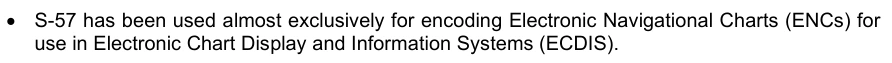
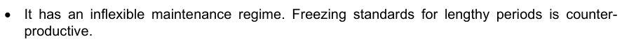
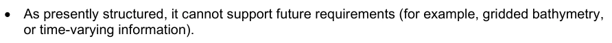
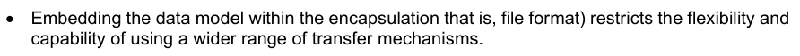
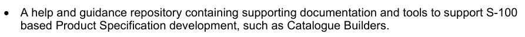

# S-100 5.2.1 · 第 0 部分 · 概述

非官方机器翻译参考稿，尚未逐条人工校订。公式与代码保留原文，解释以英文规范为准。

## 官方 PDF 第 1 页

S-100

通用水道测量数据模型

第 5.2.1 版 — 2025 年 12 月

发布机构：国际海道测量组织（IHO）
地址：4b quai Antoine 1er，摩纳哥公国
电话：(377) 93.10.81.00
传真：(377) 93.10.81.40
电子邮箱：info@iho.int
网站：www.iho.int

## 官方 PDF 第 2 页

第 0 部分 — 概述

© 国际海道测量组织（IHO），2025 年。版权所有。

除《保护文学和艺术作品伯尔尼公约》（1886 年）允许的使用，以及下述情况外，未经 IHO 事先书面许可，不得翻译、以任何方式复制、改编、传播或商业利用本作品的任何部分。本出版物部分材料的版权可能属于其他权利人，翻译或复制这些材料须取得相应权利人的许可。

本文件或其部分内容可为一般信息目的进行翻译、复制或分发，但收费不得超过成本回收水平。未经 IHO 秘书处及其他版权持有人事先书面同意，不得以盈利或获取收益为目的销售或分发副本。

按上述条件复制、翻译或分发本文件或其部分材料时，须包含以下声明：

“IHO 出版物〔摘录出处：名称、版次〕中的材料，经代表国际海道测量组织（IHO）行事的 IHO 秘书处许可（许可编号：……／…）予以转载。IHO 对转载材料的正确性不承担责任；有疑义时，以 IHO 的正式文本为准。收录源自 IHO 的材料，不应被理解为 IHO 对本产品的认可。”

“本〔文件／出版物〕是 IHO〔文件／出版物〕〔名称〕的译文。IHO 未检查该译文，因此对译文的准确性不承担责任。有疑义时，应查阅〔名称〕的〔语言〕源文版本。”

未经 IHO 秘书处事先书面许可，不得在任何衍生产品中使用 IHO 标志或其他标识。

## 官方 PDF 第 3 页

S-100 – 第 0 编

概述

## 官方 PDF 第 4 页

本页特意留空

## 官方 PDF 第 5 页

中文目录（可用上方目录直接跳转）

前言 · 官方 PDF 7
引言 · 官方 PDF 14
0-1 范围 · 官方 PDF 15
0-2 本出版物使用的缩略语 · 官方 PDF 15
0-3 S-100 的目标 · 官方 PDF 16
0-4 S-100 各部分 · 官方 PDF 17
0-4.1 专用配置 · 官方 PDF 18
0-4.2 第 1 部分 — 概念模式语言 · 官方 PDF 18
0-4.3 第 2 部分 — IHO 地理空间信息注册簿管理 · 官方 PDF 19
0-4.4 第 2a 部分 — 概念与数据字典注册簿 · 官方 PDF 19
0-4.5 第 2b 部分 — 显示注册簿 · 官方 PDF 19
0-4.6 第 3 部分 — 通用要素模型 · 官方 PDF 19
0-4.7 第 4 部分 — 元数据 · 官方 PDF 19
0-4.8 第 5 部分 — 要素目录 · 官方 PDF 20
0-4.9 第 6 部分 — 坐标参考系 · 官方 PDF 20
0-4.10 第 7 部分 — 空间模式 · 官方 PDF 21
0-4.11 第 8 部分 — 影像与格网数据 · 官方 PDF 21
0-4.12 第 9 部分 — 显示 · 官方 PDF 21
0-4.13 第 9a 部分 — 显示（Lua） · 官方 PDF 21
0-4.14 第 10 部分 — 编码格式 · 官方 PDF 21
0-4.15 第 10a 部分 — ISO/IEC 8211 编码模式 · 官方 PDF 22
0-4.16 第 10b 部分 — GML 编码 · 官方 PDF 22
0-4.17  第 10c 部分 — HDF5 数据模型与文件格式 · 官方 PDF 22
0-4.18 第 11 部分 — 产品规范 · 官方 PDF 22
0-4.19 第 12 部分 — 维护 · 官方 PDF 22
0-4.20 第 13 部分 — 脚本 · 官方 PDF 22
0-4.21 第 14 部分 — 在线通信交换 · 官方 PDF 22
0-4.22 第 15 部分 — 加密与数据保护 · 官方 PDF 22
0-4.23 第 16 部分 — 互操作目录模型 · 官方 PDF 23
0-4.24 第 16a 部分 — S-100 产品的协调显示 · 官方 PDF 23
0-4.25 第 17 部分 — 信息交换目录的发现元数据 · 官方 PDF 23
0-4.26 第 18 部分 — 语言包 · 官方 PDF 23

## 官方 PDF 第 6 页

本页特意留空

## 官方 PDF 第 7 页

前言

S-100的开发 — 国际海道测量组织通用水道测量数据模型于2001年被纳入了国际海道测量组织工作方案. S-100由国际海道测量组织传输标准维护和应用开发工作组(TSMAD)开发,水道测量办公室,行业和学术界积极参与. S-100自2015年起由S-100工作组(S-100WG)进一步开发.

S-100提供了一个当代水道测量地理空间数据标准,可以支持各种与水道测量有关的数字数据来源,并与主流国际地理空间标准,特别是ISO 19100系列地理标准完全一致,从而使水道测量数据和应用更容易地融入地理空间解决方案.

S-100的主要目标是支持更多种类的与水道测量有关的数字数据来源、产品和客户,包括使用图像和网格数据、增强元数据规格、无限编码格式和更加灵活的维护制度。 这有助于开发超出传统水道测量范围的新应用,例如高密度水深测量、海底分类、海洋地理信息系统等。 S-100的设计是可扩展的,今后在获得、处理、分析、取用和提交水道测量数据方面,如3-D、时间变化数据(x、y、z和时间)和基于网络的服务等要求可以方便地加以补充。

S-100开发和维护程序的具体目的是允许非国际海道测量组织利益攸关方的直接投入,从而增加这些潜在用户为特定目的最大限度地利用水道测量数据的可能性。

S-100最终将取代S-57 — — 已确立的IHO数字水道测量数据传输标准。 尽管S-57有许多好的方面,但它有一些局限性:



• S-57几乎完全用于电子图表显示和信息系统(ECDIS)所用的电子导航图表编码。


• S-57不是一个在地理信息系统领域得到广泛接受的当代标准。



• 它的维护制度不灵活。



• 按照目前的结构,它不能支持今后的需要(例如网格测深,



· 将数据模型嵌入封装中,即文件格式,限制了使用更广泛的传输机制的灵活性和能力。


• 一些人认为,这是专门针对生产和交换的有限标准;

国际海道测量组织将认真监测从S-57向S-100的过渡,以确保现有的S-57用户,特别是ENC利益攸关方不会受到不利影响. S-57在可预见的将来将继续作为ENC数据的指定格式而存在.

与此同时,鼓励水道测量信息和数据的所有现有和潜在用户使用S-100作为新应用的基础,如果这些标准的特定要求尚未得到满足,则寻求对进一步发展标准的投入。

## 官方 PDF 第 8 页

二. 第0部分 -- -- 概览

文档控制

编辑数字日期参考

1.0.0 2010年1月 国际水道测量组织第83/2009号通知函,2009年12月04日

2015年6月2.0.0 国际海道测量组织第39/2015号通知函 2015年6月05日

2017年6月3日 3.0.0 2017年6月2日 IHO通知函 第32/2017号 2017年5月02日 4.0.0 2018年12月17日 IHO通知函 第60/2018号 2022年12月5.0.0 2022年12月12日 IHO通知函 第45/2022号 5.1.0 2023年10月12日 IHO通知函 第36/2023号 2023年10月31日 5.2.0 2024年6月5日 IHO通知函 第27/2024号 2024年6月07日 5.2.1 2025日 IHO S-100WG

5.2.1版实质性变动摘要

已生效的概要条款

从规范引用中删除了 URL 链接。 1-3

表1-4:从URI衍生型描述中删除了示例;修改了URN衍生型描述中的示例,以反映MRN格式;添加了Derived Type file URI.

```text
1-4.6
```

表1-4.4. 删去以下解释性案文

从规范引用中删除了 URL 链接. 2a-2

为属性 S100_CD_属性ValueType 添加了 URI 、 URL 和 URN 的值备注; 添加了缺少的值文件URI 。

```text
2a-4.2.9
```

澄清了S100_CD_属性约束类的属性精确度描述和注释,以描述该精确度指定了小数位数位后位数右后方的位数.

```text
2a-4.2.10
```

以一般网页参考资料取代了URL链接。 3-10

更正了表5-A-7和表5-A-8中的备注,以反映S100_FC_InformationType和S100_FC_FeatureType出自S100_FC_ObjectType,与图5-A-1一致.

附录5-A

## 官方 PDF 第 9 页

删除的语句,所有几何原始(GM_Primitive)都必须是至少一个GM_Aggregate的一部分.

```text
7-4.2.11.1
```

从规范性参考资料中删除了URL链接,并贯穿整个过程。

以一般网页参考取代了 URL 链接。 9-B-1

从规范引用中删除了 URL 链接. 9a-3

经修订的关于COCC-NCOR、SECC-NSEG和CCOC-NCCO的子域评论,以确认对于删除指示,不应有项目。

```text
10a-7.2.1.2, 10a-
7.2.4.2.3, 10a-
7.2.5.2.2
```

从引用中删除 URL 链接 。 10b-3

澄清所有 GML 数据集的文件扩展名必须是. GML. 10b-7

通过要求使用xlink:title来指定每个协会的具体类型,消除了GML中编码协会中的模糊.

```text
10b-8.4, 10b-8.4.1,
10b-9, 10b-10, 10b-
11.4, 10b-11.4.1
```

澄清了在要素目录中存在继承时定义的GML Schema元素的范围.

```text
10b-9
```

添加了新条款来澄清GML位置语法的限制,以简化ECDIS对数据的解析.

```text
10b-9.1
```

更正的子帐号:10b-10.1.3.1,10b-10.1.3.2

删除了说明,该说明意味着一个单一的GML数据集可能包含一个以上的产品.

```text
10b-11.1.1
```

在实例中添加了chemaLocation和s100dev.net;并增加了相应的补充指导,以确保这些指导一致地用于整个系统的适当运作。

```text
10b-11.1.1
```

修正后的例子使xlink:arcrole符合MRN格式. 10b-11.4.1

表10b-4:删除了字段编码规格版的值;从字段 Dataset主题分类中删除了值.

```text
10b-11.6.1
```

修正后图10b-12,同意表10b-4.10b-11.6.1中的改动

澄清说,“欧管处具体规定的URI SRS公约”是指“标准”大地测量坐标参考系的URL(http URI)与EPSG编码。

```text
10b-11.7
```

添加了说明,以澄清坐标顺序必须与定义的坐标参考系一致。

```text
10b-11.7
```

添加了新指南, 请求产品规范开发者使用 IHO 的 Schema 服务器来放置它们的 Schema 。

```text
10b-14
```

从信息参考中删除了 URL 链接 。 10c-4.2

claized 许可 Group_F 省略当前数据集未使用的可选属性 。

```text
10c-9.5
```

## 官方 PDF 第 10 页

iv 第0部分 -- -- 概览

修正的特性 属性表元素,从"id"到"fetature 属性表Key"的固定列名.

```text
10c-9.6.2; 10c-
9.11.1
```

表10c-12中经修改的注释,分节数据CodingFormat=2或9行网格起源;网格起源纬度;网格相距;网格相距,经度;网格相距,纬度,允许投放数据集的米.

```text
10c-9.7
```

修正属性时间的多式性点从强制性改为任择性(表10c-19)。

删除了附录11-B作为符合要求的产品规范的例子。

```text
11-1
```

整齐化,以便在整个S-100、其产品规范和数据验证中统一使用数据大小单位计量参考文献

```text
11-1, 11-2.1, 11-13
```

以一般网页参考资料取代了URL链接。

添加了参考S-100 第17部分第17-4.4.2条的新指南,用于提供交易所目录XSD文件的可选规定,其中产品规范进一步限制S-100所定义的交易所目录元素.

```text
11-15
```

将附录内容改为参考S-97版 2.0.0(正在开发)和S-100版 5.2.0.

```text
11-A, 11-C, 11-E
```

附录内容取而代之的是国际海道测量组织地理空间信息注册簿、产品规范注册簿所公布的产品规范。

```text
11-B
```

将附录内容取而代之的是国际海道测量组织地理空间信息登记册中的链接。

```text
11-D
```

修改条款,以反映S-100维修的搬迁情况 -- -- 向国际水道测量组织登记处提出的更改建议表。

```text
12-2
```

将附录内容改为参考S-97版 2.0.0(正在开发)和S-100版 5.2.0.

```text
12-A
```

从规范性参考资料中删除了URL链接和整个链接 13-3, 13-7.1

表13-7:经过修改的URI值标记,用于反映字符编码可以反映任何URI格式;添加缺失值文件URI.

```text
13-8.1
```

澄清了 AtproductionControlints 的参数精度指定了小数位数位位数到小数取位数的右后方的位数.

```text
13-8.1.1.1
```

从规范性参考资料中删除了URL链接,并在整个过程中删除了14-2、14-8.2.1

添加了新的规范参考 ISO/IEC 80000-13:2025. 14-2

从规范引用中删除了 URL 链接. 15-2

修改了规格,使数据加密具有可选性,因为数据制作人需要签署数据,但可能不负责加密.

```text
15-4.2
```

澄清了指令,即计划管理员将在所有数据服务器的公用密钥上签名,以创建其数字证书,用于保护计划的运作,而不论其是否进行加密.

```text
15-4.6
```

澄清了目录中的数字签名应在加密和压缩后被应用.xml.

```text
15-5.1, 15-8.11.1
```

## 官方 PDF 第 11 页

表15-7.4.4中的Xs:正整数格式

澄清在许可证.xml.15-7.4.4、15-7.4.6中文件名扩展是可选的

澄清许可证和目录的独立签名文件格式。 15-7.4.5、15-8.11.2

将图15-6更正为数据服务器和数字签名创建流程中“DS2”的命名一致。

```text
15-8.1
```

更正了实例 Exchange Set Catalogue 标题摘要,以将证书Ref和计划管理员id “root”替换为“IHO”。

```text
15-8.4, 15-8.6
```

纠正了“S100_SE-证书容器类型”的多重性[0.1]至[1](强制性)

```text
15-8.11.1
```

S100_SE_SignatureOnData 类属性数据的修改描述和备注。

```text
15-8.11.4
```

更正属性签名的语法Refer for class S100_SE_Signature OnSignature

```text
15-8.11.5
```

已更正的编号类型值的语法

从规范引用中删除了 URL 链接. 16-3

将 URL 链接替换为一般网页参考文献。 16-A-3

从信息参考中删除了 URL 链接 。 16a- 3. 2

将URL链接替换为一般网页参考。 16a-4.2.1

纠正了文件路径,从图17-5的左侧删除了第二个“/”;将表17-1的URI例子中的第二个“:/”改为“/”。

```text
17-4.3
```

修改数据集取消的规格,以指定更新的版号必须被设定为被取消单元格的版号;以及取消的目的。

```text
17-4.4.1, 17-4.5
```

添加了交换目录 XSD 文件的可选规定的新指南,其中产品规范进一步限制了S-100定义的交换目录元素.

```text
17-4.4.2
```

修改表S100_DatasetDiscoveryMetadata中版本的编号属性类型为正整数.

```text
17-4.5
```

在表S100_DatasetDiscoveryMetadata后添加了新的注释2,以澄清目录.xml中的数字签名应在加密和压缩后被应用. 在表S100_DatasetDiscoveryMetadata中添加了数字签名属性注释2的新注释.

```text
17-4.5
```

为表S100_DataCoverage(注1)所编译,提及EPSG代码的内容将以http URI格式.

```text
17-4.5
```

为表S100_数据封面所拼写(注1),协调位置必须用列表来表示("posList").

```text
17-4.5
```

为表S100_DataCoverage(注1)所拼写,对边框Polygon属性的坐标顺序必须与定义的坐标参考系一致.

```text
17-4.5
```

将表S100_目的中的新数据集值重新标记校正,以表示在覆盖或范围发生显著变化的情况下,可能会生成新的数据集。

```text
17-4.5
```

## 官方 PDF 第 12 页

六. 第0部分 -- -- 概览

修改了表S100_PresidentFile DiscoveryMetadata中版本编号属性的备注,以正确表示版本编号是用于支持文件而不是数据集.

```text
17-4.5
```

在表S100_DatasetDiscoveryMetadata之后添加了对新注2的参考,用于表S100_PresidentFileDiscoveryMetadata和表S100_CatalgueDiscoveryMetadata中数字符号Value属性的注释.

```text
17-4.5
```

从规范引用中删除了 URL 链接 。 18-2

## 官方 PDF 第 13 页

本页特意留空

## 官方 PDF 第 14 页

八. 第0部分 -- -- 概览

引言

标准应概括最佳做法方法和程序的使用,应包括关于如何实施高效生产方法和优化组织产品和服务质量的指导,还应通过使用共同接口使不同技术之间的互操作性得以实现。 此外,它还提供了一个组件框架,供感兴趣的社区用于开发自己的海洋地理空间产品和服务。

S-100标准是在通过开发和使用现有的IHO数字水道测量数据传输标准(称为S-57)而获得的经验的基础上,以后视为优势而得到制定的. S-100标准是使用一个面向对象的标记来被记录的,称为"统一建模语言"(UML). (虽然UML定义了9个类型的图表,但在S-100中只使用了类,对象和包图.

S-100标准提供了基于ISO 19100系列标准和规格的组件理论框架,这些标准和规格也被用作大多数当代地理空间标准制定活动的基础,并与其他标准制定举措如开放地理空间联合会(OGC)紧密相通.

国际海道测量组织还开发了一个相关的地理空间信息登记册,可以结合S-100标准使用。


• 国际海道测量组织数据生产者代码注册簿。


• S-100产品规范注册簿。



• 一个帮助和指导库,载有支持S-100产品规范开发的辅助文件和工具,如目录构建器。

国际海道测量组织GI登记册提供了必要的基础设施和机制,以管理和维持上述资源,并视需要予以扩大。

S-100号说明规定了一个注册簿及其注册簿的Schema和总体管理程序,国际水道测量组织注册簿是利用这些概念实施的。

## 官方 PDF 第 15 页

0-1 范围

S-100《IHO 通用水道测量数据模型》由一组相互关联的部分组成，为用户开发和维护水道测量相关的数据、产品及注册簿提供适用的工具和框架。这些标准针对水道测量及相关信息，规定了数据管理、处理、分析、访问、呈现，以及在不同用户、系统和地点之间以数字／电子形式传输数据的方法和工具。遵循这组地理空间水道测量标准，用户能够构建符合 S-100 要求的产品规范的各个组成部分。

S-100 在合理可行的范围内尽量符合 ISO/TC 211 地理信息系列标准，并在必要时作出适合水道测量要求的专门调整。

S-100 详细规定了各国海道测量机构之间及其他组织之间交换水道测量和相关地理空间数据，以及向制造商、航海人员和其他数据用户分发这些数据时应使用的标准。

S-100 包含多个部分，对 ISO 第 211 技术委员会制定的标准进行专用配置。ISO/TC 211 负责 ISO 地理信息系列标准。这些标准共同构成一个框架，用于开发使用地理信息的行业专用应用；S-100 就是这种应用的一个例子。

本标准规定了以下工作应遵循的程序：
1）建立和维护水道测量及相关信息的注册簿；
2）创建产品规范、要素目录，并定义通用要素模型；
3）使用专门面向水道测量要求的空间数据、影像与格网数据以及元数据。

0-2 本出版物使用的缩略语

2-D：二维
2.5D：二维半
API：应用程序编程接口
ASCII：美国信息交换标准代码
CRS：坐标参考系
CSL：概念模式语言
DEF：数据交换格式
DIS：国际标准草案
ECDIS：电子海图显示与信息系统
ECS：电子海图系统
ENC：电子航海图
EPSG：欧洲石油测量组织
FCD：要素概念字典
FDIS：国际标准最终草案
GFM：通用要素模型
GML：地理标记语言
HDF：层次数据格式
HSSC：IHO 水道测量服务与标准委员会（前身为 CHRIS）
IALA：国际航标协会（原文名称为 International Association of Lighthouse Authorities）
ICC：国际色彩联盟
IEC：国际电工委员会
IETF：互联网工程任务组
IHB：国际海道测量局

## 官方 PDF 第 16 页

0-2 本出版物使用的缩略语（续）

IHO：国际海道测量组织
IMO：国际海事组织
IOGP：国际油气生产者协会（原名 OGP）
ISO：国际标准化组织
ISO/TC211：ISO 地理信息／地球信息技术委员会
JPEG：联合图像专家组
MRN：海事资源名称
OCL：对象约束语言
ODP：开放分布式处理
OEM：原始设备制造商
OGC：开放地理空间联盟
OMG：对象管理组织
OSI：开放系统互连
RENC：区域 ENC 协调中心
RFC：征求意见稿
RNC：栅格航海图
RSS：推荐安全方案
SENC：系统电子航海图（System-ENC）
SKOS：简单知识组织系统
TC：技术委员会
TIFF：标记图像文件格式
TIN：不规则三角网
TS：技术规范
TSMAD：传输标准维护与应用开发工作组
S-100WG：S-100 工作组
SVG：可缩放矢量图形
UML：统一建模语言
URI：统一资源标识符
URL：统一资源定位符（原文展开为 Universal Resource Locator）
XLink：XML 链接语言
XMI：XML 元模型交换
XML：可扩展标记语言
XSD：万维网联盟 XML 模式定义
XSL：可扩展样式表语言

0-3 S-100 的目标

S-100 的目标是：
1）符合 ISO/TC 211 正在制定的新兴 ISO 地理信息标准；
2）支持种类更广泛的海洋或水道测量相关数字数据、产品及用户；
3）将数据内容与编码格式分离，使产品规范不依赖特定格式；
4）在可管理的范围内提供适应变化的灵活性。其意图是允许产品规范通过扩展来演进，而无需发布现有产品规范的新版本。
（本条目标列表续见下一页。）

## 官方 PDF 第 17 页

5) 提供由国际海道测量组织管理的符合ISO的注册簿,其中包含要素概念词典和产品要素目录等具有灵活性并能有管理的扩展的注册簿;

6) 为不同的用户群体提供单独的注册簿。

0-4 S-100 各部分

S-100包含多个由各种ISO 19100系列标准衍生出来的部件.

表0-1列出了各个部件、其相关部件编号和ISO 19100符合性。

表 0-1 — S-100 各部分

部分标题部分编号 ISO19100标准

概念学语言 S-100 第1部分 ISO 19103:2005,地理信息 - 概念学语言 ISO

管理国际海道测量组织地理空间信息注册簿S-100 第2部分 ISO 19135:2005,地理信息-地理信息项目登记程序

概念和数据词典注册簿 S-100 第2a部分 ISO 19135:2005,地理信息-地理信息项目登记程序

ISO 19126:2009,"地理信息-地貌概念词典和注册簿".

S-100 部分2b ISO 19135:2005, 地理信息-地理信息项目登记程序

ISO 19126:2009,"地理信息-地貌概念词典和注册簿".

ISO 19117:2012,"地理信息-平面"

Schema 应用的一般要素模型和规则

S-100 第3部分 ISO 19109:2005,地理信息-应用计划规则

S-100元数据 第4a部分 ISO 19115-1:2014,"地理信息-元数据",由"2018年第一修正案"所修改.

成像学和格纹数据元数据 S-100 第4b部分 ISO 19115-1:2014, 地理信息–元数据– 第1部分 : 基本原理. 经"修正案"1"2018年修订.

19115-2:2009. 地理信息-元数据- 第2部分:图像和网格数据的扩展

元数据-数据质量 S-100 第4c部分 ISO 19113,地理信息-质量原则

ISO 19114, 地理信息 -- -- 质量评估程序

ISO 19138, 地理信息 -- -- 质量计量

要素目录S-100 第5部分 ISO 19110:2005,地理信息 - 要素目录编制方法

坐标参考系 S-100 第6部分 ISO 19111:2007, 地理信息 - 通过坐标提供的空间参考

空间Schema S-100 第7部分 ISO 19107:2003,地理信息-空间计划

成像与格子数据 S-100 第8部分 ISO 19123:2007,地理信息-覆盖几何和函数的Schema

ISO 19129, 地理信息 -- -- 图像、网格和覆盖数据框架

## 官方 PDF 第 18 页

S-100显示 第9部分

平面(Lua) S-100 第9部分a Lua平面

编码格式 S-100 第10部分

ISO/IEC 8211 编码 S-100 部分 10a ISO/IEC 8211:1994,信息交换结构实施数据描述文件的规格

GML 编码 S-100 部分 10b ISO 19136:2007 地理信息 - 地理标记语言

HDF5 编码 S-100 部分 10c HDF5 数据模型和文件格式

产品规范 S-100 第11部分 ISO 19131:2008 地理信息-数据产品规范

S-100 维护程序 S-100 第12部分

S-100 脚本语言 S-100 第13部分 为基于 S-100 的产品规范提供脚本支持

S-100 Part 14指定了S-100的在线交换机制

加密和数据保护 S-100 第15部分 指定S-100产品加密和数据保护

互操作性目录模型 S-100 第16部分 定义创建S-100数据产品互通规则的框架

S-100产品S-100统一版画 第16a部分 具体规定不同S-100数据产品的图画和其他展示功能统一的原则

信息交换目录的发现元数据

S-100 第17部分 提供了描述和创建交换目录的规格,使用户能够识别、发现和管理S-100交换集的内容

语言包 S-100 第18部分提供了实施多语种支持的通用方法;以及用于主要使用的案例的信息化实例,即创建S-100要素目录的多语相支持.

0-4.1 专用配置

ISO 基础标准为希望将其用于实际应用的开发者提供了大量选项. 剖面图的概念提供了一个方法来修改基础标准,使其能满足具体的执行要求.

剖面图是一组或多组基本标准,并在适用的情况下,确定这些基本标准中为实现特定功能所必须的选定条款、类别、子集、选项和参数。ISO 19106描述了用于剖面分析ISO 19100系列标准的两级符合度。S-100的每个部分都记录了该部分在符合度说明中使用的级别。

S-100是一套ISO TC 211地理信息标准的剖面图. S-100标准核心部分与其ISO基础类之间的关系见表0-1.

0-4.2 第 1 部分 — 概念模式语言

这一部分定义了概念 schema语言和基本数据类型,供IHO社区使用,它将统一模型语言(UML)静态结构图和一组基本数据类型的定义组合起来,作为地理信息规格化的概念 schemata语言.

## 官方 PDF 第 19 页

0-4.3 第 2 部分 — IHO 地理空间信息注册簿管理

国际海道测量组织按照ISO 19135-地理信息项目登记程序,建立了一个注册簿,其中包含可扩展的注册簿数量,包括地貌概念、数据词典、显示和Meta数据,这一部分介绍了这些注册簿的内容、结构和管理。

0-4.4 第 2a 部分 — 概念与数据字典注册簿

概念注册簿规定了可用于描述地理或元数据信息的水道测量核心概念信息(定义、骆驼数据库等),使用注册簿存储水道测量定义大大提高了国际海道测量组织管理和扩展基于S-100的多产品的能力,这些产品可以在相对较短的时间内提供使用。 因此,注册簿通过公开登记项目,支持更广泛地使用这些物品;并增加其潜在用户的能见度;概念注册簿是将所有已登记概念作为“无国家”概念储存和管理的主要资源(即没有指定物品的类型,也没有界定概念对注册簿内其他概念的约束)。 每个概念应作为单一实例列入注册簿,并将用作数据词典注册簿和Meta数据注册簿概念的推导和取自的共同来源,用于模拟要素、属性等,供S-100产品规范使用。

数据词典注册簿扩展了概念注册簿(S-100 Part 2a)所储存的概念,包括了在注册簿内独立域中装订物品类型和要素的指定,从而使S- 100产品规范开发者能够开发出它们的数据模型,以最适合其代表现实世界的具体要求。

这一部分介绍注册簿的内容,并具体说明在建立、维持和出版指定给地理、水道测量和元数据信息项目的独特、明确和永久识别资料的词典时应遵循的程序。 为了达到这一目的,本部分具体规定了为登记项目提供识别和定义所必要的信息要素。

0-4.5 第 2b 部分 — 显示注册簿

这一部分描述了显示寄存器的内容。 一张显示 Register 指定了数据的显示。 数据的显示独立于数据, 但与数据密切相关。 这就是数据集中的属性驱动显示过程, 但是对于同一数据可能有许多不同的显示 。 使用注册簿来储存图画的各个方面将大大地提高国际海道测量组织管理和扩展基于S-100的多产品的能力,这些产品可以在较短的时间内提供使用。 该注册簿将通过公开提供和增加潜在用户的能见度来支持更广泛地使用已登记项目。

0-4.6 第 3 部分 — 通用要素模型

这一部分介绍了开发一种应用计划的规则,这是任何S-100产品规范的基本内容,对于创建应用计划同样至关重要的是通用要素模型,它是关于要素、要素要素和关联的概念模型,同时也介绍了信息类型的概念。 GFM是ISO 19109 规则中介绍的用于应用Schemas的GFM的专用配置.

0-4.7 第 4 部分 — 元数据

越来越多的海道测量组织收集、储存和归档大量数字数据,这些数据正在成为重要的国家资产。 需要确定数据资源的特点,并便利其发现、获取、检索和使用,以便用户能够了解数据资源的假设和局限性,并评估资源是否适合其预期用途。 此外,对水道测量数据质量的了解对于应用水道测量数据至关重要。

## 官方 PDF 第 20 页

数据保管人需要记录有关其数据(即元数据)特点和质量的信息,以便利发现、获取、检索和使用并确保可靠性。

ISO 19115-1、19115-2和19157提供了一个抽象的结构,通过界定资源的特点和质量元数据要素,以及建立一套共同的元数据术语、定义和扩展程序,来描述数字地理信息。

本部分还描述了如何使用ISO 19115-1、19115-2和19157元数据类别、要素和条件,并纳入了充电质量元数据的规则,还纳入了ISO 19113、19114和19157所述的质量计量。

0-4.8 第 5 部分 — 要素目录

要素目录是描述数据产品内容的文档,它使用一个或多个要素数据词典中的项目类型,例如要素和属性,一个要素分类目录的基本级别是按要素类型和信息类型划分的,任何一组包含要素的地理数据都应该有要素电子形式. 要素目录也可以遵守S-100这一部分的规格,独立于现有的地理数据组.

每个产品规范都定义了一个要素目录,特性和属性绑定在一个要素目录中,要素和属性的定义取自一个特性数据词典.

本部分定义了要素类型编目方法,还具体规定了要素类型的分类如何组织成一个要素目录并提交一组地理数据的用户,本部分适用于在之前未编目的域中创建要素类型目录,并修改现有的要素分类目录以适应标准惯例. 本部分适用于以数字形式表示的要素类型编目,其原理可以被扩展至其他地理数据形式的编目.

第5部分适用于类型一级地理要素的定义,这一国际标准不适用于每一类型个别情况的代表性。

0-4.9 第 6 部分 — 坐标参考系

这一部分适用于水道测量资料的制作者和使用者,其原则可以扩展到许多其他形式的地理信息,如地图、图表和文本文件。

这一部分界定了用坐标描述空间参照的概念方案,说明了定义1-、2-和3维空间坐标参考所需的最低数据,本节载有通过坐标系统和基准充分定义空间参照的所有必要要素。 报告也说明了将坐标从一个坐标参考系改为另一个坐标所需的信息,以及描述协调行动参数和方法所必须的所有要素。

坐标参考系信息可以使用本部分所定义的元素或参照坐标参考系的信息的注册簿进行充分列报,可按照ISO 19135管理坐标参考制度信息的注册簿(见第二部分).

国际海道测量组织没有计划实施坐标参考系注册簿,可用现有的坐标参考系的数据库的一个例子是IOGP地理学委员会大地测量小组委员会管理的EPSG大地测量参数数据集,可以通过名称空间EPGS和一个代码,如4326(即EPS:4326)来传达完整的CRS定义。 EPSG命名空间范围内的这个代码识别出基于WGS84 datum的椭圆坐标系统. EPSG数据库没有按照ISO 19135进行管理.

## 官方 PDF 第 21 页

0-4.10 第 7 部分 — 空间模式

这一部分定义了描述和操纵要素空间要素所必须的信息,它基于ISO 19107 - 地理信息 - 空间计划,然而S-100的空间要求不如ISO 19107. 这个专用配置包含了包含在S- 100中的ISO 19 107. 类的子集.

0-4.11 第 8 部分 — 影像与格网数据

这一部分确定了用于水道测量和相关应用的网格数据的内容模型,包括图像和网格的数据,并介绍了网格的组织、类型和相关元数据和空间参考。 图像和网格数据的编码和显示是S-100的这一部分的外部,尽管已识别出编码和绘图使用所识别内容模型的方式,这部分是基于ISO 19129图像、网格和覆盖数据框架。

0-4.12 第 9 部分 — 显示

这一部分具体规定了用于定义和组织S-100产品特有要素所需的符号和显示规则的显示模式.

0-4.13 第 9a 部分 — 显示（Lua）

这一部分界定了S-100 第九部分使用S- 100 第13部分所定义的脚本绘制机制实施图画所需的添加和修改. 产品中具体规定使用本部分所描述的图画目录的,也必须要求执行S- 100. 第13分部分.

0-4.14 第 10 部分 — 编码格式

这一部分涵盖了编码格式. S-100没有强制特定编码格式,因此由产品规范的开发者决定合适的编码标准并记录其所选择的格式. 编码信息的问题因已有的编码标准的范围而变得复杂. 表0-2提供了一份不完整的已存在的编码标准清单,从中可以按照要求将S-100作为扩展来开发出Semas.

表 0-2 – 示例编码标准

编码名称描述

ISO/IEC 8211 目前用于编码S-57ENC数据的编码标准.

GML 地理标记语言

XML 扩展标记语言

GeoTIFF 扩展 TIFF 规格,允许存储地理参考信息

HDF-5 分级数据格式版本 5

JPEG2000 联合摄影专家组 - 常用的相片图像压缩方法

成功的数据交换取决于在"要素目录"中定义的内容的知识,以及应用程序Schema中定义的数据集结构,以及所应用的编码规则.

## 官方 PDF 第 22 页

0-4.15 第 10a 部分 — ISO/IEC 8211 编码模式

这一部分具体规定了实施以ISO 8211格式编码的交换数据集所需的结构和物理构造.

0-4.16 第 10b 部分 — GML 编码

这一部分具体规定了实施地理标记语言数据格式所需的结构和物理构造.

0-4.17 第 10c 部分 — HDF5 数据模型与文件格式

这一部分具体规定了执行分级数据格式第5版(HDF5)所编码的交换数据集所需的结构和构造.

0-4.18 第 11 部分 — 产品规范

本部分解释产品规范,是ISO 19131数据产品规范的描述性IHO专用配置,并介绍了地理数据产品与水道测量和水道测量有关的要求的数据产品规范。

该专用配置的目的是确保任何数据产品规范结构明确而一致,该专用配置将符合国际海道测量组织S-100框架下所制定的所有其他标准。

产品规范是描述一个特定应用程序的所有要素、属性和关系,并将其映射到一个数据集,是对定义特定地理数据产品所需的所有要素的完整描述。

0-4.19 第 12 部分 — 维护

这一部分具体规定了维持和公布S-100各部分的程序,不包括维持S- 100注册簿,因为注册簿所有人规定了更新注册簿的程序,也不包括按照S- 100. 记录的产品规范的维持制度。

所有S-100产品规范将包括一个维修部分。

0-4.20 第 13 部分 — 脚本

这一部分定义了将脚本支持包含在以S-100为基础的产品中的标准机制. 脚本提供通过用Lua编程语言编写的脚本文件处理以S-100为基础的数据集.

0-4.21 第 14 部分 — 在线通信交换

这一部分介绍为指定在线信息交流所需的组件和流程,可以是一套可能具有连续性的数据或数据,后者又被称作“流数据”,数据需要更动态的信息流动;即除了交流主要作为文件处理的静态数据集之外。

0-4.22 第 15 部分 — 加密与数据保护

这一部分具体规定了S-100产品规范实施副本保护和(或)认证方法所需的机制、结构和内容。

## 官方 PDF 第 23 页

定义了数字签名制作的算法和方法,以及国际海道测量组织数据保护计划范围内的关键管理和身份保证所需的周围基础设施。

0-4.23 第 16 部分 — 互操作目录模型

这一部分界定了为S-100数据产品的操作制定规则的框架,包括统一的图形演示和警报及指示处理,可用于制定包含在互操作性目录中的系统特定规则,该目录是一类元产品,它描述了产品组如何同时使用和显示.

0-4.24 第 16a 部分 — S-100 产品的协调显示

这一部分具体规定了统一不同S-100数据产品的描述和其他列报功能的原则,目的是改进用户的经验并减少使用多S- 100数据产品的系统内的模糊不清之处。 报告还介绍了国际海事组织(海事组织)在国际海道测量组织(海道测量组织)内支持统一工作的相关指导和资源。 它不处理其他S-100部件(特别是第九和第九A部分)中涉及的显示过程、功能或架构,而是侧重于演示设计方面,如显示组织、颜色和符号。

0-4.25 第 17 部分 — 信息交换目录的发现元数据

这一部分为描述和创建让用户能够识别、发现和管理S-100交换集内容的交换目录提供了规格,更重要的是它利用了XML,使机器能够机器发现和交换海道测量组织通常制作的地理数据集的信息。 其目的是建立元数据记录,提供关于识别、空间和时间范围、质量、应用Schema、空间参考系统以及数字地理数据分布的信息,适用于数据集的编目、信息交换所活动以及地理和非地理资源的全面描述。

信息交换需要若干类元数据:关于交换目录总体的元数据;关于目录中每个数据集的元数据和关于构成包的支持文件的元数据的元数据。如果交换目录包含任何特性、相容性或互操作性目录,则有附加这些元数据的条款。

这一部分针对元数据应用的开发者和执行者,对地理信息标准化的原则和总体要求提供了基本理解,应与S-100条款第4a部分第4 a-4条-规范性参考条款所列举的标准一并使用。

0-4.26 第 18 部分 — 语言包

本部分详细介绍了S-100框架的XML元素的多语言支持如何实施,并描述了用于制作单个语言包的通用机制和结构,这些组合将执行任何XMR内容的翻译.

用于提供支持产品规范的 XML 资源多种语言实例, 供终端用户使用。 执行系统可以构建这些辅助资源的翻译实例。 这部分并非针对任何一类的 X ML 数据 。 它没有详细说明如何在S-100产品规范、数据集或它们可能提及的任何外部资源中添加多语言支持,它提供了一个通用机制,可用于S- 100框架基于XML的任何要素,以适应多语言执行。

## 官方 PDF 第 24 页

S-100的这一部分提供了实施这种支持的通用方法;以及用于主要用途的提供信息性实例,即为S-100要素目录创建多语种支持.
