# S-100 5.2.1 · 第 1 部分 · 概念模式语言

非官方机器翻译参考稿，尚未逐条人工校订。公式与代码保留原文，解释以英文规范为准。

## 官方 PDF 第 25 页

S-100 – 第1编

概念模式语言

## 官方 PDF 第 26 页

5.2.1版实质性变动摘要

已生效的概要条款

从规范引用中删除了 URL 链接。 1-3

表1-4:从URI衍生型描述中删除了示例;修改了URN衍生型描述中的示例,以反映MRN格式;添加了Derived Type file URI.

```text
1-4.6
```

表1-4.4. 删去以下解释性案文

## 官方 PDF 第 27 页

中文目录（可用上方目录直接跳转）

1-1 范围 · 官方 PDF 29
1-2 符合性 · 官方 PDF 29
1-3 规范性引用文件 · 官方 PDF 29
1-4 S-100 UML 专用配置 · 官方 PDF 30
1-4.1 引言 · 官方 PDF 30
1-4.2 联合马列的一般使用 · 官方 PDF 30
1-4.3类 · 官方 PDF 30
1-4.4 属性 · 官方 PDF 30
1-4.5 基本数据类型 · 官方 PDF 31
1-4.5.1 一般考虑 · 官方 PDF 31
1-4.5.2 初级型 · 官方 PDF 31
1-4.5.3 复杂类型 · 官方 PDF 33
1-4.6 预定义的衍生类型 · 官方 PDF 37
1-4.7 假定类型 · 官方 PDF 37
1-4.8 编码清单类型 · 官方 PDF 37
1-4.9 关系和协会 · 官方 PDF 39
1-4.9.1 关系 · 官方 PDF 39
1-4.9.2 协会、组成和汇总 · 官方 PDF 39
1-4.10 定型观念 · 官方 PDF 41
1-4.10.1 班级/分类人员使用UML标准定型观念 · 官方 PDF 41
1-4.11 可选、有条件和强制性的属性和协会 · 官方 PDF 42
1-4.12 命名和名称空格 · 官方 PDF 42
1-4.13 说明 · 官方 PDF 43
1-4.14 包件 · 官方 PDF 43
1-4.15 S-100中的模型文件 · 官方 PDF 44

## 官方 PDF 第 28 页

本页特意留空

## 官方 PDF 第 29 页

1-1 范围

这一部分定义了IHO社区内使用的概念Schema语言和基本数据类型,它确定了统一建模语言(UML)静态结构图的组合,以及一组基本数据类型的定义作为用于地理信息规格化的概念Shema语言. (UMl是软件工程领域标准化的通用建模语. 它包括一组图形标记技术来创建特定系统的抽象模型. UML结合了实体关系图,工作流,对象建模和组件建模等数据建模概念中的最佳做法.

第二,本部分就如何利用UML建立标准化的地理信息和服务模式提供了指导方针,这些模式是实现互操作性目标的基础,由于本部分涉及UMR,因此除了S-100附件A(术语和定义)中包括这些术语外,还提供了一节,其中列有具体的UMle术语和的定义。

1-2 符合性

任何为说明S-100的这一部分内容而写的概念学概论,应符合第5款所载列的规则。 这一概论符合ISO 19106:2004第2类的规定。

1-3 规范性引用文件

本文件的应用需要下列参考文件:关于注明日期的参考文件,仅适用所引用的版本;关于未注明日期的文件,适用所参考文件的最新版本(包括修正案)。

ISO 19103:2005 (E), 地理信息-概念计划语言

ISO 8601:2004(E),数据要素和交换格式-信息交换-日期和时间的表示.

ISO 19136: 地理信息-地理标记语言

ISO 25964-1:信息和文献——"Thesauri"和"与其他词汇的互操作性" 第1部分:"Thesauri"用于信息检索.

ISO 25964-2:信息和文件——Thesauri和与其他软件的互操作性

词汇表—— 第2部分:与其他词汇的互操作性

OGC 10-129r1: 地理信息-地理标记语言(GML)-扩展图案和编码规则

OMG 统一建模语言(OMG UML),超结构,V2.1.2

RFC 3986,统一资源识别符(URI):通用语法. T. Berners-Lee, R.Fielding, L. Masinter. Internet Standard 66, IETF.

RFC 2141,URN语法. R. Moats. IETF RFC 2141,1997年5月.

RFC 8089,“文件”URI计划,2017年2月。

SKOS: SKOS – 简单知识组织系统 – 参考. W3C建议, 2009.

## 官方 PDF 第 30 页

1-4 S-100 UML 专用配置

1-4.1 引言

该条款规定了在地理信息领域使用UML的规则和准则。

子语序的结构如下:

(1) 联合马列的一般使用

(2) 类

3) 属性

(4) 基本数据类型

5) 预定义的衍生类型

6) 假定类型

7) 代码列表类型

8) 关系和协会

9) 定型观念

10) 可选、有条件和强制性的属性和协会

11) 命名和名称空格

12) 注解.

13) 包 装

14) S-100中模型的文献资料.

1-4.2 联合马列的一般使用

UML(统一模型语言)的使用方式应与UML 2. 规范模型必须使用类图和包图. 其他UMR图型可以信息化地使用,所有规范模型都必须包含属性,关联,以及相宜的数据类型定义等完整定义.

1-4.3类

一个类是对一组具有相同属性,操作,方法,关系,行为和约束的物体的描述. 一个类代表着一个正在被模拟的概念. 根据模型的类型,概念可能基于现实世界(对于一个概念模型),也可能基于平台独立系统概念之间的实施(对于规格模型)或平台特定系统概念(对于执行模型).

分类器是指包含其他类类类元素的类的概括,如数据类型,演员和组件. UML类有名称,一组属性,一组操作和约束. S-100操作中不使用,一个类可以参加协会.

按照S-100部分划分的类别被视为一种规格,而不是一种执行。

多重继承的使用应被最小化,因为它往往会增加模型的复杂性.

文摘类用斜体表示。

1-4.4 属性

属性的 UML 标记有:

选取性选择名称 : 选取性选择类型 选取性选择[多相] 选取性选择=初始值选择{财产-字符串}选取性选择

## 官方 PDF 第 31 页

一个属性必须在一个类及其超类型上下文中是独一无二的,否则就是衍生出的一个属性,即从超类型中重新定义的属性.

属性的能见度由表1-1中的符号显示. 保护的和私有的能受度通常不用于标准规格,必须使用适当的能受能受分的符号,协会使用相同的能受可受能见性符号.

表1-1——属性可见度

符号 说明

+ 公众知名度

# 受保护的能见度

- 个人知名度

/ 衍生属性

所有属性必须打入,类型必须存在,构建/定义类型必须始终指定一个类型,不存在默认类型.

如果没有给出明确的多重性,则假定为一.

一个属性可以定义默认值,当该类型对象创建时使用. 默认值由UML定义中的明确的默认值来定义.

可用下列属性:


仅读 – 属性的值不能被更改,必须关闭。

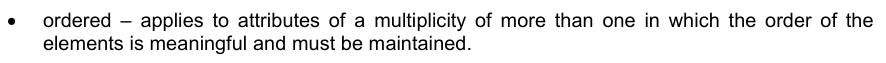

命令 – 适用于元素顺序有意义且必须维持的多个属性。

EXAMPLES + 中心: 点= (0. 0) {只读了} + 出处: 点 [0.. 1] // 多重0. 1 表示这是可选的 + 控制点 : 点 [2. *] {已订购了}

1-4.5 基本数据类型

1-4.5.1 一般考虑

基本数据类型分为两类:

1) 原始类型:代表值的基本类型,例如字符串、整数、布尔、日期、时间等。

2) 复杂类型:类型组合,例如计量类型和计量单位组合.

基本数据类型的再现在以下子语录中被描述.

S-100数据格式可能使用适当的内置或标准类型代表值. 例如,ISO 8211格式(Part 10a)代表字符串中所有主题要素属性的值,而不是使用ISO 9211签名整数,无签名整分数,或者S-100类型Integer或Real主题属性的被签名浮点表示.

1-4.5.2 初级型

以下原始类型在S-100 UML图中被支持.

## 官方 PDF 第 32 页

表 1-2 — 数据类型

名称描述

整数 A 签名整数,一个整数的表示是封装和用法的依赖.

实例29, -65547

无符号整数大于 0 。

无符号整数大于或等于0的整数。

由mantissa和expresents组成的Real A 签名真实(浮点)数字,真实的表示是封装和用法的依赖.

EXAMPLES 23.501, -1.234E-4, -23.0 (英语).

布尔 A 代表二进制逻辑的值。 该值可以是真也可以是假的 。

字符String A CharlieString是一个任意长度的字符序列,包括从被采纳的字符集的回放中取出重音和特有字符.

日期 A 给出了年份、 月份和日期的值。 日期的字符编码是遵循 ISO 8601 指定的日历日期格式( 完整表示, 基本格式) 的字符串。

19980918 (YYYYYMMDD) (英语).

在XML格式中,应该使用XML Schema标准类型来代替ISO 8601基本表示(这在XML中不是一个标准类型).

EXAMPLE: 1998-09-18 (英语).

时间 A 给出的时间在24小时钟系统中为1小时,分和次. 时间的字符编码必须是ISO 8601定义的基本格式的完整表示. 完整的表示表示意味着必须使用小时,分钟和秒. 基本格式表示忽略了分隔字符.

时间最好以世界时间坐标表示(UTC).

EXAMPLE 183059Z (英语).

时间可以表示为当地时间,给定的冲抵为协调世界时.

EXAMPLE 183059+0100 (英语).

时间可以表示为"当地时间",无需指定抵消世界协调时.

EXAMPLE 183059 (英语).

以日内瓦(在协调世界时前一个小时的冬季)和纽约(在协和世界时后五个小时的冬天)当地15小时过后27分46秒的完整时间表示以及表明当地时间尺度与协调世界后5小时的差别作为例子。

日内瓦:152746+0100

纽约:152746-0500

一项服务的服务时数,在日光节时影响协调世界时抵消的区域全年均可使用,可表示为当地时间,而无需指定抵销。

开幕时间:07.4500

闭幕式:161 500

在XML格式中,应该使用XML Schema标准类型来代替ISO 8601基本表示(这在XML中不是一个标准类型).

展览:18:30:59Z;18:30:59+01:00;18:30:59

DateTime A DateTime是日期和时间类型的组合. DateTime的字符编码必须遵循ISO 8601(见上文).

ExAMPLE: 19850412T101530 (英语).

在XML格式中,应该使用XML Schema标准类型来代替ISO 8601基本表示(这在XML中不是一个标准类型).

EXAMPLES: 1985-04-12T10:15:30; 1985-04-12T10:15+01:00; 1985-04-12T10:15:30Z

## 官方 PDF 第 33 页

S100_TrunctedDate A S100-TrundDate允许给出日期或部分日期。至少必须存在下列一个组件,其中省略的元素由格式确定的等同的连字符取而代之。

元件: 年整数从000到9999 MM 月整数在01−12(包括) DD D D D日整数 在01到28,29,30,或31(包括,如果指定的话)之间,与年和月值一致

这种类型可用于编码反复出现的即时(见第三编第3-8款)。

EXAMPLE 1 (ISO 8211, HDF5): YYYYMMDD 带有未指明的元件被连字符所取代,这样编码的长度总是8个字符:

```text
----1217 representing 17 December of any year
```

EXAMPL 2(XML):应该使用合适的XML Schema类型:

- 12-17代表任何一年的12月17日(符合XML类型gMonthDay)

第10b部分提供了GML数据集编码的进一步细节.

1-4.5.3 复杂类型

```text
1-4.5.3.1
UnlimitedInteger
```

图1-1 - 无限整数

一个签名的整数,其值可能是无限的。

1-4.5.3.2 矩阵

图1-2-矩阵

由真元素或整数元素组成的网格 。

## 官方 PDF 第 34 页

```text
1-4.5.3.3
S100_Multiplicity
```

图1-3-S-100-多元性

定义从下到上不等的多重范围。上方边界可能是无限的。

```text
1-4.5.3.4
S100_NumericRange
```

图1-4 — S100_ 数值范围

指定以下边界和上边界以及间隔的关闭类型为数字间隔。

除 ltSemiInterval 或 leSemiInterval外,所有关闭都必须使用下属性。除 gtSemiInterval 或 geSemiInterval外,所有关闭都必须使用上属性 。

注 单值间隔必须用上=下编码,并设置闭合点。

间隔的关闭由引用 S100_IntervalType 定义. 字面有以下含义: 时间轴 :

表1-3——间距类型

名称 说明 定义

打开间距( 下, 上) 下 < x < 上

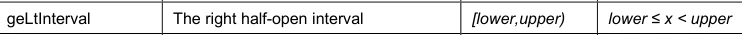

右半开间隔

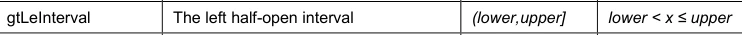

左半开间隔

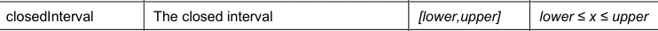

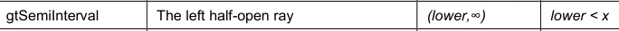

左半开光线

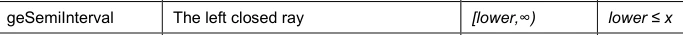

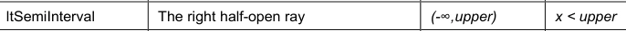

右半开光

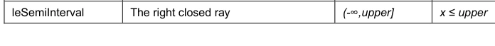

注 使用圆括号(或)的间隔,如一般间隔(下,上)或具体实例(2,4),称为开放间隔,而套接字中没有收起终点。使用方括号[或]的间隔取出一般间隔[下,出]或具体示例[-1,3]和[2,4]。

## 官方 PDF 第 35 页

中间部分使用正方和圆括号[和]或(和),如一般间隔(下,上)和[下,出)或具体例子[-1]和(2,4),称为半闭间隔或半开间隔。

注 以一个为终点的中间点称为射线或半行.

EXAMPLE 间隔"(10,42)"表示10至42之间的所有正数的集合,但不包括10或42,分别为间隔的首个和最后一个数字. 间隔 "[10, 42.]"包括了10至 42. 以及10和42之间的每个数字.

```text
1-4.5.3.5
S100_UnitOfMeasure
```

计量单位是一个定义明确的比方,其比方为一个比方。

在S-100中,计量单位由一个名称和可选的定义及符号组成。

图1-5-S100-Unit Off Measure

```text
1-4.5.3.6
S100_Measure
```

计量是计量的结果,计量是指对某一实体某些特征的大小,如长度或重量相对于计量单位的估算,计量由实际的等分(值)和计量单位所组成.

```text
1-4.5.3.7
S100_Length
```

以距离作为整体的测量,例如曲线长度,或者以多边形作为边界长度的周长.

```text
1-4.5.3.8
S100_Angle
```

将一行或平面与一行或平面相接而成的巧合需要的旋转量,一般以弧度或度来测量.

```text
1-4.5.3.9
S100_IndeterminateDate
```

不确定瞬间是指与短时格式指定的日期相关的瞬间。允许的时间关系是“先”和“后”,并分别表明瞬间是在日期-时间部分指定的时间瞬间之前或之后。

## 官方 PDF 第 36 页

图1-6 — S100_ 不定日期

示例(信息):1950年以前一个未知瞬间提交的海员报告,由一份属性报告提交,其分属性如下:

子属性值

在1950年1月1日之前的一段不确定时间,

价值1950年 -- --

```text
1-4.5.3.10 S100_TM_Instant
```

S100_TM_Instant代表了时间即时的ISO19108概念. 时间即时是代表时间位置的0维几何原始. [ISO 19108: 2002].

角色名称 名称描述 多重数据类型备注

S100_TM_即时 A 类时间点。 多个点可以指定为用于代表重复出现的即时的截取日期

```text
--

One of date,
time or dateTime
must be
populated
```

日期或缩短日期(见表1-2)

```text
0..1
S100_TruncatedDat
e
```

A 时间(见表1-2)

日期 日期 日期 日期 日期 日期 日期 日期 日期 日期 日期 日期 日期 日期 日期 日期 日期 日期 日期 日期 日期 日期 日期 日期 日期 日期 日期 日期 日期 日期 日期 日期 日期 日期 日期 日期 日期 日期 日期 日期 日期 日期 日期 日期 日期 日期 日期 日期 日期

```text
1-4.5.3.11 S100_TM_Period
```

S100_TM_Period代表了时间段的ISO19108概念. 时间段是一维几何原始,代表时间范围. [ISO19108: 2002].

角色名称 名称描述 多重数据类型备注

S100_TM_Period A级 时间范围.

```text
--

Single value
intervals are
encoded with
begin = end and
closure =
closedInterval
(or omitted)
```

属性关闭 An S100_IntervalType。 默认是关闭的Interval

```text
0..1
S100_IntervalType
```

属性开始于 0. 1 S100_TM_即时

属性结束周期为 0. 1 S100_TM_即时

## 官方 PDF 第 37 页

1-4.6 预定义的衍生类型

衍生出的类型由基本类型或其他衍生出类型通过限制允许值的范围而产生,S-100定义了以下衍生出类别,产品规范可以定义其他衍生出种类.

表1-4——预定义衍生类型

名称描述来源

URI 统一资源标识符的定义为 RFC 3986. URI 的字符编码必须遵循 RFC 3986 所定义的语法规则.

```text
CharacterString
```

URL 统一资源定位器(URL)是一种URI,它通过描述其主访问机制(RFC 3986)提供了定位资源的手段.

http://registry.iho.int 互联网档案馆的存檔,存档日期2013-12-22.

URI (美国)

URN A 持久,位置独立,资源标识符,遵循了RFC 2141中指定的URN的语法和语义.

EXAMPLE urn:mrn:iho:例:为:a:识别器

URI (美国)

fileURI A fileURI识别一个存储在一个结构化对象命名和访问环境上的一个对象(一个"文件系统")(RFC 8089).

EXAMPLE 文件:/path/to/a/文件

URI (美国)

1-4.7 假定类型

被列举的类型声明定义了 mnemonic 单词的有效标识符列表。 被列举类型属性只能取自此列表的值 。

实例

图 1-7 — 枚举

数字是模拟成定型为 QQ 的类。 计数类只能包含代表计数值的简单属性。 计算类中的其他信息无效。 点数是用户定义的数据类型, 其实例构成一个命名的字元值列表。 通常, 既要宣布计数名称, 也要宣布其字元数值 。 点数类型的扩展将意味着对Schema的修改。

1-4.8 编码清单类型

编码清单类型可用于产品规范一级无法知晓其成员身份的公开点数,用于信息模型碎片再利用,或用于更有效的目录管理。

(a) 在申请一级成员不通晓的枚举

Schema; (b) 外部当局定义或控制的清单; (c) 多个S-100域共同的列表; (d) 如果一组允许的数值需要扩展,而不对数据作重大修改

规格; e) 可能使要素目录条列或通俗易懂的潜在值的长列表。

## 官方 PDF 第 38 页

例如,ISO 19115(Metadata)定义了几个代码列表,因为它需要定义被列举的由域和情况决定的成员类型(例如分布介质).

代码列表类型声明必须是以下3种类型之一: 1.

1)开放式的点数,是有效密钥-值组合(即代码-值映射)的列表,并有允许用户社区以指定格式提供被允许的值的规定. 2)闭塞词典,是按已知格式的密钥-值组合的词典(vocabulary),由统一资源识别器可识别,并且可以通过应用标准现代技术定位资源而定位,无法提供附加值. (3) 开放式词典,是按上述定义由统一资源识别器可识别的已知格式的按键-值组合词典(vocabulary),附加但书,可以提供符合特定格式的额外值。

代码列表是模拟成定型为 QQS100_代码列表 的类。 第一种类型的代码列表必须列出已知的字元作为属性。 在第二和第三类中,没有列出属性,但词汇是由URI识别的。一个代码列表分类器必须带有标记的值,定义其表达性,扩展性,以及预期的编码。图1-8显示了3个代码列表的例子:

1) 垂直数据编码列表是仿照可扩展的编目(以标记值编码列表Type=“开放式编目”为标志)的编码列表的一个例子,可按“其他:......”的表值来扩展,以标记出值编码=“其他:“某”为标的值编码”的表格:[某]。 2) ENCProducerCodes编码列表是外部词典所模拟的代码列表的一个例子,它只能取出该词典中的值(以被标记的值编码列表Type="已关闭的字典"来表示). 字典由被标记值的URI=http://www.iho.int/proputers/enc/ver1_5来识别. 3) 机构代码表是外部词典所模拟的代码表的例子,它可以取出附加值(用标记值代码表Type=“开口词典”表示),词典用标记价值URI=http://www.iho.int/general/ver1_5来识别,该列表可以用“其他:......”表格的数值来扩展,用标记数值编码=“其他:“某”表示。

图1-8 – 代码列表

执行(和特定的编码)被允许脱离编码提示. 不同的执行可能使用不同的编码方案(和将表格翻译为其他编码方案). 例如,为ISO 8211编码编制一个要素目录,可以将一个字典转换成XML片段,将其合并为(或XCluding'd in) XML要素目录(显然需要额外的程序来维护). 这样XMI/GML编码就可以使用该词典,同时仍然允许其他编码在其限制范围内发挥作用.

## 官方 PDF 第 39 页

1-4.9 关系和协会

1-4.9.1 关系

图1-9——不同类型的关系.

UML中的关系是模型要素之间的具体语义联系,关系类型包括关联、通论、聚合/组合、元关系、流等,以及依附关系下划分的几种类型。在ISO 19103中,“关系”这一总术语与更具体的“关联”一词有明确的区分。 两者都对类联系作了界定,但关联只留给那些在现实中是证明联系的关系。 “一般化”和“依赖性”是类关系。 “隔离”和其他对象关系的对象更严格地称为“协会”。 在任何情况下,使用最限制性的术语总是适当的,因此,在谈论可即时处理的关系时,使用“协会”一词。

在S-100中,一般化、依赖和完善按照UML的标准标记和用法使用,在下列关联、汇总和组成方面的用法中作进一步说明。

1-4.9.2 协会、组成和汇总

UML中的关联,是指两个或多个分类器(例如类,界面,类型,.)之间涉及其实例间连接的语义关系.

社团用于描述两个或两个以上阶级之间的关系,除了普通社团之外,UML定义了两种特殊类型的社团,称为集合和组成,这三种类型的语义不同,一般社团必须用来代表两个阶级之间的一般关系. 汇总和组成协会必须用来建立两个阶层之间的部分关系。

二进制关联有一个名称和两个关联端. 关联端有一个角色名,一个多语种,和一个可选的聚合符号. 关联端必须总是与一个类相接.

图1-10——协会

图1-10显示一个名为"A"的关联,并带有其两个相邻端. 角色名用于识别一个关联的结束,角色名r1识别与被命名为类的连接到2的关联端. 一个关联端的多端可以是正 1 (1),零相或相邻(0. 1),一相或多相邻(1. *),零接相邻 (0. *)或相接相接(n.m). 从班级来看,相反关联-端的角色名可以识别目标班级的角色。我们说

## 官方 PDF 第 40 页

类2 与 r2 角色所识别的1 类有关联, 并且是 完全一个的多类。 另一方面, 我们可以说, 类1 与 class2 关系, 由 r1 角色名称所识别, 且 杂多为 0 或 更多。 在实例模型中, 我们说 类 1 对象 是指 零 或 多为 clas斯2 对象, 而类2 有 确切的 1 类 对象的 。

图1-11——多重性的特点

可以在一端参与社团(或属性)的例数见图1-11.

集合关联是两个类之间的关系,其中一个类扮演容器的角色,另一个类扮演一个被集合者的角色. 图1-112显示了一个集合的例子. 关联端接近1级的菱形集合符号表示1级是由3级组成的集合. 意思是3级是1级的一部分. 在实例模型中, 第1类对象将包含一个或更多类3对象。 当被封存对象(代表容器对象的部件)在没有容器对象的情况下存在时, 集合关联必须使用。 集合是关联部分的象征性短形式, 但没有明确的语义。 它允许在多个集合中共享相同的对象 。 如果需要更强的集合语义,则必须使用下文所述的成分,也可以在钻石成型端界定角色名称和多面性。

图1-12——汇总

组成关联是一个强聚合体。在组成关联中,如果一个容器对象被删除,那么其所有被封装对象也被删除。当代表容器对象部件的物体没有容器对象的情况下,则不能存在组成关联。图1-13显示一个组成关联,其中钻石形状的成分符号具有固态填充。 这里的类1对象由一等或多等的类4对象组成,除非类1的对象也存在,否则类4物体就无法存在. 需要的(被隐含的)多等物总是一个,被包含者,或部分不能由多个所有者共享.

也可以在钻石形状端界定角色名称,但最多只能是多重性,组成必须具有封存的语义作用,使用组成时应谨慎,特别是,在提出这种限制之前,应先从各种必须用角度考虑不同的要求。 组合构筑物的必须用必须在模型(而不是范围)的背景下考虑,其上下文是指必须用程序必须一致的必须用领域,目的是防止不同必须用程序对构成有不同要求的问题。

## 官方 PDF 第 41 页

图1-13——组成情况(总数)

所有协会都有为两端协会定义的要领。 至少要定义一个角色名。 如果只定义一个角色名, 默认另一个是 inv_ 作用名 。

所有代表关系方向的关联端(roles)必须命名,否则协会本身也必须被命名. 关联端的名称(角色名)必须在一个类及其超类型的背景下是独有的. 协会的方向必须指定,如果方向没有指定,则假定为双向关联. 如果打算成立单行会,则会的方向可以由行尾一箭来标出,如果只命名了会,则会的方向必须明确.

每个UML协会都有可导航属性,可以表明协会中哪个玩家直接访问关联对等角色. 无标记协会的默认逻辑是双向的,没有表示可导航性的协会是双相的,因为两个参与者都具有对等的角色的同等准入权. 双向导航在许多客户端-服务器操作中并不常见或必要. 与此相反的例子是通知服务,服务器经常在规定的事件上煽动通信。使用引入不合理的软件包依赖关系的双向关系应被最小化。当需要时,则使用单向关系。

如果关联可以向特定方向导航,模型必须提供适合目标对象相对于源对象的作用的"作用名",因此在双向关联中,将提供两个角色名,默认角色名是“目标类名>”,其中从源类中引用目标类(在许多UML工具中,这是默认名称). 社团名称具有次要的意义,实际上更是为了文献目的,但有时它们可以用来在支持社团作为一等公民概念的环境中产生社团管理对象。

多重关系是指某个对象可以参与的某种特定关系的数量. 如果关联端无法通航,对它施加多重限制需要执行来跟踪其他对象对关联的使用(或通过查询获得多相性). 如果这对模型很重要,那么该协会就必须双向通航,以使强制措施的执行更可行。 换句话说,单向关系意味着对非通航端采取某种“不关心”的态度。

N-ary关系,对于N > 2, 尽可能避免, 以减少复杂程度。 协会的多重性被指定为UML 多重规格。 角色名称的关联可被视为类似于对所涉两个类别属性的定义, 并有额外的制约, 即更新和删除对双方的处理一致。 对单向协会来说,它因此相当于属性定义,S-100的建议是对所有情况使用关联标记,但涉及基本数据类型属性的情况除外。

1-4.10 定型观念

1-4.10.1 班级/分类人员使用UML标准定型观念

在S-100中使用了下列定型观念:

a) Interface 定义一组由具有此功能的对象支持的操作

界面.b) 用于指定实例域(对象)的定型类,

一个类型可能具有属性和关联。\ Enumeration\ A 数据类型,其实例构成一个已命名的正文值列表。

引用名称及其字面值被宣告。 数字是指一个类中一个非常了解潜在值的简短列表。 经典实例是布尔, 其潜在值只有2 (或3) TRUE, FALSE (和 NULL) 。 大多数的引用将编码为一组连续的整数, 除非另有说明。 实际编码通常只对编程语言编译器有用 。 在取自ISO 19100标准的S-100代码列表中,被归类为计数.

## 官方 PDF 第 42 页

(d) 例为类的“MetaClass ” A类。

元模型构建。元类的含义是对象类,其主要目的是持有关于另一个类的元数据。例如,“元类型”和“属性类型”是“元”和 “属性”的元类别。' (e) 缺少特性(独立存在和)的一组值的描述符。

数据类型包括原始的预定义类型和用户定义类型。因此,DataType是一个类,其操作很少或没有,其主要目的是持有另一个类的抽象状态,用于传输、存储、编码或持续存储。 f) QQCodelist *_A 数据类别,其实例构成一个已命名的字词列表,其中部分或全部成员可能不得而知。 代码列表名称在应用程序Schema中被宣告。列表成员可以被描述为(一) 代码和相应字元列表,其中可附加一个模式,允许符合某种格式的额外值,或者(二) 指向由代码/文学映射列表组成的资源。该资源被称为词汇或词典。 代码列表声明所附加的标记值表示使用什么形式和资源的位置(一般作为URI). 代码清单只当一个目录不能使用或者没有效率(例如,如果规格作者不知道完整的数值清单或者允许的数值清单很长,波动多,由另一个权威控制,和/或由多个域共享)时才应该使用.

1-4.11 可选、有条件和强制性的属性和协会

在UML中,所有属性都是每个默认的强制属性. 可能显示属性和关联角色名称的多重性提供了描述可选和有条件属性的方法.

默认是强制性的, 因此不需要指定。 如果指定了 . 1 或 . * 的多重属性, 则意味着该属性可能存在或可能被省略。 有条件的属性必须在 OCL 中显示为带有约束声明的可选属性。 该条件应与 类声明 一起表示 OC L 约束 。 这意味着无效值必须在实例模型中被表示,例如一个位置持有者元素或一个无效值。可选或有条件的属性绝不必须具有定义的默认值。

属性可以被定义为条件性,意思是它根据其他属性是可选的. 依赖性可能是其他(可选)属性的存在依赖性,也可能是其他属性的值,有条件的属性被显示为可选性,并附有有条件的表达. 该条件必须被写入与属性直接相关的注释中,或者与一行上的属性的类和名称直接相通. 有条件的属性永远不能有设定的默认值.

如果未说明,关联的默认多为0.*,属性的默认多为1.

1-4.12 命名和名称空格

所有类必须有独有的名称。 所有类都应该在一个包内定义。 类名应该从大写字母开始。 类别不得有一个基于外部使用的名称, 因为这可能限制重复使用。 分类名称不得包含空格。 将一个类名中的单词组合起来。 名称中的每个子词应该从一个大写字开始, 如“ Xnnnymmm ” 。

为了确保类名的全局性,所有类名都必须用双亚法前缀来定义. Bialpha前缀允许使用_后-后,例如GM_Object. 几何模型使用双亚入前缀(GM和TP). 其他前缀必须定义为其它区域.

社团名称必须在一个阶级及其上层类型的背景下独有,否则就必须从中衍生出.

属性名称应先从小写字母开始。示例:第一Name, 最后Name

精确的技术名称应用于属性和操作,以避免混淆。例如:αCodeIdentifer, dateOfLastCchange

## 官方 PDF 第 43 页

文件栏应被广泛用来描述要素。

不要在属性名称内重现类名。 如果可能, 请缩短名称。 例如: 类 S- 100_ WorkingGroup, 属性工作组Name

命名公约主要出于可读性、一致性等各种原因,并作为防止对案件有敏感认识的约束的一种保护。

1) 对类,属性使用精确而易懂的技术名. 示例:索引不是 i

2)对于属性和关联角色,只利用第一个词后的第一个字母,该词以一个名称合并. 资本化一个类别,软件包,类型特性和关联名称的每个名称的第一个字母. 例:计算Partial erivatives(不计算Pritic deferentires或COMPUTEPARTIALDERIVATIONS) 例(不是协调转换) 坐标转换(不协调转换出)

3)保持名称的简短,如果可以理解,则使用标准缩写,跳过前置位置,如果动词没有显著地增加名称的含义,则去掉动词.

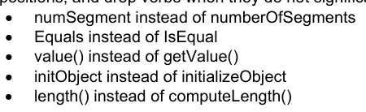

UML 命名范围包含: package: className , 允许在不同包中定义同类名。 然而, 许多 UMR 工具目前不允许这样做 。 因此, 采用了更具限制性的命名惯例 :

1)虽然该型号对案件敏感,但所有类名在对案件不敏感时都应该是独有的.

2)类名应在整个模型中独有(以免给许多UML工具造成问题).

3) 包名应在整个模型中独有(出于同样的原因).

4) 应尽一切努力,消除立即提出同一概念的多类人。

1-4.13 说明

备注框用于对模型的一般或特定项目(即类别或协会)进行评论。

图1-14——示例说明

1-4.14 包件

UML 包是一个用于组合子包、类及其关联的申报的容器。 UMR 中的包结构可以使子包,类申报和关联分级。 包必须用来代表一个Schema 。

## 官方 PDF 第 44 页

图1-15——示例包结构

Schema模型中的包,类和属性可以通过有限定的名称来识别. 限定名称的形式是: name1::name2:::nname3 其中名1是最外层包的名称,名2是出现在名1的命名空间内的名称,而名3是出现在取名空间内的名字. 标准UML"::"符号应作名分隔符. 这个命名空间等级的深度没有限制.

EXAMPLE 在空间示意图中有一个子包,名为几何定义一个叫GM_Object的类。这个类与角色名SSS(空间参考系统)有关联。这个关联的完全合格名称是: Space.Geometry :: GM_objecting.SRS 。

1-4.15 S-100中的模型文件

除了图外,还需要记录模型的语义。需要解释属性、关联、操作和约束的含义。这是通过上下文表进行的。每个类都定义了上下文表格;它有以下一栏:

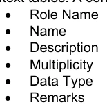

角色名栏指定此行中该类属性的描述。 可能的值为 :

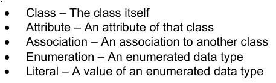

属性 – 该类协会的属性 – 与另一个类的关联 编号 – 所枚举的数据类型 literal – 所枚举数据类型的值

名称列包含属性名称。 对于关联, 这是给定类所用的角色名称。 在描述栏中, 属性的语义被给出。 多重

## 官方 PDF 第 45 页

栏中包含类中属性的发生次数。此栏中还描述了哪些属性是强制性的,哪些是可选的。“数据类型”栏中包含了属性数据类型的名称。在备注栏中,可以表示关于属性的附加信息。这包括限制或条件。 对于所列举类型的文档,不使用多功能和数据类型栏。

以下例子说明了上下文表的使用:

图1-16——上下文表格的使用

角色名称 名称描述 多重数据类型备注

A. 开展一些有益工作的专家组

```text
-
-
```

属性名称 工作组名称

```text
1
CharacterString
```

负责工作组的组织

```text
1
CI_ResponsibleParty
```

如此之多的人在世界各地旅行的原因

```text
1
CharacterString
```

协会成员 指定为团体捐款的人

1.* 个人

角色名称 名称描述 多重数据类型备注

A类人 --

属性名称 1 字符串

首字母属性Name 人物名

```text
1
CharacterString
```

属性 中间 Initial 人物的中间首字母

0.1 字符

属性日期 OffBirth 该人出生日期

1 日期

## 官方 PDF 第 46 页

协会工作组 A工作组

```text
0..*
WorkingGroup
```

角色名称 名称描述 多重数据类型备注

A类 描述个人在工作组中的成员资格

```text
-
-
```

个人在工作组中的作用

0.1 WG_Lole 普通成员没有角色

代表工作组人员所代表的组织

```text
1
CI_ResponsibleParty
```

角色名称说明

命名 WG_ Role 人们可以在工作组中扮演的角色

总理

文学副官 他最好的朋友

文秘 可怜的男人(或女人)总得在键盘上放出指头
