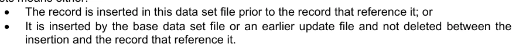
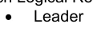
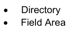
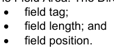
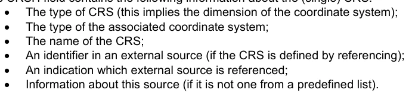
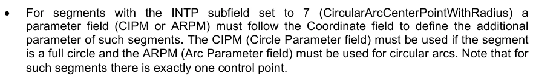
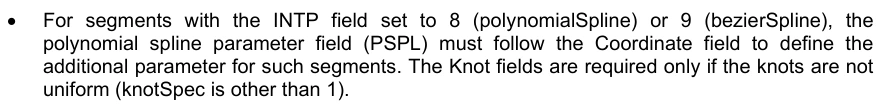
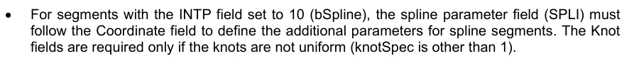
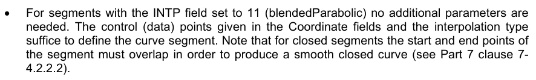

# S-100 5.2.1 · 第 10a 部分 · ISO/IEC 8211 编码

非官方机器翻译参考稿，尚未逐条人工校订。公式与代码保留原文，解释以英文规范为准。

## 官方 PDF 第 445 页

S-100 – 第10编a

ISO/IEC 8211编码

## 官方 PDF 第 446 页

5.2.1版实质性变动摘要

已生效的概要条款

经修订的关于COCC-NCOR、SECC-NSEG和CCOC-NCCO的子域评论,以确认对于删除指示,不应有项目。

```text
10a-7.2.1.2, 10a-
7.2.4.2.3, 10a-
7.2.5.2.2
```

## 官方 PDF 第 447 页

中文目录（可用上方目录直接跳转）

10a-1 范围 · 官方 PDF 449
10a-2 符合性 · 官方 PDF 449
10a-3 规范性引用文件 · 官方 PDF 449
10a-4 结构实现 · 官方 PDF 449
10a-4.1 引言 · 官方 PDF 449
10a-4.2 本条款所使用注解 · 官方 PDF 449
10a-4.3 树状结构图 · 官方 PDF 449
10a-4.4 外地表格 · 官方 PDF 450
10a-4.5 数据格式 · 官方 PDF 451
10a-4.6 数据描述字段 · 官方 PDF 451
10a-4.7 记录顺序 · 官方 PDF 452
10a-4.8 ISO/IEC 8211文件结构 · 官方 PDF 452
10a-4.8.1 总结构 · 官方 PDF 452
10a-4.8.2 领导人 · 官方 PDF 453
10a-4.8.3 名录 · 官方 PDF 454
10a-4.8.4 战地地区 · 官方 PDF 454
10a-4.8.5 实例 · 官方 PDF 455
10a-5 公共字段 · 官方 PDF 458
10a-5.1 属性字段 · 官方 PDF 458
10a-5.1.1 编码规则 · 官方 PDF 458
10a-5.1.2 更新属性字段 · 官方 PDF 460
10a-5.1.3 未知属性值 · 官方 PDF 461
10a-5.1.4 属性值编码 · 官方 PDF 461
10a-5.1.5 属性外地结构 · 官方 PDF 462
10a-5.2 信息协会领域 · 官方 PDF 462
10a-5.2.1 编码规则 · 官方 PDF 462
10a-5.2.2 信息协会外地结构 · 官方 PDF 463
10a-6 数据集描述记录 · 官方 PDF 463
10a-6.1 数据集一般资料记录 · 官方 PDF 463
10a-6.1.1 编码规则 · 官方 PDF 463
10a-6.1.2 数据集一般信息记录结构 · 官方 PDF 465
10a-6.2 数据集坐标参考系记录 · 官方 PDF 468
10a-6.2.1 编码规则 · 官方 PDF 468
10a-6.2.2 数据集坐标参考系记录结构 · 官方 PDF 470
10a-7 对象记录 · 官方 PDF 472
10a-7.1 信息类型记录 · 官方 PDF 472
10a-7.1.1 编码规则 · 官方 PDF 472
10a-7.1.2 信息类型记录结构 · 官方 PDF 473
10a-7.2 空间类型记录 · 官方 PDF 473
10a-7.2.1 坐标领域 · 官方 PDF 473
10a-7.2.2 点数记录 · 官方 PDF 477
10a-7.2.3 多点记录 · 官方 PDF 478
10a-7.2.4 曲线记录 · 官方 PDF 480
10a-7.2.5 复合曲线记录 · 官方 PDF 485
10a-7.2.6 表面记录 · 官方 PDF 487
10a-7.3 特性类型记录 · 官方 PDF 488
10a-7.3.1 编码规则 · 官方 PDF 488
10a-7.3.2 特性类型记录结构 · 官方 PDF 489

## 官方 PDF 第 448 页

本页特意留空

## 官方 PDF 第 449 页

10a-1 范围

国际标准ISO/IEC 8211 - 信息交换数据描述文件的规格,是封装数据的一种手段;它为数据传输提供了基于文件的机制. 这一部分指定了一种交换格式来方便包含数据记录的文件在计算机系统之间移动. 它定义了一个特定结构,可以用来传输包含数据类型和S-100特有数据结构的文件.

10a-2 符合性

这个剖面符合ISO 19106:2004的二级.

10a-3 规范性引用文件

本文件的应用需要下列参考文件:关于注明日期的参考文件,仅适用所引用的版本;关于未注明日期的文件,适用所参考文件的最新版本(包括修正案)。

ISO/IEC 8211:1994,信息交换数据描述文件的规格

10a-4 结构实现

10a-4.1 引言

本章规定了记录和字段级别交换所的结构,进一步规定了作为ISO/IEC 8211数据记录、字段和子字段执行所需的物理构造的内容。将记录归类为ISO/ IEC 82.11文件被视为应用特定,因此在有关产品规范中有所描述。 对于编码,只使用二进制ISO/IEC 8211格式.

10a-4.2 本条款所使用注解

记录结构的规格是树状结构图,其中包含物理构造的名称、联系和重复因素。字段和子字段的详细规格以表格形式列出。此外,每个字段都给出了数据描述字段。这些字段用于ISO/IEC 8211调和数据集的数据描述记录(DDR)。

10a-4.3 树状结构图

图10a-1

为了便于注释,本标准使用 ASCII 字符垂直地列出这些图表。在此注释中,上图变为:

```text
D
E
```

```text
B
C
```

其中A为根节点,而节点B和节点C的母体. 节点B为子树的根并是节点D和E的母体.

节点也被称为其父母的后代或子孙. 例如,节点B是节点A的后代.

树状结构图必须先以序取出出出出出行序来解释(上下分出出行,左分出行先出行).

```text
A
```

## 官方 PDF 第 450 页

地点:

A, B, C,. ISO/IEC 8211字段标记

```text
<r>
r is the sub-tree cardinality (if missing, r=1) possible values:
```

```text
<0.. 1> zero or one
```

```text
<0 .. *> any number including zero
```

```text
<1.. *> at least one
```

(n) 子字段数为n(固定数字)

(n*m)子字段被以有 m 行和 n 列的 n 阵列作为 m 存储(n 子字段重复 m 次)

(*n)子字段作为一行任意数的正列表被存储(n子字段重复).

(k ⁇ n) 将 k 子字段和n 子列表相接(k子字由n 重复子字段中的n ) 树结构图定义了允许重复的字段。 然而,在记录中,字段的重复程度将取决于正在编码的数据。在某些情况下,可能不需要某个字段,因此将不存在。 然而,在所有情况下,数据记录的前序倒转顺序将与该记录类型的通用树状结构图所示的顺序相同。

10a-4.4 外地表格

每个表格前有一行粗体图示,显示字段名称和字段标记。表格正文指定了子字段的名称和标签以及ISO/IEC 8211格式。子字段中的规格可能包括一个所需的值或范围限制。下面是使用数据集标识字段的字段表格示例。

字段标记:DSID 字段名:数据集识别

子字段名称 标签格式 子字段内容和规格

记录名称 RCNM b11{10} – 数据集识别

记录识别号码:RCID b14 范围:1至232-2

定义编码的编码规格 ENSP A () 编码规格

编码规格版 ENED A () 编码规格版

产品标识符 PRSP A () 产品规范中具体规定的数据产品的独特标识符

产品版PRED A () 产品规范版

应用程序配置 PROF A () 在数据产品中指定配置的标识符

数据集文件标识符 DSNM A () 数据集文件标识符

数据集标题 DSTL A () 数据集的标题

数据集参考日期 DSRD A(8) 数据集参考日期

格式: YYYMMDD 根据ISO 8601

数据集语言 DSLG A () 本数据集使用的(主要)语言

```text
A
|
|-<r>--B (n): nameOfFieldB
|

|
|

*--D (n*m): nameOfFieldD
|

|
|

*--E (*n): nameOfFieldE
|
|-<r>--C (k\\*n): nameOfFieldC
```

## 官方 PDF 第 451 页

数据集抽象 DSAB A () 数据集的抽象

数据集版DSED A () 数据集版

数据集主题类别 *DSTC b11 一组主题类别

1)标签是ISO/IEC 8211子字段标签,只出现在数据描述记录中,并且需要识别字段内的子字段中. “ *” 前面的标签表示子字道和后面的子字由字段重复,因此,这表示存在一个由子字德标签提供栏标题(笛卡尔标签的矢量标签)的二维数组或表.

2)格式是ISO/IEC 8211二进制子域数据格式.

10a-4.5 数据格式

分域数据格式由ISO/IEC 8211指定. 可允许的数据格式如下:

格式化数据类型 寄出值

A(n)字符数据 如果子字段有固定长度,子字段将填入空白(空格)

如果子字段长度是可变的,则必须编码单位终止符

n 指定子字段的长度(字符数)

A () 表示一个可变长度的子字段, 单位分隔符( UT) 必须终止。 本标准内字符数据的编码必须是 UTF8 执行级别 1

适当的逃逸顺序是: (2/5 (2/15) (4/7) “%/G”

b1w 无符号整数 (LSBF) *)

必须使用所有位数为 1 的 二进制值

w 指定所使用的字节数

可允许值为:1,2,4

b2w 已签名整数( LSBF)

必须使用所有位数为 1 的 二进制值

w 指定所使用的字节数

可允许值为:1,2,4

b48 已签名浮点(LSBF)

必须使用“ 非一个数字” (NAN) 的值

根据IEC 559或IEEE 754,

*) LSBF 或 “小字节” 是多字节类型的字节顺序。最小字节的位置最接近文件的开头 。

10a-4.6 数据描述字段

数据描述字段是ISO/IEC 8211 调和数据文件中的数据描述记录(DDD)的字段。这些字段在这样的文件的数据记录( DR)中描述每个字段的格式。一个数据描述域包括字段控制、数据字段名称、参数描述符和格式控制。关于数据描述的更多细节见ISO/ IEC 82.11(1994) 第6.4条。

数据描述字段包含非可打印字符。在本文档中,它们被替换为图形符号,如下表所定义:

字符代码图形

空间( 2/ 0) □

UT( 单位终止) (1/ 15) QQ

FT (Field Enterminator) (1/14) QQ 数据描述字段在表格后以粗体文字框表示,描述字段格式.

## 官方 PDF 第 452 页

10a-4.7 记录顺序

记录的顺序将使导入软件能够检查每次引用时是否有被引用的记录。

存在的意思是:



记录被插入到本数据集文件之前,以引用它的记录;或者被被基础数据集文件或更早的更新文件插入,而不被删除在插入和引用它记录之间.

此外,当记录将被删除时,不得以任何其他记录来引用。

记录顺序为:

1. 数据集一般信息记录 2. 数据集坐标参考系记录 3. 信息类型记录 (RUIN=Insert)(本组内部的顺序参见信息类型纪录编码规则) 4. 点记录 (RuIN= Insert) 5. 多点记录(RUin=In sert) 6. 曲线记录 (LUIN:Insert) 7. 复合曲线记录(RUIN=Insert)(本组内的顺序参见复合曲线纪录编码规则) 8.表面记录(LUIN:Insert) 9.要素类型记录(RuIN: Insert) 10.信息类型记录 (RUin:Modify) 11.点记录( RUIN;Modfy) 12.多点记录 (LUin=Modizy) 13. 曲线记录 (RuIN=Modify"14". 综合曲线记录(RUIN=修改) 15.地表记录(LUIN:修改) 16.地表类型记录(RuIN=更改) 17.地表类记录( RUIN为修改) 18.地表线记录(为插入而倒序) 19.综合曲线纪录(RUN:修改后) 20.地表道道记录(REIN:删除) 21.多点记录(ROIN:删去) 22.点记录 (RUin:删除出) 23. 信息类型记录(RUIN=删除)(与插入相反的顺序)

请注意,产品规范可以省略它们不使用但不会改变顺序的条目。 如果参考的通则没有被打破,它们可能会在每组中进一步定义更具体的顺序。

如果在一个数据集中需要修改一个记录的多个记录,它们必须使用不断增长的记录版本号,并且顺序必须根据这些数字.

10a-4.8 ISO/IEC 8211文件结构

10a-4.8.1 总结构

此条款不取代ISO/IEC 8211,也不全面概括ISO/IEC 8211. 读者参考ISO/IEC 8211:1994,以进行完整描述和解释.

该条款将通过解释封装结构中与S-100有关的部分,简要概述ISO/IEC 8211。

ISO/IEC 8211文件由Logical Records(LR)组织,第一张记录是"数据描述记录"(DDR),而后所有记录都是"数据记录"(Data Records (DR).

DDR 包含关于文件剩余部分的等级和结构的信息,它没有定义数据的语义.

每一逻辑记录(DDR和DR)包含三个基本要素:



## 官方 PDF 第 453 页



10a-4.8.2 领导人

逻辑记录的导师包含读取记录和将目录分解到其条目所必要的参数。此外, DDR 导师还包含一些适用于整个文件的数据描述性参数, 其固定长度为 24 字节 。

任何“导师”的前五个字节将包含以ASCII 代表中小数编码的字节中完整记录的长度(例如,242字节的记录将有一个“00242”的记录长度条目)。如果一个记录的大小为100 000字节或更大,则该值必须被设定为“00 000”。在这种情况下,软件必须能够从目录中的信息中计算出记录大小。

10a-4.8.2.1 复员方案领导人

复员方案领导人的结构:

RP Len 条目名称内容

0 5 记录长度 :

5 1 交换级"3"

6 1 领导标识 “ L ”

7 1 在行码扩展指标"E"中

8 1 版本编号"1".

9 1 应用指标空间

10,2 战地控制长度"09".

12 5 战地地区起步地址的基址(领导和目录中的字节数)

17 3 扩展字符集指标 "! " (SPACE, !, SPACE)

20 4 入场地图(见下文) 解甲返乡领导人入场地图:

RP 子条目名称长度

20 字段长度的大小 1 可变"1"-"9"(由编码器定义)

21 战地位置域的大小 1可变"1"-"9"(由编码器定义) .

22 预留1"0"

23 字段标记字段的大小 1"4"

10a-4.8.2.2 减灾领导

DR领导者的结构:

RP Len 条目名称内容

0 5 记录中的字节长度

5 1 交换级空间

6 1 领导标识 “ D”

7 1 在行码扩展指标中,空间

8 1 版本编号:空间

9 1 应用指标空间

10 2 场控制长度 2 空间

12 5 战地地区起步地址的基址(领导和目录中的字节数)

## 官方 PDF 第 454 页

17 3 扩展字符集指标 3

20 4 入会地图(见下文) DR 领袖入会地图:

RP 子条目名称长度

20 字段长度的大小 1可变"1"-"9"(由编码器定义)

21 战地位置场的大小 1可变"1"-"9"(由编码器定义).

22 预留1"0"

23 字段标记字段的大小 1"4"

10a-4.8.3 名录

逻辑记录目录包含识别和定位“外地区域”中每个字段所必要的参数。该目录由重复的目录条目组成,条目包括:



目录以字段终止( 1/14) 。 字段位置相对于字段区域的起始位置。 目录之后的第一个字段的位置是 0 。 三要素( 字段中的条目) 所用的字节数由逻辑记录导览中的条目图定义 。

10a-4.8.4 战地地区

字段对 DDR 和 DR 不同。仅在第一张记录中, DDDR, 字段中包含数据描述字段。每个数据描述出字段包含解码 DR('s) 字由域中的用户数据所必需的信息 。 数据描述包含在交换文件中的事实使得无需外部描述的数据可以交换,尽管元素的语义并不为人所了解. S-100标准以及使用ISO/IEC 8211数据编码的产品规范确实包含用于交换数据的外部数据描述. 然而,数据描述字段只有在当前文件中没有使用时才能从 DDR 中删除;而不是因为存在外部数据描述. DDD的数据描述字段中,DDR构成了ISO/IEC 8211符合文件的组成部分.

对使用字段的限制是最起码的要求,其他字段可以通过DDR中的数据描述字段来定义,然而,这给数据集增加了不必要的数据,应当避免.

DR的"战地区"包含要转移的实际数据.

10a-4.8.4.1 复员方案的战地地区

a. 外地控制领域

DDR的第一个字段是战地控制字段,战地控字段的字段标记是"00". 战地管制字段包含一个战地标记对等的列表,该列表定义了DDR中描述的所有字段等级,该清单包含对等父/子标记,并结合DDUR中战地描述的序外顺序来描述交换文件的通用树结构. 双相可以按任意顺序被放入列表中,并且必须相接相接. 下图给出了树的示例. 一组字段标记对相有HE,EA,EB,HF,HG,GC和GD等.

## 官方 PDF 第 455 页

```text
H
```

```text
F
```

```text
A
B
C
D
```

```text
E
G
```

图10a-2

外地控制场的结构如下:

字段控制 外部文件标题( S- 100 的选项) UT 字段标签配对列表 FT

场控制场的场控制为:"00;&"+"3空间".

b. 数据描述领域

字段的相接字段包含数据描述字段。数据描述域在DDR中以序向倒转顺序编码。上面显示的树的序向向倒移顺序是 HEABFGCD 。

数据描述字段的结构如下:

字段控制 字道名称 UT Array 描述器 格式控制 FT 字段中的字段 字由数据描述字段定义的级别和数据类型 字外控制的结构如下表所示.

RP Len 条目名称内容

0 1 数据结构代码 "1" – 线性结构

"2" – 多维结构

"3" – 缩合结构

1 1 数据类型代码 "1" – 隐含点(整数)

"2"-隐含点(浮点)

6" – 混合数据类型

2 2 辅助控制"00"

4 2 可打印图形“; & ”

6 3 短跑顺序 " (3个空间) – ASCII 编码 ISO 646

"%/G" – UTF8 编码执行级别 1 字段名称包含S-100中这部分给出的树状结构所定义的数据字段的长描述. 分解和格式控制定义了关联数据字段的内部字段结构. 完整描述请参考ISO/IEC 8211.

10a-4.8.4.2 民主德国的战地地区

DR 中的数据字段必须在 DDR 中定义的顺序前倒转序列中编码。数据字段的结构由 DDR 中的数据描述字段定义 。

10a-4.8.5 实例

以下简单的例子显示一个S-100相容ISO/IEC 8211相容数据集文件.

它包含一个单一的特性类型(BuoySafeWater),其属性集如下:

## 官方 PDF 第 456 页

属性代码值备注

```text
buoyShape
“4”
Pillar
```

颜色 [1] “ 3” 红色

颜色[2] “1” 白色

彩色边框 “ 3” 对角条形

```text
featureName[1].language
“eng”
English
```

```text
featureName[1].name
“Example buoy”
```

```text
featureName[2].language
“deu”
German
```

特性 [2]. name “ Beispiel Tonne” 特性对象Id 是 :

十六进制表示值

生产机构 31868 7C7C

要素识别编号为12345678 00BC614E

42 002A 要素识别分科

地理位置整数值十六进制表示

纬度42.42°N 4242000001948C740

经度12.1234°W -121234000 F8C61DB0 示例中包含不可打印字符和二进制代码,取而代之的是下表所定义的解注:

字符代码注释

空间十六进制 20 □

UT( 单位终止器) Hex 1F QQ

FT( 外地终结者) Hex 1E QQ

二进制代码 b11 Hxx [xx]

二进制码 b12 Hex xxyyy [xxyy] 由于 LSBF 编码,此编码相当于 [yy][xx]

二进制码 b14 Hex whxxyyzz [whxxyyzz] 由于 LSBF 编码,它相当于 [zz][yy][xx][wwh]

二进制码 b24 赫克思活字 [whxxyyzz] 对于负数,两个辅音被编码为 LSBF

二进制代码为b48 x.y [x.y] 由 IEEE 754 双精度编码 LSBF DR leador 所定义的编码

```text
011803LE1□0900155□!□3304
```

DDR 目录

```text
0000090000DSID132090DSSI118222ATCS044340FTCS047384CSID084431CRSH095515PRID0
71610C2IT055681FRID084736FOID064820ATTR058884SPAS083942▼
```

DDR 战地地区

```text
0000;&□□□S100Example.000▲DSIDDSSIDSIDATCSDSIDFTCSCSIDCRSHPRIDC2ITFRIDFOIDFR
IDATTRFRIDSPAS▼
```

```text
3600;&%/GData□Set□Identification▲RCNM!RCID!ENSP!ENED!PRSP!PRED!PROF!DSNM!DS
TL!DSRD!DSLG!DSAB!DSED\\*DSTC▲(b11,b14,7A,A(8),3A,(b11))▼
```

## 官方 PDF 第 457 页

```text
1600;&□□□Data□Set□Structure□Information▲DCOX!DCOY!DCOZ!CMFX!CMFY!CMFZ!NOIR!
NOPN!NOMN!NOCN!NOXN!NOSN!NOFR▲(3b48,10b14)▼
```

```text
2600;&□□□Attribute□Codes▲*ATCD!ANCD▲(A,b12)▼
```

```text
2600;&□□□Feature□Type□Codes▲*FTCD!FTNC▲(A,b12)▼
```

```text
1100;&□□□Coordinate□Reference□System□Record□Identifier▲RCNM!RCID!NCRC▲(b11,
b14,b11)▼
```

```text
1600;&%/GCoordinate□Reference□System□Header▲CRIX!CRST!CSTY!CRNM!CRSI!CRSS!S
CRI▲(3b11,2A,b11,A)▼
```

```text
1100;&□□□Point□Record□Identifier▲RCNM!RCID!RVER!RUIN▲(b11,b14,b12,b11)▼
```

```text
1100;&□□□2-D□Integer□Coordinate□Tuple▲YCOO!XCOO▲(2b24)▼
```

```text
1100;&□□□Feature□Type□Record□Identifier▲RCNM!RCID!NFTC!RVER!RUIN▲(b11,b14,2
b12,b11)▼
```

```text
1100;&□□□Feature□Object□Identifier▲AGEN!FIDN!FIDS▲(b12,b14,b12)▼
```

```text
2600;&%/GAttribute▲*NATC!ATIX!PAIX!ATIN!ATVL▲(3b12,b11,A)▼
```

```text
2100;&□□□Spatial□Association▲*RRNM!RRID!ORNT!SMIN!SMAX!SAUI▲(b11,b14,b11,2b
14,b11)▼
```

DR 1 领队(数据集一般信息记录)

```text
00321□D□□□□□00065□□□3304
```

DR 1 目录

```text
DSID104000DSSI065104ATCS070169FTCS017239▼
```

DR 1 战地地区

```text
[0A][00000001]S-100□Part□10a▲5.0▲INT.IHO.S-101.1.1▲1.1▲1▲S100Example.000▲S-
100□Encoding□example▲20221019EN▲▲1▲[0E][12]▼
```

```text
[0.0][0.0][0.0][00989680][00989680][00000064][00000000][00000001][00000000]
[00000000][00000000][00000000][00000001]▼
```

```text
buoyShape▲[0001]colour▲[0002]colourPattern▲[0003]featureName▲[0004]language
▲[0005]name▲[0006]▼
```

```text
BuoySafeWater▲[0001]▼
```

DR 2 领导(数据集坐标参考系记录)

```text
00064□D□□□□□00039□□□2104
```

DR 2 目录

```text
CSID070CRSH187▼
```

DR 2 战地地区

```text
[0F][00000001][01]▼
```

```text
[01][01][01]WGS□84▲4326▲[02]▲▼
```

DR 3 领队(点球纪录)

```text
00055□D□□□□□00037□□□1104
```

DR 3 目录

```text
PRID90C2IT99▼
```

DR 3战地地区

```text
[6E][00000001][0001][01]▼
```

```text
[1948C740][F8C61DB0]▼
```

DR 4 领导器( Feature Type Record)

## 官方 PDF 第 458 页

```text
00218□D□□□□□00065□□□3304
```

DR 4 目录

```text
FRID011000FOID009011ATTR117020SPAS016137▼
```

DR 4战地地区

```text
[64][00000001][0001][0001][01]▼
```

```text
[7C7C][00BC614E][002A]▼
```

```text
[0001][0001][0000][01]4▲
[0002][0001][0000][01]3▲
[0002][0002][0000][01]1▲
[0003][0001][0000][01]3▲
[0004][0001][0000][01]▲
[0005][0001][0005][01]eng▲
[0006][0001][0005][01]Example□buoy▲
[0004][0002][0000][01]▲
[0005][0001][0008][01]deu▲
[0006][0001][0008][01]Beispiel□Tonne▲▼
```

```text
[6E][00000001][FF][FFFFFFFF][00000000][01]▼
```

10a-5 公共字段

10a-5.1 属性字段

10a-5.1.1 编码规则

在 S- 100 属性中, 简单属性可以是简单属性也可以是复杂属性。 简单特性有值, 而复杂属性是其他属性的集合, 无论是简单属性还是复杂属性, 以下图显示了一个既具有简单属性又具有复杂属性的要素类型的例子 。

图10a-3

要素有四个属性: A1, A2, A3和A4, A1和A3是简单的属性; A2和A4(A4)是复杂的属性. A2由两个属性(A5和A6)组成,其中A5是一个简单的属性,A6是另一个复杂的属性;A4和A 6.是两个复杂的属性,两者都由两个简单的属性组成.

属性的另一个要素是主属性。 这表示同一父属性使用多少个同类型属性( 要素目录中的同代码) 。 同一个父属性意味着它们都是顶级属性, 或者属于一个复杂属性的同实例 。 在以上的例子中, A9 和 A10 假设有相同的代码 。

相同的代码 A9 A10

特性

```text
A1
A2
A3
A4
```

```text
A5
A6
A7
A8
```

## 官方 PDF 第 459 页

以一个以上为主的概念,属性可以被视为一个属性的数组。要访问此数组中的属性,不仅需要该属性的代码,还需要该属性索引。请注意,该数组的顺序可能有意义,必须用编码来维持。

考虑到上述所有因素,一个属性可以由以下三种价值独一地处理:

1. 属性代码-与子域NATC编码; 2. 属性索引(从 1起)-与子域ATIX编码; 3. 属性母体-与子域PAIX编码.

父索引(PAIX)仅用于定义球场内的树,没有必要在内部系统(例如系统数据库)结构中保存.

为完成以上示例,下表定义了属性的代码和值: .

属性代码属性索引值注释

A1 21 1 瓦洪语

A2 22 1 个综合体

```text
A3
23
1
12
```

A4 24 1个综合体

```text
A5
25
1
42.0
```

A6 26 1个综合体

```text
A7
27
1
123
```

A8 28 1 加拿大

A9 29 1 17 与 A10 相同的代码

A10 29 2 43 与 A9 相同的代码 编码一个属性 一组 5 个项目是必要的: 上面提到的三个加一个更新指令和属性值。 要指定属性的母属性, 使用一个索引。 这个索引指向 ATTR 字段中从 1 开始的 nt tuple 。 下表显示示例的编码 :

索引 NATC ATIX PAIX ATVL ARM 1 21 1 0 插入 Vachon A1 2 22 1 0 有插入 A2 - 复合体 3 25 1 2 插入 42.0 A5 4 26 1 2 有插入A6 - 复杂体 5 29 1 4 有插入17 A9 6 29 2 4有插入43 A10 7 23 1 0有插入12 A3 8 24 1 0 加插入A4 - 综合体 10 28 1 8 加插加拿大 A8 注意此处使用序前转动来定义战地的拖轮顺序. 这使得复杂属性的所有部分保持在一起,并保证父母总是在孩子之前被存储。顺序前的转动定义如下:

1) 编码根;

2) 然后将子树从左到右编码.

这种转动命令在本标准范围内是强制性的.

请注意, ATIN 子字段( 属性更新指令) 总是用于编码基础数据属性的“ 插入 ” 。 其他 ATIN 值( 修改、 删除 ) 仅用于更新 ATTR 字段。

属性的所有值都作为字符字符串存储,即使值域是数字类型. UTF- 8将是S-100中允许用于这种字符字符字符弦的唯一编码,这允许ISO 10646第一个多语言平面上的所有字符编码。国家字符集不需要其他编码。

## 官方 PDF 第 460 页

10a-5.1.2 更新属性字段

要更新属性,该属性必须具有独特的可识别性,一旦确定的指示就必需影响该属性。

属性的识别由"数值属性代码"(NATC)和"属性指数"(ATIX)来定义.

属性更新指令表示一个属性是否从字段被删除;修改,或被插入. 删除和修改意味着属性存在. 删除并插入可能会改变属性序列中其他属性的索引,因此在属性字段更新时必须考虑,因此ATIX子字段必须使用被更正的值. 指令必须按顺序必须用,以便所使用的索引能够识别后续更新中正确的属性组成部分.

显示更新属性时, 上面的例子必须修改如下图所示。 请注意, 要在属性树上识别一个节点, 就必须指定从树根起的所有节点。 为了插入属性 B5, 必须在A6 和 A2 上标注在修改之前并标注为修改后 。

图10a-4

详情如下:

属性代码属性索引值更新指令

备注

B5 29 2 32 插入将更改 A10 的指数为 3

A10 29 3 7 修改

B2 35 1 插入复合体

B3 36 1 32 插入

插入

B1 32 1 abc 插入

删去

A8 28 1 德国 修改 为了识别 B5, A10 和 B2 必须插入 A2 和 A6 的条目。 A4(识别 A8) 的条目也一样。 完整的字段将看起来像 :

相同的代码 A9 A10

特性

```text
A1
A2
A3
A4
```

```text
A5
A6
A7
A8
```

```text
B1
```

```text
B2
```

```text
B3
```

```text
B5
```

修改 A8 的值

修改 A10 的值 B4

## 官方 PDF 第 461 页

索引 NATC ATIX PAIX ATVL APIX APIN ATWL Revolution 1 22 1 0 修改 A2 - 复杂体 2 修改A6 - 复合体 3 29 2 插入32 B5 - 将增加A10 29 3 2 修订7 A10 - 现在使用ATIX 3 35 1 2 加入B2 - 有复合体的 6 36 1 插入22 B3 7 37 1 加入123 B4 8 32 1 进口 abc B1 23 1 删去 A3 24 10 修改 B4 - 修改 11 28 1 10 德国 A8 注意,为了删除一个复杂的属性,它将是: 足以删除该属性的根条目。例如,只删除一个条目(22、1、0、删除),就必须编码。

10a-5.1.3 未知属性值

当属性代码存在时,属性值未知,但属性值缺失(被编码为空字符串).

更新属性字段并缺少属性值 :


插入 - 创建初始值未知的属性。 修改 - 更改属性值为未知。 删除 - 删除属性( 在这种情况下,属性值应当始终编码为

10a-5.1.4 属性值编码

在ATVL子字段中编码属性值必须使用下列规则:

属性类型

[价值类型]

格式备注示例

```text
S100_GF_TextAttributeType
```

```text
[CharacterString]
```

任何由编码支持的字符( 这里 - UTF8) 。

字节命令标记是不允许的,因为编码不需要它们(UTF8不是一个多字节编码).

威士忌(威士忌)

```text
водка
```

```text
S100_GF_IntegerAttribute
```

[整数]

任意长度的已签名的整数。数字必须在小数系统中。

正数不应使用QQ标志.

负数必须有一个 " - " 符号。

标志和数字之间必须没有空白.

数字中除了"0"到"9"的位数外,不得有其他字符.

禁止非显著的零.

有效性 :

```text
42
```

```text
-1224566
```

无效 :

```text
0012
```

```text
123,234
```

```text
- 12
```

```text
S100_GF_RealAttribute
```

[真实]

双精度数值域中的十进制浮点数(IEEE 64-Bits).

十进制分隔符总是一个点("."),决不能使用千分符.

正数不应使用QQ标志.

负数必须有一个 " - " 符号。

指数形式是允许的。

禁止非显著的零。 如果小数点右侧只有零, 应当省略小数点 。

禁止使用INF、-INF和NaN等值。

```text
123.456
```

```text
-42
```

```text
1E-5
```

```text
-2.45E7
```

```text
S100_BooleanAttributeType
```

[宝莲].

1(真实)或

0 (虚假)

```text
1
```

```text
0
```

## 官方 PDF 第 462 页

```text
S100_EnumerationAttributeType
```

[精进入. ]

十进制中的整数 > 0。

禁止非显著的零。 不应使用QQ标志 。

```text
S100_DateAttributeType
```

[日期]

塞浦路斯

完整表示,根据ISO 8601的基本格式.

禁止以较少的解析度或短篇陈述方式进行代表。

```text
20211223
```

```text
S100_TimeAttributeType
```

[时间]

小时数

完整表示,根据ISO 8601的基本格式.

可选择添加时区.

允许分秒数,但如果全部为零,则应省去。

```text
173500
```

```text
183942+Z
```

```text
201700-0500
```

```text
S100_DateTimeAttributeType
```

```text
[DateTime]
```

将上述日期和时间代表合并。

字符“ T” 必须作为日期和时间部分之间的分隔符。

```text
20211223T170000
```

```text
S100_URIAttributeType
```

[乌]

RFC 3986)认为是URI.

URI不能包含白色空间;必须先用“计划”然后用“:”开始。

电话:+1-816-555-1212

```text
S100_URLAttributeType
```

[呼喊]

根据RFC 3986,一个URL.

http://registry.iho.int (中文(简体) ).

```text
S100_URN_AttributeType
```

[铃声]

RFC 2141中指定的铀浓缩还原物

`计划 ' =骨灰

骨灰:mrn:iala:aton:us:1234.5

```text
S100_TruncatedDateAttributeType
```

```text
[S100_TruncatedDate]
```

日期的简写版本.

塞浦路斯

所有未指定的组件都被像组件有字符一样多的连字符所取代。因此,编码的长度必须总是8个字符。

```text
------01
```

```text
----1224
```

```text
S100_CodelListAttributeType
```

```text
[CharacterString]
```

一个代码列表值,作为字符串表示.

代码列表词典的URI由"要素目录"所定义.

详情见第3和5部分。

英格莱克

10a-5.1.5 属性外地结构

字段标记: ATTR 字段名称: 属性

子字段名称 标签格式 子字段内容和规格

数字属性代码 *NATC b12 数据集一般信息记录的ATCS字段中定义的有效属性代码

属性指数 ATIX b12 属性在同代码和同父属性序列中的属性指数(位置)(从 1 开始)

父索引 PAIX b12 在这个 ATTR 字段内父复杂属性的索引(位置)(从 1 开始) 如果属性没有父(顶级属性),则值为 0

属性指令 ATIN b11{1} - 插入

```text
{2} – Delete
```

```text
{3} – Modify
```

属性值 ATVL A () 包含上面子域指定属性域的有效值的字符串

数据描述字段

```text
2600;&%/GAttribute▲*NATC!ATIX!PAIX!ATIN!ATVL▲(3b12,b11,A)▼
```

10a-5.2 信息协会领域

10a-5.2.1 编码规则

信息协会是从一个记录到信息类型记录的链接。信息类型记录可以从其他记录的任何编号中引用,但至少应有一份记录。

## 官方 PDF 第 463 页

关联到信息类型记录。此类关联将通过信息协会域(INAS)进行编码。对于每个关联,必须使用单独的域。关联本身可以有属性。属性在域中由与 ATTR 域描述的相同机制编码。在关联域的末尾使用相同的子域。 每一个协会都通过RRNM、RRID、IASS和ROLE子领域的组合得到独特的处理。

RRNM子域正在引用记录名子域(RCNM),RRID子域正在引用目标记录的id子域(RCID).

信息协会更新指令 INUI 子字段用于表示在更新时要插入还是删除关联。 对于一个基础数据集来说,此字段必须具有“ 插入” 的值 。

10a-5.2.2 信息协会外地结构

字段标记:INAS字段名:信息协会

子字段名称 标签格式 子字段内容和规格

参考记录名称 RRNM b11 参考记录的记录名称

引用记录标识符 RRID b14 引用记录的记录标识符

数字信息协会代码 NIAC b12 数据集一般信息记录IACS域所定义的信息协会的有效代码

数字协会角色代码 NARC b12 数据集一般信息记录 ARCS 域中定义角色的有效代码

信息协会更新指令

IUIN b11 {1} - 插入

```text
{2} – Delete
```

```text
{3} – Modify
```

数字属性代码 *NATC b12 数据集一般信息记录的ATCS字段中定义的有效属性代码

属性指数 ATIX b12 属性在同代码和同父属性序列中的属性指数(位置)(从 1 开始)

父索引 PAIX b12 本INAS字段内父复杂属性的索引(位置)(从 1 开始) 如果属性没有父(顶级属性),则值为 0

属性指令 ATIN b11{1} - 插入

```text
{2} – Delete
```

```text
{3} – Modify
```

属性值 ATVL A () 包含数据描述域上方子域指定属性域的有效值的字符串

```text
3600;&%/GInformation□Association▲RRNM!RRID!NIAC!NARC!IUIN\\*NATC!ATIX!PAIX
!ATIN!ATVL▲(b11,b14,2b12,b11,(3b12,b11,A))▼
```

注:本标准旧版本中,数据描述字段的格式控制部分使用了卷括号 QQ和 QX。虽然不符合ISO8211标准,但执行者应意识到可出现卷括号,不应将其视为或视为出错,应将其解释为圆括号 “(`和')”。

10a-6 数据集描述记录

10a-6.1 数据集一般资料记录

10a-6.1.1 编码规则

此记录编码了有关数据集的一般信息。 这些信息包括识别、 结构信息和元数据 。

## 官方 PDF 第 464 页

数据集识别字段包含用于识别数据集的信息。此信息分为三组:

1)关于编码的信息;2)关于数据产品的信息;3)关于数据集本身的信息.

第一组规定了编码所依据的编码规格,以及该规格的哪些版本适用.

第二组定义了数据产品,产品规范的版本和产品内部使用的配置图,产品本身由独特的标识符指定. 版和配置图取决于产品规范,并将被编码为字符串.

第三组包括:

1)数据集文件标识符;2)数据集名称;3)数据集参考(问题)日期;4)数据集使用的(默认)语言;5)数据集的抽象;6)数据集版本(可能包含颠覆/更新编号);7) 根据ISO/IEC 19115-1(参见列表)列出主题类别:

DSTC子域的值

1个农作

2个生物群

3个边界

```text
4
climatologyMeterologyAtmosphere
```

5个经济体

6个高地

7个环境

```text
8
geoscientificInformation
```

9个保健

```text
10
imageryBaseMapsEarthCover
```

```text
11
intelligenceMilitary
```

```text
12
inlandWaters
```

13个地点

14个海洋

```text
15
planningCadastre
```

16个社会

17个结构

18次运输

```text
19
utilitiesCommunication
```

21 灾难 数据集结构信息字段包含一些结构信息。

1) 用于转换编码的坐标数据的源值相抵,以便在数据集所在区域可以携带更精确的数据。

2) 单独的坐标轴的乘法因子.

3)数据文件中不同类型记录的编号.

在S-100要素目录中,所有项目都使用S100_FC_项目代码进行独特的可识别,该代码是一个字符串。这适用于属性、信息类型、特性类型、信息协会、特性协会和协会的作用。为了8211编码的空间和效率起见,最好为这些项目使用数字标识符。为了支持这种能力,

## 官方 PDF 第 465 页

8211 编码包括一个表格,其中包含数据集中使用的S100_FC_项目代码。该表格中的每个条目都带有条目代码和相关的数字代码,这些代码将在引用该条目类型的所有数据集内使用。这些数字代码只保证在数据集的一例中具有独有性。 例如,一个有代码海岸线的要素可以被记录在要素类型代码域中,数字代码为10. 然后数据集中所有的海岸线要素都会携带10. 数字代码 在另一个数据集中,海岸线的数字代码可以是15.

10a-6.1.2 数据集一般信息记录结构

```text
Data Set General Information record

|

|--DSID (13\\*1): Data Set Identification field


|


|--DSSI (13): Data Set Structure Information field


|


|-<0..1>-ATCS (*2): Attribute Codes field


|


|-<0..1>-ITCS (*2): Information Type Codes field


|


|-<0..1>-FTCS (*2): Feature Type Codes field


|


|-<0..1>-IACS (*2): Information Association Codes field


|


|-<0..1>-FACS (*2): Feature Association Codes field


|


|-<0..1>-ARCS (*2): Association Role Codes field
```

10a-6.1.2.1 数据集识别实地结构

字段标记:DSID 字段名:数据集识别

子字段名称 标签格式 子字段内容和规格

记录名称 RCNM b11{10} - 数据集识别

记录识别号码:RCID b14 范围:1至232-2

定义编码的编码规格 ENSP A () 编码规格

编码规格版 ENED A () 编码规格版

产品标识符 PRSP A () 产品规范中具体规定的数据产品的独特标识符

产品版PRED A () 产品规范版

应用程序配置 PROF A () 在数据产品中指定配置的标识符

数据集文件标识符 DSNM A () 数据集文件标识符

数据集标题 DSTL A () 数据集的标题

数据集参考日期 DSRD A(8) 数据集参考日期

格式: YYYYMMDD 根据ISO 8601

数据集语言 DSLG A () 本数据集使用的(主要)语言

数据集抽象 DSAB A () 数据集的抽象

数据集版DSED A () 数据集版

数据集主题类别 *DSTC b11 一组主题类别 数据描述字段

```text
3600;&%/GData□Set□Identification▲RCNM!RCID!ENSP!ENED!PRSP!PRED!PROF!DSNM!D
STL!DSRD!DSLG!DSAB!DSED\\*DSTC▲(b11,b14,7A,A(8),3A,(b11))▼
```

## 官方 PDF 第 466 页

注:本标准旧版本中,数据描述字段的格式控制部分使用了卷括号 QQ和 QX。虽然不符合ISO8211标准,但执行者应意识到可出现卷括号,不应将其视为或视为出错,应将其解释为圆括号 “(`和')”。

10a-6.1.2.2 数据集结构 信息领域结构

字段标记:DSSI 字段名称:数据集结构信息

子字段名称 标签格式 子字段内容和规格

数据集 坐标源 X DCOX b48 调用在编码前调整x坐标的Shift

数据集坐标出处 Y DCOY b48 编码前用于调整y坐标的Shift

数据集坐标出处 Z DCOZ b48 编码前用于调整z坐标的Shift

xcoord 坐标乘法系数

CMFX b14 向正弦或经度的整数乘法点浮动

相坐标乘以系数

CMFY b14 纵坐标或纬度的整数乘法点

z坐标坐标乘以系数

CMFZ b14 向整数乘法因子的克坐标或深度或高度浮动点

信息类型记录 NOIR b14 数据集信息记录数量

点数记录 NOPN b14 数据集中点数记录

多点记录数 NOMN b14 数据集多点记录数

曲线记录数 NOCN b14 数据集中的曲线记录数

综合曲线记录数 NOXN b14 数据集中复合曲线记录数

NSN b14 数据集中的地表记录数量

要素类型记录数量 NOFR b14 数据集要素类型记录数量 数据描述字段

```text
1600;&□□□Data□Set□Structure□Information▲DCOX!DCOY!DCOZ!CMFX!CMFY!CMFZ!NOIR
!NOPN!NOMN!NOCN!NOXN!NOSN!NOFR▲(3b48,10b14)▼
```

10a-6.1.2.3 属性代码实地结构

字段标记: ATCS 字段名: 属性代码

子字段名称 标签格式 子字段内容和规格

属性代码 *ATCD A 要素目录中定义的代码

属性 数字代码 ANCD b12 NATC 子域内使用的代码 数据描述字段

```text
2600;&□□□Attribute□Codes▲*ATCD!ANCD▲(A,b12)▼
```

10a-6.1.2.4 信息类型代码实地结构

字段标记:ITES 字段名称:信息类型代码

子字段名称 标签格式 子字段内容和规格

信息类型代码 *ITCD A 要素目录中定义的代码

信息类型 数字代码 ITNC b12 NITC子域内使用的代码 数据描述域

## 官方 PDF 第 467 页

```text
2600;&□□□Information□Type□Codes▲*ITCD!ITNC▲(A,b12)▼
```

10a-6.1.2.5 特性类型代码实地结构

字段标记: FTCS 字段名称:要素类型代码

子字段名称 标签格式 子字段内容和规格

特性类型代码 * FTCD A 要素目录中定义的代码

特性类型 数字代码 FTNC b12 NFTC 子域内使用的代码 数据描述域

```text
2600;&□□□Feature□Type□Codes▲*FTCD!FTNC▲(A,b12)▼
```

10a-6.1.2.6 信息协会守则实地结构

字段标签:IACS 字段名称:信息协会代码

子字段名称 标签格式 子字段内容和规格

相關相關碼 *IACD A 在要素目录中定义的代码

信息协会 数字代码 IANC b12 NIAC子域内使用的代码 数据描述域

```text
2600;&□□□Information□Association□Codes▲*IACD!IANC▲(A,b12)▼
```

10a-6.1.2.7 要素协会代码实地结构

字段标记: FOS 字段名:要素相会代码

子字段名称 标签格式 子字段内容和规格

特性关联代码 *FACD A 要素目录中定义的代码

特性协会 数字代码 FANC b12 NFAC子域内使用的代码 数据描述域

```text
2600;&□□□Feature□Association□Codes▲*FACD!FANC▲(A,b12)▼
```

10a-6.1.2.8 协会角色代码实地结构

字段标记: ARCS 字段名称:相關角色代碼

子字段名称 标签格式 子字段内容和规格

关联角色代码 *ARCD A 要素目录中定义的代码

关联角色 数字代码 ARNC b12 NARC子域内使用的代码 数据描述域

```text
2600;&□□□Association□Role□Codes▲*ARCD!ARNC▲(A,b12)▼
```

## 官方 PDF 第 468 页

10a-6.2 数据集坐标参考系记录

10a-6.2.1 编码规则

数据集中所有二维坐标都指一个水平的 CRS. 三维坐标指由水平的CRS和垂直的CSR组成的复合 CRS,每个复合 CSR的数据集中可以有一个以上的垂直 CRS来表示.

CRSH字段包含关于(单)CRS的以下信息:



CRS的类型(这意味着坐标系统的维度); 关联坐标系统的类型; CRS的名称; 外部来源中的标识符(如果通过引用来定义 CRS); 指示外部来源被引用; 关于此来源的信息(如果不是来自一个预定义的列表).

如果没有通过引用坐标轴的所有细节来定义 CRS, 则必须编码基准, 必要时还要编码关于所用投影的参数。 这必须通过适当的字段进行。 在这种情况下, CRSI 子字段必须编码为空, CrSS 子出字段的值必须是 255 (不适用) 。

关于CRS的更详细情况,请参见本标准"坐标参考系"组成部分.

此编码规格支持以下类型的 CRS :

CRS 类型尺寸 CS 类型轴类型

CRST 值

备注

2D 地理

2 椭圆地平纬度

大地测量经度

大地测量学 1 可与垂直的 CRS 结合

三维地理

3 椭圆地平纬度

大地测量经度

椭圆形高度

大地测量学 2

地心轴3 笛卡尔地心X

地心Y线

地心Z线

大地测量学 3

预计2笛卡尔东起/西起

北起/南起

大地测量4可以与垂直的CRS结合

垂直 1 垂直重力 相干高度或

重力相关深度

纵向 5

下表显示所支持的坐标轴:

轴类型轴向 AXTY 值备注

北纬1度

东经2度

椭圆形高地 3

东起东起4号线

北平五号

西起西起西接西接六通.

南宁七号

地心X 地心X 8

地心Y 地心Y 9

地心Z 地心Z 10

重力相干高度提升 11

重力相关深度下行 12

## 官方 PDF 第 469 页

本表列出所支持的预测及其参数:

名称 PROM 值

参数1 参数2 参数3 参数4 参数5 EPSG代码

Mercator 1 第1个标准平行纬度

```text
1)
```

自然起源经纬度

```text
-
-
-
9805
```

横向 Mercator

2 自然起源的纬度

自然起源经纬度

自然来源的尺度系数

```text
-
-
9807
```

Oblique Mercator 3 投影中心纬度

投影中心经度

初始行的最小值

从修正到 Skew 网格

初始行的缩放因数

```text
9815
```

Hotine Oblique 默卡托尔

4 投影中心纬度

投影中心经度

初始行的最小值

从修正到 Skew 网格

初始行的缩放因数

```text
9812
```

兰伯特·康克·康克勒特(1SP)

5 自然起源的纬度

自然起源经纬度

自然来源的尺度系数

```text
-
-
9801
```

兰伯特·科克·科克罗尔特(2SP)

6 错误来源的纬度

假来源经度

第1个标准平行纬度 2

第2个标准平行的纬度 3

```text
-
9802
```

Oblique 立体图

7 自然起源的纬度

自然起源经纬度

自然来源的尺度系数

```text
-
-
9809
```

极地立体

8 自然起源纬度 4

自然起源经纬度

自然来源的尺度系数

```text
-
-
9810
```

克罗瓦克 Oblique 二次曲线

9 投影中心纬度

投影中心经度

初始行的最小值

伪标准平行纬度

伪标准并行的缩放因子

```text
9819
```

美国多管风琴

10 自然起源的纬度

自然起源经纬度

```text
-
-
-
9818
```

阿尔伯斯平等区11 错误来源的纬度

假来源经度

第1个标准平行纬度 2

第2个标准平行的纬度 3

```text
-
9822
```

兰伯特-阿齐米特平等区

12 自然起源的纬度

自然起源经纬度

```text
-
-
-
9820
```

新西兰地图网

13 自然起源纬度

自然起源经纬度

```text
-
-
-
9811
```

1) 真正尺度的纬度

(2) 标准平行度接近赤道

3) 离赤道更远的标准平行

4) 必须是90度或-90度

所有纬度和经度都必须以度(南和西为负数)表示,方位以度来表示。关于预测的详细公式,请参考EPSG文档。

如果在同一数据集中同时使用二维和三维坐标,则三维的坐标必须由复合CRS来描述. 二维坐标指第一个组件(通常为一二D地理或预测CRS).

虽然数据集中的所有坐标必须指向相同的 CRS 不同的垂直数据, 用于坐标图的高度或深度组件。 因此, VDAT 字段可以重复。 每个垂直数据段都定义了一个独特的标识符。 这些标识符将用于3D - 坐标字段, 以指示使用哪个垂直数据。 坐标参考系记录的编码将用两个实例来演示。第一个实例指定了复合 CRS。第一个组件是2D地理 CRS(WGS84),第二个组件是垂直 CRS,用于深度,使用垂直数据:平均海平面。

## 官方 PDF 第 470 页

```text
The second example encodes a projected CRS by defining the details.
```

10a-6.2.2 数据集坐标参考系记录结构

```text
Data Set Coordinate Reference System record

|

|--CSID (3): Coordinate Reference System Record Identifier field


|


|-<1..*>-CRSH (7): Coordinate Reference System Header field


|


|-<0..1>-CSAX (*2): Coordinate System Axes field


|


|-<0..1>-PROJ (8): Projection field


|


*-<0..1>-GDAT (7): Geodetic Datum field


|


*-<0..1>-VDAT (4): Vertical Datum field
```

10a-6.2.2.1 坐标参考系记录识别器实地结构

字段标记: CSID 字段名称:坐标参考系记录识别符

子字段名称 标签格式 子字段内容和规格

记录名 RCNM b11{15} - 坐标参考系标识符

记录识别号码:RCID b14 范围:1至232-2

CRS 组成部分数量 NCRC b11

数据描述字段

```text
1100;&□□□Coordinate□Reference□System□Record□Identifier▲RCNM!RCID!NCRC▲(b11
,b14,b11)▼
```

10a-6.2.2 坐标参考系站头外地结构

字段标记: CRSH 字段名称:坐标参考系头

子字段名称 标签格式 子字段内容和规格

CRS指数 CRIX b11 中央RS内部标识符

(用于识别C3DI或C3DF中的垂直CRS)

CRS 类型 CRST b11 见表格

```text
CSID: RCNM{15}!RCID{1}!NCRS{1}!
CRSH: CRIX{1}!CRST{4}!CSTY{2}!CRNM’WGS84/UTM
```

```text
32N’!CRSI!CRSS{255}SCRI!
CSAX: AXTY{4}!AXUM{4}!AXTY{5}!AXUM{4}!
PROJ: PROM{2}!PRP1{0}!PRP2{9}!PRP3{0.9996}!PRP4{0}!PRP5{0}!
```

```text
FEAS{500000}!FNOR{0}!
GDAT: DTNM’World Geodetic System 1984’!ELNM’WGS 84’!ESMA{6378137}!
```

```text
ESPT{2}!ESPM{298.257223563}!CMNM’Greenwich’!CMGL{0}!
```

```text
CSID: RCNM{15}!RCID{1}!NCRC{2}!
CRSH: CRIX{1}!CRST{1}!CSTY{1}!CRNM’WGS
```

```text
84’!CRSI’4326’!CRSS{2}!SCRI!
CRSH: CRIX{2}!CRST{5}!CSTY{3}!CRNM’Mean Sea Level Depth’!
```

```text
CRSI!CRSS{255}SCRI!
CSAX: AXTY{12}!AXUM{4}!
VDAT: DTNM’Mean Sea Level’!DTID’VERDAT3’!DTSR{2}!SCRI!
```

## 官方 PDF 第 471 页

坐标系统类型 CSTY b11{1} - 椭圆形 CS

{2} - 笛卡尔 CS

{3} - 垂直 CS

CRS名称 CRNM A () 坐标参考系名称

CRS 识别器 CRSI A () 从外部来源识别出 CRS

空的, 如果未通过引用定义

CRS来源 CRSS b11{1} - IHO CRS注册.

```text
{2} - EPSG
```

{254} - 其他来源

{255} - 不适用

CRS 源信息 SCRI A () 如果 CRS = " 其他源 " 数据描述域,则关于 CRS 源的信息

```text
1600;&%/GCoordinate□Reference□System□Header▲CRIX!CRST!CSTY!CRNM!CRSI!CRSS!
SCRI▲(3b11,2A,b11,A)▼
```

10a-6.2.2.3 坐标系统轴场结构

战地标记: CSAX 战地名称:坐标系统轴

子字段名称 标签格式 子字段内容和规格

* AXTY b11 型轴见表格

AXUM b11 {1} - 度数轴单位

```text
{2} - Grad
```

```text
{3} - Radian
```

```text
{4} - Metre
```

{5} - 国际脚

-美国调查脚下

数据描述字段

```text
2100;&□□□Coordinate□System□Axes▲*AXTY!AXUM▲(2b11)▼
```

10a-6.2.2.4 投影场结构

字段标记: PROJ 字段名称: 投影

子字段名称 标签格式 子字段内容和规格

PROM b11 见表格

参数1 PRP1 b48 见表

参数2 PRP2 b48 见表

参数3 PRP3 b48 见表

参数4 PRP4 b48 见表格

参数5 PRO5 b48 见表格

FAEAS b48 假东取(根据坐标轴 " Easting " 测量单位)

False Northing FNOR b48 False Northing (根据坐标轴 " Northing " 数据描述字段的测量单位)

```text
1600;&□□□Projection▲PROM!PRP1!PRP2!PRP3!PRP4!PRP5!FEAS!FNOR!▲(b11,7b48)▼
```

## 官方 PDF 第 472 页

10a-6.2.2.5 大地测量数据站场结构

字段标记: GDAT 字段名:大地测量数据

子字段名称 标签格式 子字段内容和规格

DTNM A () 大地基准名称

椭圆形名称ELNM A () 椭圆形名称

椭圆半主要轴 EMESA b48 以米计的椭圆半主要轴

椭圆形第二参数类型 ESPT b11{1} - 以米为单位的半微轴

{2} - 反向平滑

椭圆形第二参数 ESPM b48 椭圆形第二定义参数

中子午线名称CMNM A () 中子午线名称

中甲联赛 格林尼治经度 CMGL b48 中甲联赛 格林尼治经度 数据描述场

```text
1600;&%/GGeodetic□Datum▲DTNM!ELNM!ESMA!ESPT!ESPM!CMNM!CMGL!▲(2A,b48,b11,b4
8,A,b48)▼
```

10a-6.2.2.6 垂直基准场结构

字段标记: VDAT 字段名: 垂直大数据

子字段名称 标签格式 子字段内容和规格

DTNM A () 垂直基准的名称

Datum 数据识别器 DTID A () 外部来源中数据识别器

Datum 源 DTSR b11{1} - IHO CRS 注册

{2} - 要素目录

```text
{3} - EPSG
```

{254} - 其他来源

{255} - 不适用

Datum source Information SCRI A () DTSR = " 其他来源 " 数据描述字段关于基准源的信息

```text
1600;&%/GVertical□Datum▲DTNM!DTID!DTSR!SCRI▲(2A,b11,A)▼
```

10a-7 对象记录

10a-7.1 信息类型记录

10a-7.1.1 编码规则

信息类型是数据集中可以由对象共享的一部份信息。它们具有像要素类型一样的属性,但与任何几何无关。信息类型可以参考其他信息类型。对于此编码,重要的是,在引用此记录的任何记录之前,必须存储信息类型记录。

对象代码必须是为数据产品定义的要素目录中的有效代码。记录版本会以 1 初始化,并会为更新此记录而加增。记录更新指示显示在更新中是否插入、修改或删除信息类型。在基础数据集中,数值将永远是“插入 ” 。

## 官方 PDF 第 473 页

10a-7.1.2 信息类型记录结构

```text
Information Type record

|

|--IRID (5): Information Type Record Identifier field


|


|-<0..*>-ATTR (*5): Attribute field


|


|-<0..*>-INAS (5\\*5): Information Association field
```

10a-7.1.2.1 信息类型记录标识字段结构

字段标记: IRID 字段名称:信息类型记录标识符

子字段名称 标签格式 子字段内容和规格

记录名称 RCNM b11 {150} – 信息类型

记录识别号码:RCID b14 范围:1至232-2

数字信息类型代码 NITC b12 数据集一般信息记录的ITCS域所定义的有效信息类型代码

记录版 RVER b12 RVER 包含记录版的序号

记录更新指令 RUIN b11{1} - 插入

```text
{2} – Delete
```

{3} – 修改数据描述字段

```text
1100;&□□□Information□Type□Record□Identifier▲RCNM!RCID!NITC!RVER!RUIN▲(b11,
b14,2b12,b11)▼
```

10a-7.2 空间类型记录

10a-7.2.1 坐标领域

10a-7.2.1.1 编码规则

数据集中的坐标由坐标参考系(CRS)来定义. CRS在坐标参考系记录中被定义. 此记录还定义了坐标的单位.

数据集一般信息记录的DSSI字段可以带一个本地源代码,用于数据集中的坐标。当存储坐标时,需要从值中减去源代码时,从数据集读取坐标时需要添加源代码以恢复CRS定义值。

坐标可以两种方式存储,一种是浮点数,另一种是整数。在后一种情况下,所存储的整数值是通过真实坐标和乘法系数相乘来计算的。这些因素在数据集一般信息记录的DSSI字段中为每个坐标轴定义。 通过这些因素,所储存的值可以根据坐标参考系(CRS)被转换为真正的坐标.

坐标变化如下:

```text
x = DCOX + XCOO / CMFX

y = DCOY + YCOO / CMFY

z = DCOZ + ZCOO / CMFZ
```

注意,如果坐标被存储为浮点值,则(CMFX、CMFY和CMFZ)的值应被设定为1。

如果坐标字段允许多个坐标拖动,更新必须维持坐标的顺序。因此,坐标流的每次更新都由一个索引定义,输入目标记录的坐标字段中的坐标域、更新指令和更新记录中坐标字出的数量。

## 官方 PDF 第 474 页

请注意,索引和数字是指协调tuples,而不是单坐标. 索引将从 1 开始.

10a-7.2.1.2 坐标控制场结构

字段标记:COCC [上]字段名称:坐标控制

子字段名称 标签格式 子字段内容和规格

坐标更新指令 COUI b11{1} - 插入

```text
{2} – Delete
```

```text
{3} – Modify
```

目标记录坐标域内座标坐标扭矩的指数(位置)

坐标 NCOR b12 需要插入、删除或修改的坐标图数目

如果 COUI 是 插入 (1) 或 修改 (3) 这是更新记录坐标字段坐标拖动的数 。

```text
1100;&□□□Coordinate□Control▲COUI!COIX!NCOR▲(b11,2b12)▼
```

10a-7.2.1.3 2-D 整流器坐标 Tuple 场结构

字段标记: C2IT 字段名 2-D 整数坐标图

子字段名称 标签格式 子字段内容和规格

坐标:Y轴 YCOO b24 Y-坐标或纬度

坐标为X轴 XCOO b24 X坐标或经度数据描述场

```text
1100;&□□□2-D□Integer□Coordinate□Tuple▲YCOO!XCOO▲(2b24)▼
```

10a-7.2.1.4 3-D 整流器坐标 Tuple 场结构

字段标记: C3IT 字段名称: 三维集成坐标图普勒

子字段名称 标签格式 子字段内容和规格

垂直 CRS Id VCID b11 垂直 CRS 的内部标识符

坐标:Y轴 YCOO b24 Y-坐标或纬度

坐标为X轴 XCOO b24 X坐标或经度

坐标以Z轴为ZCOO b24-Z坐标(深度或高度).

数据描述字段

```text
1100;&□□□3-D□Integer□Coordinate□Tuple▲VCID!YCOO!XCOO!ZCOO▲(b11,3b24)▼
```

## 官方 PDF 第 475 页

10a-7.2.1.5 2-D 浮点坐标 Tuple 场结构

字段标记: C2FT 字段名 2-D 浮点坐标图

子字段名称 标签格式 子字段内容和规格

坐标:Y轴 YCOO b48 Y-坐标或纬度

坐标为X轴 XCOO b48 X坐标或经度数据描述场

```text
2200;&□□□2-D□Floating□Point□Coordinate□Tuple▲YCOO!XCOO▲(2b48)▼
```

10a-7.2.1.6 三维浮点坐标图普尔场结构

字段标记: C3FT 字段名称: 三维浮点坐标 Tuple

子字段名称 标签格式 子字段内容和规格

垂直 CRS Id VCID b11 垂直 CRS 的内部标识符

坐标:Y轴 YCOO b48 Y-坐标或纬度

坐标为X轴 XCOO b48 X坐标或经度

坐标以Z轴为ZCOO b48-坐标(深度或高度) 数据描述场

```text
3600;&□□□3-D□Floating□Point□Coordinate□Tuple▲VCID!YCOO!XCOO!ZCOO▲(b11,3b48)▼
```

10a-7.2.1.7 2-D 集成坐标表实地结构

字段标记: C2IL 字段名 2-D 整数坐标列表

子字段名称 标签格式 子字段内容和规格

坐标:Y轴 *YCOO b24 Y-坐标或纬度

坐标为X轴 XCOO b24 X坐标或经度数据描述场

```text
2100;&□□□2-D□Integer□Coordinate□List▲*YCOO!XCOO▲(2b24)▼
```

10a-7.2.1.8 3-D 整数坐标表实地结构

字段标记: C3IL 字段名称: 三维集成坐标列表

子字段名称 标签格式 子字段内容和规格

垂直 CRS Id VCID b11 垂直 CRS 的内部标识符

坐标:Y轴 *YCOO b24 Y-坐标或纬度

坐标为X轴 XCOO b24 X坐标或经度

坐标以Z轴为ZCOO b24-Z坐标(深度或高度).

数据描述字段

```text
3100;&□□□3-D□Integer□Coordinate□List▲VCID\\*YCOO!XCOO!ZCOO▲(b11,(3b24))▼
```

## 官方 PDF 第 476 页

注:本标准旧版本中,数据描述字段的格式控制部分使用了卷括号 QQ和 QX。虽然不符合ISO8211标准,但执行者应意识到可出现卷括号,不应将其视为或视为出错,应将其解释为圆括号 “(`和')”。

10a-7.2.1.9 2-D 浮点坐标表实地结构

字段标记: C2FL 字段名称 2-D 浮点坐标列表

子字段名称 标签格式 子字段内容和规格

坐标:Y轴 *YCOO b48 Y-坐标或纬度

坐标为X轴 XCOO b48 X坐标或经度数据描述场

```text
2200;&□□□2-D□Floating□Point□Coordinate□List▲*YCOO!XCOO▲(2b48)▼
```

10a-7.2.1.10 三地浮点坐标表实地结构

字段标记: C3FL 字段名称: 三维浮点坐标列表

子字段名称 标签格式 子字段内容和规格

垂直 CRS Id VCID b11 垂直 CRS 的内部标识符

坐标:Y轴 *YCOO b48 Y-坐标或纬度

坐标为X轴 XCOO b48 X坐标或经度

坐标以Z轴为ZCOO b48-坐标(深度或高度) 数据描述场

```text
3600;&□□□3-D□Floating□Coordinate□List▲VCID\\*YCOO!XCOO!ZCOO▲(b11,(3b48))▼
```

注:本标准旧版本中,数据描述字段的格式控制部分使用了卷括号 QQ和 QX。虽然不符合ISO8211标准,但执行者应意识到可出现卷括号,不应将其视为或视为出错,应将其解释为圆括号 “(`和')”。

10a-7.2.1.11 鼻涕

Knots是用于控制曲线形状的分线曲线中的参数。每个结会定义分线参数空间中的值,用于定义分点基础函数。结的数据类型包含关于结多重性的信息。结数组中的参数值必须是单数并严格增加;即每个值必须大于其前一个值。

字段标记: KNOT 字段名 Knots

子字段名称 标签格式 子字段内容和规格

Knot 复数 *KMUL b11 结的复数

Knot 值 KVAL b48 结数据描述字段的值

```text
1600;&□□□Knot▲KMUL!KVAL▲(b11,b48)▼
```

## 官方 PDF 第 477 页

10a-7.2.1.12 衍生物

衍生工具字段将曲线的衍生工具编码在一个点上。任何缺失的值都必须被编码为"被输入"(见条款10a-3.5)。 衍生设备被编码,以便从一阶衍生工具开始。

衍生出物以其X和Y的组件来表示. 本版中S-100衍生出物只在2-D中被定义,因为斯平线只在2-D中被定义.

衍生出物被用浮点和整数格式定义,与相应的坐标字段类型一起使用.

字段标记: DRVF 字段名 2- D 衍生列表浮动

子字段名称 标签格式 子字段内容和规格

定义 YCOO b48 的点的 Y 部分 定义衍生物的点的 Y 部分

定义 XCOO b48 的点的 X 组件 定义衍生物的点的 X 组件

DRVO b11 衍生品的最高排序 列表中的最高排序衍生品

Y 抵消 * YDRV b48 n ' s衍生物的Y部分.

X 抵消 XDRV b48 n ' s 第一种衍生工具的 X 部分。

```text
3600;&□□□2-D□Derivative□List□Float▲YCOO!XCOO!DRVO\\*YDRV!XDRV▲(2b48,b11,(2
b48))▼
```

字段标记: DRVI 字段名称 2-D 衍生列表集成器

子字段名称 标签格式 子字段内容和规格

定义 YCOO b24 的点的 Y 元件 定义衍生物的点的 Y 坐标

定义 XCOO b24 的点的 X 组件 定义衍生物的点的 X 坐标

DRVO b11 衍生品的最高排序 列表中的最高排序衍生品

*YDRV b24 衍生物的Y部分 第n't衍生物的Y部分.

衍生工具 X 组件 X DRV b24 n ' s 第 1 个衍生工具的 X 组件. Data Descriptive Field

```text
3600;&□□□2-D□Derivative□List□Integer▲YCOO!XCOO!DRVO\\*YDRV!XDRV▲(2b24,b11,
(2b24))▼
```

10a-7.2.2 点数记录

10a-7.2.2.1 编码规则

一个点是0维空间对象。 它将被编码为点记录。 此记录包含点记录识别符字段。 使用 RCNM 和 RCID 子字段, 每个点必须在数据集中唯一可识别。 点可以有关联来进行信息类型 。

记录版本将以 1 初始化, 并会为更新此记录进行递增。 记录更新指示显示在更新中是否会插入、修改或删除信息类型。 在基数据集中, 值将永远是“ 插入 ” 。

## 官方 PDF 第 478 页

每个点有一个精确的坐标场和一个坐标的tuple。各点可以同时拥有2D或3D坐标。

由于只有一个坐标图,所以不需要特殊机制来处理用于更新的坐标。当要更新某一点的坐标时,更新记录将包含一个与新坐标相匹配的坐标字段。更新记录中的坐标尺寸必须与目标记录中的内容相同。

10a-7.2.2.2 点记录结构

```text
Point record

|

|--PRID (4): Point Record Identifier field


|


|-<0..*>-INAS (5\\*5): Information Association field


|


|alternate coordinate representations


|


*--C2IT (2): 2-D Integer Coordinate Tuple field


|


*--C3IT (4): 3-D Integer Coordinate Tuple field


|


*--C2FT (2): 2-D Floating Point Coordinate Tuple field


|


*--C3FT (4): 3-D Floating Point Coordinate Tuple field
```

10a-7.2.2.2.1 点记录识别符实地结构

字段标记: PRID 字段名称:点记录标识符

子字段名称 标签格式 子字段内容和规格

记录名称 RCNM b11 {110} - 点

记录识别号码:RCID b14 范围:1至232-2

记录版 RVER b12 RVER 包含记录版的序号

记录更新指令 RUIN b11{1} - 插入

```text
{2} – Delete
```

{3} – 修改数据描述字段

```text
1100;&□□□Point□Record□Identifier▲RCNM!RCID!RVER!RUIN▲(b11,b14,b12,b11)▼
```

10a-7.2.3 多点记录

10a-7.2.3.1 编码规则

多点是0维空间对象的集合,它将被多点记录编码。每个多点必须有一个存储在多点的记录识别器字段中的独特标识符(RCNM + RCID),就像其他空间对象多点可以有关联信息类型一样。

记录版本将以 1 初始化, 并会为更新此记录进行递增。 记录更新指示显示在更新中是否会插入、修改或删除信息类型。 在基数据集中, 值将永远是“ 插入 ” 。

坐标会被一个类型的坐标列表字段所存储。 字段可以重复, 在一个字段中可以有多个坐标图。 如果使用多个坐标列表字符段, 则它们必须是相同的类型。 如果多点使用3D坐标, 它们都必须指向相同的垂直数据通 。

## 官方 PDF 第 479 页

在更新坐标控制字段定义的目标记录中哪些坐标将被更新时,根据坐标更新指令(COUI)子域的定义,可以进行三种更新:

1) 将编码在更新记录坐标域中的坐标插入目标记录坐标字段. 坐标指数分域(COIX)表示要插入新坐标的索引. 第一位坐标有索引 1. 插入坐标数在坐标分域数(NCOR)中给出. 2) 删除坐标必须从目标记录的坐标字段中删除。删除必须从COIX子字段指定的索引开始。要删除的坐标数在 NCOR子字段中给出。 3) 修改在更新记录的编码在坐标字段中所编码的坐标,必须替换目标记录坐标字由坐标字出。 替换必须从COIX子域给出的索引开始。要替换的坐标数在NCOR子域中给出。

请注意,COIX和NCOR子域中的指数和数字被视为协调了不单一坐标的拖曳物。

如果需要若干操作来更新一个目标记录的坐标,则每项操作都必须被编码为单独的更新记录。请注意,索引总是指最新版本的记录;即如果坐标索引因更新记录而改变,则在随后的每一更新记录中必须考虑到这些变化。

更新记录中的所有坐标必须存储在目标记录中所使用的同类型的坐标域;对于3D坐标,它们必须指与目标记录中的坐标相同的垂直度分.

10a-7.2.3.2 多点记录结构

```text
Multi Point record

|

|--MRID (4): Multi Point Record Identifier field


|


|-<0..*>-INAS (5\\*5): Information Association field


|


|-<0..1>-COCC (3): Coordinate Control field


|


|alternate coordinate representations


|


*-<0..*>-C2IL (*2): 2-D Integer Coordinate List field


|


*-<0..*>-C3IL (1\\*3): 3-D Integer Coordinate List field


|


*-<0..*>-C2FL (*2): 2-D Floating Point Coordinate List field


|


*-<0..*>-C3FL (1\\*3): 3-D Floating Point Coordinate List field
```

10a-7.2.3.2.1 多点记录识别器字段结构

字段标记: MRID 字段名称:多点记录标识符

子字段名称 标签格式 子字段内容和规格

记录名 RCNM b11 {115} – 多点

记录识别号码:RCID b14 范围:1至232-2

记录版 RVER b12 RVER 包含记录版的序号

记录更新指令 RUIN b11{1} - 插入

```text
{2} – Delete
```

## 官方 PDF 第 480 页

{3} – 修改数据描述字段

```text
1100;&□□□Multi□Point□Record□Identifier▲RCNM!RCID!RVER!RUIN▲(b11,b14,b12,b1
1)▼
```

10a-7.2.4 曲线记录

10a-7.2.4.1 编码规则

曲线是一个一维空间对象。 它由一个或多个段组成, 定义曲线的几何。 一个曲线的所有段都定义一条相接路径。 一个段的几相由一组控制点( 坐标) 和插值法给出。 与其他空间对象一样, 曲线可以与信息类型相关联。 曲线可以有连接点来定义曲线的地缘边界(端),这些连接点必须分别与第一个部分的起始点或最近部分的结尾点相接,与这些点的连接将通过点协会域(PTAS)进行编码.

记录版本将以 1 初始化, 并会为更新此记录进行递增。 记录更新指示显示在更新中是否会插入、修改或删除信息类型。 在基数据集中, 值将永远是“ 插入 ” 。

对于每个段,必须先编码一个段头字段(SEGH),然后编码坐标控制字段(仅更新记录)和坐标字段.



对于将 INTP 子域设置为 7 (CircularArcCenterPointWith Radius) 的片段,参数域(CIPM或ARPM) 必须与坐标域相接,以定义这些片段的额外参数. 如果片段是圆形的,则必须使用 CIPM(Circle Parameter 字段) , 并且必须使用ARPME(Arc Parameer 字出) 来进行循环弧。 请注意, 对于这些片断, 完全有一个控制点。



对于将INTP字段设置为8(polynomialSpline)或9(bezierSp线)的片段,多诺分解参数字段(PSPL)必须跟随坐标字段来定义这些片段的额外参数. Knot字段只有在结不统一(knotSpec是1以外的)时才需要.



对于将INTP字段设置为10(bSpline)的片段,斯匹克参数字段(SPLI)必须跟随坐标字段来定义斯匹德子段的额外参数. Knot字段只有在结不统一的情况下才需要(knotSpec是1以外的).



对于将INTP字段设置为11(混合Parabolic)的片段,不需要额外的参数。坐标域和插值类型的控制(数据)点足以定义曲线段。请注意,对于封闭片段来说,片段的起点和起点必须重叠,以便产生平滑的闭合曲线(见第七部分第7-10段)。

控制点坐标可以存储在以下领域: C2IL, C2FL,C3IL或 C3FL. 这些域,协调列表字段,可以重复并可以携带多条坐标图(INTP等于7–参见上).

如果使用多个坐标列表字段,它们必须是所有同类型。如果使用3D坐标来表示区段,它们必须全部指向同一个垂直数据。

对于点协会域,不需要特殊更新指令. 更新记录所定义的关联将取代目标记录中相应的关联.

对于片段,顺序很重要,必须在更新过程中保持。因此,在更新时将使用一个片段的特殊控制字段。曲线中的片段顺序由记录中的片断标题字段的顺序来定义。要更新此序列,则使用片段控制字段中的(SECC)来进行。

三个指令可以在 SIUI 子域中定义 :

1) 添加更新记录的片段必须插入目标记录。 SEIX 子域指定要插入片段的索引(位置)。 NSEG 子域

## 官方 PDF 第 481 页

给出要插入的片段数。 2) 删除片段必须从目标记录中删除。 子域 SEIX 和 NSEG 指定要删除的片断和数量。 3) 修改目标记录的片分必须根据更新记录中编码的指令进行修改。 每一个要修改的片段必须有一个片段标题字段,一个坐标控制字段并在需要时有适当的坐标字段. SEIX子域表示第一个要修改的部分,NSEG子域给出要修改部分的数量. 所有要修改并有一个更新记录的片断必须在目标记录中相接相接. 否则必须使用一个以上更新记录.

当要修改某一段的控制点的坐标时,必须通过坐标控制字段来进行,它定义了目标记录中哪些坐标将被更新,三种更新是可能的,由坐标更新指令子域(COUI)定义:

1) 插入在更新记录部分坐标域所编码的坐标,必须插入到相应的目标记录部分的坐标域. 坐标指数分域(COIX)表示插入新坐标的索引. 第一位坐标有索引 1. 需要插入的坐标数在"坐标分域数"(NCOR)中给出. 2) 删除坐标必须从相应的目标记录段的坐标域中去除。删除必须从COIX子域指定的索引开始。要删除的坐标数在NCOR子域中给出。 3) 修改在更新记录部分坐标域所编码的坐标,必须替换相应的目标记录部分的坐标域中地址坐标。替换必须从COIX子域给出的索引开始。待替换坐标数在NCOR子域中给出。

注意COIX和NCOR子域给出的索引和数字是指协调tuples而不是单坐标.

更新记录中的所有坐标必须存储在目标记录中所使用的同类型的坐标域;对于3D坐标,它们必须指与目标记录中的坐标相同的垂直度分.

10a-7.2.4.2 曲线记录结构

```text
Curve record

|

|--CRID (4): Curve Record Identifier field


|


|-<0..*>-INAS (5\\*5): Information Association field


|


|-<0..1>-PTAS (*3): Point Association field


|


|-<0..1>-SECC (3): Segment Control field


|


|-<0..*>-SEGH (1): Segment Header field


|


|-<0..1>-COCC (3): Coordinate Control Field


|


|alternate coordinate representations


|


*-<0..*>-C2IL (*2): 2-D Integer Coordinate List field


|


*-<0..*>-C3IL (1\\*3): 3-D Integer Coordinate List field


|


*-<0..*>-C2FL (*2): 2-D Floating Point Coordinate List field


|


*-<0..*>-C3FL (1\\*3): 3-D Floating Point Coordinate List
```

## 官方 PDF 第 482 页

```text
|


|alternate parameter for circle and arc segments


|


*-<0..1>-CIPM (6): Circle Parameter field


|


*-<0..1>-ARPM (6): Arc Parameter field


|


|alternate parameters for spline segments


|


*-<0..1>-SPLI (3): Spline Parameter field


| |


| *-<0..1>-KNOT (*2) Knots array field


|


*-<0..1>-PSPL (5): Polynomial Spline Parameter field


|


*-<0..1>-KNOT (*2) Knots array field


|


|alternate coordinate representations


|


*-<0..1>-DRVF (3\\*2) Derivatives field (floating point)


|


*-<0..1>-DRVI (3\\*2) Derivatives field (Integer)
```

10a-7.2.4.2.1 曲线记录识别器实地结构

字段标记: CRID 字段名: 曲线记录标识符

子字段名称 标签格式 子字段内容和规格

记录名 RCNM b11 {120} – Curve

记录识别号码:RCID b14 范围:1至232-2

记录版 RVER b12 RVER 包含记录版的序号

记录更新指令 RUIN b11{1} - 插入

```text
{2} – Delete
```

{3} – 修改数据描述字段

```text
1100;&□□□Curve□Record□Identifier▲RCNM!RCID!RVER!RUIN▲(b11,b14,b12,b11)▼
```

10a-7.2.4.2.2 点协会实地结构

字段标记: PTAS 字段名称:点协会

子字段名称 标签格式 子字段内容和规格

参考记录名称 *RRNM b11 参考记录名称

引用记录标识符 RRID b14 引用记录的记录标识符

地理学指标TOPI b11{1} – 起点

{2} – 终点

{3} - 起始点和终点

数据描述字段

```text
2100;&□□□Point□Association▲*RRNM!RRID!TOPI▲(b11,b14,b11)▼
```

10a-7.2.4.2.3 控制场结构

## 官方 PDF 第 483 页

字段标记: SECC [上] 字段名: 片段控制

子字段名称 标签格式 子字段内容和规格

部分更新指令 SSUI b11{1} - 插入

```text
{2} – Delete
```

```text
{3} – Modify
```

目标记录中地址段的指数(位置)

需要插入、删除或修改的段数

如果 SIUI 是 插入 (1) 或 修改 (3) 此值是更新记录中的区段数

数据描述字段

```text
1100;&□□□Segment□Control▲SEUI!SEIX!NSEG▲(b11,2b12)▼
```

10a-7.2.4.2.4 分部主管外地结构

字段标记: SEGH 字段名称:片段页眉

子字段名称 标签格式 子字段内容和规格

内插 INTP b11 {1} – 线性

```text
{2} – Arc3Points
```

```text
{3} – Geodesic
```

```text
{4} – Loxodromic
```

```text
{5} – Elliptical
```

```text
{6} – Conic
```

```text
{7} – CircularArcCenterPointWithRadius
```

```text
{8} – polynomialSpline
```

```text
{9} – bezierSpline
```

```text
{10} – bSpline
```

```text
{11} – blendedParabolic
```

数据描述字段

```text
1100;&□□□Segment□Header▲INTP▲(b11)▼
```

10a-7.2.4.2.5 圆形参数场结构

字段标记: CIPM 字段名称:圆形参数

子字段名称 标签格式 子字段内容和规格

圆形半径 RADI b48 半径

半径 RADU b11 {1} – Metres 单位

```text
{2} – Yards
```

```text
{3} – Kilometres
```

{4} - 法规里程

- 直径

数据描述字段

```text
1100;&□□□Circle□Parameter▲RADI!RADU▲(b48,b11)▼
```

## 官方 PDF 第 484 页

10a-7.2.4.2.6 弧形参数场结构

字段标记:ARPM 字段名称:弧参数

子字段名称 标签格式 子字段内容和规格

圆形半径 RADI b48 半径

半径 RADU b11 {1} – Metres 单位

```text
{2} – Yards
```

```text
{3} – Kilometres
```

{4} - 法规里程

- 直径

在小数度中, 范围 [0.0, 360. 0]

角相距ANGL b48,以小数度计 [-360.0, 360.0]

数据描述字段

```text
1100;&□□□Arc□Parameter▲RADI!RADU!SBRG!ANGL▲(b48,b11,2b48)▼
```

10a-7.2.4.2.7. 平面参数场结构

字段标记: SPLI 字段名称: Spline 参数

子字段名称 标签格式 子字段内容和规格

DEGR b11 内插多声道的度

KnotSpec KSPC b11 {1} – 制服

```text
{2} – quasiUniform
```

```text
{3} – piecewiseBezier
```

```text
{4} – nonUniform
```

Is 合理RTNL b11 {1} – 该示意图是一个合理示意图

{2} – 相线不是一个合理的相线

数据描述字段

```text
1100;&□□□Spline□Parameter▲DEGR!KSPC!RTNL▲(3b11)▼
```

10a-7.2.4.2.8 聚能偶联参数场结构

字段标记: PSPL 字段名:多诺米相片参数

子字段名称 标签格式 子字段内容和规格

DEGR b11 内插多声道的度

KnotSpec KSPC b11 {1} – 制服

```text
{2} – quasiUniform
```

```text
{3} – piecewiseBezier
```

```text
{4} – nonUniform
```

Is 合理RTNL b11 {1} – 该示意图是一个合理示意图

{2} – 相线不是一个合理的相线

起始和结尾的衍生出数 NDRV b11 每一端的衍生入数 起始与结尾的被衍生出出数必须相同,如果起始和结束有不同的衍生出量,所缺值必须编码为"被接受"(见10a-3.5).

数字衍生物 内地 NDVI b11 需要连续的内地衍生物数量,例如"2"指第一和第二个.

## 官方 PDF 第 485 页

内部衍生物必须是连续的

数据描述字段

```text
1100;&□□□Polynomial□Spline□Parameter▲DEGR!KSPC!RTNL!NDRV!NDVI▲(5b11)▼
```

10a-7.2.5 复合曲线记录

10a-7.2.5.1 编码规则

复合曲线是由其他曲线所组成的一维空间物体. 复合曲面本身是一个相接的路径; 即一个组件的端口必须与下一个组件的起步相接. 组成部分是曲线,尽管其使用的方向可能与原先定义曲线的方向相悖. 将使用哪个方向编码在曲线组件字段(CUCO)的ORNT子字段.

地形边界没有明确编码。起始节点取自第一个组件,而结尾节点取自最后一个组件。取取哪个边界取决于ORNT子域。

与其他任何空间物体一样,复合曲线可以具有信息类型的关联.

记录版本将以 1 初始化, 并会为更新此记录进行递增。 记录更新指示显示在更新中是否会插入、修改或删除信息类型。 在基数据集中, 值将永远是“ 插入 ” 。

复合曲线可以将其他复合曲线作为组件。在这种情况下,在引用组件的记录之前必须存储组件的记录。

由于组件的顺序对于复合曲线的定义至关重要,所以在更新时必须保持该顺序。因此,使用一个特殊的控制字段来更新组件的序列。此字段包含一个更新指令子字段(CCUI),可以有三种值:

1) 插入更新记录的组件必须在目标记录所定义的组件序列中插入. CCIX将定义要插入组件的索引(位置). 第一个组件有索引 1. NCCO子域给出了更新记录中组件的数量. 新组件必须在数据集中添加后才能被插入到复合曲线中. 2) 删除组件必须从目标记录中删除. CCIX子域会指定第一批被删除组件的索引(位置), NCCO子域给出要删除组件的数量, 注意该组件仅从复合曲线组件的序列中被删除, 而不是从数据集中被去除. 3)修改目标记录中的组件将被更新记录中的部件所取代. 第一个被替换的组件由子域 CCIX 给出,待替换的部件数量由子地 NCCO 指定. 数据组中必须添加新的组件后才能被引用到复合曲线上.

如果需要不止一个指令来更新组件序列,则必须编码多个更新记录。请注意,索引总是指最新版本的记录,即如果组件索引因更新记录而改变,这些变化必须在随后的每一更新记录中加以考虑。

10a-7.2.5.2 复合曲线记录结构

```text
Composite Curve record

|

|--CCID (4): Composite Curve Record Identifier field


|


|-<0..*>-INAS (5\\*5): Information Association field


|


|-<0..1>-CCOC (3): Curve Component Control field


|


|-<0..*>-CUCO (*3): Curve Component field
```

## 官方 PDF 第 486 页

10a-7.2.5.2.1 复合曲线记录识别器实地结构

字段标记: CCID 字段名称: 复合曲线记录标识符

子字段名称 标签格式 子字段内容和规格

记录名 RCNM b11 {125} – 复合曲线

记录识别号码:RCID b14 范围:1至232-2

记录版 RVER b12 RVER 包含记录版的序号

记录更新指令 RUIN b11{1} - 插入

```text
{2} – Delete
```

{3} – 修改数据描述字段

```text
1100;&□□□Composite□Curve□Record□Identifier▲RCNM!RCID!RVER!RUIN▲(b11,b14,b1
2,b11)▼
```

10a-7.2.5.2.2 曲线组件控制外地结构

字段标记:CCOC [上行]字段名称:曲线组件控制

子字段名称 标签格式 子字段内容和规格

曲线组件更新指令 CCUI b11{1} - 插入

```text
{2} – Delete
```

```text
{3} – Modify
```

目标记录的 CUCO 字段内所发地址曲线记录指针的 CCIX b12 索引(位置)

曲线组件 NCCO b12 需要插入、删除或修改的曲线记录指针数量

如果 CCUI 是 插入 (1) 或 修改 (3) , 这是更新记录的 CUCO 字段中的曲线记录指针数 。

```text
1100;&□□□Curve□Component□Control▲CCUI!CCIX!NCCO▲(b11,2b12)▼
```

10a-7.2.5.2.3 曲线部分外地结构

字段标记: CUCO 字段名称:曲线组件

子字段名称 标签格式 子字段内容和规格

参考记录名称 *RRNM b11 参考记录名称

引用记录标识符 RRID b14 引用记录的记录标识符

方向 ORNT b11 {1} – 前进

{2} – 数据反向描述字段

```text
2100;&□□□Curve□Component▲*RRNM!RRID!ORNT▲(b11,b14,b11)▼
```

## 官方 PDF 第 487 页

10a-7.2.6 表面记录

10a-7.2.6.1 编码规则

表面是二维空间物体,由它的边界来定义。每个边界是封闭的曲线。闭合意味着曲线的起端和终点是相通的。表面有一个完全的外接边界,可以有零或更多的内接边界(地表孔)。

所有内部边界必须完全在外接边界内,而内部边界不得在外相接的内接边界中。 边界不得相接,但允许微小的接触。 这些边界也称为环,与环协会域相接。 每个环会被引用一个曲线记录(RRNM和RRID),曲线使用的方向(ORNT)以及这个环是外环还是内环(USAG)来编码. 此外,每个环都会被编码一个更新指令(RAUI). 由于环关联编码的顺序是任意的,所以没有特殊的更新字段可以从表面定义中添加或去除环. 这将与环协会领域和相应的环协会更新指令(RAUI)子领域相配合.

与任何其他空间物体一样,地表可以具有信息类型的关联.

记录版本将以 1 初始化, 并会为更新此记录进行递增。 记录更新指示显示在更新中是否会插入、修改或删除信息类型。 在基数据集中, 值将永远是“ 插入 ” 。

10a-7.2.6.2 表面记录结构

```text
Surface record

|

|--SRID (4): Surface Record Identifier field


|


|-<0..*>-INAS (5\\*5): Information Association field


|


|-<1..*>-RIAS (*5): Ring Association field
```

10a-7.2.6.2.1 表面记录识别器实地结构

字段标记: SRID 字段名称: Surface Record 标识符

子字段名称 标签格式 子字段内容和规格

记录名称 RCNM b11{130} – surface

记录识别号码:RCID b14 范围:1至232-2

记录版 RVER b12 RVER 包含记录版的序号

记录更新指令 RUIN b11{1} - 插入

```text
{2} – Delete
```

{3} – 修改数据描述字段

```text
1100;&□□□Surface□Record□Identifier▲RCNM!RCID!RVER!RUIN▲(b11,b14,b12,b11)▼
```

10a-7.2.6.2.2 环协会实地结构

地标:RIAS地名:指环协会

子字段名称 标签格式 子字段内容和规格

参考记录名称 *RRNM b11 参考记录名称

引用记录标识符 RRID b14 引用记录的记录标识符

方向 ORNT b11 {1} – 前进

```text
{2} – Reverse
```

用法指示器 USAG b11{1} – 外置

## 官方 PDF 第 488 页

```text
{2} – Interior
```

环协会更新指令 RAUI b11{1} – 插入

```text
{2} – Delete
```

数据描述字段

```text
2100;&□□□Ring□Association▲*RRNM!RRID!ORNT!USAG!RAUI▲(b11,b14,3b11)▼
```

10a-7.3 特性类型记录

10a-7.3.1 编码规则

要素类型的实例在数据结构中作为要素记录被执行. 要素类别在数据产品的要素目录中列出. 对于每个要素类型, 要素目录定义了允许的属性和关联. 要素目录还定义了每个要素对要素关联的两个角色.

符合S-100的要素目录确定了4类要素类型:

1)Meta要素;2)制图要素;3)地理要素;4)主题要素.

每个类别作为要素记录在结构中执行,并以同样的方式编码.

FRID 字段中,特性类型的代码被编码出,它必须是数据产品的要素目录中的有效类型。请注意,对于使用此编码的产品,要素目录必须提供16位整数代码。

FOID 字段为特性类型的实例编码了一个独特的标识符。 被分割成不同部分的实例可以有相同的特性对象标识符, 表明这是同一个特性对象。 在同一数据集的部件中, 也可以是不同数据集的特性对象 。 后一种情况允许在相邻的数据集中识别同个要素对象的部分;或者在不同比例带中确定相同的要素对象.

特性对象标识符只用于隐含的关系,而不是直接引用记录。这总是通过引用记录名称(RRNM)和引用记录标识符(RRID)的组合来实现的。

记录版本将以 1 初始化, 并会为更新此记录进行递增。 记录更新指示显示在更新中是否会插入、修改或删除信息类型。 在基数据集中, 值将永远是“ 插入 ” 。

要素类型以属性为要素,可以通过信息类型的方式获得更多相通的信息. 属性由属性域(ATTR)编码而信息协会域用于将关联编码为信息类型.

要素的位置由空间物体所定义。这些要素的关联与空间协会域编码,包括一个对要素、一个方向旗的参考,以及两个数值,它们指定了用被引用的几何来描绘要素的规模范围。 定向旗只有在(曲线方向)对要素对象(例如单向道)有意义的情况下才有必要.

特性类型可以有与其他特性类型的关联。这些关联包括它们的角色在要素目录中被定义,必须在特性协会领域被编码。每个与另一个特性对象的关系由以下定义:

1) 提及其他要素对象;2) 用于关系的联系(由要素目录的代码给出);3) 协会内部使用的角色代码. 对象A和B之间的每个联系有两个角色,一个是A和 B之间的关系,另一个是B和A的关系。 例如,协会`隔离 ' 的作用是:`Consisters'和`Is part of'。

请注意, 关系只有一个方向必须明确编码, 另一个方向总是隐含的。 例如, 聚合对象已经编码了关系与它的部件的关系, 但是

## 官方 PDF 第 489 页

组合对象之间没有明确的编码。对于每个关联,必须使用单独的字段。关联本身可以有属性。属性在域中由与 ATTR 字段描述的相同机制编码。在关联字段的结尾使用相同的子字段

主题对象是一种特殊类型的聚合对象。它们不定义对象本身,而是将其他对象组合在一起。组合的原因大多是主题;其他原因也是可能的。每个特性对象可能属于多个主题。因此,主题并非相互排斥。 由于从主题对象到其成员的关联类型(反之亦然)并不可变,因此这种关联的编码与其他要素关联不同. 一个独立的领域,即主题协会域被使用. 关联总是从属于主题对象本身的要素对象被编码.

如果部分几何图案无意用于描述一个要素,这些要素可以在MASK字段中指定. 注意要素可能不会直接使用要素. 例如,如果要素仅由地表所定义,构成地表边界一部分的曲线可以被遮掩.

MASK字段包括一个记录的参考和更新指令.

特性类型可以参考其他特性类型。 对于此编码, 必须在引用此记录的任何记录之前存储特性类型记录 。

10a-7.3.2 特性类型记录结构

```text
Feature Type record

|

|--FRID (5): Feature Type Record Identifier field


|


|-<0..1>-FOID (3): Feature Object Identifier field


|


|-<0..*>-ATTR (*5): Attribute field


|


|-<0..*>-INAS (5\\*5): Information Association field


|


|-<0..*>-SPAS (*6): Spatial Association field


|


|-<0..*>-FASC (5\\*5): Feature Association field


|


|-<0..*>-THAS (*3): Theme Association field


|


|-<0..*>-MASK (*4): Masked Spatial Type field
```

10a-7.3.2.1 特性类型记录识别器实地结构

字段标记: FRID 字段名称: 特性类型记录标识符

子字段名称 标签格式 子字段内容和规格

记录名称 RCNM b11 {100} – 特性类型

记录识别号码:RCID b14 范围:1至232-2

数字要素代码 NFTC b12 数据集一般信息记录中FTCS域所定义的有效要素类型代码

记录版 RVER b12 RVER 包含记录版的序号

记录更新指令 RUIN b11{1} - 插入

```text
{2} – Delete
```

```text
{3} – Modify
```

数据描述字段

```text
1100;&□□□Feature□Type□Record□Identifier▲RCNM!RCID!NFTC!RVER!RUIN▲(b11,b14,
2b12,b11)▼
```

## 官方 PDF 第 490 页

10a-7.3.2.2 要素识别器场结构

字段标记: FOID 字段名称: 特性对象标识符

子字段名称 标签格式 子字段内容和规格

生产机构 AGEN b12 机构代码

要素识别编号FIDN b14 范围:1至232-2

FIDS b12 特性识别子区划 范围:1至 216-2 数据描述域

```text
1100;&□□□Feature□Object□Identifier▲AGEN!FIDN!FIDS▲(b12,b14,b12)▼
```

10a-7.3.2.3 空间协会外地结构

字段标记:SPAS 字段名:空间协会

子字段名称 标签格式 子字段内容和规格

参考记录名称 *RRNM b11 参考记录名称

引用记录标识符 RRID b14 引用记录的记录标识符

方向 ORNT b11 {1} – 前进

```text
{2} – Reverse
```

{255} – NULL( 不适用)

缩放最小 SMIN b14 用于要素类型实例的可引用几何的最小缩放分母(例如用于描述) {232-1} NULL(不适用)(见注)

缩放最大 SMAX b14 大尺度的分母,可用作要素类型的实例(例如,用于描述){232-1} NULL(不适用)(见注)

空间协会更新指令 SAUI b11{1} - 插入

{2} — 删除 注:为正确处理旧数据,强力分析器应将0和232-1都视为SMIN和SMAX子域的 " 不适用 " 。

数据描述字段

```text
2100;&□□□Spatial□Association▲*RRNM!RRID!ORNT!SMIN!SMAX!SAUI▲(b11,b14,b11,2
b14,b11)▼
```

10a-7.3.2.4 要素协会实地结构

字段标记:FASC 字段名称:要素协会

子字段名称 标签格式 子字段内容和规格

参考记录名称 RRNM b11 参考记录的记录名称

引用记录标识符 RRID b14 引用记录的记录标识符

数字要素协会代码 NFAC b12 数据集一般信息记录域中定义的要素协会的有效代码

数字协会角色代码 NARC b12 数据集一般信息记录 ARCS 域中定义角色的有效代码

## 官方 PDF 第 491 页

特性协会更新指令 FAUI b11{1} – 插入

```text
{2} – Delete
```

```text
{3} – Modify
```

数字属性代码 *NATC b12 数据集一般信息记录的ATCS字段所定义的有效属性代码

属性指数 ATIX b12 属性在同代码和同父属性序列中的属性指数(位置)(从 1 开始)

父索引 PAIX b12 在这个FASC 域内父复杂属性的索引(位置)(从 1 开始) 如果属性没有父(顶级属性),则值为 0

属性指令 ATIN b11{1} - 插入

```text
{2} – Delete
```

```text
{3} – Modify
```

属性值 ATVL A () 包含数据描述域上方子域指定属性域的有效值的字符串

```text
3600;&%/GFeature□Association▲RRNM!RRID!NFAC!NARC!FAUI\\*NATC!ATIX!PAIX!ATI
N!ATVL ▲(b11,b14,2b12,b11,(3b12,b11,A))▼
```

注:本标准旧版本中,数据描述字段的格式控制部分使用了卷括号 QQ和 QX。虽然不符合ISO8211标准,但执行者应意识到可出现卷括号,不应将其视为或视为出错,应将其解释为圆括号 “(`和')”。

10a-7.3.2.5 主题协会外地结构

字段标记: THAS 字段名:主题协会

子字段名称 标签格式 子字段内容和规格

参考记录名称 *RRNM b11 参考记录名称

引用记录标识符 RRID b14 引用记录的记录标识符

主题协会更新指令 SAUI b11{1} - 插入

{2} - 删除数据描述字段

```text
2100;&□□□Theme□Association▲*RRNM!RRID!TAUI▲(b11,b14,b11)▼
```

10a-7.3.2.6 遮盖空间类型实地结构

字段标记: MASK 字段名称: 遮盖的空间类型

子字段名称 标签格式 子字段内容和规格

参考记录名称 *RRNM b11 参考记录名称

引用记录标识符 RRID b14 引用记录的记录标识符

遮罩指示器 MIND b11{1} – 以数据集限制为截线

{2} – 禁止显示

遮罩更新指令 MUIN b11{1} - 插入

{2} – 删除数据描述字段

```text
2100;&□□□Masked□Spatial□Record▲*RRNM!RRID!MIND!MUIN▲(b11,b14,2b11)▼
```

## 官方 PDF 第 492 页

引用记录标识符字段对应S100_GF_MaskReference(第3部分,表3-14)的空间参考属性. 面具指标字段对应于S100-GF-Mask Refererence的遮罩指示属性.
