# S-100 5.2.1 · 第 10b 部分 · GML 编码

非官方机器翻译参考稿，尚未逐条人工校订。公式与代码保留原文，解释以英文规范为准。

## 官方 PDF 第 493 页

S-100 – 第10编b

GML 数据格式

## 官方 PDF 第 494 页

5.2.1版实质性变动摘要

已生效的概要条款

从引用中删除 URL 链接 。 10b-3

澄清所有 GML 数据集的文件扩展名必须是. GML. 10b-7

通过要求使用xlink:title来指定每个协会的具体类型,消除了GML中编码协会中的模糊.

```text
10b-8.4, 10b-8.4.1,
10b-9, 10b-10,
10b-11.4, 10b-
11.4.1
```

澄清了在要素目录中存在继承时定义的GML Schema元素的范围.

```text
10b-9
```

添加了新条款来澄清GML位置语法的限制,以简化ECDIS对数据的解析.

```text
10b-9.1
```

更正的子帐号:10b-10.1.3.1,10b-10.1.3.2

删除了说明,该说明意味着一个单一的GML数据集可能包含一个以上的产品.

```text
10b-11.1.1
```

在实例中添加了chemaLocation和s100dev.net;并增加了相应的补充指导,以确保这些指导一致地用于整个系统的适当运作。

```text
10b-11.1.1
```

修正后的例子使xlink:arcrole符合MRN格式. 10b-11.4.1

表10b-4:删除了字段编码规格版的值;从字段 Dataset主题分类中删除了值.

```text
10b-11.6.1
```

修正后图10b-12,同意表10b-4.10b-11.6.1中的改动

澄清说,“欧管处具体规定的URI SRS公约”是指“标准”大地测量坐标参考系的URL(http URI)与EPSG编码。

```text
10b-11.7
```

添加了说明,以澄清坐标顺序必须与定义的坐标参考系一致。

```text
10b-11.7
```

添加了新指南, 请求产品规范开发者使用 IHO 的 Schema 服务器来放置它们的 Schema 。

```text
10b-14
```

## 官方 PDF 第 495 页

中文目录（可用上方目录直接跳转）

10b-1 范围 · 官方 PDF 497
10b-2 符合性 · 官方 PDF 497
10b-3 参考文献 · 官方 PDF 497
10b-3.1 非规范性参考资料 · 官方 PDF 498
10b-4 引言 · 官方 PDF 498
10b-5 一般概念 · 官方 PDF 498
10b-6 表示法与图示约定 · 官方 PDF 498
10b-7 组成部分及其与标准的关系 · 官方 PDF 498
10b-7.1 专用配置的使用 · 官方 PDF 499
10b-8 要素数据专用配置 · 官方 PDF 499
10b-8.1 要素和信息类型 · 官方 PDF 499
10b-8.2 数据类型 · 官方 PDF 500
10b-8.2.1 原始类型 · 官方 PDF 500
10b-8.2.2 扩展值类型 · 官方 PDF 500
10b-8.2.3 属性类型 · 官方 PDF 500
10b-8.2.4 枚举 · 官方 PDF 500
10b-8.3 要素收藏 · 官方 PDF 501
10b-8.4 关联 · 官方 PDF 502
10b-8.4.1 协会课程 · 官方 PDF 502
10b-9 S-100 GML 数据格式 · 官方 PDF 504
10b-9.1 S-100 GML 允许的位置格式 · 官方 PDF 504
10b-10 GML 数据集处理 · 官方 PDF 504
10b-10.1 空间类型 · 官方 PDF 505
10b-10.1.1 几何原始人 · 官方 PDF 505
10b-10.1.2 曲线内插 · 官方 PDF 505
10b-10.1.3 几何复合物、几何复合物和几何集合 · 官方 PDF 506
10b-10.1.4 内入和旁引编码 · 官方 PDF 506
10b-10.1.5 信封 · 官方 PDF 506
10b-10.1.6 空间属性的Schema元素 · 官方 PDF 506
10b-10.1.7 蒙面、短跑和平面幅度 · 官方 PDF 507
10b-10.2 不支持的GML功能 · 官方 PDF 509
10b-10.3 遵约水平 · 官方 PDF 509
10b-11 要素数据的 S-100 基础模式 · 官方 PDF 510
10b-11.1 引言 · 官方 PDF 510
10b-11.1.1 建造 xsd 页眉 · 官方 PDF 510
10b-11.2 要素和信息类型 · 官方 PDF 511
10b-11.3 空间类型 · 官方 PDF 512
10b-11.3.1 内含并参考几何 · 官方 PDF 512
10b-11.3.2 基准计划中定义的空间类型a · 官方 PDF 513
10b-11.4 关联 · 官方 PDF 513
10b-11.4.1 作用名称作为财产要素 · 官方 PDF 514
10b-11.5 更新 · 官方 PDF 514
10b-11.6 数据集一般信息 · 官方 PDF 515
10b-11.6.1 数据集识别 · 官方 PDF 515
10b-11.7 坐标参考系 · 官方 PDF 517
10b-11.8 数据集结构定义 · 官方 PDF 517
10b-11.8.1 数据集元数据 · 官方 PDF 517
10b-12 约束与验证 · 官方 PDF 517
10b-13 数据集级元数据与完整性检查 · 官方 PDF 517
10b-14 模式位置与命名空间 · 官方 PDF 518
10b-15 与常规 GML 做法的差异 · 官方 PDF 518
附录 10b-A：应用模式（资料性） · 官方 PDF 519
10b-A-1（条款） · 官方 PDF 519
附录10b-B · 官方 PDF 521
在 GML 应用数据集中使用专用配置 · 官方 PDF 521
（资料性） · 官方 PDF 521
10b-B-1 引言 · 官方 PDF 521
10b-B-2 GML 应用模式中的数据集结构 · 官方 PDF 521

## 官方 PDF 第 496 页

本页特意留空

## 官方 PDF 第 497 页

10b-1 范围

本部分具体列出了GML的专用配置,意在作为S-100数据产品GML应用计划开发的基础. 每个S-100数据产品GML应用计划定义了机对机交换信息的文件格式,按照数据产品应用计划结构,并匹配了相应的产品规范中定义的要素目录内容.

本部分的范围包括:

1)符合第3部分所定义的S-100通用要素模型的要素和信息类型数据,用GML(ISO 19136)编码,结构为数据集(可识别的数据集). 2) 从要素目录中构建GMl Schemas. 3)应用Schemas中用于数据产品的Schemas的指南.

以下为范围以外:

1)数据集更新格式 2),通过非数据集的交换方式被封装为文件,如Web要素服务(WFS),其他Webe服务,电子邮件等3) 使用GML不封装的信息,如要素目录,交换要素集元数据,显示 Catalogue,以及支持其他XML格式的文件. 4) 用于开发GMl应用程序用于数据产品的Schemas的工具. (5) 用于处理GML数据的软件的设计和编程。 6) Grided和覆盖数据。

10b-2 符合性

本部分所描述的剖面符合ISO 19136所描述的GML剖面要求.

10b-3 参考文献

ISO 19106:2003, 地理信息–简介

ISO 19107:2003, 地理信息–空间计划.

ISO 19111:2007,通过坐标提供空间参考(坐标参考系)

ISO 19118:2005, 地理信息-编码

ISO 19123:2005, 覆盖几何和功能的Schema

ISO 19136:2007, 地理信息-地理学标记语言

ISO 19136-2:2015,"地理信息-地理学标记语言".

ISO/TS 19139, 地理信息-元数据- XML 计划实施

ISO/IEC 19757-3,信息技术 – 文件Schema定义语言(DSDL) 第3部分:基于规则的验证 – Schematron

IETF RFC 2396, 统一资源识别符(URI):通则语法

IETF RFC 3986, 统一资源识别符(URI):通用语法

W3C XLink, XML 链接语言 (XLink) 第1.0版, W3C 建议

W3C XML 命名空间, XML 中的命名空间, W3C 建议

W3C XML,可扩展标记语言 (XML) 1.0, W3C 建议

W3C XML Schema 第1部分,结构,W3C建议

W3C XML 第2部分,数据类型,W3C建议

LEIRI, XML 资源鉴定的遗留物扩展IRIs,W3C工作组注3。

## 官方 PDF 第 498 页

10b-3.1 非规范性参考资料

以下参考资料仅供参考或澄清本文件的部分内容,草案可作修改,不是国际标准。

ISO/DIS 19107, 地理信息-空间计划(草案-2018年6月)

10b-4 引言

S-100 GML配置定义了用于S-100数据产品GML编码中的核心GMl组件. 这个配置定义了一个限制子集XML和GM L类型,排除了S- 100 GMl数据集不需要的GMI要素. GM L配置包含在多Schema文件中,并将GMAL编码全集的复杂性降低到更可管理的级别. 部分Schema定义了所有S-100数据集编码基于要素的信息所需的共同元素和类型.

10b-5 一般概念

GML应用计划是符合GML规格(ISO 19136)中给出的应用计划规则的XML计划.

GML 文档是 XML 文件,其根元素符合 GMl 规格(ISO 19136) 所指定的 GMML 有规则。 具体来说, 在 S- 100 的背景下,这意味着根元素必须是 GM L 抽象形状或词典元素, 或属于其中任何元素的替代组。

本部分使用的“GML应用 schema”和“应用 schama”分别指XML 和概念性 schemata。前者可能是符合XMI 计划规则的 XSD 文件,后者是符合S-100应用 Schema规则的UML图。

这些术语和定义符合ISO 19101和ISO 19136. 完整的定义在ISO 19101和ISO 19136中给出,并转载于附件A.

以S-100为基础的要素目录将一组或多组地理数据所代表的现实抽象化,作为定义性现象分类,它根据S- 100 第5部分,对产品规范概念Schema提出了机器可读描述.

10b-6 表示法与图示约定

图表元素含义

或者说

```text
XML Schema <sequence>
```

或者说

```text
XML Schema <choice>
```

XML 多种限制(这里,“0”和“无限制”)

10b-7 组成部分及其与标准的关系

S-100的GML数据编码由下列组件组成,作为单独的XML schemas实现: .

(1) XML 计划定义 GML profile(“Profile”),这是GML 3.2.1 schemas中定义的受限制的种类和元素分集(“XML构件”). XMl 构造对于S-100数据产品来说是不需要的,但被排除在外.

## 官方 PDF 第 499 页

2) XML 计划定义额外的 XMR 构造(“ S100 Base ”) 。 这个计划使用 GML profile 构造。 需要这个计划中定义的构造, 才能使产品规范符合 S- 100 标准, 从而定义数据集的格式 。

下面图10b-1说明了S-100框架的各个要素,S- 100产品规范和GML专用配置之间的关系. GML编码标准(ISO 19136:2007)为ISO 19100概念计划提供了执行计划(XML Schema). S-100 GMl专用配置是由GMl执行计划定义的构造的一个子集. S-100共同元素在符合配置的共通元素XML schema中被定义. 特定数据产品的GML格式使用共通要素中的构造来定义XMl类型和严格与特有目录中相关产品规范定义的要素和信息类型相匹配的元素. 数据集是符合GMl应用程序Schema的XMI文件.

图10b-1 – 剖面图的衍生及其使用数据产品

如上图10b-1所示,所有GML数据集的文件扩展名必须是.GML.

10b-7.1 专用配置的使用

剖面图的典型用法是定义GML文件被封装为文件的数据集的格式.

数据集以外的交换模式的格式不需要使用这些Schemas.

S-100 GML 配置文件已被定义为支持Schema 验证。 S- 100 GMl 配置信息必须在必须用程序 Schema 中声明。 这样可以让一个验证引擎选择这个 SchemA 而不是 GMI 3.2.1 Schemma 来验证数据 。

GML 应用程序 Schema 镜像了在 Feature 目录中定义的特性/属性名称,多相性,几何原始物,类型和关系。虽然 Scheme 验证是可能的,但也可以在不诉诸应用程序 Schema 的情况下,毫不含糊地使用 Fetature 目录来解析 GMl 数据集 。

10b-8 要素数据专用配置

10b-8.1 要素和信息类型

配置文件支持将定义为可识别对象的类别编码的能力,这些类别来自抽象的GML类型或抽象的要素类型:

## 官方 PDF 第 500 页

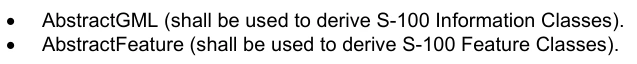

抽象GML(必须用于得出S-100信息类). 抽象Feature(必须用于得出S-100要素类).

S-100 GML 配置文件禁止使用 gml: Standard ObjectProperties 组.

10b-8.2 数据类型

10b-8.2.1 原始类型

S-100 GML 配置支持 S- 100 要素目录(如 S-10 Part 2a, 第 2a-4.2.9条所定义) 中定义的类型,其等同性如下. 类型尽可能使用 XML Schema ("x:") 内置数据类型支持,但已注明除外.

表10b-1-S-100原始类型

要素目录类型 XML / GML 配置文件等同

布尔 xs: 布尔

整数 xs:整数

实值 x: 十进制

文本 xs: 字符串

日期 xs: 日期

时间xs: 时间

```text
dateTime
xs:dateTime
```

```text
S100_TruncatedDate
S100_TruncatedDate
```

URI, URN, URL xs: 任意URI

表10b-1中提及的所有S-100类型都在S- 100 GML 配置中定义,该配置还提供了对0.0-360(为°表示)范围非负十进制和十进取十进位的类别的共同限制.

10b-8.2.2 扩展值类型

S-100 GML 配置支持第一部分第1-4.5.3.5项所定义的值类型:

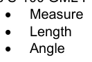

注:S100_UnitOfMeasure 类型必须由可计量属性实现,其值应指代号表注册簿所定义的数值,该注册簿提供名称、定义和符号。

10b-8.2.3 属性类型

S-100简单属性必须取上表10b-1所定义的类型之一. S-100复杂属性在GFM中没有命名类型.

Schema类型简单属性和复杂属性的命名惯例必须有一个定义类型名称"<Name>Type",其中"Name>是相关要素目录所定义的"code"字段. “code”字段预计将符合xs:NCName标准.

10b-8.2.4 枚举

对于 S-100 引用或 S-100 代码列表属性,数据集必须使用被编码在"要素目录"中的上市值的代码和标签.

编号和标签必须使用限制的简单类型组合来构建。

代码简单类型必须是 xs: 与 要素目录中允许的计数代码列表相拼接。 类型名称必须使用属性代码构建为 < Name> Code。

## 官方 PDF 第 501 页

```text
<xs:simpleType name="cardinalDirectionCode">
<xs:restriction base="xs:integer">
<xs:enumeration value="1">
<xs:annotation>
<xs:documentation>N</xs:documentation>
</xs:annotation>
</xs:enumeration>
<xs:enumeration value="2">
<xs:annotation>
<xs:documentation>NNE</xs:documentation>
</xs:annotation>
</xs:enumeration>
…
```

标签简单类型必须是使用要素目录允许的计数标签限制xs:字符串。类型名称必须使用属性代码构建为 <Name>Label。

```text
<xs:simpleType name="cardinalDirectionLabel">
<xs:restriction base="xs:string">
<xs:enumeration value="N">
<xs:annotation>
<xs:documentation>1: north</xs:documentation>
</xs:annotation>
</xs:enumeration>
<xs:enumeration value="NNE">
<xs:annotation>
<xs:documentation>2: northnortheast</xs:documentation>
</xs:annotation>
</xs:enumeration>
…
```

查点属性类型被定义为从标签类型延伸出来的复杂类型,并包括代码类型为xml属性.

```text
<xs:complexType name="cardinalDirectionType">
<xs:annotation>
<xs:documentation>Cardinal direction: Principal and intermediate compass points.</xs:documentation>
</xs:annotation>
<xs:simpleContent>
<xs:extension base="cardinalDirectionLabel">
<xs:attribute name="code" type="cardinalDirectionCode"/>
</xs:extension>
</xs:simpleContent>
</xs:complexType>
```

10b-8.3 要素收藏

要素收藏是要素实例的集合。 在 GML 3.2.1 中, 通用 gml: Feature Collection 元素被折旧。 要素收集是任何特性类, 其内容模型中包含属性元素, 扩展词源为 gmL: AbstractFeatural MemberType 。

S-100 GML专用配置支持GML 3.2.1方法,在S-100 GML应用程序Schema内模拟一个要素收藏类.

为了使用S-100交换基于文件的GML数据,GML专用配置包括:

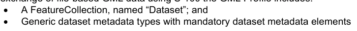

具有强制性数据集元数据要素的通用数据集元数据类型

其他交换机制,例如通过API机制,可以将按照这一部分编码的GML数据包入不同特性收集机制.

## 官方 PDF 第 502 页

10b-8.4 关联

社团只能用于表达相应的要素目录所定义的关系.

10b-8.4.1 协会课程

剖面图允许GML 3.3常规使用GM L 3.3关联类转换规则对关联类进行编码,该规则将关联类转化为等同的中间类. 下图说明了转换规则.

如果关联在产品规范要素目录中包含属性,则该结构必须用来通过中间信息类型实现这些属性。信息类型的名称应被定义为与“特性”相配合的关系(要素或信息关联)的名称(S100_FC-项目代码),而无需在要素目录内加以定义。

注:要素目录编码为“My AssociationType”的中间关系类别改为“My AssociationType”并附有适当的命名空间限定符。

图10b-2 – 具有关联类的模型(取自OGC-10-129r1 / ISO 19136-2:2015).

一个例子(取自S-127)见下文图10b-3,此处使用“豁免”类协会,相当于与“豁免”,代码的关系,用以表示关联属性“关系类别”。

## 官方 PDF 第 503 页

图10b-3 — 代表协会属性的示例使用(S-127)

为了避免源/去向要素与中间信息类型之间不必要的重复关系,中间信息类型的必须按照参考要素列入;例如:

```text
<S-127:VesselTrafficServiceArea gml:id="a1">
<categoryOfCargo>ballast</categoryOfCargo>
<permission xlink:title="PermissionType">
<S-127:PermissionType gml:id="res1">
<categoryOfRelationship>required</categoryOfRelationship>
</S-127:PermissionType>
</permission>
</S-127:VesselTrafficServiceArea>
<S-127:Applicability gml:id="R1">
<categoryOfCargo code=”7”>dangerous or hazardous</categoryOfCargo>
</S-127:Applicability>
```

在施特马申请中,这应通过 gmlReferenceType 的扩展来完成。

```text
<xs:complexType name="PermissionType">
<xs:sequence>
<xs:element name="categoryOfRelationship" type="categoryOfRelationshipType" minOccurs="1"
```

maxOccurs="1"/ > </xs:序列相通" </X:复合Type > <x:复合type名="permission" <xs;commexContent > <X:扩展基数="gml: referenceTypp" <X-序列相接" < ⁇ :元素相接名= "pmississionTyp"类型"MinOccours=1";/xx:extent:exmtent"等";xx-x:x-extext.commissent" –";"x-s-ex-exs-commessCype" <;"/x--x-i-x.

以上例子资料丰富,并非强制性的.

## 官方 PDF 第 504 页

10b-9 S-100 GML 数据格式

数据格式必须使用要素、信息类型以及要素目录所指定的属性和子属性等骆驼案例代码,作为GML要素和属性的元素标记中的 " 本地名称 " 。

EXAMPLE:鉴于一个要素目录,它定义了一个名为“海洋保护区”的要素,其代码为“海洋保护地”,数据集中的相应要素必须使用“海洋保护区”作为当地名称,例如,用“海洋安全保护地”的S122:MarineProtectedrea...或“海洋的保护地”来定义“海洋防护地”这一类型。

GML Schemas 中的元素排序应与 要素目录中的顺序相同。 当要素分类目录包含继承时, 必须用程序 Schema 中可能执行类似的结构。 所有所继承的财产(属性和关联约束) 均应出现在属于衍生类型的财产之前; 类别内的财产顺序必须保留。

独立地对要素进行编码的空间物体(即不嵌入内有要素的要素),必须用标记来编码,其本地名称成分为S-100 GML剖面图中的空间物体元素(例如S- 100:Point).

GML Profile定义了用于定义要素目录所包含具体类型时使用的要素和信息类型的抽象类型.

要素与信息协会必须使用xlink:title属性来编码协会的类型.

以下标记为保留标记,不得以GML数据格式作为元素的局部名称: 1.

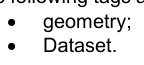

S-100数据集的GML数据格式必须遵循GML规格(ISO 19136/OGC 07-036)所描述的由S-100GML剖面图和本部分所修改的GML规则.

10b-9.1 S-100 GML 允许的位置格式

为了简化ECDIS对GML数据的解析,所有为导航目的发布的数据集必须使用以下两种方法来编码GML位置数据:

(1) 曲线和表面的 " posList " ;和(2) 点的 " pos " 。

对“ posList” 来说, 这是 :

```text
<gml:posList>latitude_1 longitude_1 latitude_2 longitude_2 latitude_3 longitude_3 latitude_4 longitude_4
… latitude_n longitude_n</gml:posList>
```

对于“pos”,这是:

```text
<gml:pos>latitude_1 longitude_1</gml:pos>
```

10b-10 GML 数据集处理

实施,包括必须用程序和生产工具,可以使用任何合适的方法处理GML数据集. GML的数据集必须符合产品规范中定义的GMl必须用程序 Schemas,但处理器不需要使用GM L必须用程序 SchEMs来处理数据集. 然而,GMI规格,本部分,以及S-100 GMl专用配置的组合导致以下共通性: 使用GmL必须用程序 Schems来处理数据集.

1)每个数据集有一个单一的根元素(“Dataset”). GML数据集是XML文档,这是XML的要求.

2)鉴于路径/数据集/X1/X2,那么X1是一个要素,而X2是一个属性或关联角色. 同样,给定/数据集/X1/X2,X1是一个信息类型,而X2是其属性或关联之一.

3) 如果X2拥有XML属性xlink:href和xlink:title,则是一个关联角色.

## 官方 PDF 第 505 页

4) 如果X2有元素内容,则代表一个复杂或空间属性.

5) 空间属性或物体将具有允许的空间属性之一作为其内容.

6)如果X2是空的和零的,或者有文字或数字内容,则是一个简单的属性.

7) 必须用程序必须允许存在或不存在命名空间;例如,X1可能属于S122:FeatureA等形式。 XML中的命名空间在“:”之前,所以必须用程序可以区分标记中的名称空间部分和“本地名称”部分。

10b-10.1 空间类型

10b-10.1.1 几何原始人

S-100 GML专用配置支持S-100执行GML 3.2.1基本地貌(第七编第7-4.1.1.1条).

对于不需要空间归属或关联的最简单的几何要求,可以使用S-100 GML配置图Semas所导入的原生GML类型,并代表S- 100点,曲线和地表几何等分,这些执行相当于要素目录中被定义为几何原始的指向,曲线与地表等分.

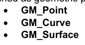

需要参考和空间属性(以及更复杂的曲线插值)的更复杂的Schemas可以使用专门为S-100 GML配置定义的更复杂的构造;. 例如:

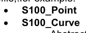

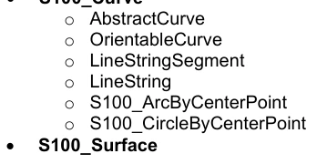

S-100 GML 剖面限制 GM_Curve Profile 类型值,并将曲线编码限制在 GML 曲线的子集几何上.

注:S100_ArcByCenterPoint和S100_CircleByCenterpoint与GML原始人ArcByCenterPoint和CircleByCenterPoint不同.

10b-10.1.2 曲线内插

允许值列表由ISO 19136允许的值子集和分线和插入曲线段的扩展(ISO/DIS 19107草案-2018年6月,澄清标准中的插入列表并非详尽无遗): 标注: 标值的分线,分线的分轴,分轴和分轴的分分轴.

1) 线性(线性)在非地理学 CRS 中——插值由一串直线所定义,每对相接的控制点之间有直线.

2) 地理CRS(被解释为"氧化")中的线性内插法 — — 插法必须在相接的相接控制点之间,在一对相接点之间的一对直线曲线上返回直线性外插法。 一条相接线是一条以相同角度跨越所有地心线的线,即一条恒恒相承接的路径。

3)大地测量(地极)-内插机制必须在相接的相接控制点之间一对地极曲线上回放直取地势波斯克克克. 地极地极道是长度最短的曲线. 大地测量必须在使用地极-地极的坐标参考系中确定.

4) 圆弧取出3分(圆弧3分)- 由从起始点从中间点到终点的圆弧上接取的3个直通点来定义插值.

## 官方 PDF 第 506 页

每套连续3个控制点的点。中间点位于起始点和终点之间的中点。

5) 椭圆弧 (椭圆) — 每套连续四个控制点, 插入机制必须将从第一个控制点从中控点穿过一个椭圆角上直接返回到第四个控制点上。 注意: 如果四个控制站是同线的, 弧会变成直线。 如果四个控制的点在同一圆上, 则弧会变为圆形 。

6) Concic 弧 (concic) – 与椭圆弧相同,但使用相接的5个分来阻遏一锥形的一段.

7) 有中半径的圆弧(circularArcCenterPoint Withradius) – 插值由以单个控制点所给出位置为中心的特定半径圆圈的弧来定义. 弧起起于起始角度参数并延伸至角距离参数所给出的角度. 这种插值类型只能与 S100_ArcByCentepoint和 S100-CircleBy Centerpoint 相接几何. 参数的精确语义在第七编第7-4.2.20条(S100_ArcByCenterPoint)中被定义.

8) Polynomial(polynomyalSpline) — 控制点的顺序与线弦相同,但它们由多诺函数所跨越。 通常情况下,连续性的程度取决于所选择的多诺分量的程度。

9) Bézier Spline(bezierSpline) — 数据按行字符串排列,但由使用Béziers基础定义的多诺米或分型函数来跨越。通常,连续性的程度取决于所选择的多諾米相關相關程度。

10) B-spline (bSpline) — 控制点像行字符串一样被命令,但它们被一个多名或理性(多名的引数)的分线函数所跨越,该函数使用B-spine碱函数(即片面多名函数)来定义. 理性函数的使用由布尔旗"isRational"决定. 如果理由是TRUE,那么所有与控制点相关的直接位置都以等同的形式存在。通常情况下,连续性的程度取决于所选择的多名度。

11) Blended parabolic(blending Parabilic) — 控制点像行弦一样被命令,但由一个函数所跨越,该函数将由相继数据点的三相序列定义的抛物线曲线的分块相混合. 每个三相包括前身的最后两个分点. 7–4.2.2.2 第7部分条款提供了语义学的进一步细节.

10b-10.1.3 几何复合物、几何复合物和几何集合

10b-10.1.3.1 几何复合材料和几何复合材料

S-100 GML 剖面图支持以下复合地貌(第七编第7-4.1.1.1条):

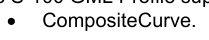

10b-10.1.3.2 几何总和

S-100 GML 剖面图支持集合几何类型(第七编第7-4.1.1.1条):

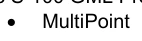

10b-10.1.4 内入和旁引编码

S-100 GML专用配置支持在两个要素具有GM_Object的同一种实例时,通过内线或参考方式编码几何功能的能力(见第三部分第3-6.5.4.5条),如果两者都得到规定,则遵循GML公约并优先使用内线参考。

10b-10.1.5 信封

S-100 GML 配置支持通过边框或信封编码适当几何的能力. 配置并不限制 GML 执行 GM_Envelope 。

10b-10.1.6 空间属性的Schema元素

GML 必须用程序 Schemas 将 S100 空间属性类型命名为几何元素,使用保留元素名称“ 几何” 。 这是为了与更广泛的 GMl 工具实现更大的互操作性。 如果将 GMI 必须用程序Schema 定义为 要素目录允许多种几何原始类型,这些类型应作为 XML Schema 选择元素而不是集合类型执行。 在GML必须用Schema中,几何元素必须具有多相0.*.

## 官方 PDF 第 507 页

例如:

10b-10.1.7 蒙面、短跑和平面幅度

S-100几何型号有一个可选的子元素口罩,内有被遮住的元素.

从5.0.0版开始,S-100 GML格式定义了具有最小和最小最大属性的空间属性的通用复合型S100_空间属性和掩码标记。这些属性与S- 100通用要素模型中的S100-空间属性元级(第3部分图3-1和3-2以及第3-5.3.5条)的属性相对应。 使用 GML 引用类型执行 smusReference 属性, 具有以下限制:

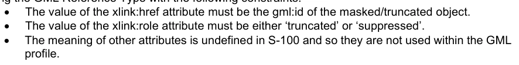

xlink:href属性的值必须是被遮蔽/被遮掩对象的gml:id. xlin克:role属性的数值必须是"truncate"或"suppleed". 其他属性的含义在S-100中未定义,因此不在GML内被使用.

S100_SpatialAttization Complex类型的结构在下文图10b-4和图10b-5中描绘.

图10b-4 – S-100 GML格式通用空间属性类型的结构

## 官方 PDF 第 508 页

图10b-5 — 口罩参考型的结构

注:本部分只指定了href和角色属性。不使用其他协会属性组成员、所有权属性组成员和零Reason。

使用遮掩的例子见下图10b-6. 地表边界的界定参考了两道曲线(由外环组成的相继曲线),其gml:id为JS.C.123和JS·C.567. 这些曲线在文件中的其他地方被定义了,示例中的遮掩标记表明,被压制了曲线JS-C.566.

注1:S-100 GML格式不要求将对象几何(图X.X中的表面对象)以图X所描绘的内线编码,它可以被数据集中其他地方编码为单独的空间数据对象,如曲线.

## 官方 PDF 第 509 页

注2:标识符前面的QQ字符是XML常规,表示后面的部分是XmL文件中XMl元素的标识符(由于没有指定文件名,该常规是引用元素在同一文件中)。 请注意,参考机制也允许通过将对象标识符与外部文件的文件名或URL前缀来引用外部文件中的对象.

图10b-6 – GML格式的遮掩示例

10b-10.2 不支持的GML功能

ISO 19107 未定义的GML 3.2.1和GMl 3.3几何支持不包括在内,具体地说,这意味着CircleByCenterPoint和ArcBy Centerpoint(GM L 3.2.1所定义)不支持,GMI 3.3所定义的紧凑几何编码也不支持.

ISO 19108中定义的时间模型和时间原始,包括时间位置,即时,时间段,不支持. S-100数据应当将日期和时间编码为主题属性.

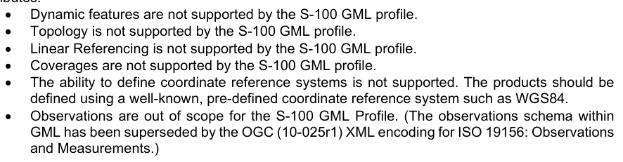

动态特性不支持 S-100 GML 剖面图 地形学不支持 s-100 GMl 剖相图 线性参考不支持 线性的参考不并支持 S- 100 GM L 剖位图 覆盖不支持 St- 100 GmL 描述, 定义坐标参考系的能力不支持 该产品应当使用一个众所周知的,预定义坐标参考系如 WGS84 来定义. S-100 GML 剖面图的观测范围已超出(GML内部的观测计划已被ISO 19156的OGC(10-025r1)XML编码所取代:观测).

10b-10.3 遵约水平

客户端要能够正确解释一个计划,它需要识别必须用程序计划遵守程度的能力。为此必须使用XML Schema注释。以下的图片显示该注释如何在必须用程序计划中宣布:

1 增加了换行和空格,以便明确。

## 官方 PDF 第 510 页

```text
<annotation>
<appinfo>
<gmlProfileSchema xmlns="http://www.opengis.net/gml/3.2">
http://www.iho.int/S-100/profiles/s100_GMLProfile.xsd
</gmlProfileSchema>
<s100:ComplianceLevel>1</s100:ComplianceLevel>
</appinfo>
</annotation>
```

表10b-2 — 合规声明 XML 代码

合规级别

1 S-100 要素类型、信息类型、要素和信息关联。

2 第1级的所有要素,加上圆和弧,按中点几何,分出分出,并混合插出,在生成后手动将遵守声明添加到计划中,涉及3个步骤: 3个分出: 4个分入,并被插入到中点,并进行分出.

1. 添加 S- 100 GML 配置文件 XML 命名空间声明 :

```text
xmlns:s100_profile="http://www.iho.int/S-100/profile/s100_gmlProfile"
```

2. 在计划说明中添加S-100 GML 专用配置遵守声明,遵守声明是上文表10b-2中的XML代码.

3. 为 S-100 GML 配置图级计划添加导入语句。为 S-100 GML 配置图级计划添加下列导入语句,将导入语句添加到导入语句列表中: 3.

```text
<import namespace="http://www.iho.int/S-100/profile/s100_gmlProfile"
```

```text
schemaLocation="../../S100/profile/S100_gmlProfileLevels.xsd"/>
```

10b-11 要素数据的 S-100 基础模式

10b-11.1 引言

提供了第二个 XML Schema , 它定义了“ S100” 命名空间中一组小的衍生类型和元素。 定义这些共同元素和类型的 Scheme 技术上是 ISO 19136 定义的 “ GML 应用程序 SchemA ” 。 它定义 GMl 构造, 期望不同的产品规范用于定义 GmL 应用 Schemas 编码的详细格式。 这个Schema为跨多个应用域的GML数据集提供了一个共同的核心结构范式,目的是通过最小化结构变异的激增来降低应用开发的复杂性,促进软件模块的共享,以及不同应用域的信息整合和映射. XML Schemas的设计是为了保证要素目录结构与所出产的GML Schema之间的匹配.

元素和类型仅使用S-100 GML配置中定义的GML受限子集来定义.

10b-11.1.1 建造 xsd 页眉

必须用程序 Schema 头必须定义 S- 100 GML 配置中所有导入元素的命名空间和前缀。 下面显示一个顶级 Schema 元素的例子 :

```text
<xs:schema
xmlns:xs="http://www.w3.org/2001/XMLSchema"
xmlns:S100="http://www.iho.int/s100gml/5.0"
xmlns:gml="http://www.opengis.net/gml/3.2"
xmlns="http://www.iho.int/S123/gml/1.0"
xmlns:S100EXT="http://www.iho.int/s100gml/1.0+EXT"
```

## 官方 PDF 第 511 页

```text
xmlns:xsi="http://www.w3.org/2001/XMLSchema-instance"
targetNamespace="http://www.iho.int/S123/gml/1.0"
```

```text
elementFormDefault="qualified"
version="1.0.0-20170831"
xsi:schemaLocation="
```

```text
http://www.iho.int/s100gml/5.0
https://schemas.s100dev.net/schemas/S100/5.0.0/S100GML/20220620/S100_gmlProfile.xsd
```

http://www.opengis.net/gml/3.2 https://schemas.s100dev.net/schemas/S100/5.0.0/S100GML/20220620/s100gmlbase.xsd 互联网档案馆的存檔,存档日期2013-12-20.

```text
http://www.iho.int/s100gml/1.0+EXT
https://schemas.s100dev.net/s100gml/1.0+EXT/s100ext.xsd">
```

定义的命名空间为:

```text
xmlns:gml=http://www.opengis.net/gml/3.2
xmlns:S100="http://www.iho.int/s100gml/5.0"
xmlns="http://www.iho.int/S123/gml/1.0"
targetNamespace=http://www.iho.int/S123/gml/1.0
elementFormDefault="qualified"
```

Schema默认命名空间和目标命名空间是相同的,应当使用S-100 第10b部分所定义的一致模式来形成;也许基于产品规范和产品规范版本. 使用元素FormDefault = “合格” 表示数据集中的每个元素必须属于一个命名空间,但并不意味着需要命名空间前缀;可以使用默认的命名空间来设置任何元素的命名空格,而无需特定的前缀.

注:所有S-100 Schemas应放在一个中Schema服务器上,以确保验证和ScheMa互操作性如所愿发挥作用。例如,国际海道测量组织目前为此目的使用S100DEV.NET服务器,并授权其产品规范加以使用。 此外,强烈建议所有产品规范Schemas都包括Schematron验证检查,以确保符合要求的产品也包括正确的计划。

示例 Schematron 规则 :

```text
<sch:schema xmlns:sch=http://purl.oclc.org/dsdl/schematron
xmlns:xsi="http://www.w3.org/2001/XMLSchema-instance" queryBinding="xslt2">
```

```text
<sch:pattern id="check-inline-schemaLocation">
```

```text
<sch:rule context="*">
<!-- Check for xmlns:S100 and schemaLocation on the same element -->
<sch:assert test="not(namespace::*[name() = 'S100']) or @xsi:schemaLocation">
```

如果在此元素上声明了"xmlns:S100",它也必须包括"xsi:schemaLocation"属性. </sch:assert" <!- 检查同元素上的xmins:s100_profile and schemaLoccation - > <sch:sassert test="not(名称空间:*[名 ()='s100-profication'])或@xsi;schemalocations"

如果在此元素上声明了"xmlns: s100_ profile",它也必须包括"xsi:schemaLocation"属性. </sch:assert > </sch:rule > </sch:pattern > </sch:schema>

10b-11.2 要素和信息类型

XML 复合类型 CraisalFeatureType 被定义为S-100剖面图中所有地理要素的基类型. 从S- 100版 5.0.0起,抽象要素类型或信息类型中不定义任何通用关联.

所有协会应作为命名协会实施,名称和类型与源要素目录中使用的名称和类型相匹配。GML标识gml:id可用作默认要素标识符。

## 官方 PDF 第 512 页

图10b-7 – S-100 要素要素的基础类型定义

信息类型的通用类型定义与通用要素类型相似.

图10b-8 – S-100 信息类型元素的基础类型定义

10b-11.3 空间类型

更复杂的空间类型被定义为带有信息关联的对应GML空间类型的扩展,因为在S-100空间对象中可以有信息关联. 下图显示了S- 100 schema中点类型的设计,包括了单个gml:Point类型和0或多个关联到S- 100.

图10b-9 – S-100 通用 S-100 点空间物体的空间类型

其他空间类型结构相近.

10b-11.3.1 内含并参考几何

基站相图还允许以内线或参考方式定义几何,符合GML中的相同能力. 如果两者都包含在一个数据集中,则内线几何是规范的.

## 官方 PDF 第 513 页

10b-11.3.2 基准计划中定义的空间类型a

基站式设计方案定义了点,曲线,和地表空间物体,以及多点和复合曲线物体. 曲线可以是简单的,复合的,也可以是可定向的曲线. 这是S-100 GML剖面图(clause 10b-8.5)中定义的同一组. 也支持 gml: Polygon(ISO 19136),它是由单一地表补丁定义的特殊地表.

图10b-10 – 基准图中定义的几何类型a

10b-11.4 关联

要素与信息关联属性被定义为GML要素属性的扩展. 关联的另一端对对象的指针被编码入XLink属性.

XLink组件是支持XML中超文本引用的标准方法.

GML 提供了 XML Schema 属性组, gml: AssociationAttized Group, 支持使用 XLinks 来以 GMl 中统一的方式引用表示一个属性的价值, 这个结构必须用于编码关联的要素目录中的所有关联.

ISO 19136规定,带有xlink:href属性的GML属性的值是通过穿行链接而返回的资源.

属性的数据类型见下表.

表 10b-3 - 社团对XLink属性的要求

Xlink 属性 数据类型备注

href URI 引用关联的另一端的对象, 例如当前数据集中对象的 gml:id 。 可能是 XLink 规格所描述的 URI 碎片 。

角色 URI 对目标资源性质的可选描述,作为 URI 给出

弧形后遗症扩展了IRI 描述目标资源相对于当前资源的作用或目的,作为URI(ISO 19136)提供,可以从应用程序 schema 中的角色名来构建.

XLink 1.1规格要求:

(1) 价值必须是延伸的IRI遗产

2) 识别标志不得是相对的

注: 空间类型的信息关联要素必须满足要求。 数值的格式必须如下: “ data: aRole” , 其中 aRoole 是要素目录条目的代码, 对应协会的作用

## 官方 PDF 第 514 页

标题字符串 要素目录条目的代码对应 S100_FC_信息协会或 S100_FC_ Feature协会

显示未使用

未使用动画

类型未使用,从S-100版5.0.0起,应用程序Schemas只能使用命名的参考类型来连接要素与信息类型,使用角色名作为属性元素,而通用关联被贬值以用于GML应用程序Sjemas.

10b-11.4.1 作用名称作为财产要素

必须用程序 Schema 中定义的角色必须用作特性或信息类型的属性要素, XLink 属性提供了实例的参考。 在这种情况下, 关联最远端的角色必须用于定义属性的 XML 标签。 角色名称可以作为属性标签的正本使用, 或者它可能必须被映射到符合 XMR 和 GML公约的标签 。

EXAMPLE(非规范):鉴于下图中包含关系关系的应用程序Schema,导航Line特性可以将关联编码为以下命名为NavTrack的属性元素. 弧和标题值的格式,构造规则和语义将在应用程序Shema中定义.

```text
<NavigationLine gml:id=”US123098”>
<navTrack xlink:href=”#US890321”
xlink:arcrole=”urn:mrn:iho:s101:1.0:52.2” xlink:title=”RangeSystem”/>
...
</NavigationLine>

and elsewhere in the same file:
```

```text
<RecommendedTrack gml:id=”US890321”>
<navLine xlink:href=”#US123098”
xlink:arcrole=”urn:mrn:iho:s101:1.0:52.1” xlink:title=”RangeSystem”/>
...
</RecommendedTrack>
```

图10b-11-应用Schema协会

10b-11.5 更新

数据集可能有两个目的.

1. 包含特定覆盖区域内所有要素,信息类型和关联的基数据集,针对特定数据集发出日期. 2. 编号更新数据集,仅包含对更早的基集中单个要素的更新.

更新的编号,从数据集元数据所列1起,按顺序更新编号。数据集元数据的元数据元素和包含数据集的交换集目录元数据中列出了数据集的目的。

更新只在特性或信息类型级别上定义,它们只能添加新特性或替换先前对单个数据集特性的定义。更新的特性应保留GML标识符。

## 官方 PDF 第 515 页

。无法更新关联,除非替换所有因引用更改而受影响的特性。不可能通过更新删除特性。

10b-11.6 数据集一般信息

10b-11.6.1 数据集识别

数据集识别信息由复杂的类型"数据集识别Type"定义,字段如下文表10b-4和图10b-12所示.

表10b-4-数据集识别头元素

字段 XML 标记值。 类型描述

编码规格

编码 规格 `S- 100 部分 10b ' 1 字符串编码规范,定义编码

编码规格版

```text
encodingSpecificationE
dition
```

1 编码规格的字符串版

```text
Product identifier
productIdentifier
```

1 字符串 数据产品的独特标识符

```text
Product edition
productEdition
```

1 产品规范字符串版

```text
Application profile
applicationProfile
```

1 字符串“1” – 基础数据集“2”– 更新数据集

数据集文件标识符数据集FileIdentifer 1 CharlesString 文件名称包括扩展名但不包括任何路径信息

数据集标题数据集 Title 1 字符串 数据集标题

数据集参考日期

数据集的发售日期 。 格式: YYYY- MM- DD

数据集语言数据集 Language “ENG” 1 ISO 639-1-2/T 本数据集3字符代码中使用的(主)语言

```text
Dataset abstract
datasetAbstract
```

0.1 字符串 数据集的抽象

数据集主题类别

数据集TopicCategory 1.. * MD_TopicCateg 矿石编码(ISO 19115-1)

ISO 19115-1中的MD_TopicCategoryCod e列表中的一组主题类别代码("外部地"除外)

数据集目的数据集 { “ Base”、“ U pdate” }

1 字符串 数据集是包含更新的特性还是包含所有特性

更新数字更新 第 1 集 此数据集的相继更新数字。 必须是 QQ 0

## 官方 PDF 第 516 页

图10b-12 - 数据集识别

## 官方 PDF 第 517 页

10b-11.7 坐标参考系

GML允许以不同方式确定用于几何的坐标参考系(“空间参考系统”),具体方法是明确规格,或者“继承”外部元素的SRS。 对于S-100数据集,这意味着SRS可以两种方式之一进行指定:

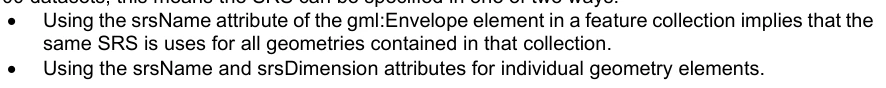

使用 gml: 信封元素的 srs 属性意味着该集合中包含的所有几何都使用相同的 SRS 属性。 使用 srSName 和 sr斯 Dimension 属性来表示单个几何元素 。

必须用数据格式可以使用两种方法,但应确保数据集中每一几何实例的SRS可以通过必须用软件,使用一种或另一种方法来确定.

“标准”大地测量坐标参考系必须使用OGC规定的关于SRS的http URI公约加以确定。

```text
EXAMPLE      http://www.opengis.net/def/crs/EPSG/0/4326
```

注:坐标顺序必须始终与中央资源系统一致,例如,对http://www.opengis.net/def/crs/EPSG/0/4326来说,这总是以经纬度为后方,对预测的(UTM或UPS)数据集来说,总是以东为后再以北为后后方。

10b-11.8 数据集结构定义

数据产品的必须用Schemas应定义XML类型和元素,作为GML数据集的根元,由用于必须用程序ScheMa中其他地方定义的要素、信息类型和空间数据对象的XMl元素集合而成。这必须称为“数据集”。

10b-11.8.1 数据集元数据

数据集类可能包含一个或元数据属性来编码数据集级别元数据(例如ISO 19115/19139),可以内置或参考.

10b-12 约束与验证

如果数据产品GML应用的系统尽可能创建了定义明确的类型,例如,列出点数属性的类型,以及真实属性的最大和最小允许值,那么可以通过验证XML处理器来进行数据验证。 但是,完整的验证,特别是有条件属性的验证,可能需要额外的数据验证手段。

制约因素使得复杂的业务规则可以被定义,这些规则根据明确界定的限度或属性之间的关系来限制允许值(例如,结束日期必须等于或大于起始时间)。

限制可以有多种不同的方式定义——仅人可读的文本,对象约束语言(OCL),"商业词汇与商业规则"(SVBR)的语义学,这些都可以作为UML模型的一部分或模型外的文献来记录.

S-100 GML Profile没有为表达约束或基于规则的验证提供明确的支持. 目前的行业最佳做法,主张使用 Schematron来验证基于使用 OCL, SVBR 或 人可读文本定义的商业规则的 XML 文件. Schemapron (ISO/IEC 19757-3) 是用于对 XMR 中是否存在规律作出断言的基于规则的一种验证语言. 使用 Schematron 编码的制约可能直接被编码在由此产生的应用程序 Schema 中,也可能被定义在一个相关的 Schematron 文档中.

10b-13 数据集级元数据与完整性检查

S-100 GML专用配置没有明确包含与数据集一级元数据或完整性检查有关的任何要素. S-100 第15部分包含了此类规定.

## 官方 PDF 第 518 页

10b-14 模式位置与命名空间

通用元素的GML专用配置和GMl应用程序Schema位于IHO地理空间信息登记处的ScheMa服务器上,该网站还定义了命名空间和版本,并要求所有使用GMI编码的S-100产品规范开发者将其Schema放在该网站. 使用Schema服务器的程序不是这个框架的一部分,而是国际海道测量组织秘书处的一个操作程序。

10b-15 与常规 GML 做法的差异

GML专用配置(10b-8)和基础计划(10b-9)在以下项目中不同于通用GML做法:

1. 解释缺失曲线插值(见第10b-10.1.2条)。几何属性是单独界定的,而不是使用替代组。没有单一属性在所有要素中作为空间属性发挥作用。

## 官方 PDF 第 519 页

附录10b-A 应用程序Schema

（资料性）

```text
10b-A-1
```

[待补]

## 官方 PDF 第 520 页

本页特意留空

## 官方 PDF 第 521 页

附录 10b-B 在 GML 应用程序数据集中使用配置文件

（资料性）

10b-B-1 引言

这一条款说明了GML剖面图(10b-8)和基站图(10b-9)以及一个基于S-100的数据产品和GML数据集GML应用图(App. 10b-A)的使用情况.

[待补]

10b-B-2 GML 应用模式中的数据集结构

如下图所示,GML数据集格式的一个实例。该数据集将数据对象定义为信息对象、空间对象或要素对象,它首先指定了信息对象的序列,然后是空间对象,然后确定要素。

[待补]

## 官方 PDF 第 522 页

本页特意留空
