# S-100 5.2.1 · 第 10c 部分 · HDF5 数据模型与文件格式

非官方机器翻译参考稿，尚未逐条人工校订。公式与代码保留原文，解释以英文规范为准。

## 官方 PDF 第 523 页

S-100 – 第10编c

HDF5 数据模型与文件格式

## 官方 PDF 第 524 页

5.2.1版实质性变动摘要

已生效的概要条款

从信息参考中删除了 URL 链接 。 10c-4.2

claized 许可 Group_F 省略当前数据集未使用的可选属性 。

```text
10c-9.5
```

修正的特性 属性表元素,从"id"到"fetature 属性表Key"的固定列名.

```text
10c-9.6.2; 10c-
9.11.1
```

表10c-12中经修改的注释,分节数据CodingFormat=2或9行网格起源;网格起源纬度;网格相距;网格相距,经度;网格相距,纬度,允许投放数据集的米.

```text
10c-9.7
```

修正属性时间的多式性点从强制性改为任择性(表10c-19)。

## 官方 PDF 第 525 页

HDF5版权通知和许可条款(Hierarchical Data Format 5) 软件库和公用事业--- --- -- -- - - - - 由伊利诺伊大学董事会颁发的软件库与公用事业版权1998-2006年(Herrical data Forum 5)(Herlical Department 5,软件库及公用事业版权2006-2015) HDB5(Hierric Cata Format 4). NCSA HDP5(英语:Softwart Data format 5.) Illinoistics大学董事会发行的软件图书馆与公用事业著作权1998- 2006年. 所有权利保留. 允许以原始和二进制形式,不论有无修改,为任何目的(包括商业目的)进行再分配和使用,但必须符合下列条件: 1. 源代码再分配必须保留上述版权通知,本条件清单,以及下列免责声明. 二进制再分配必须复制上述版权通知,本条件清单,以及随发件提供的文件和/或材料中的下列免责声明. 3. 此外,对源代码或二进制代码的修改后形式的再分配,必须携带显著通知,说明原代码被修改了并更改了日期. 所有提及该软件的要素或使用的出版物或广告材料都被要求但无需承认由HDF集团和伊利诺伊大学厄巴纳-尚帕因分校国家超级计算应用中心开发,并归功于撰稿人。 无论是HDF集团的名称、大学的名称,还是任何贡献者的名字,均不得用于未经HDL集团、大学或贡献者分别具体的书面许可而认可或推广从该软件衍生出的产品。 在任何情况下,HDF小组或贡献者均不应对用户因使用该软件而蒙受的任何损害承担责任,即使已告知可能发生这种损害。

## 官方 PDF 第 526 页

本页特意留空

## 官方 PDF 第 527 页

中文目录（可用上方目录直接跳转）

10c-1 范围 · 官方 PDF 529
10c-2 引言 · 官方 PDF 529
10c-3 符合性 · 官方 PDF 529
10c-4 参考文献 · 官方 PDF 529
10c-4.1 规范性引用文件 · 官方 PDF 529
10c-4.2 资料性参考文献 · 官方 PDF 529
10c-5 HDF5 规范 · 官方 PDF 530
10c-5.1 抽象数据模型 · 官方 PDF 531
10c-5.1.1 文件 · 官方 PDF 531
10c-5.1.2 组 · 官方 PDF 531
10c-5.1.3 数据集 · 官方 PDF 532
10c-5.1.4 数据空间 · 官方 PDF 533
10c-5.1.5 数据类型 · 官方 PDF 533
10c-5.1.6 属性 · 官方 PDF 534
10c-5.1.7 财产清单 · 官方 PDF 535
10c-5.2 HDF5 图书馆和编程模式 · 官方 PDF 536
10c-5.3 被禁的HDF5建筑 · 官方 PDF 536
10c-6 HDF5 的 S-100 专用配置 · 官方 PDF 536
10c-7 数据类型 · 官方 PDF 536
10c-8 命名约定 · 官方 PDF 537
10c-9 数据产品结构 · 官方 PDF 538
10c-9.1 总结构 · 官方 PDF 538
10c-9.2 元数据 · 官方 PDF 540
10c-9.2.1 发现元数据 · 官方 PDF 540
10c-9.2.2 载体(嵌入式)元数据 · 官方 PDF 540
10c-9.2.3 扩展元数据 · 官方 PDF 541
10c-9.3 坐标和数据的一般尺寸和储存 · 官方 PDF 541
10c-9.4 根组 · 官方 PDF 543
10c-9.5 专题信息组 · 官方 PDF 549
10c-9.6 特性容器组 · 官方 PDF 552
10c-9.6.1 单元格内数据点的位置 · 官方 PDF 557
10c-9.6.2 要素属性表 · 官方 PDF 558
10c-9.7 要素实例组 · 官方 PDF 558
10c-9.7.1 压倒性属性 · 官方 PDF 565
10c-9.7.2 集装箱和实例结构实例 · 官方 PDF 565
10c-9.8 铺设资料组 · 官方 PDF 566
10c-9.9 指数组 · 官方 PDF 567
10c-9.10 定位组 · 官方 PDF 567
10c-9.10.1 空间代表战略 · 官方 PDF 567
10c-9.10.2 储存网点位置信息的数据结构 · 官方 PDF 568
10c-9.11 数据值组 · 官方 PDF 570
10c-9.11.1 以地貌为主的正网格 · 官方 PDF 576
10c-10 公共枚举与字典 · 官方 PDF 579
10c-10.1 数据编码格式 · 官方 PDF 579
10c-10.2 水平式CRS类型 · 官方 PDF 580
10c-10.3 垂直坐标基座 · 官方 PDF 580
10c-10.4 纵向基准参考 · 官方 PDF 580
10c-10.5 预测方法 · 官方 PDF 580
10c-10.6 垂直和声学数据 · 官方 PDF 581
10c-11 支持文件 · 官方 PDF 583
10c-12 目录文件与元数据文件 · 官方 PDF 583
10c-13 矢量空间对象、要素及信息类型 · 官方 PDF 583
10c-14 约束与验证 · 官方 PDF 584
10c-14.1 验证试验 · 官方 PDF 584
10c-15 更新 · 官方 PDF 584
10c-16 模型汇总 · 官方 PDF 584
10c-17 产品规范开发者应遵循的规则 · 官方 PDF 585
10c-17.1 从本专用配置中界定产品规范的格式 · 官方 PDF 585

## 官方 PDF 第 528 页

中文目录（可用上方目录直接跳转）

10c-17.2 其他规则 · 官方 PDF 586
10c-17.3 本专用配置的扩展 · 官方 PDF 586
10c-17.4 添加元数据的扩展 · 官方 PDF 587
10c-18 实现指南 · 官方 PDF 587
10c-19 第 8 部分应用模式的实现（资料性） · 官方 PDF 587

## 官方 PDF 第 529 页

10c-1 范围

Hierachical Data Format 5 (HDF5) HDF是由HDLGroup开发的用于图像和网格数据的数据传输的文件格式,这一部分是HDR5的剖面图并指定了交换格式,以便于包含数据记录的文件在计算机系统之间移动. 它定义了一个特定的结构,可以用来传输包含符合S-100通用要素模型的数据类型和数据结构的文件.

这一部分规定了各种制约和公约,共同规定了S-100 HDF5数据格式的规则. S-100HDF克数据不需要的HDL5特性被排除在外. 本部分的范围仅限于数据格式,不包括应用方案,也不包括如何制定产品规范或特性和属性命名规则的准则.

10c-2 引言

HDF5使用开源格式,它允许IHO等用户在功能要求上与HDF Group合作,并允许用户的经验和知识酌情被收录到HDB产品中.

HDF5特别擅长处理复杂和可扩展性重要的数据,几乎任何类型或大小的数据都可以被存储到HDF5. 包括复杂的数据结构和数据类型. HDL5是可移植的,运行在大多数操作系统和机器上. H DF5是可以扩展的-它在高端计算环境中运作良好,并且可以容纳几乎任何大小或多相容的数据对象. 它还可以高效地存储大量数据——它有内置压缩. HDF5在政府,学术界和工业界被广泛使用.

10c-3 符合性

S-100 HDF5数据格式符合HDF5的1.8.8发布.

10c-4 参考文献

10c-4.1 规范性引用文件

HDF集团,2011年11月,HDF5用户指南 第1.8.8版.

HDF Group,2011年11月,HDF5参考手册 1.8.

ISO 8601:2004, 数据元素和交换格式-信息交换-日期和时间的表示

ISO 19123, 地理信息——覆盖几何和功能的Schema

ISO 19129:2009, 地理信息-成像、网格和覆盖数据框架

10c-4.2 资料性参考文献

Gilbert, W., A Cube-filling Hilbert Curve,数学情报员6(3), 第78页, 1984年

Goodchild,M.F.和Grandfield,A.W.,优化Raster存储:对四种替代品的检查,程序Auto-Carto 6(1), 第400-407页,渥太华,1983年

Kidner, D.B., 常规网格数字高程模型的更上等插值,《国际遥感学报》,24(14),2003年7月,第2981-2987页。

Kidner, D., Mark Dorey, M., & Smith, D., 有什么意义? 用常规网格DM进行内插和外推, 第四届国际地产测量会议记录, 弗吉尼亚州弗雷德里克斯堡.

Laurini,R.和Thompson,D.,空间信息系统基础知识,学术出版社,1992年。

## 官方 PDF 第 530 页

10c-5 HDF5 规范

HDF5执行一个管理和存储数据的模型,模型包括一个抽象的数据模型和一个抽象的存储模型(数据格式),以及库来实施抽象模型并将存储模型映射到不同的存储机制. HDLF5库为抽象模型的具体实施提供了程序化接口. 图书馆还实施一个数据传输模式,即数据从一个存储的表示方式有效转移到另一个存储的表达方式,下图显示了模型与执行之间的关系。

图10c-1-HDF5模型及其实施

抽象数据模型是数据,数据类型,和数据组织的概念模型,抽象数据模式独立于存储介质或编程环境,存储模型是抽象数据模块对象的标准表示. HDF5文件格式规格定义了存储模型.

编程模型是计算环境的模型,包括从小型单系统到大型多处理器和集群的平台. 编导模型从抽象数据模型中操纵对象(intantiatics,populties,和 retrievers).

库是程序化模式的具体实施. 库会将HDF5 API导出为它的接口. 图书馆除了执行抽象数据模型的对象外,还管理从一个存储格式到另一个存储格式的数据传输,数据传输实例包括从磁盘到内存的读取和从内存到磁盘的写入.

存储数据是存储模型的具体实施. 存储模型被映射到多个存储机制,包括单盘文件,多文件(文件的家族)和内存表达.

HDF5库是一个C模块,可以执行编程模型和抽象数据模型. HDP5库调用操作系统或其他存储管理软件(如MPI/IO库)来存储并取回持久性数据. H DF5图书馆还可以链接到其他软件,如过滤器等进行压缩. HFP5图书馆与一个应用程序相链接,程序可能用C,C++,Fortran,或Java来编写. 应用程序程序执行特定问题算法和数据结构,并呼叫HDF5库来存储并取回数据.

HDF5库执行HDF3抽象数据模型的对象,其中一些对象包括组,数据集,属性. S-100产品规范图将S-100数据结构映射到HDL5对象的分级上. 每个S- 100基于产品规范将创建一个最适合其目的的绘图.

## 官方 PDF 第 531 页

HDF5抽象数据模型的对象被映射到HDF-5存储模型的对象上,并被存储在一个存储介质中. 所存储的对象包括头块,自由列表,数据块,Btrees等对象. 每个组或数据集被存储为一个或多个头块和数据块.

10c-5.1 抽象数据模型

抽象数据模型(ADM)定义了定义和描述存储在文件中的复杂数据的概念. ADM是一个非常通俗的模型,旨在从概念上覆盖许多特定模型. 许多不同类型的数据可以被映射到ADm的对象上,因此使用HDF5来存储和检索. 然而,AD姆并不是任何特定问题或应用域的模型. 用户需要将其数据映射到ADM的概念上.

关键概念包括:

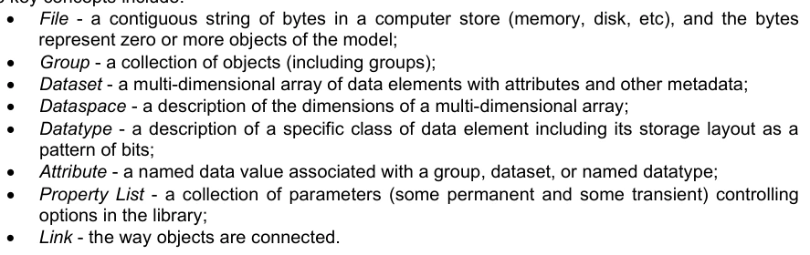

文件 - 计算机存储器(记忆、磁盘等)中一个相接的字节串,而字节代表模型的零或更多对象; 组 - 对象(包括组)的集合; 数据集 - 有属性和其他元数据的数据元素的多维阵列; 数据空间 - 对多维数组尺寸的描述; 数位数组: 数据类型 - 对特定类别数据元素的描述,包括它作为属性的存储布局 - 与组,数据集相关联或被命名的数据类型相连接的命名数据值; 属性列表 - 一组参数(有些是永久的,有些是瞬间的控制Link) - 对象的连接方式.

下文将更详细地阐述这些关键概念。

10c-5.1.1 文件

抽象地, HDF5 文件是组织对象集合的容器。 对象是组、 数据集和下面定义的其他对象。 物体是根状的、 有定向的图表。 每个 HDL5 文件至少有一个对象, 即根状组。 见图。 所有对象都是根状群或根状团后代的成员 。

HDF5对象在单一的HDF-5文件中具有独特的身份,只能通过文件等级内的名称才能访问. 不同文件中的H DF5物体不一定具有独特的特征,除了通过文件,无法访问永久的HdF5的对象.

文件创建时,文件创建属性指定了文件的设置。文件创建特性包括全局数据结构的版本信息和参数。文件打开时, 文件访问属性指定当前访问文件的设定。文件访问属性包括存储驱动器参数和缓存和垃圾收集参数。 文件创建属性被永久设定为文件寿命,文件访问属性可以通过关闭并重开文件来更改.

HDF5 文件可以作为另一个HDF 5 文件的一部分“挂载” 。 这类似于 Unix 文件系统挂载。 挂载文件的根附于挂载文件中的组, 并且所有内容都可以访问, 仿佛挂载的文件是挂载中文件的一部分 。

10c-5.1.2 组

HDF5 组类似于文件系统目录。抽象地说,一个组包含零或多个对象,每个对象必须是至少一个组的成员。根组是一个特殊的情况;它可能不是任何组的成员 。

组成员通过链接对象实际执行。 见下文图。 链接对象由一个组拥有, 并指向一个命名对象。 每个链接有一个名称, 每个链接指向精确的一个对象。 每一个命名对象至少有一个, 可能有许多链接 。

## 官方 PDF 第 532 页

图10c-2 - 通过链接对象加入集团

命名对象有三类: 组、 数据集和命名数据类型。 参见下图。 每个对象至少是一个组的成员, 这意味着至少有一个链接 。

图10c-3 - 已命名物体的类别

10c-5.1.3 数据集

HDF5数据集是一个多维数据元素阵列,请参见下图. 数组的形状(维度数,每个维度的大小)由数据空间对象描述.

数据元素是单个数据单位,可以是数字、字符、数字或字符数组,也可以是各种数据元素的记录。数据元素是一个比特集。比特的布局由数据类型来描述。

数据空间和数据类型是数据集创建时设定的,并且不能为数据集的生命而更改。数据集创建属性是数据集创建时设定的。数据集

## 官方 PDF 第 533 页

创建属性包括填充值和存储属性,如块和压缩等。这些属性在数据集创建后无法被更改。

数据集对象管理数据的存储和访问。虽然数据在概念上是一个相接的矩阵列,但根据存储属性和使用的存储机制,它被物理存储和传输的方式不同。实际存储可能是一组压缩块,访问可能通过不同的存储机制和缓存进行。 在元素的概念阵列与实际存储的数据之间的数据集图.

图10c-4 - 数据集

HDF5概念 " 数据集 " 是指一个阵列,而S-100概念被定义为 " 可识别的数据收集 " (S- 100附件A -- -- 术语和定义),一般被解释为是指收集要素和/或信息类型的实例。

这一部分经常使用“数据文件”一词来指S-100意义上的数据集和“HDF5数据集”来指HDP意义上的一数据集。如果不使用这些术语,则从上下文中就应该明显地看到这一意义。

10c-5.1.4 数据空间

HDF5数据空间描述了多维阵列元素的布局. 概念上,该阵列是一个具有一到32维的超矩形. HDL5数据空格可以被扩展,因此,每个维有当前大小和最大大小,最大大小可能是无限的. 数据空间描述这个超矩相:它是一个具有当前和最大(或无限)大小的维度列表.

```text
10c-5.1.5 DataType
```

HDF5数据类型对象描述单个数据元素的布局,一个数据元素是数组的单个元素;它可能是单个数,字符,数字或载体的数组,或者其他数据. 数据类型的对象描述此数据的存储布局.

数据类型分为11类。每个类别都按照一套规则解释,并有一套具体的属性来描述其存储。例如,浮点数具有可表示位置和大小,这些大小根据适当的标准来解释。

## 官方 PDF 第 534 页

数字表示。因此,数据类型类别会说明元素的含义,数据类型会说明其存储方式。

下图显示了数据类型的分类. 原子数据类型是不可分割的,每个可能是一个单一对象;一个数字,一个字符串,或者一些其他对象. 复合数据类型由原子数据类型的多要素组成,除了标准类型外,用户还可以定义额外的数据类型,如24位整数或16位浮点.

数据集或属性有一个与之相联的单一数据类型对象,见上文图10c-4. 该数据类型的对象可能用于定义多个对象,但默认情况下,数据类型物体的副本会被私自保存到数据集.

可选的是,数据类型对象可以存储在HDF5文件中. 数据类型被链接到一个组中,因此被赋予了名称. 命名的数据类型可以被打开并以任何方式被使用到一个数据类型对象.

并非所有HDF5数据类型在第一部分第1-4.5.2条(表1-2)所定义的S-100基本和衍生数据类型中都有精确等同值. HDF 52. 与S- 100数据类型之间的对应关系见本部分后期表10c-2.

图10c-5 - 数据类型分类

10c-5.1.6 属性

HDF5 命名数据对象( 组、 数据集或命名数据类型) 可能具有零或更多用户定义属性。 属性用于记录对象。 对象的属性与对象一起保存 。

HDF5属性有一个名称和数据. 数据部分在结构上与数据集相似:一个数据空间定义了一组数据元素的布局,一个数据类型定义了元素的存储布局和解释. 见下文图10c-6.

## 官方 PDF 第 535 页

数据对象的属性原则上相当于主题属性,但本版HDF5配置文件没有规定HDL5文件中的矢量要素或信息类型数据,因此不使用矢量对象属性. HDF5. 分组属性,数据集,或被命名的数据类型扮演元数据的角色.

图10c-6 - 属性数据要素

事实上,一个属性与具有以下局限性的数据集非常相近:

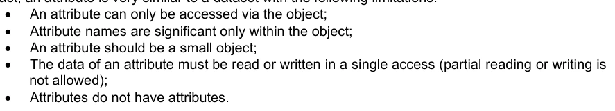

属性只能通过对象访问; 属性名称只在对象内是显著的; 特性必须是小对象; 一项属性的数据必须在单一的存取中读取或写入(部分读取出或写出是属性没有属性).

注意一个属性的值可以是对象的参考. 共享属性或是一个大数组的属性可以作为数据集的参考执行.

属性的名称,数据空间,和数据类型在创建时被指定,且在属性存在期间不能被更改. 属性可以由名称,索引,或者通过对象的所有属性来移动来打开.

10c-5.1.7 财产清单

HDF5 具有通用属性列表对象。 每个列表都是名称值对的集合。 每个属性列表都有一组特定的属性。 每个类属性都有隐含的名称、数据类型和值。 一个属性列表的对象被创建和使用的方式与 HDP5 库中的其他对象相似。

属性列表附于库中的对象,可以被库中的任何部分使用. 有属性是永久的(例如数据集的块策略), 有属性则是瞬态的(如数据传输的缓冲大小). 属性清单的常用方法是将参数从调用程序传递给VFL驱动程序或管道模块.

属性列表在概念上与属性相似。属性列表是和库行为相关的信息,而属性则与用户的数据和应用相关。自此以后,属性列表将包含与库行为相关的信息。

## 官方 PDF 第 536 页

S-100产品规范中使用HDF5财产清单的数据规格不鼓励。

10c-5.2 HDF5 图书馆和编程模式

HDF5库执行HDF3抽象数据模型和存储模型. HDL5产品有两个主要目标,即提供尽可能多的计算平台上可以使用的工具(可移植性),并提供合理的面向对象的数据模型和编程接口.

参考HDF5用户指南第1.8.8版和HDG5参考手册第1.8. 8版,可以了解HDL5模型实施的更详细信息. S-100产品规范必须在S-100通用要素模型中指定HDR5组,数据集和属性.

10c-5.3 被禁的HDF5建筑

不可使用 HDF5 发行的标准库处理的构造不能使用。 具体地说, 不可用 HDL5 构造需要使用库来晚于本部分指定的版本 。

10c-6 HDF5 的 S-100 专用配置

HDF5的S-100剖面限制HDF3的数据类型和构造,可用于S- 100 HDf5数据集;描述S- 100.0和HDf6数据类型和其他构造之间的对应;并定义S-1000 HDG5数据集必须如何结构的规则.

S-100 HDF5专用配置必须适用于以下所列各类信息——指出这些类型并非全部相互排斥,尽管大多数单个产品规范将只使用一组可能的组合: .

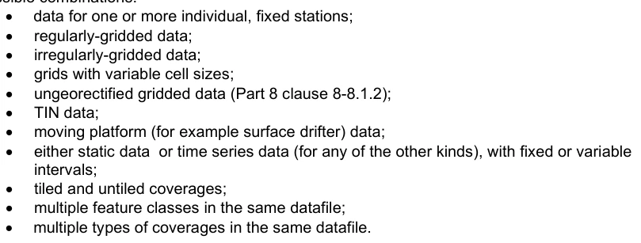

一个或多个单个,固定站点的数据; 具有可变单元格大小的网格; 未被分化的网状数据(第8部分条款 第8-8.1.2条); 移动平台(例如地表漂流器)数据; 静态数据或时间序列数据(针对其他任何种类),在同一数据文件中有固定或可变的多功能类; 在同一数据文件中有多类覆盖。

以下各节对限制、来往信件和规则作了说明。

10c-7 数据类型

预定义的HDF5数据类型包括Integer,Float,String,和Enumeration,但没有HDL5等同的S-100数据类型布尔克,S100_Codelist或S100-TruntedDate. 后几类被映射到下表中指定的HDR5构造. S-100数据类型 日期、 日期时间和时间 被映射到 HDF5 字符串, 原因是 HDL5 时间格式的不同处理器结构中可能存在可移动性问题。 在 S- 100 HDR5 数据产品中, 第三部分定义的 S- 100 数据类型被映刻到等同的 HDG5 的数据类型 。 这些等同性在下面的表10c-1中汇总。 本表格未提及的 HDl5 类型数据类别不得使用 。

## 官方 PDF 第 537 页

表10c-1 – S-100和HDF5数据类型等同

S-100 属性值类型

HDF5 数据类型类

对 HDF5 数据类型进行约束

真实浮点 32 或 64 位浮点

整数 1, 2 或 4 字节已签名和未签名的整数

文本(S-100元数据中的字符串)

字符串可变长字符串

点数 数字代码必须是1或2字节无符号的整数,范围 [1, 28– 1] 或 [1, 216– 1]

日期( 字符串) 字符串, 长度= 8

表1-2(第一部分)中的日期格式;即ISO 8601中规定的完整表示,基本格式

时间( 切换器) 可变长字符串

时间格式按照表1-2(第一部分);即完整的表示,ISO 8601. UTC指定的基本格式由"Z"后缀表示;本地时间由没有后缀决定. 区相抵消格式也是允许的;例如,123,000+0100

日期时间 (Character)(可变长度字符串)

ISO 8601规定的日期格式. EXAMPLES: 19850412T101530Z 19850412T101530-0500

布尔 (整数) 1- 字节未签名, 值 :1 (TRUE); 0 (FALSE)

S100_ 代码列表复合( 编号, 可变长字符串)

完全允许其中一个组件;另一个必须是数字值0或根据其数据类型表示的空 (0-长)字符串

URI, URL, URN 字符串( 可变长)

RFC 3986(URI, URL)或RFC 2141(URN)中指定的格式

S100_Truncted Date 字符串, 长度=8 格式如第一部分表1-2

参数数据类型必须按必须用程序Schema中的值属性类型。“值记录”对应第八部分中的值记录。

外部对象引用

字符串格式:extObj Reference:<fileName:<record Identifier> 其中:<profilename>是ISO 8211或GML文件的基名,而<reccordIdifier'是该文件中矢量对象记录的记录标识符。文件名称的扩展部分没有使用。记录标识符是GMl数据集的gml:id,或者ISO 82.11数据集的记录标识码(RCID)。文件必须在同一交换集中存在。

10c-8 命名约定

HDF5元素的名称(数据集,对象等),在必须用程序Schema中编码数据元素(即要素类,属性,角色,计数,代码列表等)必须与必须用程序Shema中的名称相符合(因为必须用程序Sjema到要素目录的映射有1/1. 的映想,这也相当于要求与要素分类表的一致). `名称 ' 必须是骆驼案例. 名称。本部分其他章节显示应用程序Schema(或等同的要素目录)的名称的使用地点。

## 官方 PDF 第 538 页

嵌入式(“carrier”)元数据和定位信息中与第4a-4c部分的属性相对应的要素也必须与第4a-4c和8部分的相应骆驼案件名称相符合。

没有直接对应关系的要素可能具有HDF5格式所特有的名称(这些差异旨在简化ISO 19123和S-100 Parts 4,4b和8中的抽象,并缩短在XML schemas中被深深地嵌入的字段).

" 纬度 " 和 " 纬度 " 等名称在适当时必须用于地理坐标轴,而优于 " . " 和 " Y " ,只有在纬度/经度不适当时才必须使用。

本文件后文具体说明了本专用配置中载体元数据要素与第4-4c部分和第8部分之间的折合。

非嵌入式元数据中的名称和交换组中的目录文件作为矢量产品产品规范处理,即它们必须符合标准的S-100元数据和交换目录计划。

HDF5 组,对应已在S- 100 或产品规范中命名的 schema 元素,必须使用该元素的同名,如果指定的话,则使用骆驼案代码。例如,如果一个时间序列产品指定了在时点收集数据的名称,那么如果将收集的代码编码为组,这些名称就必须作为组名。 (Product Specification 开发者必须注意指定符合允许的HDF5语法的收藏名.

在下划线字符(即后缀 " NNN " )前可以添加数字后缀,以区分本来具有同名的组(例如不同时点的数据组)。

以下团体名称保留用于所指定的用途:

表 10c-2 - 保留组名

定位分层定位信息, 包括压缩或紧凑编码。 不包括仅由网格或覆盖参数可以完全指定的定位( 这些参数被编码为根组的属性) 。 需要非统一定位的规格(例如二等代数公式)必须作为未分化的网格处理。

Group_F 特性规格信息,例如特性和属性名称,代码,类型,多功能,角色等,还包括HDF5格式所特有的格式元数据.

组_IDX 索引,如果编码为 HDF5 组。包括到稀有数组的索引 。

组_TL 倾斜信息,如果在组中编码 。

Group_nnn Data for a series;例如,在一个时间序列的某一个时间点,或者不同的站点. “n” 指0到9的任意数字,编号必须使用3个数字,001-999。

10c-9 数据产品结构

10c-9.1 总结构

S-100 HDF5文件的结构由组组成,每个组可能包含其他组,属性和 (HDF)数据集. Groups是不同类型信息的容器(指数据值,位置信息,元数据,或辅助信息). HDG数据集被设计为持有大量数字数据,并可用于持有覆盖数据值. 属性旨在保存适用于Groups或数据集的单值信息,并可用于持有某些类型的元数据。

以下组包含在根组内. (以下列表中的巢穴等同HDF5文件中的巢穴分等. ) 1) 要素信息组.

## 官方 PDF 第 539 页

2) 特性容器组 – 每个特性类的单个实例都充当容器。其属性编码了任何特性级元数据。 a) 要素实例组 - 每个特性容器组合都充当定位、平板、索引和数据的容器。

。它的属性编码了任何实例级元数据 i) 倾斜信息组(有条件,仅以平面存储值)。 ii) 索引组(无条件,仅需对数据索引)。 定位组(条件是,仅当位置不能从元数据中计算出来)。 iv) 数据值组。只有时间序列数据将有一个以上的值组 。

注意,数据文件中的组和数据集存储的顺序可能与创建时的顺序不同.

S-100 HDF5文件的基本结构在下图中描述。 `F'是产品规范定义的特性类的数量。 并不是要求每个数据文件包含所有特性类的实例。 在时间序列中, 1 每个时间点有一个值组( 不为时间序列的数据集将在每个特性实例组中只有一个值组 ) 。

地物Container和定位组是抽象类,因为它们的属性和内容取决于覆盖类型.

本部分稍后将列入一个更详尽的图表。

图10c-7 - S-100 HDF5文件的基本结构.

10c-9.1.1 阵列和网格元素索引

阵列:当使用索引引用一个阵列的元素时,必须明示地或默示地将被引用的阵列视为使用以0为基础的索引.

1,除移动站数据和固定站(站)数据外,本部分后部分介绍每个覆盖类型使用值组的情况.

## 官方 PDF 第 540 页

EXAMPLE:一个用于TIN的三角形阵列的成员通过编码几何Vales阵列中第一,第二和第三坐标对等条目的索引来定义特定的三角形。这个三角形陣列中编码的值分别为0,1和2 (这是对主题阵列几何Values索引值的明显使用.

网格点和网格:当使用索引值引用特定网格分点或网格的单元格时,无论是夸张地还是不简地,必须把网格取出点或单元格作为使用以0为基准的索引处理. EXAMPLE:为不规则网格或可变的细胞大小网格生成的莫顿码则使用以0.为基准来进行以0作索引.

注 (信息):应用程序开发者可能需要考虑库或编程语言常规。例如,使用基于 1 的数组索引的语言需要将 1 添加到三角形数组编码的指数值中,以便参考几何变量数组中预定的要素。

10c-9.2 元数据

元数据在逻辑结构的不同级别被定义,因此根组的元数据适用于文件中的所有要素,特性容器级的元信息适用于该特性类的所有实例,实例级的分数仅适用于该特定要素实例.

10c-9.2.1 发现元数据

完整的发现元数据在外部发现元数据文件中被编码,如第4a部分(Metadata)和第4b部分(Metadata for Imagery and Grided Data)所具体规定. 见关于命名惯例的第10c-12条.

10c-9.2.2 载体(嵌入式)元数据

载体元数据是被编码到HDF5文件中的元数据,它根据是否与HDf5文件整体相关,描述数据对象类的结构和属性,或者提供读取数据对象分级实例所需的参数,分为一般元数据、类型元和实例元数据等. 元数据被编码于以下位置: 1.

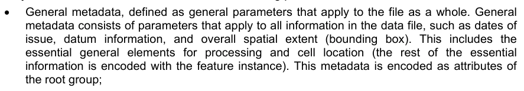

一般元数据,被定义为适用于整个文件的一般参数. 一般元数据的构成包括适用于数据文件中所有信息的参数,如发件日期,数据信息,以及总体空间范围(边界框)等,这包括处理和单元格位置的基本一般要素(其余基本信息被编码为要素实例). 此元数据被编码为

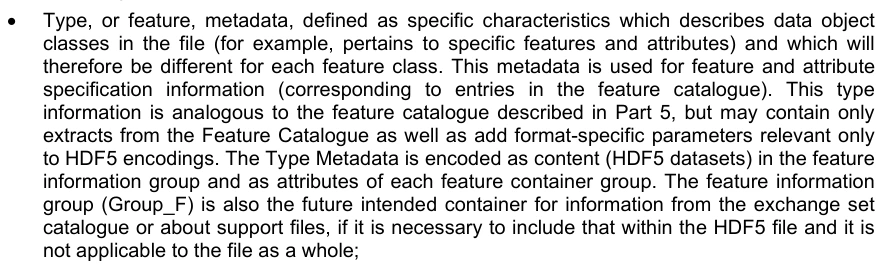

类型,或要素,元数据,被定义为描述文件中数据对象类别(例如,涉及特定要素和属性)的具体要素,因此每个要素类别将有所不同. 此元数据用于要素和要素规格信息(对应要素目录中的条目). 这种类型信息类似于第5部分所描述的要素目录,但可能只包含从要素目录中提取的内容,并添加仅与HDF5编码相关的格式特有参数. Type M元数据被编码为要素信息组中的内容(HDf5数据集),并作为每个要素容器组的属性. 特性信息组(Group_F)也是今后拟从交换集目录或关于辅助文件的信息的容器,如果有必要将这种信息纳入HDF5文件,而且不适用于整个文件;

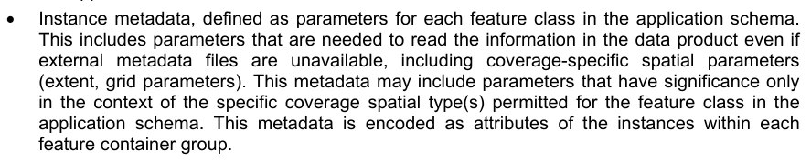

实例元数据,定义为应用程序图中每个要素类的参数,这包括即使没有外部元数据文件,也读取数据产品中的信息所需的参数,包括覆盖特定空间参数(扩展,网格参数). 元数据可能包括仅在应用程序图中允许的要素类特定覆盖空间类型背景下才具有意义的参数。

描述数据的其他信息包含在值组中,作为适用于每个值组中的值数据集的属性。数据可以是时间点或站点信息,例如:

## 官方 PDF 第 541 页

站名;以及时间序列特征,如时间间隔,值数和起止时间等.

10c-9.2.3 扩展元数据

产品规范中定义的扩展元数据元素被编码为:

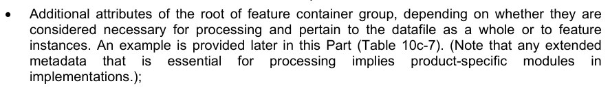

特性容器组根的其他属性,取决于是否认为处理必要,是否与数据文件整体有关,或与要素实例有关。本部分下文提供了一个例子(表10c-7)。 (注意任何扩展)

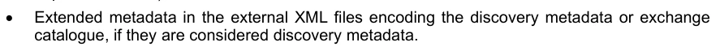

在外部XML文件中扩展元数据编码发现元数据或交换目录,如果它们被认为是发现元数据的话.

数据产品也可能定义矢量要素元数据;例如,具有矢量几何特性的质量元元要素. 矢量特性不是在HDF5文件中编码,而是在一个符合S-100 Part 10a或Part 活性元要素的单独文件中编码. 如果存在矢量元要素,必须通过在元要素中命名文件而将一个引用到单独的文件中去(见 第10c-9.4条).

10c-9.3 坐标和数据的一般尺寸和储存

本节概述S-100 HDF5数据集中代表定位信息和存储数据的一般方法,基本方法是将用于存储数据记录的数据结构的种类减少到最低限度。

1)一个与网格形状完全对应的多维数据阵列,其级别和维度都仅用于正格网格,为了减少空间需要,网格点的坐标没有被明确存储,因为可以从网格参数计算出;2)1维数据和网格坐标阵列并附有描述网格外形的元信息. 这也用于多点数据(在没有实际网格的情况下).

结构核心的关键思想是: 数据组织在逻辑上对每一种类型数据都是一样的,但信息本身会根据空间代表类型的不同而有不同的解释,这由元数据属性数据CodingFormat(由表10c-10和条款10c-4)所表示.

对于正格数据,定位信息不以明确坐标的形式被存储,因为格元数据(扩展和格格的单元格间隔信息)足以指定每个格点的坐标. 例如,对于2-D格子,值阵列为二维,其尺寸由属性numPointsLongitudinal和numpoints Latitunal所指定. 通过了解网格来源和网格间隔,可以使用简单的公式来计算网格中每个点的位置.

仅对非正常网格数据,则有额外的定位信息。定位信息的性质取决于数据类型:

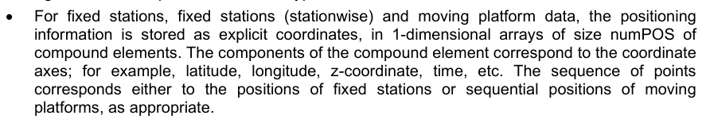

对于固定站台,固定站(站)和移动站台数据,定位信息作为明确坐标存储,以复合元素大小的一维数组为单位,复合元素的组件与坐标轴相对应;例如:纬度,经度,z坐标等. 分数的顺序与固定站位或移动的相继位置相对应

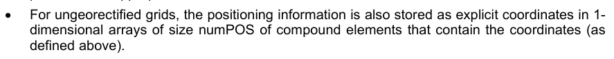

对于未变质的网格,定位信息也作为明确坐标被存储在包含坐标的复合元素的大小为一维数组中(如:

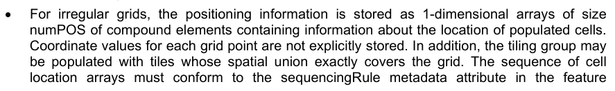

对于不规则的网格,定位信息作为包含有人口聚集细胞位置信息的复合元素的大小的一维数组被存储. 每个网格点的坐标值没有被明确存储. 此外,平板组可能包含空间结合完全覆盖了网格的瓦片. 单元格位置数组的顺序必须符合特性中的顺序规则元数据属性

## 官方 PDF 第 542 页

容器组(clause 10c-9.6) , 可以通过产品规范来添加一个可选的平板索引组件( 输入平板阵列的索引 — 见第10c至9. 7条) 。 如果使用, 平板指数组件必须被命名为“ 平面Index ” , 而必须是“ 整形” 数据类型。 这个格式是针对基于相通矩形的网格。

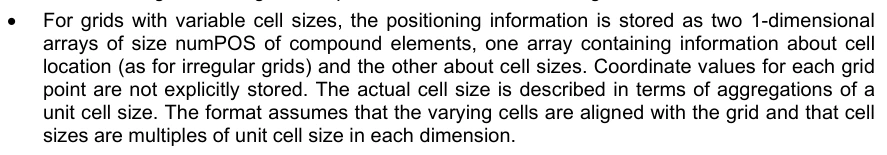

对于可变单元格大小的格子,定位信息被存储为复合元素大小的一维数组,一个阵列包含关于单元格位置的信息(如不规则格子),另一个包含关于细胞大小的信息. 每个格子点的坐标值没有被明确存储,实际的单元格大小以单位单元格大小相聚合来描述. 格式假设不同的单元格与网格一致,且每个维的单元格大小是单位单元格大小的倍数.

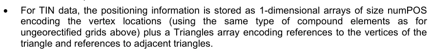

对于TIN数据,定位信息作为大小的一维数组数组被存储在为顶点位置编码(使用与上面未被地心测量的网格相同的复合元素)外再加三角数组编码指三角的顶点和相邻三角的参考.

对于不规则的格和可变的单元格大小,描述单元格位置和大小的辅助阵列被存储在"值"组而不是定位组中(这允许在可变单元格大小格式的不同时点对单元格进行不同的聚合). 数据与坐标值的存储汇总于下表. ("D"是覆盖的维数. )

HDF数据集存储坐标和值的设计,目的是使用不同覆盖类型的统一数据存储结构并减少数据总量,这些标准导致将一些覆盖类型所需的额外信息分别存储(例如,不规则和可变单元格大小网格的单元格位置和大小信息等).

表10c-3 - 坐标和数据值储存战略摘要

覆盖类型 坐标值

普通网格未从元数据中明确存储

D-维值阵列

不规范的网格未从元数据中明确存储

1-d 值阵列 Tuples + 单元格位置信息

可变单元格大小网格未明确存储从元数据计算

1-d 值阵列 Tuples + 单元格大小和位置信息

固定站台 固定站台(站台),未接地网,移动站台

1-d 坐标图案 1-d 值图案

TIN 1-d 串联坐标图 + 三角信息

1-d 个值阵列

数据组是包含数据值的单独组,它们存储在与定位信息相对应的阵列中. 对于定位信息没有明确存储的覆盖类型(N维正则格),数据存储在对应网格维度的N维分级阵列上(例如,对于2-D数据,由numCOLS来表示大小为numROWS的2-D阵列).

对于时间序列数据,有多个数据组存在,数据组的总数为numGRP. NumGrP对每种空间代表的意义在下表10c-4中给出,格式允许所有代表的时间序列数据.

坐标系统中有2个以上坐标轴的位置,使用相应的更多维度进行编码. 例如,对于三维数据,垂直维度作为第三个维度.

## 官方 PDF 第 543 页

为了处理效率,本剖面图建议将尺寸限制在不超过4个(空间和时间),但如果数据产品需要的话,可以使用更高的维度。决定数组大小的变量(nummROWS, nummCOLS, numPOS, 和 numGRP)是不同的,取决于使用哪种编码格式。它们载于表10c-4。

表10c-4-不同类型覆盖的阵列尺寸

编码格式

数据类型定位数据值

numpos nummCOLS nummROWS nummZ (只有3-d) 数字

```text
numGRP
```

1个固定站台编号 1个站台编号 1个站台编号 1个站台编号 1个站台编号

2 常规网格( 未使用) numPoints 长相图定式 numpoints 语言学 nummpoints

3 未经加密的网格

编号 编号 编号 编号 编号 编号 编号 编号 编号

4 移动平台

时间数 1 时间数 1

5 非正常网格编号 Off Nodes 1 编号 Off Nodes 1 编号 Off Times

6 可变单元格大小

编号 编号 编号 编号 编号 编号 编号 编号 编号

7 TIN 编号 Of Nodes 1 编号 Off Nodes 1 编号 Off Times

8个固定站台(分层).

次数 次数 次数 次数

9 面向要素的正网格

(未使用) numpoints 长相图取出 numpointsLatitunal 1 number OfTimes

注意: nummROWS, numCOLS, numZ, 和 numpOS 等没有在 HDF5 文件内明确编码。 此规格只用于表示数组维度, 用于执行目的。 编码为要素实例属性的站点、 节点、点等数目( 声明 10c- 9. 7)。

每个数据组的名称从字符"Group_nnn"开始,n的编号从1到numGRP. 最多允许999个数据组,数据组名称的长度为9个.

对于所有数据类型,HDF5中的逻辑产品结构由(a)元数据块组成,后是(b)要素信息组,再是(c)一个或多个数据容器组,每个组包含一个或多个要素实例组,而它们又包含第10c-9.1条所述的地标,索引,定位和数据组. 需要根据数据的类型,有条件地设置平板、索引和定位组,其特征是指定编码格式的HDF5属性。

文件的物理布局可能与其逻辑数据结构不同,但HDF5 API允许执行者使用逻辑数据结构来访问信息.

以下各节描述每组的内容和属性.

10c-9.4 根组

根组作为其他组的容器,载体元数据(表10c-6)作为属性包含在根组中,载体元数据由数据和参数(a)组成.

## 官方 PDF 第 544 页

需要阅读和解释产品中的信息,即使没有外部元数据文件,而且大多数情况下(b)不在元数据的其他部分。

## 官方 PDF 第 545 页

表10c-5 - 根组

HDF5 组

类别

名称 数据类型 数据空间/ 备注

/(根)属性

(Carrier元数据属性)整数、浮出、计数或字符串

(无)表10c-6说明

Group_F 特性信息组(见 第10c-9.6条)

```text
Group(s)
```

(featureCode) 特性容器组 – 数据产品中每个特性类型各一组,名称为特性代码,以 Group_F 为单位。 结构和属性参见第10c- 9.6条

HDF5 类

名称

组(要素代码). N要素实例组(setature example group) - 每个要素实例各一个,结构和属性见第10c-9.7节

HDF5 类

名称

组( 可选)

Group_TL 平铺信息,只限产品使用平铺。见第10c-9.8节。

组( 可选)

Group_IDX 空间指数信息,只有当产品使用空间指数时才使用. 见 第10c-9.9节.

组定位定位信息 — 2D 或 3D. 数据编码格式=2(正则网格)和数据编码格式=9(面向常则网格)不需要 参见 第10c-9.10节

Group_NNN Static Data – 只有 1 个值组 Time序列数据 – 000至999个组 参见 第10c-9.11节 常见(核心)元数据元素被指定为根组的属性,如表10c-6所列出. 根组只包含第4a和4b部分所指定的最小元数据要素的一个子集. 外部 XML元数据文件需要包含所有强制元数据内容.

## 官方 PDF 第 546 页

表 10c-6 — 根组内嵌元数据（载体元数据）

译注：各项依次列出：名称、原始字段名、多重性、数据类型，以及备注或单位。0..1 表示可选且最多出现一次；1 表示出现一次。条件为真时标记为“必须”的字段，应按相应条件提供。

1．产品规范编号及版本
productSpecification ｜ 1 ｜ String（字符串）
示例：INT.IHO.S-NNN.X.X，其中 X 表示版本号。“NNN”和“X”不限定字符长度。该值对应 S100_ProductSpecification 中 productIdentifier 与 version 两个字段的组合。原文示例带脚注 2。

2．数据产品发行时间
issueTime ｜ 0..1 ｜ String（时间格式字符串）
必须与发现元数据中的 issueTime 一致。

3．发行日期
issueDate ｜ 1 ｜ String（日期格式字符串）
必须与发现元数据中的 issueDate 一致。

4．水平坐标参考系
horizontalCRS ｜ 1 ｜ Integer（整数）
使用 EPSG 代码；若为用户自定义，则取 -1。

5．水平坐标参考系名称
nameOfHorizontalCRS ｜ 0..1 ｜ String（字符串）
当 horizontalCRS = -1 时必须提供。

6．水平坐标参考系类型
typeOfHorizontalCRS ｜ 0..1 ｜ Enumeration（枚举）
当 horizontalCRS = -1 时必须提供。见表 10c-21。

7．水平坐标系统
horizontalCS ｜ 0..1 ｜ Integer（整数）
当 horizontalCRS = -1 时必须提供。
当 typeOfHorizontalCRS = 1（二维大地坐标参考系）时，允许值为 6422（纬度、经度，单位为度）。
当 typeOfHorizontalCRS = 2（投影坐标参考系）时，允许值为 4400（东坐标、北坐标，单位为米）或 4500（北坐标、东坐标，单位为米）。

8．水平基准
horizontalDatum ｜ 0..1 ｜ Integer（整数）
当 horizontalCRS = -1 时必须提供。使用 EPSG 代码；若为用户自定义，则取 -1。

9．水平基准名称
nameOfHorizontalDatum ｜ 0..1 ｜ String（字符串）
当 horizontalDatum = -1 时必须提供。

10．本初子午线
primeMeridian ｜ 0..1 ｜ Integer（整数）
当 horizontalDatum = -1 时必须提供；采用 EPSG 代码。

11．参考椭球
spheroid ｜ 0..1 ｜ Integer（整数）
当 horizontalDatum = -1 时必须提供；采用 EPSG 代码。

12．投影方法
projectionMethod ｜ 0..1 ｜ Integer（整数）
当 typeOfHorizontalCRS = 2 时必须提供；采用 EPSG 代码，见表 10c-24。

13．投影参数 1
projectionParameter1 ｜ 0..1 ｜ Float（浮点数）
仅在使用 projectionMethod 时提供。见表 10c-24。

14．投影参数 2
projectionParameter2 ｜ 0..1 ｜ Float（浮点数）
仅在使用 projectionMethod 时提供。见表 10c-24。

15．投影参数 3
projectionParameter3 ｜ 0..1 ｜ Float（浮点数）
仅在使用 projectionMethod 时提供。见表 10c-24。

16．投影参数 4
projectionParameter4 ｜ 0..1 ｜ Float（浮点数）
仅在使用 projectionMethod 时提供。见表 10c-24。

脚注 2：待适用于所有 S-100 产品的通用格式最终确定后，将使用该通用格式替换本示例。

## 官方 PDF 第 547 页

17 投影参数5 投影参数5 Paremeter5 0.1 浮点数只使用投影方法。

18 虚向北假向北:0.1 浮点数只使用投影方法,将应用到轴向北的坐标。 [m]

19 虚向东假向东. 1. 只有在使用投影方法的情况下,方能浮出水面,用于轴向东行的坐标。 [m]

20 Epoch of reformation Epoch 0.1 弦码表示CRS使用的大地基准时代;例如,G1762表示2013-10-16实现WGS84的大地基准

21a 西边边框 1 Float Ref. Data Coverage. BroundingBox > EQQGraphic BroundingBox

绑定框的每个组件被编码为一个单独的属性

数据的最小/最大纬度和经度以地理中央遥感系统为基础,该数据使用与可能预测的数据集所用的中央遥感系统相同的水平基准。

单位必须是学位.

21b 东经一平方

21c 南纬1度

21d 北纬1度

22 资源的地理位置(按说明)

地理学标识符 0.1 字符串 EQXX外接 > EQXGraphicDescription.geographicIdentifer > MD_标识符.code.

23个元数据元数据 0.1 String MD_Metadata.filesIDenter

XML 元数据文件名称(声明 10c-12).

参考文件S-100 第8编

如果描述此数据集的ISO XML 元文件包含在交换集中,则必须存在并被覆盖;否则必须省略.

24 垂直坐标系统 垂直CS 0.1 整数 EPSG 代码; 允许值

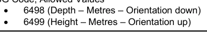

25 垂直坐标基垂直坐标Base 5.1 编号见表10c-22

26 垂直基准参考 垂直基准参考 0.1 只有在垂直坐标Base=2 时才进行编号

见表10c-23

27 垂直基准垂直数据为0.1 整数,只有垂直坐标Base=2

如果垂直数据参考= 1, 则此值来自 S100_ VerticalAndSounding Datum

如果垂直数据参考 = 2, 这是垂直数据的 EPSG 代码

28 Meta 特性 metaFeatures 0.1 字符串名称 8211 或 GML 文件包含 meta-features

GML 文件必须有扩展名.GML或.gml;ISO 8211文件必须有扩展名.NNN,其中N为任何数字

## 官方 PDF 第 548 页

说明:

1) 如果CRS是用户定义的,则只支持以下坐标系统:大地测量CS(纬度,经度)-度;和笛卡尔CS(北接,东接或东接,北接)-米特斯.

2) 对于水平 Datum,所有EPSG预定义的Datum都是允许的,或者任何被预定义的Prime Meridians或预定义的类固醇的组合.

(3) 预测方法仅限于表10c-24所列方法。

4) 如果水平的CRS由EPSG代码所定义,定义的CRS不应使用除用户定义的CRS允许的元素以外的任何其他元素; (例如,表中没有没有的预测方法.

5) 边框是数据集边框;覆盖数据要素实例可能或可能不覆盖整个边框。如果只有一个覆盖要素,那么其范围可能或不会与数据集相同。

6)核心属性对应S100_Dataset DiscoveryMetadata(第4a部分)中的元数据属性,或第八部分中的图像/被网格/被覆盖的数据属性. 函文在备注栏中给出.

7) 垂直数据是可选的,因为它不适用于某些数据产品中使用的某些类型的深度参考;例如:表面电流。

产品规范需要额外的元数据属性可能包括它们作为附加属性,定义在产品规范中。附加属性必须与表10c-6相同 — — 具体来说,它们必须有一个从小写字母开始的骆驼案名,多写为0.1(可选)或1(强制性),并且是表10克-1所列出的允许类型之一。 此外,还可以为核心载体元数据属性添加限制或附加条件. 普通载体的元数据特征的数据类型不能被改变,但允许的值范围可以受到限制,也可以被强制或有条件的强制规定可选属性.

EXAMPLE: 下表显示产品规范如何定义一个附加属性(Vertical reference),引入一个核心元数据属性(Vertic datum refersion)的有条件测试,并强制规定一个可选的元数据特性(数据产品问题的时间).

表10c-7 - 扩展元数据属性实例和核心元数据属性附加条件

无名称骆驼案泥数据类型备注和/或单位

附加载体元数据

11 垂直参考深度 TypeIndex 1 第1层 第1层 第1层 第2层 第3层 第3层 第3层 第3层 第4个垂直基准(见垂直数据) 第4个海底

对核心载体元数据的其他限制或条件

2 数据产品发行时间 时间 1 字符串(时间格式)

9 垂直基准参考 垂直基准 0.1 需要编号,如果并且只有深度为 TypeIndex = 3

## 官方 PDF 第 549 页

产品规范如何描述核心和扩展元数据属性留给规格写作人,但规格应该区分核心属性和扩展属性,并明确显示对核心属性的任何额外限制或条件. 可使用ISO格式来指定元数据扩展(第4a部分条款4a-5.7.5).

10c-9.5 专题信息组

要素信息组包含要素类及其属性的规格,要素信息组的构成部分如下表所描述.

表10c-8 - 要素信息组的组成部分

HDF5类

名称 数据类型或 HDF 分类

数据空间

/Group_F Dataset 特性 Code String (可变长度) 阵列 (1-d): i=0, F-1 数值 = 特性类的代码(F是应用程序 schema 中的特性类的数目.

数据集(专题信息数据集 -- -- 功能代码阵列中每个功能的数据集)

```text
<featureCode>
For example:
SurfaceCurrent,
WaterLevel
```

复合物阵列(String X 8)

阵列 (1-d):i=0,NAF-1(NAF=由"要素Code"命名的要素属性数). 化合物类型:代码:骆驼 case code 属性代码 如要素目录名称:长名 如要素分类目录 uom.name:单位(uom>name from S-100 要素目录) 填瓦:填值(整数或浮值,字符串表示) 数据类型:HDF5 数据类别,由 H5Tget_class ()函数返回 下: 属性值上方下方受约束:属性值关闭上方受上方约束:关闭类型 “编码”和“数据类型”的组件编码了第8部分“低等”、“上等”和 “关闭”中涵盖特性属性的属性,编码了要素目录中编码的对属性值的任何限制(见第5部分“S-100_FC_SimpleAttizt> contracts”和第1部分“N100_Nummeric Range”)

注释:

1) 土地掩体或未知值由属性的填入值来表示.

## 官方 PDF 第 550 页

本页特意留空

## 官方 PDF 第 551 页

特性描述数据集中的所有数值都是数字值的字符串表示;例如,“-9999.0”不是浮取值-999.0。应用程序要分析字符串以获得数字值。不适用的条目用无效值或空取(0长)字符串来表示。

HDF5 数据文件中使用的每个特性类型都需要一个 Group_F 条目。 这意味着 :

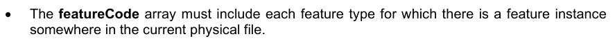

特性Code阵列必须包含当前物理文件中某个地方有特性实例的每个特性类型.

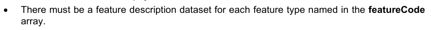

在特性代码中命名的每个特性类型必须有一个要素描述数据集

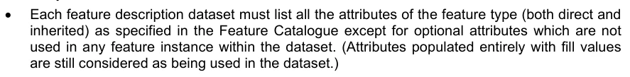

每个要素描述数据集必须列出要素类型(直接和继承)的所有属性,除了数据集内任何要素实例中都没有使用的可选属性。 (完全由填充值组成的属性仍然被视为数据集中所使用的属性。 )

请注意,上述要求并未授权在Group_F中输入XML要素目录所定义但当前数据文件中没有实例的要素类型。

同样,要素描述数据集必须省略该要素任何情况下根本不存在的属性(甚至不包含填充值);反之亦然,要素实例也不得包含其要素描述数据集中未列出的属性,即使它们完全被填充数值所覆盖. 每个要素类型(表10c-8中的NAF)的属性数量没有明确规定,但可以使用HDF5 API来确定每个要素描述数据集中的行数.

下图描绘了Group_F对一个假设产品,具有SurfaceCurrent和Water Level两种特性类型. 这两个特性在数据集功能代码中被命名(使用从要素目录中得出的骆驼案例代码). SurfenceCurrent和Watry Level描述每个要素类型属性. 要素描述数据集与要素描述数据组中的值相同,这些值是从XML要素目录中获取的要素的骆驼案例代码. 每个要素描述数据的数据集都是一组复合类型元素,其组件为表10c-8所指定的8个组件.

## 官方 PDF 第 552 页

图10c-8 – Group_F实例

10c-9.6 特性容器组

特性容器组包含一个特性类所有实例的坐标和值。每个特性实例都分配到特性容器类内自己的组。这个组织允许将全类属性附在整个类别上,并将特定实例属性附入适当的特性实例上。

注:决定为每个要素实例建立不同的组系,是基于在某些情况下会有一个单一实例的多组数据集(例如索引、TIN等),将所有数据集直接置于容器组下,可能至少从人的角度给数据组织带来混乱(虽然后缀可能足以区分不同实例)。 编程目的).

特性容器组的结构如下表10c-9所示,该表还显示特性实例组。轴名见特性容器一级的数据集。

特性类所有实例(如维度)中常见的元数据在特性容器级别被编码,这些元数据元素列于表10c-10. 特性实例中特有的元数据(如网格参数)被编码到实例级别,这些元素被列于表 10c-12.

产品规范可能增加产品特有的元数据属性. 附加元数据元素的准则与根组中附加元数据元素(clause 10c-9.4)相同.

## 官方 PDF 第 553 页

表10c-9 特色容器组的结构

HDF5类

名称 数据类型 备注 / 数据空间

/(地貌代码)

参见表10c-10(见表) 表10c-10中描述的单值属性

数据集轴名字符串阵列(1-D):以D为维数属性的值的 0.D-1 轴应处于主小顺序;即如果存储按行大顺序排列,则X/经轴应位于第一

数据集( 可选)

坐标整数阵列(1-D):在D为维度属性值的地方,0.D-1。 坐标编码的大小为字节。 允许的值为 1、 2、 4或 8。 如果此数据集不出现, 坐标必须使用64位( 8位) 来编码浮点坐标, 32位( 4位) 为整数坐标

数据集( 可选)

插入参数的浮点阵(1-D),只有在属性插入值为 " 二等分尺 " 或 " 二等分尺 " 时才需要。

数据集( 可选)

特性 属性表 化合物 矩阵 (1-D) 以索引为基础的特性属性(clause 10c-9.6.2.) 必需的属性数据值为 9 时,且只有在该属性数据 CodingFormat 值为 9 时

组

/(要素代码).N 容器,每个特性类型。按顺序从 1 到 numInstances(表10c- 10) 编号。必须使用以 0 为主的零相接的平面,使 " N " 后缀都相同。要适应扩展,建议增加一个零相通:

(1) “不确定性”是指数据值的不确定性,位置不确定性(横向和纵向)分别编码。

2) 应在产品规范中提供插值Paremeters数据集的长度和参数顺序.

## 官方 PDF 第 554 页

表10c-10 - 特性容器组的属性

无名称骆驼案泥数据类型备注和/或单位

数据组织指数数据 编码格式1 数字表示此特性的覆盖类型。过去读取数据(见表10c-4)

1:固定站点的时间序列2:正线网格阵列3:未地心网格网格数阵列4:移动站台5:不正线格6:可变电池大小7:TIN 8:固定所点的时间系列(站点方向) 9:面向地心的正线克格.

维度 1 整数 要素实例的维度

这是坐标轴的数量,而不是存储坐标或值的HDF5阵列的级别。例如,具有纬度和经度位置的固定站台数据集将具有维度=2。

通用点规则 第1条 编号 用于评估位于边界上的位置或几何物体之间重叠区域覆盖范围的程序

CV_CommonPoint Rules(第8部分,表8-11)的值

水平位置不确定性 水平位置不确定性 水平坐标的不确定性 水平坐标的不确定性 水平坐标的不确定性 水平坐标的不确定性

例如,-1.0(未知/不适用)或正值(m)

垂直坐标的不确定性。

例如,-1.0(未知/不适用)或正值(m)

时间不确定性 时间值的不确定性 0.1 浮动 时间值的不确定性

例如,-1.0(未知/不适用)或正值(s)

仅用于时间序列数据

要素实例数 : 1

(同一时序或移动平台序列的记录被计算为单个实例,而不是单独实例).

(额外共同属性)(按产品规范规定)

```text
dataCodingFormat = 1
```

(无)

```text
dataCodingFormat = 2
```

顺序规则排序规则. type 1 用于将值序列中的值分配到网格的编号方法

## 官方 PDF 第 555 页

顺序规则.scanDirection 1 字符串坐标

输入和扫描方向作为单独的属性编码

类型: 编号 CV_顺序Type(第8部分,表8-13)

扫描方向: 字符串 < 轴名条目 > (comma- speparated) 。 例如, “ 纬度、 经度 ” 。 沿轴向反向扫描方向通过在轴名上添加“ -” 符号来表示 。

内插类型 内插 第1编 建议用于评价S100_地道的内插方法

数值:S100_CV-刑警组织方法(第8部分,表8-13)

单元格数据中数据点的偏移 OffsetCode 0.1 编号 参见第10c-9.6.1条.

1: XMin, YMin ("左下") 角 ("Cell frome") 2: XMax, YMax ("上右") 角 3: XMax, YMin ("下右") 角 4: XMin, YMax ("上左") 角 5: Barycenter (centroid) of cell.

将单元格中的数据点作为矢量数据OffsetVector 0.1 Float Array (1-D) 0.D-1 , 其中D是维度属性的值

值必须是在 [0, 1] 范围内的真实数字

见第10c-9.6.1条。

```text
dataCodingFormat = 3
```

内插类型 内插 第1编 建议用于评价S100_地道的内插方法

数值:S100_CV-刑警组织方法(第8部分,表8-13)

```text
dataCodingFormat = 4
```

(无)

```text
dataCodingFormat = 5
```

顺序规则排序 Rule.type 1 用于将值序列中的值分配到网格坐标的编号方法

输入和扫描方向作为单独的属性编码

类型: 编号 CV_顺序Type(第8部分,表8-12)

扫描方向: 字符串 < 轴名条目 > (comma- speparated) 。 例如, “ 纬度、 经度 ” 。 沿轴向反向扫描方向通过在轴名上添加“ -” 符号来表示 。

```text
sequencingRule.scanDirection
1
String
```

内插类型 内插 第1编 建议用于评价S100_地道的内插方法

数值:S100_CV-刑警组织方法(第8部分,表8-13)

## 官方 PDF 第 556 页

单元格数据中数据点的偏移 OffsetCode 0.1 编号 参见第10c-9.6.1条.

1: XMIN, YMIN ("左下") 角 ("Cell frome") 2: XMax, YMax ("上"右上") 角 3: XMax, YMin ("右下") 角 4: XMIN, YMax ("左上") 角

5:细胞中心(中心机器人)

将单元格中的数据点作为矢量数据OffsetVector 0.1 Float Array (1-D) 0.D-1 , 其中D是维度属性的值

值必须是在 [0, 1] 范围内的真实数字

见第10c-9.6.1条。

```text
dataCodingFormat = 6
```

顺序规则排序 Rule.type 1 用于将值序列中的值分配到网格坐标的编号方法

输入和扫描方向作为单独的属性编码

类型: 编号 CV_顺序Type(第8部分,表8-12)

扫描方向: 字符串 < 轴名条目 > (comma- speparated) 。 例如, “ 纬度、 经度 ” 。 沿轴向反向扫描方向通过在轴名上添加“ -” 符号来表示 。

```text
sequencingRule.scanDirection
1
String
```

内插类型 内插 第1编 建议用于评价S100_地道的内插方法

数值:S100_CV-刑警组织方法(第8部分,表8-13)

单元格数据中数据点的偏移 OffsetCode 0.1 编号 参见第10c-9.6.1条.

1: XMin, YMin ("左下") 角 ("Cell frome") 2: XMax, YMax ("上右") 角 3: XMax, YMin ("下右") 角 4: XMin, YMax ("上左") 角 5: Barycenter (centroid) of cell.

将单元格中的数据点作为矢量数据OffsetVector 0.1 Float Array (1-D) 0.D-1 , 其中D是维度属性的值

值必须是在 [0, 1] 范围内的真实数字

见第10c-9.6.1条。

```text
dataCodingFormat = 7
```

内插类型 内插 第1编 建议用于评价S100_地道的内插方法

数值:S100_CV-刑警组织方法(第8部分,表8-13)

```text
dataCodingFormat = 8
```

(无)

```text
dataCodingFormat = 9
```

## 官方 PDF 第 557 页

单元格数据中数据点的偏移 OffsetCode 0.1 编号 参见第10c-9.6.1条.

1: XMin, YMin ("左下") 角 ("Cell frome") 2: XMax, YMax ("上右") 角 3: XMax, YMin ("下右") 角 4: XMin, YMax ("上左") 角 5: Barycenter (centroid) of cell.

将单元格中的数据点作为矢量数据OffsetVector 0.1 Float Array (1-D) 0.D-1 , 其中D是维度属性的值

值必须是在 [0, 1] 范围内的真实数字

见第10c-9.6.1条。

```text
Sequencing rule
sequencingRule.type
```

```text
sequencingRule.scanDirection
```

```text
1
```

```text
1
```

枚举

字符串

用于将值序列中的值指定为网格坐标的方法

输入和扫描方向作为单独的属性编码

类型: 编号 CV_顺序Type(第8部分,表8-12)

扫描方向: 字符串 < 轴名条目 > (comma- speparated) 。 例如, “ 纬度、 经度 ” 。 沿轴向反向扫描方向通过在轴名上添加“ -” 符号来表示 。

```text
(any dataCodingFormat value)
```

(附加属性)(按产品规范规定)

10c-9.6.1 单元格内数据点的位置

产品规范可能要求其数据产品显示与单元格角相对应的网格单元格的数据点的相对位置,可以使用数据OffsetCode或数据OfsetVector属性来表示该位置,这些属性只能使用网格覆盖,而不能使用时间序列,TIN,或移动平台数据. 产品规范可能使用数据OffsetCode或数据OffsetVector,但两者不同时使用.

数据点位于(XMin,YMin)网点的产品规范不需要使用数据OffsetCode或数据OffsetVector.

属性数据OffsetCode只能使用二维格,它表示数据点是四个单元格角之一还是单元格的中心。请注意,显示角的编码的定义是相对于网格源头的X和Y格坐标。 (这意味着,在以自东向西和自北向南的Y轴为轴线的电网中,“左下”角与以自西向东和自南向北的Y相接的电克中以“左后”角不同。 )

属性数据OffsetVector用于高分量网格或数据点位置不在单元格的一个角落或中心时。该阵列中的数值表示数据点每个轴沿其网格坐标最接近网格源的网格点的相对相抵。 在二维格中, 这将是一个最小的 X 和 Y 格坐标点。 同样, 必须指出, 轴的方向和网格来源的位置决定了哪个角是单元格来源。 每个相抵相对的是单元格的大小沿着相应的轴。 数据OffsetVector中的值顺序必须与轴名数组中的轴顺序相匹配(表10c-9)。

关于TIN覆盖,数据点位于TIN的顶点. 见S-100 第8部分 第8-7.4条.

## 官方 PDF 第 558 页

10c-9.6.2 要素属性表

此元素是带有"featureAttizibility Table"名称的可选记录. 该元素仅在特性容器组中使用,如果数据CodingFormat = 9 (Featural frant Grid) 。在所有其他情况下,元素都不得使用。“fetature Atttition Table”元素只能与“data value group(s)”的“值”-记录结合使用。

"地物属性表"元素对应一个复合数据集的HDF5数据类型为一维阵列,它总是由一固定列组成,并取名"地物特征表基"和任何多列.

```text
Column featureAttributeTableKey
```

“ 属性表基” 栏中总是包含未签名整数数据类型的一对一值。 数值总是大于0 (>0), 因为数值为0 (0) 被指定为无数据值。 这些值不必与任何特定顺序对应, 可以随机选择, 这样就可以使用外部数据源的识别值, 例如数据库 。 列"要素属性表基"始终包含出自"地要素要素实例组"数据值组"的"值-记录"的值. 该值充当了要素光栅几何及其在"地相属性表"中的描述性数据的链接. "地平面分配表基"一对一的值可能从光栅图像的像素中冗余地出现,但必须始终精确地描述出一个要素几何. 光栅图象中冗多的效果可以通过HFD5数据集内的压缩而被大幅降低.

其他栏

附加列的数量取决于要运输的信息. 数字必须始终大于0 (>0). 表10c-8定义了"特有容器组"的名称必须始终对应"IHO地理空间信息(GI)登记""Feature Type"类型对象的骆驼Case名称,数据词典登记. 其他列的名称取自数据词典注册簿中选定要素类型的属性. 由于HDF5格式中属性的映射形式,只能使用简单的数据类型(参见第10c-7条),对于复杂数据类型的映射,需要用点来作相应的注解. 复杂数据类型的相邻水平通过一个点到简单的数据类型相隔;例如"SurveyDate Range.date End"和"SurveyDate Range.dateStart"等.

10c-9.7 要素实例组

要素实例组包含在要素容器组中。要素实例分组的结构定义于表10c-11。每个要素实例特有的属性定义于下表(表10克-12),由不同情况的信息组成,如范围、位置、时间和网格大小等在同一数据集中可能有所不同。

## 官方 PDF 第 559 页

表10c-11 - 要素实例组的结构

HDF5类

名称 数据类型 备注 / 数据空间

/(地貌代码).N 例如: SurfaceCurrent.01

参见表10c-12 (见表) 表10c-12中描述的单一值属性

数据集( 可选)

域名Extent.polygon 化合物(浮点、浮点)

覆盖范围域的空间范围(1-d):i=0, 组件: < 纬度、纬度> 或 QQ、Y > (作为封闭环的多边形顶点的坐标;即第一和第二个元素将包含相同的值) 要么必须包含此属性,要么必须覆盖边框属性。对于不规则的数组,此数据集必须指定多边形,以表示提供数据的区域。

数据集( 可选)

域外垂直元素化合物(整数 X 2,浮点 X 2)

化合物元素的阵列(1-d) 提供网格位置和最大,最小垂直范围的位置 化合物类型的组件有:格克X,格克Y:整数(沿X/经度和Y/纬度轴的网格点数) 最小值,最大值(浮取):格克x和格克E指定的网点上最小和最大值为Z,仅适用于3-D格. 此数据集或垂直外向属性( 表10c- 12) 必须包含在三维网格中

数据集( 可选)

化合物(整数X D)

1-D 矩阵, 复合元素, 2行。 第0行给出“ 低” 值, 第1行给出 “ 高” 数值 。 提供了数据的网格区域 。 (第8部分图8-24) 复合类型的组成部分根据轴名数据集中的轴名命名。

数据集( 可选)

不确定性复合物( String, Float)

矩阵(1-d):i = 0, (上) NAF 代码和数据值的不确定性 例如, ("地表切换", 0.1) 此特性类(NAF) 的属性数可以从 Group_F 中确定 。

## 官方 PDF 第 560 页

数据集( 可选)

细胞测量复合物(String, Float X 2,整数 X 1)

细胞几何. 长度与以上定义的轴名数组相同的矩阵(1-d)(这意味着如果存在,此数据集编码包括经纬度等在内的所有轴) 有条件,仅用于常规网格(数据编码Format=2或9),使用坐标参考系,其坐标参考系除(纬度、经度、垂直等)外,或超过3个维度 此数组用于扩展网格所编码的信息 表10c-12(使用高维格或非标准坐标轴的数据产品属性(来源,间隔,点数)定义的参数属性(由来,相距,点出数) 元件:轴Name:字符串(在上定义的轴名阵列中的一个条目) 克格:浮取 (轴名的出自轴名) 格:平取 (所命名轴的字符间隔) 个数:入取取取出取取. (沿命名轴的网格线数)

组( 可选)

/Group_TL平板信息。如果产品规范指定了平板,则需要有条件的。

组( 可选)

/Group_IDX 空间索引方法。有条件,如果产品规范指定了空间索引,则需要。

组( 可选)

/ 投放定位信息。 数据值的坐标 。 有条件, 如果数据编码格式不是 2 则需要( 规范格)

组/组_nnn 数据值组.

表10c-12 - 要素实例组的属性

无名称骆驼案泥数据类型备注和/或单位

方格的地理范围,作为方格框

参考域名Extent: EQQGraphicExtent > EQGraphic BroundingBox

无论是此数据还是域外数据集都必须被覆盖

界限必须全部是人口或全部省去

该单元必须符合数据集使用的CRS(例如,地理2D CRS EPSG 4326的学位;UTM预测的CRS EPSG 32710的学位)。

```text
eastBoundLongitude
0..1
Float
```

```text
southBoundLatitude
0..1
Float
```

```text
northBoundLatitude
0..1
Float
```

## 官方 PDF 第 561 页

时间记录数量 OfTimes 0.1 整数 时间记录总数

仅限时间序列数据。 对于数据 CodingFormat = 8, 此变量可能被值组属性中的相应变量所覆盖( 表10c-19)

时间间隔时间 记录 0. 1 整数 时间记录之间的间隔 。 单位:秒

仅限时间序列数据。 对于数据 CodingFormat = 8, 此变量可能被值组属性中的相应变量所覆盖( 表10c-19)

有效时间 Earlyest 值 日期 Time Of First Recordd 0.1 字符 最早时间记录的有效性时间 。 单位: DateTime

仅限时间序列数据

最新值的有效时间 日期 TimeOf Last Recordd 0. 1 字符 最新时间记录的有效性时间 。 单位: DateTime

仅限时间序列数据

三维网格的垂直范围

最小Z,最大Z: 沿垂直方向的网格空间范围最小和最大值。它们被编码为单独的属性 垂直Extent. maximZ 0. 1 Float

组数 numGRP 1 整数 此实例组中包含的数据值组数 。

(数据产品特有的额外属性).

(按产品规范的定义)

```text
dataCodingFormat = 1
```

固定站点数量 1 整数 固定站点数量

数据编码格式 = 2 或 9

网格源的经度; 网克源的纬度; 有线或有线。 单位必须符合数据集所用的CRS。 即, 对于地理数据集, 单位必须是度; 对于预测数据集,单位必须是米

网格来源地纬度; 网克来源地经纬度或北纬度。 单位必须符合数据集所用的CRS。 即, 地理数据集的单位必须是度; 而预测数据集的单元必须是米

垂直网格来源 gradeOriginVertical 0..1 垂直维度的网格来源,只用于三维网格. 由产品规范指定的单位

网格间隔,长. 网栅间隔 Longitudinal 1 在 X/ 纬度维度中浮点数的大小。 这是相向向量的 X/长相相相元件( S- 100 Part 8, 第 8-7.5条)。 单位必须符合用于数据集的 CRS 。 也就是说, 对于地理数据集, 单位必须是度; 对于预测数据集,单位必须是米 。

网格间隔, lat. gradSatingLatitunal 1 浮点数单元格大小, 以 Y/纬度维度表示。 这是相抵向量的 Y/ 纬度部分( S- 100 Part 8, 第 8-7.5条)。 单位必须符合用于数据集的 CRS 。 也就是说, 对于地理数据集, 单位必须是度; 对于预测数据集,单位必须是米

## 官方 PDF 第 562 页

网格间距, Z 网格间距Vertical 0. 1 垂直维度的浮格单元格大小。 仅针对 三维网格。 单位由产品规范指定

点数,长. numpints Longitudinal 1 整数 在 X/经度维度的网格点数. (iMax)

点数, lat. numPointsLatitunal 1 Y/纬度维度的整数网格点数。 (jMax)

点数, 垂直分数 Vertical 0. 1 垂直维度的整数格点数 。 (kMax)

启动序列 启动顺序 1 字符串格点坐标, 值序列中的第一个要指定。 启动序点的有效点的选择由序列规则决定 。 格式 : n, n... (网点的合并列表, 每个维度一个) - 例如 0, 0 )

```text
dataCodingFormat = 3
```

网格编号中的节点 Of Nodes 1 整数 网格点总数

```text
dataCodingFormat = 4
```

车站数量 1 整数总是1

数据编码格式=5或6

网格来源的经纬度 网格来源的经纬度 : Arc Desus

网格起源地纬度 网克起源地经度 克克克(Cr.)

垂直网格来源 gradeOriginVertical 0..1 垂直维度的网格来源,只用于三维网格. 由产品规范指定的单位

网格间距,长. 网格相距 Longitudinal 1 在 X/ 纬度维度中浮格的大小, 这是相抵向量的 X/ 纵向相分( S- 100 Part 8, 第 8-7.5条) 。 单位 : Arc Denters

对于可变的单元格大小网格,这是单位单元格大小(这个维度中最小的单元格大小)

网格间距, lat. gradSaring Latitudinal 1 在 Y/纬度维度中浮格的大小。 这是相向向的 Y/纬度组件( S- 100 Part 8, 第 8-7.5条) 。 单位: Arc Desus

对于可变单元格大小网格,这是单位单元格大小

网格间距, Z 网格间距Vertical 0. 1 垂直维度的浮格大小, 仅用于 三维网格。 由产品规范指定的单位。 对于可变的单元格大小网格, 这是单位单元格大小 。

网格编号中的节点 Of Nodes 1 整数 网格点总数

启动序列 开始序列 1 字符串格点坐标, 值序列中的第一个要指定。 起始序列的有效点的选择由序列规则决定 。 格式 : n, n... (网点的合并分隔列表, 每个维度一个, 例如 0, 0)

```text
dataCodingFormat = 7
```

## 官方 PDF 第 563 页

网格编号中的节点 Of Nodes 1 整数 网格点总数

三角形,网格号OfTriangles 1 整数 TIN 中三角形的总数

```text
dataCodingFormat = 8
```

固定站点数量 1 整数 固定站点数量

```text
(any dataCodingFormat value)
```

(附加属性)(按产品规范规定)

说明:

1)常规和可变的细胞大小网格的特定类型属性相同,只是给出每个维度中点数的参数被网格中点数的总数所取代.

2) 属性“最早值的变相时间”和“最新值的变相时间”提供了网格模型中域外属性的时空元素部分(S-100 第8部分,图8-22、8-23和8-24)。

3)产品规范可能要求使用域外或边框属性的一种或另一种,取决于要素实例的空间范围是否绝对已知是坐标系统中的矩形,还是绝对已知的形状不规则.

## 官方 PDF 第 564 页

本页特意留空

## 官方 PDF 第 565 页

10c-9.7.1 压倒性属性

要素实例组也可能带有更高层次组中定义的以下任何属性. 要素实例组中指定的属性值超过更高层次组中的值.


根系组的“虚拟基准参考”(垂直基准)属性;

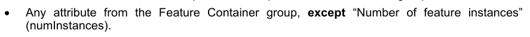

特性容器组的任何属性,但“特性实例的数目”除外

产品规范可禁止其产品具有压倒一切的属性(如果不需要的话)。

说明:

1) 属性压倒性是为了允许某些产品在同一数据文件中编码要素类型的变化,例如,如果应用程序的系统定义了一个特性,该特性既可以有常规的网格信息,也可以有固定的站点信息,因此可能需要不同的元数据属性. 然而,产品规范作者应注意到,这个问题可以通过确定要素类别的适当专业来在应用计划中加以解决,该类别将是不同的要素类型,因此编码于不同的要素容器。

(2) 属性压倒性还允许生产时间差异,例如不同情况下的纵向基准不同,虽然这样做是可能的,但应避免这种做法,以减少在应用开发中以及最终用户出现人为错误的可能性。

10c-9.7.2 集装箱和实例结构实例

下图描绘了包含3个SurfaceCurrent要素类型的假设数据文件的结构.

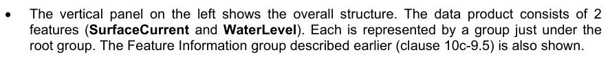

左侧的垂直面板显示整体结构。 数据产品包含两个特性( 近相 Current 和 water Level) 。 每个特性都由一个组代表, 位于根组下方。 上面描述的特性信息组( 10c- 9. 5) 也显示 。

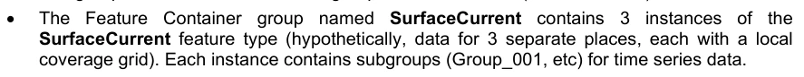

名为 SurfaceCurrent 的要素容器组包含 SurffaceCorrent 有3个实例的地要素要素类型(按假说,3个相隔位置的数据,每个地方都有覆盖网格),每个实例包含时间序列数据的子组(Group_001等).

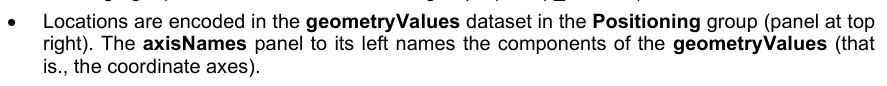

位置在定位组中的几何Values数据集(右上方的平面板)中编码。轴名面板左上方的名称是几何Values的组件。

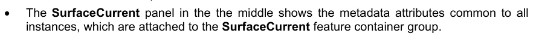

中间的 SurfaceCurrent 面板显示所有实例所共有的元数据属性,这些属性附在 SurfaceCurrent 特性容器组上.


底部的两个面板显示特性实例的具体元数据

## 官方 PDF 第 566 页

图10c-9 – 数据集结构的典型示例.

10c-9.8 铺设资料组

此组编码了( S- 100) 数据集中所使用的平板图信息。 如果数据被编码在一个多块地块中, 并且只有这样才会存在。 S-100 Part 8, 第8- 6 段对一些平板方案做了描述。 此版本的 HDF5 配置文件只支持两个平板: 简单的网格和可变密度简单的网克 。 在这两种情况下,用其边框来说明瓷砖的大小(表10c-12)。

平地平地的空间结合必须覆盖(S-100)数据集中的所有要素,但反面不是要求。 (形式上,这意味着可能有一些要素部分没有被数据集中任何要素的几何所覆盖,但反过来则不是 — 要素几何部分不能被至少一个要素所覆盖. )

请注意,平板与“堆积”的概念并不完全相同,因为后者在HDF5和NetCDF中被定义——平板是坐标地理分区,而块块则定义了HDL5数据集的切片以进行存储和检索性能优化.

表10c-13 - 平铺信息组

HDF5类

名称 数据类型或 HDF 分类

备注/数据空间

/Group_TL 属性 数字 整数 瓦片值 > 0

## 官方 PDF 第 567 页

属性平板化计数法 1: 简单格网 2: 可变密度 简单格网(生产规格必须选择一个)

数据集平板阵列化合物(Float X 4,整数)

砖块的取出方块. 组件:西接方块:浮起方块;南接方塊:浮出方塊;北接方取方块出方:浮取方塊(平面识别符) 拼接方:入方块方法的细节留待本版S-100产品规范处理. 此配置文件没有为瓷块指定订单,也没有控制分级平面图的使用或不使用. S-100 第8部分第8-6分款要求所使用的任何平板图案必须完全描述为特定数据产品规范的一部分,其中包括平板的尺寸、位置和数据密度以及平板识别机制(平板ID)。

10c-9.9 指数组

索引组如果被产品规范使用,则编码空间索引信息。如果并且只有在产品规范规定了空间索引方法,并要求对空间索引进行明确的编码,则该组编码。

表10c-14-指数组

HDF5类

名称 数据类型或 HDF 分类

备注/数据空间

/Group_IDX 属性索引 Method Enumeration 空间索引方法。 (在产品规范中描述)

数据集空间索引( 依赖索引方法)

数据编码空间指数。 (在产品规范中描述)

索引方法的细节和索引数据集的结构留待本版S-100的产品规范.

10c-9.10 定位组

根据数据编码格式的不同,可以有一个定位组"定位",这个组没有属性,它包含一个坐标数据集,是一个复合类型,其组件名称与地心容器组中的轴名数据集相同。这个组用于数据编码Format的值为1,3,4,7和8(clause 10c-9.3). 它不用于数据CodingFormat = 2 (正格),5 (正格),6 (可变的细胞大小网格),或9 (面向Feature的正格).

不同类型网格的转动顺序由特性容器组中的载体元数据属性排序规则来指定. Traversal顺序不用于固定站,移动站台,或TIN,或固定站(站)数据(数据编码格式=1,4,7或8).

数据的维度D由特性容器组中的维度元数据属性给出.

10c-9.10.1 空间代表战略

对于经常被网格化的数据(data CordingFormat = 2或9),每个维度,网格间隔和网格来源的网格点数被编码为元数据属性. (例如,对于2-D网格,该网格).

## 官方 PDF 第 568 页

元数据属性 numpintsLongitudinal和numpotsLatitudinal 编码了沿经度和纬度轴的点。)鉴于这些参数和网格中一个点的索引,该点的位置可以通过简单的公式来计算。

对于固定站点时间序列数据,未地心网格化数据,移动平台数据,三角化不规则网络和固定站(站)时间序列的数据(即当数据编码格式为1,3,4,7或8),必须分别指定每个站点的位置. 这一点是在“定位”组中的HDF5数据集中实现的,该数据集给出了每个地点的单个位置坐标(例如经度和纬度),对于固定站时间序列和固定站(站)时间序列数据,经度值和纬取值是站的位置;站站数量是编号OffStations. 对于未被地心化的网格数据,值为网格中每个点的位置;网格点数为"OfNodes". 对于移动平台数据,数值为每次平台的位置;平台数为 "OfStations".

对于不规则的格和可变的单元格大小覆盖(data CodingFormat 5和6),存储格式使用与普通格外加HDF5数据集相同的元数据,分别表示哪个单元格是被集成或被集聚的. 后一数据集将网格坐标中的格点或单元格地址的单元格位置编码 — — 即网格中的索引,或莫顿代码 — — 不是地理(纬度/经度)坐标。 将网克坐标解释为地理坐标所需的顺序和轴序分别由测序规则属性和扫描方向属性给出。 通过将这种信息与元数据提供的网格参数相结合,可以比正常网格数据更复杂的公式计算人口细胞/点的位置。

下表概述了协调信息储存战略。

表10c-15-不同覆盖范围类型数据集类型和维度定位

覆盖数据类型 编码格式

坐标数据集的结构

固定站台 1个一维阵列,长度=站台数量

未使用正格 2

3个一维阵列,长度=节点数

移动平台 4 1-维矩阵,长度=时间数

未使用的非正弦网格 5

未使用可变单元格大小 6

TIN 7 1维阵列,长度=节点数

固定站点(分层)

8 个一维阵列, 长度 - 数级

面向要素的正格网格

9 未使用

注:多个移动平台可被编码为不同的要素实例.

10c-9.10.2 储存网点位置信息的数据结构

职位数目按第10c-9.3段表10c-4所具体规定计算。

## 官方 PDF 第 569 页

表10c-16 - 定位组

HDF5类

名称 数据类型 数据空间

/投影数据集几何等分数复合体(Float X D)

大小依数据编码格式而定的矩阵(1-维),见表10c-15 化合物类型的组成部分根据轴名(例如: " 纬度 " 、 " 经度 "、 " Z "等)来命名。 大小D和组成部分名称分别由特性容器组属性和轴名数据集(表10c-10和10c-19)来指定。

数据集三角形( 可选)

阵列( 整数)

阵列 (2-d): 维度数 OfTriangles X 3 每行编码一个三角形,作为几何Values数据集中只需要3个坐标的索引,只用于数据CodingFormat=7(TIN)

数据集相接性( 可选)

阵列( 整数)

阵列 (2-d):维数 为OfTriangles X 3 每行通过在三角数据集相接处指定其指数来编码任何给定三角的相接三角[i][0] = 相接于三角[一][0"和相接的相邻三角[ [一][1] 相邻的相相邻相邻边三角[ 一][一][2] 和相邻接相邻边缘三角[ 52. =相邻之三角[相接相接之三角 [一] 等分 [一 [0] 没有相邻三角形的边缘被数值-1所填充,仅适用于数据编码格式=7(TIN),但即使是TIN也可以选择.

## 官方 PDF 第 570 页

10c-9.11 数据值组

数据值内容的结构与定位内容相似,只是常规网格数据值(data CodingFormat = 2或9)作为D维数组存储,对应地轴名称数据集中的地轴顺序(主要指数先于小指数). 维度D被编码为要素容器组的尺寸属性.

EXAMPLE:对于二维正定格的数据,值阵列为二维,有维度波克(numPointsLongitudinal)和相度波克(numPointsLatitunal).

对于固定站点时间序列数据,未地心网格化数据,移动平台数据,三角化不规则网络和固定站(站)时间序列的数据(即当数据编码格式为1,3,4,7或8),数据值被存储为由要素实例组的编号OfTimes,编号OffNodes或编号OfsStations元数据属性(表10c-12)给出的长度一维数据集,视具体情况而定. 数据编码格式。

对于不规则的网格覆盖(data CordingFormat=5),数据值的存储与未被地心化的网克等(即数值记录的一维数组,长度=数字OfNodes)相同,但值组包括一个数据集,指定了与值组中每个条目相接的网点或单元格地址. 第二套数据集使用格子坐标 — — 即格子中的索引,或莫顿代码 — — 不使用地理(纬度/经度)坐标。 将格子的坐标作为地理坐标来解释所需的顺序和轴序分别由顺序规则和扫描方向属性给出。

对于可变的单元格大小覆盖(data CordingFormat=6),数据值的存储与不规则的网格覆盖相同,但值组包含不规则网格使用的网格指数数据集,以及显示哪些单元格被集合为较大单元格的数据集.

下表介绍了各种数据集及其组成部分。

## 官方 PDF 第 571 页

表 10c-17 – 不同数据编码格式的值数据集类型和大小

覆盖数据类型 编码格式

HDF5 值和辅助数据集的结构 HDF5 数据集组件

固定站台 1 值:1维矩阵,长度=数字OfStations 化合物,在要素信息组中相应的要素资料数据集(表10c-8)中指定的每个属性一个组件 元件名:要素数据组中指定的属性代码 元个型:任何符合要素信息系统中指定的特性数据类型的适当HDF5数据类型

常格值 2: D-维数组,由: 2-D: numpers Latitudinal X nummpoints Longitudinal 3-D: numpointS Latimudinal x numintitudial X tummots Langituditinal X Numpoents Vertical 如果在要素实例组中存在细胞测量:所有子的产物

```text
cellGeometry[i].numPoints values.
```

固定站点

未更正的网格

3 数值: 1维阵列,长度=点数 与固定站点相同

移动平台4值:一维矩阵,长度=时间数 与固定站点相同

不规则的网格 5 值: 1维矩阵,长度=编号 OfNodes As for固定站点。顺序规则和扫描方向属性规定的顺序规则(表10c-10)

网格Index:一维矩阵,长度=NofNodes(数据集属性代码Size:Integer - 给出位域长度)

元素类型:位域(由网格维度决定的长度) 元素顺序对应值数组 元素每个元素都包含根据序列规则和扫描方向属性所指定的序列规则所指定的单元格(网格点)代码. 例如,单元格的莫顿代码

可变单元格大小 6 值: 1-维矩阵,长度=点数 与固定站点相同

## 官方 PDF 第 572 页

网格Index:一维矩阵,长度=NofNodes(数据集属性代码Size:Integer - 给出位域长度)

(对于不规则网格的网格Index阵列) 对于聚合多个单位单元格的单元格,使用顺序顺序中遇到的第一个单元格(网格点). 例如:单元格的Morton代码

单元格比例: 1-维矩阵,长度=数 节点 元素类型: 元素的复合顺序对应值 等分数序列 化合物类型 元素根据轴名数据集在地心容器组中的轴名命名 每一个组件属于类型 整数,并给出了沿所命名轴所汇总的单元格数量

TIN 7 值: 1-维矩阵,长度=点数 与固定站点相同

固定站 (分层)

8 数值: 1 维矩阵,长度=时间数 与固定站点相同

面向要素的正格网格

9个值: D-维数组,由: 2-D 指定维度: numPointsLatitudinal X numpints Longitudinal 如果在要素实例组中存在细胞测量:所有细胞测量的产物[i]. numpoints value

至于正则网格 特性容器组的名称必须对应来自国际海道测量组织地理空间信息(GI)登记簿的特性类型对象的骆驼Case名称,数据词典登记簿

说明:

2)格子Index阵列的64位无符号整数允许4-D的格子,每个维数最多可有216-1(65,535个)点/细胞.

3)格子Index数据集有一个名为代码的整数属性Size,它给出了包含索引的位域长度(以位元计),这取决于代码的类型和维数,例如,每个维度有8分的二维格需要6位的Morton代码.

4)位域大小的计算方法是将容纳最大维度所需的位数乘以维度(D)数来计算. 为减少复杂性,每个维度在位域中分配到相同的位数. 例如,一个200 X 1000 个数组被赋予了20位位域,计算为:

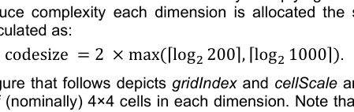

以下图描绘了格网格Index和单元格比例数组的不规则格(左)和可变格大小数组(右),两者都使用每个维度(名义上)4×4个单元格的Morton代码和二维格。请注意,在图中,指定代码的是单元格而不是格点。左边的面板描述了11个有人口细胞的不定期格。 右边的面板描述一个可变的细胞大小网格,有两个集合的细胞,每个集合2×2个单元的细胞.

## 官方 PDF 第 573 页

网格本身被描绘在面板下方,各单元格中显示有莫顿码. 3,右侧的例子还指括号中每个单元格的缩放(假设大小在所有维度上都是相同的;即:格数中每个2×2区集合为0100和1000个).

对于不规则的网格示例,缺失的单元格不显示在网格中。对于可变的单元格大小示例,灰色的单元格会与0100或1000的单元格相加.

对于可变单元格大小网格,此配置文件以它们覆盖在每个方向的单位单元格数量来指定聚合单元格的大小,而不是像图右下方的例子中描述的那样在每一维上必须用相同的缩放系数。这是为了更好地容纳矩形和奇形聚合。奇形区域必须被分割成多个矩形集合。 (使用长方形聚合具有相关的额外存储成本.

本专用配置的今后版本可能涉及进一步优化。

3 图下方的两个网格描绘取自“地平面模型标准化专用配置”(DGIWG 116-1)Ed.1.0.1,国防地理空间信息工作组(2014年6月10日)。

## 官方 PDF 第 574 页

图10c-10 – 不规则网格(左)和可变细胞大小网格的网格指数和细胞尺度阵列的网格指数阵列的示例

(权利)

现在可以描述数据值组的结构。每个组的结构如下表所示。

## 官方 PDF 第 575 页

表10c-18 - 价值组的结构

分组 HDF5 类别名称 数据类型 数据空间

/Group_NNN 属性 参见表10c-19(见表) 表10c-19 描述的单值属性

如表10c-17所描述的,化合物类型的复合阵列,根据数据编码格式和空间维度而排列阵列等级

数据集网格 数据编码格式所需的Index Bitfield = 5或 6,在表10c-17中描述

数据编码格式所需数据集单元格比例复合件=6,表10c-17中描述的除移动平台和固定站(站)格式(数据编码Format=4,8)外,所有数据都按实例组内包含的相接分组编码。

子组各包含一个日期-时间值,以及数值记录阵列。对于数据编码格式=2,3,5或6,日期-日期是整个格网格。数据值阵列为二维,有多个列(numCOLS)和行(nomROWS)。对于一个时间序列,数据值将持续序列中的每一次。对于一个格网,速度和方向值将覆盖格网中的每个点。

组数为001,002等,最多可达到组数,numGRP. 除移动平台和固定站(站)时间序列数据外,所有覆盖类型,组数是时间记录的数量,对于移动平台数据,只有一个组,对应一个单一平台;在额外的功能实例中可以容纳额外的平台. 对于固定站(站)数据,组数为站数.

单个组的数量由元数据变量numGRP给出. 单个时间之间的统一时间间隔由元数据变量时间记录Interval给出.

代表不同时间的值按顺序存储,从最古老到最新的。初始日期时间值包含在元数据属性(表10c-12)中。 通过了解每个记录之间的时间间隔,可以计算出适用于每个值的时间。

团体,如果代表不同的时代,则按顺序编号,从最古老的到最新的.

属性(表10c-19)可能由与被网格化的数据有关的单个值(timePoint)组成,也可能由描述固定站(站)时序数据(data Cording Format = 8)的几个特征的扩展变量列表组成.

## 官方 PDF 第 576 页

表10c-19 - 价值组的属性

无名称骆驼案泥数据类型备注和/或单位

数据编码格式= 1、2、3、4、5、6或7

1 时间戳时间点0.1 字符串日期时间

```text
dataCodingFormat = 8
```

1 站名Name 4.1 弦等,地理描述或 " 不可用 "

2站名识别站名标识为0.1字符串 例如站名的字母编码或"不可用"

3 记录数量 OfTimes 0.1 这里的整数值在实例级别上超过相应的值

4 时间间隔时间索引 IntervalIndex 1 (Integer) 1 (TRUE) 表示统一的时间间隔; 由时间记录Interval提供的间隔

0(FALSE)表示非统一时间间隔.

这是表10c-1所描述的布尔数据类型

5 时间间隔

```text
timeRecordInterval
```

0.1 整数只有在时间IntervalIndex = 1时

时间记录之间的统一间隔。 单位:秒。 这里的值将超过实例级的相应值

6 初始值的有效时间 DateTime 0. 1 字符串日期时间格式

7 最新值终止的有效时间 DateTime 6.1 字符串日期时间格式

(附加属性)(按产品规范规定)

10c-9.11.1 以地貌为主的正网格

数据CodingFormat描述了一种以光栅几何形式创建要素并为其提供额外信息的可能性. DataCodingformat只能与要素属性表(clause 10c-9.6.2,表10c–9)一起使用.

特性容器组的名称必须对应来自IHO地理空间信息(GI)注册,数据词典注册的特性类型对象的骆驼Case名称.

每个网格单元格定义了一个值,允许识别相应的要素. 要素识别值的名称和数据类型与要素属性表(clause 10c-9.6.2)中的标识值相同. 特性识别值的代码和名称定义在要素信息组(claruse 10.c- 9.5)中. 一个特性的识别值可能在格子中发生多起,因为多个格子一起决定一个特性的格子几何. 压缩HDF5数据集消除了冗余效应. 要素识别值是格子中的格子数相接与从特性属性表得到的信息相接.

## 官方 PDF 第 577 页

使用此数据 CodingFormat 可能需要另一个光栅格式的特性容器组。 这是在此创建的特性的参考。 这里描述的数据 Coding Format的空间范围指的是前面提到的特性容器小组。 空间范围必须匹配。 执行的产品规范必须定义哪个特性容器集团的参考值 。

如果在格子的某个区域无法/应该创建任何特性,则相应的格子将被分配到要素识别值0 (0). 0 (0") 因而该值被认为是无数据值. 下图10c-11 使用了 S-102 的例子来显示一个简化的插图.

图10c-11 – 数据编码格式的示例

## 官方 PDF 第 578 页

本页特意留空

## 官方 PDF 第 579 页

10c-10 公共枚举与字典

10c-10.1 数据编码格式

表 10c-20 – 数据编码格式目录

名称描述代码注释

S-100 HDF5数据的数据编码格式

多个离散固定点位置的数据

```text
1
```

成网点的正格点的正格数据, 且单元格间距不变

2 常规网格通常由每个维相平的垂直横线所组成,形成正方形或长方形的细胞.

字符未被分解的Grid数据,其中不包括任何可用于确定单元格地理坐标值的信息,或单元格间隔可变的信息,而且一个单元格的位置与另一个单元格的位置之间没有预先定义的联系

3 例如,包括没有地理校正信息的数字视角航空相片

移动传感器平台相继离散点位置的数据

```text
4
```

分布在一个网格上,具有统一的单元格间隔,但整体形状不规则的字形不规则Grid数据

5 形状不规则可能包括非矩形覆盖区或没有数据覆盖的相对大的区域。

字符变量 CellSize 可变密度网格包含一个或多个区域,其单元格间隔是共同最小统一单元格间隔的整倍数

6 整个网格的外形可能是非矩形的

平面 TIN 三相不规则网络 7 A TIN 是完全由三角面组成的连续地表的表示. 每个三角面的角上起顶点与相邻三角面共用. 这些顶点构成覆盖函数的控制点.

按站点排列的多个离散固定点位置的数据

```text
8
```

成网点时的正格, 恒定的单元格间隔

9 常规网格通常由每个维相平的垂直横线所组成,形成正方形或长方形的单元格.

## 官方 PDF 第 580 页

10c-10.2 水平式CRS类型

表 10c-21 - 横向计算机辅助系统的类型

名称描述代码注释

描述二维水平 CRS 类型的编号类型 OffHorizontalCRS 代码

二维大地测量学 CRS 1

预测的计算机辅助系统2

10c-10.3 垂直坐标基座

表10c-22 垂直坐标基数

名称描述代码注释

描述垂直坐标系统基位的编号垂直坐标Base代码

垂直坐标系统的底部是海平面

```text
1
```

垂直数据 垂直坐标系统的基础是一个定义的垂直数据

```text
2
```

垂直坐标系统的底部是海底

```text
3
```

10c-10.4 纵向基准参考

表10c-23 - 纵向基准参考

名称描述代码注释

```text
Enumeration
verticalDatumReference
```

垂直数据是S100_VerticalAndSounding Datum中列出的一个数据。

1 见第10c-10.6条。

纵向基准是EPSG登记簿上列出的垂直基准之一

```text
2
```

10c-10.5 预测方法

表10c-24-预测方法及其参数

名称 EPSG 代码

参数1 参数2 参数3 参数4 参数5

Mercator 9805 标准平行纬度

自然起源经纬度

```text
-
-
-
```

横向 Mercator

9807 自然起源纬度

自然起源经纬度

自然来源的尺度系数

```text
-
-
```

Oblique 默卡托尔

9815 投影中心纬度

投影中心经度

初始行的最小值

从修正到 Skew 网格

初始行的缩放因数

热线Oblique Mercator

9812 投影中心纬度

投影中心经度

初始行的最小值

从修正到 Skew 网格

初始行的缩放因数

## 官方 PDF 第 581 页

兰伯特·康克·康克勒特(1SP)

9801 自然起源纬度

自然起源经纬度

自然来源的尺度系数

```text
-
-
```

兰伯特·科克·科克罗尔特(2SP)

9802 假产地纬度

假来源经度

第1个标准平行纬度4

第2个标准平行纬度5

```text
-
```

Oblique 立体图

9809 自然起源纬度

自然起源经纬度

自然来源的尺度系数

```text
-
-
```

极地立体

9810 自然起源纬度6

自然起源经纬度

自然来源的尺度系数

```text
-
-
```

克罗瓦克 Oblique 二次曲线

9819 投影中心纬度

投影中心经度

初始行的最小值

伪标准平行纬度

伪标准并行的缩放因子

美国多管风琴

9818 自然起源纬度

自然起源经纬度

```text
-
-
-
```

阿尔伯斯平等区

9822 错误来源的纬度

假来源经度

第1个标准平行纬度5

二等平行纬度6

```text
-
```

兰伯特-阿齐米特平等区

9820 自然起源纬度

自然起源经纬度

```text
-
-
-
```

注:投影参数的所有纬度和经度必须用度(正中和正中)表示,方位以度表示,关于投影方法的详细说明,请参考欧洲空间合作组织的文件。

10c-10.6 垂直和声学数据

表 10c-25 垂直和声音数据

名称描述代码注释

S100_代码列表 S100_VerticalAndSounding Datum 允许的垂直和发声数据

- 公开点数

数值平均值 LowWaterSprings 1 (MLWS)

值表示下劳水泉 2 -

数值平均海平面3(MSL)

数值最低的LowWater 4 -

数值平均值 LowWater 5 (MLW)

数值最低的Low Water 春天 6 -

数值约为 MeanLow 水泉 7 -

印地安语SpringLow Water 8 -

低值水泉 9 -

数值约为Lowest-AstromicalTide 10 -

价值接近LowestLowWater 11 -

数值表示下劳水 12 (MLLW)

13 (LW) 低水量(LW)

数值约为 MeanLow Water 14 -

4 标准平行近赤道.

5 标准平行,离赤道更远。

6 必须是90度或-90度。

## 官方 PDF 第 582 页

数值约为 " 低地水分 " 15 -

数值平均值16高水分(MHW)

值平均值 高水生 17 (MHWS)

高值水 18 (厚水)

数值约为海平面19 -

价值高水泉 20 -

值平均值 21高水分(MHHW)

等值春水 22 -

最低数值 23 (LAT)

值本地数据 24 -

价值国际大湖日 1985年 25 -

数值平均值 -- -- 水层26 -

数值低于LowWaterLargeTide 27 -

高水压热量 28 -

价值接近最高的高度水量 29 -

数值最高的天文潮30(HAT)

波罗的海海图 2000年数字表 44 -

价值国际大湖大坝2020 2020年国际大坝更新,用于测量大湖水位高度的官方参考系统,连接道道,圣劳伦斯河系统

46 与前两个IGLD不同的是,这一基准更新将使用一个基于地基的垂直基准,该基准将使用全球定位系统等全球导航卫星系统(GPS)进行访问。

通常有平滑温和梯度的海洋底部,也称为海床(有时是海床或海底)和海底。

```text
47
-
```

值海砂面 A 二维(平面上) 代表出海空界面,有高频起伏,如风波和膨胀等,但不包括天文潮汐,被过滤出

```text
48
-
```

最低天文潮下带的垂直参照物(LAT),海平面只有非常例外的下降

49 LAT和水道测量零之间的偏移可能是由于强烈的反环状大气条件,使水柱增加重量,而这种偏重可能特别使最低海平面下降到天文低水平下。 注:数字编码是国际海道测量组织GI登记簿为国际水生物学组织水道测量域属性垂直数据表所列等值规定的编码,因为目前该登记簿没有列出 (2018年6月20日)包含交换集元数据和数据集元数据属性的条目.

## 官方 PDF 第 583 页

S-100 计数表中未包括的标注必须使用“其他:......”表编码,如果有关标注列在IHO GI 登记簿中(作为IHOC Hydro域属性垂直标注的标准标注值之一),则在“其他(.)”要素中使用登记处的“驼子案码”,对于来自EPSG 登记单位但未列在IO Gi 登记机关的标定,表格必须为“其他:(EPGS_NNN)”。

EXAMPLE 1:“当地低水参考水平”列在国际海道测量组织GI登记簿中,但没有列入S-100标准,必须与GI登记簿中的骆驼案例编码为:“其他:当地低水参考水平”。

EXAMPLE 2:“2019年欧洲纵向参考框架中位潮”列于EPSG的垂直数据登记表(EPSG 1287)中,但未列入IHO GI登记表,必须编码为:“其他:EPSG_1287”。

如果上表、国际海道测量组织全球地理研究所登记册或环境与安全小组登记册没有列出该数据,生产者应与国际水生物学组织工作组和国际海道测量组织的全球地理资料研究所登记当局协商,确定适当的特别代码。

禁止使用上述枚举、国际海道测量组织GI登记、以及EPSG登记中均没有的基数,需要使用S-100列出的基值的生产者应提议在IHOGI登记册中增加基数和/或通过S- 100维修提案进行这一基数。

请注意,应用软件不需要处理“其他:......”形式所编码的信息,也就是说,例如ECDIS软件不需要承认编码为“其他(.)”的任何数据,因此无法用相应的S-104数据集的水位数据调整ENC深度信息,可能警告或拒绝S-1040数据集与S-101ENC相容。

10c-11 支持文件

HDF5格式不将支持文件信息编码为要素属性;即应用程序 schema主题属性不能是支持文件的引用,这意味着在覆盖要素中不允许引用图片或文本文件等.

此外,不允许从覆盖到载体要素的要素和信息协会。

根组的 HDF5 “元数据”属性是外部元数据的引用。 引用必须是表单的字符串 :

```text
fileRef:<fileName>
```

,其中“文件名”是 ISO 8211 或 GML 文件的基名。不使用文件名的扩展部分。

混合矢量覆盖数据产品可以继续使用与矢量要素类相关的支持文件,并定义矢量特性或信息类别,其属性是支持文件的参考,如常.

10c-12 目录文件与元数据文件

交换集目录和元数据文件必须符合为本版S-100所定义的目录和元数据的标准XML计划和相关ISO标准. 文件必须命名如下:

CATALOG.XML (或.xml) 交换目录 XML文件.

MDX-HDF5 数据文件基名>. XML (或.xml) ISO元数据

10c-13 矢量空间对象、要素及信息类型

在某些情况下,可能有必要使用矢量空间对象,如影响区域多边形. 本版剖面图不直接将矢量空间对象编码于HDF5数据中.

## 官方 PDF 第 584 页

文件。相反,空间对象必须在外部文件(GML或ISO 8211格式)中定义,并引用编码的空间对象。引用必须是表单的字符串:

```text
extObjRef:<fileName>:<recordIdentifier>
```

此处“文件Name”是ISO 8211或GML文件的基名,“记录识别器”是该文件中矢量对象记录的记录标识符。文件名称的扩展部分不使用。记录标识符是GMl数据集的gml:id,或者ISO 82.11数据集的记录识别号(RCID)。文件必须在同一交换集中存在。

这种方法可用于参考多边形等,在GML的外部文件中被定义,或者在同一交换集中被定义为8211格式数据文件,也可以用于参考GMl或ISO 8211文件中的要素或信息类型实例.

举个例子:

USSFC0001:S093546在GML数据文件USSFC0001. GML (GML)中以gml:id S093456来参考此天体.

USSFC0001:93546在ISO 8211数据文件USSFC0000000 (ISO 8211)中引用了有记录标识符93456的天体.

10c-14 约束与验证

10c-14.1 验证试验

验证测试必须在产品规范中加以界定,并包括下列检查:

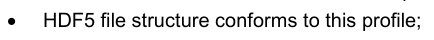

HDF5文件结构符合此配置文件;

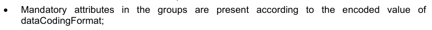

组中的强制属性按照编码值显示:

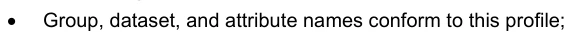

组、数据集和属性名称符合此配置文件;

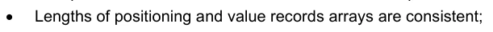

定位长度和价值记录阵列一致;

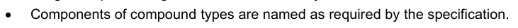

化合物类型的部件按规格要求命名.

10c-15 更新

建议对 HDF5 数据文件进行更新,以遵循与基础 HDL5 的数据文件相同的结构。更新可能只包括正在更新的 HDR5 数据集。正在更新的特定数据集全部包含在更新的数据文件中。

该条款意味着S-100数据集可以部分更新,也可以被更新后的数据完全取代,但产品规范不需要允许部分更新. 它们可以定义更适合其特定域和必须用程序的更新创建和管理流程. 然而,如果允许对S- 100数据集部分内容进行更新,则必须遵守上一段中的规则.

10c-16 模型汇总

HDF5配置的基本结构(图10c-7)现在可以使用前几节中的组和数据集规格作为更详细的概念模型来呈现. HDB5文件内容的概念模型如下图所示. 此Fgure显示了组的结构和包含空间表示和数据值的数据集. (包含元数据的属性和数据集不为简单起见而包含. )相匹配命令关联表示相关数据集中元素的序列是相互依存的.

## 官方 PDF 第 585 页

图10c-12 - 内容的概念模型

10c-17 产品规范开发者应遵循的规则

10c-17.1 从本专用配置中界定产品规范的格式

大多数产品规范只需要这个配置图的子集,但是,所有产品规范必须包括这个配置图的强制性要素.

数据文件的逻辑结构必须符合图10c-11所描绘的并在前几节所具体说明的逻辑结构.

产品规范的 " 数据格式 " 部分必须说明配置图中所使用的部分(例如,哪些值数据编码格式可以取用,哪些组和数据集被使用,空间代表是二维还是三维等)。

推荐但并非强制的UML图来自本部分的概念结构描述. 文件表必须具体说明产品对元数据和内容的限制或限制,除非本专用配置中的相应表格不加修改地适用.

要求有非统一相距网格的规格必须作为未加地心网格处理,并明确编码每个位置的坐标。

## 官方 PDF 第 586 页

此配置文件并不妨碍一个要素类的覆盖类型不同,但在此配置文件中无法重复同一实例的空间属性,这意味着一个要素子不能有两个网格,无论它们是否是同一覆盖类型. 如果产品规范似乎需要同一情形的多处覆盖,考虑将两者合并为一个覆盖对象或使用两个要素实例.

本配置文件没有完全实现特性和信息关联,但是,在附带GML或ISO 8211数据集时,可以将覆盖对象与矢量要素或信息对象相链接,使用第10c-13条所描述的对象参考方法. 提及矢量对象,如影响多边形,必须使用同一种方法来编码.

产品规范应当指定HDF5数据文件中编码的元数据元素的精确性,无论是单独还是被覆盖的报表中。例如,产品规范可能要求Float类型的所有元数据属性使用64位浮点数编码。

如果位置或数据值的不确定性因单个要素的空间范围而异,产品规范开发者应当考虑解决方案作为产品规范的一部分;例如,将网格细分为不同的要素实例,或者在应用计划层面通过定义一个覆盖要素来编码不确定性或者为数值记录添加一个不确定性属性来解决这个问题. 本部分不要求对这一问题采取任何具体办法。

10c-17.2 其他规则

由于所报告的性能问题,使用可变长度字符串作为化合物类型的组成部分的做法受到阻碍。

理论上,使用瓦片可以与HDF5块相相互作用来影响性能。 性能是重要考虑因素的产品规范可能需要考虑可能的相互作用效应并调查其规模和后果。

10c-17.3 本专用配置的扩展

产品规范可以通过定义额外数据结构或扩展本配置中定义的数据结构来扩展本剖面图中的格式,但所有扩展必须保留本剖相图的核心规格,以便执行必须能够不处理额外数据的结构而摄取并描绘出数据. 产品规范必须写成,这样这些额外数据结构用于处理或显示是可选的.

这种添加应放在HDF5数据文件中的适当位置;例如Group_IDX组中的空间索引.

扩展名不能重用此配置中定义的项目名称。 此配置中定义的项目不能在产品规范中重新命名 。

下文列举了允许和不允许延期的一些例子。

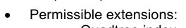

o Quadtree指数,作为索引组中的HDF5数据集添加. o 本配置描述的核心格式(即1-d阵列结构和指定的组件)保留值记录结构的扩展. ○ 线性比例数组,作为可变单元格大小数组的辅词,表示每个轴上单元格大小变化的网格点. oh 产品特定元数据作为任何一个组的属性. o 产品特定元数据作为本配置中指定的任何组中HDF5的额外数据集。o 附加组,但这些组不被用作本配置中的一个强制性组的替代品。

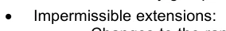

o 修改数组数据集类型的等同;例如,使用2-d数组取而代之的1-d数组。

## 官方 PDF 第 587 页

o 本剖面图所定义的复合数据类型组成部分的命名规则的修改。

10c-17.4 添加元数据的扩展

虽然第10c-17.3条允许添加元数据,但定义产品专用元数据意味着,如果执行中要对额外的元数据做任何事情,而不是仅仅显示它,就必须在必须用程序中包括产品专用编码。 鉴于S-100生态系统包括多种数据产品,最好都能够用S- 100应用程序处理(包括显示),本部分建议不增加对处理或显示有影响的具体产品元数据。 如果认为这种添加是必要的,则应利用S-100和相关文件中所述的维护机制,作为S- 100框架本身的延伸,但可以添加但劝阻只显示元数据(即只要求应用程序显示所添加属性的内容)。

10c-18 实现指南

HDF5 C API 包含了用于确定化合物类型组件的接口,这表明可以检查一个数据类型的大小来缓解可能的转换问题.

HDF5 C API 也定义了在一组中对属性或项目进行延展的标定器,这些标定仪可以用来发现来自数据集,组,或属性的剖面数据集,或仅由单个产品规范定义的属性(产品特定项目的名称会与剖面项目不同).

取回对象的顺序可能与创建命令不同。 执行者应该允许这样做, 或调查HDF5 API中是否有保存命令的功能。

XML要素目录和HDF5文件中的对象之间的联系通过使用(驼子)代码来保存要素,和属性.

10c-19 第 8 部分应用模式的实现（资料性）

下文图10c-13显示第10c至10.1分款所描述的不同类型覆盖的实现情况,以及第八编所定义的涵盖类型中的表10c-4,产品规范开发团队不妨为其产品规范编制类似数字,以说明如何从第八编所界定的涵盖类型中实现HDF5格式编码的数据产品覆盖类型.

## 官方 PDF 第 588 页

图10c-8部分类型HDF5编码覆盖类型的实现情况.

有可能将图10c-13扩展至包括来自ISO类型的高层数据,而可能牺牲一个更拥挤的数字。 图10c-14说明了常规网格覆盖类型的构想。 注意假设的应用程序Schema既允许离散网点覆盖,也允许连续网点涵盖类型;如果只需要连续网格覆盖,CV_DiscreteGridPointCoverage和CV-Dis克reteCovergerage类就可以省略. 另外,由于这个假设的应用程序Schema只使用正格,因此可以从网格起源和单元格大小来计算出网格点的坐标,不需要与S100_IF_Grid相联的CV_GeometryPair类,图10c-14中已省略.

## 官方 PDF 第 589 页

图10c-14 - 假想应用 Schema碎片,包括上等ISO类型.

灰色框是ISO 19123 定义的类

## 官方 PDF 第 590 页

本页特意留空
