# S-100 5.2.1 · 第 14 部分 · 在线数据交换

非官方机器翻译参考稿，尚未逐条人工校订。公式与代码保留原文，解释以英文规范为准。

## 官方 PDF 第 659 页

S-100 – 第14编

在线数据交换

## 官方 PDF 第 660 页

5.2.1版实质性变动摘要

已生效的概要条款

从规范性参考资料中删除了URL链接,并在整个过程中删除了14-2、14-8.2.1

添加了新的规范参考 ISO/IEC 80000-13:2025. 14-2

## 官方 PDF 第 661 页

中文目录（可用上方目录直接跳转）

14-2.1 开放系统互联 · 官方 PDF 663
14-3.1 通讯堆栈 · 官方 PDF 664
14-7.1 SOAP(《索马里行动计划》) · 官方 PDF 667
14-7.2 资源减少 · 官方 PDF 668
14-8.1 类型 · 官方 PDF 671
14-8.2 编码清单和目录 · 官方 PDF 675
14-8.2.1 S100_OC_服务技术 · 官方 PDF 675
14-8.2.2 S100_OC_方向金刚 · 官方 PDF 675
14-8.2.3 S100_OC_现状Type · 官方 PDF 675
14-8.2.4 S100_OC_交换台 · 官方 PDF 676
14-8.3 人员身份鉴定 · 官方 PDF 677
14-8.3.1 S100_SV_服务识别 · 官方 PDF 678
14-9.1 类型 · 官方 PDF 679
附录14-A · 官方 PDF 681
示例：高效数据广播 · 官方 PDF 681
（资料性） · 官方 PDF 681
附录14-B · 官方 PDF 683
示例：基于会话的 Web 服务 · 官方 PDF 683
（资料性） · 官方 PDF 683
附录14-C · 官方 PDF 685
操作 · 官方 PDF 685
（资料性） · 官方 PDF 685
14-C.1 获取_NW_NM_服务 · 官方 PDF 685

## 官方 PDF 第 662 页

本页特意留空

## 官方 PDF 第 663 页

范围

这一部分介绍为指定在线信息交流所需的组件和流程,可以是一套可能具有连续性的数据或数据,后者又被称作“流数据”,数据需要更动态的信息流动;即除了交流主要作为文件处理的静态数据集之外。

规范性引用文件

本文件的应用需要下列参考文件:关于注明日期的参考文件,仅适用所引用的版本;关于未注明日期的文件,适用所参考文件的最新版本(包括修正案)。

IEC 61162, 海上导航和无线电通信设备和系统 -- -- 数字接口 -- -- 第1部分:单油轮和多例

IEC 61174,海上导航和无线电通信设备和系统 - 电子图表显示和信息系统 - 业务和性能要求,测试方法和必要的测试结果

ISO/IEC 8211:1994,信息交换数据描述文件的规格

ISO/IEC 7498, 信息处理系统-开放系统互通-基本参考模型

ISO/IEC 8859-1:1998,信息技术 – 8位单字节编码图形字符集 第1部分:拉丁字母编号 1

ISO/IEC 80000-13:2025,量和单位, 第13部分:信息科学技术(经修订)

国际水道测量组织关于海上安全信息S-124的草案

OGC 传感器观测处

W3C建议“SOAP 1.2 第1部分:信息发布框架(第二版)”

W3C 建议“网络服务描述语言”(WSDL)

14-2.1 开放系统互联

本部分参考了ISO/OSI标准参考模型用于开放系统互联[ISO/IEC 7498],但在所提供的确切服务方面并未遵守该标准. ISO/OSI标准被作为协议堆栈中单个层的命名参考(见图14.1)。

适用下列公约:

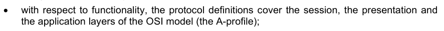

关于功能,协议定义涵盖OSI模型(A-profile)的会话、演示和应用层;

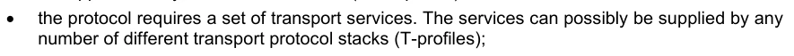

协议需要一套运输服务。服务可能由任何数量的不同的运输协议堆栈(T-profile)提供;


此部分不描述A- profile 的分层。 此部分将ISO/ OSI 模型的所有上三层合并为一个协议 ;


此部分指辅助标准或用户层,作为位于顶端的单独协议层.

## 官方 PDF 第 664 页

图14-1——协议分层

引言

应用程序/设备之间的在线数据交换将遵循不同的通信模式,以支持各种海上业务需要。

多个客户端可以与S-100模拟的数据交换服务进行交互,可以区分单向消息流和交互式信息交换.

通信的背景可以通过使用面向会话的通信概念来给出。因此,区分的通信伙伴之间的通信可以被分配到逻辑实体 — — 一个会话。这样就可以存储指定给会话的互动的元数据。

使用服务的通信手段应在通信堆栈中定义,指定通信堆堆将确保服务通信的统一,并便于实施。

14-3.1 通讯堆栈

通信由ISO-OSI参考模型定义的堆栈组织,封面位于A-profile等处:


用于定义消息类型的会话协议(例如:WSDL,SOAP,REST,SOS);


编码和压缩(例如GML,XML,ISO8211,HDF,.)以序列化数据; 2.

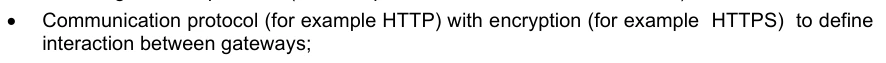

有加密( 如 HTTP) 的通信协议( 如 HTTP) 以定义

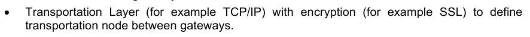

带有加密( 如 SSL) 的运输层( 例如 TCP/ IP) 以定义

## 官方 PDF 第 665 页

图14-2——通信堆栈

本部分只处理应用程序和演示层中的概念。覆盖 T- Profile 的下层超出了 S- 100 的范围。 这可以是 Internet Protocol 或 VDES 。

面向会话的通信

为界定信息交流的背景,必须使用会议的概念。

面向会话的服务通常包含三个部分,每个部分处理其他类型的数据:

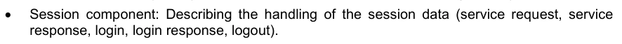

会话部分:描述会话数据的处理情况(服务请求,服务响应,登录响应,登录响应,登录).


服务部分:描述信息以维持服务(例如,保持


数据部分:描述数据本身;例如,船只交通图像数据(对象).

产品规范中可以详细列出每个部件所需的其他元数据。

在面向会话的服务中,界面是客户端和服务器之间的点对点连接. 客户端与服务器管理会话(见图14-3)并双向交换信息. 服务描述应当包含一个交互模型. 交互模型应当描述会话的寿命(启动,维护和会话终止).

## 官方 PDF 第 666 页

图14-3——会话互动模式实例

对于交互模型中的每个要素,必须在服务的产品规范中提供详细的描述,以确保服务互动是统一而可靠的,例如,如果对服务至关重要,对服务中所使用的协议的描述可以提供足够的反馈,以确保充分接收数据。

对于使用会话概念交互的每项服务,可以定义。例如,以下信息:


o 启动和确认会话


- 保持消息鲜活


o 闭幕会请求

无会话交互通信

交互式通信在应用中被广泛用于应用数据交换,大部分应用客户端服务器通信模式,客户端启动与服务器的通信,以及两个合作伙伴作为(定义)数据集交换消息.

遵循无国籍通信范式的概念,无会话信息交换需要将请求中所有相关信息封装起来,服务器应能够仅以这些信息为基础,制定适当的响应。元数据要么是其中的一部分。

## 官方 PDF 第 667 页

所有业务都是针对服务的,因此不在此考虑。

图14-4——无会话客户端-服务器通信.

消息流

消息流是包含定义明确的数据集的单向消息流. 已使用的通信介质可以确保消息流的序列和完整性.

与会话概念相反, 广播的信息大多是上下文不可知的。 服务器的信息流可能但不一定是由客户端的信息所触发的。 因此, 客户端可以播放一个未定向的信息请求, 之后服务器会发出一个未指令的答案。 必须提供身份识别符, 才能将响应信息与请求关联 。 消息流信息必须包含关于所传输数据集的元数据.

图14-5——信息流通信

基于 IP 的技术

一般在线数据交换适用于不同的ISO/OSI服务堆栈,对于基于IP的通信,建议使用Web Service技术来传递S-100兼容数据.

以下分节介绍了两种共同的Web Service技术。

14-7.1 SOAP(《索马里行动计划》)

SOAP依靠Web Service定义语言(WSDL)和XML通过互联网提供网络服务. W3C标准化SOAP. SOAP规格可以被广义地定义为由以下三个概念部分组成:协议概念,封装概念和网络概念. 它旨在支持扩展,提供诸如:

## 官方 PDF 第 668 页

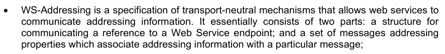

WS-Addressing是运输中立机制的规格,允许网络服务通信地址信息,它基本上由两部分组成:一个是用于通信一个网络服务端点的引用的结构;以及一组涉及将地址信息与某一特定信息相连接的属性的信息;

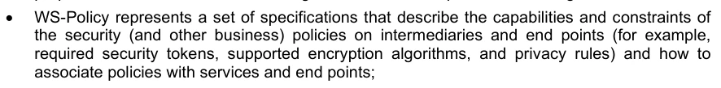

WS-政策代表一套规格,说明安全(和其他业务)政策对中介和终点(例如,所需的安全标志、支持的加密算法和隐私规则)的能力和限制,以及如何将政策与服务和终点挂钩;


WS-Security是SOAP的一个扩展,用于对Web服务应用安全; 4.

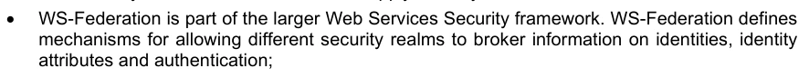

WS-Federation是更大的Web服务安全框架的一部分. WS-Federation定义了允许不同的安全领域来中介身份,身份信息的机制.

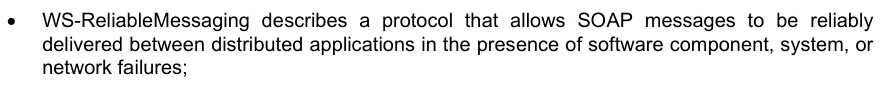

WS-可信赖的Message 描述了允许SOAP消息在软件组件、系统或软件存在的情况下在分布式应用程序之间可靠发送的协议.


WS-Coordination描述了一个可扩展的框架,用于提供协议来协调分布式应用程序的行动;

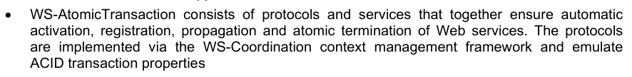

WS-AtomicTraction由协议和服务组成,共同确保自动激活、登记、传播和原子终止Web服务。

SOAP消息是一个由SOAP-信封组成的XML文档,包含一个可选的SOAP-头条,SOP-Body和可选 SOAp-错误信息,涉及处理消息时发生的错误. 信封为消息创建了命名空间;可选信封可以包含关于路由和加密等的元数据;而正文包含给SOap-收发器的訊息数据.

```text
<?xml version="1.0"?>
<s:Envelope xmlns:s="http://www.w3.org/2003/05/soap-envelope">

<s:Header>

</s:Header>

<s:Body>

</s:Body>

<s:Fault>

</s:Fault>
</s:Envelope>
```

在S-100语境下使用SOAP,需要使用SOAP-header中服务定义模型的参考,并将S100_DataSet放入SOAP-Body中. 以附录B为例.

14-7.2 资源减少

REST是Representational State Transfer的缩写,是分布式超介质系统的建筑风格,由Roy Fielding于2000年首次提出. RET有六个指导性限制,如果需要将一个接口称为RESTful,就必须满足这些限制. 这些原则列举如下.

《关于教育、科学和技术的指导原则》:

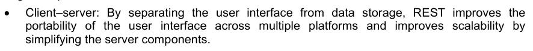

客户端-服务器:通过将用户界面与数据存储相分离,REST提高了用户界面跨多平台的可移植性并改进了可扩展性.

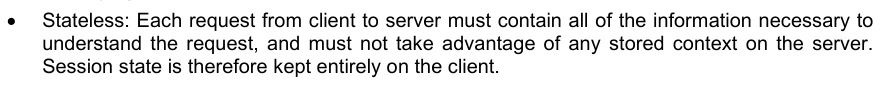

无国籍人:客户端到服务器的每一项请求都必须包含理解请求所需的全部信息,并且不得利用服务器上存储的任何上下文,因此会话状态完全保存在客户端上.

## 官方 PDF 第 669 页

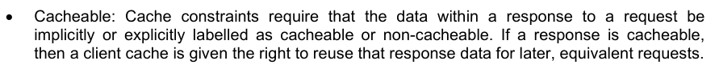

可缓存:缓存限制要求响应请求中的数据被隐含或明确标记为可缓存或不可缓存. 如果响应是可缓发的,则客户端缓存被赋予了对后期,等同请求重用该响应数据的权利.

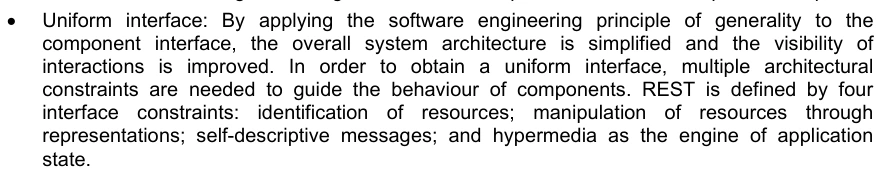

统一接口:通过将软件工程通俗性原则应用于组件接口,简化了整体系统架构并改进了交互的能见度,为获得统一接口,需要多种建筑约束来引导组件的行为. REST由四个接口限制定义:资源识别;通过表示来操纵资源;自我描述信息;以及超媒体作为应用引擎.

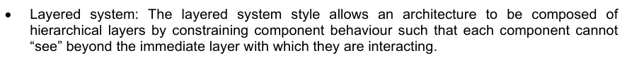

分层系统:分层系统的风格允许一个架构由分层组成,通过约束组件行为,使每个组件无法"看到"它们与之互动的近层外.

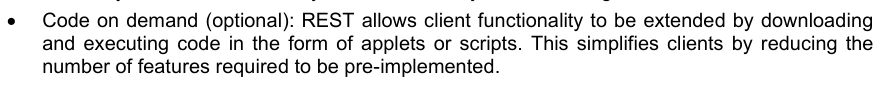

求取代码(可选):REST允许客户端功能通过以小程序或脚本的形式下载和执行代码来被扩展,这通过减少需要预先执行的功能数量来简化客户端.

REST中信息的关键抽象是一个资源. 任何可以命名的信息都可以是一个资源:文档或图像;时间服务;其他资源集合;非虚拟对象(例如人);等等. RET使用资源标识符来识别组件间互动中所涉及的特定资源.

服务定义模型

在图14-6中,服务定义模型被显示。它定义了如何以通类描述服务操作。该模型的核心部分是S100_OC_ServiceMetaData类。该类定义了执行和使用服务所需的所有信息。因此,它引用了S100-FC_FeatureCatalogue,该类包含通过服务API交换的数据集的所有必要的元数据。 这个API由一个或多个接口定义(通过使用 S100_OC_ServiceInterface 类)定义. 它们由一组以两种方式代表的操作组成:

1. 正式说明:每个操作必须采用技术不可知的方式描述,具体说明操作的参数及其结果. S100_OC_ParametBinding是确定参数是否仅由服务读取,只写或两者兼写的方向的集合. 附加的S100_Ob_ParametBinding(方向:回放)规定了操作的结果数据类型.

2. 技术依赖描述:每个S100_OC_ServiceInterface由技术标识符(REST,SOAP等)和一个或多个外部技术依赖性描述文件组成,通过接口引用Description URL. 此外,S100-OC_服务Interfase可以指定数据的编码,如果这不能通过被使用的技术定义. 使用时,编码属性必须定义已使用的编码名称,例如ISO8211,S100指定的GML等。虽然这些编码属性适用于数据集内的数据,但可以被参数绑定的编码属性所覆盖,这样可以进一步指定一个参数值的内容.

## 官方 PDF 第 670 页

图14-6——描述一项服务的数据模型

## 官方 PDF 第 671 页

14-8.1 类型

```text
S100_OC_ServiceMetaData
```

定义执行服务所需的所有信息。

角色名称 名称描述 :

```text
Class
S100_OC_ServiceMeta
Data
```

正式描述一项服务,包括其互动模型和数据产品

```text
-
-
-
```

组成服务 DataModel 描述服务 1 S100_OC_Service 数据模型的逻辑数据模型

强制性

描述某项服务的技术不可知性和技术特定接口

```text
1..*
S100_OC_Service
Interface
```

强制性

将特性CatalogueURL URL URL URL 属性到已使用的要素目录中。 如果可能,此 URL 应指向交换集中提及的要素目录的机器可读代表

0.1 URL 强制性

联系要求指服务要求的规格,此处应列出业务要求、功能要求和非功能要求。

```text
0..*
S100_OC_Requir
ement
```

属性名 人类可读服务名 服务名最多应为服务一行简标签。同一服务规格的更新版本不得更改名称 。

```text
0..1
CharacterString
```

描述必须包含关于实施这一规格的服务将做什么的抽象内容。

```text
0..1
CharacterString
```

属性版本 服务规格版本 。 服务规范以其名称和版本独有地识别。 任何服务数据模型或服务界面定义的修改都需要新版本的服务规格

```text
0..1
CharacterString
```

服务规格状况

```text
0..1
S100_OC_StatusT
ype
```

属性关键字 服务相关关键字列表 0. * 字符串

## 官方 PDF 第 672 页

```text
S100_OC_ServiceInterface
```

指定指定的技术,以及该接口对技术依赖的描述的引用。界面描述必须指向一个与操作匹配的、通过“操作”聚合定义的技术依赖界面定义文件。此外,如果使用的技术没有定义,服务界面还可以指定数据的编码。

角色名称 名称描述 :

S100_OC_ServiceInterface 描述某项服务的技术不可知性和技术特定接口

```text
-
-
-
```

使用技术 1 S100_OC_服务技术

强制性

属性接口 描述操作的技术依赖定义文件。 必须与“ 操作” 聚合匹配

1.* URL 强制性

此界面所使用的数据集的属性编码 定义。 如果编码没有通过使用的技术定义, 则必须设定 。

0.1 字符串条件,如果编码没有通过所使用技术定义,则必须设置

属性交换 Pattern 描述支持的交互类型 1 S100_OC_Exchan gePattern

强制性

技术不可知性描述本服务所提供的业务

```text
1..*
S100_OC_Operati
on
```

强制性

协会消费者Interface可选参考服务消费者必须提供的界面定义来补充服务接口. 特别是如果设计了发布/订阅服务接口,则有必要描述服务预期在用户端可获得什么服务.

```text
0..1
S100_OC_Consu
merInterface
```

可选

```text
S100_OC_Operation
```

以技术不可知的方式定义特定服务上可能的操作。指定参数以及操作结果(见S-100_OC_ParameterBinding)。

角色名称 名称描述 :

S100_OC_操作类 指定可以由服务完成的操作 - - -

通用 - 对要素、属性、.和操作使用相同的描述方法

```text
1
S100_FC_Item
Mandatory
```

属性参数列表 属性参数约束。 它的义务由操作的语义定义, 例如需要输入/ 输出时

```text
0..*
S100_OC_Param
eterBinding
```

将操作结果返回呼叫者

```text
0..1
S100_OC_Param
eterBinding
```

## 官方 PDF 第 673 页

```text
S100_OC_Parameter
```

角色名称 名称描述 :

S100_OC_Paremeter - - - - 关于S100_OC_Paremeter的进一步信息将列入未来的S-100版.

```text
S100_OC_ParameterBinding
```

将S100_OC_Paremeter指定给一个操作,它遵循S-100的属性分配和限制概念,并用方向的定义来补充(见第14-8.2节)。

角色名称 名称描述 :

S100_OC_Parameter Binding 类,用于描述属性如何绑定操作

```text
-
-
-
```

属性方向指定操作如何使用参数 1 S100_OC_Directio nKind

强制性

属性编码 如果设定, 此属性指定此参数所用的编码。 如果不设定, 则使用技术依赖的编码 。

```text
0..1
CharacterString
```

提供的最低和最高数量,最多数量可能无限。

```text
0..1
S100_Multiplicity
```

用于描述参数1. * S100_OC_Param eter的聚合参数

```text
S100_OC_Requirement
```

角色名称 名称描述 :

S-100_OC-要求

全球独特要求识别 1 字符串

属性名称 人类可读要求名称/摘要。 长度不得超过一行

```text
1
CharacterString
Mandatory
```

人类可读要求文本。通常以 " 应 " 声明形式提出

```text
1
CharacterString
Mandatory
```

## 官方 PDF 第 674 页

此项要求的属性理由。关于为何存在此项要求的文字解释。提供关于服务需要的背景资料。

```text
1
CharacterString
Mandatory
```

参考可选信息,说明要求最初在何地提出。如果要求来自外部文件,则该属性应指此来源。

```text
0..1
CharacterString
Optional
```

将关于要求的作者的行政资料作为作者的可选参考

```text
0..1
CI_Responsibility
Optional
```

```text
S100_OC_ConsumerInferface
```

角色名称 名称描述 :

```text
Class
S100_OC_ConsumerInterfa
ce
```

服务消费者预期提供的界面规格。例如,如果设计了请求/召回服务接口,则有必要描述客户端期望的服务接口

```text
-
-
-
```

属性名称 人类可读界面名称。 名称不应超过一行

```text
1
CharacterString
Mandatory
```

属性描述 界面的可读描述 1 字符串

协会业务是指消费者界面支持的服务业务的规格.

```text
1..*
S100_OC_Operati
on
```

强制性

```text
S100_OC_ServiceDataModel
```

角色名称 名称描述 :

聚合特性 Catalogue 描述服务数据模型 1 S100_FC_Feature Cataogue

```text
-
```

属性编码 特性的机器可读表示的编码 Catalogue

0.1 字符串 这里指的是通过 S100_OC_ServiiceMetaData 中的特性CatalogueURL提供的要素目录

## 官方 PDF 第 675 页

14-8.2 编码清单和目录

```text
14-8.2.1
S100_OC_ServiceTechnology
```

项目名称描述 :

S100_CodeList S100_OC_ServiceTechnology 常用服务列表(描述/实施) 技术

```text
-
-
-
```

文字 SOAP 简单对象访问协议 - - SOAP 1.2 2007, W3C

代表国家转让 -- -- Fielding,Roy Thomas(2000年)

Litteral CORBA 共同对象请求经纪架构 - - 对象管理组(OMG) 二月 2021 v3.4

```text
14-8.2.2
S100_OC_DirectionKind
```

项目名称描述 :

编号 S100_OC_DirectionKind 描述操作如何使用参数 - - -

In(put) 参数中的字元只能通过自有操作读取,但永远不会被更改

```text
-
-
-
```

字面输出( 输出) 参数可以被自有操作用于存储给调用者的额外信息, 其初始内容既不会被读取, 也不会被去除( 已清除)

```text
-
-
-
```

本地操作可以使用 literal inout In(put)/ Out(put) 参数存储调用者的额外信息,但这些参数的内容也影响到操作执行

```text
-
-
-
```

```text
14-8.2.3
S100_OC_StatusType
```

项目名称描述 :

编号 S100_OC_StatusType 描述服务规格、设计或实例的状况 - - - -

服务规格/设计未正式发布,服务实例可供使用,但无法正式运行

```text
-
-
-
```

文字发布 服务规格/设计/设置正式发布 - - - -

服务规格/设计/设计仍然可用,但寿命已设想结束

```text
-
-
-
```

已删除 服务规格/设计/设计不再可用 - - -

## 官方 PDF 第 676 页

```text
14-8.2.4
S100_OC_ExchangePattern
```

项目名称描述 :

编号 S100_OC_ExchangePattern 定义操作处理类型 - - -

从服务消费者到服务供应商,

```text
-
-
-
```

消费者向服务商提出请求,并期望得到服务商的答复

```text
-
-
-
```

服务消费者向服务供应商发送请求;在向服务机构发送的独立电话中同步提供回复

```text
-
-
-
```

用户在服务供应商的订户,接受服务供应商发送的出版物

```text
-
-
-
```

BROADCAST 服务供应商独立于任何消费者发布信息

```text
-
-
-
```

## 官方 PDF 第 677 页

14-8.3 人员身份鉴定

资料来源:根据ISO 19115-1:2014调整。

图14-7-服务元数据信息类

## 官方 PDF 第 678 页

```text
14-8.3.1
S100_SV_ServiceIdentification
```

角色名称 名称描述 :

```text
Class
S100_SV_ServiceIdentitifica
tion
```

确定服务提供者通过确定行为的一系列接口向服务用户提供的能力

- SV_Services Information(ISO 19115-1)的专门化,从而实现MD_Information的专业化

(不使用ISO属性并联资源与耦合Type).

(继承财产)

```text
(Inherited from SV_ServiceIdentification.)
```

属性服务 Type A 服务类型名称 1 Class 通用Name

通用名是一个抽象类,用于命名空间中所有名称。 通用名称的每个实例都属于本地名或范围名。 本地名引用了直接从名称空间中访问的本地对象。 域名是定位另一个名称空间的本地名和名称名称的复合体。 (ISO 10103) 简言之: 定义在名称空间中的名。

对于S-100服务,建议命名空间是IALA/IMO/IHO海事服务清单(截至2018年5月的TBD).

属性服务 TypeVersion 服务版本,支持基于服务版本的搜索 Type

```text
0..*
CharacterString
```

服务提供情况,包括收费、计划可用日期和时间、订购指示、周转情况

```text
0..1
MD_StandardOrd
erProcess
```

ISO 19115-1 B.11.5

属性操作 Dataset 提供了服务运行资源参考

0..* CI_Citation 对于任何被引用的单个资源,只允许将一个操作的Dataset或操作On进行文件记录(对同一资源来说,两者都不相同)

服务所遵守的属性配置配置文件 : 0. * CI_Citation 配置文件 服务标准中引用的标准

数据产品的规格可在此识别

属性服务标准 服务所遵守的标准为0.* CI_Citation 例如OGC WFS,WMS等的引用.

角色运行于 0. * MD_ DataIdentifica tion

对于任何被引用的单个资源,只允许记录一个操作的Dataset或运行On(不同时用于同一资源)

## 官方 PDF 第 679 页

(继承财产)

(从 MD_ 识别中继承. ) (未显示)

通信管理数据类型

客户端请求服务商创建一个会话, 以返回会话ID。 后续的通信, 其操作不属于这些建议的一部分, 总是使用会话D。 第二次操作关闭了活动会话。 下面的图14-8 显示了这组最小的操作。 GetMetaData 操作允许在运行时请求数据集的元数据 。 KeepAlive被调用是为了防止会话的时间安排出局.

图14-8——基于届会的交互式服务的最低业务套数

14-9.1 类型

```text
StartSession
```

作业方式:统一

```text
OPERATIONOWNER: SERVICE_PROVIDER
```

角色名称名称描述 穆特型号方向

启动会话请求启动新会话 - -

参数标识符 世界范围 请求者 1 URN 的独有标识符

## 官方 PDF 第 680 页

参数会话ID服务系统为会话提供的独特标识,该标识应匹配ITU-T Rec X.667 ISO/IEC 9834-8

如果此参数为空, 登录失败, 而参数“ message” 包含失败的原因

```text
1
CharacterString
return
```

```text
EndSession
```

作业方式:统一

```text
OPERATIONOWNER: SERVICE_PROVIDER
```

角色名称名称描述 穆特型号方向

会议闭幕请求 -- --

参数会话段待关闭,应与ITU-T Rec X.667 ISO/IEC 9834-8 1 字符串相匹配

```text
GetMetaData
```

作业方式:统一

```text
OPERATIONOWNER: SERVICE_PROVIDER
```

角色名称名称描述 穆特型号方向

GetMetaData操作请求交换数据集的MetaData - - -

参数会话ID 以识别活动会话 1 字符串

参数交换设置 描述数据集的交换集。 1 字符串返回

```text
KeepAlive
```

作业方式:统一

```text
OPERATIONOWNER: SERVICE_PROVIDER
```

角色名称名称描述 穆特型号方向

操作 KeepAlive 防止会话计时出错 - - -

参数会话ID 以识别活动会话 1 字符串

参数会话ID 以识别活动会话 1 字符串返回

## 官方 PDF 第 681 页

附录14-A 实例:高效率的数据广播

（资料性）

这个例子描述了提供数据广播的服务。服务嵌入了外部产品规范给出的数据结构。按照产品规范编排的数据项目通过通信媒介(例如VDES)进行广播,因此,它们按照标准S-100(第10a部分)定义的IEC/ISO 8211编码进行序列化和发送。

图14-A-1显示了如何高效地交换信息. 静态数据,如根据产品定义的数据结构,被认为是服务规格的一部分(StaticData_ISO8211),由于客户端为了使用服务必须已经知道这些信息,所以只需要交换动态数据(DynamicData-ISO8221). 服务商删除了服务规格中已经覆盖的所有静态数据,从而减少ISO 8211中序列数据集。客户端接收数据并将其与静态的数据记录相合并。这样,整个数据集就可以重建。这样一个概念的基础就是S-100 Part 10a中描述的插入、删除和修改机制。 因此,可以将静态数据和动态数据分别作为ISO 8211兼容数据。

图14-A-1——产品规范中定义静态数据交换服务的示例

## 官方 PDF 第 682 页

本页特意留空

## 官方 PDF 第 683 页

附录14-B 实例:基于会话的网络服务

（资料性）

这个例子描述了一个基于会话的概念(见条款14-4),用于传输导航警告。 此类消息的数据结构在产品规范S-124中定义,并将作为XML schema提供。

这里描述的服务使消费者能够请求与特定领域相关的信息。 在技术层面, SOAP 被使用。 图14-B-1 显示了 ServiceInterface 的属性值。 如 第14.8 节所描述的那样, 服务Interfasy 缩写为 正式部分和技术特定部分。 所有必要的操作的正式规格见图14- B-2 。

图14-B-1——服务界面实例值

图14-B-2——NW-NM服务处对业务的正式定义

如服务Interface所定义,技术特定部分由 WSDL 文件描述,如下所示.

一旦客户端想要访问航海家的Nautical Warnings和通知,它就会通过使用启动会话操作开始一个会话,服务器会通过发布会话ID来回复。然后客户端开始使用 Get_NW_NM_Messages 操作请求特定区域的消息。 服务器的响应将是nw_nm_messages数据集,客户端可以通过S-124产品规范来解释.

## 官方 PDF 第 684 页

```text
<?xml version="1.0" encoding="UTF-8" standalone="no"?>
<wsdl:definitions xmlns:tns="http://www.example.org/S124_NW_NM_Service/"

xmlns:soap="http://schemas.xmlsoap.org/wsdl/soap/" xmlns:wsdl="http://schemas.xmlsoap.org/wsdl/"

xmlns:xsd="http://www.w3.org/2001/XMLSchema" name="S124_NW_NM_Service"

targetNamespace="http://www.example.org/S124_NW_NM_Service/">

<wsdl:types>

<xsd:schema xmlns:xsd="http://www.w3.org/2001/XMLSchema">

<xsd:import id="S124.xsd"  schemaLocation="http://www.iho.int/S124/gml/1.0"
namespace="S124"/>

</xsd:schema>
</wsdl:types>
<wsdl:message name="StartSessionRequest">

<wsdl:part name="identifier" type="xsd:string" />
</wsdl:message>

...

<wsdl:message name="Get_NW_NM_Request">

<wsdl:part name="sessionID" type="xsd:string" />

<wsdl:part name="areaDataSet" type=" xsd:string " />
</wsdl:message>
<wsdl:message name="Get_NW_NM_Response">

<wsdl:part name="nw_nm_messages" type=" xsd:string " />
</wsdl:message>
<wsdl:portType name="S124_NW_NM_Service">

<wsdl:operation name="StartSession">


<wsdl:input message="tns:StartSessionRequest" name="" />


<wsdl:output message="tns:StartSessionResponse" />

</wsdl:operation>


...

<wsdl:operation name="Get_NW_NM_Messages">


<wsdl:input message="tns:Get_NW_NM_Request" />


<wsdl:output message="tns:Get_NW_NM_Response" />

</wsdl:operation>
</wsdl:portType>


<wsdl:binding name="S124_NW_NM_ServiceSOAP" type="tns:S124_NW_NM_Service">

<soap:binding style="document"


transport="http://schemas.xmlsoap.org/soap/http" />


<wsdl:operation name="StartSession">


<soap:operation


soapAction="http://www.example.org/S124_NW_NM_Service/StartSession" />


<wsdl:input name="">


<soap:body use="literal" />


</wsdl:input>


<wsdl:output>


<soap:body use="literal" />


</wsdl:output>


</wsdl:operation>

</wsdl:binding>

<wsdl:service name="S124_NW_NM_Service">


<wsdl:port binding="tns:S124_NW_NM_ServiceSOAP" name="S124_NW_NM_ServiceSOAP">


<soap:address location="http://www.example.org/" />


</wsdl:port>

</wsdl:service>
</wsdl:definitions>
```

```text
S124_NW_NM_Service.wsdl
```

## 官方 PDF 第 685 页

附录14-C

业务(信息)

起始会议、结束会议、KeepAlive和GetMetaData操作的说明载于第14.9节,因此此处不作解释。

```text
14-C.1
Get_NW_NM_Service
```

作业方式:统一

```text
OPERATIONOWNER: SERVICE_PROVIDER
```

角色名称

名称描述 : Mut 类型方向编码

Get_NW_NM_Messages行动为特定区域提供NW和NM消息

```text
-
-
-
```

参数会话ID 以识别活动会话 1 字符字符串

内

参数区域 DataSet 区域定义 0.1 字符字符串

以 WKT 键入

参数nw_nm_消息 消息返回到此区域

1 字符串

```text
return
GML
```

此操作使用附加的编码字段来附加一个参数, 以进一步指定两个参数的内容和格式。 也就是说, 回信会返回一个字符串, 它使用 GML 编码字符串的内容, 从而定义其含义。 输入参数“ 区域数据Set” 期望字符串被编码为“ 熟悉的文本几何”, 至少不是空的 。

## 官方 PDF 第 686 页

本页特意留空
