# S-100 5.2.1 · 第 15 部分 · 加密与数据保护

非官方机器翻译参考稿，尚未逐条人工校订。公式与代码保留原文，解释以英文规范为准。

## 官方 PDF 第 687 页

S-100 – 第15编

数据保护计划

## 官方 PDF 第 688 页

5.2.1版实质性变动摘要

已生效的概要条款

从规范引用中删除了 URL 链接. 15-2

修改了规格,使数据加密具有可选性,因为数据制作人需要签署数据,但可能不负责加密.

```text
15-4.2
```

澄清了指令,即计划管理员将在所有数据服务器的公用密钥上签名,以创建其数字证书,用于保护计划的运作,而不论其是否进行加密.

```text
15-4.6
```

澄清了目录中的数字签名应在加密和压缩后被应用.xml.

```text
15-5.1, 15-8.11.1
```

表15-7.4.4中的Xs:正整数格式

澄清在许可证.xml.15-7.4.4、15-7.4.6中文件名扩展是可选的

澄清许可证和目录的独立签名文件格式。 15-7.4.5、15-8.11.2

将图15-6更正为数据服务器和数字签名创建流程中“DS2”的命名一致。

```text
15-8.1
```

更正了实例 Exchange Set Catalogue 标题摘要,以将证书Ref和计划管理员id “root”替换为“IHO”。

```text
15-8.4, 15-8.6
```

纠正了“S100_SE-证书容器类型”的多重性[0.1]至[1](强制性)

```text
15-8.11.1
```

S100_SE_SignatureOnData 类属性数据的修改描述和备注。

```text
15-8.11.4
```

更正属性签名的语法Refer for class S100_SE_Signature OnSignature

```text
15-8.11.5
```

已更正的编号类型值的语法

## 官方 PDF 第 689 页

中文目录（可用上方目录直接跳转）

15-1 范围 · 官方 PDF 691
15-2 规范性引用文件 · 官方 PDF 691
15-3 总体说明 · 官方 PDF 691
15-4 保护方案的参与方 · 官方 PDF 692
15-4.1 计划管理员 · 官方 PDF 692
15-4.2 数据服务器 · 官方 PDF 692
数据客户端 · 官方 PDF 693
原设备制造商 · 官方 PDF 693
15-4.5 域协调员 · 官方 PDF 693
15-4.6 参与人关系 · 官方 PDF 693
15-5 数据压缩与打包 · 官方 PDF 694
15-5.1 概述 · 官方 PDF 694
15-5.2 压缩算法 · 官方 PDF 695
15-5.3 编码 · 官方 PDF 695
15-6 数据加密 · 官方 PDF 695
15-6.1 哪些数据是加密的? · 官方 PDF 695
15 -6.2 它怎么加密的? · 官方 PDF 695
15-6.2.1 加密算法 · 官方 PDF 695
15-6.2.2 加密垫装 · 官方 PDF 695
15-6.2.3 AES 加密 CBC 模式 · 官方 PDF 696
15-6.2.4 AES CBC模式-初始化矢量 · 官方 PDF 697
15-6.2.5 AES 实例 · 官方 PDF 698
15-7 数据加密与许可 · 官方 PDF 698
15-7.1 引言 · 官方 PDF 698
15-7.2 将比特字符串转换为整数 · 官方 PDF 699
15-7.2.1 将比特字符串转换为整数 · 官方 PDF 699
15-7.2.2 将整数转换为比特字符串 · 官方 PDF 700
15-7.2.3 将未签名的整数转换为十六进制文本表示法 · 官方 PDF 700
15-7.2.4 将十六进制文本表示式转换为无符号整数 · 官方 PDF 701
15-7.3 用户许可证 · 官方 PDF 701
15-7.3.1 用户许可证的定义 · 官方 PDF 702
15-7.3.2 M_KEY 格式 · 官方 PDF 702
15-7.4 数据许可 · 官方 PDF 703
15-7.4.1 许可文件(PERMIT.XML) · 官方 PDF 703
15-7.4.2 许可文件 - 标题内容 · 官方 PDF 704
15-7.4.3 产品科和许可记录栏 · 官方 PDF 705
15-7.4.4 许可记录的定义 · 官方 PDF 705
15-7.4.5 许可证文件签名 · 官方 PDF 706
15-7.4.6 实例 PERMIT.XML 文件 · 官方 PDF 706
15-8 数据真实性验证 · 官方 PDF 707
15-8.1 数据认证和完整性检查的入门 · 官方 PDF 707
15-8.2 数据保护计划设置、数据服务器注册和认证序列 · 官方 PDF 708
15-8.3 数字签名的核查 · 官方 PDF 709
15-8.4 数字签名、密钥和证书的数据格式和标准 · 官方 PDF 709
15-8.5 编写关键材料和证书签署申请(署名公用钥匙) · 官方 PDF 711
15-8.5.1 SA设置 · 官方 PDF 711
15-8.5.2 数据服务器设置 · 官方 PDF 711
15-8.6 数字证书实例 · 官方 PDF 712
15-8.7 由数据服务器创建数字签名 · 官方 PDF 712
15-8.8 其他数字签名 · 官方 PDF 713
15-8.9 用S-100数字签名验证数据完整性和数字身份 · 官方 PDF 714
15-8.10 MRN 规格 · 官方 PDF 715
15-8.11 交换目录元数据和单独的计划要素规格 · 官方 PDF 717
15-8.11.1 S100_SE_证书封接器 · 官方 PDF 718
15-8.11.2 独立数字签名 · 官方 PDF 718
15-8.11.3 S100_SE_数字签名 · 官方 PDF 718
15-8.11.4 S100_SE_Signature OnData 数据 · 官方 PDF 719

## 官方 PDF 第 690 页

中文目录（可用上方目录直接跳转）

15-8.11.5 S100_SE_签字 · 官方 PDF 719
15-8.11.6 数据现状 · 官方 PDF 719
15-8.11.7 S100_SE_数字符号参考 · 官方 PDF 720
15-9 S-100 数据保护方案与计算术语表 · 官方 PDF 721

## 官方 PDF 第 691 页

15-1 范围

S-100 第15部分,后被称作 " 数据保护计划 " 或 " 保护计划",介绍了根据国际海道测量组织S-100通用水道测量数据模型提出的水道测量或空间信息保护标准。 它界定了安全结构和操作程序,必须遵循这些结构和程序,以确保保护计划得到正确运作,并提供规格,使参与者能够建立符合要求的系统,并以安全和商业上可行的方式分发数据。

15-2 规范性引用文件

本文件的应用需要下列参考文件:关于注明日期的参考文件,仅适用所引用的版本;关于未注明日期的文件,适用所参考文件的最新版本(包括修正案)。

FIPS第81号出版物,DES业务模式,国家标准和技术研究所

FIPS 180-4号出版物,安全哈什标准(SHS)

FIPS第186号出版物,数字签名标准(DSS)

ISO/IEC 18033-3,信息技术-安全技术-加密算法- 第3部分:块密码(AES)

打开 SSL 加密和 SSL/ TLS 工具包

PKCS# 10 v1.7, 认证请求语法规格

RFC 1423,"互联网电子邮件隐私增强:第三部分:算法,模式和识别符".

RFC 2451, ESP CBC- Mode Cipher 算法

RFC 2459 第3版, Internet X. 509 公用钥匙基础设施和属性证书框架

RFC 5651,密码信息语法(CMS),国际电联国际电信联盟

RFC 4647, 基地64编码

OSI网络和系统方面 - 文摘语法注释一(ASN),国际电联 国际电信联盟

X.509 第3版,信息技术-开放系统互联 – 目录:认证框架,国际电信联盟

15-3 总体说明

这一部分规定了获取数字海、水道测量和空间相关产品和信息的方法。

1. 海盗保护:通过加密产品信息防止未经授权使用数据。 2. 选择性获取:仅限制客户获得许可证的产品。 3. 认证:提供产品来自核准来源的保证。

海盗保护和选择性访问是通过加密产品和提供数据许可来解密的. 数据许可有期限,允许在许可期内访问产品. 資料伺服器会加密数字产品后再提供给数据客户,加密后的产品在使用前由最终用户系统(例如ECDIS/ECS)解密. 认证是通过适用于产品文件的数字签名方式提供的。

安全计划没有涉及产品信息在最终用户应用中后如何保护的问题,这是原设备制造商的责任。

## 官方 PDF 第 692 页

该计划允许在硬介质上大规模分发受保护数据集,然后所有客户都可以访问和使用这些数据集,并持有包含一套数据许可证的有效许可证,通过向用户提供一套包含加密数据集密钥的许可证,支持对单个产品的选择性访问。 此许可证是使用目标系统的硬件标识符创建的,是每个数据客户独有的,因此,不能在单个数据客户之间交换许可证。

保护计划旨在基于文件的当事方之间传输数据。流源传输可能使用不同的方法。数据流流在S-100 Part 14. 中被介绍,本部分描述的S- 100保护计划与CATALOG.XML Exchange Set Catabase中的保护S-S-10 emplaction 元素中的"S-00p15"值相接.

"计划"使用可选压缩算法来缩小数据集的大小. 未加密的产品文件包含许多重复的信息模式;例如协调信息. 因此,在产品文件加密之前总是应用压缩,并在数据客户端系统进行相应的解密后不压缩.

15-4 保护方案的参与方

该计划有几种用户类型,如下:


计划管理员,其中只有一个;


数据服务器(DS),其中可以有许多;


数据客户端(DC),其中有许多;


原设备制造厂(OEM),有许多;


领域协调员,其中可能有很多人。

下文对这些术语作了更详细解释,每个计划参与者的角色细节由作为计划管理人的国际海道测量组织管理。

15-4.1 计划管理员

计划管理员专门负责维护和协调保护计划,由国际海道测量组织代表国际水道测量机构成员国和参与保护计划的其他组织运作,这些组织可以在海洋产品领域发挥协调作用,例如海事组织和国际水道测量协会。 作为SA的IHO将建立程序,由产品域运营商利用保护计划来保护其产品,这些程序将使这些域名协调员能够以数字方式签署其成员组织参与保护计划所使用的数字证书。

SA负责控制计划成员,确保所有参与者按照确定的程序运作. SA维护用于运行保护计划的顶层数字根证书,这构成了认证链中根的特征.

SA负责将制造商ID(M_ID)和制造商密钥(M_KEY)直接分发给所有参加"保护计划"的已注册数据服务器.

南联盟也是S-100这一部分执行工作的所有文件的保管人,所有业务程序均由南联盟确定和管理。

15-4.2 数据服务器

数据服务器(DS)负责数字签名,并且可选择地按照本部分所定义的程序和流程对数据集进行加密. 数据伺服器还可以发放许可证(data permits),以便数据客户端拥有有效的用户许可,可以解密产品数据.

数据服务器会使用SA提供的M_KEY和M_ID信息为每个特定安装发布加密产品密钥,尽管每个数据集加密所用的密钥对单个数据客户端来说是一样的,但它们会使用HW_ID进行加密,因此无法从同一制造商在其它系统安装之间传输.

## 官方 PDF 第 693 页

计划不妨碍代理或经销商向客户提供数据服务,实现这一目的的协议和结构不属于本文件的范围,该文件仅包含生产符合本标准的保护数据集的技术规格。

水道测量局、数据制作者、增值回售商和RENC组织是数据服务器的可能例子。

数据客户端

数据客户端(DC)是数据集的终端用户,并将接收数据服务器提供的受保护信息来访问和使用数据集和服务. 数据用户端软件应用程序(OEM System)负责认证应用于产品文件的数字签名并按"办法"中规定的程序解密数据集信息.

具有ECDIS/ECS系统的导航员是数据客户端的例子.

原设备制造商

加入S-100数据保护计划的原设备制造商必须根据本文件规定的规格建立软件必须用程序,并按照SA规定的条件进行自我核实和验证,这一部分将建立测试数据,用于在产品出现时对基于S- 100的各种产品规范的OEM必须用程序进行核查和验证。 SA会为成功的OEM申请者提供自己独特的制造商钥匙和身份证明(M_KEY和M_ID).

制造商必须在其软件系统内提供一种安全机制,以便专门识别每个终端用户的安装。该计划要求每个安装都有一个硬件标识符(HW_ID),除非一个数据服务器同意复制。

软件应用程序将能够使用存储在应用程序内或附加在硬锁上或编程的软锁设备中的HW_ID来解密数据许可中的产品密钥,从而随后解密并解压缩数据集文件. 产品完整性可以通过认证数据集文件提供的数字签名来验证.

15-4.5 域协调员

域协调员由提名,SA的受信任机构,能够提供证书,并提供数据服务器在其域内的中间认证. 域协调人由SA任命,并拥有授权在自己域内签名的数据服务器证书. 当数据客户端认证数据服务器创建的数字签名身份时,证书会构成一个“链”到SA的根级身份。 如果数据服务器得到域协调员的认证,那么数据客户点也应该对照SA根验证其身份,提供从数据集到SA的一个认证链。

15-4.6 参与人关系

计划管理员(SA),其中只能有一个,认证计划中其他参与者的身份,所有数据服务器、域协调员和系统制造商(OEMs)都必须向SA申请加入计划,并在接受后获得他们独有的专有信息。 数据客户端是Data Servers和OEMs的客户端,Data Servers提供数据服务,而OEMs则提供解密并显示这些服务的设备.

SA会签署数据服务器的公钥,以创建用于保护计划运行的数字证书,无论它们是否执行加密. SA将会签署数据制作商的公键,这些数据制作人不加密数据,以使他们能够为它们生产的数据集创建数字签名. 域协调员也可以在成员组织的公用钥匙上签名,以创建数字证书。域协调员将向SA通报每个数据服务器的身份和联系方式,并签名证书。

## 官方 PDF 第 694 页

协调员在加入保护计划后,随着更多数据客户端的加入,将直接向所有参加保护计划的数据服务器分发M_ID和M_KEY信息.

图15-1 - 保护计划参与者之间的关系

由于保护计划并不依赖数据客户端总是有互联网连接来认证证书或证书路径验证,因此交换集元数据中必须包含足够的信息来履行这些功能. 在所有情况下,SA证书都单独安装在终端用户系统上,没有在交换集元数据中分发,以提供SA证书的独立核查.

15-5 数据压缩与打包

15-5.1 概述

基于S-100数据模型的产品内容由于其结构,将包含重复的信息模式,其中的例子包括文件内的坐标信息小有变化.

如果应用了压缩,文件总是在加密之前被压缩,因为任何压缩算法的有效性都依赖于结构化的数据内容的存在. 个人基于S-100的产品规范将在元数据中指定是否正在使用压缩.

## 官方 PDF 第 695 页

15-5.2 压缩算法

保护方案使用 ZIP 算法来压缩和不压缩文件。压缩方法是DEFLATE。每个文件被压缩成一个与源文件同名的文件归档。如果需要压缩多个文件(例如,一个显示 Catalogue),那么它们必须位于一个单一的根文件夹中,并且压缩文件的名称被设定为根文件夹的名称。

ZIP的加密和数字签名功能没有被使用.

15-5.3 编码

单个基于S-100的产品规范将提供更多细节,如果使用压缩,哪些文件会被压缩.

压缩的使用将编码为:

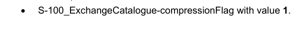

15-6 数据加密

15-6.1 哪些数据是加密的?

任何基于S-100数据模型的产品规范必须定义是否将使用加密,以及哪些文件将被加密.

加密时,加密算法必须是Cepher Block chaining(CBC)操作模式中的高级加密标准(AES),总是假设完整的文件会被加密.

此外,OEM系统HW_ID(硬件ID)将加密,并以用户许可的形式提供给数据客户端. 用于加密文件的密钥本身由数据服务器加密,并在数据许可时提供给数据用户. 有关加密算法的信息载于第15-6.2.1条.

15 -6.2 它怎么加密的?

每个单一产品都使用一个独特的密钥加密。 同样的密钥用于加密与产品相关的所有文件和为产品版发布的所有更新。 但是, 方案允许由数据服务器自行修改密钥。 密钥以数据许可的形式交付给数据客户端 。

15-6.2.1 加密算法

对于许可证和数据文件的加密,使用高级加密标准(AES)块密码算法。这是一个对称-密钥算法,这意味着同一密钥用于加密和解密。该算法定义了纯文本的一个块如何转换成一个块密码文本,反之亦然。AES的块大小总是16个字节(128位) 。 键长可以从128比特,192比特或256比特选择,相应的变体被命名为AES-128,AES-192,或AES-256. 在S-100的这一部分中,总是使用128比特键长.

AES 算法只能加密一个区块的纯文本。 对于较大的信件,必须使用区块密码模式。本保护方案选择了 Cipher 链路模式(CBC) ,用于加密一个多区块的数据。在这个操作模式中,要求区块大小的精确倍数必须是纯文本长度; 需要加贴。

15-6.2.2 加密垫装

将使用的编解方法在 PKCS# 7 中描述, 它会在信件中添加 N 字节, 直到其长度为 16 字段的倍数。 每个字节的值是 N。 注意, 如果原始平原文本已经具有 16 为 16 作为 16的倍长, 则必须添加 16 每个字段为 6 个的完整块 。

## 官方 PDF 第 696 页

表 15-1 — 明文填充

表头：Plain text 为明文，Padded plain text 为填充后的明文。字节值及其排列保留官方原表。

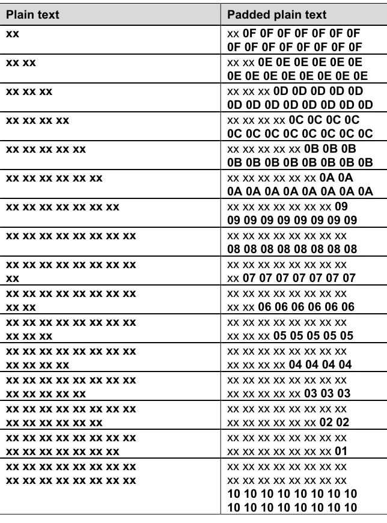

xx = 任意字节。

15-6.2.3 AES 加密 CBC 模式

在 CBC 模式下，每个明文块在加密前，先与前一个密文块进行异或（XOR）运算。第一个数据块需要初始向量 IV。数学公式如下：

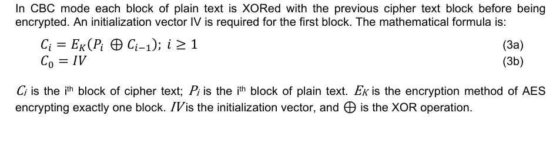

Cᵢ 是第 i 个密文块；Pᵢ 是第 i 个明文块。Eₖ 是恰好加密一个数据块的 AES 加密方法。IV 是初始向量，⊕ 表示异或运算。

## 官方 PDF 第 697 页

图15-2 – Cipher Block chaining (CBC)模式加密(出自:维基百科)

解密的定义是:

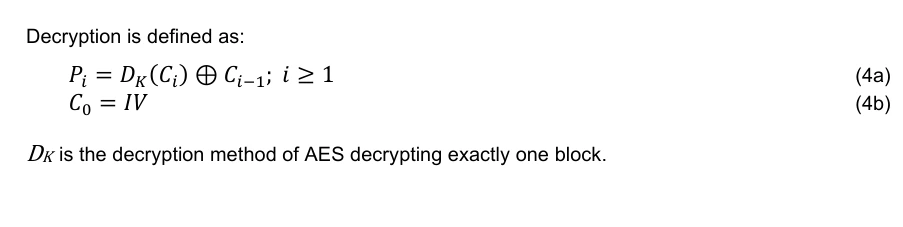

DK是AES精确地解密一个块的解密方法.

图15-3 – Cepher区块链(CBC)模式解密(出自:维基百科)

15-6.2.4 AES CBC模式-初始化矢量

通常初始化向量必须从加密转移到解密中。 然而, 解密时错误的 IV 只会损坏第一个纯文本块。 这可以从公式和图表中很容易识别出来。 每个纯文本项只取决于相邻的两个已解密文本块 。

这种行为将被用于CBC模式的以下修改.

在数据文件加密时, 纯文本将被单个随机块预设。 然后使用随机初始化向量进行正常加密。 此向量无需在数据客户端被转移到解密中 。

在解密时可以使用任意初始化矢量,在正常的 CBC 解密后,第一个纯文本块被丢弃。其余部分是原始的纯文本数据文件 。

这一程序并不要求传送IV或使用预测IV. 第一种选择会使数据传输过程复杂化,第二种选择将使其易受攻击,特别是如果普通人知道第一个纯文本块(如ISO/IEC 8211数据描述记录)的话。

## 官方 PDF 第 698 页

15-6.2.5 AES 实例

以下例子取自FIPS文档.

加密和解密一个区块 :

Key128:K={00,01,02,03,04,05,06,07,08,09,0a,0b,0c,0d,0e,0f}平原文本:P={0000,11,22,33,44,55,66,77,88,99,a,bb,cc,dd,e,ff) Cepher文本:C={69,c4,e0,d8,6a,7b,04;30,d,d;cd;b7;80,70,b4,c5,5a} Key192:K: ⁇ ,01;02;03;04;05;06;07;08;09;09:09;0;a,9;a;b;cc;d;11;12;13;14;15;16;17}平地文本:p=#;11,33;44;55;55,55;77;88;99;aa; 密码文本:C={dd, a9, 7c, a4, 86, 4c, df, e0, 6e, af,70, a0, cc, 0d, 71, 91} 键256:K={00, 01, 02, 03, 04, 05, 06, 07, 08, 09, 0a, 0b, 0c, od, 0t, 010, 11, 12, 13, 14, 15, 16,17, 18, 19, 1a, 1b, 1c, 1d, 1e, 1f}平面文本:P=#00,11,22,33,44,55,66,77,88,99,a,bb, cc, q, puff, = 接下页文本: Cepher {8e,a;b7, ca, 51, 67, 45, 5, if, fa, et, 49, 90, 89} 以下实例文件文档 修改的 CBC 模式 :

```text
Key128:
K = {12, 34, 56, 78, 9a, bc, de, f0, 12, 34, 56, 78, 9a, bc, de, f0}
Plain Text:   P = {fe, dc, ba, 98, 76, 54, 32, 10}
Plain Text after prepending a random block:
P’ = {48, d2, 4e, 7c, 00, 2f, 67, 4e, 93, 1d, ee, 27, 42, 17, a3, 4c}
{fe, dc, ba, 98, 76, 54, 32, 10}
Plain Text (padded):
P” = {48, d2, 4e, 7c, 00, 2f, 67, 4e, 93, 1d, ee, 27, 42, 17, a3, 4c}
{fe, dc, ba, 98, 76, 54, 32, 10, 08, 08, 08, 08, 08, 08, 08, 08}
Initialization vector (random):
IVE = {45, b5, 00, d7, 28, 39, 42, bb, 85, 61, 28, d5, 97, 15, ca, 25}
Cipher Text using CBC Mode:
C = {ba, 45, ee, 06, 02, a6, 29, 35, 7a, e3, 90, 2c, 22, 4d, d9, d5}
{dd, 3b, 07, 3b, 84, 7f, 4d, 43, 28, 71, 19, 43, 97, d9, a6, 03}

For the decryption an arbitrary initialization vector can be used; for example:
```

```text
IVD = {00, 00, 00, 00, 00, 00, 00, 00, 00, 00, 00, 00, 00, 00, 00, 00}

Decryption using the CBC will give the following plain text. The bytes added by the padding are already
removed:
```

```text
PD‘ = {0d, 67, 4e, ab, 28, 16, 25, f5, 16, 7c, c6, f2, d5, 02, 69, 69}
{fe, dc, ba, 98, 76, 54, 32, 10}

Note that the first block is different from the one in P‘.
```

丢弃第一个块后, 原始信件会被回收 。

```text
PD = {fe, dc, ba, 98, 76, 54, 32, 10} = P
```

15-7 数据加密与许可

15-7.1 引言

数据客户端一般不购买以S-100为基础的产品,但持有使用许可证. 许可证是数据服务器用于在特定时间内给数据客户点选择性地访问最新产品的方法.

要有效地操作此方案, 必须有数据客户系统解锁加密数据的手段。 要解锁数据, 数据客户服务系统必须能够访问用于加密特许数据文件的密钥。 这些密钥是用加密方式提供给数据客户端的。

## 官方 PDF 第 699 页

包含一组许可的许可文件。 包含加密密钥的数据许可就是这些。 这种方法用于数据客户端和数据服务器基于文件的数据交换。 其他框架和方法,例如数据流可能使用算法的变异或不同的键长,在元数据中具体说明如何定义它们。

要使每组数据允许独占密钥,必须使用数据客户端系统独有的特性进行加密. OEMs为每个系统指派了标识符(HW_ID),并以用户许可的形式向每个数据客户点提供此功能的加密副本. HW_id是加密的并存储在用户许可中.

OEMs用自己独特的制造商密钥(M_KEY)加密了HW_ID,这样一来,一个HW-ID不能被另一个制造商复制. IHO作为Scheme管理员,为数据服务器提供了访问OEM M_KYys的功能,因此可以解密存储在用户许可中的HW__ID. Data Server在生产一套数据许可时,会与制造商HW _ID加密他们的数据集密钥.

图15-4-基于S-101 ENC产品的高水平许可图

15-7.2 将比特字符串转换为整数

15-7.2.1 将比特字符串转换为整数

{b1, b2,..., bn} 的序列定义一个未签名的整数 I :

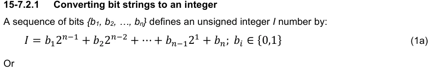

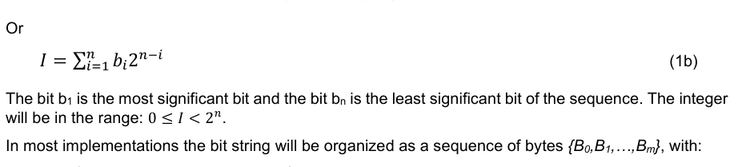

位b1是序列中最显著的位而位bn是最小的位. 整数

在大多数执行中,比特字符串会被排列为{B0,B1,...,Bm}的字节序列,其:

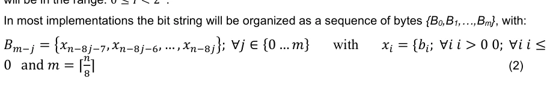

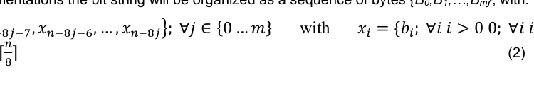

## 官方 PDF 第 700 页

将这样的字节序列转换为整数的可能实施由以下伪码给出.

输入:字节序列 BQQB0, B1,..., Bm} 输出:非负整数编号 I

让 K 从 0 到 m 的 I= 0

我=我*28我=我+Bk Return I

15-7.2.2 将整数转换为比特字符串

公式 1a和 1b 描述一个比特字符串与一个对应的(非负数)整数的关联。假设比特字串是按 (2) 定义的字节顺序排列的,则以下算法显示如何将一个未符号的整数转换为比特数.

输入:一个非负整数 I 有 0QQI < 2n

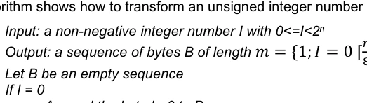

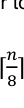

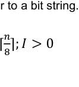

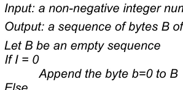

让B成为空序

将字节 b=0 附加到 B else 中

我则 > 0做

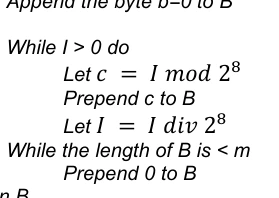

B的长度为 < m

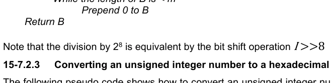

注意,除去28等于位移操作 I\\\8

15-7.2.3 将未签名的整数转换为十六进制文本表示法

以下的伪代码显示如何将一个未签名的整数转换为它的十六进制文本表示. 在这个文本表示中,每个数字可以有16个不同的值.

整数 I 的定义是:

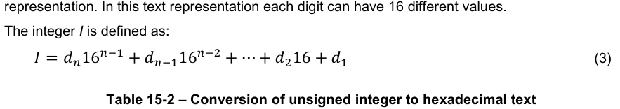

表15-2 - 无符号整数转换为十六进制文本

数字 d 位字符串字符 ASCII 代码 (Hex) ASCII 代码 (dec)

```text
0
0000
‘0’
30
48
```

```text
1
0001
‘1’
31
49
```

```text
2
0010
‘2’
32
50
```

```text
3
0011
‘3’
33
51
```

```text
4
0100
‘4’
34
52
```

```text
5
0101
‘5’
35
53
```

```text
6
0110
‘6’
36
54
```

```text
7
0111
‘7’
37
55
```

```text
8
1000
‘8’
38
56
```

```text
9
1001
‘9’
39
57
```

```text
10
1010
‘A’
41
65
```

```text
11
1011
‘B’
42
66
```

## 官方 PDF 第 701 页

```text
12
1100
‘C’
43
67
```

```text
13
1101
‘D’
44
68
```

```text
14
1110
‘E’
45
69
```

15 1111 ‘F' 46 70 该算法是:

输入: 无符号整数 I 输出: 十进制文本代表 S Let S 是字符的空序列。 如果 I = 0

让 S = “0” 否则

```text
While I>0
```

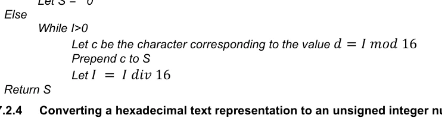

15-7.2.4 将十六进制文本表示式转换为无符号整数

以下算法显示如何将一个无符号整数的十六进制文本代表转换为整数本身.

输入 : 无符号整数 S = {s1, s2,..., sm} 的十六进制文本表示 S 输出 : 无符号整数 I Let I = 0 for I = 1至 m

I = I*16 I = I + d;其中d是对应字符"Si Return I"的数字值.

15-7.3 用户许可证

用户许可由OEMs创建,并作为数据客户端系统的一部分提供给他们,以便他们能够从数据服务器获得必要的加密产品. 下一节定义了用户许可的构成和格式.

所有具有能够使用数据的系统,按照IHO数据保护计划加以保护的数据客户端都必须有一个硬件识别(HW_ID),由嵌入其终端用户系统的数据客户点定义. 这种HW-ID经常作为dongle或通过其他手段执行,以确保每次安装都有一个防篡改识别.

HW_ID对数据客户端是未知的,但OEM会提供HW_id的加密版本,并且是数据客户点系统独有的用户许可. 用户许可是通过取取所指定的HW-ID并用制造商密钥(M_KEY)加密而创建的. CRC32算法运行在加密的HW _ID上并附在其中的结果上. 最后,制造商将指定制造商标识符(M_ID)附在所生成的字符串的末尾. M_KEY和M_id值由SA提供,是每个提供IHO数据保护计划兼容系统的制造商独有的.

数据客户端通过向数据服务器提供用户许可,获得对S-100加密产品的访问权限。这使得数据服务器能够发放数据客户点用户许可特有的数据许可。由于用户许可包含制造商独有的M_ID,因此数据服务器可以使用此功能来识别在用户许可中用于解密硬件标识的M-KEY。 M_ID 是用户许可的最后六个字符。 制造商 M_ KEY 和 M_ ID 的数值由 SA 发布并更新给所有签署此方案的数据服务器。 此列表将在新 OEM 加入此方案时定期更新 。

## 官方 PDF 第 702 页

15-7.3.1 用户许可证的定义

用户许可有46个字符长,必须写成ASCII文本,并带有以下强制性编码格式和字段长度: 1.

表15-3 - 用户允许的外地结构

加密的 HW_ID 检查 SUM( CRC) M_ID 制造商 ID

128个比特(32个字符) 8个字符 6个字符 任意字母字符会用大写来写出.

示例: 编码用户许可 :

```text
AD1DAD797C966EC9F6A55B66ED98281599B3C7B1859868
```

用户许可的结构在以下子语录中解释.

```text
15-7.3.1.1
HW_ID Format
```

HW_ID是由 OEM 定义的十六位数。这样的 HW_ID 可以作为 Dongle 或其他方式执行,并且必须确保每个安装的防篡改标识 。

HW_ID将以加密格式存储在用户许可中。它使用以OEM M_KEY为键的AES算法进行加密,生成128位值(见条款15-6.24)。 128位加密的HW_id随后以ASCII格式在用户许可证中被表示为32个十六进制数字,如有必要,则预先花费0's以获得所需的32位数。

注意,HW_ID的大小与AES块大小相同,不需要任何地标.

HW_ID的例子有: 40384B45B54596201114FE9904220101

被加密的HW_ID的例子有: AD1DAD797C966EC9F6A55B66ED982815

```text
(M_KEY=4D5A79677065774A7343705272664F72)
```

15-7.3.1.2 检查和数(CRC)格式

Check Sum是八位十六进制数字。 它通过取出加密的 HW_ID 并转换为32个十六进取字符串来生成。 然后, 字符串会使用算法 CRC32 和 4 字节转换为 8 个十六出取字串来散开 。

Check Sum不加密,允许检查用户许可证的完整性.

以上示例中的 " 核对和 " 的计算方法如下:

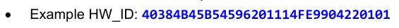

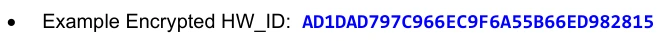

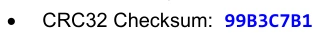

```text
15-7.3.1.3
M_ID Format
```

M_ID是6个字符的字母编码,由SA提供给OEM的ASCII文本来表示. SA会向所有获得许可的制造商提供自己独特的制造商密钥和标识符(M_KEY和M_ID)组合,制造商必须保护这些信息.

SA将在新制造商订阅此方案时,为所有获得许可的数据服务器提供所有制造商代码的完整列表。此信息被数据服务器用于确定在创建数据客户端数据集许可时,用于解密用户许可中的HW_ID的哪个密钥(M_KEY).

以上例子中的M_ID为:859868

```text
15-7.3.2
M_KEY Format
```

M_KEY 是分配给制造商并由SA提供的随机16个十六进制(128位)数字。 OEM 使用此键加密指定的 HW_ID 值生成用户许可。 此键也用于解密指定的 HHW_ ID 。 请注意, M_ KEY 的大小与 AES 块大小相同,不需要任何粘贴 。

## 官方 PDF 第 703 页

M_KEY的例子有: 4D5A79677065774A7343705272664F72 (十六进制代表)

完整的例子见下表15-4:

表15-4-完整的用户许可 -- -- 例如

字段数值

```text
M_ID
859868
```

```text
M_KEY
4D5A79677065774A7343705272664F72
```

```text
HW_ID
40384B45B54596201114FE9904220101
```

```text
Encrypted HW_ID
AD1DAD797C966EC9F6A55B66ED982815
```

```text
CRC32 (Encrypted HW_ID)
99B3C7B1
```

```text
Complete User Permit
AD1DAD797C966EC9F6A55B66ED98281599B3C7B1859868
```

15-7.4 数据许可

要解密数据文件,数据客户端必须能够访问加密它所使用的加密密钥(见条款15-6.2.1)。由于加密密克只有数据服务器知道,因此需要有保护方式将这些信息发送给数据客户点。这种信息由数据服务器以加密形式提供给数据客户,称为许可。 提供一个文件来提供数据许可,它的名称是PERMIT.XML(见第15至7.4.1条)。 这个文件可能包含若干个基于数据客户所要求的产品覆盖范围的许可证。

PERMIT.XML文件将依照数据服务器操作程序,通过硬媒体或在线服务交付,这些程序将在购买许可证时提供给数据客户。

数据许可文件中的每个记录还包含额外的字段,用于协助OEM系统管理数据客户端许可和多个数据服务器的许可文件,参见第15-7.4.2条.

数据客户端可以通过向数据服务器提供用户许可(见第15-7.3条)获得产品访问许可证,然后数据服务器可以使用数据客户点的M-KEY从用户许可中提取HW_ID,并根据这一值创建客户特定许可证。 许可证文件记录的格式在下文第15-74.1至15-7.4.4条中叙述。

由于数据许可是针对特定的HW_ID签发的,因此不能在安装(数据客户系统)之间转让。这种将许可与安装连接起来的方法支持制作通用加密数据,这些数据可以分发给服务的所有数据客户端。

数据客户端系统使用指定由硬件或软件存储的HW_ID来解密许可证,然后系统可以使用已解密的密钥来解析许可证产品,由于多个数据服务器可以为特定类型的产品制作许可证文件,因此由数据客户点系统负责管理来自多个数据伺服器的许可证文件.

15-7.4.1 许可文件(PERMIT.XML)

文件名将始终以UPPERCASE 格式提供,文件内包含的任何字母符号也将同样提供。文件在 ASCII 中完全编码,并符合 S- 100 XML 的许可证规则。 OEMs 应当意识到,保护计划生成的所有 ASC 二 文本文件可能包含模糊的行尾标记,如 CR 或 CRLF , 并且应当能够处理这些标记 。

下图15至5说明了XML计划结构。

## 官方 PDF 第 704 页

图15-5 - 许可证档案的结构

PERMIT.XML文件可以包含多个部分,并具有相应的XML元素如下:

表15-5 – PERMIT.XML 元素

XML 元素描述

标题文件创建日期、数据服务器的名称和格式版本

产品允许从数据服务器获取指定产品

请注意,PERMIT.XML文件可以包含由Data Server提供的多个产品的许可. OEMs必须确保其最终用户软件能够从多个数据服务器合并许可.

15-7.4.2 许可文件 - 标题内容

下表定义了许可 XML 文件内每个部分的内容和格式.

表15-6 - PERMIT.XML的内容和格式

内容 XML 元素

文件名 文件名 许可使用的资源名称, 不包含路径名 格式: 字符串

## 官方 PDF 第 705 页

日期

```text
issueDate
```

日期 XML 格式: xs: date 示例: <issueDate > 2018-03-20Z </issueDate >

提供数据服务器Name 生成许可文件的数据服务器名称。 数据服务器名称应当一致, 并使用S100_ ExchangeCatalogue – contact XML格式: xs: string中定义的相同的组织联系人

提供方标识符数据服务器标识符 数据服务器的简短标识符

S-100版本的版本编号。它将与IHO版本编号方案X.Y.Z相兼容。例如,4.0.0格式:字符串

用户允许用户许可 用户许可许可 。 这样可以让客户系统或执行者验证目的地。 最终用户系统必须能够检查是否是多系统桥上的指定系统许可 , 定义为第15- 7.3.1条定义的字符字符串 格式: 字符字符字符弦

15-7.4.3 产品科和许可记录栏

PERMIT.XML文件中的每个标题元素后有一个名为“产品”的单一元素,其中包含多个“产品”,每个“产品“记录”中包含这些产品的实际许可,这样就可以有一个单独的PERMTI.XmL文件,包含所有指定用于最终用户系统的多个产品的许可。 每个产品部分的属性"id"包含许可证相关的产品规范的S-100标识符;例如:"products id="S-101". 许可文件可能包含与不同终端用户系统相关的多对头/出品元素.

15-7.4.4 许可记录的定义

PERMIT.XML文件中的每个产品元素包含一系列“许可”元素,这些元素包含被识别产品的实际许可,下表定义了许可元素中包含的元素,并定义了每个元素的目的;除非另有说明,否则字段是强制性的. 请注意,只为Base数据集发放许可证,同样的许可证用于解密增量更新(如果产品规范执行更新的话).

表15-7 - 许可证记录要素

字段目的格式

文件名(见下文注)

S100_Dataset DiscoveryMetadata – fileName所定义的文件名,它使数据客户系统能够将正确的加密密钥与相应的加密文件相链接。文件的路径Name 在交换集元数据中定义

字符串

版号[可选] S100_Dataset DiscoveryMetadata所定义的产品文件的版号 - 版号 对于没有版号的产品,许可将适用于所有已发布的数据集

```text
xs:positiveInteger
```

## 官方 PDF 第 706 页

如果产品没有版号,则该发售日期可作为替代标识符。

xs: 日期( X)

过期

这是数据客户端许可证到期的日期。系统必须防止在此日期之后发布的任何新版本或更新被安装

xs: 日期( X)

```text
encryptedKey  (EK)
```

EK 包含产品文件指定版本的解密密钥

32个十六进制字符串, 代表128位加密密钥 注意: 许可. xml 内的文件名以可选文件扩展名指定。 如果文件扩展名为不指定, 则许可文件适用于所有带有指定文件名的数据集, 不论扩展名为何 。

15-7.4.5 许可证文件签名

每个许可文件都将有一个由数据服务器创建的数字签名。数字签名将存储在单独的文件中,并将重复使用许可文件的名称,但将附有“.SIGN”文件,例如许可。

签名文件的内容将是数据服务器证书和许可文件签名,并且必须按照S-100 XML Schemas对独立数字签名进行编码,参见第15-8.11.2.条. OEM系统在对数据集许可密钥解密前,在认证许可文件之前,必须认证数据服务器证明.

15-7.4.6 实例 PERMIT.XML 文件

```text
<?xml version="1.0" encoding="UTF-8"?>
<Permit xmlns="http://www.iho.int/s100/se/5.1"
xmlns:xsi="http://www.w3.org/2001/XMLSchema-instance"
xsi:schemaLocation="http://www.iho.int/s100/se/5.1
https://schemas.s100dev.net/schemas/S100/5.1.0/S100SE/20230327/Part15.xsd">
<header>
<issueDate>2018-03-20Z</issueDate>
<dataServerName>Primar</dataServerName>
<dataServerIdentifier>PR</dataServerIdentifier>
<version>1.0.0</version>

<userpermit>267C3AD506E69B1ED18AA5ECC7FFDE6E7C330CE8859868</userpermit>
</header>
<products>
<product id="S-101">
<datasetPermit>
<filename>101GB40079ABCDEF</filename>
<editionNumber>10</editionNumber>
<expiry>2022-12-31</expiry>

<encryptedKey>2E16E07E451FF1854156634DA3DD3FB8</encryptedKey>
</datasetPermit>
<datasetPermit>
<filename>101NO32802411223</filename>
<editionNumber>5</editionNumber>
<expiry>2022-06-10</expiry>

<encryptedKey>C714B5C0FBDF14BFE4B1F12E62CE5FF6</encryptedKey>
</datasetPermit>
</product>
<product id="S-102">
```

## 官方 PDF 第 707 页

```text
<datasetPermit>
<filename>102NO329048208.h5</filename>
<editionNumber>1</editionNumber>
<expiry>2022-12-31</expiry>

<encryptedKey>50BBC28B6793E1C3966B45FB2932E1BE</encryptedKey>
</datasetPermit>
</product>
</products>
</Permit>
```

15-8 数据真实性验证

本节具体规定了S-100产品规范实施复制保护和(或)认证方法所需的机制,结构和内容,并定义了数据集基于文件的组件以及要素和相片目录的加密标准方法. 数字签名执行的算法和方法以及国际海道测量组织数据保护计划内关键管理和身份保证所需的周围基础设施都得到界定。

15-8.1 数据认证和完整性检查的入门

S-100的数字签名技术使用标准算法和密钥交换机制,广泛提供和使用. 数字签名使用公用钥匙基础结构计划中的不对称公用密钥算法,将数据文件与发行人的身份不可破地绑定.

计划依赖于数据文件的不对称加密。 通过对照发行商的公用钥匙验证签名,以及对照顶级身份验证发行商的公共钥匙,用户可以放心地知道签名商的身份。 数字签名的详细技术说明超出了本文件的范围,读者参考数字签名标准(DSS-FIPS Production 186),以进行更详细和更易于理解的解释. S-100的这一部分假设了数字签名术语的基本知识以及PKCS(公钥密码学标准)认证计划的运作.

国际海道测量组织的数据保护计划可以认为有三个不同的阶段:

1) 计划管理员(SA)核实S-100产品数据服务器的身份,并向供应商提供使其能以数字方式签名其产品的信息。 2) 数据服务器发布其身份(以及由SA验证其身份)所签名的产品。 3) 数据客户端随后对数据服务器的身份、其与SA的联系以及产品数据的完整性进行核实。

域协调员也可担任数据服务器和SA之间的中介。 域协调人的身份由SA认证,然后由它来认证他们负责的数据服务器的身份。

应当指出,S-100数字签名机制并非仅用于S- 100产品规范的数据文件,既可以加密(和发放许可证),也可以在数字上签名任何基于文件的数据,本部分所述机制将被用于签署目录和其他补充文件,包括要素和外观目录。

1 不对称加密依赖于用不同加密密钥进行加密和解密的算法,因此,一个人可以加密数据,提供解密密钥供他人解密,这些密钥被称作"私人密钥"和"公用密钥 ",统称为"密钥对".

## 官方 PDF 第 708 页

图15-6 - 数据服务器和数字签名创建过程

15-8.2 数据保护计划设置、数据服务器注册和认证序列

以下是数据保护计划各机构在数据文件数字签名期间采取的步骤清单.

1. 计划创建和设置(仅是在数据保护计划的推动下):a. SA创建自己的公/私钥匙对并自签。 b. NA将其自签公用钥匙(也称为 " 证书 " )公用公用键放在公众面前。

域名. c. SA 公用密钥在 OEM 系统需要时被嵌入.

2. 数据服务器设置(仅存): a. 数据服务器创建了公用和私用密钥对. b. 数据服务器在他们的公用密钥上签名(带有私用密钥) 创建自签名密钥

(有时也被称为 " 证书签名请求 " ) c. 数据服务器的自签名密钥(SSK)被发送给SA(或域协调员),用于

申请加入IHO S-100数据保护计划时进行验证,数据保护计划内的任何其他要求和职责在此阶段发给未来的数据服务器.

3. 数据服务器身份验证: a. 如果接受SA验证数据服务器的SSK和身份. b. SA用自己的私人密钥在数据服务器的SSK上签名,以生成一个已签名的SA.

Data Server Certification. c. 数据服务器证书随后被返回到Data Server. d. 数据服务器验证证书在他们的公钥上签名反对SA Public

钥匙

## 官方 PDF 第 709 页

4. Data Server随后可以制作数据文件的数字签名. Feature和显示 Catalogues的数字签名也可以由一些计划参与者按需要制作.

15-8.3 数字签名的核查

客户系统对数字签名的核查采取以下步骤:

图15-7 – 客户端系统的数据认证过程

15-8.4 数字签名、密钥和证书的数据格式和标准

数据认证需要下列类别的内容:

1. 密钥对, 私有和公钥。 这些都是PEM编码的椭圆曲线数字签名算法(ECDSA)密钥及其椭圆曲面域参数。 格式在 RFC 5915( 私有密钥) 和 RFc 5480( 识别器和公用密钥格式) 中描述。 ' 不受限制的 ' 算法标识符必须设定为:

```text
id-ecPublicKey OBJECT IDENTIFIER ::= {
iso(1) member-body(2) us(840) ansi-X9-62(10045) keyType(2) 1 }
```

名为 Curve 的参数必须设置为:

```text
secp384r1 OBJECT IDENTIFIER ::= {
iso(1) identified-organization(3) certicom(132) curve(0) 34 }
```

2. 证书签名请求和数字签名公用钥匙:当公用密钥本身数字签名时,它被称为“证书”(因为公用专用钥匙通过使用私人钥匙认证而“认证”),当公有密钥由相应的私人钥匙签名时则被称为“自签名”证书。 这些记录被设定为X.509记录,可以被DER或PEM编码,以发送到SA签名. 当嵌入到XML文件密钥中时,应当被PEM被编码,这样便可以将纯文本作为XMl元素插入. 要符合这一标准,CSR和证书应当定义用于创建数字签名的散列算法到SHA384(又称SHa2-384). 3. SA所签名的公钥("证书")的数字格式为X509v3格式编码为PEM.

## 官方 PDF 第 710 页

X.509证书中的显著名称(DN)构成证书不可变异的内容的一部分(即不能更改证书而不无效). 方案参与者的角色和他们被分配的域可以被编码入DN. 数据保护计划的国际水道测量组织的运作程序将执行这种内容的格式化所需的任何具体程序,SA可以限制DN组件(例如通用名称或组织)允许的值以及这种识别符的格式,以便管理数据保护计划的参与者的运作。

SA执行的政策和程序不属于S-100这一部分的范围,必须在其他地方界定。使用DN定义证书Ref字段也可以帮助执行者在验证数字签名时选择正确的证书。这也可以由SA授权,因为它规定了数据保护计划的运作方式。

PEM格式定义了ECDSA算法所要求的多大数的文字编码(与ECDSA算法所要求的ECDSA参数相通). PEM编码(最初是为电子邮件编码而开发,但在加密界广泛用于编码用于密钥和数字签名的长整数)允许将公钥和数据服务器证书嵌入XML文件,用于许可证文件XMl创建,创建目录和支持文件元数据,并制作显示和Feature Catalogues的数字签名. S-100数据文件的数字签名必须嵌入目录元数据,并服务于对照未加密数据文件进行校验及其来源认证的双重目的,因此,必须在任何压缩和加密机制之前制作这些签名,因为副本保护本身是可选的。

SA证书代表了作为PEM编码文本文件提供的ECDSA公共密钥. S-100 Part 15 SA Certification将永远以名为 IHO.PEM的文件提供. IHo.Pem文件可以从 IHOC http://www.iho.int 上获取.

S-100数字签名是数字签名标准(DSS)的实现. DSS使用一个经批准的散列函数来创建文件内容的电文摘要(hash). 消息摘要随后会输入椭圆曲线数字签名算法(ECDSA),以使用不对称加密算法和签名人密钥对的"私钥"生成电文的数字签名. S-100基于文件的认证使用曲线NIST P-384和散列函数SHA384. 其他框架或通过API进行的数据流可能使用不同的曲线和散列函数.

在 ECDSA 算法中,一个签名是两个整数的序列。按照惯例,这些签名被称为 R 和 S (一种 “ R, S 配对 ” )。 XML 文件嵌入的数字签名格式如下 :

```text
<digitalSignature id=”primar” certificateRef=”IHO”>
MGQCMDP17NEJXU7gzwTQAp2lgyDzJd1agCeoZ6FZOMGFRmV4sPfzAUhlC3hdj+DF3n2n/QIwPYzh15YiBgJ5Aph11kF
UjLywzjDZGHYm/GyjxeCL/8FnOviMwccTlxh65fNkL0eg==</digitalSignature>
```

两个R,S大整数的编码是一个 Base64 ASN.1 字节序列2. 这些由 OpenSSL 执行程序原地生产,可以生成和验证,而不需要解开单个的R和S整数。这个编码方便地将这两个值明确地包裹在一个字节数组中。 然后代表R,S对的ASN.1序列被编码为Base64(RFC 4648),用于XML数字签名元素中的表示.

ASN.1的上述计划是:

仙女花花花(2 emelem) INTEGER (382位) 33F5ECD1095D4EE0CF04D0029DA58320F325DD5A8027A867A15938C185466578B0F7F3048650B785D8FE0 C5DE7DA7FD (38222位出) 3D8CE1D7962206027902987D641548CBB0CE30D9187626FCA3CA5C5E08BFFFC373A8C1C71397187AE5F3642F47A0D3D.

数字签名还包含下列属性:

1. “id”属性作为标识符。 2. 证书参考属性, 以正确公钥识别数据服务器证书进行认证。 如果签名由SA认证, 则证书参考符是SA的标识符, XML 容器类型的系统管理员要素中定义的。

第15-8.8条对这些属性作了描述。

2 抽象语法注解一(ASN.1)是用于定义数据结构的标准界面描述语言,可以跨平台方式进行序列化和去序列化,广泛用于电信和计算机网络,特别是密码学(参考:维基百科).

## 官方 PDF 第 711 页

15-8.5 编写关键材料和证书签署申请(署名公用钥匙)

常用的"OpenSSL包"提供了一个公有领域,开源工具,用于在本部分所指定的需要的开放标准中制作关键材料.

下文表15-8列出了创建公用和私人密钥对、证书制作和数据文件数字签名的基本命令行实例。

15-8.5.1 SA设置

程序只执行一次。表格中的指令 SA-1 设置了一套新的 ECDSA 参数, SA-2 命令创建了 SA 的“ 根证书 ” — — 即自动验证其身份的自签名密钥 。

当一个数据服务器创建了X509证书签名请求(CSR)时,SA会使用命令SA-3来签名。这将创建一个签名版本的数据服务器公钥。“ds.crt”文件的PEM编码版本是嵌入在许可文件和目录元数据中作为“数据服务器证书”的内容。SA也可能向自己签发数据服务器证明。

表15-8 - 创建公用和私人钥匙对-基本命令

任务命令

SA-1 创建 SA 私钥

```text
openssl ecparam -name secp384r1 -genkey -out sa-
priv.pem
```

SA-2 创建 SA 自签名证书

```text
openssl req -new -x509 -key sa-priv.pem -sha384 -out
sa.crt -days 365
```

SA-3 创建并签名数据服务器证书

```text
openssl x509 -req -in ds.csr -CA sa.crt -CAkey sa-
priv.pem -out ds.crt -sha384 -days 365
```

15-8.5.2 数据服务器设置

数据服务器通过使用命令DS-1到DS-4描述的一次唯一过程来设定其在SA的身份,这向数据服务器提供一份SA签名证书,每次向数据客户端发送签名材料时都包含该证书.

表15-9 – 数据服务器设置命令

任务命令

DS-1 创建数据服务器私有密钥

```text
openssl ecparam -name secp384r1 -genkey -out ds-key.pem
```

DS-2 将公钥从私钥分割开来

```text
openssl ec -outform pem -in ds-key.pem -out ds-public-
key.pem -pubout
```

DS-3 创建签名请求

```text
openssl req -new -sha384 -out ds.csr -key ds-key.pem
```

DS-4 核查从南非收到的证书

```text
openssl verify -verbose -CAfile sa.crt ds.crt
```

```text
DS-5 make data file
echo "hello world" > hw.txt
```

```text
DS-6 sign data file
openssl dgst -sha384 -sign ds-key.pem -out signature.bin
hw.txt
```

DS-7 编码签名为 Base 64

```text
openssl enc -base64 -in signature.bin -out signature.b64
```

```text
DS-8 verify signature
openssl enc -d -base64 -in signature.b64 -out
signature.bin
openssl dgst -sha384 -verify ds-public-key.pem -signature
signature.bin hw.txt
```

## 官方 PDF 第 712 页

指令DS-5到DS-8显示如何创建一个简单的文本文件"helloworld",与数据服务器的私人密钥签名创建了ECDSA-P384签名,然后验证. DS-7创建了64个编码的基数签名,可以用于按照S-100的相关部分嵌入XML文件(无论是PERMIT.XM70还是所需的目录元数据).

```text
<digitalSignature>
```

```text
MGQCMDP17NEJXU7gzwTQAp2lgyDzJd1agCeoZ6FZOMGFRmV4sPfzAUhlC3hdj+DF
3n2n/QIwPYzh15YiBgJ5Aph11kFUjLywzjDZGHYm/GyjxeCL/8FnOviMwccTlxh6
5fNkL0eg==
</digitalSignature>
```

15-8.6 数字证书实例

数字证书将被编码为 PEM , 以便于交换并嵌入到 XML 文件。 以下是 PEM 有编码的数据服务器证书的示例。 上一节列出的命令格式化了公钥和证书签名请求, 以便SA和DS之间适当通信。 在将数字证书嵌入 XMR 元素时, 标题和页脚行被省略 。

以 S- 100 为主的交换集的目录文件将包含交换集中所有文件所使用的所有数据服务器证书的副本,但最终用户单独安装的SA根证书除外。 交换目录证书中包含一个带有“ id” 属性的“ 化学管理员” 元素的代表SA 根证书的标识符。

每个包含证书的XML元素将有一个独特的标识属性"id". 每个XMR证书定义还将包括一个属性,“签发者”定义发行者的标识,或者是SA(由计划管理员id所识别),或者是一个域协调员(其证书也将被包含在交换集中). 下面的例子显示一个带有 SA 证书( 未包含) 的 Exchange Set 目录头的摘录, 上面有 id “ IHO ” 。 之后, PEM 编码证书中包含了 SA 在 ID “ DS1 ” 有签名的数据服务器证书 。

```text
<S100XC:certificates>
<S100CE:schemeAdministrator id="IHO"/>
<S100CE:certificate id="DS1" issuer="IHO">
MIICDjCCAZMCFEvCGmio4FLGYU9VtSiIjkR3n+i6MAoGCCqGSM49BAMDMFoxCzAJ
BgNVBAYTAk1DMRUwEwYDVQQHDAxEZWZhdWx0IENpdHkxHDAaBgNVBAoME0RlZmF1
bHQgQ29tcGFueSBMdGQxCjAIBgNVBAsMAS8xCjAIBgNVBAMMAWQwHhcNMjMxMTMw
MTczOTA0WhcNMjQxMTI5MTczOTA0WjB7MQswCQYDVQQGEwJNQzEWMBQGA1UECAwN
REFUQV9QUk9EVUNFUjEwMC4GA1UECgwnSW50ZXJuYXRpb25hbCBIeWRyb2dyYXBo
aWMgT3JnYW5pc2F0aW9uMSIwIAYDVQQDDBl1cm46bXJuOmlobzpvcmc6MDBBQTox
ODEwMHYwEAYHKoZIzj0CAQYFK4EEACIDYgAEfnOz0pGcPnvTXIYVhfvWsFm5+gf0
5QRlfCtfswveUijttUHrZJUDZSBf5s15tEEAaseQqDpJJcR9z354GN4uzpqHPELL
zNaahZ+oYBois44W4Y5Qo+NfH5iaRHbmsNOiMAoGCCqGSM49BAMDA2kAMGYCMQDc
lFEyN3iFINm/5O1mKp/8HwPxnDwkH7tgBnY8PBLQk69vTqPOow3cieJN44EM9rsC
MQCo+v/K7P1eanGRurkLOstFoEcNySgErIDFQ7sCYF8/E3/onf5/q81wMH66DBJF
IHU=
</S100CE:certificate>
```

15-8.7 由数据服务器创建数字签名

数据服务器使用ECDSA算法及其私人密钥为所需数据文件创建了数字签名,参见第15-8.4.

S-100 交换集中包含的所有文件都必须在 S100_Dataset Discovery MetaData-digital Signature 或 S100_PresidentFile Discovery Metadatadatadigital Signature 元素中编码其签名.

数字信号参考域必须被编码为“ECDSA-384-SHA2”。

## 官方 PDF 第 713 页

数据服务器证书必须始终提供数字签名。它使 OEM 能够使用 SA 公钥认证证书,并检查证书的有效性。数据服务器公钥可以从证书中提取出来,用于认证数据集文件。

单个 id 属性可以在定义数字签名时被 OEM 用作查询。 每次签名被编码后,它都会减少重复数据服务器证书的必要性 。

交换集目录中定义的数据服务器证书和数字签名的同同为XML元素,也用于目录元数据中没有的数码签名辅助文件;例如目录和许可文件,这些都包含在S-100 XML Schemas中,并自成一体,包含所有必要的数据服务器证书.

由于域协调员(例如海事组织)可以为其域的参与者创建数据服务器证书,所以必须使用以下机制来确保数据客户系统能够进行证书路径验证: 数据服务器的用户身份验证,其用户身份认证程序是: 用户身份证明,其身份证明和证书认证程序,其权限为: 数据库的用户名称,其地址和地址为:

1.数据服务器必须始终包括其域协调员的数字证书,以确保数据客户端OEM拥有在没有任何外部访问的情况下进行完整证书路径验证所需的所有证书. 2. 当目录元数据中定义数据服务器证书时,它将包括数据服务器ID和出证者的引用. OEM 应向 发行者 证书 查询,并将其用于 Data Server 认证 。 3. OEM 应 核查 证书签发者的身份, 以验证 用于 Dat Server 证书认证的正确域证书。 这是在 根据 ECDSA 验证签名之前进行的 。 交换集中的所有证书必须由SA认证,由一个或多个域协调员直接认证或通过间接认证.

数字签名在目录元数据(和支持文件元数据)中用于两个领域:

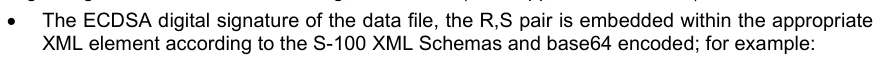

数据文件的ECDSA数字签名,R,S对被嵌入到合适的XML元素中,按照S-100 XML Schemas和base64编码;例如:

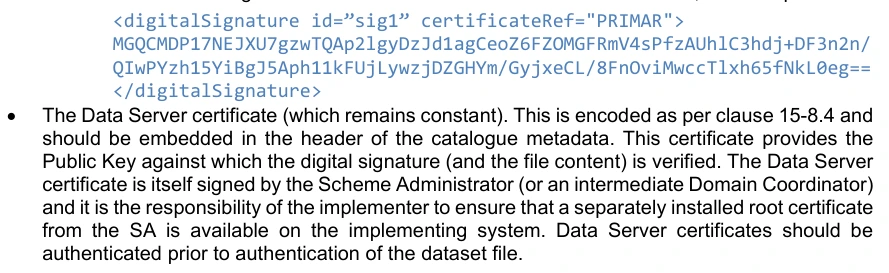

数据服务器证书( 不变) 。 其编码是第 15- 8 4. 条, 并应当嵌入目录元数据头中。 此证书提供了用于验证数字签名( 和文件内容) 的公钥 。 数据服务器证书本身由Scheme管理员(或中间域协调员)签署,执行者有责任确保在执行系统上可以获得从SA中单独安装的根证书. 数据伺服器证书应在数据集文件认证前进行认证.

数据服务器证书只需要在交换集元数据中完整地包含一次。由于证书不更改,因此,如果多个数字签名引用了证书,可以使用证书的“id”属性来称呼证书。

数字签名的另一种编码是PERMIT.SIGN文件,它持有由颁发许可证的数据服务器创建的许可文件内容的独立签名. PERMTI.SIKN文件是一个自成一体的数字签名,包含定义文件名、数字签名和所需的任何证书(以及中间域协调员证书)等要素.

数据客户系统应核查许可证文件的真实性,以确保签字在安装许可证之前由SA进行认证。

15-8.8 其他数字签名

可通过在目录条目中附加额外的数字签名条目来添加更多的数字签名,这可以表达一个签名单个资源的认证身份列表. 这是数字签名的可选增强,最小的是一个单一的数字签名,对照一个被命名的证书验证一个单一资源(例如许可,目录,数据集或补充数据集文件)的内容.

## 官方 PDF 第 714 页

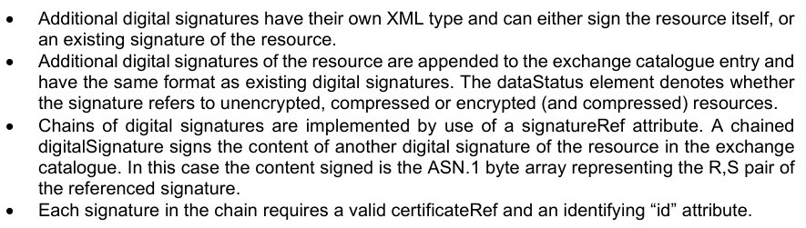

其他数字签名有自己的XML类型,可以自己签名资源,也可以签名资源本身,也可以是资源的现有签名. 资源的额外数字签名被附加在交换目录条目上,并且具有与已存在的数字签名相同的格式. 数据状态元素表示签名是指未加密,压缩还是加密(并被压缩)资源. 数字签名链是通过使用签名属性来执行的 。 链式数字签名在交换目录中标出资源的另一个数字签名的内容。 在这种情况下,签名的内容是代表链中每个签名的 R, S 字节数组,需要有效的证书Ref 和一个识别的“ id” 属性。

这些属性汇总于下表15-10:

表 15-10- 附加数字签名属性

属性目的

id 数字签名值的独特标识符

证书 Ref 签名可对照的公用钥匙。 只有签名的公用钥匙本身包含在数字签名元素中时, 才具有可选性, 否则是强制性的 。

数据现状[仅指数据签名] 签名是否为未加密资源,仅指被压缩的资源(如多个资源的存档)或被加密的资源(并被压缩)

数据集DiscoveryMetadata元素中包含的完整实例如下。在此示例中,数据集发现元数据指定了一个数据文件。第一个签名“s1”表示数据集资源(不需要“ref”属性),签名“ s2”表示加密数据,签名 “s3”表示签名S2。

```text
[datasetDiscoveryMetadata entry]
<S100XC:digitalSignatureValue>
<S100SE:S100_SE_SignatureOnData id="s1" certificateRef="PROD1"
dataStatus="unencrypted">(sig. omitted)</S100SE:S100_SE_SignatureOnData>
</S100XC:digitalSignatureValue>

<S100XC:digitalSignatureValue>
<S100SE:S100_SE_SignatureOnData id="s2" certificateRef="RENC1"
dataStatus="encrypted">(sig. omitted)</S100SE:S100_SE_SignatureOnData>
</S100XC:digitalSignatureValue>

<S100XC:digitalalSignatureValue>
<S100SE:S100_SE_SignatureOnSignature id="s3" certificateRef="DIST1"
signatureRef="s2">(sig. omitted)</S100SE:S100_SE_SignatureOnSignature>
</S100XC:digitalSignatureValue>
```

15-8.9 用S-100数字签名验证数据完整性和数字身份

数字签名验证是一种算法,它运行在三个独立的数据上(所有数据格式都与S-100的这一部分一致):

1. 需要验证的一些内容(该内容的格式是任意的); 2. 公用密钥,适当编码. 在采用的ECDSA算法中,公用公用钥匙是一个单数,加上一组ECDS A参数(三个数字); 3. 签名. 在ECDS阿算法里,签名由两个数字组成;根据公约,这些数字被称作R和S(一对R,S对).

一个签名验证进程可以识别R,S对子是否根据给定的公钥认证内容。这只能导致真实结果或虚假结果 。

ECDSA数字签名核查有两个结果:

## 官方 PDF 第 715 页

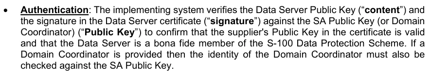

认证:实施系统对数据服务器公用钥匙(“内容”)和数据服务器证书(“签名”)中的签名进行验证,以确认供应商在证书中的公用键是有效的,并且数据服务器是S-100数据保护计划的真正成员。 如果提供域协调员,还必须对照SA公用钥匙检查域协调员的身份。

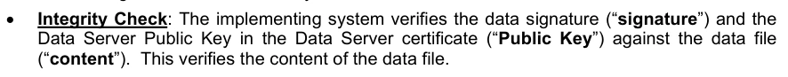

完整性检查:执行系统对照数据文件(“内容”)验证数据签名(“签名”)和数据服务器证书中的数据服务器公钥(“公钥”),以此验证数据文件的内容。

如果此验证检查成功, 那么它证明了数据没有以任何方式被损坏, 并且数据集签名中的数据服务器的身份由SA根证书中定义的 SAS 身份验证. 包含其公钥的 SA 根证书必须单独安装在终端用户系统上,而不与 ExchangeSet 元数据相包装.

15-8.10 MRN 规格

为了支持 17 部分 交换集资源的可发现性, S- 100 部分定义了以下 MRN 命名空间。 这些区域旨在通过独特的密码散列或数字签名来发现数据集补充资源。 用于定义散列和签名的算法嵌入 MR N 中 。

下面的表15-11和15-12显示了S-100的数字签名和散列MRN的规格,所有字段都是强制性的,对大小写不敏感。

表15-11-S-100 数字签名 MRN

名称值示例

前缀骨灰:mrn:iho:s100:dsig

数字符号参考的算法(第15-8.11.8条)

```text
ECDSA-384-SHA2
```

```text
Value
Computed digital Signature value
MGUCMQCd9T4ggpAeVA/6zB0HWCXTsUOaD56lM4Ui
tkNXrYa5rURtLwiWH2D/ZkmYRY1LTO8CMHIYHpBX
vr7HwY6+W36bXnR5ylc8QTN7vc9WH/Zmo5Ck1IH0
2RUbS286RnYXUEP3WQ==
```

```text
Example
urn:mrn:iho:s100:dsig:ecdsa:
MGUCMQCd9T4ggpAeVA/6zB0HWCXTsUOaD56lM4UitkNXrYa5rURtLwiWH2D/ZkmYRY1LTO8
CMHIYHpBXvr7HwY6+W36bXnR5ylc8QTN7vc9WH/Zmo5Ck1IH02RUbS286RnYXUEP3WQ==
```

表15-12-S-100 密码散列

名称值示例

```text
Prefix
urn:mrn:iho:s100:hash
```

数字符号参考(第15-8.11.8条) SHA-256

以十六进制表示的计算出密码散列值

```text
a948904f2f0f479b8f8197694b30184b0d2ed1c1
cd2a1ec0fb85d299a192a447
```

```text
Example
urn:mrn:iho:s100:hash:sha256:a948904f2f0f479b8f8197694b30184b0d2ed1c1cd
2a1ec0fb85d299a192a447
```

## 官方 PDF 第 716 页

本页特意留空

## 官方 PDF 第 717 页

15-8.11 交换目录元数据和单独的计划要素规格

图15-8 数据保护-类详情

## 官方 PDF 第 718 页

```text
15-8.11.1 S100_SE_CertificateContainerType
```

角色名称描述。 数据类型备注

```text
Class
S100_SE_CertificateConta
inerType
```

一组签名的公钥证书 - - 用于 S- 100 部分 17 交换目录

方案管理员的身份 1 字符串 方案署长的身份载于方案管理员要素的“id”属性中。方案管理员证书没有列入目录元数据,因为执行系统独立核查了该证书。

IHO作为计划管理员的编码为:<S100SE:chemeAdministrator id="IHO"/>

属性证书 A 已签名的公钥证书 1.. * 基础 64 已编码字符字符串

与 X.509 编码一致。 包含一个实体的数字签名标识符 注意: 用于S- 100 兼容交换集和独立的签名文件时, 属性方案管理员必须在场 。

```text
15-8.11.2 StandaloneDigitalSignature
```

角色名称描述。 数据类型备注

Class 独立数字签名 A 单一数字签名 - - - CATALOG.SIGN和PERMIT.SIGN文件的格式(见条款15-7.4.5和S-100 第17部分第17-4.2.7条)

属性文件名 签名内容的文件名 1 C字符串 签名资源的文件名

认证对方案管理员签名的任何证书

```text
1
S100_SE_CertificateContainerT
ype
```

属性签名 A 单一数字签名 1 S100_SE_数字签名 文件资源的签名

```text
15-8.11.3 S100_SE_DigitalSignature
```

类 S100_SE_数字签名是作为 S100-SE-Signature OnData(特定已识别资源的数字签名) 或使用类 S 100_Se_附加签名定义的额外数字签名实现的,每个符号要么是一个 S100 _SE _SigmatureOnData 或

## 官方 PDF 第 719 页

S100_SE_Signature OnSignal 元素,如第15-8.8. 条款所描述. S-100 第17部分元数据允许多个数字签名,一个单一的强制S100_ SE_signatual OnData和任何数量的附加签名,无论是数据还是其他签名.

```text
15-8.11.4 S100_SE_SignatureOnData
```

角色名称描述。 数据类型备注

S100_SE_SignatureOnData - Base64 编码数字签名值(第15-8.4项)

```text
-
```

数字签名的属性 id 标识符 1 字符串 每一个签名条目都有独特的标识符

属性证书 参考已签名的公用钥匙 1 字符串标识符,数字签名据以验证证书

属性数据状态 创建数字签名时的数据状态

1 数据状态 表示签名是否来自未加密的,压缩的或加密的资源文件版本

```text
15-8.11.5 S100_SE_SignatureOnSignature
```

角色名称描述。 数据类型备注

S100_SE_Signature On Signature - Base64 编码数字签名值(第15-8.4节)

```text
-
```

数字签名的属性 id标识符 1 字符串 每一个签名条目都有一个独特的标识符

属性证书 参考已签名的公用钥匙 1 字符串标识符,数字签名据以验证证书

属性签名 参考数字签名 。

```text
15-8.11.6 DataStatus
```

角色名称说明

数字签名创建时的数据状态

未加密的值 数据未加密且未压缩 例如, 支持资源

数值加密 数据被压缩并加密 例如, 复制保护数据集

数值压缩。 数据只压缩 。 例如, 多资源档案

## 官方 PDF 第 720 页

```text
15-8.11.7 S100_SE_DigitalSignatureReference
```

角色名称描述代码备注

```text
Enumeration
S100_SE_
DigitalSignatureReference
```

提及用于实施第15部分的加密算法

目前,在执行S-100时,只使用ECDSA来向ECDIS文件传输数据,还列入了其他数值,用于通过外部标准与其他执行的互操作性。

键长为 QQ 2048 比特的 RSA 1 RSA

值 DSA 2 有键长的 QQ 2048 比特

值为 ECDSA 3,键长为 QQ 224 比特.

价值 ECDSA-224-SHA2-224 4 224比特 ECDSA 与 SHA2-224 散列

价值 ECDSA-224-SHA3-224 5 224位元 ECDSA 有 SHA3-224 散列

价值 ECDSA-256-SHA2-256 6 256比特 ECDSA: SHA2-256

价值 ECDSA-256-SHA3-256 7 256比特 ECDSA: SHA3-256

数值 ECDSA-384-SHA2 8 384比特 ECDSA: SHA2-384

数值 ECDSA-384-SHA3 9 384比特 ECDSA: SHA3-384

值 AES-128 10 AES 128位键

值 AES-192 11 AES 192 位键

值 AES-256 12 AES 256比特键

## 官方 PDF 第 721 页

15-9 S-100 数据保护方案与计算术语表

关于整个S-100使用的一般缩略语清单,见第0部分,第0至2款;关于整个S-100使用的一般术语和定义清单,见附件A。

表15-13 - S-100数据保护计划条款

AES 高级加密标准, 方案使用的加密算法

包含解密许可产品所需的加密产品密钥的数据许可文件。它专门为特定用户创建 。

数据客户端(Data Client Term) 用来代表接收加密信息的信息消费者. 数据用户端将使用软件应用程序(例如ECDIS)来完成计划中所详述的许多操作.

数据服务器术语,用于代表一个组织,生成加密数据文件或向最终用户发放数据集许可证

M_ID SA为每个制造指定的唯一标识符 。 数据服务器用此来识别在解密用户许可证时要使用的 M_ KEY

M_KEY 系统制造商向 OEM 提供的唯一识别密钥。 它被 OEMs 用于加密创建用户许可时的 HW_ ID 。

HW_ID 由 OEM 指定给系统每个执行的标识符。 此值使用 OEM独特的 M_ KEY 加密,并作为用户许可提供给数据客户端。 这种方法允许数据客户客户端购买许可来解密数据集 。

PKCS 公钥加密标准

IV AES-CBC加密算法所使用的初始化矢量

SA计划管理员. 国际海道测量组织负责维护和协调保护计划的所有业务方面和文件

SHA 安全哈斯算法

SSK 自签名密钥( 自签名证书文件)

用户允许加密的 HW-ID 格式 唯一识别数据客户端系统

表15-14 - 计算术语

CRC 循环裁员检查

XOR 独家或

## 官方 PDF 第 722 页

本页特意留空
