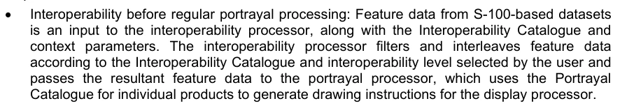
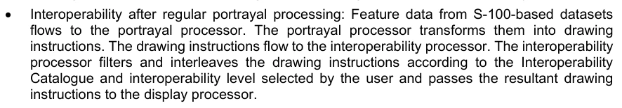
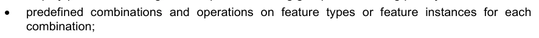
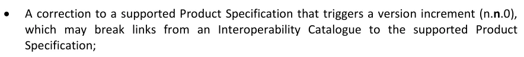
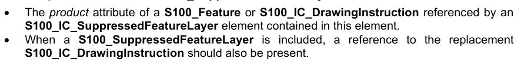

# S-100 5.2.1 · 第 16 部分 · 互操作目录模型

非官方机器翻译参考稿，尚未逐条人工校订。公式与代码保留原文，解释以英文规范为准。

## 官方 PDF 第 723 页

S-100 - 第16编

互操作目录模型

## 官方 PDF 第 724 页

5.2.1版实质性变动摘要

已生效的概要条款

从规范引用中删除了 URL 链接. 16-3

将 URL 链接替换为一般网页参考文献。 16-A-3

## 官方 PDF 第 725 页

中文目录（可用上方目录直接跳转）

目录 · 官方 PDF 725
16-1 范围 · 官方 PDF 729
16-2 符合性 · 官方 PDF 729
16-3 规范性引用文件 · 官方 PDF 729
16-4 上下文 · 官方 PDF 729
16-4.1 实施互操作性办法概述 · 官方 PDF 729
16-4.2 互操作性目录概览 · 官方 PDF 730
16-4.3 处理概况 · 官方 PDF 732
16-4.4 互操作性目录数据模型 · 官方 PDF 733
16-4.4.1 引言 · 官方 PDF 733
16-4.4.2 行动概念类型 · 官方 PDF 736
16-4.4.3 过滤器 · 官方 PDF 751
16-5 显示目录元素的对应与抑制 · 官方 PDF 751
16-6 要素创建或替换规则 · 官方 PDF 752
16-7 互操作目录数据模型与通用要素模型 · 官方 PDF 754
16-7.1 地理要素类型 · 官方 PDF 754
16-7.2 元特性类型 · 官方 PDF 755
16-7.3 要素和信息协会 · 官方 PDF 755
16-7.4 信息类型 · 官方 PDF 755
16-8 互操作级别 · 官方 PDF 755
16-9 混合规则 · 官方 PDF 755
16-9.1 简单的混合规则 · 官方 PDF 756
16-9.2 专题混合规则 · 官方 PDF 756
16-9.3 完整的混合规则 · 官方 PDF 756
16-9.4 混合要素和外观目录 · 官方 PDF 756
16-10 互操作目录制作流程 · 官方 PDF 756
16-10.1 要素目录和外观目录更新的管理 · 官方 PDF 757
16-10.2 除FC/PC以外的产品规范更新 · 官方 PDF 758
16-10.3 无法预测的产品规范更新 · 官方 PDF 758
16-10.4 将在目录中界定的其他数据产品 · 官方 PDF 758
16-10.5 后向相容性 · 官方 PDF 758
16-10.6 互操作性目录产品 · 官方 PDF 759
16-10.6.1 更新互操作性目录 · 官方 PDF 759
16-10.6.2 取消一个版本的互操作性目录 · 官方 PDF 759
16-10.7 支持文件 · 官方 PDF 759
16-10.7.1 更新互操作性目录支持文件 · 官方 PDF 760
16-11 显示 · 官方 PDF 760
16-11.1 显著要素的显示 · 官方 PDF 760
16-11.1 切换为正本 · 官方 PDF 761
16-11.2 对观众群体的影响 · 官方 PDF 761
16-11.3 对平面目录的影响 · 官方 PDF 761
16-11.4 元地貌 · 官方 PDF 761
16-11.4.1 个别产品的数据质量 · 官方 PDF 761
16-11.4.2 组合数据质量图示 · 官方 PDF 761
16-11.5 文本显示 · 官方 PDF 762
16-11.6 混合要素概念或混合显示 · 官方 PDF 762
16-11.7 混合显示对符号和区域图案的影响 · 官方 PDF 762
数据等级 · 官方 PDF 762
16-11.9 互动网格信息 · 官方 PDF 762
16-11.10 拾取报告 · 官方 PDF 763
16-11.11 用户对已加载数据集合的控制 · 官方 PDF 763
16-11.12 用户对互操作级别的控制 · 官方 PDF 763
附录16-A · 官方 PDF 765
16-A-1 XML 模式 · 官方 PDF 765
16-A-2 互操作目录结构 · 官方 PDF 765
16-A-3 模式文件的位置 · 官方 PDF 773
附录16-B · 官方 PDF 775
16-B-1 如何实现产品规范之间的互操作 · 官方 PDF 775
16-B-2 重复要素 · 官方 PDF 775

## 官方 PDF 第 726 页

中文目录（可用上方目录直接跳转）

16-B-2.1 复制特性,同型号 · 官方 PDF 775
16-B-2.2 复制特性,不同的模型 · 官方 PDF 776
16-B-2.3 复制特性域 · 官方 PDF 776
16-B-2.4 几何 · 官方 PDF 776
16-B-2.4.1 组合几何 · 官方 PDF 776
16-B-2.4.2 空间相差,与平滑缩放或制图无关 · 官方 PDF 777
16-B-2.4.3 空间相差,与比例或制图平滑有关 · 官方 PDF 777
16-B-2.5 文本显示 · 官方 PDF 777
16-B-2.6 地球外皮替换 · 官方 PDF 778
16-B-2.6.1 地球地貌调整 · 官方 PDF 778
16-B-2.7 混合要素概念 · 官方 PDF 778
16-B-2.8 数据的等级 · 官方 PDF 778
16-B-2.8.1 预定义组合 · 官方 PDF 778
16-B-2.9 新数据集 · 官方 PDF 778
16-B-2.9.1 新数据集 - 覆盖 · 官方 PDF 779
16-B-2.9.2 新的数据集 -- -- 最大和最小显示尺度 · 官方 PDF 779
16-B-2.9.3 新数据集-地貌几何 · 官方 PDF 779
16-B-2.9.4 新的数据集 -- -- 类型和属性 · 官方 PDF 779
16-B-2.10 由于规模而装入和卸出数据集 · 官方 PDF 779
16-B-2.11 新数据产品 · 官方 PDF 779
16-B-2.12 元数据 · 官方 PDF 779
16-B-3 显示可区分性：预留颜色 · 官方 PDF 779
16-B-3.1 黑色(S-4-B-141) · 官方 PDF 780
16-B-3.2 红葡萄酒(S-4-B-142) · 官方 PDF 780
16-B-3.3 巴夫(黄)或灰色(S-4-B-143) · 官方 PDF 780
16-B-3.4 蓝色(S-4-B-144) · 官方 PDF 780
16-B-3.5 绿色(S-4 – B-145) · 官方 PDF 780
16-B-3.6红 · 官方 PDF 780
16-B-3.7 日/夜/日/日/日 · 官方 PDF 780
16-B-4 绘制顺序步骤 · 官方 PDF 780
附录16-C · 官方 PDF 781
16-C-1 引言 · 官方 PDF 781
16-C-2 结构化互操作 · 官方 PDF 781
16-C-3 产品规范的互操作要求 · 官方 PDF 782
16-C-4 用户层面的自定义 · 官方 PDF 782
16-C-5 支持以人为中心的设计 · 官方 PDF 782
16-C-5.1 以人为本的设计和用户界面 · 官方 PDF 783
16-C-5.2 以人为中心的设计和文字 · 官方 PDF 783
16-C-6 用户对已加载数据集合的控制 · 官方 PDF 784
16-C-7 用户对互操作级别的控制 · 官方 PDF 784
16-C-8 用户指定设置的优先级覆盖 · 官方 PDF 784
附录16-D · 官方 PDF 785
16-D-1 引言 · 官方 PDF 785
16-D-2 通用编码说明 · 官方 PDF 785
16-D-2.1 标识和参考 · 官方 PDF 785
16-D-2.2 特性代码 · 官方 PDF 785
16-D-2.3 元素 S100_IC_Interoperable 目录 · 官方 PDF 785
16-D- 2.4 元素 S100_IC_DisplayPlane · 官方 PDF 786
16-D-2.5 元素 S100_IC_绘图指令 · 官方 PDF 786
16-D-2.6 元素 S100_IC_Feature · 官方 PDF 786
16-D-2.7 元素 S100_IC_DisplayPlane · 官方 PDF 786
16-D-2.8 元素 S100_IC_预定义组合 · 官方 PDF 786
16-D-2.9 元素 S100_IC_Supped FeatureLayer 软件 · 官方 PDF 787
16-D-2.10 元素 S100_IC_ 调整后的温度 · 官方 PDF 787
16-D-2.11 元素 S100_IC_HybridFeature · 官方 PDF 787
16-D-2.12 元素 S100_IC_完成规则 · 官方 PDF 788
16-D-2.13 元素 S100_IC_理论规则 · 官方 PDF 788
16-D-2.14 元素 S100_IC_简易规则 · 官方 PDF 788
16-D-2.15 元素 S100_IC_HybridFC · 官方 PDF 788
16-D-2.16 元素 S100_IC_HybridPC · 官方 PDF 788

## 官方 PDF 第 727 页

中文目录（可用上方目录直接跳转）

附录16-E · 官方 PDF 789
16-E-1 实现指南 · 官方 PDF 789
16-E-2 减少对用户注意力的占用：显示调整 · 官方 PDF 789
16-E-3 减少对用户注意力的占用：避免文字过载 · 官方 PDF 789
16-E-4 对初学用户的支持 · 官方 PDF 789
16-E-5 减少对用户注意的需求——导航系统的规划和监测模式 · 官方 PDF 789
16-E-6 互操作与数据覆盖范围 · 官方 PDF 789
16-E-7 其他重要信息 · 官方 PDF 790
16-E-8 分阶段实现 · 官方 PDF 790

## 官方 PDF 第 728 页

本页特意留空

## 官方 PDF 第 729 页

16-1 范围

S-100数据产品的用户可能同时接收和使用不同的S-100的数据产品,这些数据产品可能包含一些可能具有一些共同要素或类似基本概念的不同表达要素,也可能存在雷达上覆等其他数据层. 有必要对这些不同产品进行平稳的、方便用户的平面介绍,这一部分界定了一个框架,用以制定S-100数据产品平面展示和处理提醒和指示等操作规则。

这一框架可用于制定包含在互通目录中的系统特定规则,这种元产品类型描述产品组类如何同时被使用和显示.

16-2 符合性

这一部分不是ISO或其他标准的专用配置,因为本部分使用的S-100互操作性概念是S- 100所独有的. S-100相通性模型是ISO 19139中定义的CT_Catalogue类的一个专业化,由ISO 19115-3所实施.

16-3 规范性引用文件

RFC 2141 URN语法,因特网工程工作队,1997年5月,海事组织MSC.1/Circ.1512 关于软件质量保证和以人为中心的电子设计的准则。

导航. ISO 19115-1 ISO 19.115-1:2014,地理信息-元数据-第一部分-基本原理. 由"修正案"一号2018年修改. 标准化组织 19115-3 ISO/TS 19115:3:2016,地理信息 -- -- 元数据 -- -- XML Schema执行基本概念. XPath XMl路径语言(XPath) 3.1 - W3C建议 2017年3月21日 (World-Wide Web Consortium-W3C)(Retrieved 2018-12-08).

16-4 上下文

这一部分提供了一个框架,用于规定S-100兼容系统中数据产品交互的机器可读规则。 一个使用不同数据产品的系统需要一种规定的算法来确定这些不同数据产品如何在系统内交互。 此处的交互作用,指数据产品同时显示的方式,与单独显示的每个产品的外观相比,影响综合显示的外观. 产品的互操作性包括一些问题,例如确保所覆盖的其他信息不会掩盖其他重要信息,或管理不同产品中存在相同或类似要素的情况,这会使用户对哪个实例最准确和适合使用提出质疑。

有关互操作性的规则预计不会适用于所有产品互动,因此必须管理在特定情况下预计将一起使用的产品分组,例如在执行具体导航任务时。 按照这些原则管理信息的规则,以机器可读的XML格式来捕捉,这样在诸如额外产品可供使用或对现有组合的修改变得必要等事件中,系统可以被更新出新规则. 这套规则被称为"互操作性目录".

16-4.1 实施互操作性办法概述

互操作性处理与常规的绘图处理结合工作(见S-100 Part 9-显示),取决于系统软件开发者设计的系统架构,它可能起到例如作为前处理或后处理阶段的作用,而可进行常规的图像处理.

## 官方 PDF 第 730 页

一个互操作性目录基本上描述了从一个输入流的要素数据转变为一个输出流的被优先排序的要素数据的. 输入流由S-100基于数据集的要素出自于要素数据(或者以输入数据中的要素对象的形式,或者通过绘图处理而被转换为绘图指令的要素对象). 输出特性流由特性数据组成,其原始形式可能包含一些输入特性;将其他特性的版本合并;并完全从流中去除其他特性. 输出要素流中的特性也根据特性类型,与其他特性相比,指定(或修改)了优先级.

16-4.2 互操作性目录概览

互操作性目录是用于过滤和/或将不同数据产品对应的从不同输入流中的要素对象合并到合并输出流中的特性对象的法规集. 互接性目录提供了描述规则活性条件的手段-即每个法规集适用于特定的产品组合.

在每一规则中,可能都有其前例具体规定它们所应用的不同产品要素的组合,以及适用规则的结果是什么的规则;即,鉴于输入流中要素的特定组合,应当向输出流中释放出哪些要素或要素.

互操作性处理器应用了分配给已加载的数据产品组合的规则,输出出一串既包含原始特性实例又包含任何新特性的数据流,在适用的情况下,它们符合混合要素目录中定义的新混合特性类型. 选择过程如图16-1所示,仅包括选择与用户或系统设置相适应并准确列出目前已上载产品的可适用预定义组合(PDC). 在这些步骤之后,只必须有一个适用的PDC;但是,如果有平分,就必须用外部平分平分的方法来打破,例如允许用户根据PDC的使用条件和描述属性选择组合.

## 官方 PDF 第 731 页

图16-1 - 选择规则的程序

产品组合是数据产品列表,当与规则或单个规则相关联时,指规则或单一规则适用于所列出的数据产品的组合,如果实施,每个产品组合可以被指定一个互操作级别,以及说明其目的和对人类最终用户和目录开发者的适用性的描述性属性. 关卡用于将Interoperable Catalogue模型的功能分解为适合使用大小写时的逻辑模块. 如果使用小写不要求分解Interopositable Ctalogue模式的功能,则只需要一个单等一等.

显示平面在终端用户显示中起到分层功能的作用。输出流中的每个功能都被分配到显示平相上。每个平相下都分配了相对于其他平相上的显示顺序。互操作性目录使用显示平等从不同产品中分离的特性,其要素存在于较高优先平相中,无论在哪个重合处,均覆盖在较低优先平面中。 对于相接或相重叠的符号,执行者可以使用适当的方法来避免显示部分符号,或者将下层符号的"分出"部分分到上层的符号上.

互操作性目录允许压制特性类,其中某一特性类型在某一产品中存在特性导致特定特性类型的所有特性从另一指定数据产品中去除。当两个特性类型代表同一类数据时,应该使用这两个特性类型,但一个数据产品比另一个更受青睐。 例如,首选数据产品的详细程度,首选产品中的额外要素要素等.

互操作性目录还允许压制特性实例,即只压制符合特定条件的特性实例,而偏向于不同产品的特性实例。 条件的描述方式为特定要素,如属性值或不同属性值的组合,或特定类型中所有点要素等空间原始物的特定类别.

## 官方 PDF 第 732 页

EXAMPLE:A类数据集中具有属性=(自然保护区),(鸟类保护区)相接地(鸟取地), (海豹保护区)或(生态保护区)的受限地要素被压制,由于更多细节,偏好B类数据集中的受限区域要素.

高级互操作性功能包括特性的混合. 混合性包括将输入流中不同产品的特性数据合并为输出流中的新类型-从输出特性类型在输入出品的任何要素目录中都没有定义的意义上来说是新的. 这种组合类型是为了产生具有增强特性的由此产生的要素,例如通过增强一种产品产生的属性集,并增加从另一种数据产品衍生出来的属性.

EXAMPLE:一种产品提供的水位信息与另一种产品的水深测量结合,第三种产品中高定义的水深测定可以产生去去去取去的地区,随着水位的变化而增减.

混合特性在混合要素目录中被定义(必须符合第5部分),其显示在混合相通目录中得到定义(必须与第9部分相接),该目录被捆绑在一个交换集中.

16-4.3 处理概况

互操作性处理可以先于或后于绘图处理(渲染除外,它把要素数据转换为图形,必然是实际显示前的一步). 混合处理模式,即图像处理前后进行互操作性的处理,也是可能的.



在常规描述处理前的互操作性:来自S-100基数据集的特有数据是互操作性处理器的输入,同时还有互操作性目录和上下文参数. 互操作性处理器过滤器和互放器按照用户选择的互操作性和互操作级别设置了功能数据,并将所生成的要素数据传递给显示处理器,它使用个人产品的显示 Catalogue为显示处理器生成绘图指令.



常规描述处理后的互操作性: S-100 数据集的特性数据会流到描述处理器上。描述处理取出它们会转化为绘图指令。绘图指令会流至互通处理器。 互操作性处理器过滤并互放根据用户所选择的互操作性和互操作级的绘图指令,并将所生成的绘图指示传递给显示处理器.

上述两种处理方案如图16-2所示。

## 官方 PDF 第 733 页

图16-2 - 基本互操作性处理

除第0级(互操作性关闭)外,在任何处理级别中,待加载的数据产品由系统根据用户从目录所列出的用户中选择的预定义组合中选取列表.

互操作性目录中未列出的产品所生成的特性数据,通过S-100 第9部分(相接性处理)所描述的显示处理,在互操作性的处理中没有任何中间阶段,由普通的S- 100显示处理按照各自相接性的相接式目录进行显示.

16-4.4 互操作性目录数据模型

16-4.4.1 引言

互操作性目录规定了单个产品规范中定义的要素类型和要素实例相对于其他要素类型及要素实例的相对显示优先顺序,这些要素类型与要素实例可以在被宣布为互操作性的目录范围内的任何数据产品中被定义.

互操作性目录描述显示平面,预定义组合,要素实例和要素层压制规则.

互操作性目录(IC)使用ISO 19139(由ISO 19115-3)定义的ISO CT_Catalogue类作为标题信息的超级类型. 互操作性正文

## 官方 PDF 第 734 页

目录由编码显示平面规则的分节、要素优先级、要素互通以及可用的预定义组合组成:


显示飞机、表明飞机的顺序、取景组和绘制优先;



预定义的组合和关于每个要素类型或要素实例的操作

Interoperable Catabase必须是符合Interoperable Catabase Schema的XML文档,可以从IHO网站下载. 图16-3显示Interoperable Catabase模式.

## 官方 PDF 第 735 页

图 16-3 — 互操作目录模型

## 官方 PDF 第 736 页

16-4.4.2 行动概念类型

以下条款描述了可在互操作性目录中使用的不同概念要素。

```text
16-4.4.2.1
S100_IC_InteroperabilityCatalogue
```

一个互操作性目录包含一套S-100数据产品的互通操作操作和规则.

```text
Table 16-1 S100_IC_InteroperabilityCatalogue
```

角色名称 名称描述 :

S100_ IC_ InteroperableCatalogue 类, 包含关于Interoperable目录的标题信息

```text
--
--
Specialization of CT_Catalogue
(ISO 19115-3)
```

属性描述 目录描述 1 字符串

属性注释 任何附加注释 0.1 字符串

属性互操作性 级别 类型中编码的最多一级互操作性功能

0.1整数

负责编制本目录所依据的规格、规则或要求的当局或请求者的类型

1 编号

说明本目录所依据的要求或规格的来源,这可能是国家、公司、OEM、港口、飞行员等的名称。

```text
1
CharacterString
```

本目录涵盖的产品

```text
2..*
dataProduct
```

属性名称目录名称 1 字符串从 CT_ Catalogue 继承

属性范围 目录主题域 1.. * 从 CT_Catalogue 继承的字符串

描述本目录可能用于何种用途

0. * 从 CT_ Catalogue 继承的字符

属性版本 编号 产品规范的版本号

1 从 CT_ Catalogue 继承的字符串

## 官方 PDF 第 737 页

属性版本 Date 产品规范的版本日期

1 从 CT_ Catalogue 继承的日期

属性语言 本目录使用的语言

0.1 从 CT_ Catalogue 继承的字符串

属性地块提供替代本地化字符串的信息

0.1 PT_Locale(ISO 19115-1) 从CT_Catalogue继承

属性字符Set 目录中使用的字符集

```text
0..1
MD_CharacterSetCode
```

(ISO 19115-1)

```text
Inherited from CT_Catalogue
```

必须是值=utf8

显示一个或多个 S100_IC_DisplayPlane 元素的 Planes 容器

1..* <序列>S100_IC_DisplayPlane 排序的一个或多个 S100_IC_DisplayPlane 元素列表

预定义产品组合的容器和每个容器的互操作性操作

0.* <序列>S100_IC_预定义组合序列 S100_IC_预定义组合元素

混合规则 混合规则的容器 0.* <序列>S100_IC_Hybridization Rules

角色 mixyFC 引用此互通目录中操作所使用的混合要素目录

```text
0..*
CharacterString
```

角色混合PC 引用此互操作性目录中操作使用的混合 显示 目录

```text
0..*
CharacterString
```

```text
16-4.4.2.2
S100_IC_DisplayPlane
```

显示平面元素充当显示指定特性类信息的容器。 整个平面的显示顺序在 S100_ IC_ DisplayPlane 元素中提供。 S100- IC- DisplayPlanee 实例中的所有类型相对于 S100 _ IC _ DispplayPrane 实例中的特性类型, 都具有相同的显示顺序( 以属性顺序编码) 。 显示平面的实例可以以互操作性水平为特征,根据用户希望产品在所生成的显示上进行紧密整合的程度,允许对不同的一组操作进行编码.

指定显示平面的要素类型,通过显示显示平平面,优先级,并渲染指定到显示平相的类型顺序,使得在显示时能够交互显示平分出出要素层. S100_IC_DisplayPlane 指定了要素类型子集来显示平等平相并定义平相中的每个要素类型并绘制出优先级和意义. S100_IC_DisplayPlane 元素可能包含多个特性类型.

一个要素类型可以在一个以上的S100_IC_DisplayPlane中被引用,但是不同显示平面中的条目必须用不同的属性-值组合或空间原始区分,这样实际的要素实例会被明确划分为不同的显示平平面.

S100_IC_DisplayPlane 组件中没有提到的要素类型的显示,在普通的描述处理之前是未定义的.

## 官方 PDF 第 738 页

S100_IC_DisplayPlane的示例必须包含至少一个S100_C_Feature或S100-IC_ Drawing Interviews. S100-C_Diseplay Plane 的示例可能同时包含S100起_IC-Featual和S100出行指令,但受以下制约.

对于S100_IC_Feature和S100_IC_Drawing 指令,其组合相同为[地由代码,出产,几何类型和属性组合],并且在同一S100_IC_DisplayPlane容器中:


S100_IC_Feature.drawing Priority和S100_IC_Drawing Instruction.drawing Priority必须具有相同的值.


S100_IC_Feature. Viewing Group and S100_IC_Drawing Instruction. Viewing Group必须具有相同的值.

```text
Table 16-2 S100_IC_DisplayPlane
```

角色名称 名称描述 :

类 S100_IC_DisplayPlane 每个显示平面识别所有特性及其平面内的绘图优先级。还给出了显示平面的排列顺序 。

```text
--
--
Composition component of
S100_IC_InteroperabilityCatalogue,
container displayPlanes
```

属性标识符 显示平面1 字符串的独特标识符必须是独一无二的

属性名 显示平面名称 1 字符串 在雷达下,在雷达上等.

用于排序显示平面的渲染顺序的属性顺序。 显示值较大的平面会被绘制在数值较低的平面之上 。

1 整数参考S-100 第二部分第2b-4.2.23条和第九部分第9-11.1.5、9-13.3和9-13.3.20条。

正面:RADAR 0上方:RADAR预留 正面:RADAR下方:

显示平面 1 字符串的属性描述

属性互操作性 级别 类型中编码的最多一级互操作性功能

0.1整数

S100_IC_Feature 元素0. * <序列>S100_IC_Feature 至少一个S100_IC_Feature或S100_IC_Drawing 指令元素的容器必须包含在显示平面元素中

S100_IC_绘图指令元素的容器

0.* <序列>S100_IC_绘图指令至少必须包含一个S100_IC_Feature或S100_IC_绘图指令元素在显示平面元素中

## 官方 PDF 第 739 页

```text
16-4.4.2.3
S100_IC_Feature
```

S100_IC_Feature元素描述特定产品中特定要素类型所有要素的显示参数. S100-IC_featural元素决定了其要素属性相对于同一显示平面中其他要素类型所识别的要素类型绘制顺序,还指定了该要素被指定到的取景组. 它的适用性可以通过附加属性来指定空间原始类型并表明主题属性的具体值,可选择性地限制在要素类型的子集.

相通目录中的S100_IC_Feature元素在操作中与显示 Catalys中的绘图指示元素的分层和优先方面相类似(参见S-100 Part 9-Portranyal),因此具有等同于PorttrayalCatary元素的一些属性和作用的属性. 如果有精确的对应内容与显示 Catalogue元素相通,则Interoperable Catarogue元素中的该元素将取代Porttrayal目录元素。这些对应内容在表16-19第16-5条中汇总。

```text
Table 16-3 S100_IC_Feature
```

角色名称 名称描述 :

S100_IC_ Feature Information 类,用于在绘图时引导要素类型相对分层和绘制优先级

```text
--
--
```

属性标识符目录元素 1 的内部标识符字符串

属性要素 代码 指定在要素目录中用于产品属性所显示产品的特性类型

```text
1
CharacterString
```

属性产品 A 数据产品 1 数据

属性几何Type 表示位置的原始空间类型

```text
0..*
S100_FC_SpatialPrimitiveType
```

属性属性 组合 描述要应用到指定特性的属性值过滤器

0.* 字符串见第16-4.2.3条。

在显示平面中绘制特性类型的优先级

1 整数参考S-100第9部分第9至11.2.2条。

属性取景组 要素类型 1 的取景组 整数参考 S-100 第9部分 第9-13.3条

注:S100_IC_Feature和S100-IC_Drawing 指令元素的运作方式与绘图优先级的指派基本相同,显示平面。它们有所不同,因为S100__IC_ Drawining 指示提供了一种可选属性,可以取代绘图指令中的符号化元素。 S100_IC_Feature应用于互操作性目录,该目录是为在生成绘图指令之前进行互操作处理的系统所设计的. S100-IC_Drawing Interoper性目录应用于为生成绘图指示之前进行相互操作处理取而代之的系统而设计的. 还应在所有目录中使用,因为需要替换符号。

## 官方 PDF 第 740 页

```text
16-4.4.2.4
S100_IC_DrawingInstruction
```

绘图指令指定了渲染引擎在生成特定要素类型/地平面原始类型/属性值组合的绘图输出时所使用的显示顺序. S100_IC_ Drawing Instruction 元素决定了绘制其要素属性相对于同一显示平面上的其他要素类型所识别的要素类型的顺序. S100_IC_Drawing Instruction对要素类型的适用性可以进一步被空间原始类型和主题属性值所限制,使用S100_C_DlawingInstruments类的几何Type和属性组合属性.

相接目录中的S100_IC_Drawing Interoperal Catalogy 中的指示元素在操作中类似于相接式目录中指示元素的分层和优先方面(参见S-100 Part 9-相接性),因此具有等同相接相接的相接子目录元素的一些属性和作用. 凡与显示 Catalogue元素有确切对应关系时,相交性目录元素中的元素会取代Porttrayal目录元素. 对应关系摘要载于第16-5项中的表16-19. (Portaryal Ctalogue属性的定义见S-100 第9部分).

S100_IC_Drawing Instruction元素包含可替换的Symbolization属性,可以替换由绘图处理生成的符号化指令. 注意演示文稿中定义的显示指令XML元素XMle S-100 第9部分(点指示,行指示等)不能被直接使用,因为作为该Schema中碱基类型绘图指示的扩展,它们:(a)参考单个要素和空间实例, (b)包含取景组,显示平面,并绘制优先级作为强制元素,这将是多余的.

```text
Table 16-4 S100_IC_DrawingInstruction
```

角色名称 名称描述 :

S100_IC_绘图指令类信息,用于指导绘图指令在绘图过程中的相对分层和绘制优先级.

```text
--
--
```

属性标识符 指令组 1 字符串的内部标识符

属性要素 代码 指定在要素目录中用于产品属性所显示产品的特性类型

1 字符串对应 S- 100 第 9 部分中绘图指令的特性参考

属性产品 A 数据产品 1 数据

属性几何Type 表示位置的原始空间类型

```text
0..*
S100_FC_SpatialPrimitiveType
```

属性属性 组合 描述要应用到指定特性的属性值过滤器

0.* 字符串见第16-4.4.3条。

第1组的绘图优先权

属性取景组 要素类型 1 的取景组 整数参考 S-100 第9部分 第9-13.3条

## 官方 PDF 第 741 页

属性替代 符号化 符号式 符号取而代之 绘图指令 。 这可以是S- 100 Part 9 定义的抽象类绘图指令中未定义的任何绘图指令要素, 其第 9-11.2 项中定义的是该类的相关后人

0.1 CharlieString 字符串必须包含一个或多个 XML 片段,按照 S-100 Part 9 中的演示文稿 Schema 构造,或等同的非 XMR 语法. CDATA 部分可以用来避免字符实体对特殊字符的明文编码

注:即使使用S-100 第9部分中的演示语法Schema,可能需要提供特定代码来验证替代Symbolization属性的内容,而不是依赖于纯粹的XML Schema验证. 该属性的内容不是由这个规格规定的,可能是XMl的一个片段,或者解释代码或规则等,在非XMR语法中. 它可能被封入到 <! [CDATA [.]]] > 一节中,这样XML验证器就把它当作字符数据而不是XMl。如果内容是XMR,它必须成型良好(例如有平衡的开和收的标记).

```text
16-4.4.2.5
S100_IC_SuppressedFeatureLayer
```

此元素的每个实例都识别出特定数据产品中的要素类型.

```text
Table 16-5 S100_IC_SuppressedFeatureLayer
```

角色名称 名称描述 :

S100_ IC_ SupprestedFeatureLayer 类 描述一个产品中所有特性类型实例的操作,并用另一个产品的特性来压制它

```text
--
--
```

属性标识符目录元素 1 的内部标识符字符串

属性特性 属性产品中提及的产品的FC 特性类型代码

```text
1
CharacterString
```

属性产品 被替换类型的数据产品

```text
1
dataProduct
```

角色特性 参考替代特性在互操作性目录显示平面部分的显示规格

0.* <参考>S100_IC_Feature Control by multiple special special special specials types 打算用于相关的要素类型,例如构成交通分离方案的不同要素类型.

角色绘图指令参考 S100_ Drawing 指令元素

```text
0..*
<reference>S100_IC_DrawingInstruction
```

注:在实例中只能使用特性参考或绘图参考。注:如果特性和绘图指导参考均为空,则该类型将被压制而不被替换。

## 官方 PDF 第 742 页

```text
16-4.4.2.6
S100_IC_PredefinedCombination
```

一个预先定义的组合元素定义了数据产品的集合,其中在Interoperable Catalogue中定义了一套通用的互操作性操作. 预定义组合的事例可以以互操作性水平为特征,根据用户希望产品在所生成的显示上进行紧密整合的程度,允许对不同的一组互操作进行分解,详见"条款16-8".

预定义的组合元素可以指定其上市产品之间的下列类型的相互作用.


操作某要素类型的选定实例,或将输入要素数据转换为仅涉及主题属性的新要素数据.


涉及空间属性和可能涉及主题属性的业务。

实例上最简单的操作是用另一个产品中选定的实例来替换一个产品中的某些实例。这些实例由关联的S100_IC_SupprestedFeatureInstance元素来描述。更复杂的操作,包括将输入特性实例转换为新特性(hybridization),由关联 S100_C_HybredFeatual元素来形容。 第16-6条对替换和混合规则作了说明。

预定义的组合可以通过S100_IC_预定义组合元素中的引用来与S100_IC_DisplayPlane元素相链接.

```text
Table 16-6 S100_IC_PredefinedCombination
```

角色名称 名称描述 :

S100_IC_预定义组合是可识别的S-NNN数据产品预设集合,它们预期用户在特定条件下或特定任务下会加载. 每个预定义的组合基本上是数据产品的包,显示优先级,上下文参数,用户设置,显示 Catalogues等.

```text
--
--
Composition component of
S100_IC_InteroperabilityCatalogue
```

预定义组合 1 字符串的属性标识符。 例如, 目录中一个序列号、 UUID 或 PDC 独有的 URN 。 可能是全球独有, 但必须至少是目录中独有 。

属性名称 组合 1 字符串

属性描述 组合 1 的简介 字符串

组合设计的条件

```text
1
CharacterString
```

属性互操作性 级别 类型中编码的最多一级互操作性功能

0.1整数

## 官方 PDF 第 743 页

属性包括装入该组合的并按适用于该组合的业务和规则注明的制成品

2.* 数据 生产 组合必须至少使用2个数据产品

角色显示 Plane 参考 此互操作性目录中 S100_ IC_ DisplayPlane 元素

```text
0..*
<reference>S100_IC_DisplayPlane
```

S100_IC_SuppedFeetental Instance 或 S100_IC_HybridFeature 元素的Features 容器(S100_IC_FeatureDerivation的具体专业)

0. * S100_IC_ FeatureDeviation的子类的"序列"

S100_IC_SuppedFeatureLayer 的 FeatureLayers 容器的组件被压制

```text
0..*
<sequence>
S100_IC_SuppressedFeatureLayer
```

注:一个系统可以允许用户启动多数据产品的加载,并激活多个参数设置作为单项动作,方法是从一个预定义的组合列表中选择,而不是装入并卸下单个数据产品.

```text
16-4.4.2.7
S100_IC_FeatureDerivation
```

S100_IC_FeatureDerivation是不同类型特性混合操作的抽象超类,单个主输入和次级输入被抑制提供,只有由此而来衍生的特性被添加到数据堆. 由此衍生的特性不需要有任何杂交特性,即一个被另一个受限制区域所取代的禁区将使用主产品中常规的PC/FC. 然而,如果结果特性需要任何自定义的FC或PC元素支持,它们必须在混合FC和混合PC下相应定义. 创建该特性的规则必须在规则一节中描述.

```text
Table 16-7 S100_IC_FeatureDerivation
```

角色名称 名称描述 :

S100_IC_FeatureDerivation 衍生特性是通过将两个或多个不同产品的特性合并到一个最终视图来创建的,因此这些变化可以包括几何,归属和/或显示(取决于互操作性级别).

```text
--
--
Abstract class.
```

属性标识符目录元素 1 的内部标识符字符串

两种互通数据产品之一 1 数据

初级产品在FC中的特性类型代码

```text
1
CharacterString
```

## 官方 PDF 第 744 页

首个特性类型实例的属性主选择器选择表达式

0.1 特性选择器 如果省略,则包含该类型的所有实例。

例1:障碍类别=5

例2:水位效应=4和WISIN( " 初级 " , " 中等 " )

属性二级 Production 另一种互通数据产品 1 数据

二级FeatureCode 二级Feature产品在FC中的特性类型代码

```text
1
CharacterString
```

属性二级选择器选择第二个特性类型的实例表达式

0.1 特性选择器 如果省略,则包含该类型的所有实例。

例1:声优解释=3

例2: 类 OffPile = 2 and WithIN( " 初级 " , " 中等 " )

属性输出 Product Data 产自所生成的混合特性 1 数据 Propuctive 默认值= HYBRID ,以表示结果是一个混合特性。这是默认值 — 在特定情况下可以设定为词典中允许的其他值 。

属性输出 FeatureCode 混合 FC 1 字符串中的特性类型代码

角色特性 参考输出特性在互操作性目录的显示平面部分的显示规格

```text
1
<reference>S100_IC_Feature
```

```text
16-4.4.2.8
S100_IC_SuppressedFeatureInstance
```

S100_IC_SupprestedFeatureInstance是一类根据一个产品中的属性组合抑制要素实例,另一个产品中的要素组合. 主产品属性组合指定了将要被替换的要素实例. 次级产品组合是替换被抑制实例的产品,应该与输出产品属性合并完全相同. 如果两组不同的特性例要被一组共同的特性例所压制,则需要两组S100_IC_SuppedFeatualInstance.

```text
Table 16-8 S100_IC_SuppressedFeatureInstance
```

角色名称 名称描述 :

S100_IC_SuppedFeatureInstructions 类,用于将一个产品中的特性实例替换为另一个产品中的实例.

```text
--
--
Sub-class of
S100_IC_FeatureDerivation
```

“二级”产品取而代之的是“初级”。

## 官方 PDF 第 745 页

参考目录中混合规则一节所定义的规则

```text
0..1
<reference>S100_IC_SimpleRule
```

注:如果输出的属性约束与二次产品类型相同,则输出的Production和出品的ProvityCode应与二次Product和二次FeatureCode相同. 如果属性约束的变化方式与二级产品的要素目录不一致,则必须使用S100_IC_HybridFeauture来代替.

```text
16-4.4.2.9
S100_IC_HybridFeature
```

S100_IC_HybridFeature是选择初级和二级输入的类,将抑制被提供,取而代之的是从输入中衍生出来的特性.

```text
Table 16-9 S100_IC_HybridFeature
```

角色名称 名称描述 :

S100_IC_HybridFeature Class 用于将两个或两个以上产品的特性类型合并,以进行互操作显示,从而创建一个特性

```text
--
S100_IC_FeatureDerivation
Sub-class of
S100_IC_FeatureDerivation
```

参考目录中混合规则一节所定义的规则

```text
0..1
<reference>S100_IC_CompleteRule
```

参考目录中混合规则一节所定义的规则

```text
0..1
<reference>S100_IC_ThematicRule
```

注:在一个实例中只能使用一个创建规则。

```text
16-4.4.2.10 S100_IC_HybridFeatureCreationRule
```

S100_IC_HybridFeatureCreature Rule 是不同类型混合规则的抽象超类,这个功能需要制定,但OGC Filter似乎是定义数据过滤逻辑的理想选项. 总体而言,S100_IC_HybridFeatureCreature Rule的执行输出是一组混合特性,为此预定义的FC,PC和显示平面定义已经存在,因此这种特性将像其他S-100特性一样,适合传递到绘图引擎进行处理. S100_IC_HybridFeatureCreature Rule的例可以以互操作性级别为特征,根据用户希望产品在结果显示时的紧密整合程度,允许将不同组互操作性的操作进行分解,详见16-8.

```text
Table 16-10 S100_IC_HybridFeatureCreationRule
```

角色名称 名称描述 :

S100_IC_HybridFeatualCreature规则类以捕捉混合特性创建规则来捕捉整个数据过滤逻辑(即发现所有要操作的特性)以及整个处理逻辑.

```text
--
--
Abstract class
```

## 官方 PDF 第 746 页

属性互操作性 级别 类型中编码的最多一级互操作性功能

0.1整数

属性规则标识符 规则标识符 1 字符串 用于引用的强制性唯一标识符

```text
16-4.4.2.11 S100_IC_CompleteRule
```

此类用于描述一组要素实例如何组合成混合要素类型的规则。 完整的规则可能同时在主题属性和空间属性上运行 。

```text
Table 16-11 S100_IC_CompleteRule
```

角色名称 名称描述 :

类 S100_IC_Conference Rule Class 用来捕捉描述一组要素实例如何组合以创建混合要素类型的规则.

```text
--
--
Subclass of
S100_IC_HybridFeatureCreationRule
```

```text
16-4.4.2.12 S100_IC_ThematicRule
```

此类用于描述一组要素实例如何组合成混合要素类型的规则。主题规则可能只运行在主题属性上。输入要素必须在系统设定的容能内具有空间等同的几何要素。

```text
Table 16-12 S100_IC_ThematicRule
```

角色名称 名称描述 :

S100_IC_Thematic Rule Rules 描述一组要素实例如何组合以创建混合要素类型.

```text
--
--
Subclass of
S100_IC_HybridFeatureCreationRule
```

```text
16-4.4.2.13 S100_IC_SimpleRule
```

此类用于描述一组要素实例如何组合生成混合要素类型的规则。 简单规则只能运行在主题属性上。 简单的规则在混合过程中统一处理主题属性, 因此不提及特定属性。 所有输入要素的位置/ 扩展空间属性必须在空间上相等 。

```text
Table 16-13 S100_IC_SimpleRule
```

角色名称 名称描述 :

S100_IC_SimpleRule Rules 描述一组要素实例如何合并以创建混合要素类型

```text
--
--
Subclass of
S100_IC_HybridFeatureCreationRule
```

## 官方 PDF 第 747 页

```text
16-4.4.2.14 S100_IC_HybridFC
```

用于持有一个要素目录的引用的分类,该目录定义了任何通过将特性类型从两个或两个以上产品组合起来而创建的用于交互显示的"特性类型".

```text
Table 16-14 S100_IC_HybridFC
```

角色名称 名称描述 :

S100_IC_HybridFC Feature Catalogue 定义任何"hybrid 要素类型",它是通过将两个或两个以上产品的要素类型组合而来,以进行可互操作的显示.

```text
--
S100_FC_FeatureCatalogue
The Interoperability Catalogue contains
references to local resources (files)
containing hybrid Feature Catalogues
```

属性和作用

(见S-100 第5部分)

```text
16-4.4.2.15 S100_IC_HybridPC
```

用于持有一个显示 Catalogue的引用的分类,定义了混合功能目录所定义的"hybrid 要素类型"的显示规则.

```text
Table 16-15 S100_IC_HybridPC
```

角色名称 名称描述 :

S100_IC_HybridPC 显示 Catalogue定义了混合要素目录所定义的"hybrid要素类型"的显示规则.

```text
--
(S-100 Part 9) PortrayalCatalog
The Interoperability Catalogue contains
references to local resources (files or
folders) defining hybrid PCs
```

属性和作用

(见S-100 第9部分)

```text
16-4.4.2.16 FeatureSelector
```

用于持有模板,逻辑表达式,或匹配条件的数据类型,赋予要素实例作为参数,可以被评价以产生TRUE/FALSE结果.

```text
Table 16-16 FeatureSelector
```

类型名称描述

数据类型 要素Selector 一个模板,逻辑表达式,或匹配条件,赋予一个要素实例作为参数,可以被评价以产生TRUE/FALSE结果

字符串的子类型 示例: XSLT 匹配条件

## 官方 PDF 第 748 页

注:在执行过程中必须界定格式和表达语言。

```text
16-4.4.2.17 requirementType
```

互操作性目录来源或目录根据建议编写人员或当事方的代码清单。

```text
Table 16-17 requirementType
```

名称描述代码注释

S100_代码表要求

```text
--
```

原IHO 互操作性目录 1

根据 OEM 或系统集成器的要求编写

```text
2
```

国家法规根据国家政府、国家政府集团(例如欧洲联盟)或政府机构(例如国家航运当局或海岸警卫队)具体规定的要求编写。

```text
3
```

根据国家、省或县等国家以下各级政府具体规定的要求编写

```text
4
```

根据港务局或港务局具体规定的要求编制

```text
5
```

根据所有人、租船人或经营人规定的要求编制

```text
6
```

根据船长规定的要求编写

```text
7
```

根据试点8具体要求编写

其他来源. 9

代码列表类型: 打开的计数符

附加值编码:其他: " Charracter String" ( " Charracter String"格式): [a-zA-Z0-9]+ (A-zA-Z0-9)+* -- 见S-100 Part 3, 第36.7.

```text
16-4.4.2.18 dataProduct
```

以S-100为基础的产品的封闭词典代码表.

## 官方 PDF 第 749 页

允许的值在字典文件中被定义,这是执行本部分的单个互操作性规范的一个组件. 如果Interoperable目录中的任何操作或规则产生混合特性,字典中的一条目必须对必须用于这些特性的名词"HYBRID"数据产品.

```text
Table 16-18 dataProduct
```

名称描述代码注释

S100_Codelist Data Product 数据产品列表 -- 符合项目名称所识别规格的数据产品,在以S-100为基础的产品规范的IHO列表中.

这是一个已关闭的字典代码表(见S-100 1-4.8、3-5.3.11、3-6.7)。

. .(.)(见个别规格).

代码列表类型:已关闭字典,URI格式:urn:mrn:.

执行规格中必须充分指定URI标签. E. 如: vorn:iho:prod:s98:1:0:0:产品,用于S-98中被S- 98. 0版本互操作性目录所指定的产品总清单.

Interoperable Catalogues中使用的字典格式是ISO 19115-3 “代码列表目录”格式。使用此格式的一个示例在图16.4中描述。 整个数据产品代码列表包含在由XML ID“rn.mrn.iho.prod.s98.1.0.0.products”(CT_Codelist的id属性)所识别的CT-CodeList XML元素中。 单个数据产品在代码列表中的代码Entry元素中列出,由它们自己的id属性识别. 例子中, S-101在扩展代码Eintry元素中的XML ID “s101”中被XMI ID识别. 注意到由于XMl语法限制,代码列表URI中的":"字符被替换为"."在相应的XMY id元素中被替换. CT_Codelist和CT_CodelistValue元素的id值组合,足以识别给定词典文件中的数据产品,词典文件的名称(或其他标识符)必须在单个互操作性规格中指定,产品规范还必须描述词典文档是如何提供给单个终端用户系统的.

## 官方 PDF 第 750 页

图16-4 - 数据产品词典条目示例

## 官方 PDF 第 751 页

16-4.4.3 过滤器

属性-值组合过滤器(S100_IC_Feature的属性组合属性)是表单"attr-op-值"的字符串,其中:

a) <atr>是属性的骆驼大小写;b)<op>是 “=”、“!”,“in”、“not In”、“gt”、“ge”、“lt”、“le”、“null”;c)<value>是十进制数字、整数、数字代码或字符串,或数值列表。字符串必须包含

以双引号结尾:“”在嵌入式双引号或\个字符前加上\个字符。

<atr>、<op>和<value>组件由空白字符或标签字符分隔。

复杂属性的子属性可以在"attr"字段中使用W3C XPath规格(§ 3.3.1 XML Path Language (XPath) 3.1)所指定的限定的相对路径表达式子集来表示.


路径相对单个要素作为上下文节点.


仅允许使用“儿童”轴,不使用可选的“儿童:”前缀。


XPath 规格中描述的示意图不使用.

效果是允许"attr"字段以"/"字符相隔的骆驼案例代码来描述子属性(它也允许简单的属性单独由上面描述的骆骆驼的案例代码指定. ) .

EXAMPLE 1:带有OfRadioStation等值的属性组合 = 20 选择具有OfRadioStation等值的特性(AIS Base station).

EXAMPLE 2: 带有值特性的属性组合Name/language = “eng” 选择带有有值“ eng” 的语言子属性的特性。

16-5 显示目录元素的对应与抑制

Interoperaility Catalogue和显示 Catarogue元素之间的通信在下表16-19中汇总. 在所有情况下,由Interoberailable Cataology显示的Portrany Catalogy的超会话,仅适用于应用属性几何Type和属性组合所描述的滤镜后所剩余的要素子集.

表16-19 - 可互操作性中显示指令要素之间的通信

目录和外观目录

互操作性目录元素

平面目录元素

互操作性目录取代了平面目录?.

注

显示列表中产品( 隐含) 汇总

在“显示列表”中隐含的汇总不适用;产品可以从整个“显示 Catalogue”所适用的数据产品中识别出。

1 如果高级互操作性需要,可以开发出更多的表达式滤波器.

注 (信息):选择者可能放松这些限制,并使用更大的分集XPath. 细节应在执行规格中详细说明.

## 官方 PDF 第 752 页

绘画优先(S100_IC_画作指示) 绘画优先(S100_IC_Feature)

```text
drawingPriority
Y
```

标识符 -- -- 不适用

```text
viewingGroup
viewingGroup
Y
```

几何Type(含)Y可以由显示 Catalogue中的执行元素得到,例如Point Istruction,Area Istruction,Line Instruction等.

属性组合( XSLT 模板) Y XSLT 模板在 显示 目录中

特性代码( 包含在 XSLT 模板中)

不适用(定义上必须兼容)

互操作性目录元素涉及要素类型或要素类型的子集;在显示 Cataloges中绘制指令的实例参考了单个要素.

(组合关联)显示 Plane Y 组成到 S100_IC_Display Plane.

```text
--
scaleMinimum,
scaleMaximum
```

不适用

```text
--
featureReference
association
```

Y 互操作性目录元素不指单个实例(见例1)。

```text
--
spatialReference
association
```

Y 互操作性目录元素不指单个实例(见例2)。

```text
substituteSymbolization
(S100_IC_DrawingInstruction
only)
```

(由描述处理产生的赞美)

Y (见例3)。

EXAMPLE 1:一个覆盖产品的显示 Catalogue将它的所有要素放入同一显示平面中,但Interoperable Catalogue将其分解为超雷达和低雷达平面.

EXAMPLE 2: 要素流 — — 非要素被允许拥有点、曲线或地表几何。 视空间原始类型,一个外观目录可以将它们置于不同的取景组中,而Interoperable目录可以推翻该位置,并将这个要素的所有实例,无论是点、地道还是地表,都置于同一取景群中。

EXAMPLE 3: 区域边界符号化由简单线型改为复合线型,用于不同类型区域要素共有的区域边界,例如产品A中锚地区与产品B中海洋保护区相接.

16-6 要素创建或替换规则

特性创建和替换规则通过结合输入数据产品中指定特性类型的特性来创建新的特性类型. 特性生成/替换规则基本上将输入流中一个要素实例集转换为输出流中一个或多个不同的特性实例. 所创建的特性与所有输入特性不同,例如将一个特性的属性加到另一个特性的属性上.

由于新的要素类型必须在一个用于ECDIS的要素目录中定义,因此还有一个“hybrid”要素目录包含所有可能的特性类型的规格,这些特性类型可以由Interoperable目录的规则生成。同样,混合的显示目录描述了这些特性类型的描述。

下文图16至图5说明了适用这些规则的程序。

## 官方 PDF 第 753 页

图16-5 - 要素创建和替换规则的一般流程

如下图16-6所描绘的,是这种规则运行的一个假设例子。左边是两个假设的输入要素:


要素实例 DRGARE_12345 从图层取出,是要素类型 Dredgedrea 的一例,它的几何是一个区域, 并列被描绘 。


要素实例 AISMessage_8472 从相接/相接层取出,是要素类型 MetHydroDataAISMesseage 的一例。它的几何是点, 并列描绘 。

该规则的运行有两个特点,如下表16-20所描述:

表16-20 - 假设规则运行所产生的要素

输出特性实例

输出特性类型在要素目录中定义

空间属性 主题属性

RTWL_H01 实时水位空间混合 FC IHOCFCF01.XML

以输入位置为中心的圆形 ASMessage_8472

DRGARE_12345和AISMessage_8472的组合

DRGARE_H01 疏浚地图 FC 原始 DRGARE_12345 和圆形几何 RTWLArea_H01

```text
Same
as
DRGARE_12345
```

## 官方 PDF 第 754 页

图16-6 - 设定/替换规则的示例

16-7 互操作目录数据模型与通用要素模型

本条款详述了通用要素模型(第3部分)元素如何由互操作性数据目录模型管理.

16-7.1 地理要素类型

地理要素类型显示目的相对优先是互操作性数据目录模型的核心,对于互操作性的目录概念,功能类型可以被视为数据模型的"域",就像要素概念构成普通产品规范的域.

要素实例在Interoperable Catalogue中没有被编码,因为要素界面目录是一种基于目录的产品,功能上是用来调整要素数据集信息显示的规则集;要素接口目录本身不是要素要素数据产品.

特写类型的引用可能作为属性值出现在Interoperable Catalogues中. 参考文献将识别要素类型定义的产品规范,也可以识别产品规范的版本;如果该版本未识别出,参考文献是指产品规范的所有版本中注明的要素类型.

提及要素类型必须解释为适用于符合所标明的产品规范和版本的数据集中要素类型的所有实例。 (限制适用于要素实例子集的额外条件可能被编码入其他属性中。 )

## 官方 PDF 第 755 页

16-7.2 元特性类型

互通目录中的压制,互通和替换操作不影响单个产品规范中的元特性. 如果航海者要求显示元特性,则由单个显示 Catalogues指定.

16-7.3 要素和信息协会

特性和信息协会不直接用于互操作性目录。

16-7.4 信息类型

信息类型不直接用于互操作性目录.

16-8 互操作级别

互操作性等级属性(S100_IC_InteroperableCatalogue,S100-IC_DisplayPlane,S 100_IC-PreguidedCombination,S-100-CIC_HybridFeatureCreatureRule)用于表示互操作性的级别. 0值表示互操作性关闭了,所有层都按照它们的堆放顺序被描绘出. 当1或更高值被指定给互操作性属性时,它意味着该互操作性的功能在被开启。任何1或以上值的确切含义必须在实施模型的互操作目录规格中描述。

不同的产品组合可能需要不同类型的互操作性,以便按照系统的设想工作. 例如,产品组合可能要求能够关闭产品A中的一款特性,以突出产品B中的一门特性. 另一个例子是,产品结合需要将产品C置于产品D的分层之间的能力. 在同一互操作性目录中,这些不同类型的互操作性可以用构成函数的类的互操作性Level属性中的不同值区分出.

示例:一个规格定义了除所谓的"0级"外的4个级别的互操作性. 四个等级从1级简单的互操作开始,到4级的几乎梳理数据,如下文示例图16-7所见.

图16-7 - 如何将互操作性功能分入各级别的实例

16-9 混合规则

混合规则定义了一组要素实例如何组合在一起来创建混合要素类型. 在最简单的混合形式中,并假设输入类型的主题属性之间没有相撞,混合要素会将输入类型的所有属性绑定在一个单一输出要素类型上. 更复杂的混合规则可以处理相撞,例如定义碰撞属性的偏好顺序,包括如果输入类型绑定了相同的被列出属性的所有值,或者如果数字属性值不同,则添加不确定性元数据. 混合规则要求两个要素实例作为输入,并产生一个单一的要素实例来作为输出.

1级

离异

2级

基于类型选择和

特性类

替换

第3级

要素混合

第4级

空间操作

## 官方 PDF 第 756 页

16-9.1 简单的混合规则

简单规则统一处理主题属性,例如,将初级和二级输入实例的属性与输出实例相绑定,或者在共同属性值不同时,偏好初级实例的特性约束于二级实例的特征约束. 所有输入实例的位置/范围空间属性必须具有空间上的平等性,并且通过不变的方式传递.

16-9.2 专题混合规则

主题规则按个人处理主题属性,例如使用主输入实例中指定的属性和次输入实例中的指定属性. 属性值上的组合操作可以被指定,例如OptionFeature. s深入Value=最大(ProductA.FetureX. s深度Value,ProductB.FeventY. s深 Vale. 所有输入实例的位置/范围空间属性必须在空间上平等,并且通过不变。

16-9.3 完整的混合规则

完整的规则允许使用复杂的空间查询以及空间平等和属性值上选择的表达方式来选择输入集,输出可以以主题混合规则允许的任何方式将主题属性结合起来,此外,它还可以通过将选定的空间操作应用到输入实例中,从输入空间原始中产生复杂的空间对象. 这一规格的今后版本(暂定为IHO S-58第2节所定义的空间操作)将确定允许的空间操作。

16-9.4 混合要素和外观目录

混合要素和相生目录是物理上与主相生性目录相分离的文件,但主要要素目录通过编码其中定义的特性创建规则所使用的相生分类目录文件名称来链接它们. 相生要素与相生的相生编目分别符合S-100 第5部分和9部分要求的结构. 建议将混合特性和相容性目录与互操作性目录相捆绑,作为辅助文件的交换集,见下文第16-10条.

16-10 互操作目录制作流程

互操作性目录是在 XML 编辑器环境中创建的。 一般预计任何现成的 XMR 编辑机都可以执行这项任务。 任何新版本的创建过程都可能从上一个版本的开始(如果有的话) 。 另一个办法是开发一个专门的Interoperable Catalogue编辑器,可以创建和维护Interopositable Ctalogue,具有创建各种组件的专用功能,如显示平面和预定义的组合.

由于产品规范在互操作性Schema下具有相互联系的性质,因此必须实行一种总体变革管理。 产品规范要求的任何修订或新版都应及早宣布,让整个利益攸关方群体有足够的时间审查影响,然后才能生效。 对支持的产品规范的任何修订和新版可能需要一个新的互通目录版本,而负责维持互通分类目录的一方需要了解并参与评估任何影响。

注: 混合化的正式规格和规则语言将在本文件的后一版本中描述.

## 官方 PDF 第 757 页

由于产品规范参考可能会影响数据集与互操作性目录之间的联系.

建议以交换集结构来分发互操作性目录,参见第17部分. Interoper性目录的发现元数据必须提供符合S-100部分所指定的S- 100数据集发现的XML格式,并有本条款所描述的扩展.

16-10.1 要素目录和外观目录更新的管理

对被支持的产品规范的修改可能对Interoperable目录产生影响. 对要素目录或相片目录的修订最有可能需要修改Interoverable目录以支持修改,这些类型的修改一般需要一个新的版本(n.n.0)来保证支持. 需要注意的是,之前版本的互操作性目录可能忽略了对所支持的要素目录或相通性分类目录的修订,因此有必要将此视为变化管理过程的一部分,特别是如果变化涉及航行安全. 产品规范的主要修改,如在所支持的列表中加入功能或添加新的产品规范,将产生一个互通目录的新版本(n.0.0).

同一版本内互操作性目录的版本被认为是一个相容的组. 新版发布时,这种相容性被打破;应该努力尽快更新所有被影响的系统.

图16-8 - 要素目录变化如何影响互操作性的实例

目录生命周期

支持的产品规范的几类修改可能会影响互操作性目录,从而需要一个新的版本来维持充分的支持。


在支持的产品规范中添加了新的特性,要求将新的特性组合添加到互操作性目录中;


在支持的产品规范中添加到一个特性的新属性,该特性要求将一个新的属性组合添加到互操作性目录;


将新产品规范添加到互操作性目录中支持的产品规范清单中。这可能需要新的特性和属性组合到

时间

```text
«xmlFile»
IC v1.0.0
```

添加到支持的新特性类

要素目录

```text
«xmlFile»
IC v1.1.0
```

在支持的要素目录中添加了新属性

需要将新的属性组合添加到 IC 中

```text
«xmlFile»
IC v1.2.0
```

新产品规范

添加到支持列表中

终止

下个更改

```text
«xmlFile»
IC v2.0.0
```

兼容组

## 官方 PDF 第 758 页


从支持的产品规范中删除在互操作性目录中的特性或属性组合中存在的特性或属性;



对支持的产品规范进行修正,从而触发版本增量(n.n.0),该增量可能断裂从可互操作性目录到支持产品的联系


航行安全问题。

在所支持的产品规范或互操作性规格中添加新的功能可能需要一个新的版本的互操作性目录.

16-10.2 除FC/PC以外的产品规范更新

对数据集元数据进行更新,如产品规范参考文献,可能影响数据集与互通目录之间的联系,因此需要对互通分类目录(n.n.0)进行修改. 对互操作性可操作性可开发产品规范的一些修改可能不需要对互通规格或互通 目录作任何修改. 这包括修改要素,属性或属性值的定义,还包括对产品规范的细微修改,如澄清语言等. 其他修改可能只需要更新互操作性规格和/或互操作性的目录元数据,如支持的产品规范版本引用. 在需要进行更实质性的修订时,可收集和适用对互操作性规格和/或互操作性目录的这种小改动。

16-10.3 无法预测的产品规范更新

应避免对互操作性准备的产品规范或其要素目录和显示目录作出不可预见的改动,应十分谨慎地协调所有利益攸关方之间的改动,以避免任何意外后果,应把属于同一互操作伞下的产品规范视为互操作性。 因此,负责小组应与其他小组协调修改,这些小组发布互操作性准备的产品规范,例如,在发布之间商定一个固定期限,以协调的方式收集、实施和发布所有待修改内容。

16-10.4 将在目录中界定的其他数据产品

互操作性目录理论上应该可以扩展至尚未定义的产品,只要这些产品在同一S-100版内。 新的产品可以包含在目录中,但这种情景需要一个新的互操作性的目录。 任何互操作性目录的默认处理是任何新产品都遵循被作为叠加的默认规则,一般被堆放在用户定义的顺序上,并且实际使用默认取景组.

16-10.5 后向相容性

不同版本的数据产品可能同时运行;如果以及何时需要在同一大版内更新相接性目录,互操作性目录设计允许后相接性的更新. 下图16-9显示了相接性和目录随时间变化而可能演变的一个例子.

如果出现产品与互操作性目录不相容的情况,则该产品只能作为叠加,可能遮蔽不相兼容产品下的任何数据,或者被任何具有较高优先度的数据遮掩.

## 官方 PDF 第 759 页

图16-9 - 互操作性目录的示例生命周期

16-10.6 互操作性目录产品

每一个互操作性目录产品本身都应被视为一个完整的单位。 新版本 — — 要么澄清、更正,要么新版 — — 应该用更新的版本来更新。 在定义互操作性和规格时,应该详细规定更新过程。 以下条款给出了特定更新进程的一些原则。

16-10.6.1 更新互操作性目录

建议使用交换集结构分发新的可互操作性目录,见第十七部分。

互操作性目录在新版本发布后可能仍然有效. 在同一大版本内接收新版本的系统应当保留所有版本. 将这些版本存储在单独的文件夹中以避免任何问题,比如当同一支持文件在版本之间被再使用时.

由于有倒向相容性破裂的问题,所有之前版本的Interoperable Catalogue在发布新版时都应被取消.

16-10.6.2 取消一个版本的互操作性目录

为了取消一个版本的互操作性目录,建议采用第17部分元数据所定义的交换方法。

16-10.7 支持文件

Interoperable Catalogue的支持文件一般是混合要素目录和混合外观目录. 管理方法如下:

## 官方 PDF 第 760 页

16-10.7.1 更新互操作性目录支持文件

建议利用第17部分元数据界定的交换方法更新支助文件。

支持文件应当存储在交换集内的一个单独的文件夹中.

16-10.7.1.1 支持文件的新版

支持文件的新版引入了显著的修改. 新版启用了新概念,比如支持新功能的能力,或者引入了新的构造. 新版本可能对Interoperable Catabase规格化的现有用户或未来用户产生重大影响.

EXAMPLE: Interoperable Catalogue中添加了一个新产品, 所有支持文件都应该更新以支持新产品。 这将需要支持文件的新版 。

16-10.7.1.2 支助文件的修订

修订的定义是支持文件的实质性语义修改。 通常情况下, 修订将更改支持文件以纠正事实错误; 引入由于实践经验或情况变化而明显可见的必要修改。 不能将修订归类为澄清。 修订可能对互可操作性目录规格的现有用户或未来用户产生影响,所有累积澄清都必须在发布核准的修订后予以列入。

修改的修改是次要的,并确保与同版内以前的版本相后相容. 例如, 更新的修改引入了新的功能或属性组合. 在同一版中,为一个版本的互通目录创建的支持文件总是可以使用后期修改处理.

EXAMPLE:添加一个新的混合特性,需要修改支持文件的递增.

16-10.7.1.3 对支助文件的澄清

澄清是辅助文件的非实质性更改。 通常情况下, 澄清: 消除模糊性; 正确的语法和拼写错误; 修正或更新交叉引用; 在拼写、 通缩和语法中插入改进的图形。 澄清不得导致任何实质性语义上的更改, 改为互通目录规格 。

澄清的修改是次要的,并确保与同版内以前的版本相后相容. 在同一版内,为一个版本的互通目录创建的支持文件总是可以处理,以后再对互通分类目录进行澄清(或修订).

EXAMPLE:纠正定义中的拼写错误需要澄清支持文件的递增.

16-11 显示

该条款为描述用户系统中使用互通目录时的考虑提供了准则和指示. 互通分类表必须适用于其元数据所列出的具体产品规范,具体来说就是S100_IC_InteroperableCatalogue下的产品封接属性.

用户系统中可能存在互操作性目录以外的额外数据产品;在这种情况下,互操作性和互操作性的目录应继续在目录中未定义的产品面前运行. 互操作性质以外的数据产品必须作为叠加处理(见第16-10.4条).

16-11.1 显著要素的显示

显示平面中的重要特性应在 S100_IC_Display Plane 中具有最高的绘图优先值。 还应注意在相关的 S100-IC_Feature 和 S100 _IC_ Drawing Instruction 中指定具有高绘图优先价值的重要特性。

## 官方 PDF 第 761 页

某一数据产品中不太重要的要素在另一数据产品中并不比更重要的要素更显著。

16-11.1 切换为正本

用户系统应当包括方便互操作性功能的开关和关闭的手段.

16-11.2 对观众群体的影响

取景组是一个控制显示内容的概念,它作为指定给相应取景群的任何绘图指令的上下切换器,可以看作是绘图指令列表中的过滤器[S-100 Part 9, 第9-11.3条].

Interoperable Catalogues中的查看组相对于支持的产品规范中的任何要素实例,在S100_IC_Drawing Instruction,或S100-IC_Feature实例中包含的可适用查看组优先.

16-11.3 对平面目录的影响

查看系统必须管理数据产品的能见度和绘图顺序,尤其是相对于雷达/ARPA、AIS显示或其他传感器数据而言,此外,该系统必须确保在所有产品中具有超雷达旗的重要要素,在雷达/ALPA,AIS或其他传感器数据的出现下可以区分。 在导航系统跟踪和船只位置信息方面,可能具有高度优先地位,而一些AIS ASM(应用特定信息)可能携带较低优先级的信息,包括S-100产品规范描述的数据,例如气象和水道测量信息。

16-11.4 元地貌

建议查看系统只允许一次显示一个产品的元特性,目的是尽量减少显示杂乱、用户混淆以及将一个产品的相貌解释为适用于不同产品的风险。

例如,不同屏幕上产品的数据质量元特性不应同时显示,任何特定时间只显示最高产品数据质量,这一点也适用于屏幕中最上的产品不覆盖的地区.

16-11.4.1 个别产品的数据质量

该条款适用于屏幕上显示多种产品并启用质量元要素的情况。在任何特定时间,只应显示一套质量要素,以避免对质量元数据含义的混淆和错误解读。

互操作性目录没有规定区分单个产品数据质量描述的方法。 产品规范必须规定显示数据质量元数据(包括数据质量的元要素信息)的规则,用户系统将使用这些元数据来显示数据质量。

区分单个产品数据质量描述的方法留给产品规范作者(特别是显示 Catalogue作者)和OEMs,可以通过区分不同产品数据的质量元要素的描述规则或符号,如颜色编码或特殊行符号来处理. 还应当有清晰的屏幕上信息,说明显示哪些数据质量要素,以便让用户能够确切显示目前显示的质量元数据所适用的层.

16-11.4.2 组合数据质量图示

互操作性目录不包括合并数据质量描述,第16-11.4条中关于只显示一套元要素的建议,特别是针对数据质量,建议避免同时显示不同产品的数据质量。

因此,建议用户系统包括让用户选择显示哪些产品数据质量的功能。

## 官方 PDF 第 762 页

16-11.5 文本显示

文本通常是最后绘制的项目。一般来说,在单个产品规范和相关显示目录中定义了放置、显示选择和管理长文本的规则。 一般而言,只有当文本的特性被显示时,可互操作性目录才会规范。

16-11.6 混合要素概念或混合显示

该条款描述了混合特性或混合图案的互操作性解决方案,可通过使用透明度或创建临时混合特性来制作,或对不同产品的具体特性组合进行混合(规则和/或符号)。 这种混合的概念一般会通过使用S100_IC_Preguided Conclation来创建,该组合与包含要被组合的特性的混合相接目录和用于被替换的特性的一种压制规则(使用S-100_ IC_SupprestedFeatureLayer)相接.

混合概念可以使用的一个例子是从西面吹出风来导致芬兰一些西海岸港口的仙道被层冰压倒(风将冰层推向上方,直到从海底到地表有冰),当一个破冰者在海底和破冰者的鱼 ⁇ 之间通过一些冰块留下来时。 冰层厚度在这样的地方可能高达11米,而破冰器的取出则大约为7至8米,在这种情况下,需要同时显示冰覆盖和下层深度区域,其他深度区域要素,如地取探针、岩石、残骸等,也仍然很重要。

16-11.7 混合显示对符号和区域图案的影响

当将不同层次合并起来时,这些层次可能具有不同的汇编尺度和覆盖范围,但很可能符号和地区模式会最终被边界所取代,或者与其他层次的符号和区域模式相冲突。 重要的是,符号必须保持清晰,用户系统包括适当的方法来避免显示部分符号,或者“将”下层符号的一部分移入上层的符号上。

对于填充图案的符号,必须更接近一个小或狭小的区域,以确保有足够的符号被看到,对于一个大区域来说,则要更相隔去,以避免杂乱。如果没有足够的空间显示图案,则可以用一个单一的以中心为主的符号来取而代之。

数据等级

不同产品规范之间的分级受到多个因素的影响,如在范围内用户系统内的预期用途,例如一种产品在导航系统中的导航操作中有用性,可能无法将固定的分级列表规定为通用标准,因此互操作性目录模型提供了一种灵活的方法. 在互操作性目录中,不同基于S-100的产品规范之间的数据等级是通过预先定义的组合来确定的. S100_IC_DisplayPlanes在S100_取自于CFC-PreDefinedCombination中给出了要素层的顺序. 这种方法还允许在同一互操作性的目录中同一产品的不同堆放顺序,如果有用户需要的话. 应当谨慎(例如使用描述性名称并允许用户在选择时看到这些名称),以确保用户无意地选择错误的堆放顺序的风险。

16-11.9 互动网格信息

如果要交互两个或两个以上网格化的数据类型,则应使用与其他数据类型相同的预先定义的组合来建立它们之间的等级。

具有互操作能力的用户系统的开发者应考虑增加功能,加强自动文本放置,以限制杂乱无章。

## 官方 PDF 第 763 页

在决定哪个网格数据类型具有最高优先地位时,如何列报数据,同时考虑到诸如一个网格数据类型会模糊另一个类型的项目。

例如,被网格测深可能模糊被网格化的地表电流,因此在同时显示时,应当给予被网格化的地表电流在二者之间最高的优先.

16-11.10 拾取报告

选取报告可以在单个产品规范中定义. 互操作性目录模型允许这些规格的再用,因为它没有为单个支持的产品规范指定取取取报告的设计.

系统用户应可获取屏幕上可见的所有产品的完整数据,而不论这些产品是否在使用中的互操作性目录的范围之内。

不得在选取报告中列入被视压制的要素。

16-11.11 用户对已加载数据集合的控制

建议用户可以选择为系统加载范围外的额外产品,即使这些产品超出互通目录的范围,或者以预先定义的组合方式关闭一个或多个数据产品. 相位图必须酌情调整到已装入的集,例如如果加载了额外的产品,它必须按照绘图顺序与预定义组合中的数据产品的分层相接并被其相位表中绘制出优先级.

16-11.12 用户对互操作级别的控制

如果一个以上的互操作性级别得到Interoperable Catalogue(参见16-8)的支持,建议用户有选择选择他们希望使用的互操作级别的选择. 显示必须适应新的互操作级.

## 官方 PDF 第 764 页

本页特意留空

## 官方 PDF 第 765 页

附录16-A

互操作性目录 XML Schemas

(规范)

16-A-1 XML 模式

16-A-1.1 概述

S-100互操作性目录的开发者必须开发其数据格式,由本附录中引用的互操作性的目录XML Schemas组成. Schemas有一个根或容器元素S100_IC_InteroperableCatalogue,其结构如下图16-A-1所示.

16-A-1.2 未知属性值

当强制属性代码或标记存在但属性值缺失时,这意味着制片人希望表示该属性值未知。缺少的强制属性必须“无名”。如果值未知或缺失,则选择属性必须全部被省略。这些属性不得“无用 ” 。此规则也适用于元数据。

16-A-2 互操作目录结构

互操作性目录包含识别目录的标题信息(从CT_Catalogue中专门化,并扩展出适合S-100互操作性的特定要素,如数字签名和识别互通需求来源的要素等). 标题后有目录所覆盖的产品和显示平面的容器列表,预定义组合,混合规则和混合规则结果所使用混合图和要素目录的参考文献. 总体结构由图16-A-1所显示.

## 官方 PDF 第 766 页

图16-A-1 - 互操作性目录的基本结构

显示 Planes 容器是1个或更多 S100_IC_DisplayPlane 元素的集合. 预定义的PropuctionCombinations 容器是0个或更多 S100_IC_PregulatedCombination 容器的集合. (下限的区别在于目录只能实施互离,但不能实现更高水平的互操作性。 )容器在下文图16-A-2和图16至A-3中都有描述。

图16-A-2 - 供展示的容器

飞机

图16-A-3 - 预定义产品的集装箱

组合

每个S100_IC_DisplayPlane和S100-IC_Pregulated Combination中的元素对应了第16-4条所描述的模型,并被描绘在下图16-A-4和16- A-5中. 这些元素的内容有: .


o 互操作性级别;o 平面的优先级(散射优先级);o 识别和描述要素(识别器、名称、描述);o S100_IC_Feature和S100_C_Drawing Interformation元素的容器。


o 互操作性级别;o 列出这一预先定义的组合涵盖的数据产品(包括生产要素);o 提及S100_IC_DisplayPlane元素;o 可选特性抑制规则和特性衍生规则的容器;o 确认和描述要素(识别符、名称、说明、使用条件)。

## 官方 PDF 第 767 页

图16-A-4 - 单个显示平面元素的结构

图16-A-5 - 单个预定义组合要素的结构

S100_IC_Feature,S100_Drawing Instruction,和S100-IC_SupprestedFeatuallyLayer元素的结构与第16-4条中的模型和文献相符合,并被描述在下图16-A-6,图16—A-7和图16–A-8中.

## 官方 PDF 第 768 页

图16-A-6 - 结构结构

```text
S100_IC_Feature
```

图16-A-7 - S100_IC_绘图指令的结构

图16-A-8 - S100_IC_SuppedFeatureLayer的结构

S100_IC_FeatureDerivation类是抽象的,有两个衍生类,取名为S100_C_SuppedFeatherInstance和S100-IC_HybridFeauture. 每个S100起的"C"中的内容与第16-4条所描述的模型相对应,并被描绘在下图16-A-9和16- A-10中. 这些元素的内容有: .


o 初级产品选择器;o 次级产品选择器;o 产出产品指标;o 识别和描述要素(标识、名称、描述);o 参考可选的S100_IC_SimpleRules。


o 初级产品选择器;o 二等产品选择所;o 输出产品指标;o 确认和描述要素(标识、名称、描述);o 参考S100_IC_Conference Rules或S100-IC_Thematic Rule。

## 官方 PDF 第 769 页

图16-A-9 - S100_IC_SpressedFeatureInstance的结构

图16-A-10 - S100_IC_HybridFeature的结构

## 官方 PDF 第 770 页

S100_IC_HybridFeatual Creature Rule类是抽象的,有三个衍生类,取名为S100_Conferente Rules,S100-IC_Thematic Rulault和S100·IC_Simple Rurule. 每个S100"IC"的元素被补充的Fecatual Instance和S 100"IC_ HybrydFeture",与第16-4条所描述的模型相呼应,并被描绘在下图16-A-11,16- A-12和16-阿-A-13中. 这些元素的内容是: .


o 互操作性级别;o 标识符。


o 互操作性级别;o 标识符。


o 互操作性级别;o 标识符。

图16-A-11 - S100_IC_完成规则的结构

图16-A-12 - S100_IC_理论规则的结构

图16-A-13 - S100_IC_简易规则的结构

XML符合结构的一个实例见图16-A-14。该图显示由目录标题元素组成的更高层次的结构(cat:name through requestType),

## 官方 PDF 第 771 页

后是示范显示平面和预定义产品组合。低等容器的特性、绘图指示和被压制的FeatureLayers在图16-A-15和图16-16中都显示。

图16-A-14 - 显示较高层次结构的互操作性目录示例

图16-A-15 - S100_IC_Feature和S100_IC_Drawing 指令 - XML实例

## 官方 PDF 第 772 页

图16-A-16 - S100_IC_预定义组合和S100_IC_SuppededFeatureLayer -

XML 实例

图16-A-17显示一个显示S-101的显示平面的扩展例子 — — 其中一个显示平面包含导航辅助设备。 一个特性的规格已被扩展为一例。

在显示 Catalogue中给出的绘图优先级和取景组,可以按每个地貌(类型)由Interoperable Catalogue中编码的不同值为交互操作目的所压倒.

图16-A-17 - 具有S-101特性的显示平面示例(信息)

图16-A-18显示了使用互操作性目录替代能力的例子. S-101特性的元素相邻化有其点和行符号被内线识别出的新符号所取代. 符号和行式文件被收录入由IHOCPCEXMP0001所识别的显示 Cata.

## 官方 PDF 第 773 页

图16-A-18 -- -- 绘图指示中的替代实例(信息)

16-A-3 模式文件的位置

这些计划文件可从下文表16-A-1所列地点获得。

表16-A-1 - Schema 文件位置

文件描述版本位置

S100_IC.xsd 互操作性目录的 XML Schema

5.0 IHO S-100WG GitHub 存储器

S100_IC.sch Schematron 文件,用于验证互操作性目录

5.0 IHO S-100WG GitHub 存储器

注: XML Schema 以分布式方式从S100_IC.xsd文件中编码的ISO Internet位置导入 ISO 元数据 Schemas。执行者可能希望将 ISO 二元数据存储在本地, 并使用本地安装 。

## 官方 PDF 第 774 页

本页特意留空

## 官方 PDF 第 775 页

附录16-B

关于如何使产品规范互通的指南

（资料性）

16-B-1 如何实现产品规范之间的互操作

本附录就如何确定在制订互操作性目录时应考虑的概念提供了准则,并就如何制定规则以解决相关的互操作问题提出了建议。 此外,这些准则有助于制定产品规范,列入互操作性目录及其规格,以便使这些规格能够为用户系统中的互操作能力做好准备。

由于产品规范在互操作性Schema下具有互联性质,因此必须建立一种总体变革和内容管理形式,建议建立一套管理结构,以统一互操作性的Sche马下的产品规范。

关于描述方面的考虑,见第16-11条。

关于产品规范的操作间要求,见第16-C-3条。

16-B-2 重复要素

在考虑互操作性时,也许最需要处理的问题是如何消除层之间的重复要素的冲突。

16-B-2.1 复制特性,同型号

如果有具有相同要素概念和属性约束的等同模型,由于不同产品之间维持相同更新序列的问题,仍然可能存在不同的属性值. 制作方和最终用户方都可以影响这个问题. 在制定互操作性目录时考虑这一问题时,应优先考虑最有可能与最新信息相更新的产品。

预计将在互操作性模式系统中使用的产品规范的开发者应考虑,规格中的特性是否比通用软件更经常地得到更新。

产品在描述产品生产情况时,应考虑这些考虑因素,并设想产品的未来用途。

EXAMPLE:如果压制一个产品中的受限制区域导航,而另一个产品中具有属性类别受限制区=4(自然保护区)的受限制地区导航,则有可能只有这种组合的事例才会被看到,其他所有的人都会受到压力.

IC_SuppedFeatureLayer元素只有特性代码和产品作为压制的属性,这意味着列出的特性类的所有实例都会被压制. 这在创建促进替代实例的规则时很重要. IC-Featually和IC_Drawing Instruction可以有属性组合和空间原始来选择替代实例. 因此,除非对细节给予足够的注意,否则可能忽略重要的例子。

## 官方 PDF 第 776 页

16-B-2.2 复制特性,不同的模型

如果要素概念,属性约束,以及所选属性的值大多相同,但不同产品,如附加属性约束中存在细微差异,一个互通目录的开发者应当考虑该要素的哪个版本是终端用户的更高值,并给予该版本优先权. 根据预先定义的组合试图支持的操作情况,可能会有不同的答案,这必须被视为构建互操作性目录的一部分.

EXAMPLE:互操作性目录开发者比较了从“试运行信息”数据产品中提取的“试操作登入地”要素和“试用于试运行地”功能的规格和数据样本,并决定“试运营信息”数据集的要素在入站情景中具有更大的价值。

产品规范开发者应考虑其数据模型如何与其他相关产品规范相类似和/或不同,并对此提出理由;就如何最佳地在相关特性的版本之间进行选择向互操作性目录开发者提出建议。

16-B-2.3 复制特性域

如果要素概念不同,但信息内容相当,则应考虑包括信息的更新周期,在创建互通目录时,应优先考虑最有可能最经常更新的概念。 其他考虑必须包括概念与其他要素概念的任何关系,在选择给予优先权的哪个概念和压制哪个概念时,必须考虑到打破这些概念的任何后果。

EXAMPLE:开发者调查实时流数据产品的更新周期,发现更新频率高于具有流-非引力和潮流-洪水/Eb特性的图表产品,因此,相对于图表产品流特性,来自实时流数据集的要素更受青睐. 请注意,这个问题不是通过比较按要素编码的日期来决定的,而是根据持续获得的实时数据与过去收集的历史资料来决定的。

如果避免概念重叠不切实际,产品规范开发者应努力维持一个尽可能与有关数据模型相协调的数据模型,在发展一个与其他产品规范中类似概念不同但功能上相等的概念之前,应适当考虑。

16-B-2.4 几何

要素的几何是一个重要的属性,在开发一个互操作性目录时必须考虑,因为它定义了要素对象的"部分". 与其他属性类似,可能必须做出一些决定来解决诸如选择一个要素而不是另一个要素的问题,例如,一个产品中的种类受到小尺度的影响,而另一个则受到大尺度的影响;或者如果将两者合并是一种更好的方法,则以下段落将提供更多细节,说明在互通目录的帮助下,在产品之间消除几何冲突的选项.

16-B-2.4.1 组合几何

如果一个数据集中有一个功能可以有效地增强另一个数据集中概念上不同的要素的几何,那么一个互操作性目录的开发者需要指定一个混合要素,其描述可以正确显示综合信息。此外,如果用户系统为澄清源数据集中的要素而合适的话,则应当考虑该要素。

EXAMPLE:一个疏浚区域,从最近疏浚作业的调查中增加了高定义的深水度,使航行产品中的水面积和宽度大于疏浚面积,结合起来,使疏浚的区域比航行产品中存在的范围更大(新边界)。

产品规范的开发者在与某些其他产品互动时可能导致混合要素,应当与相关产品规范的开发者合作,以正确处理.

## 官方 PDF 第 777 页

定义适当使用混合特性的条件,并将这些规格告知互操作性目录开发者。

16-B-2.4.2 空间相差,与平滑缩放或制图无关

如果不同数据产品中存在相同的要素实例,并且预计有相容相克的地美图,那么一个互通目录的开发者应该确定差异的原因。 原因可能会影响在特定相通目录中执行的解决方案。 例如,如果其中一种数据产品由于产品规范范围的不同而拥有更详细的信息,那么一个互操作性目录的开发者应当考虑压制较不详细产品的要素类,更详细地偏好产品中相同的要素类. 另一方面,如果发现差异不规则地发生,则可能更适合压制不太详细的例子,而倾向于比较详细的例子而独立于它们所属的数据产品.

例子:导航产品具有限制区要素,而环境产品则具有海洋保护区要素,这些要素显示了一个亚类限制区的更详细情况。

产品规范的开发者应审查其规格范围,并审议由此产生的数据产品是否包含与其他产品中相同或相近的信息相比优于或低于的信息。 例如,如果信息仅用于背景目的,则另一产品和互操作性即时系统中可能有更好的信息,这些背景要素应在有更准确信息的情况下得到补充,这些期望应与包含产品的互操作目录开发者沟通。

16-B-2.4.3 空间相差,与比例或制图平滑有关

如果期望不同产品中同一要素的几何要素存在差异,那么就有必要确定原因,因为这将可能影响在互通目录中实施的解决方案。 如果原因与某一产品中的规模或制图平滑于另一产品有关,因为规格的不同范围(意图使用)等问题,互操作性目录开发者应当考虑对较细的产品进行补充并更详细地宣传该产品. 如果空间差异不规则地发生,也许应该纠正细节较少的情况,并推广更为详细的例子。

EXAMPLE: 导航产品使用较小尺度省略的气候数据,具有近似地表电流实例; 表面电流被网格化的数据产品有更详细的细节,并且每天更新. 导航产品的地表被可被压制,以偏好地表流被克格化数据产品的信息.

产品规范开发者应审查规格范围,并审议由此产生的数据产品是否可能包含比其他产品中相同信息优劣的信息. 例如,如果信息仅用于背景目的,或因规模而详细减少,则另一产品和互操作性即时系统可能具备更好的信息,这些较次要的详细要素应在有更准确信息的情况下得到补充,这些期望应与包含产品的互操作目录开发者沟通。

16-B-2.5 文本显示

关于文本的显示,包括长文本的放置、显示、选择和管理等细节,见第16-11.5条。 互操作性目录没有笼统地处理这些问题。

产品规范开发者应意识到,即使产品在互操作性模式的用户系统中使用,他们给产品规范中的指示一般也会被传递,此外,互操作性的模式中的文本放置问题预计会发生在两个产品之间的边界上,这可能导致文本由于优先权问题而部分被遮蔽. 具有互操作能力的用户系统开发者很可能在解决这些问题方面有经验,应就如何减轻这些问题征求他们的意见。 此外,第16-11.5部分建议OEMs提供功能,设法解决导致文本被部分模糊的大多数问题。

## 官方 PDF 第 778 页

16-B-2.6 地球外皮替换

有些系统执行地球外观,要求系统始终持续覆盖选定的数据元素,以构成地表,这些数据元素通常先被绘制在描述处理中,在某些情况下,可能需要用更适当的数据来替换其中的一些所选数据元素. 在互操作性模型中,"地球之皮"取代是组合几何学的一个专门化,详见Catecret 16-B-2.4.1.

16-B-2.6.1 地球地貌调整

在将要素实例合并到新的要素要素实例时,应当考虑由此产生的要素属性,因为一个要素组合可能改变了地理代表性、属性组合或属性值,从而可能影响其被纳入要素的要素。

EXAMPLE:在导航产品中以通道为取向的Shoaling可能由高定义的测深产品来表示,更浅的通道混合特性可以取代导航产品要素实例,其外形也有了修改. 相邻深度区域会因分光而生长.

16-B-2.7 混合要素概念

混合要素概念或混合描述可以通过使用相关要素之间的透明性;或创建临时混合要素;或混合不同产品要素的具体组合的描述(规则和/或符号)。 混合概念一般会通过使用S100_IC_预定义组合来创建,该组合连接到包含要组合的特性和压制规则的混合相声目录,例如,为要被替换的特性使用S-100_C_SupprestedFeatureLayer.

产品规范开发者在互操作性模式下可能用于混合特性概念的ECDIS中,应当与相关规格开发人员沟通其意图,以建立对这些类型关系的相互依存性的认识,在考虑修改这些规格时,这种沟通尤为重要。 这样做将有助于管理风险,随着相关产品规范在整个生命周期的过渡而打破关系。

16-B-2.8 数据的等级

在这种情况下,数据的分级是指在预先定义的组合内堆放数据产品(层). 预先定义相的组合一般是在考虑特定类型的操作视图的情况下创建的,因此数据分级可能因预先定义同位相去而异.

例如,在ECDIS中,ENC将是基层;即预定义组合中的最低层.

16-B-2.8.1 预定义组合

预定义组合用于定义不同基于 S- 100 的规格之间的数据等级。 IC_ PreguidedCombination 实例与 IC- DisplayPlane 实例相关, 用于给出拟使用的数据产品的等级。 在 IC _ DispplayPrane 中属性显示优先度给出了图层绘制的顺序。 更多关于预定义的组合的细节, 请参见 16-4. 4.2.6 。

16-B-2.9 新数据集

将按照任何装入的互操作性目录管理添加到具有互操作模式的系统中的新数据集,其中包括相关数据产品符合的产品规范,因此应鼓励数据制作者进行充分的测试,以确保新的数据集在互操作环境中运行。

## 官方 PDF 第 779 页

16-B-2.9.1 新数据集 - 覆盖

新的数据集可能改变用于互操作性视图的特定数据的现有覆盖面;因此,任何新的数据集都应经过充分测试,以确保绩效符合设想。

16-B-2.9.2 新的数据集 -- -- 最大和最小显示尺度

新数据集可能会改变现有数据,特别是尺度和/或尺度,例如增加或去除数据覆盖面,因此,在编制出新的数据集时,应当考虑统一最大和最小显示尺度。

16-B-2.9.3 新数据集-地貌几何

新的数据集可能会改变用于互操作性视图的现有数据的要素几何。这些变化包括扩展或缩小区域大小,从区域到点、从区域、从一行到一行或一行的几何类型变化。因此,任何新的数据集都应经过充分的测试,以确保性能如所设想。

16-B-2.9.4 新的数据集 -- -- 类型和属性

新的数据集可能会改变用户系统中实例的类型和属性,例如,一个平台可能被移除,而障碍依然存在。这些变化可能影响Interoperable目录创建的情况视图,因为特性类和属性组合的改变可能意味着对象不再被预先定义的组合所特有的条件所覆盖,或者新对象被新覆盖。 因此,任何新的数据集都应经过充分测试,以确保业绩符合设想。

16-B-2.10 由于规模而装入和卸出数据集

产品规范的开发者和数据生产者应尽一切努力,在相关产品之间装载/卸载时间时统一最大和最小显示尺度的效果,以控制超标指标和数据集,以避免出现一个覆盖而另一个覆盖的情况。

16-B-2.11 新数据产品

当将一款新产品添加到现有的互通目录中时,需要一个新的版本,参见16-10. 4. 在新版本开发过程中,互通分类目录开发者除了开发新的预定义组合来管理新产品打算用于的情况观点外,还需要审查现有的预定义的组合以获取影响. 高度推荐产品规范的作者与互通目录的制作者之间的密切协调,以确保对互通分类的所有相关修改都得到说明.

16-B-2.12 元数据

本版"规格"没有规定比较未被编码为要素(或信息类型)实例属性的信息,这意味着元数据不能被用于互换,过滤,或规则等,除非它被编码到要素属性(例如"横向位置不确定性"属性)或元要素(例如水深数据的质量). 如果产品规范作者设想需要在互操作性中使用元数据,那么产品规范应用程序Schema的设计应使相关元数据作为要素属性或元特性提供.

请注意,在互操作性操作中使用元要素的信息可能涉及空间操作.

16-B-3 显示可区分性：预留颜色

在为产品规范创建与颜色选择有关的显示规则时,必须特别考虑。

## 官方 PDF 第 780 页

海洋导航方面,IHO S-4给出了红线指向非物理物质,而黑色指向物理物质。关于其他细节,见IHO S-4, 第B-141至B-145条。

例如:在ENC上,标记复杂岸外通道的光部门,如斯堪的纳维亚水域,以红色、绿色和黄色显示。

16-B-3.1 黑色(S-4-B-141)

黑色通常用于所有物理(固体)要素,包括深度信息.

16-B-3.2 红葡萄酒(S-4-B-142)

使用紫红色的通则是,它应保留给:


提请注意那些其意义超越了其超出物理要素的杰出信息,而并不意味着任何永久性物理障碍的要素的符号(关于绿色用于环境的S-4条款B-145)

16-B-3.3 巴夫(黄)或灰色(S-4-B-143)

一种颜色,通常为黄褐色或灰色,必须用作纸上图中的地锡. ECDIS中用S-52描绘的ENC使用黄色/棕色的颜色(LANDA).

16-B-3.4 蓝色(S-4-B-144)

颜色蓝色被作为锡来强调浅水. 可能使用两个(或更多)密度的蓝色锡来显示浅水的不同深度带,最暗的锡来显示最浅水.

16-B-3.5 绿色(S-4 – B-145)

色彩绿色可用作潮间带的锡,而用于提供环境信息和限制时也可使用绿色,而不是紫红色;见S-4条款B-437.2b。

16-B-3.6红

应当指出,任何使用红色的符号可能是夜间操作导航设备的问题,因此应尽可能避免使用红色。

16-B-3.7 日/夜/日/日/日

可能需要每个用于导航系统的产品规范都包含白天、黄昏和夜间模式的颜色。系统可能需要根据设定的取景系统使用的方式使用这些颜色。

16-B-4 绘制顺序步骤

属于互通目录范围的产品规范在显示组之间至少应有十个渲染顺序步骤。这样,在互通分类目录中与其他产品互通时,就能够有更大的灵活性。

## 官方 PDF 第 781 页

附录16-C

用户互动限制和期望

（资料性）

16-C-1 引言

S-100基产品是为多种用途而开发的,但一般只定义产品本身及其用途,而不是如何与其他S-100基础的数据产品或传感器信息结合使用,预计大多数S- 100基系统会同时使用几种不同的产品,每一种提供一个或多个信息层. 预计还有其他数据层,如雷达和AIS等源的实时传感器信息,这些不同产品的平稳的操作和统一方便用户的图形演示对于安全和效率是必要的。 本附件对S-100数据产品平稳地开展相互合作和统一图形列报时应考虑的原则提供了一些指导

16-C-2 结构化互操作

海事组织就如何提供航行相关信息提出了建议和准则,其中特别重要的有:

MSC.191(79),"关于船舶航行显示器上航行相关信息的列报性能标准的建议",具体规定了船舶桥梁上航行信息的列报,包括航道术语,缩写,颜色和符号的一致使用以及其他的列报特征. 报告也涉及与具体导航任务有关的导航信息的列报,承认除本组织通过的个人业绩标准所要求的专题介绍外,还使用用户选定的专题介绍。

MSC.1/Circ.1512, " 关于软件质量保证和电子导航人文中心设计的准则 " ,为在开发复杂系统时实现可信赖的软件和使用性提供指导,需要有一个有纪律和结构化的方法,该准则鼓励特别关注软件质量保证和人文核心设计,包括使用性测试。 设计、开发和管理的系统在其整个生命周期内,能够改善用户的性能,稳定和有复原力,最重要的是,在工作量低和高的环境中为用户提供支持,例如在面临挑战的导航和环境条件下,用户最容易出错,而且错误管理和恢复至关重要。 其他重要的好处包括限制操作人员所需的熟悉情况培训数量以及系统维护和支持所需的时间和资源。

MSC.1/Circ.1609,导航设备用户界面设计标准化准则,适用于综合导航系统、电子图表显示和信息系统以及雷达设备,这些准则还可能有益于其他电子导航设备和导航传感器,以提高标准化和使用性。 该准则的目的是促进用户界面的标准化,以帮助满足用户需要。

海事组织SN.1/Circ.243/Rev.2,《介绍与导航有关的符号、术语和简称的准则》,源于用户迫切需要加强标准化,以提高导航设备和系统的可用性。 不同制造商生产的系统和设备之间有很大差异,导致用于履行关键导航安全职能的基本信息的列报、理解和使用方式不一致,改进导航系统的标准化将使用户能够更及时地获得支持安全导航的基本信息和功能。

## 官方 PDF 第 782 页

16-C-3 产品规范的互操作要求

列入互操作性目录的产品规范责任方应考虑该互操作性和相联产品规范在产品规范整个生命周期内的影响,并应适用MSC.1/Circ.1512附件第4节所载的软件质量保证一般原则。

图16-C-1-通用生命周期(出自MSC.1/Circ.1512)

图16-C-1显示了典型的通用生命周期,其中建议作为管理与互操作性目录一起使用的产品规范开发的最低阶段:


分析业务系统反馈;

16-C-4 用户层面的自定义

支持IHO互通目录的S-100相容系统可能包括允许最终用户(包括船主,运营商和船上官员)根据需要添加新的预定义组合的功能,这些所添加的组合不得干扰或降低IHOC互通分类的官方功能.

16-C-5 支持以人为中心的设计

如MSC.1/Circ.1512所指出,高分司有助于确保解决系统设计和开发过程中与人的因素有关的知识和技术,从而确保满足用户需要和安全。 这一规格的实施者在设计欧洲化学和化学信息系统互操作性用户界面时,应进行使用性测试(UT)并遵循MSC.1/Circ.1512所阐明的原则,包括为了在整个生命周期内为开发提供信息而开展的下列热电图开发活动:

## 官方 PDF 第 783 页


预先活动:进行早期人类元素分析; 活动1:了解和具体说明使用的背景; 活活动2:确定用户要求; 行动3:制作和/或制定设计解决方案以满足用户要求。 活动4:根据可用性标准评价设计;

请注意,HCD的根本是通过使用性测试收集用户反馈.

图16-C-2 -- -- 电子导航系统HCD概览(出自MSC.1/Circ.1512)

建议每个阶段的活动详情见MSC.1/Circ.1512附件第6节。

16-C-5.1 以人为本的设计和用户界面

MSC.1/Circ.1609, 导航设备用户界面设计标准化准则第15节说明,用于制定准则,这些及由此产生的附录可能对支持互操作性目录的任何系统都有好处。

16-C-5.2 以人为中心的设计和文字

经修正的MSC.191(79)第5.2.3节指出,案文的使用应使用简单而明确易懂的语言,航行术语和缩略语应使用海事组织SN.1/Circ.243/Rev.2和MSC.1/Crc.1609所定义的术语,并鼓励所有船舶导航系统和设备使用这些术语。 与船载系统互动的以海岸为基地的设备也可从本准则的指导中受益。

## 官方 PDF 第 784 页

16-C-6 用户对已加载数据集合的控制

具有互通能力的系统的用户可能具有附加产品装载功能,或者在预先定义的组合中关闭一个或多个数据产品.

系统应根据产品本身的显示 Catalogue中编码的优先顺序和取景组处理来自互操作性目录中未提及的此类额外产品的数据(例如,根据产品相对渲染顺序和绘图优先次序,与互操作性的目录所控制的产品中的分层进行互通)。

当用户关闭数据产品时,其描述应该把它当作系统根本就没有相关数据集一样对待,例如,由于其中一种数据产品在其条件被关闭而变得不适用的互操作性规则是不存在的.

16-C-7 用户对互操作级别的控制

系统必须允许用户通过简单的操作来改变操作间级别(参见16-8)并(或)选择预定义的组合. 向用户提供的任何选项必须在上下文中有效;例如,如果互操作性目录支持多个互操作级别,用户界面必须为用户提供在互操作一级选择预设定的组合的机会. 所列出的组合应仅在互操作性目录中在该级别下定义的组合.

该系统在改变互操作性水平或预定义组合时,应尽量减少用户互动需求,但受平台和接口的限制。

1)当仅互操作级别被改变,而Interoperable目录包含一个列出当前显示的产品集的新级别预定义组合时,系统应立即将新级别规则应用于产品集,该级别可采用非侵扰性方式提供替代预定义的组合. EXAMPLE:产品A和产品B数据在将一级(无压制)改为二级(支持压制)时均被屏蔽,目录包括了"二级产品B+产品A"预定义组合. 产品A与产品B特性的互通(一级)即刻被改变,以产品B导航辅助特性压制产品A导航辅助器. 可选性,可以提供一种提示,告知用户"互操作性目录"中新级别定义的活性预定义组合. 2)当单对预定义的组合进行更改,而"互接性目录 "包含当前级别上的新预定义合并时,系统应当将当前级别的规则应用于新的预定义结合. EXAMPLE:系统处于二级(支持压制),产品B+产品A预定义组合被改为产品B再+产品 A+产品C. 系统压制产品A型限制区要素,有利于从产品C中选择海洋保护区. 3) 当Interoperable目录中未包含新选择的级别上预定义的组合时,用户界面应当向用户提供此提示(虽然不一定通过取消选择或阻断过渡). 处理这种情况的战略留给接口设计者. 例如,各系统可能愿意使用一个互操作性目录中最接近的配有屏幕上任何残余产品作为普通的上盖。

16-C-8 用户指定设置的优先级覆盖

当用户动作修改一个设置,然后与一个系统设置相冲突时,用户设置应当覆盖这个系统设置。系统可以显示这个覆盖。

EXAMPLE:用户设置的特性渲染顺序应当覆盖Interoperable目录或显示目录中的设置.

## 官方 PDF 第 785 页

附录16-D

数据编码指南

(诺马特克)

16-D-1 引言

本附录为互通目录开发者提供了语法,内容和目录结构的编码指导. 16-B提供了如何使产品规范互通以及在制定互通分类目录时适用哪些原则的指导. 关于目录要素的定义,其属性,以及关联,参见16-4.

16-D-2 通用编码说明

16-D-2.1 标识和参考

多个目录元素具有标识属性。 此属性的值必须符合统一资源标识符( URI) 的语法。 这意味着它可能是 URL, 整数, 字母字符串, 不含白空, 或者 URN 。 任何额外的限制都会在编码注释中提及, 用于适当的元素, 构成本附录的其余部分 。

目录数据模型中的一些目录类(16-4)有关联,在关联的另一端作为元素的引用. 数据格式中将此编码为引用者的XML儿童元素,其XMl标记与UML模型中的角色名相同. 这种引用值必须等同被引用元素的标识属性值.

简言之:

S100_IC_SupprestedFeatureLayer 元素中的标记<地平线参考:mrn:iho:chart:CurENT</地平线参考:使用标记的 S100_IC_地平线参考:

```text
<identifier>urn:mrn:iho:chart:CURENT</identifier>.
```

16-D-2.2 特性代码

一些目录元素具有特性Code属性. 属性要素Code的值必须是该特性被编码在产品共性命名的产品"要素目录"中的骆驼案例代码.

```text
16-D-2.3
Element S100_IC_InteroperabilityCatalogue
```

类型数据的任何属性中提及的任何产品 产出目录元素(例如S100_IC_Feature.产出,S100-IC_PregulatedCombination.CluredProduct等)也必须在元素的产品封面属性中被提及.

系统将使用被封装的属性产品来决定是否适用互操作性规则,还是回落到普通的上覆图上,因此,所有在编制目录时考虑的产品都必须列出.

名称、描述和要求 描述属性应当包含适当的大小的文本值,对于开发、配置或使用互操作性目录的人,包括终端用户,都有意义。 这些属性,特别是要求 Description,在用户为系统支持的特定任务选择互通目录时,可能会被显示给终端用户,并且应当铭记这种使用.

属性互操作性Level可用于表示目录所编码的可通性功能的最高水平.

## 官方 PDF 第 786 页

```text
16-D-2.4
Element S100_IC_DisplayPlane
```

S100_IC_DisplayPlane 元素必须包含至少一个实例的 S100-IC_ Drawing Instruction 或 S100 _IC_Feature 。它可能包含多个任意或两者兼有的例。选择取决于是否替换了绘图指令的符号或其他组件 。

名称和描述属性应当包含文字值,向开发,配置,或使用互操作性目录的人,包括终端用户,说明显示平面的目的和要素内容.

```text
16-D-2.5
Element S100_IC_DrawingInstruction
```

要素目录中的绘图指令元素覆盖了直接取自数据产品 显示 Catalogue 的绘图指令。 细节见第16-4.4.2.4条。

属性产品,要素代码,几何图案Type,属性组合值共同构成一个过滤条件,决定S100_IC_Drawing Instruction中所编码的绘图优先级和取景组的要素类型的子集. 它们是结合应用的(AND) —— 即S100_IC_ Drawing Industrction的取景组和绘制优先权只在所有这些属性表达的条件得到满足时适用。 (如果不是编码,那么可选择的属性几何类型和属性组合将被忽略。 )

如果S100_IC_DisplayPlane的一例同时包含S100_IC_Feature和S100_IC_Drawing 指令元素,具有相同的"过滤条件",其绘图优先级和取景组也必须相同.

功能(绘图指示)在S100_IC_ Drawing指令中不能满足过滤条件,则按照可能适用于它们的任何其他互操作性规则处理,或者如果没有,则根据数据产品显示 Catalogue处理。

```text
Distinction: S100_IC_Feature.
```

```text
16-D-2.6
Element S100_IC_Feature
```

S100_IC_界面目录中的元件凌驾于数据产品"显示 Catalogue"中的绘图优先级和取景组中. 16-4.4.2.3中描述了这一压倒性的细节.

S100_IC_Feature元素具有与S100_IC_Drawing Interformation相同的四个过滤条件属性,16-D-2.4中描述的相同规则和约束也适用.

```text
Distinction: S100_IC_DrawingInstruction.
```

```text
16-D-2.7
Element S100_IC_DisplayPlane
```

如16-D-2.5和16-D-2.6所指出,S100_IC_DisplayPlane的实例必须至少包含一个S100_IC_Feature或S100_IC_Drawing Instruction.

```text
16-D-2.8
Element S100_IC_PredefinedCombination
```

S100_IC_预定义组合至少包括了两种不同的数据产品. 包含的属性必须包含在这个预定义的组合中直接或间接引用的所有数据产品,包括: .


该元素中包含的S100_SupprestedFeatureLayer的产品属性;



包含 S100_Feature 或 S100- IC_ Drawing 指令的产物属性, 引用了 S100 _ IC- SupprestedFeatuallyLayer 元素。 当包含 S 100_Suppsed FeaturalityLayER 时, 提及替换

## 官方 PDF 第 787 页

名称、描述和使用条件属性应当包含适当的大小的文本值,这些值对开发、配置或使用互操作性目录的人,包括终端用户都有意义。 这些属性,特别是使用条件,在为系统支持的特定任务选择互操作性目录时,可能会被显示给终端用户,并且应当铭记这种使用.

```text
16-D-2.9
Element S100_IC_SuppressedFeatureLayer
```

特性Code和产品属性确定一个将全部被压制的特性类型;即该产品中所有特性实例都将被隐藏,它们将被被参考的S100_IC_Feature(或S100-IC_Drawing Instruction)所显示的特性类别和产品实例所取而代之. 这两个要素都可能包括第16.5条所述的属性值和几何类型的条件,在提及S100_IC_Feature或S100-IC_Drawing Instruction时,应认真考虑其影响,例如:


考虑是否将显示替换产品中显示的要素类型的所有要素实例,或者只显示属性值选择的子集。


考虑被排除在外的事例会发生什么,如果这些情形是否应当显示的话。 (注意该模型允许用多个特性子集替换一个特性类型,例如,海图层冰区可能被从海冰层取出多个冰地要素所取代).


考虑空间属性的变化和如果发生的影响。例如,替换产物是否包括点和地表的要素,而替换产物是否包含点和地表的要素?

```text
16-D-2.10 Element S100_IC_SuppressedFeatureInstance
```

S100_IC_SuppedFeatureInstance 元素被 S100-IC_PrefinedCombination 用于从一个产品中选择实例,以从另一个产品中的实例取而代之。属性 PrimeProduction, PrimeFeutureCode和PrimeSelector指定了要被压制的主要要素和产品. 属性二级产品,二级FeatureCode和二级Selector指定了次级特性和产品,这些特性应取代被抑制的实例. 属性输出和输出FeatualCode指定了替换特性和出品,并且应与二级产品相同. 输出特性不需要有任何混合特性,参见第16-4.4.2.7条.

引用 S100_IC_Feature 时,会给出由此而来特性在互操作性目录的显示平面部分的显示规格。可选引用 S 100_IC-SimpleRule 的规则会描述一组特性实例如何组合以创建混合特性类型。 如果两个不同的要素实例将被一个共同的要素实例所压制,则需要两个S100_IC_SuppresedFeatureInstance的实例。区分:S100_IC_HybridFeature。

```text
16-D-2.11 Element S100_IC_HybridFeature
```

复杂的操作,包括将输入要素实例转换为新特性(hybridization),由相關的S100_IC_HybrdFeature元素来描述. 第16-4条对替换和混合规则进行了描述. 属性主Production,PrimeFeatualCode和PriorSelector指定了会从渲染被压制的主要输入. 属性二级Production,二级FeatureCode和二级Selector指定了会被抑制于渲染的二级输入.

## 官方 PDF 第 788 页

属性输出 Production和输出 Production 和 Production FeatureCode指定了属性输出 Production和输出 Production FeatureCode指定了替换特性和出品,这些特性和出品可以在混合FC和混合PC中被定义.

引用 S100_IC_Feature 在互操作性目录的显示平面部分给出了由此而来的特性的显示规格。 引用一个 S100-IC_Thematic Rule 或一个 S 100_IC-Fectlete Rules 时给出了规则, 说明一组特性实例如何组合在一起, 以创建混合特性类型。 区分: S100–IC_Suppedfessed Featententance 。

```text
16-D-2.12 Element S100_IC_CompleteRule
```

此类用于描述一组要素实例如何组合成混合要素类型的规则。 完整的规则可能同时在主题属性和空间属性上运行 。

```text
16-D-2.13 Element S100_IC_ThematicRule
```

此类用于描述一组要素实例如何组合成混合要素类型的规则。主题规则可能只运行在主题属性上。输入要素必须在系统设定的容能内具有空间等同的几何要素。

```text
16-D-2.14 Element S100_IC_SimpleRule
```

此类用于描述一组要素实例如何组合生成混合要素类型的规则。 简单规则只能运行在主题属性上。 简单的规则在混合过程中统一处理主题属性, 因此不提及特定属性。 所有输入要素的位置/ 扩展空间属性必须在空间上相等 。

```text
16-D-2.15 Element S100_IC_HybridFC
```

用于为互通显示目的,将两个或两个以上产品的特性类型合并而创建的“要素类型”定义任何“要素目录”的引用类别。要素目录必须符合S-100 第5部分。

```text
16-D-2.16 Element S100_IC_HybridPC
```

使用 显示 分类表来定义混合要素目录中定义的"hybrid 要素类型"的描述规则。 显示 Catalogue 必须符合 S-100 第 9 部分 。

## 官方 PDF 第 789 页

附录16-E

实现指南

（资料性）

16-E-1 实现指南

本附录就制定最终用户系统互可操作性目录时应考虑的执行问题提供了指导,个人互可适用性规格可酌情制定和修改本指导。

16-E-2 减少对用户注意力的占用：显示调整

建议支持互通目录的最终用户系统的执行者包括解析技术,如尽量减少符号和文本的重叠并尽量减少显示时同时的颜色数量.

16-E-3 减少对用户注意力的占用：避免文字过载

建议最终用户系统的执行者提供显示文本注释的手段,限制其他内容的模糊性,例如,将文字显示与图形显示分开。

建议规定限制同时显示文字数量的手段,既包括图文,多图文,也包括单独的辅助显示.

在可能的情况下,建议将行内文本从支持文件中缩短。这可以通过限制产品规范中某些属性中允许的文本来完成。例如,允许任何用于行内文字的属性中多达300个字符。

互操作性目录开发者应当审查范围产品规范中的文本交接,包括单个数据分类和编码指南中所说的内容以及显示 Catalogues对文本属性的处理,这一审查应当与产品规范开发者合作进行,因为他们可以预期知道哪些属性可以预期包含长文本并包含短文本.

16-E-4 对初学用户的支持

建议允许终端用户执行有"创新"模式或用户界面控制,为经验不足的用户提供快捷方式.

16-E-5 减少对用户注意的需求——导航系统的规划和监测模式

应当允许具有规划模式的导航系统提供更强大的信息搜索或处理功能,而牺牲更多的用户注意力。

具有路由监测模式的导航系统应当提供显示路由监测所需信息的手段,同时允许用户也专注于其他任务.

16-E-6 互操作与数据覆盖范围

互操作性目录所描述的互操作规则和互离操作应只适用于规则或互离作业所引用的产品在导航系统中按当前显示尺度的数据覆盖的区域.

## 官方 PDF 第 790 页

如果某一地区没有选定预定义组合中某些产品的数据覆盖,则有关相关领域确实有数据覆盖的产品的规则和互通操作应继续适用于该领域,有关领域不应适用有关领域没有数据覆盖产品的规则和互接操作。

最终用户系统的实施应能够表明显示屏中部分内容:(a)可部分适用互操作性,因为预定义组合中的某些数据产品没有数据覆盖,而另一些则有覆盖面;(b)可操作性根本不适用,因为所选预定义的组合中的数据产品没有涵盖范围。

16-E-7 其他重要信息

建议在互操作性目录中列入其互操作性尚未与相关产品规范开发团队讨论过的数据产品.

互操作性团队和产品规范团队之间应当进行对话,以确保产品规范的新变化被Interoperable目录所覆盖.

特色目录和相貌目录开发团队应被视为混合目录的利益攸关方.

16-E-8 分阶段实现

可分阶段实施互操作性,为此可使用互操作性级别属性(见16-8)来分解互操作性目录的不同功能。

注:屏幕中这些突出部分的去除和符号可能属于性能标准问题,但系统上非图文信息,或适当的警告符号的修改可能是合适的。
