# S-100 5.2.1 · 第 16a 部分 · 协调显示

非官方机器翻译参考稿，尚未逐条人工校订。公式与代码保留原文，解释以英文规范为准。

## 官方 PDF 第 791 页

S-100 – 第16编a

S-100 产品的协调显示

## 官方 PDF 第 792 页

S-100版 2025年12月5.2.2日

5.2.1版实质性变动摘要

已生效的概要条款

从信息参考中删除了 URL 链接 。 16a- 3. 2

将URL链接替换为一般网页参考。 16a-4.2.1

## 官方 PDF 第 793 页

中文目录（可用上方目录直接跳转）

16a-1 范围 · 官方 PDF 795
16a-2 符合性 · 官方 PDF 795
16a-3 参考文献 · 官方 PDF 795
16a-3.1 规范性引用文件 · 官方 PDF 795
16a-3.2 资料性参考文献 · 官方 PDF 796
16a-4 引言 · 官方 PDF 796
16a-4.1 组织和标准 · 官方 PDF 797
16a-4.2 应用系统的概念和限制 · 官方 PDF 800
16a-4.2.1 电子图表系统(ECS) · 官方 PDF 800
16a-4.2.2 其他系统 · 官方 PDF 800
16a-5 一般原则 · 官方 PDF 801
16a-5.1 符号统一 · 官方 PDF 801
16a-5.2 视觉互操作性 · 官方 PDF 802
16a-5.3 清除战略 · 官方 PDF 802
16a-6 显示组织与操作 · 官方 PDF 803
16a-6.1 操作模式 · 官方 PDF 803
16a-7 颜色 · 官方 PDF 803
16a-7.1 配色 · 官方 PDF 804
16a-7.2 彩色符号、配置和调色板 · 官方 PDF 804
16a-8 文字 · 官方 PDF 804
16a-9 拾取报告 · 官方 PDF 805
16a-10 报警与指示 · 官方 PDF 805
16a-11 产品规范新版本之间的显示协调 · 官方 PDF 806
16a-12 显示屏要求 · 官方 PDF 806
16a-12.1 实物显示要求 · 官方 PDF 806
16a-12.2 彩色显示能力 · 官方 PDF 806
16a-A-1 国际组织与标准 · 官方 PDF 807

## 官方 PDF 第 794 页

S-100版 2025年12月5.2.2日

本页特意留空

## 官方 PDF 第 795 页

16a-1 范围

这一部分具体规定了统一不同S-100数据产品的描述和其他列报功能的原则,目的是改进用户的经验并减少使用多S- 100数据产品的系统内的模糊不清之处。 报告还介绍了国际海事组织(海事组织)在国际海道测量组织(海道测量组织)内支持统一工作的相关指导和资源。 它并不涉及其他S-100部件(特别是9和9A部分)中涉及的显示过程,功能或架构,而是侧重于演示设计方面,如显示组织,颜色,和符号.

16a-2 符合性

这一部分不是ISO或其他标准的专用配置,而是基于(如果可能的话,也符合)电子纳米图的显示规格以及人机学和人机交互的通则。 本文件大部分取自国际海道测量组织S-52标准,特别是第2、3和4条。

这一部分是根据国际海道测量组织、海事组织、国际电工委员会和制造商的研究和讨论所产生的规格,这些努力产生了由国际水生物学组织、国际海事组织和水文学委员会颁布的一套相关标准和规格,本部分参考部分引用了这些标准和规格,并在第16a-4.1条中作了概述。 人类工程学和人与计算机交互(HCI)的通则已在各种人类工程学和人类工程学出版物中被描述.

16a-3 参考文献

16a-3.1 规范性引用文件

A.1021(26) 《警报和指标守则》(2009年),海事组织第A.1021(26)号决议,2009年。

IEC 61174 海上导航和无线电通信设备和系统 – 电子图示和信息系统(ECDIS) –业务和性能要求,测试方法和所需的测试结果. 国际电工委员会 (IEC) 第 4.0版, 2015年.

IEC 62288 海上导航和无线电通信设备和系统 – 船舶导航显示的与导航相干信息的介绍 – 一般要求,测试方法和所需的测试结果. 国际电工委员会 (IEC), 第2.0版, 2014.

MSC.191(79) 船舶导航显示导航相关信息列报性能标准修正案,海事组织第MSC.191(79)号决议,2004年,经MSC 466(101)修正。

MSC.232(82) 电子图表显示和信息系统订正性能标准,海事组织MSC.232(82)号决议,2006年。

MSC.252(83) 综合导航系统性能标准,海事组织第252(83)号决议,2007年。

MSC.302(87) 采用桥梁警报管理性能标准,海事组织第302(87)号决议,2010年。

MSC.466(101) 与航行有关的提交性能标准修正案

关于船舶导航显示的信息(MSC.191(79)号决议),2019.

MSC.1593 统一显示通过通信设备接收的导航信息的临时准则,海事组织MSC.1/Circ.1593,2018年。

MSC.1609 导航设备用户界面设计标准化准则,IMO MSC.1/Circ.1609, 2019.

## 官方 PDF 第 796 页

《海上人命安全公约》第五章,航行安全,《海上人命安全公约》第五章,2002年。

SN.243/2 航海符号列报准则,术语和简称,IMO SN.1/Circ.243/Rev.2,2019.

16a-3.2 资料性参考文献

CSS2 Cascading Styles, 第二级(CSS2)规格,W3C建议1998年5月12日,REC-CSS2-19980512,万维网集团,1998年5月(检索2020-08-12).

CSS2.1 分级样式表 第二级修订 第一级(CSS 2.1) 规格,W3C建议07-6-2011,REC-CSS2-20110607,万维网联合,2011年6月 (检索2020-08-12).

IALA G1105 Shore-side 显示 确保与电子导航相关信息相统一,国际海洋援助导航和灯塔管理局协会,2013年第1版。

IEC 60945 海上导航和无线电通信设备和系统-一般要求-测试方法和所需的测试结果,国际电工委员会,第四版,2002年。

IEC 61924-2 海上导航和无线电通信设备和系统-综合导航系统- 第2部分:INS的模块结构-操作和性能要求,测试方法和所需的测试结果. 国际电工委员会 (IEC) 第1.0版, 2012.

IMPA-PPU 便携式试验单位设计和使用准则,国际海洋试验协会,2016年。

ISO 19117 地理信息 - 显示. ISO标准 19117 第2版 2012.

RTCM 10900.6 RTCM标准 10900.6 电子图表系统,无线电技术

海事服务委员会,2015年7月.

S-4 IHO出版物 S-4,"国际海道测量组织国际(INT)图和图规格条例","国际海道测量组织国际(INT)图和图规格",第4.8.0版,2018年10月. (特别是B和C部分.

S-52 国际海道测量组织出版物S-52,ECDIS的图表内容和显示方面规格,第6.1.1版,2015年6月.

16a-4 引言

在任何系统,在共同屏幕上将使用多类数据产品和传感器输入,都需要统一用户界面中的描述。协调需要确保用户不会因为相互矛盾的符号、文字或颜色等而被误导。协调还需要减少屏幕因信息而超载的风险。 还需要进行光彩相通协调,以减少用户在培训要求和视觉变量数量方面的负担,这些变量在评估屏幕显示的信息时必须加以记忆和考虑,并增强系统实施者的可预测性。 海事组织已制定了关于列报电子导航相关信息的指南,应利用这一指南来制定任何描述协调框架。

这一部分包含描述协调,说明S-100产品应如何同时使用和显示。它是一个总体原则声明,适用于所有S- 100产品规范。 由于这不取决于特定产品规范,因此在设计和开发绘图的方法上可以灵活地使用用户界面,因此,如果确定任何额外的产品规范或任何需要修改的显示规则,就没有必要修改所有涉及的产品规范。

该指南的一个重要方面是界定任何指南适用的用户系统类别,因为S-100产品的潜在用户种类繁多。

## 官方 PDF 第 797 页

本文件将应用程序和系统分为以下几大类(实际上,往往是配置和任务问题,而不是设备或软件问题):

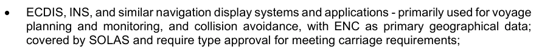

ECDIS、INS和类似的导航显示系统和应用 -- -- 主要用于航行规划和监测以及避免相撞,以ENC为主要地理数据;《海上人命安全公约》涵盖范围,并需要获得类型的批准,以满足运输要求;

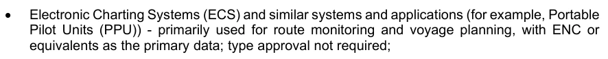

电子图示系统(ECS)和类似的系统和应用(例如:可移植试运行单元(PPU)) -- -- 主要用于路线监测和航道规划,以ENC或等同数据为主;不需要类型批准;

其他类型的基于S-100的用户系统和应用,包括岸上系统.

迄今大多数基于S-100的产品规范是为ECDIS开发的. ECDS是一个早已确立且有详细记录的概念,由于S- 100产品的其他用户可能知道ECDis概念与其系统的关系,因此ECDiz是用来模拟描述协调指导的最有名的用户系统.

鉴于ECDIS和其他导航显示(用于航道监测或航道规划)对海洋运输的重要性,本部分界定了侧重于这种导航显示的原则以及打算用于其他应用领域的更通则.

16a-4.1 组织和标准

几个组织参与了关于显示、提示和指示以及其他用户界面要素的标准和准则的制定工作。 下面图16a-1描述了主要组织为用户界面标准和其他规格的制定做出贡献,以及不同类型标准/规格之间的主要影响。 目前与显示和用户经验有关的一套标准和规格可分为以下几个特点:

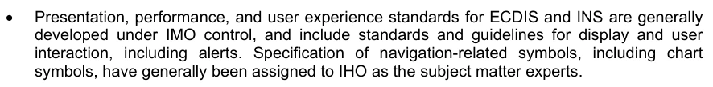

ECDIS和INS的演示,性能和用户体验标准一般由海事组织控制制定,并包括显示和用户互动的标准和准则,包括提示,与导航有关的符号,包括图表符号的规格一般被指定给国际海道测量组织作为主题专家.

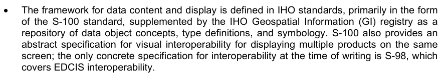

数据内容和显示的框架由IHO标准所定义,主要以S-100标准的形式来定义,由IWO地理空间信息(GI)登记册作为数据对象概念,类型定义,符号的存储库来补充. S-100还提供了视觉互操作性的抽象规格,用于在同一屏幕上显示多件产品;在作此作文时唯一关于互操作性的具体规格是S-98,即:

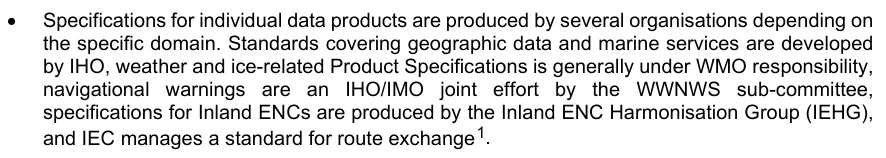

个别数据产品的具体规格由几个组织根据具体领域制作. 地理数据和海洋服务标准由国际海道测量组织制定,天气和与冰有关的产品规范一般由气象组织负责,导航警告由国际海文学组织/海事组织的WWNWS小组委员会联合努力,内陆环境国家中心规格由内陆环境协调小组制定,而IEC管理一条路由交换标准。

产品规范应包括数据产品的符号和显示规则,但是如果不包括,系统可以规定所制作产品的显示规则。 系统指定的显示规则也应该遵循显示协调。

制定了设备和系统的测试操作和性能标准

各类标准和规格一般相互关联,而且往往具有共同的依赖性. 海事组织的导航和安全标准是指代表地理要素的IHO符号学,IHOC符号学的定义考虑到了海事组织标准中的用户界面准则,以及

1 其他组织也在为信息交流制定S-100标准,这些标准与显示和用户互动、船舶或岸上的不同关系,图16a-1中的产品规范清单具有代表性,但并不全面。

## 官方 PDF 第 798 页

个人产品规范以S-100框架为基础,并参照测试准则。 产品规范是根据S-100框架、数据模型中的特点和属性以及它们为显示数据而指定的符号和颜色,这些特性和属性都应在IHO GI登记簿中登记,这些相互关系见图16a-1。

开发者必须符合适用于必须用程序或系统的特定标准的强制性要求。如果本部分与所引用的适用标准中的强制性要求相冲突,则本部分中的要求取代了本部分中的指导意见。

附录A载有各项标准和规格的摘要。

## 官方 PDF 第 799 页

图16a-1 - 组织、规格和用户界面标准概览

## 官方 PDF 第 800 页

16a-4.2 应用系统的概念和限制

该条款描述了本部分所涵盖主要应用系统类型的概念和限制. ECDIS和INS在S-98中被涵盖,而本条款的重点是影响其他系统的内容和行为的考虑.

16a-4.2.1 电子图表系统(ECS)

ECS是所有描绘电子图表的系统的共同标准. RTCM 10900.6将电子图表系统定义为符合其设定的要求或IEC 62376. ECSS系统可能满足ECDIS的要求,具有额外的功能,或者是一个带有全球导航卫星系统功能和可变性的电子导航系统,可以显示电子图表. RTCM 10900.6对ECS系统从A级到D级进行分级;如果A级等于ECDIS备份,D级则任何装置“旨在规划不在岸作业的船舶的位置,它们无须具有C级ECS的所有功能。 它们必须显示电子图资料并绘制船舶位置图,但不必显示电子MSI,或监测船舶位置,或提供航行规划或航行监测功能。

屏幕上图示区域通常与ECDIS相似,增加了一些要素(例如边框或外图指标),这些系统一般还会装载更多的数据产品,例如含有海洋保护区或海洋无线电服务的官方产品,或休闲工艺用户感兴趣的点等非官方产品(如POI).

ECS可能提供ECDIS上没有的功能,虽然ECS不像ECDID那样受到限制,但如果打算用于船舶(例如便携式试航装置),这种系统在实际可行的情况下,在符号和颜色方面应当遵循同样的原则。 他们的文本显示元素,显示组织,取取报告,用户界面可能比ECDIS更细腻(这样可以让用户多获取信息或更详细的信息),但应该具有相容的结构和功能(例如,对于重要功能的相似突出,用户接口标签和菜单项应该有相同的含义).

这一原则的基础是尽可能减少从计划转向监测船舶任务时的认知转换惩罚,2 因此,本条款中的限制不太适用于非船舶使用系统(虽然必须考虑实际使用与预期使用)。

16a-4.2.2 其他系统

显示协调在其他系统也是有益的,例如那些涵盖并非用于船上航道监测或船舶移动监测或控制或分配给ECDIS、INS或ECS的其他任务的岸边系统和专门系统。 船舶和港口管理信息系统可被视为船舶交通服务的一个延伸,因为其主要目的是综合海上监视系统。 自愿海上活动监测系统吸收了其他资源,使相关服务和其他利益攸关方能够直接分享自愿海上行动数据或访问某些分系统,以提高港口或海上活动业务整体的效能,但可能与自愿海上行动的自身目的无关。

自愿技术监测系统一般是针对具体的自愿技术服务而单独规定的,但可能受国家或区域条例的制约,例如,欧洲议会第2002/59/EC号指令对欧洲海事安全局成员国的自愿技术安全监察作出了规定。 美洲法律协会就岸边系统中的数据和信息描述提供指导,包括VTMIS(例如G1105-Shore-side 显示 Security with E-Navigation conference information).

一般来说,ENC图在一个VTMIS和其他数据源中形成基层,形成额外信息或增强信息来帮助VTISS操作员进行监测和决策,额外层的例子包括用于目标跟踪的雷达和AIS,用于元水相信息等传感器信息的AIS-ASM(AIS应用特有消息),空隙和特殊区如不规则快区等. 此外,无线电服务可构成服务援助的一环,其他例子包括导航警报和气象警报等海洋安全倡议,地表海流和水位等海洋学信息也可能是重要的一环。

2 例如,见“多重任务:切换费用”,美国心理学会,网页标题-多任务:切换费用。

## 官方 PDF 第 801 页

16a-5 一般原则

海事组织《关于列报航行符号、术语和简称的准则》(SN.1/Circ.243/Rev.2)第15节指出,在设计准则附录时适用的原则并非都直接适用于数据产品之间的描述协调,因为这些原则主要适用于人机接口。 然而,即使是不直接适用的原则,也仍然提供了重要的间接指导,能够对显示的协调产生积极影响。

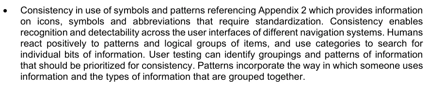

使用符号和模式的一致性 参考附录2,该附录提供了需要标准化的图标,符号和缩写信息. 一致性可以使不同导航系统的用户界面识别和可探测性 人类对图案和逻辑项目组作出积极反应,并使用类别搜索单个位点的信息. 用户测试可以确定应优先注意一致性的信息分组和模式,模式包括某人使用信息的方式和组合在一起的信息类型。

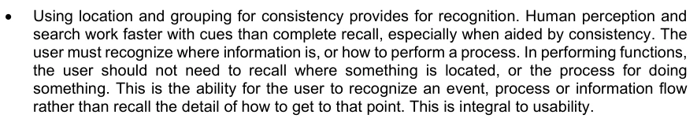

使用位置和组合来获取一致性提供了识别。人类的感知和搜索比完全召回更快,特别是在一致性帮助下。用户必须识别信息所在,或如何执行进程。在功能运行中,用户不需要提醒某物所在位置,或某事的处理过程。 这是用户识别事件、进程或信息流动的能力,而不是回顾如何达到这一目的的细节。 这是可用性所不可或缺的。

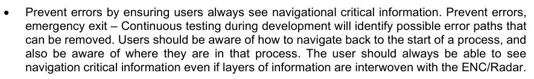

通过确保用户总是看到导航关键信息来防止出错。 防止出錯, 紧急退出 — 在开发过程中持续测试将识别可能可以去除的错误路径。 用户应该知道如何导航回到进程开始,并且知道他们正在哪个过程中。 即使层层信息与ENC/Radar交织在一起,用户仍应始终能够看到导航关键信息.

显示协调还必须考虑到,是否必须有一套固定的、必须属于规则范围的地层,或者这些规则是否应更灵活地容纳更多的地层(例如未来产品或区域特有产品)。

固定的分层列表为执行者提供了可预测性,因为大多数变量是已知的,

固定的地层列表不灵活,因为如果不创建新版本的规则,新地层就无法被添加,执行者可能需要更新用户系统来添加新地层.

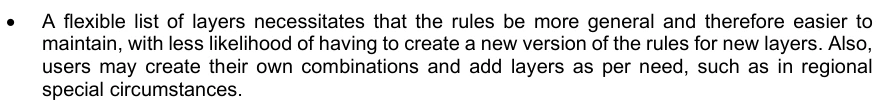

灵活的层表要求规则更加通俗,因此更容易维持,而为新层创建新版规则的可能性较小。 此外,用户可能根据需要创建自己的组合并添加层,例如在区域层面。

灵活的层列表让执行者对预想的层层组合的可能性较高,从而降低可预测性。这需要更多的测试和更加灵活的用户设置,以适应用户定义的层相组合,并避免这种影响。

显示协调准则适用于病媒和覆盖类型的数据,只要是实用的。

16a-5.1 符号统一

符号用于传送信息,如果在同一个环境中使用,例如海洋,无论使用何种产品,都必须传送一致的信息。 人类对规律和逻辑项目组作出积极反应,并使用类别搜索单个位点的信息。用户测试可以确定应当优先排列的组合和模式信息,模式包括某人使用信息的方式和被组合的信息类型”。 因此,对于同一一般系统/应用类别中使用的产品,应统一编号,以确保尽可能地减少相互矛盾的信息的风险。

## 官方 PDF 第 802 页

符号的设计应遵循海事组织SN.1/Circ.243/Rev.2和IHO S-4内的指导,这两份文件应是第一个在导航系统中需要可视化的要素的图案取材来源。 如果在这两份文件中都没有找到合适的符号,国际海道测量组织海洋制图工作组(NCWG)就负责协调国际水生物学组织相关产品的显示,并可能提供援助。 鉴于国际海道测量组织在界定图表显示方面发挥领导作用,所有为导航屏幕或相关系统生产数据产品的组织,都应同国际水生物学组织国家工作组协调开发任何新的符号。

应在产品本身以及所有预期产品组合中测试新的符号,以确保充分协调,并充分处理任何含糊不清的风险。

16a-5.2 视觉互操作性

Interoperable Catalogue Model,参见第16部分,是一个可以用来创建规则目录的架构,用于如何将一组地层组合起来,这个集可以是固定列表或灵活的方法.

S-100产品规范可能只考虑过与ENC的描述相协调,也是S-100产品的规格。 因此,当几个层次同时被可视化时,可能会出现杂乱无章的风险,从而掩盖重要要素,增加不安全操作的风险。 互操作性目录模型框架应该用来将屏幕层同步数量限制在一个逻辑集,例如,在正常操作模式下使用预配置的组合功能,同时允许具有特殊要求的用户有更大的灵活性。逻辑集可以被视为在特定操作中有用的多层。 在逻辑设定的重要特性中,应优先注意重要特性,可视为重要作业中任何时刻都不得关闭的特性,例如导航系统对航道的监测,在ECDIS和ENC中,重要特性被视为显示基. 在其他S-100产品和系统中,也可能有重大特性,应该按照海事组织ECDIS性能标准(MSC.232(82)号决议)所定义的显示基础的精神加以考虑,在将各层合并起来以尽量减少任何重要特性被混淆的风险时,应十分谨慎。 应当考虑利用产品规范概念的预定义组合来限制可能的组合,并指定取景组层为产品规范的具体预定义的组合.

16a-5.3 清除战略

所有基于S-100的产品规范,包括描述,都必须考虑解密策略。 这对于减少用户系统孤立使用或作为更大生态系统内一层层使用符合数据产品时的杂乱风险是必要的。 任何S-100基于孤立使用的产品,如果使用时数据内容的屏幕密度开始互相干扰,可能会在系统中引起屏幕的混杂. 类似地,当S- 100基于数据的产品被作为系统层使用时,数据密度可能由于内容数量而开始相互干扰,甚至由于内容的数量较大而导致内容的相干. 两种情况都需要由产品规范开发者和系统实施者考虑;需要采用缓解战略。

可以采用的一种复杂减缓策略是在产品中引入比例带,通过在较低比例的通缩来限制不同比例范围内的数据密度,包括光栅数据的稀释,同时在最大比例上包含最详细的细节。 这种方法在单个产品系列上最有效,因为它无法说明任何其他层的影响,但增加比例带可以成为最有特色的密集产品总体缓解战略的一部分。

第二种缓解战略可以是为所描绘的要素类别增加最小尺度和最大尺度属性,以关闭较小尺度或大尺度的不太重要的信息。 比例最小属性被作为极限,用来表示屏幕被缩放到更小的尺度时一个要素的显示被关闭的尺度,例如关闭点符号,由于密度较小而开始互相干扰. 比例最大属性用于关闭大比例的要素描述,例如,在大比例上可能被认为不太重要的大面积,并且可以引起杂乱,例如按地区模式。 这个方法在单个产品系列上最有效,因为它不能说明其他任何层次的影响,但可以成为整体杂乱的缓解战略的一部分。 生产者应确保产品之间的一致性。

## 官方 PDF 第 803 页

配置互操作性目录可以是第三个缓解战略,方法是界定预先定义的组合产品应如何相互作用的规则,例如,关闭一种产品中不太重要的特性,以便更容易地识别出其他产品中较重要的特性。 互操作性目录还可以用来定义将不同产品的数据组合成混合特性的规则,从而可以消除对多份原始数据拷贝的描述需要. 互可操作性目录的利用最适合多个层相互作用的情况,并有引起屏幕杂乱的风险.

这三个战略并非相互排斥,可以结合其他方法加以利用并进行综合缓解,其他战略将在以下各节中讨论。

16a-6 显示组织与操作

有些系统制定了详细的规格和要求;例如,ECDIS. 其他系统可能没有那么严格的规则和要求,但可能全部或部分遵循类似的性能标准。 这类系统的例子可以是可移植的试点单位(PPU),它们可能遵循欧洲残疾信息系统的一些性能标准,因为它们既在同一环境中使用,又利用了许多相同的数据,此外,PPO可能在其所使用区域有本地的采用。 一般而言,与显示组织和系统操作有关的显示指导部分适用于所有基于S-100的产品规范,不论打算使用来自这些产品规范的基于S-1100的数据的系统(尽管如第16a-4.2.2条所概述,系统可能提供关于基本组织的详细说明)。

16a-6.1 操作模式

一些系统(例如ECDIS)设计时采用了不同的颜色模式,以考虑船桥上的环境光线条件。 这些模式支持一种操作环境,保护航海家的光敏视觉,这种视觉在发现影响航行安全的状态时,特别是在夜间,可能至关重要。 用于导航屏幕的所有S-100产品规范应支持用于数据产品的导航系统的操作模式,请注意海事组织/IEC对某些系统,如ECDIS的性能要求可能需要这种支持。 S-100产品的制造商和用户,其显示 Catalogue没有适合系统类型和照明条件组合的颜色模式,请与IHO讨论此事.

国际海道测量组织ENC标准维护工作组(ENCWG)负责管理S-52 -- -- ECDIS的图内容和显示方面的规格,该规格具体规定了S-57 ENC的显示规则,Nautical制图工作组负责协调显示,这两个工作组共同可能成为不同显示操作模式中彩色使用方面建议的良好来源。

鉴于国际海道测量组织在与航海制图工作组(NCWG)界定海图的显示方面发挥领导作用,所有制作数据产品供导航屏幕使用的组织都应同国际水生物学组织协调其颜色使用,关于欧洲海洋组织不同显示操作模式的颜色使用的建议将公布在IHO ECDIS互操作性规格的附件中。

16a-7 颜色

颜色和相组合的颜色往往有与它们相关的特定含义;对于导航显示来说也是如此. 例如,在黑色图表上通常指物理物体或边界(例如海岸线),而紫红色通常指非物理物体或者边界(如限制区域边界). 其他的例子有浮标系统标记,其中使用黄色和黑色带的组合来表示从已知危险中向上的主要方向.

另一种考虑是,使用红色的任何符号可能对于在夜间条件下操作的任何系统都是一个问题,因为这些符号在经常用于保护夜视的红色环境光下可能很难区分。 因此,在夜间情况下,应当避免使用红色。

## 官方 PDF 第 804 页

添加文字也可以减少混合的风险。

色彩选择对显示的影响如此之多,因此必须确保颜色的使用在层和系统之间协调一致,以减少给用户提供模糊信息的风险。 产品规范应尝试使用国际海道测量组织显示登记簿中登记的现有颜色。

鉴于国际海道测量组织在确定图画方面拥有经验和领导才能,所有制作用于导航屏幕的数据产品的组织都应与国际水生物学组织协调其颜色使用。 在国际水学组织内,海洋制图工作组的任务是协调图画工作。

16a-7.1 配色

ECDIS、INS和海事组织性能标准所涵盖任何类似导航系统的彩色任务必须符合S-98彩色任务。

海事组织导航系统性能标准未涵盖的桥梁或图表系统颜色分配应符合S-98颜色分配,但可为此目的增加其他颜色分配。

其他系统的色彩分配可能符合S-98色彩分配,但可以根据应用程序要求或用户环境而偏离或扩展.

16a-7.2 彩色符号、配置和调色板

以S-100为基础的产品规范使用S- 100的显示概念,这一概念由几个组成部分组成,可以在GI注册,因此可以在不同的产品规范之间共享,彩色标志和色彩简介是这种可分享概念的例子。 彩色标志在显示 Catalogues中用于使用 sRGB 和/或 CIE 彩相空间坐标中的地址来指定一般颜色的特定变异. 历史上,多个彩相标志被分配到ENC内部的特定用法,用于深度区域,陆地区域,受管区域,浮标,灯光等概念. 这些特性概念可以在任何基于 S- 100 的产品规范中重复使用,它们也可能添加它们自己的颜色符号。这需要统一使用颜色符号,当一个特性概念被两个或两个以上产品规范显示时,建议在所有的相片目录中使用相同的颜色符号 。

16a-8 文字

海事组织MSC.191(79)经修正后在第5.2.3节中要求,案文应使用简单明了的易懂语言,航行术语和缩略语应使用准则所定义的术语,并鼓励所有船舶航行系统和设备使用这些术语和简称(见海事组织MSCC.1/Circ.1609的订正和附录2,SN.1/Crica.243)。 同样,S-4(第500节 -- -- 文本:语言、数字、缩写、名称、样式和字体)界定了用于导航信息的通用导航术语和缩写,该文本指南应与海事组织指南一起用作统一S-100产品规范中文本的使用,供导航使用。

建议遵守海事组织MSC.1/Circ.1609号文件的指南,因为它指出,在使用图标、术语和(或)缩写时,必须符合准则的要求,此外,还指出,如果没有标准术语、缩写或图标,可使用另一个图标、名词或缩写,但这些不应与上述准则所列出的相冲突。 因此,如果海事组织MSC.1/Circ.1609;国际海道测量组织S-4和海事组织SN.1/Crc.243没有适当的替代用语或缩写,应审查这些指南,只有在审查后发现这些准则没有适当的术语或缩略语时,才应考虑创建新的术语或简称。 如果在适当考虑了上述建议之后创造了新的术语或缩略语,则应努力在适当的准则中添加新的术语和缩略词,以确保统一。

## 官方 PDF 第 805 页

虽然上述海事组织文书是专门供环境信息系统使用的,但打算用于海洋情况的其他类别的系统或应用也应使用同样的术语和缩略语。

16a-9 拾取报告

海事组织第1609号通知指出,“电子设备用户界面的巨大差异会严重地妨碍运营商执行导航任务的有效性。 如果按钮、图标、动作、工作流程、流程、计量单位或信息位置存在重大差异,设备熟悉情况所需的时间和操作出错的风险相应增加,特别是在挑战性导航情况下。” 选取报告历来是由单个产品规范或执行者定义的,给用户带来困难的模糊性留下了空间,当同时使用两个或两个以上产品对取取报告有相冲突配置时,用户可能会面临更多的挑战. 当不同的系统对同一类型的数据使用用户界面时,也可能遇到类似的复杂情况,这还需要进行更多的培训,使用户熟悉安全至关重要的产品,因此,统一描述的取材报告应成为任何使用S-100产品系统的具体目标。

选取报告应允许从所有可见/启用的基本产品获取信息。数据应组织起来,以便在考虑屏幕显示的分层顺序时,以合乎逻辑的方式通过复杂报告进行导航。人机接口战略应周密思考,以便尽可能少地要求用户努力审查选取的报告。 可以在相同操作模式或上下文中使用产品和系统之间的统一外观和行为,从而便利于做到这一点。这意味着产品规范在如何设计取取用报告方面保持灵活性。还应酌情灵活地允许在操作模式之间有所差异。选取报告应具有反映产品在屏幕上的优先次序的排序顺序。

16a-10 报警与指示

所有用于导航的产品规范,应具体说明与应发出警报或指示的一个或多个领域相匹配的任何要素组合,以确保用户系统能够协调地实施。 这种规格可以使用机器可读警报和指示目录进行,但需要谨慎,因为这一目录可能用于一个特定的系统,如欧洲残疾信息系统,因此,执行者可能会发现,通知和指示分类目录的某些内容不适用于非欧洲残疾信息数据库系统,只应使用一个子集。 这还可能需要制定额外的系统特定警报或指示。

海事组织MSC.232(82)号决议在11.3和11.4分段中说明了环境残疾信息系统应如何应对过境风险、危险、被禁地区或有特殊条件的地区,并在同一项决议附录4和附录5中详细说明了环境残疾数据库应探测哪些地区,并对此发出警报或指示。 这一指导水平足够高,对大多数S-100产品和其他相关系统应有用,因此在设计警报和指示时应参考该指导。

在国际海道测量组织内,ENC标准维护工作组(ENCWG)的任务是管理S-52 -- -- ECDIS的图表内容和显示方面的规格,其中具体规定了S-57ENC的描述规则,其中包括关于哪些要素属性组合应考虑与海事组织ECDI关于警报和指示的绩效规则相匹配的指导。 鉴于国际水道测量组织在界定图的显示方面发挥领导作用,而且其显示与系统的其他安全批评行为是相互依存的,所有制作数据产品供导航屏幕使用的组织都应同国际水道观测组织协调其警报和指示规则。

## 官方 PDF 第 806 页

16a-11 产品规范新版本之间的显示协调

基于S-100的产品规范基本使用S- 100的维护制度来维持,该制度将修订版本分为澄清,更正,或新版本等,这些类别对应意义和复杂性越来越大,一般建议在新版本中设置新功能,这意味着新符号等新显示元素可能需要新版的产品规范. 这种新符号化背后的原因可能多种多样,例如海事组织准则的修改、新的用户要求或新技术,在需要新版本时,必须认真考虑任何描述变化的影响,因为重大变化可能对设备和用户产生重大影响。 如果有正当理由对产品规范版本之间的描述作重大改变,则应采取适当的手段,在用户和系统有足够时间适应的情况下,通报这些变化。 经修订的国际海道测量组织第2/2007号决议所详述的标准生命周期程序应适用于国际海道测量组织的产品;其他组织应采用同样的程序或采用同等的程序。

16a-12 显示屏要求

该条款说明了显示屏的一般要求,在适用于不同类别系统的具体标准中规定了更详细的要求,例如海事组织MSC 232(82)规定了对ECDIS的要求。

16a-12.1 实物显示要求

显示的地理部分最小的有效尺寸应使关键信息一般可见而不会滚动显示,用户与地理显示(如果有的话)可以直接互动,而不需要在典型条件下过度集中用户。

如何将这一原则适用于特定系统,其细节应通过分析用户的任务和用户在预期和危急环境条件下的绩效来确定。

特定类别的系统可能具有由控制标准设定的最小尺寸,例如MSC 232(82)要求ECDIS用于路由监测的图表演示的最低有效尺寸至少为270毫米×270毫米.

16a-12.2 彩色显示能力

彩色显示器在红,绿和蓝等每一种显示器中应至少能有256个发光步骤.

对于夜间性能来说,硬件必须有一个能给出"比黑色更黑"的图形卡;即完全控制颜色,软件可以控制这个功能.

显示必须能够维持在用于执行显示中任务的数据产品显示目录所定义的符号之间的颜色区别。典型的用户必须能够区分它们在执行使用显示的任务时可能遇到的符号的颜色。

某些类别的系统可能须遵守颜色转换容能的具体标准,例如,适用的ECDIS要求、性能和测试标准中说明了ECDID关于颜色转换相容和色标的标准。

特定类别的系统(特别是ECDIS)的规格可能包括一个颜色区分测试图。

1) 供海员检查并在必要时重新调整控制,特别是夜间使用;

(二) 供海员用来核实老化的显示仍然能够提供必要的颜色区别;

3)用于对白天,黄昏和夜间彩色表进行初始颜色验证.

## 官方 PDF 第 807 页

附录16a-A 组织和标准

16a-A-1 国际组织与标准

海事组织就如何提供航行相关信息提出了建议和准则,其中特别重要的有以下文件。

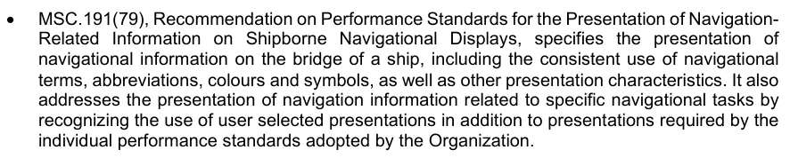

MSC.191(79),"关于船舶航行显示器上航行相关信息的列报性能标准的建议",规定了船舶桥上航行信息的列报,包括航道术语,缩写,颜色和符号的一致使用以及其他的列报特征. 报告也涉及与具体导航任务有关的导航信息的列报,承认除本组织通过的个人业绩标准所要求的专题介绍外,还使用用户选定的专题介绍。

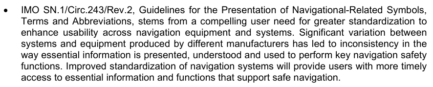

海事组织SN.1/Circ.243/Rev.2,《介绍与导航有关的符号、术语和简称的准则》,源于用户迫切需要加强标准化,以提高导航设备和系统的可用性。 不同制造商生产的系统和设备之间有很大差异,导致用于履行关键导航安全职能的基本信息的列报、理解和使用方式不一致,改进导航系统的标准化将使用户能够更及时地获得支持安全导航的基本信息和功能。

MSC.191(79)和SN.1/Circ.243/Rev.1中的准则继续适用如下:

o 2024年1月1日之前安装的雷达设备、电子图表显示和信息系统以及综合导航系统;

o 在2025年7月1日之前安装的船舶桥上所有其他导航显示器。

经MSC.466(01)号决议修正的MSC.191(79)和SN.1/Circ.243/Rev.2中的准则将适用于在上述日期或之后安装的设备。

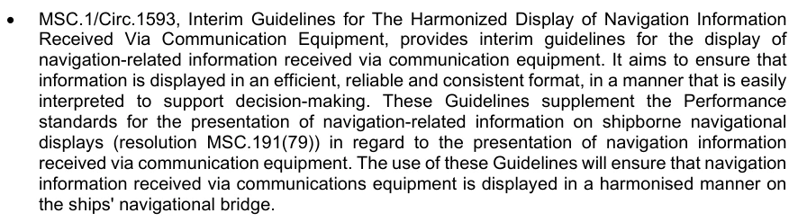

MSC.1/Circ.1593, " 统一显示接收到的导航信息Via通信设备临时准则 " 为显示通过通信设备收到的导航相关信息提供了临时准则,旨在确保以高效、可靠和一致的格式显示信息,便于解释以支持决策。 本准则补充了在提交通过通信设备收到的导航信息方面,关于船舶导航显示的导航相关信息的列报性能标准(MSC.191(79)号决议)。

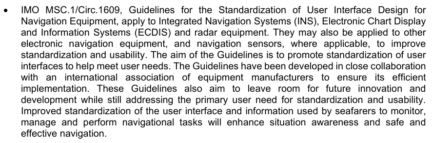

海事组织MSC.1/Circ.1609,导航设备用户界面设计标准化准则,适用于综合导航系统、电子图表显示和信息系统以及雷达设备,也可适用于其他电子导航设备和导航传感器,以酌情提高标准化和可用性。 准则的目的是促进用户界面标准化,以帮助满足用户需要,准则是与设备制造商国际协会密切合作制定的,以确保准则得到有效执行,准则还旨在为今后的创新和发展留有余地,同时仍然满足用户对标准化和使用性的基本需要。 改进海员用于监测、管理和执行航行任务的用户界面和信息的标准化,将提高情况意识,加强安全性和可持续性。

海事组织第A.1021(26)号决议《警报和指标守则》(2009年)界定了警报的分类(作为紧急警报、警报、警告和警告),并规定了一般设计。

3 预期日期为2020年3月,海事组织可修订日期,并应从海事组织最新的相关决议/圆形决议中确认日期。

## 官方 PDF 第 808 页

指导和原则,以便按照《国际海上人命安全公约》、其他国际公约、航运规则和海事组织业绩标准和准则的规定,使必要的警报和指标的类型、地点和优先次序统一。

海事组织MSC 302(87), " 桥梁警报管理性能标准 " ,介绍了协调优先事项、分类、处理、分配和

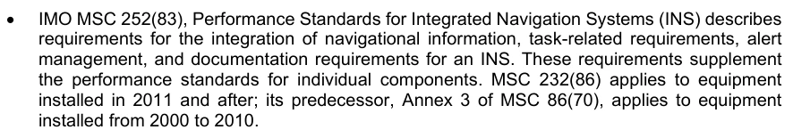

海事组织MSC 252(83),综合导航系统性能标准(INS)说明了综合导航信息的要求、与任务有关的要求、警报管理和信息预报文件的要求,这些要求补充了单个部件的性能的标准。 MSC 232(86)适用于2011年及其后安装的设备;其前身MSC 86(70)附件3适用于设备

信息、教育和宣传技术委员会TC80制定了设备标准、一般要求和性能要求、测试方法和选定非地理信息的符号(例如,船舶活动、AIS和雷达信息)。

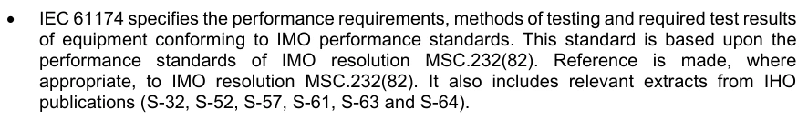

IEC 61174规定了符合海事组织性能标准的设备的性能要求、测试方法和所需的测试结果,该标准以海事组织MSC.232(82)号决议性能的标准为基础,并酌情参考海事组织MSCC.232( 82.)号决议,其中还收录了国际海道测量组织的相关摘录。

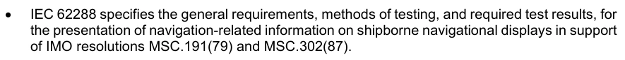

信息、教育和宣传委员会62288具体规定了提交船舶航行显示的航行相关信息的一般要求、测试方法和必要的测试结果,以支持海事组织MSC.191(79)和MSC.302(87)号决议。

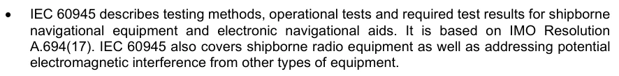

IEC 60945介绍了船舶导航设备和电子导航辅助设备的测试方法,操作测试和所需的测试结果,以海事组织A.694(17)号决议为基础. IEC 600945还涵盖了船舶无线电设备并解决了其他类型设备的潜在电磁干扰.

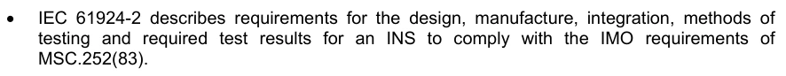

IEC 61924-2说明设计、制造、集成、测试方法的要求,以及为了遵守海事组织关于国际船舶和港口运输标准的要求而要求的测试结果。

国际水道测量组织的标准和规格描述数据产品,数据内容,数据更新,以及地理信息的显示,自然条件,航行危害的符号和表示,以及选定的非地理信息,如监管和行政信息等.

ECS是所有描绘电子图表的系统的共同标准. RTCM 10900.6将电子图表系统定义为符合本标准或IEC 62376. ECSS系统可能满足ECDIS的要求(例如备份ECDis)或是一个具有全球导航卫星系统功能的简单平板电脑. RTCM 10900.6对ECS系统从A级到D级进行分级;如果A级等于ECDIS备份,D级则任何装置“旨在规划不在岸作业的船舶的位置,它们无须具有C级ECS的所有功能。 它们必须显示电子图资料并绘制船舶位置图,但不必显示电子MSI,或监测船舶位置,或提供航行规划或航行监测功能。

便携式试验单位(PPU) — 国际海洋飞行员协会(IMPA)发布了"关于便携式试验单元的设计与使用的准则",该准则水平很高,但强调引航是本地的母体,因此没有PPO解决方案能够满足所有引航区的所有需要,因此,PPM针对特定引航区域进行定制,并有一些配置可以被使用.

海岸边系统和专业系统,并非用于船上路线监测或船舶移动监测或控制,或分配给ECDIS、INS或ECS的其他任务,见IALA G1105 — Shore-side 显示 Secretation with E-Navigation conference information.
