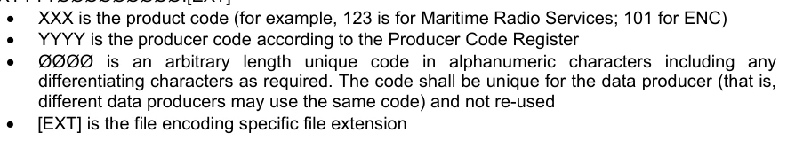
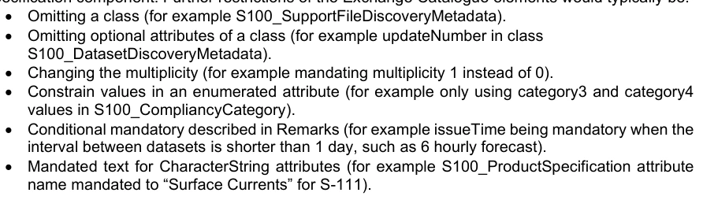
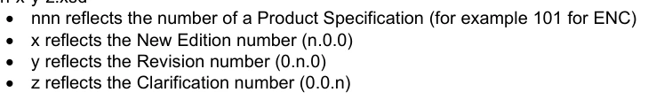
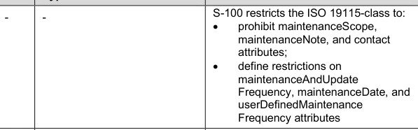
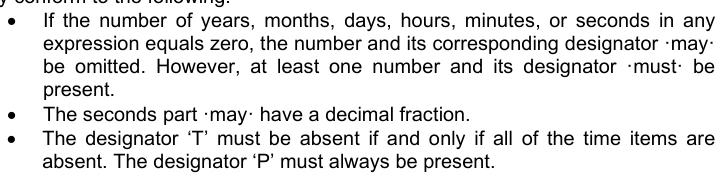

# S-100 5.2.1 · 第 17 部分 · 发现元数据与交换目录

非官方机器翻译参考稿，尚未逐条人工校订。公式与代码保留原文，解释以英文规范为准。

## 官方 PDF 第 809 页

S-100 — 第17编

用于信息交流的发现元数据

目录

## 官方 PDF 第 810 页

5.2.1版实质性变动摘要

已生效的概要条款

纠正了文件路径,从图17-5的左侧删除了第二个“/”;将表17-1的URI例子中的第二个“:/”改为“/”。

```text
17-4.3
```

修改数据集取消的规格,以指定更新的版号必须被设定为被取消单元格的版号;以及取消的目的。

```text
17-4.4.1, 17-4.5
```

添加了交换目录 XSD 文件的可选规定的新指南,其中产品规范进一步限制了S-100定义的交换目录元素.

```text
17-4.4.2
```

修改表S100_DatasetDiscoveryMetadata中版本的编号属性类型为正整数.

```text
17-4.5
```

在表S100_DatasetDiscoveryMetadata后添加了新的注释2,以澄清目录.xml中的数字签名应在加密和压缩后被应用. 在表S100_DatasetDiscoveryMetadata中添加了数字签名属性注释2的新注释.

```text
17-4.5
```

为表S100_DataCoverage(注1)所编译,提及EPSG代码的内容将以http URI格式.

```text
17-4.5
```

为表S100_数据封面所拼写(注1),协调位置必须用列表来表示("posList").

```text
17-4.5
```

为表S100_DataCoverage(注1)所拼写,对边框Polygon属性的坐标顺序必须与定义的坐标参考系一致.

```text
17-4.5
```

将表S100_目的中的新数据集值重新标记校正,以表示在覆盖或范围发生显著变化的情况下,可能会生成新的数据集。

```text
17-4.5
```

修改了表S100_PresidentFile DiscoveryMetadata中版本编号属性的备注,以正确表示版本编号是用于支持文件而不是数据集.

```text
17-4.5
```

在表S100_DatasetDiscoveryMetadata之后添加了对新注2的参考,用于表S100_PresidentFileDiscoveryMetadata和表S100_CatalgueDiscoveryMetadata中数字符号Value属性的注释.

```text
17-4.5
```

## 官方 PDF 第 811 页

中文目录（可用上方目录直接跳转）

17-1 范围 · 官方 PDF 813
17-2 符合性 · 官方 PDF 813
17-2.1 本专用配置符合其他标准 · 官方 PDF 813
17-2.2 与本专用配置的符合性 · 官方 PDF 813
17-3 规范性引用文件 · 官方 PDF 813
17-3.1 专用配置定义 · 官方 PDF 813
17-3.2 资料性参考文献 · 官方 PDF 814
17-4 概述 · 官方 PDF 814
17-4.1 S-100 交换集结构 · 官方 PDF 814
17-4.2 S-100 交换集文件夹结构. · 官方 PDF 817
17-4.3 外部资源的储存和管理 · 官方 PDF 819
17-4.3.1 支助资源/多种参考指导 · 官方 PDF 820
17-4.3.2 ISOMetadata File 指导 · 官方 PDF 820
17-4.4 S-100 交换集目录 · 官方 PDF 821
17-4.4.1 新版、修订、更新和取消 · 官方 PDF 821
17-4.4.2 提供交换目录 XSD · 官方 PDF 822
17-4.5 交换集目录的要点 · 官方 PDF 824
17-4.6 S-100交流集目录中的多语种支持概况 · 官方 PDF 843
17-4.7 S-100 Exchange 集目录元素多语言编码 · 官方 PDF 844
17-4.8 S-100 交换集目录所描述的地理空间资源内部使用的语言的说明 · 官方 PDF 845
17-4.9 维修资料编码 · 官方 PDF 846
17-4.9.1 S-100元数据中的编码和解释规则 · 官方 PDF 847

## 官方 PDF 第 812 页

本页特意留空

## 官方 PDF 第 813 页

17-1 范围

本部分所描述的S-100 信息交换目录解析元数据提供了描述和创建交换目录的规格,使用户能够识别,发现和管理S- 100交换集的内容. 更重要的是,它利用了XML,使机器能够机器发现和交换海道测量组织通常制作的地理学数据集的信息. 其目的是建立元数据记录,提供关于识别、空间和时间范围、质量、应用Schema、空间参考系统以及数字地理数据分布的信息,适用于数据集的编目、信息交换所活动以及地理和非地理资源的全面描述。

信息交换需要若干类别的元数据:关于整体交换目录的元数据、关于目录中每个数据集的元数据和关于构成包的支持文件的元数据的元数据。如果交换目录包含任何特性、相近或互通目录,则有附加元数据的条款。

该文件针对元数据应用程序的开发者和实施者,提供了对地理信息标准化的原则和总体要求的基本理解,应与第4a-4条-规范性参考条款下的标准一并使用。

17-2 符合性

17-2.1 本专用配置符合其他标准

S-100 用于信息交流的发现元数据目录专用配置采用了由ISO其他标准所定义的数据类型,主要有ISO 19115-1 地理信息–元数据– 第1部分–基本数据,ISO/TS 19115-3:2016, 地理信息—元数据—关于基本概念的XML Schema实施和ISO 19136 地理信息-地理标记语言,以及其基本义务和 条件。与这些外部数据类型有关的XML Schema引用嵌入到此配置的 XML schemas 中,从而确保此配置在 XMle 目录实例的编写和验证过程中与其他标准相符合。

17-2.2 与本专用配置的符合性

与该配置文件相符的情况可通过对照从国际海道测量组织S-100存储库中获取的S-100元数据配置文件Semas验证XML目录实例来确认。

17-3 规范性引用文件

本文件的应用需要下列参考文件:关于注明日期的参考文件,仅适用所引用的版本;关于未注明日期的文件,适用所参考文件的最新版本(包括修正案)。

17-3.1 专用配置定义

用于定义S-100元数据配置的参考文献如下:

ISO 19115-1:2014,"地理信息-元数据" 第1编-基本原理.

ISO 19115-1/Amdt01:2018,地理信息-元数据-第一部分-基本原理(修正案1)

ISO 19115-2:2009,地理信息-元数据- 第2部分:图像和网格数据的扩展

ISO 19119:2016, 地理信息–服务

## 官方 PDF 第 814 页

ISO/TS 19115-3:2016,地理信息-元数据-基本概念的XML计划实施

17-3.2 资料性参考文献

ISO 19115:2003, 地理信息-元数据

ISO 19115:2003/Cor.1:2006,地理信息-元数据(技术更正1)

ISO/TS 19139:2007, 地理信息-元数据-XML schema执行.

17-4 概述

17-4.1 S-100 交换集结构

S-100交换集是一个数据容器,提供可靠和安全地交换S-100符合标准的数据所需的所有要素,它旨在成为一个自成一体的实体,由数据文件和元数据记录组成,利用适用的数据完整性和可选的安全规定进行组合。 S-100交换集的总体概念是ISO 19115-3类的实现,这从根本上支撑了地理空间数据和相关元数据的交换,如下图17-1所描述. 这个图从左到右描绘出ISO数据交换结构类,用于交换的元数据的相关ISO类,代表S-100交换集组件的S- 100结构类以及相關的S -- 100交换集元数据类.

注意 S- 100 结构类代表交换集(文件/文件夹/存档)的组件,而不是交换文件中的 XML 片段。因此,它们在本部分中没有属性,也没有相应的文档表。

也请注意,S-100 Exchange Set元数据类是相应的ISO类的模拟,但(严格地说)不是专门化或实现.

## 官方 PDF 第 815 页

图17-1 交换组类别的实现情况

上图说明了ISO-19115-3和S-100标准中的数据交换条款之间的概念对应. 在执行层面,S- 100交换集可能包括S- 100. 数据集、支持文件、目录文件以及S-1000交换集目录形式的所有此类资源的元数据信息组合。 从概念上讲,这导致了S-100交换套件的更详细模型,如下图17-2所显示.

## 官方 PDF 第 816 页

图17-2 – S-100 交换集

图17-2所描绘的概念模型非常灵活,可以多种方式实施,因为除S-100_ExchangeCatalogue外,几乎所有组件都是可选的. 这一灵活性对于适当支持交换地理空间数据的主流使用案例,以及支持发布数据集和支持文件取消通知或没有任何数据文件的新目录发布的案例至关重要。

这种办法确保将交换集目录始终列入任何S-100兼容交换集,提供关于任何包含的资源及其预定用途的基本发现元数据。

准备一个交换集,由使用如下图17-3所示预定义的文件文件夹结构的组合组成。

## 官方 PDF 第 817 页

17-4.2 S-100 交换集文件夹结构.

图17-3 – An S-100 交换集文件夹结构

1. S-100 交换集必须包含一个交换集目录,CATALOG.XML,其数字签名 CATALOG.SIGN,并可能包含任何编号的S-100相容数据集文件,支持文件和目录文件.

2. 所有S-100内容必须放在一个名为S100_ROOT的顶端根文件夹中。这是交换集中唯一一个只包含S-100产品的顶端根文件夹。 S100_ROOT文件夹必须包含交换集中包含的每个特定S-100产品规范数据类型的子文件夹;例如S-101,S-104,S-102(名称由IHO地理空间信息(GI)注册簿的产品规范注册簿所定义),这些子文件夹持有一个单个产品规范特有的S- 100内容. 4. 每个产品子文件夹必须包含组件数据集文件(DATASET_FILES),支持文件(SUPPORT-FI LIS)和目录(CATALOGUES)的子文件夹。 5. 个人数据文件可以选择放在自己的子文件夹中(如上文图17-3的S-102文件夹所显示),也可以将文件分组(如上图17至3的S-101文件夹所表明). ISOMetadataFile(见图17-2)必须位于支持_FILES文件夹中。如果使用,所有相关的ISOMetadataFile都必须遵循MDQ数据文件基名>.XML文件命名惯例。

## 官方 PDF 第 818 页

6. 另一方面,支助文件可合并在一个文件夹中,以防止多个数据集文件夹的重复,同样,在必要时,交换集可能携带额外的目录和(或)其不同的版本,这些目录和/或其版本也应合并在一个被合并的文件夹中。

7. 所需的交换集目录XML文件实例必须被命名为CATALOG.XMI并连同其数字签名(CATALG.SIGN)文件一起被放入S100_ROOT文件夹,所有其他数字签名都包含在CATALoG.xML的相应资源元数据记录中.

S-100交换集可以按照S-57产品规范和(可选)S-63. 的要求,与S-56数据集一起可选定义,其中包含自己的ENC_ROOT和INFO根文件夹. EC-57产品规范以及(可选择)S-63. 在这种情况下,有三个顶级文件夹:ENC-ROOT与INFO为S-57. 和S-100_ROOT,其中有两个单独的目录,分别涵盖各自的内容(CATALOG.031和CATALoG.XML). 下图17-4显示其中一种使用案例,包括S-57和多种S-100产品。

图17-4 – S-100和S-57组合交换集文件夹结构

除了文件夹结构外,重要的是使交换集创建工作流程与S-100 第15部分概述的数据完整性和安全规定相配合,这些规定涵盖交换集资源的数字签名、压缩和加密。

## 官方 PDF 第 819 页

数据压缩和加密是可选操作。

因此,交换集的创建包括:

创建合适的交换集文件夹结构。 2. 安排指定文件夹中的所有资源。 3. 对需要的资源可选择进行压缩和加密。 4. 为所有资源创建数字签名。 5. 构建一个交换集目录,记录所创建的结构。

S-100 第15部分界定了创建和核查数字签名值以及制作压缩/加密数据集的要求和程序。

17-4.3 外部资源的储存和管理

S-100数据集可能指一些外部引用,内容支持资源. 此内容可能是文字上的或图形上的,并以多种格式(由交换目录中S-100_PassupportFileFormat的列表所定义)编码. Dataset持有外部资源作为属性值的引用. 此值可随任何其他属性更新,并更新外部资源的引用。外部资源可以支持数据集或目录,也可以是交换集中的独立实体

S-100交流目录提供:

1. 每种辅助资源位置的规范定义。如果这些是物理文件,则在交换目录文件结构中的 " S-100 产品 " / " SUPPORT_FILES " 子目录中是一个物理位置。 对于每个被编码在数据集或目录要求的支持资源中的外部资源的独特引用,交换目录在元数据条目中提供了该资源至需要其编码的数据集或分类元数据项中的独特地图(以参考方式提供).

例如:

图17-5 - 交换集支持资源(实例)

与这种外部资源有关的所有内容都应经过验证,必须符合数据集的内容,以形成有效的S-100交换集。

数据集是指使用具有URI原始类型的S-100属性的外部资源,此类引用必须使用S- 100 URI形式,并且必须由执行系统独一地解决,而不需要交换目录元数据条目中的任何补充信息.

此类URI定义的例子有:

## 官方 PDF 第 820 页

表17-1 – URI参考文献(实例)

URI 类型 示例 URI

```text
File reference
file:/101GB00400797.TXT
```

MRN (S- 100 数字签名值)

```text
urn:mrn:iho:s100:dsig:dsa:MEQCIDDzwjK4ksBsMx-
AADc5eGQ9uI9Qi8oDx0lVdavMshZnAiBKx_m4KPS3Kk8zYJx-
nzeJzhs_H_VHWpVkdtExAqJ-0Q==
```

S-100支持的文件URI和MRN的完整规格载于S-100 第1部分第1-4.6条. ECDIS执行中不同类型的URI的使用可能受S-98附件C限制在ECDI执行中.

只要从外部资源元数据到数据集元数据映射是独一无二的,那么多个数据集就可以在交换目录中“共享”共同的外部资源,而不能含糊不清。要提供从外部资源的清晰文件URI到数据集,所有基础数据集文件名必须是独一无二的。

数据集命名必须遵循标准模式,为执行者保证对所接入的数据集提供独特的基础数据集文件名. XXXYYYY ⁇ . [EXT].



XXX是产品代码(例如123为海事无线电服务;101为ENC) YYYY是生产者代码注册所显示的生产者代码. QQ是字母数字字符中任意长度独有的代码,包括任何需要区分的字符. 代码必须是数据生产者独有的(即不同的数据生产者可能使用同一种代码),而不再被使用[EXT]是文件编码特定文件扩展名.

支持资源必须遵循相同的命名惯例,但必须使用MDQ数据文件基名的ISOMetadataFile除外。为了进一步协助执行者,数据生产者应确保最新修订支持资源的内容是针对所使用的未分类代码的。 支持资源的不同内容应被分配给个人数据生产者的全部内容的不同的独特代码。

支持性资源不能在产品规范方面共享。

在文件 URI 中使用文件名允许交换集生产者在资源内容变化时保持任何支持文件资源的单一最新版本,而不需要更新数据集。如果数据生产者希望确保当支持资源内容改变时,数据集更新将使用数字签名或数据集中的校验和 URI。

17-4.3.1 支助资源/多种参考指导

单个支持文件可以通过多个数据集中的特性属性来引用。这在支持文件内容更新的情景中创造了一些复杂性,而修改不适用于当前引用支持文件的所有数据集。

如果适用,在一个支持文件被多个数据集引用,支持文件内容发生变化并启动新版本支持文件的情况下,所有引用支持文件的数据集会遵守新版本. 如果支持文件更改不适用于引用它的所有数据集,则必须为新的更改创建一个新的支持文件,并且必须删除旧支持文件的数据集引用并添加新的支持文件中的引用。对于不适用该更改的数据集,旧的支持文件和引用仍然有效.

关于进一步详细解释,请参看S-98。

```text
17-4.3.2
ISOMetadataFile guidance
```

S-100 交换集模式提供了一个机制,用于将每个数据集的符合ISO的元数据记录纳入交换集。这些可选的辅助资源可以使用单个ISOMetadataFile记录进行包含和引用。 它们无意用于ECDIS,但可选列入,以支持与其他用户群体更广泛的互操作性,或在需要时满足ISO元数据要求.

## 官方 PDF 第 821 页

17-4.4 S-100 交换集目录

S100 交换集目录是一个 XML 文档实例, 它提供了发现和使用 S- 100 交换集合中包含的资源所需的元数据信息。 它必须命名为 CATALOG. XMl。 S-100 交流集的这个强制性的核心组件由若干组件组成,它们可以捕捉每种资源类型的适当的元数据记录 。 这些组件涵盖交换集目录的元数据,数据集发现,支持文件发现,任何引用ISO 19115-1/2/3数据集元数据的内容,以及上文图17-4所描述的额外目录.

图17-6 – S-100 交换集目录

发现元数据分节具有属性,可以无需处理数据而检查数据集和相伴支持文件的重要信息,例如加密/压缩旗. 相类似地,其他目录可以被收录到S-100交换集中,以支持数据集,如要素,描述,协调参考系统,代码列表等. 此外,S100交换集目录还提供了管理记录生命周期,支持资源和目录的机制. 例如,S 100_PresidentFileRevision Status和S100_Purpose Census支持修订控制机制,不仅用于提供新版本和修订,而且用于取消此类资源. 这提供了使用S100 Exchange集目录记录取消记录,支持资源和目录的能力,而不是发布实际资源的增量版本.

有关目录各项内容的更详细资料,见下图17-7和17-4.5条表格中的正文说明.

17-4.4.1 新版、修订、更新和取消

本节定义了新版数据集的顺序,在S-100编码支持增量更新,更新和再发的情况下,为了确保要素类型更新以正确的顺序被并入终端用户系统而没有任何遗漏,数据和元数据中编码的一些参数被使用如下: 用户代码: 数据代码:

当一个数据集(Base dataset)初始创建时,第1版被指定给它,每个新版的编辑号会增加1个.

更新号 0 被分配到一个新的数据集和一个新版。与这个新数据集相关的第一个更新数据集文件必须具有更新号 1 , 更新后每次更新都必须增加一个, 直到发布新版.

## 官方 PDF 第 822 页

数据集的再发必须具有上次更新的更新编号必须用于数据集,并使用同名版号.

数据制作方已纳入所有适用修改的日期。该日期必须大于数据集上一个发布日期。

除了使用目录元数据文件(S100_Purpose = 已取消)中的字段进行无文件数据集的取消外,数据制作人还可以通过发布取消更新来取消数据集. 要取消数据集,需要创建更新数据集文件,为此S100_Dataset DiscoveryMetadata属性版必须设置为被取消产品的编辑号;属性目的必须设定为S100-Purpose值5(取消). 这种方法仅用于取消 Base 数据集文件. 当一个数据集被取消,并且其名称在后期被再使用时,发行日期必须大于被取消的数据集的发行日期。当该数据集被取消时,它必须从系统中去除。 无文件注销可以通过使用一个数据集元数据条目,其中文件名和原始数字签名指定了要取消的资源,其他所有强制元数据字段也设定到与原数据相同的值来完成,但发行日期除外,它必须设定到无文件注销本身的发售日期.

交换集可能包含 Base 数据集文件, 并更新同一数据集的数据集文件。 在这种情况下, 更新数据集文件必须按从上次必须用到 Base 有数据集文件的更新中正确的顺序跟踪 。

17-4.4.2 提供交换目录 XSD

S-100只规定交换目录所编码的最低限度信息,见条款17-4.5. 如果产品规范进一步限制交换目录元素,则应该提供反映产品规范特定交换目录的.XSD文件作为产品规范组件. 交换目录要素的进一步限制一般是: .



• 选择某一类的可选属性(例如更新类数) 改变多重性(例如,规定多重性1而不是0) 列出的属性的约束值(例如只使用类别3和类别4) 备注中描述的有条件强制值(如当数据集之间的间隔短于1天时,如6小时预报时,必须使用时间)。 字符串属性的授权文本(例如S-100_ProductSpecification属性名授权为S-111的"Surface Contress").

XSD 的命名惯例为: nnn-x-y-z.xsd



• nnn反映产品规范编号(例如ENC为101) • x反映新版编号(0.0号)

## 官方 PDF 第 823 页

图17-7 – S-100 交换集目录-类细节

## 官方 PDF 第 824 页

17-4.5 交换集目录的要点

本节各表详细介绍了S-100交换集目录的编码文字,设计遵循了在整个开发过程中一贯应用的一些关键设计原则.

其中一条原则驱动着多重价值任务的选择. S-100框架级别上,S-100交换集目录元素的多数是可选的,因此其下等多相约束被设定为"0". 只有所有S-100数据产品中被认为绝对必要的要素,其多重约束值才降至1,有效使所有数据产品都具有强制性,总体而言,S- 100框架层面所产生的多重值被视为S- 100. 产品规范开发者的起点,必要时可在单个数据产品层面被推翻。

另一项原则是保留一些基于历史原因的现有元素名称,例如,NotForNavigation元素的命名可以改进,但这一元素因后向相容性原因而从以前的版本被保留下来,同样,术语文件和资源在模型中被互换使用,也出于历史原因.

对于S-98所涵盖S-100 ECDIS中将使用的产品规范,第三种原则是S- 100交换目录描述不能被扩展到产品规范级别,这一原则的存在使得S- 100. 交换目录配置的执行者不需要考虑产品特定的扩展.

```text
S100_ExchangeCatalogue
```

每个交换集有一个单独的S100_ExchangeCatalogue,它包含交换集中的数据和支持文件的元信息.

角色名称 名称描述 :

S100_ExchangeCatalogue A Exchange Catalogue 包含关于交换数据集和支持文件的发现元数据

```text
-
-
-
```

属性标识符 唯一标识此交换目录 0. 1 S100_ExchangeCatalogueIden tifer

属性联系人细节 此交换目录的发行者

```text
0..1
S100_CataloguePointOfConta
ct
```

属性产品 详细描述用于交换目录所载数据集的产品规范

```text
0..*
S100_ProductSpecification
```

此交换目录中用于所有元数据记录的默认本地语言和字符集

0.1 PT_本地默认为英语和UTF-8

在本交换目录中将本地化元数据记录所使用的其他语言和字符集属性到其它本地化

0..* 如果交换目录中有本地化条目,则需要 PT_ 本地化

## 官方 PDF 第 825 页

属性交换目录 描述交换目录包含的内容

```text
0..1
CharacterString
```

属性交换目录Comment 任何附加信息

```text
0..1
CharacterString
```

交换集中数字签名提及的已签名的公钥证书属性证书

```text
0..*
S100_SE_CertificateContainer
Type
```

S-100 第15部分界定的内容 所使用的所有证书,除SA根证书(由实施系统单独设置)外,均必须包括

属性数据 ServerIdentifer 为许可证确定数据服务器 . 1 字符串

角色数据集 Discovery Metadata 交换目录可能包含或参考交换集数据集的发现元数据

0.* 汇总 S100_数据集 发现Metad ata

角色目录 发现元数据元数据目录 0. * 汇总 S100_ Catalogue Disovery Met 数据

要素、外观和相通性目录元数据(如有)

角色支持 FileDiscoveryMetadata 交换目录可能包含或引用交换集中支持文件的发现元数据

0.* 汇总 S100_支持发现工具

```text
S100_ExchangeCatalogueIdentifier
```

角色名称 名称描述 :

S100类_ExchangeCatalogue Identifer 交换目录标识符 . - - - 标识符和日期的组合 时间构成独有的名称

属性标识符 唯一识别此交换目录 1 字符串 <S100XC:IDnitifer>US_101_20200101_120101_01 </S100XC:IDnitifer>

交换目录的创建日期和时间,包括时区

1 日期时间格式:yyy-mm-ddTh:mm:ssZ

```text
S100_CataloguePointofContact
```

角色名称 名称描述 :

S100级_ CataloguePoint Of Contact 联系人细节 此交换目录的发行者

```text
-
-
-
```

## 官方 PDF 第 826 页

分发此交换目录的组织

1 字符串 这可以是单个生产者、增值再销售商等

属性电话 组织电话号码: 0.1 CI_电话

组织地址: 0.1 CI_Address

```text
S100_DatasetDiscoveryMetadata
```

角色名称 名称描述 :

关于交换目录中单个数据集的 S100_Dataset 发现元数据

```text
-
-
-
```

属性文件Name 数据集文件名 1 URI 见 第1部分 第1-4.6条

描述数据集覆盖的区域或位置的简短描述

0.1 字符串,例如两个指定地点之间的港口或港口名称等

以海洋资源名称表示的属性数据集ID

0.1 核电站必须是一个核电站

属性压缩Flag 表示资源是否被压缩 1 布尔 True 表示压缩数据集资源

False 表示未压缩数据集资源

属性数据 保护 表示数据是否被加密 1布尔 True 表示一个加密数据集资源 False 表示一个未加密数据集资源

属性保护 数据保护方法的具体规定

```text
0..1
S100_ProtectionScheme
```

属性 数字签名参考指定用于计算数字签名的算法

```text
1
S100_SE_DigitalSignatureReference
```

(见第15编)

属性 数字符号等值 由数字签名 1.. * S100_SE_数字等值

(见第15编)

应用数字符号参考所产生的价值

以第15部分规定的数字签名格式执行

见下文附注2。

## 官方 PDF 第 827 页

角色名称 名称描述 :

属性版权 表示数据集是否为版权 1 Boolean True 表示资源为版权

假表示资源没有版权

属性分类表示数据集的安全分类

0.1 类 MD_ 安全约束> MD_ Classifi 密码(代码列表)

1.未密 2. 限制 3. 保密 4. 保密 5. 绝密 6. 敏感而未密 7. 仅供公务使用 8. 被保护 9. 有限分发.

发布数据集的目的

```text
0..1
S100_Purpose
```

属性非ForNavigation 表示数据集无意用于导航

1 Boolean True 表示数据集无意用于导航

假表示数据集用于导航

属性特定用户 数据集的用法为0.1 MD_USAGE> 特定用户(字符串)

属性版号 数据集0.1 的编辑号 . 1 当数据集初始创建时, 将指定为第1版。 编辑号在每新版增加1个。 重新发布和取消时,编辑号保持不变 。

分配给数据集的更新数,每次更新增加1个

0.1 整数更新 0 被分配到一个新的数据集

属性更新 必须用 仅此日期用于基单元格文件(即新数据集、再发和新版),而不是更新单元格文件。在此日期或之前的所有更新都必须由制作人必须用

1.1 日期

属性参考ID 回溯到数据集ID 0. 1 URN Update 元数据指数据集元数据的数据集ID。如果且只有在数据集是更新时才使用此方法。

URN必须是MRN

## 官方 PDF 第 828 页

角色名称 名称描述 :

数据编制者提供数据的日期

1 日期

数据编制者提供数据的时间

1.1 时间 S-100数据类型 时间

属性边界框 数据集的限度限制为 0.1 EQQGraphic BroundingBox -

数据集时间范围的特殊性

0.1 S100_时间范围 时间范围被编码为最早和最新的数据记录(在覆盖数据集)或日期/时间范围(在矢量数据集)的日期/时间.

如果数据集中有一个以上的特性,则使用所有特性中记录的最早和最新的时间值,这意味着最早和最新的值可能来自不同的特性

如果一个特性的日期/时间信息没有在数据集中编码,则为了这个属性的目的,它被处理为无限地向时间轴上的适当方向延伸,以发行日期/时间或数据集被取消或超会话为限.

如果并且只有在时间范围至少有一个开始和结束的情况下,这个属性才被编码

属性产品 规格 用于创建此数据集的产品规范

```text
1
S100_ProductSpecification
```

负责编制数据的机构属性 1 CI_责任>CI_组织 见表17-3

属性制片人Code 官方 IHO出自S-620.1的出品人代码 CharlieString

属性编码格式 数据集 1 S100_编码格式

属性数据 Coverage 提供数据集内的数据覆盖信息

```text
0..*
S100_DataCoverage
```

属性注释 任何附加信息 0.1 字符串

数据集中使用的默认本地语言和字符集

0.1 PT_Locale 在没有默认的Locale的情况下,语言为英语,UTF-8

属性其他 Llocale 数据集中使用的其他语言和字符集

```text
0..*
PT_Locale
```

## 官方 PDF 第 829 页

角色名称 名称描述 :

元数据属性元数据PointOf 联系点 0. 1 CI_责任>CI_个人或

```text
CI_Responsibility>CI_Organisation
```

只有元数据PointOf Concontact 不同于生成机构

属性元数据 DateStamp 元数据的日期戳 4.1 日期为5月或可能不是发行日期

属性替换 Data 显示一个已取消的数据集是否被另一个数据文件所替换

0.1 布尔 见下文注1

属性数据 重置数据集名称为 0. * 字符串 A 数据集可以被 1 个或更多 数据集所取代 。

见下文附注1。

属性导航目的分类(用于目录索引编制目的)

0.3 S100_Navigation 用途 如果产品规范是为了创建导航产品,这种属性应是强制性的。

关于资源更新频率和这些更新范围的信息

0.1 MD_维护信息 S-100将多重性限制为0.1,并增加了对ISO 19115结构和内容的具体限制。见本部分后面的条款MD_维护信息

格式:PnYnMnDTnHnMns(ISO 8601持续时间的XML内建型) 参见 第17-4.9条 注1:替换数据与数据 替换:被替换数据/数据属性的预期用途 例如,替换可以提供一种机制,让服务商在为客户在现有订阅期间提供替换数据集时建立自动化.

注2:对于交换集(数据集,支持文件和目录)中的每一文件,此签名都是强制的,并在保存在交换集中时签名。因此,如果文件是压缩和/或加密的,则必须在任何压缩和加密后创建此签名。其他签名可能要添加,但不需要。它们可以使用S100_SE_SignatureOnData或S100-SE-SignalTOnSigrnature。 强制属性数据必须设置为 S100_SE_SignatureOnData 的适当值 。

```text
S100_NavigationPurpose
```

名称描述代码注释

编号 S100_Navigation 目的 数据集的导航目的 -

港口和近岸业务价值港 1 -

用于海岸和规划目的的价值过境 2 -

海洋跨越和规划价值概览 3 -

## 官方 PDF 第 830 页

```text
S100_DataCoverage
```

角色名称 名称描述 :

S100_数据覆盖类 提供数据的空间范围;以及所提供数据的显示尺度信息

- 用户系统将这个字段作为数据上载算法的一部分,并大力鼓励产品规范要求使用作为S100_数据Coverage的一部分提供的一个或多个显示框

定义 1.1 实际数据限制的多边形(见注1)

覆盖时间范围的规定

0.1 S100_TemporalExtent 数据集发现块(S100_Dataset DiscoveryMetadata)中时间延伸的注释适用,只是其范围是单个覆盖,而不是整个数据集.

最佳显示比例表 数据的最佳显示比例表

0.1整数示例:1:25000的比分被编码为25000

显示数据的最大尺度

0.1整数

属性最小显示比例表 显示数据的最小比例尺

0.1整数

网格或地理参考数据的分辨率(以米计)

0.* 当所有轴具有共同解析度时,可以提供一个实际值

对于多值提供,按照数据集中指定的使用轴顺序

可能为未识别数据的近似值

例如,对于5米分辨率,值 5 必须编码

(见附注2)

注1: 边接Polygon仅限于一个单一的GML多边形,外侧和内侧以Linear Rings表示,使用 http URI 格式的 SRS EPSG 代码 4326。外部和可选内部由以列表形式表示的QQ4坐标位置的闭序组成("posList"). GML的多边形必须具有有效的GMl标识符。坐标顺序必须始终与 CRS 相同。

注2:大致GridSecretion:如果网格单元格大小因网格范围而异,则应使用基于模型参数或生产元数据的大致值。

## 官方 PDF 第 831 页

```text
S100_Purpose
```

名称描述代码注释

编号 S100_ 目的 数据集的目的 -

新数据集 品牌新数据集 1 以前没有为这一领域编制数据,或与现有数据,例如覆盖面或范围有重大变化。

数据集或目录 2 的新版本 包括以前没有通过更新分发的新信息

值更新 数据集更新 3 修改现有数据集中的一些信息

重新发布的数据集 4 包括所有对重发之日之前的原始数据集应用的更新。重发数据中不包括任何与先前通过更新发布的信息相补充的新信息。

已取消的数据集或目录

5 表示不应再使用数据集或目录,并可以删除

数据集差异 6 预留供未来使用

```text
S100_TemporalExtent
```

角色名称 名称描述 :

S100 类- 时间范围

```text
--

At least one of the timeInstantBegin and
timeInstantEnd attributes must be
populated; if both are known, both must
be populated. The absence of either
begin or end indicates indefinite validity
in the corresponding direction, limited
by the issue date/time or the
cancellation or supersession of the
dataset
```

时间范围开始的瞬间

```text
0..1
DateTime
```

时间范围结束的瞬间

```text
0..1
DateTime
```

说明:

(1) 如果前数据集和后继数据集在时间范围内发生重叠,则以后继数据集为准。

预测数据集的时间范围可能为N天或小时,但在N-X时被新的预测所取而代之.

(2) 根据数据集发现元数据中的信息(例如数据属性)确定优先性和继承性

## 官方 PDF 第 832 页

以及更新数字、发布数据和时间)。

EXAMPLE 1: S-104(用于地表导航的水位信息)预测数据集有下列数据,用于交换目录中数据集发现块所编码的TermExtent:

```text
<temporalExtent>
<timeInstantBegin>2021-07-03T06:00:00Z</timeInstantBegin>
<timeInstantEnd>2021-07-10T18:00:00Z</timeInstantEnd>
</temporalExtent>
```

表示数据集中预测的时间范围为从2021年7月3日清晨6时(UTC)开始,至2021年7月10日正晚6时(UTC)结束的期间.

EXAMPLE 2: 实例1的后继数据集有以下数据用于时间Extent:

```text
<temporalExtent>
<timeInstantBegin>2021-07-03T12:00:00Z</timeInstantBegin>
<timeInstantEnd>2021-07-10T24:00:00Z</timeInstantEnd>
</temporalExtent>
```

表示数据集中预测的时间范围是2021年7月3日正午(UTC)起至2021取终正午夜起至正午时段(UtC)的期间. 由于这一时间范围与2021年世界协调世界时7月克正午起例1的时间范围相重叠,因此它取代了2021年度协调世界后7月出克正正午后例1中的数据范围.

```text
S100_EncodingFormat
```

名称描述代码注释

编号 S100_数据格式编码格式 - -

ISO/IEC 8211 部分10a 1所定义的 ISO 8211 数据格式 -

第10b 2 部分界定的GML数据格式 -

价值 HDF5 第10c 3 部分定义的 HDF5 数据格式 -

未定义的值 编码在产品规范中定义

100 产品规范特定编码的使用是指数据产品和产品规范并非用于IHO S-100兼容系统.

## 官方 PDF 第 833 页

```text
S100_ProductSpecification
```

角色名称 名称描述 :

S-100类 产品规范 产品规范包含构建指定产品所需的信息

```text
-
-
-
```

属性名称 用于创建数据集的产品规范名称

0.1 字符排序 GI 登记簿中的名称应用于此领域。

例如,“电子导航图”

属性版本 产品规范的版本号

0.1 字符串TR 2/2007规定了产品规范的版本。

属性日期 产品规范的版本日期为0.1 日期

特性产品标识器 机器可读产品类型的独特标识器

```text
1
CharacterString
```

(仅限于国际海道测量组织产品规范注册簿的产品标识值,载于国际海道测量组织地理空间信息注册簿)

例如,“S-101”

IHO GI 登记器产品规范登记簿中查找产品所用的编号

1 国际海道测量组织产品规范的整数,取自国际海道测量组织地理空间信息登记处的国际海道测量组织产品规范注册簿。

S-100产品规范的遵守程度

0.1 S100-竞争力 类别 见 第4a部分, 第4a-5.5条。

```text
S100_CompliancyCategory
```

名称描述代码注释

编号 S100_兼容性类别 - -

价值类别1 IHO S-100 符合1的物体模型

价值类别2 IHO S-100 符合非标准编码

```text
2
```

价值类别3 IHO S-100符合标准编码3

价值类别4 国际海道测量组织S-100和海事组织统一显示合规

```text
4
```

## 官方 PDF 第 834 页

```text
S100_ProtectionScheme
```

名称描述代码注释

S100-保护化学数据保护计划 -- --

价值S100p15 IHO S-100 第15部分 1 见 第15部分

```text
S100_SupportFileDiscoveryMetadata
```

角色名称 名称描述 :

S100 类_ 支持 File 发现元数据元数据关于交换目录中单个支持文件的内容

```text
-
-
-
```

属性文件Name 支持文件的名称 1 URI 见 第1部分 第1-4.6条

属性修订现状 发布支持文件的目的

1 S100_ 支持文件修订现状,例如新版本、替换等

属性版号 支持文件 1 的编辑号 整数 当初始创建支持文件时, 指定了版本 1 。 当支持文件内容发生变化并启动新版本支持文件的时候, 版本号会增加 1 个

数据编制者提供数据的日期

1.1 日期

属性支持 FileSpecification 创建此文件的规格 . 1 S100_PresidentFileSpecification

属性数据Type 支持文件格式 1 S100_PresidentFileFormat

属性 其他 DataType 描述支持文件格式,但所列格式除外 . 1 字符串

属性注释 可选评论 0.1 字符串

属性压缩Flag 表示资源是否被压缩 1 布尔 True 表示压缩资源

假表示未压缩的资源

属性 数字签名参考指定用于计算数字签名的算法

```text
1
S100_SE_DigitalSignatureReference
```

(见第15编)

## 官方 PDF 第 835 页

角色名称 名称描述 :

属性 数字符号等值 由数字签名 1.. * S100_SE_数字等值

(见第15编)

应用数字符号参考所产生的价值

以第15部分规定的数字签名格式执行

参见 S100_Dataset discoveryMetadata 下注2

属性默认 Llocale 默认语言和支持文件中使用的字符集

0.1 PT_Locale 在没有默认的Locale的情况下,UTF-8语言为英语.

支持文件只使用一个作为语言。 可以为其它语言创建额外的支持文件 。

属性支持 此支持文件所支持的资源资源标识符

0.* S-100 Part 15. S-100详细规定了标识符的字符串公约,允许使用文件URI、数字签名或加密散列检查和

属性资源 支持资源的目的 0.1 S100_资源用途 确定支持资源是如何使用的

```text
S100_SupportFileFormat
```

名称描述代码注释

编号 S100_ 支持文件格式 支持文件所使用的格式 - -

值 TXT_UTF-8 UTF-8 文本,不包括控制码 1 -

数值 JPEG2000 JPEG2000格式 2 ISO 15444

HTML 超文本标记语言 3

值 XML 扩展标记语言 4

值 XSLT 扩展样式表语言转换

```text
5
```

数值 VIDEO 以未指定格式显示移动图像

```text
6
```

值 TIFF 标记图像文件格式 7

## 官方 PDF 第 836 页

价值 PDF/AorUA 可移植文档格式 8 ISO 19005, ISO 32000

产品规范开发者在使用PDF作为支持文件格式时,应认真考虑。建议PDG永远不要用于导航系统将使用的产品,因为其可能损害夜视

必须是 PDF/A 或 UA

LUA Lua 编程语言 9

其他格式 100

```text
S100_SupportFileRevisionStatus
```

名称描述代码注释

编号 S100_ 支持文件修正状态 将支持文件包含在本交换集中的理由

```text
-
-
```

值新文件 A 是新文件 1 表示新文件

替换值 替换已存在文件 2 的文件 表示替换同名文件

删除一个已存在的文件 3 表示删除该名称的文件

```text
S100_SupportFileSpecification
```

角色名称 名称描述 :

S100 类 支持文件 规格 支持文件符合的标准或规格

```text
-
-
-
```

属性名称 创建支持文件所使用的规格名称

```text
1
CharacterString
```

属性版本 规格的版本号为0.1 CharlesString

属性日期 规格的版本日期 0.1 日期

```text
S100_ResourcePurpose
```

名称描述代码注释

编号 S100_资源用途定义支持资源的目的 - -

值支持 文件 A 支持文件 1

## 官方 PDF 第 837 页

ISO 格式2中的数据集元数据值

价值语言 Pack A 语言包 3

GMLSchema GML 应用程序 Schema 4

其他价值 未另作说明的一类资源 100

```text
S100_CatalogueDiscoveryMetadata
```

角色名称 名称描述 :

S-100目录元数据分类S100_Catalogue DiscoveryMetadata class - - -

属性文件Name 目录 1 URI 的名称参见 第1部分 第1-4.6条

属性目的 发布目录的目的

```text
0..1
S100_Purpose
```

(代码列表)

数值必须是以下之一: 2个新版本 5 取消

默认为新版本

属性版 编号目录 1 整数的编辑号 初始设定为给定产品为 1 编号 。

以后每个新项目增加1个

唯一标识目录的版本

属性范围 目录主题域 1 S100_目录范围

属性版本 编号 目录 1 字符串 人类可读版本标识符的版本标识符

属性 发行日期 目录 1 的发行日期

属性产品 规格 用于创建此文件的产品规范

```text
1
S100_ProductSpecification
```

属性 数字签名参考指定用于计算数字签名的算法

```text
1
S100_SE_DigitalSignatureReference
```

(见第15编)

属性 数字符号等值 由数字签名 1.. * S100_SE_数字等值

(见第15编)

应用数字符号参考所产生的价值

以第15部分规定的数字签名格式执行

参见 S100_Dataset discoveryMetadata 下注2

## 官方 PDF 第 838 页

属性压缩Flag 表示资源是否被压缩 1 布尔 True 表示压缩资源

假表示未压缩的资源

属性默认本地默认语言和目录中使用的字符集

0.1 PT_Locale 在没有默认的Locale的情况下,UTF-8语言为英语.

属性目录中使用的其他本地语言和字符集

```text
0..*
PT_Locale
```

```text
S100_CatalogueScope
```

名称描述代码注释

编号 S100_目录 目录的范围 - -

值要素 Catologue S-100 要素目录 1

数值描述 Catalogue S-100 显示目录 2

数值互操作性 Catalogue S-100 互操作性目录 3

```text
MD_MaintenanceInformation
```

角色名称 名称描述 :

MD_维护信息类 更新的范围和频率信息



S-100将ISO 19115级限制为:

初始资源完成后对资源进行修改和补充的频率

0.1 MD_维护FreencyCo de(代码表)

如果用户Defined 维护频率不存在, 必须被覆盖, 否则是可选的。 关于 S- 100 元数据允许的值, 请参见本部分的表格 MD_ 维护频率代码

## 官方 PDF 第 839 页

与资源维护有关的日期信息

0.1 CI_Date 恰好是维护 定时和用户 定时维修必须有人居住

日期类型允许的值: 下个更新日期

定义的0.1 TM_Period Duration 完全是一个维护期 Date 和 user Defined Maintenance Freenentency 必须使用定义的维护期

只有正持续时间允许查阅第17-4.9条关于编码维护信息的更多信息。

```text
MD_MaintenanceFrequencyCode
```

S-100使用ISO 19115-1中允许的分集值.

名称描述代码注释

首次生成后对数据进行修改和删除的频率

- S-100仅限于ISO 19115-1代码列表中的以下值。特定值的使用条件在其备注中说明

视必要更新了所需资源值 1 只用于数据集,通常使用定期间隔进行更新或超级会话,但下一次更新的发布间隔与通常不同

只有在用户不居住的情况下才允许使用

时间跨度不均匀的更新资源

2 仅用于不使用常规更新或超会话时间表的数据集

只有在用户不居住的情况下才允许使用

```text
CI_DateTypeCode
```

此代码列表被记录在ISO Schemas文档中,在S-100 Schemas发行中可以找到,它被用于S-100元数据中的多处.

```text
PT_Locale
```

角色名称 名称描述 :

PT_ 本地语区描述 - 从 ISO 19115-1 中

属性语言 指定地语 1 语言Code ISO 639-2/T 3个字母语言代码.

指定当地语言的具体国家

0.1 国家代码 ISO 3166-2 2个字母的国家代码

## 官方 PDF 第 840 页

属性字符 编码用于编码地语区文字值的字符集的指定

1 MD_CharacterSetCode UTF-8在S-100中使用

表17-2 个人(对国际标准化组织19115-1的CI_个人的限制)

名称路径数据集 其他资源

个人名称 CI_ dividual.name

C(如果 " 位置名称 " 和 " 未记录的 " 当事方识别符 " ,则有文件证明)

C(与数据集相同)

个人在组织中的地位 CI_Individual.positionName

C(如果 " 名称 " 和 " 未记录的 " 缔约方识别符 " 有文件证明)

C(与数据集相同)

个人联系信息 CI_dividual > contactInfo > CI_Contact M(见附注2)

M(见附注2)

CI_dividual. Party 的识别符

C(如果 " 姓名 " 和 " 位置 " 没有文件,则有文件证明)

C(与数据集相同)

表17-3 组织(限制国际标准化组织从ISO 19115-1开始的组织)

名称路径数据集 其他资源

组织名称。

C(如果 " 位置名称 " 没有文件记录,则见注1)

C(与数据集相同)

个人在组织组织中的地位. 位置Name

C(如果 " 姓名 " 没有记录,则见注1)

C(与数据集相同)

CI_Organization. contactInfo > CI_Contact M(见附注2)的联系信息

M(见附注2)

CI_Organization. Party Identifer 政党的识别符

C(如果 " 姓名 " 和 " 位置 " 没有文件,则有文件证明)

C(与数据集相同)

## 官方 PDF 第 841 页

注1 S-100对ISO 19115-1作了限制,因为记录CI-Organization的 " logo " 属性不足以省略 " 名称 " 和 " 位置 " 。

注2 CI_Contact属性电话/地址/在线资源/联系指令中至少有一个必须被记录.

## 官方 PDF 第 842 页

本页特意留空

## 官方 PDF 第 843 页

17-4.6 S-100交流集目录中的多语种支持概况

S100 交换集目录通过直接重用ISO 19115-1:2014元数据标准中存在的本地化框架,提供必要的多语言支持,这实际上将两个本地化元素:默认本地化和其他本地化内容添加到模型内的各个类中. 这些元素旨在一致识别元数据记录和地理空间资源中使用的语言,如数据集、支持文件以及一个交换集中包含的其他目录。默认本地元素旨在识别默认语言和字符集,而其他本地元素则旨在为任何另外使用的本地化字符字符串提供相同的语言。 这两种要素的定义是下文图17至图8所说明的PT_locale类型。

图17-8 – ISO 19115-1:2014 PT_Locale Class.

ISO 19115-1:2014中定义的PT_Locale类有以下成员:

- LanguageCode – 在小写中需要ISO 639-2/T, 三字母代码; 即 “fra” - CountryCode — 大写中可选 ISO 3166-1 2-字母代码, 即“ CA” 用于当国家语言差异可能影响本地化内容的解译或处理时 - MD_CharacterSetCode - 需要 MD-CharacterSetCode

注:由于语言、国家和字符集的代码被定义为S-100 Schema发行版中包含的“代码目录”中的条目,因此代码列表值必须与该文件中的密钥相同。

EXAMPLE:语言代码的代码列表值为"eng",在XML属性代码ListValue中被编码.

```text
<lan:LanguageCode  codeList="http://www.iho.int/S100/5.0.0/resources/Codelists/cat/codelists.xml#S10
0_MD_LanguageCode" codeListValue="eng">English</lan:LanguageCode>
```

更多细节和实例,请参看S-100通用Schemas提供的文件和样本。

PT_Locale类型的实施为在元数据或其他地理空间资源内一致地定义并沟通关键语言特征提供了必要的结构.

此外,本地化框架通过扩展字符串简单类型,PT_FreeText和本地化的CharacterString子类型,为元数据记录中使用多语言提供支持,如下图17-9所示.

## 官方 PDF 第 844 页

图17-9 – ISO 19115-1:2014 PT_FreeText和本地化的CharacterString子类型

这样,任何以默认元数据语言表达的免费文本元数据记录实例,也可以通过使用本地化的CharacterString汇总相应的本地化翻译,并添加对本地化其他定义的引用来在其他语言中表达。下图显示了一个伪XML执行实例,说明如何构建这些集合。

17-4.7 S-100 Exchange 集目录元素多语言编码

S100 交换集目录模型提供了两个要素:默认Locale和其他Lo克勒,用于定义和表示交换目录实例中所有元数据记录所使用的语言. S100交换集分类目录核心部分(在S100_ExchangeCatalogue内部)中只允许有一个默认Llocale,它旨在沟通所有目录记录所使用的默认语言. 由于预期的默认语言是英语,默认字符集是UTF-8,默认的Locale元素是可选的,可以省略。但是,在多数情况下,谨慎的做法是明确定义默认Lo克,以防止任何混淆,更方便地支持与其他可能不完全了解S-100公约的用户共享数据。这一点可以在下面说明。

希望为目录记录中的任何记录提供额外本地化翻译的数据制作机构,可以首先定义其他Locale,然后在需要时提及它来达到这个目的. 第一步可以实现如下所示, 与默认本地化类似, 这只需要在 S100 交换集目录的核心部分( 在 S100_ExchangeCatalogue 内部) 中定义, 用于目录实例中所使用的每种附加语言。 这个方法旨在传达本地化目录记录中使用的任何附加语言 。

## 官方 PDF 第 845 页

值得注意的是PT_Locale的id属性。在其他Lo克勒定义中使用时,它需要是一个独特的、理想的描述性识别,即特定语言,通过本地化记录可以用作参考。 加上定义了其他Locale元素,使用默认语言捕获的任何自由文本实例,也可以使用PT_FreeText和Lo克特CharacterString子类型提供相应的本地化翻译,如下文所示.

17-4.8 S-100 交换集目录所描述的地理空间资源内部使用的语言的说明

数据制作机构在产品或其他资源中使用多语言,希望明确标明所使用语言的,可以使用相同的本地化框架. 与元数据记录不同,在交换目录实例中,语言定义适用于所有记录,默认和其他语言定义是单个资源特定. 这样做的方式是定义默认和/或其他语言,与以前一样,但将它们放在特定资源记录中。例如,一个希望通信某个特定数据集包含使用多种语言编码的特性的数据制作机构可以在相应的数据集发现元数据记录中添加默认的Locale和其他Lo克勒定义. 在资源层面,这两个要素都是可选的,英语UTF-8编码被认为是默认的,因此一般都没有必要明确地捕捉到这一事实.

S-100支持文件资源是一个特殊的情况,因为其中的文本信息意在使用单一语言. 与所有其它资源一样,英语UTF-8编码是默认的,因此没有必要明确地抓住这一事实. 然而,当用于内容的语言是英语以外的语言时,谨慎的做法是定义支持文件特定的默认 Lorace. S-100 交换集目录和 S- 100 数据集都可以引用任何数量的支持资源。下面的图中显示一个伪XML版本,其中包含基于MRN的标识符的例子,作为数据集与支持资源之间的引用。这说明了使用预定义的引用系统连接独立捕获的数据集和支持资源元数据记录的机制。

## 官方 PDF 第 846 页

上述图表还说明了使用英语UTF-8编码的任何资源被完全省略的可选默认本地数据,从而简化了相关的元数据内容。 同时,希望以其他语言提供支持资源的数据制作者可以通过独立捕获并添加相应的元数据记录来实现这一目标,包括酌情定义其默认本地资源. 下面的图显示了一个伪XML元数据实例,其中一个是作为两个单独的文件提供的,一个是英文文件,另一个是法文文件。

虽然本地化框架目前允许高度的灵活性,但大力鼓励数据制作者在整个S-100产品组合中采用一种一致的多语言支持方法,以确保用户体验一致,建议的方法是除英语外,以任何其他官方支持的语言提供所有支持资源。

17-4.9 维修资料编码

用户DefinedMaintanceFreenente描述的间隔时间与本数据集发现元数据块描述的数据集的发售日期和时间有关。 最终用户和分销商的系统必须利用这个间隔时间来规划任何自动操作以获取后继数据集,但必须允许延迟或改变后续数据集的实际可用性。

## 官方 PDF 第 847 页

用户DefinedMain-devention的格式由 XML 内置数据类型持续时间给出,可用现成的 XMle 解析器验证。参见 “ XMl Schema Part 2: Datatypes (第2版) - 第3.2.6条持续时间”(下文的相关摘录):

持续时间的词汇表示是ISO 8601扩展格式PnYnMnDTnHnMNS,其中nY表示年数,nM表示月数, nD表示日数,"T"表示日期/时间分隔符,nH表示时数,NM表示分数和nS表示秒数. 秒数可以包括小数到任意精确.

年份、月、日、时和分钟的值不加以限制,但允许任意的无符号整数;即符合图案 [0-9]+. 。 同样,秒的值允许任意无符号的小数。 遵循ISO 8601, 如果出现小数点,至少必须有一个数字。

允许减少这种格式的精度和短写表述,但必须符合下列规定:



如果任意表达式中的年数、月数、日数、小时数、分数或秒数等为零,则该数字及其相应的代号为 ^%。 但是, 至少一个数字及其代号必须是 ^ 秒数 。 可能有小数分数。 如果所有项目都缺席, 则必须缺下“ T” 。代号“ P” 必须始终存在。

17-4.9.1 S-100元数据中的编码和解释规则

(1) 限于非负期限:S-100禁止零或

用户DefinedMainanceFreequentency中持续时间的负值。

(2) 数位数:S-100建议(但不需要),在数月、数日使用2位数,

当它们出现时, 时,分钟, 组件。 如果秒组件被编码, 则整个秒数的位数建议为两位数( 例如, 编码为 PT00.5S; 编码 为 PT01M40S ) 。

(3)起止瞬间:通过组合计算出间隔的起止瞬间

定义保存时间与问题日期/时间的关联性必须根据第三部分第3至8条进行解释。必须适当地编码该值;这意味着,除非后续数据集的可用性有相应的精确度,否则不得对较小的日期/时间组件进行编码。 当相应的精确度知道可用性时,例如“48小时”而不是“2天”,在后续数据集的可用性计划到该小时时,应使用较小的单位。

(4)零元件编码:零元件必须被编码,如果并且只有这些元件是

表示间隔的起始/结束瞬间颗粒性。

(5) 可变性:在X是最小成分的情况下,应允许[X]的变异。

颗粒性; 如果最小组件的值是 1, 则变量未具体说明 。

(6) 相继数据集的稳定性和例外:该属性的值通常为:

使用维护 Date 的替代编码应用于已知的特殊情况, 影响后继者释放, 如在间隔期结束时关闭办公室, 在恢复正常更新时间表时恢复与用户Defined MainintanceFreency 的正常编码。

(7) 超时更新:通报非常规、不可预见的超时

诸如紧急飓风预报等数据应通过用户以外的其他手段提供。

(8) 超级会话:如果用户Defined MainentanceFreequentence和维护两者均被编码

在同一发现元数据块中,维护Date取代了用户DefinedMaintanceFrequentency.

## 官方 PDF 第 848 页

举个例子:

表17-4 维护元数据(实例)

```text
No.
maintenanceAnd
UpdateFrequency
```

日期用户 定义维护频率

备注

1 — -- P3DT10H30M 间隔为3天10小时30分,可变性+/-1分.

2 -- -- PT6H 间隔时间为正6小时,可变时间为+/1小时.

3 -- -- P30M 间隔30个月。

4 -- -- PT30M 间隔30分钟.

```text
5
--
--
P6H
P30S
P30M10S
```

无效( 它们包含时间组件, 但缺少 " T " 代号)

6 -- -- PT30m 无效( " m " 为大写)。

7 -- -- PT12:30 P3DT10H 30M

无效( 不允许使用` : ' 或空间分隔符, 只允许 XML Schema 数据类型对持续时间的规格指定的分隔符)

8 — P1M 1个月,变化性不明。根据“开始和结束即时”规则,将在下个月被解释为同一天,如果下个月没有这一日期,则在上一天被解释为最近一天。 如果当前数据集的发行日期为8月30日,则可以预期9月30日开始午夜到9月31日午夜之间将发布后续数据集。

9 —- P1M00D 一个月,可变性为+/- 1天. 2021年1月31日发布数据集,预计下个数据集于2021取自2021活地2月28日; 2024年1活地31日发布的数据集意味着下个数据集预计于2024活地29取自于2022年2月29日,预计这些日期后提前1天发布数据集.

10-- P30D 30天,可变性+/- 1天. 2021年1月31日发布数据集意味着下个数据集预计于2021取自2021活地3月2日; 2024年1出自数据集意味着下一个数据集预计在2024取自于2024活地1日. 两种情况下都应允许1天的相变.

## 官方 PDF 第 849 页

11 不规则出处: CI_Date > 出处:日期:Type=nextUpdate出处:日期:2021-10-25

```text
--
On 25 October 2021, at an
unspecified time on that date.
```

12 不规则的出处: CI_Date > 出处:日期:Type=next Update出处:日期:2021-10-25T14:00Z

```text
--
On 25 October 2021, at 2 pm
UTC.
```

13 as Needed 引文使用过时参数coauthors (帮助) CI_Date > 出自:dateType=next Update 出自:date=2021-10-25T14:00-Z

```text
--
To encode an exception to a
dataset sequence normally on a
regular schedule. Next dataset
will be available on 25 October
2021, at 2 pm UTC.

XML encoding examples:
```

EXAMPLE 1: 数据集更新间隔为6小时:

```text
<mri:resourceMaintenance>
<mmi:MD_MaintenanceInformation>
<mmi:userDefinedMaintenanceFrequency>
<gco:TM_PeriodDuration>PT06H</gco:TM_PeriodDuration>
</mmi:userDefinedMaintenanceFrequency>
</mmi:MD_MaintenanceInformation>
</mri:resourceMaintenance>
```

EXAMPLE 2: 数据集通常在常规的日程上更新,但下一次更新将在2022年1月1日当地时间5点在时区进行,UTC抵消-5小时(例如,美国东部标准时间为5分). 代码列表属性必须包含相应的代码列表的URL,该代码列表将包含在ISO或S-100 Schema分配包中.

```text
<mri:resourceMaintenance>
<mmi:MD_MaintenanceInformation>
<mmi:maintenanceAndUpdateFrequency>
<mmi:MD_MaintenanceFrequencyCode codeList="http://...." codeListValue="asNeeded">
empty, or any text in any single language
</mmi:MD_MaintenanceFrequencyCode>
</mmi:maintenanceAndUpdateFrequency>
<mmi:maintenanceDate>
<cit:CI_Date>
<cit:date>
<gco:DateTime>2022-01-01T05:00:00-05:00</gco:DateTime>
</cit:date>
<cit:dateType>
<cit:CI_DateTypeCode codeList="http://..." codeListValue="nextUpdate">
empty, or any text in any single language
</cit:CI_DateTypeCode>
</cit:dateType>
</cit:CI_Date>
</mmi:maintenanceDate>
</mmi:MD_MaintenanceInformation>
</mri:resourceMaintenance>
```

EXAMPLE 3: Dataset没有一致的更新时间表,下一次更新将在2022年1月1日,具体时间不明.

```text
<mri:resourceMaintenance>
<mmi:MD_MaintenanceInformation>
<mmi:maintenanceAndUpdateFrequency>
<mmi:MD_MaintenanceFrequencyCode codeList="http://...." codeListValue="irregular"/>
```

## 官方 PDF 第 850 页

```text
</mmi:maintenanceAndUpdateFrequency>
<mmi:maintenanceDate>
<cit:CI_Date>
<cit:date>
<gco:Date>2022-01-01</gco:Date>
</cit:date>
<cit:dateType>
<cit:CI_DateTypeCode codeList="http://...." codeListValue="nextUpdate"/>
</cit:dateType>
</cit:CI_Date>
</mmi:maintenanceDate>
</mmi:MD_MaintenanceInformation>
</mri:resourceMaintenance>
```
