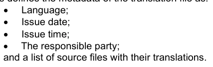
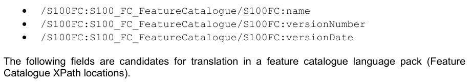
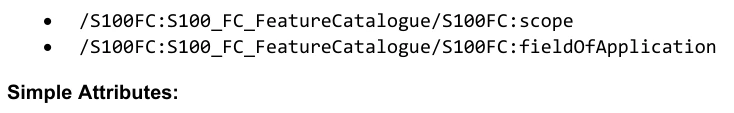

# S-100 5.2.1 · 第 18 部分 · 语言包

非官方机器翻译参考稿，尚未逐条人工校订。公式与代码保留原文，解释以英文规范为准。

## 官方 PDF 第 851 页

S-100 – 第18编

语言包

## 官方 PDF 第 852 页

5.2.1版实质性变动摘要

已生效的概要条款

从规范引用中删除了 URL 链接 。 18-2

## 官方 PDF 第 853 页

中文目录（可用上方目录直接跳转）

18-1 范围 · 官方 PDF 855
18-2 规范性引用文件 · 官方 PDF 855
18-3 总体说明 · 官方 PDF 855
18-4 语言包模型 · 官方 PDF 857
18-4.1 翻译软件包 · 官方 PDF 859
18-4.2 源文件类型 · 官方 PDF 859
18-4.3 源头Type · 官方 PDF 859
18-4.4 资源鉴定 · 官方 PDF 860
18-4.5 翻译项目 · 官方 PDF 860
18-4.6 状况 · 官方 PDF 860
18-5 语言包创建 · 官方 PDF 863
18-5.1 撰写 · 官方 PDF 863
18-5.2 分发 · 官方 PDF 863
18-5.3 执行。 · 官方 PDF 863
18-6 语言包模式 · 官方 PDF 863
18-6.1 司马 ⁇ . · 官方 PDF 863
18-6.2 方案的执行 · 官方 PDF 865
附录18-A · 官方 PDF 871
要素目录的语言包 · 官方 PDF 871
（资料性） · 官方 PDF 871

## 官方 PDF 第 854 页

本页特意留空

## 官方 PDF 第 855 页

18-1 范围

S-100的这一部分详细介绍了如何实施对框架的XML元素的多语言支持,并描述了用于制作单个语言包的通用机制和结构,以实施任何XMR内容的翻译.

用于提供支持产品规范的 XML 资源多种语言实例, 供终端用户使用。 执行系统可以构建这些辅助资源的翻译实例。 这部分并非针对任何一类的 X ML 数据 。 它没有详细说明如何在S-100产品规范、数据集或它们可能提及的任何外部资源中添加多语言支持,它提供了一个通用机制,可用于S- 100框架基于XML的任何要素,以适应多语言执行。

S-100的这一部分提供了实施这种支持的通用方法,并为主要使用案例提供了信息性实例,为S-100要素目录创建了多语种支持.

18-2 规范性引用文件

本文件的应用需要下列参考文件。关于注明日期的参考文献,仅适用所引用的版本。关于未注明日期的文件,适用所参考文献的最新版本(包括修正案):

XML Schema : W3C XML Schema 主题 :

XPath规格:W3C规格. 2017-3-21

ISO 639-2/T 语言规格: ISO 639-2/T 1998 3个字母代码

18-3 总体说明

在S-100下定义了一些 XML Schemas。这些定义用于框架内的各种上下文中,以及数据制作者和执行者定义了 XMl 内容。这一部分引入了“语言包”的概念,以便能提供针对 XMR 内容的多语言支持。

对于特定的XML “ source” 内容, 语言包是一个已出版的 XML 数据集, 它提供源内容中选定元素的翻译。 语言盒本身就是 XMl 内容的 smL, 其定义是 S- 100, 第 18-6 节描述的 sema 。

这种机制能够将源内容的某些要素从一种语言( " 源语言 " )转变为另一种语言( " 目标语言 " )。

图18-1 - 语文包支助程序

还可以构建多语言包,以定义与源 XML 内容(可能不同)的多语言翻译。例如:

## 官方 PDF 第 856 页

图18-2 – 多语种支持实例

请注意,语言包只提供源内容中特定识别要素的翻译列表,不一定会制作包含所有相关要素的源内容版本,语言盒和源内容通过执行系统一起分发和使用,为终端用户提供多语种支持.

例如,在下图18-3中,一个XML要素目录和三个语言包,连同一个数据集在一个交换集中交付到一个执行系统. 该数据集提供了数据内容,要素分类及其语言包为用户界面元素(例如,图例和要素的文字描述)提供了多语言支持.

图18-3 - 多语种支助 - 用于执行系统的交换集

## 官方 PDF 第 857 页

18-4 语言包模型

下文图18-4介绍了一个语言包的模式。

图 18-4 — 语言包模型

翻译包Type包含一组最小标题信息和源文件元素的序列. SourceFileTyke元素中每个元素都有一个标题来识别资源,以及一组为要翻译的资源中一个文本元素持有信息的项.

模型细节如下表所示。请注意,大多数类存在于命名空间 S100_LA。此前缀不是类名的一部分,但逻辑上属于它们。例外在表格中被标记。

## 官方 PDF 第 858 页

本页特意留空

## 官方 PDF 第 859 页

```text
18-4.1
TranslationPackageType
```

角色名称 名称描述 :

类翻译包Type 语言包的主要元素。 - - -

角色语言 翻译语言语言 语言类型包含一种属性语言,它根据ISO639-2/T(例如deu, fra)持有语言代码.

属性 发行 日期 语言包发布的日期 1

属性 发售语言包的时间 0. 1 时间

责任方的属性

0..* CI_责任方 此类型符合ISO 19115,没有在命名空间S100_LA中定义.

可能不止一个责任方具有不同的作用。 (例如,保管人、翻译或出版商)

角色源文件 File 一个源文件 1. * 的所有翻译项目 SourceFileType

```text
18-4.2
SourceFileType
```

角色名称 名称描述 :

类 sourceFileType A 元素, 包含要为单一源文件翻译的所有元素信息

- 源文件必须是XML格式

用于识别源文件 1 的 sourceheaderType 的信息

角色翻译项目列表中每个项目都描述了要翻译的源文件的元素

```text
0..*
TranslationItemType
```

```text
18-4.3
SourceHeaderType
```

角色名称 名称描述 :

类源头Type 信息,用于识别此翻译包包含翻译对象的源文件

```text
-
-
```

## 官方 PDF 第 860 页

属性资源识别 资源 1 URI 的标识符 它可以是文件 URI 或 散列 URN

示例: 文件:/// somefile.xml

位于源文件中的版本信息信息

```text
0..*
ResourceIdentification
```

```text
18-4.4
ResourceIdentification
```

角色名称 名称描述 :

资源识别类信息 源文件( XML) 中可找到版本标识符的类别, 以及存储在那里的值

```text
-
-
```

属性路径 XPath 表达式到包含识别信息的元素或属性

1 字符串示例:/S100FC:S100_FC_FeatureCatal ogue/S100FC:版本数

属性值 指定元素中必须包含的值与源文件相匹配

1 字符串示例: 1.0.0

```text
18-4.5
TranslationItemType
```

角色名称 名称描述 :

```text
Class
TranslationItemType
```

关于源文件中单个可转换项的信息

```text
-
-
```

属性路径 XPath 表达式到包含要翻译的文本的元素或属性

```text
1
CharacterString
```

属性原始文本 来源文件 0. 1 字符串

属性状态 项目 0.1 状态

属性翻译 翻译文本。 1 字符串

18-4.6 状况

项目名称说明

编号状态 翻译项目的状况 目的是支持每个翻译项目的生命周期

字面新项尚未翻译

## 官方 PDF 第 861 页

字面修改 源文件更改了项目内容 翻译必须重新审视,因为它可能不再有效

字形已删除 源文件中此项已不存在

字面翻译 本项目已翻译并准备使用

## 官方 PDF 第 862 页

本页特意留空

## 官方 PDF 第 863 页

S-100版 2024年6月5.2.0日

18-5 语言包创建

18-5.1 撰写

语言包作者负责特定语言翻译内容的定义,用于特定内容的选定要素. 虽然有些要素可能总是需要翻译(如要素定义或信息类型),但其他要素(如语言非特定点名)可能不会,由语言包撰写者负责确定哪些要素需要翻译.

翻译可能会随着时间而修订,因此计划规定修改内容可以选择包含在语言包中,但是这些内容预计不会被最终用户系统执行,而交付到最终用户系统的每套语言包都定义了将源 XML 中所需元素完整地翻译成目标语言.

18-5.2 分发

S-100 第17部分 交换目录允许在 S- 100 交换集中包含零或更多语言包,以分发给终端用户。这些语言包可以与他们提及或独立使用的内容一起包含,以补充在终端用户系统中预先安装的内容。

如果它们与它们提及的内容一起交付,则必须使用该部分内为支持资源而界定的机制,通过联系在交换目录中提及内容,并将在交换内容中进行数字签名。

语言包没有具体的文件名公约,但作为辅助资源,它们必须使用第17部分所定义的文件名公约。

为了避免模棱两可,交换集只必须包含一个单一语言包,用于任何特定源资源,使用特定的目标语言.

18-5.3 执行。

S-100系统的执行者负责正确解释已交付语言包,并正确执行内容值替代,执行者还负责为多语言包提供支持,并在S-100产品数据集内与多语言支持相统一. 这可以为终端用户提供统一的经验,即数据内容和相关用户界面元素是使用同一种语言的规格进行配置的.

18-6 语言包模式

18-6.1 司马 ⁇ .

在S-100的这一部分下,创建了一个语言包,作为符合语言包Schema的XML内容。这个Schema由两个部分组成:

1. 定义: a. 语言包中执行的语言. b. 语文包生产者和发行时间/日期. 2. 用于一个(或多个)源 XML 资源的翻译条目。每个源 XmL 资源由一个URI和一个单一元素识别,该元素可以识别其修改。为每个源给出一个翻译条目的序列,每个条目包含(至少):

a. 源 XML 中元素的位置指定符。使用 XPath 指定

b. 元素的翻译文本。

为了协助语言包的创建过程,并维持Schema也可以选择包含的语言包,对于每个翻译条目:

## 官方 PDF 第 864 页

1. 翻译的来源内容。 2. 翻译的状态值。

root 翻译包元素定义了语言包(目的语言)所支持的语言,发行日期和时间以及语言包生产者。翻译包随后包含任何数量源文件翻译,提供目的地语言翻译。所有语言都使用ISO639-2/T指定,并包含在S-100 Schema代码列表中的描述符。 这确保了语言包所指定的语言使用与数据集编码所包含语言相同的描述符.

源文件元素包含一个头来识别提供翻译的源文件 xml 。通过将源中定义的 XPath 资源与语言包翻译软件包识别元素中定义值相匹配,实现了源资源的独特标识. 这是因为这种独特的识别器可能在不同S-100 XML schemas之间有所不同,因此使用一般路径规格来使S-100内的任何XML内容都能够进行独特的识别.

翻译项目定义翻译本身。 翻译项目的路径属性将使用 XPath 表达式指向源文件中的元素或属性。 表达文必须独一定义一个元素, 因此, XML DOM 树上的查询必须返回一个完全的节点 。

例如,鉴于以下 XML 源内容:

```text
<S100FC:S100_FC_FeatureCatalogue xmlns:S100FC=http://www.iho.int/S100FC …
…
<S100FC:S100_FC_SimpleAttributes>
<S100FC:S100_FC_SimpleAttribute>
<S100FC:name>Category of Topping</S100FC:name>
<S100FC:definition>Topping on a pizza (a maximum of four)</S100FC:definition>
<S100FC:code>categoryOfTopping</S100FC:code>
```

以上XML文件的简化树结构如下图18-5所示:

图18-5 – 要素目录树结构(例)

XPath 表达式 :

```text
/S100FC:S100_FC_FeatureCatalogue/S100FC:S100_FC_SimpleAttributes/S100FC:S10
0_FC_SimpleAttribute[./S100FC:code/text()='categoryOfTopping']/S100FC:name
```

## 官方 PDF 第 865 页

将首先找到带有标记的元素,其名称为 S100FC:S100_FC_Simple_属性与父为 S 100FC;S100-FCSimble-属性(和 S100 FC: S100_ FC_FeatureCatalog) , 其孩子的S100F克:编码为“分类” 。 然后选择孩子 S100fC: 名称, 并用作翻译的参考。 在一般情况下, 元素具有相同代码的 XPath 表达式可能模糊不清。 在功能目录中不存在这个问题,因为S100FC:code总是独一无二的,所以指代代码的表达式保证了翻译项目中一条明确的路径规格.

然后将翻译项目编码为目的地语言的元素(名称)文本译文以及任何可选状态或修订信息。

18-6.2 方案的执行

在命名空间中定义了 Schema :

```text
xmlns="http://www.iho.int/s100/la/5.0"
```

它使用来自两个ISO 19115 Schemas 的类型:

```text
xmlns:gco="http://standards.iso.org/iso/19115/-3/gco/1.0"
xmlns:cit="http://standards.iso.org/iso/19115/-3/cit/2.0"
```

此 Schema 的设置如下:

```text
targetNamespace="http://www.iho.int/S100/la/5.0"
elementFormDefault="qualified"
attributeFormDefault="unqualified"
```

在Schema中,状态作为一个简单类型执行如下:

```text
<xs:simpleType name="Status">
<xs:annotation>
<xs:documentation>
The status of the translation item. The purpose is manly to support the
functionality of an translation tool.
</xs:documentation>
</xs:annotation>
<xs:restriction base="xs:string">
<xs:enumeration value="New">
<xs:annotation>
<xs:documentation>
The item is new, there is no translation available yet.
</xs:documentation>
</xs:annotation>
</xs:enumeration>
<xs:enumeration value="Modified">
<xs:annotation>
<xs:documentation>
The original text has been changed in the source
</xs:documentation>
</xs:annotation>
</xs:enumeration>
<xs:enumeration value="Deleted">
<xs:annotation>
<xs:documentation>
The text defined by path is not longer available in the source
document.
</xs:documentation>
</xs:annotation>
</xs:enumeration>
<xs:enumeration value="Translated">
<xs:annotation>
<xs:documentation>
```

## 官方 PDF 第 866 页

本项目有有效的翻译. </xs:documentation > </Xs:notation > > <-xs;enummentation> </ xs:reclation ></x:simpleType> 对于语言的定义,定义了一种复杂的类型LanguageTyope,它使用一种类型的gco:CodeListVale_Tyke(取自ISO 19115):

```text
<xs:complexType name="LanguageType">
<xs:sequence>
<xs:element name="languageCode" type="gco:CodeListValue_Type"/>
</xs:sequence>
</xs:complexType>

Each translation item is defined by the type TranslationItemType:
```

```text
<xs:complexType name="TranslationItemType">
<xs:annotation>
<xs:documentation>
One item to be translated. This will be a uniquely identifiable element or
attribute in a source (XML) file
</xs:documentation>
</xs:annotation>
<xs:sequence>
<xs:element name="path" type="xs:string">
<xs:annotation>
<xs:documentation>
The XPath that defines the 'source' text.
</xs:documentation>
</xs:annotation>
</xs:element>
<xs:element name="original" type="xs:string" minOccurs="0">
<xs:annotation>
<xs:documentation>
The original text as exists in the source document.
</xs:documentation>
</xs:annotation>
</xs:element>
<xs:element name="status" type="Status" minOccurs="0">
<xs:annotation>
<xs:documentation>
The status of the translation item
</xs:documentation>
</xs:annotation>
</xs:element>
<xs:element name="translation" type="xs:string">
<xs:annotation>
<xs:documentation>
The translated text.
</xs:documentation>
</xs:annotation>
</xs:element>
</xs:sequence>
</xs:complexType>

The type ResourceIdentification contains the information to identify a source file. This defines an
XPath to the version element in the source and the value that this element in the source file must have:
```

## 官方 PDF 第 867 页

```text
<xs:complexType name="ResourceIdentification">
<xs:annotation>
<xs:documentation>
Information to identify a specific version of an (XML) file.
</xs:documentation>
</xs:annotation>
<xs:sequence>
<xs:element name="path" type="xs:string">
<xs:annotation>
<xs:documentation>
The XPath to the element or attribute that allows the unique identification
of the source file.
</xs:documentation>
</xs:annotation>
</xs:element>
<xs:element name="value" type="xs:string">
<xs:annotation>
<xs:documentation>
The value of the element or attribute that describes the identification of
the source file. e.g. the version or issue date
</xs:documentation>
</xs:annotation>
</xs:element>
</xs:sequence>
</xs:complexType>

The type SourceHeaderType contains the information on the source file as the filename and an
identification mechanism:
```

```text
<xs:complexType name="SourceHeaderType">
<xs:annotation>
<xs:documentation>
Information to identyfing the source file. It supports mechanism to distinguish
different versions of a source file.
</xs:documentation>
</xs:annotation>
<xs:sequence>
<xs:element name="resourceIdentifier" type="xs:anyURI"/>
<xs:element name="identification" type="ResourceIdentification" minOccurs="0"
maxOccurs="unbounded">
<xs:annotation>
<xs:documentation>
Identification by one or more elements or attributes in the source
file.
</xs:documentation>
</xs:annotation>
</xs:element>
</xs:sequence>
</xs:complexType>

The type SourceFileType contains the header information of the file and a list of translation items for
that file:
```

```text
<xs:complexType name="SourceFileType">
<xs:sequence>
<xs:element name="header" type="SourceHeaderType"/>
<xs:element name="translationItem" type="TranslationItemType" minOccurs="0"
maxOccurs="unbounded">
<xs:annotation>
<xs:documentation>
The list of translation items.
```

## 官方 PDF 第 868 页

```text
</xs:documentation>
</xs:annotation>
</xs:element>
</xs:sequence>
</xs:complexType>

The last type defined by the Schema is the type TranslationPackageFile:
```

```text
<xs:complexType name="TranslationPackageType">
<xs:sequence>
<xs:element name="language" type="LanguageType">
<xs:annotation>
<xs:documentation>
The language that will be supported by this translation
file.
</xs:documentation>
</xs:annotation>
</xs:element>
<xs:element name="issueDate" type="xs:date"/>
<xs:element name="issueTime" type="xs:time" minOccurs="0"/>
<xs:element name="responsibleParty" type="cit:CI_Responsibility_PropertyType"
minOccurs="0" maxOccurs="unbounded"/>
<xs:element name="sourceFile" type="SourceFileType" maxOccurs="unbounded">
<xs:annotation>
<xs:documentation>
The list of source files for that this translation file provides
translations.
</xs:documentation>
</xs:annotation>
</xs:element>
</xs:sequence>
</xs:complexType>

This defines the metadata of the translation file as:
```



以及源文件列表及其译名.

注意对责任方使用同前:CI_责任_利润Type.

一个可能的编码会看起来像:

```text
<S100LA:responsibleParty>
<cit:CI_Responsibility>
<cit:role>
<cit:CI_RoleCode codeList="codeListLocation#CI_RoleCode"
codeListValue="custodian">custodian</cit:CI_RoleCode>
</cit:role>
<cit:party>
<cit:CI_Individual>
<cit:name>
<gco:CharacterString>Max Mustermann</gco:CharacterString>
</cit:name>
</cit:CI_Individual>
</cit:party>
</cit:CI_Responsibility>
</S100LA:responsibleParty>
```

## 官方 PDF 第 869 页

作为元素<cit:CI_Individual>的替代,如果生产者是组织而不是个人,则可以使用元素<Cit: CI_Organization>。责任方的预先定义角色由S-100 Schemas在相应的代码列表中定义。请注意,责任方预先定义的角色列表是。 虽然 " 翻译 " 没有任何价值,但如有必要,可以利用 " 贡献者 " 发挥这一作用。

最后,Schema定义了翻译文件的根元素:

```text
<xs:element name="translationPackage" type="TranslationPackageType">
<xs:annotation>
<xs:documentation>
The root element of a translation file.
</xs:documentation>
</xs:annotation>
</xs:element>
```

## 官方 PDF 第 870 页

本页特意留空

## 官方 PDF 第 871 页

附录18-A 要素目录语言包

（资料性）

虽然本部分导言中已经指出,语言包制作可以应用于任何S-100 XML内容,但主要使用的案例是制作语言包以支持执行系统的要素目录,这使得系统(无论是最终用户还是数据生产者)可以使用特性,信息类型,属性和关系等要素目录条目的翻译版本.

在这个例子中,由S-100产品规范过程定义的单个要素目录包含一些可能翻译的内容。

已编写了所需字段的一套译文,并构建了一套语言包,与语言包的图案一致,该图案为给定的要素目录执行特定语言.

图18-A-1 — S-100语言包

此语言包,连同"要素目录"可以随后分发给最终用户,供最终用户系统执行。终端用户系统可以在运行时以给出的语言构建一个要素目录版本,或者根据需要将所翻译的项目互放。这是针对执行的。

由于某些要素被用作要素目录的参考,以提供条目之间的约束(例如要素属性约束参考),因此如果最终用户系统选择在运行时创建完整的要素目录翻译,那么应当注意确保这种绘图保持完整. 这将排除S100_FC_项目代码字段的翻译,因为它提供了属性和子属性约束的参考.

## 官方 PDF 第 872 页

要素目录的语言包应当使用下列字段来进行产品和版本识别源要素目录: 1.



以下领域是特写目录语言包中翻译的候选项目(Feature).

一般内容:



名称、定义和注释是翻译的对象。请注意,必须使用上游来唯一地识别源文件中的元素。

在上方[./S100FC:code/text ()="code"]中,"code"将是属性的代码;例如"CategoryOfLight".

```text
/S100FC:S100_FC_FeatureCatalogue/S100FC:S100_FC_SimpleAttributes/S100FC:S100_FC
_SimpleAttribute[./S100FC:code/text()='attributeCode']/S100FC:name
```

```text
/S100FC:S100_FC_FeatureCatalogue/S100FC:S100_FC_SimpleAttributes/S100FC:S100_FC
_SimpleAttribute[./S100FC:code/text()='attributeCode']/S100FC:definition
```

```text
/S100FC:S100_FC_FeatureCatalogue/S100FC:S100_FC_SimpleAttributes/S100FC:S100_FC
_SimpleAttribute[./S100FC:code/text()='attributeCode']/S100FC:remarks
```

列出的计数属性值 :

标签、定义和评论均需翻译。

请注意,此处需要两个上位符,一个是属性代码,一个是列表值的点数代码.

```text
/S100FC:S100_FC_FeatureCatalogue/S100FC:S100_FC_SimpleAttributes/S100FC:S100_FC
_SimpleAttribute[./S100FC:code/text()='attributeCode']/S100FC:listedValues/S100
FC:listedValue[./S100FC:code/text()='enumerationValue']/S100FC:label
```

```text
/S100FC:S100_FC_FeatureCatalogue/S100FC:S100_FC_SimpleAttributes/S100FC:S100_FC
_SimpleAttribute[./S100FC:code/text()='attributeCode']/S100FC:listedValues/S100
FC:listedValue[./S100FC:code/text()='enumerationValue']/S100FC:definition
```

```text
/S100FC:S100_FC_FeatureCatalogue/S100FC:S100_FC_SimpleAttributes/S100FC:S100_FC
_SimpleAttribute[./S100FC:code/text()='attributeCode']/S100FC:listedValues/S100
FC:listedValue[./S100FC:code/text()='enumerationValue']/S100FC:remarks
```

复杂属性 :

类似于简单的属性.

```text
/S100FC:S100_FC_FeatureCatalogue/S100FC:S100_FC_ComplexAttributes/S100FC:S100_F
C_ComplexAttribute[./S100FC:code/text()='attributeCode']/S100FC:name
```

```text
/S100FC:S100_FC_FeatureCatalogue/S100FC:S100_FC_ ComplexAttributes
/S100FC:S100_FC_ComplexAttribute[./S100FC:code/text()='attributeCode']/S100FC:d
efinition
```

```text
/S100FC:S100_FC_FeatureCatalogue/S100FC:S100_FC_ ComplexAttributes
/S100FC:S100_FC_ComplexAttribute[./S100FC:code/text()='attributeCode']/S100FC:r
emarks
```

## 官方 PDF 第 873 页

角色 :

```text
/S100FC:S100_FC_FeatureCatalogue/S100FC:S100_FC_Roles/S100FC:S100_FC_Role[./S10
0FC:code/text()='roleCode']/S100FC:name
```

```text
/S100FC:S100_FC_FeatureCatalogue/S100FC:S100_FC_Roles/S100FC:S100_FC_Role[./S10
0FC:code/text()='roleCode']/S100FC:definition
```

```text
/S100FC:S100_FC_FeatureCatalogue/S100FC:S100_FC_Roles/S100FC:S100_FC_Role[./S10
0FC:code/text()='roleCode']/S100FC:remarks
```

```text
InformationAssociations:
```

```text
/S100FC:S100_FC_FeatureCatalogue/S100FC:S100_FC_InformationAssociations/S100FC:
S100_FC_InformationAssociation[./S100FC:code/text()='associationCode']/S100FC:n
ame
```

```text
/S100FC:S100_FC_FeatureCatalogue/S100FC:S100_FC_InformationAssociations/S100FC:
S100_FC_InformationAssociation[./S100FC:code/text()='associationCode']/S100FC:d
efinition
```

```text
/S100FC:S100_FC_FeatureCatalogue/S100FC:S100_FC_InformationAssociations/S100FC:
S100_FC_InformationAssociation[./S100FC:code/text()='associationCode']/S100FC:r
emarks
```

```text
FeatureAssociations:
```

```text
/S100FC:S100_FC_FeatureCatalogue/S100FC:S100_FC_FeatureAssociations/S100FC:S100
_FC_FeatureAssociation[./S100FC:code/text()='associationCode']/S100FC:name
```

```text
/S100FC:S100_FC_FeatureCatalogue/S100FC:S100_FC_FeatureAssociations/S100FC:S100
_FC_FeatureAssociation[./S100FC:code/text()='associationCode']/S100FC:definitio
n
```

```text
/S100FC:S100_FC_FeatureCatalogue/S100FC:S100_FC_FeatureAssociations/S100FC:S100
_FC_FeatureAssociation[./S100FC:code/text()='associationCode']/S100FC:remarks
```

```text
InformationTypes:
```

```text
/S100FC:S100_FC_FeatureCatalogue/S100FC:S100_FC_InformationTypes/S100FC:S100_FC
_InformationType[./S100FC:code/text()='typeCode']/S100FC:name
```

```text
/S100FC:S100_FC_FeatureCatalogue/S100FC:S100_FC_InformationTypes/S100FC:S100_FC
_InformationType[./S100FC:code/text()='typeCode']/S100FC:definition
```

```text
/S100FC:S100_FC_FeatureCatalogue/S100FC:S100_FC_InformationTypes/S100FC:S100_FC
_InformationType[./S100FC:code/text()='typeCode']/S100FC:remarks
```

```text
FeatureTypes:
```

```text
/S100FC:S100_FC_FeatureCatalogue/S100FC:S100_FC_FeatureTypes/S100FC:S100_FC_Fea
tureType[./S100FC:code/text()='typeCode']/S100FC:name
```

```text
/S100FC:S100_FC_FeatureCatalogue/S100FC:S100_FC_FeatureTypes/S100FC:S100_FC_Fea
tureType[./S100FC:code/text()='typeCode']/S100FC:definition
```

```text
/S100FC:S100_FC_FeatureCatalogue/S100FC:S100_FC_FeatureTypes/S100FC:S100_FC_Fea
tureType[./S100FC:code/text()='typeCode']/S100FC:remarks
```

如第18-5节所述,要素目录可以根据语言包作者的偏好,产生其中部分或全部字段的翻译.

下面S-101要素目录的摘录中列举了其中一些领域的例子:

## 官方 PDF 第 874 页

```text
<S100FC:S100_FC_SimpleAttribute>
<S100FC:name>Category of Light</S100FC:name>
<S100FC:definition>Classification of different light types.</S100FC:definition>
<S100FC:code>categoryOfLight</S100FC:code>
<S100FC:remarks>All lights are considered to be marine lights unless the category of light indicates
otherwise.</S100FC:remarks>
<S100FC:alias>CATLIT</S100FC:alias>
<S100FC:definitionReference>
<S100FC:sourceIdentifier>88</S100FC:sourceIdentifier>
<S100FC:definitionSource ref="IHOREG"/>
</S100FC:definitionReference>
<S100FC:valueType>enumeration</S100FC:valueType>
<S100FC:listedValues>
<S100FC:listedValue>
<S100FC:label>Leading Light</S100FC:label>
<S100FC:definition>A light associated with other lights so as to form a leading line to be
followed.</S100FC:definition>
<S100FC:code>4</S100FC:code>
<S100FC:definitionReference>
<S100FC:sourceIdentifier>863</S100FC:sourceIdentifier>
<S100FC:definitionSource ref="IHOREG"/>
</S100FC:definitionReference>
</S100FC:listedValue>
<S100FC:listedValue>
<S100FC:label>Aero Light</S100FC:label>
<S100FC:definition>An aero light is established for aeronautical navigation and may be of higher
power than marine lights and visible from well offshore.</S100FC:definition>
<S100FC:code>5</S100FC:code>
<S100FC:definitionReference>
<S100FC:sourceIdentifier>864</S100FC:sourceIdentifier>
<S100FC:definitionSource ref="IHOREG"/>
</S100FC:definitionReference>
</S100FC:listedValue>

This section of the S-101 Feature Catalogue would result in the following translations included in a
German S-101 feature catalogue language pack:
```

表18-A-1 语文包翻译(实例)

德文文本

名称[代码=类别Offlight] 轻光光光能光能能光光力光能取出光能电光光的光能回放

```text
Definition[code=
categoryOfLight]
```

不同光型的分类

Die Systematik der unterschiedlichen Leuchtfeerarten (法语) 互联网档案馆的存檔,存档日期2011-12-02.

```text
Remarks[code=
categoryOfLight]
```

所有灯光均被视为海洋灯光,除非该灯光类别另有说明

莱克特费厄海边的海边的莱克特费厄海边的贝特拉克泰特岛 索朗格会死 凯特高里尼克特海边的安吉布特岛

已列出的数值/ 标签[ 代码=4]

列出Value/definition[code=4] 与其他灯光相接的光线,以便形成一条要遵循的导线。

```text
Ein Feuer, dass zusammen mit anderen Feuern eine Linie bestimmt, der gefolgt werden muss.
```

上市的Value/label[代码=5] Aero Light Luftfahrtfeuer 软件

确定航空导航的航空光,其功率可能高于海上光线,从海上井中可见。

Feuer für Luftfahrtsnavigation. 海洋之帽事件(Hat eventuell eine höhere Leuchtstärke als) 海洋之帽(Hat eventuell eine höhere Leuchtstärke als) 海洋之帽(Hat eventuell) 海洋之帽(Hat eine Höhere Leuchtstärke als) 海洋之帽(Hat subject)

## 官方 PDF 第 875 页

Leuchtfeier und kann weit vor der Küste sichtbar sein. 表中的值将在德国 S-101 语言包中编码,如下 XML 碎片所显示。

请注意, 并非所有项目都在本例中翻译。 对于被翻译的项目, 状态被设定为“ 翻译 ” 。 所有其他项目仍然具有“ 新” 的含义, 尚未翻译 。

```text
<S100LA:translationItem>

<S100LA:path>/S100FC:S100_FC_FeatureCatalogue/S100FC:S100_FC_SimpleAttributes/S100FC:S100_FC_
SimpleAttribute[./S100FC:code/text()='categoryOfLight']/S100FC:name</S100LA:path>
<S100LA:original>Category of Light</S100LA:original>
<S100LA:status>Translated</S100LA:status>
<S100LA:translation>Kategorie des Leuchtfeuers</S100LA:translation>
</S100LA:translationItem>
<S100LA:translationItem>

<S100LA:path>/S100FC:S100_FC_FeatureCatalogue/S100FC:S100_FC_SimpleAttributes/S100FC:S100_FC_
SimpleAttribute[./S100FC:code/text()='categoryOfLight']/S100FC:definition</S100LA:path>
<S100LA:original>Classification of different light types.</S100LA:original>
<S100LA:status>Translated</S100LA:status>
<S100LA:translation>Die Systematik der unterschiedlichen Leuchtfeuerarten </S100LA:translation>
</S100LA:translationItem>
<S100LA:translationItem>

<S100LA:path>/S100FC:S100_FC_FeatureCatalogue/S100FC:S100_FC_SimpleAttributes/S100FC:S100_FC_
SimpleAttribute[./S100FC:code/text()='categoryOfLight']/S100FC:remarks</S100LA:path>
<S100LA:original>All lights are considered to be marine lights unless the category of light indicates
otherwise.</S100LA:original>
<S100LA:status>New</S100LA:status>
<S100LA:translation />
</S100LA:translationItem>
<S100LA:translationItem>

<S100LA:path>/S100FC:S100_FC_FeatureCatalogue/S100FC:S100_FC_SimpleAttributes/S100FC:S100_FC_
SimpleAttribute[./S100FC:code/text()='categoryOfLight']/S100FC:listedValues/S100FC:listedValue[./S100FC:
code/text()='4']/S100FC:label</S100LA:path>
<S100LA:original>Leading Light</S100LA:original>
<S100LA:status>New</S100LA:status>
<S100LA:translation />
</S100LA:translationItem>
<S100LA:translationItem>

<S100LA:path>/S100FC:S100_FC_FeatureCatalogue/S100FC:S100_FC_SimpleAttributes/S100FC:S100_FC_
SimpleAttribute[./S100FC:code/text()='categoryOfLight']/S100FC:listedValues/S100FC:listedValue[./S100FC:
code/text()='4']/S100FC:definition</S100LA:path>
<S100LA:original>A light associated with other lights so as to form a leading line to be
followed.</S100LA:original>
<S100LA:status>New</S100LA:status>
<S100LA:translation />
</S100LA:translationItem>
<S100LA:translationItem>

<S100LA:path>/S100FC:S100_FC_FeatureCatalogue/S100FC:S100_FC_SimpleAttributes/S100FC:S100_FC_
SimpleAttribute[./S100FC:code/text()='categoryOfLight']/S100FC:listedValues/S100FC:listedValue[./S100FC:
code/text()='5']/S100FC:label</S100LA:path>
<S100LA:original>Aero Light</S100LA:original>
<S100LA:status>New</S100LA:status>
<S100LA:translation />
</S100LA:translationItem>
```

## 官方 PDF 第 876 页

```text
<S100LA:translationItem>

<S100LA:path>/S100FC:S100_FC_FeatureCatalogue/S100FC:S100_FC_SimpleAttributes/S100FC:S100_FC_
SimpleAttribute[./S100FC:code/text()='categoryOfLight']/S100FC:listedValues/S100FC:listedValue[./S100FC:
code/text()='5']/S100FC:definition</S100LA:path>
<S100LA:original>An aero light is established for aeronautical navigation and may be of higher power than
marine lights and visible from well offshore.</S100LA:original>
<S100LA:status>New</S100LA:status>
<S100LA:translation />
</S100LA:translationItem>

This language pack would be named according to the naming convention in S-100 Part 17 and would
support a Feature Catalogue using the reference structure defined.
```
