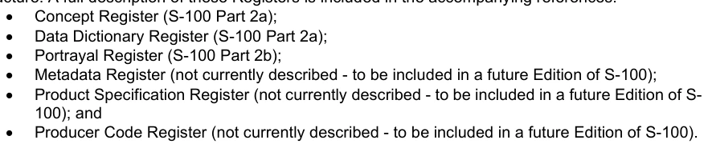

# S-100 5.2.1 · 第 2 部分 · 注册簿管理

非官方机器翻译参考稿，尚未逐条人工校订。公式与代码保留原文，解释以英文规范为准。

## 官方 PDF 第 47 页

S-100 – 第2编

注册簿的管理

## 官方 PDF 第 48 页

5.2.1版实质性变动摘要

已生效的概要条款

## 官方 PDF 第 49 页

中文目录（可用上方目录直接跳转）

2-1 范围 · 官方 PDF 51
2-2 符合性 · 官方 PDF 51
2-3 规范性引用文件 · 官方 PDF 51
2-4  一般概念 · 官方 PDF 52
2-4.1 书记官处 · 官方 PDF 52
2-4.1.1 登记处所有人 · 官方 PDF 52
2-4.1.2 书记官处管理员 · 官方 PDF 52
2-4.2 注册簿 · 官方 PDF 52
2-4.2.1 国际水道测量组织地理空间信息注册簿内的注册簿 · 官方 PDF 52
2-5 注册簿管理中的角色与职责 · 官方 PDF 52
2-5.1 注册簿所有人 · 官方 PDF 52
2-5.2 注册簿管理员 · 官方 PDF 53
2-5.3 注册簿用户 · 官方 PDF 53
2-5.4 域控制体 · 官方 PDF 53
2-5.5 行政管制机构 · 官方 PDF 53
2-5.6 提交组织 · 官方 PDF 53
2-5.6.1 合格的提交组织 · 官方 PDF 53
2-5.7 提案的处理 · 官方 PDF 53
2-5.7.1 增加已登记的物项 · 官方 PDF 54
2-5.7.2 澄清已登记项目 · 官方 PDF 54
2-5.7.3 超期分发已登记物品 · 官方 PDF 54
2-5.7.4 已登记物品的退役 · 官方 PDF 54
2-6 注册簿管理员必须履行的职责 · 官方 PDF 54
2-6.1 提案的合法性 · 官方 PDF 54
2-7 提案流程 · 官方 PDF 55
2-7.1 核准程序 · 官方 PDF 56
提案的撤回 · 官方 PDF 58
2-7.1.2 上诉 · 官方 PDF 58
2-7.2 提交组织名单 · 官方 PDF 58
2-7.3 出版情况 · 官方 PDF 58
2-7.4 廉正 · 官方 PDF 59
2-8 注册簿模式 · 官方 PDF 59
2-8.1 引言 · 官方 PDF 59
2-8.2 S100_RE_注册 · 官方 PDF 61
2-8.3 S100_RE_登记项目 · 官方 PDF 61
2-8.4 S100_RE_项目现状 · 官方 PDF 62
2-8.5 S100_RE_参考来源 · 官方 PDF 63
2-8.6 S100_RE_类似来源 · 官方 PDF 63
2-8.7 S100_RE_参考文献 · 官方 PDF 64
2-8.8 S100_RE_管理信息 · 官方 PDF 64
2-8.9 S100_RE_提案类型 · 官方 PDF 65
2-8.10 S100_RE_提案现状 · 官方 PDF 65

## 官方 PDF 第 50 页

本页特意留空

## 官方 PDF 第 51 页

2-1 范围

S-100的这一部分规定了在维持和公布分配给地理、水道测量和元数据信息的独特、明确和永久识别资料注册簿时应遵循的程序,并为此目的,这一部分说明了注册簿及其注册簿的管理作用和责任。 国际海道测量组织地理空间信息登记处及其注册簿的具体行政细节载于国际海道测量组织出版物S-99。

2-2 符合性

此剖面符合ISO 19106:2004中的第二级. 以下是关于该剖面与ISO 19135:2005不同的专业和通论的简要说明.

1) S100_RE_Register限制属性替代语言的使用.

2) S100_RE_Register 项目限制属性字段Of应用和可替代Expression的使用.

3) S100_RE_注册项目将属性描述重命名为备注.

4)S100_RE_ManagementInfo是一个新类,它合并了类RE_决策状态,S100_RE_提议Type,S100_RE_附属组织,S100_RE_项目状态和Re_Disposition.

5)S100_RE_ProposalType是一个将ISO 19135类RE-Addition Information,RE-Clarification Information,RE-修正Information和RE-修正Type合并而成的新类.

2-3 规范性引用文件

ISO 19126:2009,"地理信息-地貌概念词典和注册簿".

ISO 19135:2005,"地理信息-地理信息项目登记程序".

ISO 8601:2004,数据元素和交换格式 - 信息交换 - 日期和时间的表示

IHO S-99,国际HO地理空间信息登记册的组织和管理业务程序

## 官方 PDF 第 52 页

2-4 一般概念

2-4.1 书记官处

注册簿是注册簿或注册簿系列所维持的信息系统。

2-4.1.1 登记处所有人

登记所有人有权托管注册簿并制订查阅政策,登记所有人决定是否必须在注册簿上托管拟议的注册簿。

2-4.1.2 书记官处管理员

书记官处管理员负责书记官处的日常运作,其中包括:

1) 为注册簿管理人员、管制机构和注册簿用户提供注册簿访问权;

(2) 确保用户随时可以获取与注册簿所列物品有关的资料,这些物品具有有效、无效、澄清、取代、退役或处理的性质;

3) 接受建议并转交所有注册簿管理人员;以及

4) 管理解决持续的URI识别符以获得适当资源,但只有在登记服务器上提供解析服务时才能这样做。

2-4.2 注册簿

注册簿只是管理的清单,比固定文件更容易保存,因为注册簿需要增加新的项目;注册簿中的现有项目可以澄清、替换或退役;每个注册簿项目都有一个或多个相关日期,说明其状况何时发生变化。 这意味着在特定日期界定的产品规范可在某一具体时间点参照注册簿中的某一物品。

2-4.2.1 国际水道测量组织地理空间信息注册簿内的注册簿

在国际海道测量组织地理空间信息注册簿结构内实施了下列注册簿,并在所附参考资料中全面介绍了这些注册簿:



元数据注册簿(目前没有说明,将列入S-100的未来版);产品规范注册簿(现在没有说明 -- -- 将列入未来的S-生产者代码注册簿的版本)(目前没有叙述 -- -- 要列入未来的 S-100 版)。

国际海道测量组织地理信息登记处的业务和管理程序说明,进一步扩展了下列条款所描述的一般概念,载于国际海道测量组织的出版物S-99-国际水生物学组织地理空间信息登记处的组织和管理业务程序。

2-5 注册簿管理中的角色与职责

2-5.1 注册簿所有人

注册簿所有人是一个组织,它:

(1) 在注册簿内设立一个或多个注册簿;

2) 负责管理、传播和掌握这些注册簿的知识内容;

3) 可任命另一组织担任注册簿管理员;

4) 应制定程序,处理提交组织提出的建议和申诉。

## 官方 PDF 第 53 页

2-5.2 注册簿管理员

注册簿管理员负责管理注册簿,其中包括:

(1) 与其他注册簿管理人员、提交组织、相关管制机构、注册簿所有人和注册簿管理人进行协调;

(2) 在注册簿内保存各种物项;

3) 维持和公布提交组织名单;

4) 分发包含注册簿说明和如何提交提案的整套资料;

5) 向注册簿所有人和/或管制机构提供定期报告,每份报告应说明自上次报告以来收到的建议和作出的决定,这些报告之间的间隔不得超过12个月。

注册簿管理员可以管理多个注册簿。

2-5.3 注册簿用户

注册簿用户是有意访问或确定注册簿内容的任何人或组织。

2-5.4 域控制体

注册簿领域管制机构是由注册簿所有人任命的技术专家组,负责决定修改注册簿内容的建议是否可以接受,该小组必须由构成注册簿内容的相关领域的专家组成,因此,注册簿领域管理局由每个领域至少一名代表组成,协助注册簿内容。

2-5.5 行政管制机构

行政管制机构必须由注册簿内每个领域的代表组成,欧洲中央银行将监测注册簿管理人并提供咨询意见,并充当注册簿程序的任何决定或争端的仲裁人,如果无法达成解决办法,欧洲央行可要求国际水道测量服务和标准委员会(水道测量委员会)作出决定。

2-5.6 提交组织

2-5.6.1 合格的提交组织

提交组织是指按照注册簿所有人确定的标准有资格提议修改注册簿内容的组织,注册簿管理人必须确定提交组织是否符合注册簿所有人制定的标准。 经核准的提交组织应至少有一名代表被任命代表其向注册簿提交提案(可同注册簿管理人协商任命多个提交组织的代表)。

2-5.7 提案的处理

提交申请的组织可提出增补、澄清、补会和注销已登记项目的请求。

## 官方 PDF 第 54 页

2-5.7.1 增加已登记的物项

增列是将一个新项目列入注册簿,说明一个概念,即注册簿中已经存在的有效或处理项目没有充分描述。

2-5.7.2 澄清已登记项目

澄清更正了拼写、标注、语法或内容或措辞的改进等错误,澄清不得导致对登记项目的任何实质性语义改动,可以澄清的三个特征是定义、其他参考和说明。

2-5.7.3 超期分发已登记物品

超会是指任何可能导致实质性地语义改变现有有效项目的提案,例如更改某一项目的名称或其骆驼目识别标志;或改变《显示注册簿》中某一项目的形象。 原项目应保留在注册簿中,但必须注明其被取代的日期并注明被取代的项目。

2-5.7.4 已登记物品的退役

退休应受到下列因素的影响:将物品留在注册簿;在物品上标出其退役;以及包括退休日期。

2-6 注册簿管理员必须履行的职责

1) 接收本组织代表提出的建议;

(2) 审查完整性建议;

3) 如果提案不完全,则将提案退回提交组织的代表;

4) 在注册簿内核实类似的建议;如果类似,注册簿管理人应同提交组织代表联系;

5) 在收到提案后两个日历周内与其他注册簿管理人员协调;

6) 产生一份建议书管理记录,其地位定为 " 转让 " ;

7) 启动批准程序。

2-6.1 提案的合法性

注册簿管理人必须采用下列标准确定该建议书是否完整,并在下列情况下否决该建议书:

(1) 提交者不是合格的提交组织代表;

(2) 拟议物项不属于分配给该注册簿管理人的物项类别;

3) 拟议项目不属于注册簿的范围;或

(4) 拟议项目已经提出。

## 官方 PDF 第 55 页

2-7 提案流程

图2-1-提议程序-概念注册簿

## 官方 PDF 第 56 页

图2-2 – 提案过程 – 数据词典注册簿

2-7.1 核准程序

上文图2-1和图2-2说明了确定投标书可接受性的程序,必须按S-99的规定,在注册簿所有人规定的期限内完成。

注册簿管理员应确保:

(1) 如果提议澄清或留存注册簿项目,将项目现状定为“处理”;并将提议转交注册簿领域管制机构;或

## 官方 PDF 第 57 页

(2) 如果提议登记新项目或登记现有项目:a) 向新项目和替代项目指定项目标识符;b) 将项目现状定为“处理”项目;c) 将该提议转交注册簿域管制机构。

注册簿域管制机构应:

(1) 决定不加修改地接受提案;接受提案,但须与提交组织谈判作出修改;或不接受提案。

(a) 有关物项的规格不完整或无法理解;

(c) 拟议项目不属于注册簿所列项目类别; (d) 拟议物项不属于本注册簿的范围;或 (e) 提议的理由不充分。

(2) 根据S-99,在注册簿所有人规定的时限内,将决定和决定的理由通知注册簿管理人。

注册簿管理员应:

(1) 如果提交组织与注册簿域管制机构之间需要就域管制机构的指定作为接受条件的提案的修改进行谈判,则充当联络点;

(2) 将处理提案的结果通知提交组织的代表。

如果注册簿领域管制机构的决定是肯定的,注册簿管理人应根据注册簿的政策:

1) 完成提案管理记录,将提案现状定为“接受”;并修正日期为域管制机构作出决定之日;

(2) 对注册簿项目的内容作出经核准的修改;和

3) 将注册簿项目状态设为“有效”项目。对于超会或退休提案,被替换或退休项目的状况酌情设为“超会”或“退休”。

如果注册簿域管制机构的决定是否定的,注册簿管理人应:

(1) 更新建议书管理记录,规定建议书的状况为`被拒';修改日期为域管制机构作出决定之日;以及

(2) 向提交组织通报对域管制机构的决定提出上诉的截止日期。

提交组织代表应:

(1) 与注册簿域管制机构谈判,就域管制机构规定接受的条件对其提案的修改;

(2) 在各自提交组织的社区或组织内,公布注册簿管理员向其转递的域管制机构就提案作出的决定。

注册簿管理员应:

1) 向公众传播审批结果。

## 官方 PDF 第 58 页

提案的撤回

提交组织代表可在核准过程中的任何时候决定撤回一项提案。

注册簿管理员应:

(1) 将提案管理记录提案从“尚未确定”改为“撤回”。

2-7.1.2 上诉

提交申请的组织代表如果不同意注册簿域管制机构的决定,可向注册簿执行管制机构提出申诉,拒绝关于注册簿中某一物品的增列、澄清、超期存放或留存的建议,申诉应至少说明情况;申诉的理由;如果申诉不成功,应说明影响。 如上文图2-1和图2-2所示,上诉程序已纳入总体提案进程。

提交组织应:

(1) 确定关于登记提案的决定是否可以接受;和

2) 如果不是,则向注册簿管理员提出上诉。

注册簿管理员应:

1) 将上诉转交注册簿执行管制机构。

注册簿执行管制机构应:

(1) 按照既定程序处理上诉;

(2) 决定接受或驳回上诉;

3) 将结果退还注册簿管理员。

注册簿管理员应:

1) 更新提案管理记录栏的提案现状和修正日期;

2) 更新注册簿项目的现状;

(3) 向注册簿领域管制机构和提交组织代表提供该决定的结果。

提交组织的代表应:

1) 在其提交组织社区或组织内公布呼吁的结果。

2-7.2 提交组织名单

注册簿管理员应保持并公布一份注册簿专有名单,列出所有有资格提交组织,这些组织可就其管理的每一注册簿的内容提出修改建议;每一名单必须包括每个提交组织代表的姓名和联系资料;注册簿应载有成为提交组织的申请。 登记所有人将负责接受或拒绝申请。

2-7.3 出版情况

注册簿管理员应确保用户随时可以获取注册簿中有效、澄清、替换或已取出的物品的信息,提供这种信息的方法可能取决于用户界成员的要求。

## 官方 PDF 第 59 页

2-7.4 廉正

注册簿管理员应确保,对所管理的每个注册簿:

(1) 登记过程的所有方面都按照良好的商业做法处理;(2) 注册簿的内容准确;(3) 只有经授权的人才能修改注册簿的内容。

书记官处管理人应利用信息技术最佳做法,确保书记官处的安全和完整。

2-8 注册簿模式

2-8.1 引言

本条款规定的计划描述了国际海道测量组织地理空间信息注册簿的结构。

关于注册簿和注册簿中物品的资料必须为:

1) 通过注册簿的联机接口可以访问;2)注册簿的任何副本都包括在内;3)注册簿的任何资料包都包括在内。

图2-3 - 注册簿计划

## 官方 PDF 第 60 页

本页特意留空

## 官方 PDF 第 61 页

```text
2-8.2 S100_RE_Register
```

S-100_RE_登记簿专门列出关于注册簿本身的资料。

角色名称 名称描述 穆特 数据类型 注释

S100_RE 类登记 - -

属性名称 注册簿名称 1 字符排序 注册簿内的独特性

属性操作语言 本注册簿使用的语言 1 RE_ Locale

属性内容 内容摘要 1 字符串

互联网上注册簿接口的链接

```text
1
CI_OnlineResource
```

上次更改登记日期

1 日期

登记项目 登记项目 0.* S100_RE_登记项目

```text
2-8.3 S100_RE_RegisterItem
```

S100_RE_Register项目类别带有所有类型已登记项目的共同特性。特定域扩展可以添加在S-100的适当部分;例如,第2a部分-概念和数据词典注册簿。

角色名称 名称描述 穆特 数据类型 注释

S100_RE 类 _ 注册项目 - - 类是抽象的

属性项目标识符 每一个项目在注册簿中都有自己的独有标识符

1 整数

属性名称 : 它表示的项目概念的 Succinct 表达式

```text
1
CharacterString
```

属性定义应准确说明项目实现的概念的性质、性质、范围或基本品质。

0.1 概念、数据词典、外观和元数据注册簿的字符串

属性注释 补充信息 0.1字符串

属性项目现状 注册项目的存在状态

```text
1
S100_RE_ItemStatus
```

属性别名,用于项目 0. * 字符串

使用骆驼标记来识别此项的 Case

```text
0..1
CharacterString
```

## 官方 PDF 第 62 页

角色名称 名称描述 穆特 数据类型 注释

属性定义来源 定义的来源 0.1 字符串

属性参考 定义中位置的标识符

```text
0..1
CharacterString
```

属性相似度 To Source 定义相对于定义的更改类型,因为它存在于定义源中

```text
0..1
CharacterString
```

提议的主要理由,包括提议如何使用

0.1 从S-100_RE_管理Info中继承的字符

拟议修改的案文 0.1 字符顺序继承自S-100_RE_管理Info

协会登记包含项目1的注册簿S100_RE_注册

关联参考源 源信息 项定义取自.

```text
0..1
S100_RE_ReferenceSourc
e
```

参考其他相关标准或文件

0.* S100_RE_参考例如INT1或M4

说明注册簿中物品管理情况的成套资料

```text
1..*
S100_RE_ManagementInf
o
```

```text
The camelCase must:
```

1)为复合词,将单词无空格地相接,并在复合词中被资本化.

(2) 在书记官处内是独一无二的。

3) 与UTF-8字符编码相容(参考ISO/IEC 10646),有大写字符A-Z,小写字符A-z和数字为0-9.

4)概念必须从小写a-z开始.

例 1 信标 Cardinal 是 Camel 概念的标志

例 2 类 OffLandmark 是 Camel 概念的标识符 类 Landmark

```text
2-8.4 S100_RE_ItemStatus
```

点名S100_RE_项目现状说明注册簿项目的登记情况。

项目名称说明

```text
Enumeration
S100_RE_ItemStaus
```

## 官方 PDF 第 63 页

物品已输入注册簿,但域管制机构正在评估提案。

该物品已被接受,建议使用,没有被替换或退役。

项目已被一个或多个项目所取代,不再建议使用

物品已输入注册簿,但域管制机构没有接受添加该物品的提议。

已决定不再建议使用该物品,但又没有被另一物品所取代。

已澄清项目,不再建议使用

```text
2-8.5 S100_RE_ReferenceSource
```

S-100_RE_ReferenceSource 分类具体说明了从外部文件或注册簿取自的关于注册簿项目来源的信息。

角色名称 名称描述 穆特 数据类型 注释

类 S100_RE_参考来源 - -

引用源文档中位置的标识符

```text
0..1
CharacterString
```

属性源文档 源文档 1 CI_ Citation

属性相似性 表示定义与源文档的关系

```text
1
S100_RE_SimilarityToSou
rce
```

```text
2-8.6 S100_RE_SimilarityToSource
```

引用 S100_RE_同源(Simularity To Source) 表示相对于外部来源中的项目规格对项目规格所做的更改类型.

项目名称说明

```text
Enumeration
S100_RE_SimilarityToSou
rce
```

## 官方 PDF 第 64 页

项目名称说明

字面上完全相同,对定义未作修改

定义的样式已经改变,以与输入定义的注册簿中其他定义的样式和结构相匹配

定义包括外部来源的规格中没有明确的关于上下文的信息

登记项目的定义被概括为具有比外部来源中指定的项目更广泛的意义

注册簿项目的定义是专门界定的,其含义比外部来源所指明的项目更为狭窄。

未具体说明注册簿项目与外部来源类似项目之间的差异的性质

```text
2-8.7 S100_RE_Reference
```

S-100_RE_Reference 类别具体规定了外部文件或注册簿中某一登记项目的来源和(或)分界线的信息。

角色名称 名称描述 穆特 数据类型 注释

S100_RE级_参考 --

引用源文档中位置的标识符

```text
0..1
CharacterString
```

属性源文档 源文档 1 CI_ Citation

```text
2-8.8 S100_RE_ManagementInfo
```

S100_RE_ManagementInfo 类指定了注册项的管理记录。

角色名称 名称描述 穆特 数据类型 注释

```text
Class
S100_RE_ManagementInfo
```

```text
-
-
```

属性提案类型 1 S100_RE_提案提案类型

提案的提案国 1 字符串

描述拟议修改的案文 1 字符串

## 官方 PDF 第 65 页

角色名称 名称描述 穆特 数据类型 注释

提议的主要理由,包括提议如何使用

```text
1
CharacterString
```

接受建议日期被接受

建议提出日期 1

修改后的提案裁定日期 1

说明关于增列或修改注册簿项目的提案的处理情况

```text
1
RE_ProposalStatus
```

属性控制 BodyNots 补充管理信息 0.* 字符串

```text
2-8.9 S100_RE_ProposalType
```

S100_RE_提议Type物种的登记项目提案类型。

项目名称说明

```text
Enumeration
S100_RE_ProposalType
```

增列字数 增列入注册簿

对注册簿中某一物品的无实质性改动

字面超会 本项被另一个项所取代,不再建议使用.

已决定不再建议使用该物品,但并未被另一物品所取代。

```text
2-8.10 S100_RE_ProposalStatus
```

S100_RE_提议状态清单规定了关于增加或更改登记项目的提案的处理情况。

项目名称说明

```text
Enumeration
S100_RE_ProposalStatus
```

提交组织已提交提案

注册簿管理员请域管制机构审查该提议。

## 官方 PDF 第 66 页

项目名称说明

注册簿管理员已请提交组织补充提议

字面上接受 控制机构接受这个提议

字面上拒绝了 控制机构没有接受这个提议

提交组织已撤回提案

域管制机构已请提交组织对提案作补充

提交组织已提出上诉

登记管理员已将上诉转交行政管制机构。

行政管制机构已接受上诉。

上诉被驳回 行政管制机构不接受上诉
