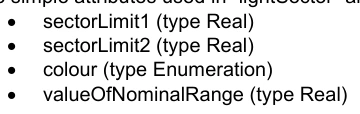
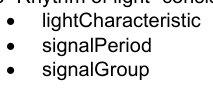
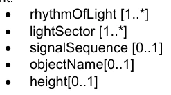

# S-100 5.2.1 · 第 2a 部分 · 概念与数据字典注册簿

非官方机器翻译参考稿，尚未逐条人工校订。公式与代码保留原文，解释以英文规范为准。

## 官方 PDF 第 67 页

S-100 – 第2编a

概念与数据字典注册簿

## 官方 PDF 第 68 页

5.2.1版实质性变动摘要

已生效的概要条款

从规范引用中删除了 URL 链接. 2a-2

为属性 S100_CD_属性ValueType 添加了 URI 、 URL 和 URN 的值备注; 添加了缺少的值文件URI 。

```text
2a-4.2.9
```

澄清了S100_CD_属性约束类的属性精确度描述和注释,以描述该精确度指定了小数位数位后位数右后方的位数.

```text
2a-4.2.10
```

## 官方 PDF 第 69 页

中文目录（可用上方目录直接跳转）

2a-1 范围 · 官方 PDF 71
2a-1.1 符合性 · 官方 PDF 71
2a-2 规范性引用文件 · 官方 PDF 71
2a-3 一般概念 · 官方 PDF 72
2a-3.1 注册簿 · 官方 PDF 72
2a-3.2 与ISO登记和要素概念词典模型的关系 · 官方 PDF 72
2a-3.3 概念注册簿 · 官方 PDF 73
2a-3.4 数据词典注册簿 · 官方 PDF 73
2a-3.5 要素目录 · 官方 PDF 74
2a-4 IHO 概念与数据字典注册簿 · 官方 PDF 74
2a-4.1 已登记的物项细目 · 官方 PDF 74
2a-4.1.1 国际水道测量组织概念注册簿 · 官方 PDF 74
2a-4.1.2 国际海道测量组织数据词典注册簿 · 官方 PDF 74
2a-4.2 国际海道测量组织概念和数据词典注册簿的数据模型 · 官方 PDF 75
2a-4.2.1 UML 型号 · 官方 PDF 75
2a-4.2.2 S100_RE_注册 · 官方 PDF 77
2a-4.2.3 S100_CD_登记项目 · 官方 PDF 77
2a-4.2.4 S100_CD-Feature (中文(简体) ). · 官方 PDF 77
2a-4.2.5 S100_CD_FeatureUservationType 互联网档案馆的存檔,存档日期2013-12-20. · 官方 PDF 77
2a-4.2.6 S100_CD_属性 · 官方 PDF 78
2a-4.2.7 S100_CD_简单属性 · 官方 PDF 78
2a-4.2.8 S100_CD ⁇ 规格 · 官方 PDF 78
2a-4.2.9 S100_CD_属性值 · 官方 PDF 80
2a-4.2.10 S100_CD_属性约束 · 官方 PDF 80
2a-4.2.11 S100_CD_复杂属性 · 官方 PDF 81
2a-4.2.12 S100_CD_属性使用 · 官方 PDF 81
2a-4.2.13 S100_CD_已实现的数值 · 官方 PDF 81
2a-4.2.14 S100_CD_资讯 · 官方 PDF 82
2a-4.2.15 S100_概念 · 官方 PDF 82
附录2a - A · 官方 PDF 83
复杂属性示例（资料性） · 官方 PDF 83

## 官方 PDF 第 70 页

本页特意留空

## 官方 PDF 第 71 页

2a-1 范围

国际海道测量组织地理空间信息登记处载有一些注册簿,其中一些是根据概念注册簿的内容编制的,概念注册簿规定了可用于描述地理或元数据信息的水道测量核心概念信息(定义、骆驼Case等)。 利用注册簿储存水道测量定义大大提高了国际海道测量组织管理和扩展基于S-100的多产品的能力,这些产品可以在较短的时间内提供使用,因此注册簿支持更广泛地使用已登记项目,公开提供这些产品;并提高潜在用户的能见度。 概念注册簿是将所有已登记的概念作为“无国家”概念加以储存和管理的主要资源(即没有指定某一种类的物品,也没有界定概念对注册簿内其他概念的约束力)。 每个概念应作为单一实例列入注册簿,并将用作数据词典注册簿和Meta数据注册簿概念的推导和取自的共同来源,用于模拟要素、属性等,供S-100产品规范使用。

数据词典注册簿扩展了概念注册簿所储存的概念,包括了在注册簿内各独立域中装订物品类型和要素的指定,从而使S-100产品规范开发者能够开发出它们的数据模型,以最适合其代表现实世界的具体要求。

这一部分介绍概念和数据词典注册簿的内容,并具体说明在建立、维持和出版分配给地理、水道测量和元数据信息项目的独特、明确和永久识别资料注册簿时应遵循的程序。 为了达到这一目的,本部分具体规定了为登记项目提供识别和定义所必要的信息要素。

2a-1.1 符合性

这个剖面符合ISO 19106:2004中的相容性第2类. 以下是对剖面与ISO 19126:2008不同专业和通称的简要说明.

1) 引入了新类,S100_CD_Information.

2)新班,S100_CD_Feature和S100_CD_Information被引入.

3)引入了新类,S100_CD_属性约束.

4) 类FC_FeatureAttize是专为抽象类S100_CD_Attize.

5) 引入了新类,S100_CD_SimpleAttize和S100_CD_ComplexAttize.

6)类 CD_继承关系,CD_Feature Operation CD_Binding,CD_Control和CD_BoundFeatureAttroduction 不使用.

2a-2 规范性引用文件

本文件的应用需要下列参考文件:关于注明日期的参考文件,仅适用所引用的版本;关于未注明日期的文件,适用所参考文件的最新版本(包括修正案)。

ISO 19135:2005,"地理信息-地理信息项目登记程序".

ISO 19126:2009,"地理信息-地貌概念词典和注册簿".

ISO 8601:2004, 数据元素和交换格式 - 信息交换 - 日期和时间的表示

ISO/IEC 10646:2017,"信息技术-通用编码字符集"(UCS)

RFC 3986,统一资源识别符(URI):通用语法. T. Berners-Lee, R.Fielding, L. Masinter. Internet Standard 66, IETF.

RFC 2141,URN语法. R. Moats. IETF RFC 2141,1997年5月.

## 官方 PDF 第 72 页

W3C XML Schema 第2部分:数据类型 第2版,附录 F正则表达式.

2a-3 一般概念

2a-3.1 注册簿

如第二部分所述,注册簿只是管理下的清单,比固定文件更容易保存,因为注册簿需要增加新项目,注册簿中的现有项目可以澄清、替换或取出,每个注册簿项目都有一个或多个相关日期,说明其状况何时发生变化。 这意味着,在特定日期界定的产品规范可在特定时间点参照注册簿中的某一物品。

2a-3.2 与ISO登记和要素概念词典模型的关系

ISO 19126和ISO 19135类型在IHO GI注册中的实现情况如下图2a-1所示,该图描绘了ISO类型(有灰色背景的元素);已实施的S-100注册模型类(有棕色背景的条目);以及包含IHOC GI登记的两个注册项目(有白色背景的文档). 注册簿本身是在国际海道测量组织GI注册簿网站的不同部分内实施的,每个网站都可通过网站导航菜单访问。

ISO类型"Feature Conference Dyctionary"包含要素和属性类型的定义,被作为"数据词典"在IHO GI注册(图2a-1中的S100_DataDictionary Register)中被执行. 数据词典注册簿载有要素、信息类型、属性(包括简单和复杂)的定义,以及枚举的用于点数和S-100_代码列表属性的数值(见S- 100 Part 1, 第1-4.7和1-4.8条)。

国际海道测量组织全球倡议注册簿还实施“概念注册簿”(S100_ConceptRegister in 图2a-1),可理解为一种术语词汇表,其中包含定义和来源,概念注册簿中的个人条目由S100-Conference类别代表,概念登记与数据词典注册簿分开。 然而,数据词典注册簿条目取自概念注册簿条目,第2a-3.3和2a-4.1.1条对概念注册簿作了进一步说明。

协会和角色的注册簿目前没有在IHO GI注册簿内实施,因此相应的ISO类型没有包括在图2a-1中,此外,IHOC GI书记官处还包括了额外的注册簿(用于显示,出品人代码,产品规范和元数据),这些没有在图2 a-1中显示.

## 官方 PDF 第 73 页

图2a-1 – S-100登记类别与ISO 19126/ISO 19135型号的关系

2a-3.3 概念注册簿

概念注册簿规定了可用于描述地理、水道测量和元数据信息的独特、独立的概念定义。这些概念在概念注册簿中登记,然后可以在数据词典或Meta数据注册簿中使用,以制定一个要素目录。 与数据词典注册簿不同,概念注册簿不规定关联;也不界定概念的类型或与其他概念的约束。 从这个角度看,概念登记处登记的项目基本上是“无清单的”,这允许灵活地使用概念进行适当的数据建模,以满足产品规范的要求。

此类地理空间信息注册簿可作为其他地理信息界作为相互参照系统的一部分而建立的类似注册簿的参考来源。

2a-3.4 数据词典注册簿

数据词典注册簿规定了可用于描述地理、水道测量和元数据信息的要素、属性、所列举的数值和信息类型等独立定义。 数据词典可以用来指定概念注册簿中定义的某一项目的类型(例如特性、属性和列举值);并定义推荐的关联和属性/要素约束,以利开发要素目录。概念注册簿中的物项只能在数据词法典注册簿中针对每个类型登记一次,以支持互操作性。

## 官方 PDF 第 74 页

这种地理空间信息数据词典可作为其他地理信息社区作为交叉参考系统的一部分而建立的类似数据词词典或注册簿的参考来源。

2a-3.5 要素目录

要素目录是描述数据产品内容的文档,它使用一个或多个数据词典中的项目类型,例如特性和属性,将它们绑在一起,此外,还可以指定属性的计量单位和格式描述. 特性分类在S-100 第5部分中详细描述.

2a-4 IHO 概念与数据字典注册簿

2a-4.1 已登记的物项细目

2a-4.1.1 国际水道测量组织概念注册簿

以下是概念注册簿中用以描述和管理水道测量、海洋和元数据信息的详细信息:

1) 项目名称

(2) 项目标识符

3) 项目状况

4) 别名

(5) 骆驼案

6) 定义

7) 定义来源

8) 定义

9) 与来源的相近性

10) 备注

11) 提案类型

12) 继承人.

13) 预处理器

14) 提交组织

15) 拟议日期

16) 接受日期

17) 修正日期

18) 拟议变动

19) 理由说明

这些细节取自S-100_RE_登记项目和S-100_RE_管理信息(见下文条款2a-4.2和第二部分条款2-8.3和2-8.8)。

2a-4.1.2 国际海道测量组织数据词典注册簿

以下为概念注册簿中可登记在数据词典注册簿中的物品类型:

1) 要素 – 取自现实世界现象.

2) 属性 – 要素概念的要素.

## 官方 PDF 第 75 页

3) 假设价值 – 构成属性范畴的一组相互排斥的价值之一.

4)信息 – 一个可识别的对象,包含属性,关联到其他信息概念,但没有空间信息.

5) 代码列表 — 一个开放式的列表,或者一个词汇的标识符(介于代码,标签和定义之间的映射).

2a-4.2 国际海道测量组织概念和数据词典注册簿的数据模型

2a-4.2.1 UML 型号

下图显示了IHO概念和数据词典注册簿的UML信息模型:

图 2a-2 — IHO 概念与数据字典注册簿

## 官方 PDF 第 76 页

本页特意留空

## 官方 PDF 第 77 页

```text
2a-4.2.2
S100_RE_Register
```

S-100 Part 2 第2-8.2条载有S-100 Part 2第2至8.2条,详细内容见S-100第2部分第2至8节。

```text
2a-4.2.3
S100_CD_RegisterItem
```

S100_CD_注册项目是S100_RE_注册项目的专有项目,具有第2a-4.1.1.条所列所有类型注册项目的共同特征,该类被包括在模式中,以与第2b部分保持一致,其中类似扩展(S100-PR_注册的项目)定义了额外的属性.

角色名称 名称描述 :

类 S100_CD_注册项目扩展 S100_RE_注册项目 - - 摘要类

```text
2a-4.2.4
S100_CD_Feature
```

此类取自 S100_RE_Register 项目通过中间超类。 它定义了以下附加属性 :

角色名称 名称描述 :

数据词典中的 Class S100_CD_Feature A 要素类型 - 从 S100_概念中衍生出来的

属性特性 UseType 特性类型 1 S100_CD_ FeatureUseType 的预定用途

协会作用

引用此特性类型与

```text
0..*
S100_CD_Feature
```

关联概念参考 S100_Concept as the base class 1 S100_Concept Notes 属性骆驼Case是该类的强制.

```text
2a-4.2.5
S100_CD_FeatureUseType
```

项目名称说明

编号 S100_CD_ FeatureUse Type 特性类型

文字地理具有真实世界实体的描述性特征

与包含与要素有关的信息的信息类型不同,

文字制图包含关于真实世界实体的制图表现(包括文字)的信息

主题 专题分组

## 官方 PDF 第 78 页

```text
2a-4.2.6
S100_CD_Attribute
```

属性可以是简单或复杂的。简单的属性带有特定值,如日期。复杂的属性是其他属性的组合,无论是简单还是复杂的属性。复杂的特性实例载于附录2a-A。这一类来源于S100_RE_Register Project,通过中间超类,并描述了所有属性类型的共同特征。

角色名称 名称描述 :

S100_CD类 数据词典中所有属性类型的属性基类 - 从S100_概念中衍生出来

关联概念参考 S100_Concept as the base class 1 S100_Concept Notes 属性骆驼Case是该类的强制.

```text
2a-4.2.7
S100_CD_SimpleAttribute
```

角色名称 名称描述 :

S100_CD 类 数据词典中的简单属性类型 - 从S100_CD_属性中衍生出来

属性值 说明值的表示、解释和结构

1 S100_CD_属性值

具体数量,如长度、体积、深度、重量等

```text
0..1
S100_CD_QuantitySpecification
```

属性类型0.1 S100_CD_属性约束的关联约束必须与数据Type一致 如果值Type是S100_代码列表,则必须完全真实的有以下之一: 1.

1) 有一个相关的S100_RE_Reference 与一个词典的命名空间,列在IHO GI注册.

2) 属性至少有一个S100_CD_EncumentedValue相关.

条件1为“开放式词典”或“封闭词典”,提供了“开放式取出”类型编码清单的所枚举值。

```text
2a-4.2.8
S100_CD_QuantitySpecification
```

项目名称说明

数量计量类型

角移随时间变化的瞬间速率

从ISO 19103

## 官方 PDF 第 79 页

项目名称说明

任何二维几何物体物理范围的测量

从ISO 19103

单位体积的字形密度;单位面积的数;又:特重力(S-32). 声调密度是同线声调和声调的行距(S-32).

“敏感性”可以在不同意义上使用,计量单位和属性定义必须明确说明意图是什么。

时间间隔

单位时间的振动或周期数 IHO S-32

物体最长的维度; 沿线或曲线测量的相距

物体惯性值的数值度量;物体所包含物质的数量,而不论其批量或体积如何

平面 平平面 一般用弧度或度测量的使一行或一平面与一平平相巧合所需的旋转量

从 ISO 19103 “相干”

工作或转移能的活性能率;放大S-32 指“放大能:光学仪器所见线性维度的明显长度与无辅助眼所见的长度之比”。

单位面积的单位压力

盐分盐分量 测量溶解盐量 IHO S-32(缩略语)

平时位置变化的平时速度 Rte 通常使用简单的公式计算, 在一个特定时间间隔中位置的变化。 速度是一个平时物理量, 有等分量, 但没有方向。 与“ 速度” 相抗, 它是一个既有等分也有方向的矢量量 。 ( 由 ISO 19103 “ 速度 ” 缩写)

温度 热度或程度 IHO S-32

任意三维几何天体物理空间的测量

从ISO 19103

物体因重力而经历的力

数量与本项清单中其他单数不同的数量

## 官方 PDF 第 80 页

```text
2a-4.2.9
S100_CD_AttributeValueType
```

项目名称说明

简单属性的数值类型 S100_CD_属性变量

字形布尔真假

可扩展和订约的预定值清单

含有定义范围、单位和格式的数值

实际浮点数

文字文本 A 字符序列

字符编码必须遵循ISO 8601规定的日期格式

字符编码必须遵循ISO 8601规定的时间格式

文字日期 时间字符编码必须遵循ISO 8601规定的日期和时间格式

字面URI字符编码必须遵循RFC 3986规定的URI格式

通用形式的 URI; 允许编码任何形式的 URI

文字 URL 字符编码必须遵循 RFC 3986 指定的 URL 格式

URL是一个URI类(RFC 3986).

字面URN字符编码必须遵循RFC 2141所定义的URN格式

URN是一个URI类(RFC 3986).

字面文件URI 字符编码必须遵循 RFC 8089 定义的文件URI 格式

fileURI是URI类(RFC 3986)下的一种URI类型.

词汇表的字面S100_代码列表 开放目录或条目标识符

S100_Truncted Date 日期的缩略语格式

```text
2a-4.2.10 S100_CD_AttributeConstraints
```

角色名称 名称描述 :

类 S100_CD_属性约束 简单属性的制约 - -

属性字符串Length应作为正整数( 即大于零) 表示, 该整数指定可指派给

```text
0..1
PositiveInteger
```

## 官方 PDF 第 81 页

文本属性类型。如果未指定,则文本长度将不受限制

属性文本 Pattern A字符串, 它指定了对可指定属性的文本值结构的一种或多种限制的方案。 需要使用正则表达式来实现 。 W3C XML Schema Part2: Datasets Second Edition, 附录 F (Regular Expressions) 用于定义本标准中的文本模式

```text
0..1
CharacterString
```

属性范围 指定允许的数字值范围 . 1 S100_ 数值范围

属性精度指定小数点右侧的最大位数

0.1 非负数集成器,又称分数分数或小数位数

```text
2a-4.2.11 S100_CD_ComplexAttribute
```

角色名称 名称描述 :

类 S100_ CD_ 复杂属性 数据词典中的复杂属性类型 - - 从 S100_ CD_ 属性中衍生出来

关联子属性 引用子属性 1.. * S100_CD_属性特征由S100_CD_属性Usage定义

```text
2a-4.2.12 S100_CD_AttributeUsage
```

此类指定了复杂属性类型与其子属性之间关联的特征.

角色名称 名称描述 :

```text
Class
S100_CD_AttributeUsage
```

复杂属性与其子属性之间关联的特征

```text
-
-
```

属性多倍性 子属性的发生次数 1 S100_多相性

属性顺序布尔值,表示复杂属性的子属性是否处于特定顺序

1 布尔 它仅适用于子属性的多值 > 1

```text
2a-4.2.13 S100_CD_EnumeratedValue
```

此类由S100_RE_Register Project通过中间超类产生,并描述所列举的数值类型的特性.

## 官方 PDF 第 82 页

角色名称 名称描述 :

S100_CD 类 数据词典中已列出的数值类型的假设值特征

```text
-
-
```

属性数code 指定域内唯一值的正整数

```text
1
PositiveInteger
```

关联属性指定此属性类型项目为域值

1 S100_CD_Simplication 只在S100_CD类属性值 Type = 引用或S100_代码列表时才适用

关联概念参考文献 S100_概念为基础类 1 S100_概念

```text
2a-4.2.14 S100_CD_Information
```

角色名称 名称描述 :

S100_CD_数据词典中信息类型特征

```text
-
-
```

关联区分 类似信息类型与0. * S100_CD_Information

关联概念参考 S100_Concept as the base class 1 S100_Concept Notes 属性骆驼Case是该类的强制.

```text
2a-4.2.15 S100_Concept
```

S-100-概念类别确定了概念注册簿所需的资料,详见第2a-3.3条。

角色名称 名称描述 :

S100类_ 接受自然界的物体、信息或现象的定义

```text
-
-
```

## 官方 PDF 第 83 页

附录2a — 复杂属性的示例

注:以下示例并不反映任何S-100产品规范中的灯光建模。

光可能有多个扇区,它们都具有相同的光特性和相序,其他常见的属性有高高和名.

在复杂属性中描述一个扇区的所有属性都是结构化的"光扇区".

“光线韵律”的复杂属性也得到界定。

“光部门”中使用的简单属性是:



因此,复杂的属性是:

特征值

名称 :

定义 A 扇区是从中心到环线所划出的两个正线之间的圆圈部分。 (高级学习者词典, 第2版)。

备注n/a

```text
camelCase
lightSector
```

别名 LITSEC

子属性绑定

caamCase 识别符 相继多

```text
sectorLimit1
1
n/a
```

```text
sectorLimit2
1
n/a
```

颜色 1 不详

注:复数和序数在复数和子属性之间的属性中。

“光之韵律”包括:



特征值

名称: 光线韵律

定义

备注n/a

```text
camelCase
rhythmOfLight
```

别名RHYLGT

子属性绑定

骆驼Case 识别器复数相继

```text
lightCharacteristic
1
n/a
```

## 官方 PDF 第 84 页

```text
signalPeriod
0..1
n/a
```

信号组0.1 n/a 描述光节的第二种方式是“信号序列”,因为它是用S-57 SIGSEQ属性来做的。信号序列由信号在开或关(这里是光或日蚀)的间隔组成。

特征值

名称 : 信号序列间隔

定义 tbd。

备注n/a

```text
camelCase
signalSequenceInterval
```

别名 SGSQIN

子属性绑定

骆驼Case 识别器复数相继

```text
signalStatus
1
n/a
```

持续时间 1 n/a 信号序列只是这些间隔的顺序列表。

特征值

名称信号序列

为所有“光的特性”确定由光和日食间隔占用的时间顺序(取自S-57版3.1,附录A-第二章,第2.191页,2000年11月)。

备注n/a

```text
camelCase
signalSequence
```

别名SIGSEQ

子属性绑定

caamCase 识别符 相继多

信号序列Interval 1.. * True A光线物体现在包括:

灯:



这一定义将列入要素目录,尽管属性的定义取自概念注册簿。
