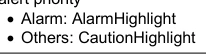

# S-100 5.2.1 · 第 2b 部分 · 显示注册簿模型

非官方机器翻译参考稿，尚未逐条人工校订。公式与代码保留原文，解释以英文规范为准。

## 官方 PDF 第 85 页

S-100 – 第2编b

显示注册簿

## 官方 PDF 第 86 页

5.2.1版实质性变动摘要

已生效的概要条款

## 官方 PDF 第 87 页

中文目录（可用上方目录直接跳转）

2b-1 范围 · 官方 PDF 89
2b-1.1 符合性 · 官方 PDF 89
2b-2 规范性引用文件 · 官方 PDF 89
2b-3  一般概念 · 官方 PDF 90
2b-3.1 注册簿 · 官方 PDF 90
2b-3.2 显示注册簿 · 官方 PDF 90
2b-3.3 显示目录 · 官方 PDF 90
2b-4 IHO 显示注册簿 · 官方 PDF 90
2b-4.1 已登记物品的类型 · 官方 PDF 90
2b-4.2 显示注册簿的数据模型 · 官方 PDF 91
2b-4.2.1 UML 型号 · 官方 PDF 91
2b-4.2.2 S100_PR_注册 · 官方 PDF 93
2b-4.2.3 S100_PR_注册域 · 官方 PDF 93
2b-4.2.4 S100_PR_用户 · 官方 PDF 93
2b-4.2.5 S100_PR_登记管理器 · 官方 PDF 94
2b-4.2.6 S100_PR_注册组织 · 官方 PDF 94
2b-4.2.7 S100_PR_登记许可证 · 官方 PDF 94
2b 4.2.8 S100_PR_管理信息 · 官方 PDF 95
2b-4.2.9 S100_PR_附文 · 官方 PDF 95
2b-4.2.10 S100_PR-登记项目 · 官方 PDF 95
2b-4.2.11 S100_PR_视觉项目 · 官方 PDF 96
2b-4.2.12 S100_PR-符号 · 官方 PDF 96
2b-4.2.13 S100_PR_线条斯泰尔 · 官方 PDF 96
2b-4.2.14 S100_PR_区域过滤器 · 官方 PDF 97
2b-4.2.15 S100_PR_位图 · 官方 PDF 97
2b-4.2.16 S100_PR_项目计划 · 官方 PDF 97
2b-4.2.17 S100_PR_彩色托肯 · 官方 PDF 98
2b-4.2.18 S100_PR_彩色Palette (英语). · 官方 PDF 98
2b-4.2.19 S100_PR_Palette 项目 · 官方 PDF 99
2b-4.2.20 S100_PR_DisplayMode (英语). · 官方 PDF 99
2b-4.2.21 S100_PR_维温集团Layer · 官方 PDF 99
2b-4.2.22 S100_PR_维温集团 · 官方 PDF 99
2b-4.2.23 S100_PR_演示计划 · 官方 PDF 100
2b-4.2.24 S100_PR_丰特 · 官方 PDF 100
2b-4.2.25 S100_PR_画取优先 · 官方 PDF 100
2b-4.2.26 S100_PR_文本页 · 官方 PDF 100
2b 4.2.27 S100_PR_彩色value(英语:S100_PR_Clorual Value) · 官方 PDF 101
2b-4.2.28 S100_PR_SRGB value (中文(简体) ). · 官方 PDF 101
2b-4.2.29 S100_PR_CIEVALue (中文(简体) ). · 官方 PDF 101
2b 4.2.30 S100_PR_Alert (英语). · 官方 PDF 102
2b-4.31 S100_PR_AlertInfo 互联网档案馆的存檔,存档日期2013-12-02. · 官方 PDF 102
2b-4.2.32 S100_PR_优先级 · 官方 PDF 102
2b-4.2.33 S100_PR_解析器 · 官方 PDF 103
2b 4.2.34 S100_PR_Alert 高亮度 · 官方 PDF 103
2b-4.2.35 S100_PR_国家语言标准 · 官方 PDF 104
2b-4.2.36 S100_PR_FileType（条款） · 官方 PDF 104
2b-4.2.37 S100_PR_风向 · 官方 PDF 104
2b-4.2.38 S100_PR_图像Type · 官方 PDF 104
2b-4.2.39 S100_PR_优先级 · 官方 PDF 105
2b-4.40 S100_PR_平面图 · 官方 PDF 105
2b-4.2.41 S100_PR_高清风格 · 官方 PDF 105

## 官方 PDF 第 88 页

本页特意留空

## 官方 PDF 第 89 页

2b-1 范围

国际海道测量组织地理空间信息登记处载有若干注册簿,其中之一是用于显示的;显示注册簿登记了用于构建Portranyal目录的组件;如果提供了要素目录和符合要求的数据,则从已登记组件中构建的Portaryal目录将把要素和属性转化为显示。

数据的显示独立于数据,但与数据密切相关。也就是说,数据集中的属性驱动了显示过程,但对于同一数据可能有许多不同的显示。

使用注册簿来存储图案组件可以提高国际海道测量组织管理和扩展基于S-100的产品图案的能力。该注册簿支持更广泛地使用已登记项目,公开它们,并增加它们对显示目录开发者的能见度。本部分介绍Portayal Register的内容。

2b-1.1 符合性

本专用配置符合ISO 19106:2004第2类的相容性.

2b-2 规范性引用文件

本文件的应用需要下列参考文件:关于注明日期的参考文件,仅适用所引用的版本;关于未注明日期的文件,适用所参考文件的最新版本(包括修正案)。

ISO 19135:2005,"地理信息-地理信息项目登记程序".

ISO 19126:2009,"地理信息-地貌概念词典和注册簿".

ISO 19117:2012,"地理信息-平面"

## 官方 PDF 第 90 页

2b-3 一般概念

2b-3.1 注册簿

如第二部分所述,注册簿只是管理下的清单,比固定文件更容易保存,因为注册簿需要增加新项目,注册簿中的现有项目可以澄清、替换或取出,每个注册簿项目都有一个或多个相关日期,说明其状况何时发生变化。 这意味着,在特定日期界定的产品规范可在特定时间点参照注册簿中的某一物品。

2b-3.2 显示注册簿

平面目录指定了用于构建平面分类目录的独立组件组,如颜色,符号和字体等. 注册簿还指定了上下文参数,取景组,显示平面以及可选的提醒目录中使用的组件等辅助项目.

平面注册簿可细分为不同的域;并可用于开发平面目录。平面名录与平面分类目录不同,平面登记并不定义显示规则,也不将显示或提示/提示与要素相绑定。

此类描述信息注册簿可作为其他地理信息界作为相互参照系统的一部分所建立的类似注册簿的参考来源。

2b-3.3 显示目录

显示 Catalogue 包含将要素映射到符号的显示规则;以及可选的提醒/提示规则,它也包含符号定义,颜色定义,描述参数和显示管理概念. Portrahyal Gatarogues 详见S-100 第9部分.

2b-4 IHO 显示注册簿

2b-4.1 已登记物品的类型

下列是可登记的物品类型:

1) 位图

2) 颜色值

3) 颜色托肯

4) 彩色调色板

5) 符号

6) 行样式

7) 区域填充

8) 字体

9) 查看组

10)取景组图层

11) 显示模式

12) 显示平面

13) 背景参数

14) 符号Schema

15)行样式Schema

## 官方 PDF 第 91 页

16) 填充区Schema

17) 平相图.

18) 色彩专用配置Schema

19) 绘制优先权

20) 警报

21) 警报信息

22) 警示要点

2b-4.2 显示注册簿的数据模型

2b-4.2.1 UML 型号

图2b-1和图2b-2分别显示了水道测量显示注册簿的注册簿管理和信息模型:

图2b-1 – 平面注册簿管理模式

## 官方 PDF 第 92 页

图2b-2 – 平面注册簿信息模型

## 官方 PDF 第 93 页

```text
2b-4.2.2
S100_PR_Register
```

注册者是S100-RE-注册者,由“所有者”和“域”组成。 组织可能拥有专门的注册,注册者则针对特定领域。

角色名称 名称描述 穆特 数据类型 注释

类 S100_PR_注册 显示 注册扩展为 S100_RE_注册

- S100_RE_Register Inherits S100_RE_Register 项目的所有特性,并带有域名和所有者扩展

负责管理注册簿内容的组织

```text
1
S100_PR_RegisterOrganization
```

关联领域 注册簿主要针对的领域

```text
1
S100_PR_RegisterDomain
```

```text
2b-4.2.3
S100_PR_RegisterDomain
```

这一类说明注册簿的要领。

角色名称 名称描述 穆特 数据类型 注释

S100_PR_注册域定义 - -

域名 1 字符串的属性名称

属性描述域 1 字符串描述

```text
2b-4.2.4
S100_PR_User
```

这一类代表注册簿的用户。

角色名称 名称描述 穆特 数据类型 注释

S100_PR_注册用户标识 - -

先属性Name 用户 1 字符串的首名Name

属性后端Name 用户 1 字符串的姓

属性创建 Date 日期用户输入 1 日期

用户 1 字符串的属性电子邮件

协会组织 参考组织 1 S100_PR_注册组织

## 官方 PDF 第 94 页

```text
2b-4.2.5
S100_PR_RegisterManager
```

这一类人员包括一名注册簿管理员以及目前的状况和时间段。

角色名称 名称描述 穆特 数据类型 注释

S100_PR_登记管理员 类别 显示注册簿的管理者 - -

属性启动 日期 管理器的起始日期 1

属性结束日期 管理员任务结束日期 0. 1

如果管理器目前活动 1 布尔, 则属性活动旗

协会注册 管理者管理 1 S100_PR_注册

关联用户 是管理器 1 S100_PR_用户

```text
2b-4.2.6
S100_PR_RegisterOrganization
```

这一类代表了登记组织。

角色名称 名称描述 穆特 数据类型 注释

S100_PR-登记组织定义 -

属性短名Name 缩写或简单形式名 1 C字符串

属性全名Name 组织全名 1 字符串

```text
2b-4.2.7
S100_PR_RegisterPermissions
```

用于向注册员用户分配权限的类。

角色名称 名称描述 穆特 数据类型 注释

类 S100_PR_注册注册用户权限 - -

属性读取权限读取注册项 1布尔

属性写入权限 :

属性控制 Body 用户是控制机构 1 布尔部分 2 注册管理

协会注册 管理者管理 1 S100_PR_注册

关联用户 是管理器 1 S100_PR_用户

## 官方 PDF 第 95 页

```text
2b-4.2.8
S100_PR_ ManagementInfo
```

这个类是S100_RE_ManagementInfo类的描述扩展,其中引用了组织对象和可能的附件.

角色名称 名称描述 穆特 数据类型 注释

S100_PR_管理信息扩展 S100_RE_管理信息 - S100_RE_管理信息

协会组织 提交登记条目 1 S100_PR_登记组织

关联附件 附加文件或文件 0. * S100_PR_Attachment

```text
2b-4.2.9
S100_PR_ Attachment
```

此类处理附件.

角色名称 名称描述 穆特 数据类型 注释

类 S100_PR_ 附件 持有附件文件 - -

附件 1 字符串的名称

属性类型 附件 1 S100_PR_FileType

属性文件附件 1 Blob

```text
2b-4.2.10 S100_PR_ RegisterItem
```

S100_PR_Register项目类是S100_RE_Register项目类的一个专门项目,它携带一个有效的XML标识符,用于显示目录.

角色名称 名称描述 穆特 数据类型 注释

S100_PR_注册项目扩展项目 S100_RE_注册项目 - S100_RE_注册项目

属性 xmliID 有效 XML 标识字符串 1 字符串

属性描述 国语描述 0.* S100_PR_国家语言语言结构 提供 S100-RE_登记项目定义属性 替代语言,支持 显示 Catalogue 语言独立描述的人群

## 官方 PDF 第 96 页

```text
2b-4.2.11 S100_PR_ VisualItem
```

S100_PR_Register 项目的抽象专门化, 以表示“ 符号 ” 、 “ 线条” 和“ 区域过滤 ” 或者“ pixmap ” ( small) 。 视觉项目各有一个 XML 标识字符串和 XMR 文档, 定义项目细节, 以及一个预览图像和一个带有维度的工程图像 。

角色名称 名称描述 穆特 数据类型 注释

S100_PR_Visual 项目摘要类,代表符号或行样式等图形元素

```text
-
S100_PR_ RegisterItem
```

属性项目 详细介绍项目 0. 1 Blob 的 XML 文件

属性预览图 0. 1 项的预览图像

具有0.1 Blob测量的工程图像

属性预览 Type 预览图像的文件类型 0. 1 S100_PR_ ImageType 如果预览图像被包含在内,则需要文件类型

属性工程图像Type 工程图像的文件类型 0. 1 S100_PR_ImageType 需要,如果工程图像是人所居住的

关联项目Smeta XML 用于验证项目1的 S100_PR_项目Smeta

关联颜色托肯 视觉项目 0. * S100_PR_ 色彩托肯在编集 显示 目录时需要识别依赖性

```text
2b-4.2.12 S100_PR_ Symbol
```

S100_PR_Symbol级是S100_PR-Visual 项目的一个专业,用于根据第九部分显示注册一个符号.

角色名称 名称描述 穆特 数据类型 注释

S100_PR_符号符号可视化项目 - S100_PR_视觉项目

```text
2b-4.2.13 S100_PR_ LineStyle
```

S100_PR_LineStyle级是S100_PR-Visual Projects级的一个专业,用于根据第九部分显示注册一种行式.

角色名称 名称描述 穆特 数据类型 注释

类 S100_PR_ LineStyle 线条样式视觉项目 - S100_PR_视觉项目

关联符号符号由行样式0. * S100_PR_用于识别依赖关系的符号使用

## 官方 PDF 第 97 页

```text
2b-4.2.14 S100_PR_ AreaFill
```

S100_PR_AreaFill是S100_PR_Visual项目的一个专业,用于根据第九部分显示来注册一个填充区域.

角色名称 名称描述 穆特 数据类型 注释

类 S100_PR_ 区域填充可视项目 - S100_ PR_ 视觉项目

区域填入 0. * S100_PR_用于识别依赖关系的符号的关联符号

```text
2b-4.2.15 S100_PR_ Pixmap
```

S100_PR_Pixmap是S100_PR_Visual Projects的一个专业,用于按照第九部分 显示 来注册一个像素映射.

角色名称 名称描述 穆特 数据类型 注释

类 S100_PR_ Pixmap Pixmap 视觉项目 - S100_PR_视觉项目

```text
2b-4.2.16 S100_PR_ ItemSchema
```

S100_PR_ProjectSchema是S100_PR_Register项目的一个专业,根据第九部分的显示注册了一个绘图项目.

角色名称 名称描述 穆特 数据类型 注释

类 S100_PR_ XML 描述项目的项目Schema - S100_PR_登记项目

属性 xmlSchema XML schema 从第9部分 显示 作为 Blob 1 Blob Schema 存储

```text
2b-4.2.16.1
S100_PR_ SymbolSchema
```

该类是S100_PR_ProjectSchema的一个专业,用于注册Part 9 显示符号schema.

角色名称 名称描述 穆特 数据类型 注释

类 S100_PR_符号Schema 符号Schema - S100_PR_项目Schema

```text
2b-4.2.16.2
S100_PR_ LineStyleSchema
```

该类是S100_PR_ProjectSchema的一个专业,用于注册Part 9 显示行样式schema.

角色名称 名称描述 穆特 数据类型 注释

S100_PR_LineStyleSchema 线条样式 schema - S100_PR_项目Schema

## 官方 PDF 第 98 页

```text
2b-4.2.16.3
S100_PR_ AreaFillSchema
```

该类是S100_PR_ProjectSchema的一个专业,用于注册Part 9 显示区域填充schema.

角色名称 名称描述 穆特 数据类型 注释

类 S100_PR_地区FillSchema 区域填充 schema - S100_PR_项目Schema

```text
2b-4.2.16.4
S100_PR_ PixmapSchema
```

该类是S100_PR_ProjectSchema的一个专业,用于注册Part 9 显示 pixmap schema.

角色名称 名称描述 穆特 数据类型 注释

类 S100_PR_ PixmapSchema- S100_Pr_项目Schema

```text
2b-4.2.16.5
S100_PR_ ColourProfileSchema
```

该类是S100_PR_ProjectSchema的一个专业,用于注册第9部分色彩剖面图.

角色名称 名称描述 穆特 数据类型 注释

类 S100_PR_彩色ProfileSchema 色彩描述图 - S100_PR_项目Schema

```text
2b-4.2.17 S100_PR_ColourToken
```

类 S100_PR_彩色托肯是类 S100_PR_Register 项目的一个专业。一个彩色符号定义了多个彩色值的单一引用,每个彩色调色板都与单个彩色调色板相关联。

角色名称 名称描述 穆特 数据类型 注释

类 S100_PR_彩色托肯 色彩符的定义 - S100_PR_注册项目

颜色值的标识符 1 字符串

关联值 与此符号相关的颜色 1. * S100_ PR_ Palette 项目用于识别依赖性

如果打算供欧洲残疾信息系统使用,则多重性为3.*。

```text
2b-4.2.18 S100_PR_ColourPalette
```

S100_PR_彩色Palette是S100_PR_注册项目的一个专业.

## 官方 PDF 第 99 页

角色名称 名称描述 穆特 数据类型 注释

S100_PR_彩色调色板定义 - S100_PR_注册项目

```text
2b-4.2.19 S100_PR_PaletteItem
```

S100_PR_Palette 项目类是S100_PR_注册项目类的一个专业,它为彩色调色板内的彩色符号提供了一个颜色值。

角色名称 名称描述 穆特 数据类型 注释

S100_PR_Palette 项目 彩色调色板条目的定义 - S100_PR_注册项目

属性透明 0.1 实际范围为 [0, 1], 默认范围为 0( opaque)

属性颜色 颜色值 1 S100_PR_颜色值

关联调色板 与本项目 1. * S100_PR_彩色Palette 用于识别依赖性

```text
2b-4.2.20 S100_PR_DisplayMode
```

这是S100_PR_Register项目类的一个专业,它用来根据第9部分 显示 来注册一个显示模式.

角色名称 名称描述 穆特 数据类型 注释

S100_PR_DisplayMode 类 用于注册显示模式 - S100_PR_注册项目 请参见 第 9 部分 移植

```text
2b-4.2.21 S100_PR_ViewingGroupLayer
```

这是S100_PR_Register类项目的一个专业,它用来根据第9部分 显示 来注册一个查看组层 。

角色名称 名称描述 穆特 数据类型 注释

类 S100_PR_ ViewingGroupLayer 用于注册查看组层 - S100_PR_注册项目 参见 第 9 部分 移植

关联显示模式 A 显示模式, 可能包括此层 0. * S100_ PR_ DisplayMode 用于识别依赖性

```text
2b-4.2.22 S100_PR_ViewingGroup
```

这是S100_PR_Register项目类的一个专业,它用来根据第九部分显示注册一个查看组.

角色名称 名称描述 穆特 数据类型 注释

S100_PR_Viewing Group 用于注册查看组的类 - S100_PR_注册项目 参见 第 9 部分 移植

## 官方 PDF 第 100 页

属性基础模式表示观看组应始终在.

0.1 布尔默认是虚假的

关联取景组 Layer A取景组层,其中可能包括此取景组

0.* S100_PR_ViewingGroupLayer 用于识别依赖性

```text
2b-4.2.23 S100_PR_DisplayPlane
```

这是S100_PR_注册项目的一个专业。

角色名称 名称描述 穆特 数据类型 注释

S100_PR_DisplayPlane 类 显示平面定义作为“DisplayPlane” 类型的寄存项的具体内容

- S100_PR_登记项目,见第九部分显示

用于排序显示平面的绘图顺序 1 整数

```text
2b-4.2.24 S100_PR_Font
```

这是 S100_PR_Register 项目的一个专业。 曾经注册一个字体文件, 用于 显示 Catalogue 。

角色名称 名称描述 穆特 数据类型 注释

S100_PR_Font 类 字体文件定义的具体内容为“ font” 类型的注册项

- S100_PR_登记项目,见第九部分显示

属性字体 File A 字体文件, 包含在绘图目录 1 Blob 中

属性字体 Type 字体文件类型 1 S100_PR_FontType 最初限制在 True Type 字体

```text
2b-4.2.25 S100_PR_DrawingPriority
```

S100_PR_Drawing Priority是S100_PR_RegisterProject的一个专业.

角色名称 名称描述 穆特 数据类型 注释

S100_PR_ Drawing Priority 用于注册绘图优先级, 用于 显示 目录

- S100_PR_登记项目,见第9部分

属性优先级用于排序显示平面内的绘图指令

1 整数

```text
2b-4.2.26 S100_PR_ContextParameter
```

S100_PR_ContextParameter是S100_PR_注册项目的一个专业.

## 官方 PDF 第 101 页

角色名称描述。 数据类型备注

```text
Class
S100_PR_ContextParamet
er
```

上下文参数的具体内容,作为 " ContextParemeter " 类型的登记项

- S100_PR_登记项目,见第9部分

属性参数Type 上下文参数1的数据类型 S100_PR_ParameterType

属性默认值 Value 默认值或初始值 . 1 字符串

```text
2b-4.2.27 S100_PR_ColourValue
```

在一个或多个颜色空格中识别颜色值。

角色名称描述。 数据类型备注

类 S100_PR_ 色彩值描述一个或多个颜色空格中的颜色值

- 必须有至少一个颜色值

属性 sRGB 在 sRGB 色彩空间中的颜色值为 0. 1 S100_PR_SRGBValue

属性 cie CIE 色彩空间中的颜色值为 0. 1 S100_PR_ CIEValue

```text
2b-4.2.28 S100_PR_SRGBValue
```

识别 sRGB 色彩空间中的颜色值。

角色名称描述。 数据类型备注

S100_PR_SRGBValue A 类在 SRGB 色彩空间中的颜色值 - -

红色1整数范围为[0,255]

绿色1整数范围为[0,255]

属性 蓝色 1 整数范围为 [0, 255]

```text
2b-4.2.29 S100_PR_CIEValue
```

识别 CIE 色彩空间中的颜色值。

角色名称描述。 数据类型备注

S100_PR_CIEValue A 类在 CIE 色彩空间中的颜色值 - -

色度 1 的属性 x 组件 真正的范围 [0]

色度的属性 y 成分 1 实际范围 [0, 1]

## 官方 PDF 第 102 页

以 cd/ m2 1 计的属性 L 亮度

```text
2b-4.2.30 S100_PR_Alert
```

S100_PR_Alert是S100_PR_Register项目的一个专业,一个提醒与显示 Catalogue规则的特性有关.

角色名称描述。 数据类型备注

类 S100_PR_Alert 提供了优先级,消息,以及图形突出显示相关的取景组.

- S100_PR_登记项目 路由监视器或路由规划必须在场

属性路由监视器描述在路由监测过程中提示的属性

```text
0..*
S100_PR_AlertInfo
```

属性路由 Plan 在路由规划中描述提醒的属性

```text
0..*
S100_PR_AlertInfo
```

```text
2b-4.2.31 S100_PR_AlertInfo
```

角色名称描述。 数据类型备注

S100_PR_AlertInfo 类 提醒的属性 - -

属性优先级 警示 1.. * S100_PR_AlertPriority 多功能支持用户选择优先级

关联 msg 提醒激活时显示的邮件 1 S100_PR_ 提醒信

关联突出显示 支持正在显示图形突出显示 0. 1 S100_PR_ Alert 高亮

```text
2b-4.2.32 S100_PR_AlertPriority
```

角色名称描述。 数据类型备注

S100_PR_优先级 提醒的优先权 - -

属性优先级 优先级值 S100_PR_ 优先级

属性默认 表示此优先级为默认 0. 1布尔默认为虚假

属性可选 表示向用户披露此优先级是可选的 0. 1 布尔默认是虚假的

## 官方 PDF 第 103 页

```text
2b-4.2.33 S100_PR_AlertMessage
```

S100_PR_AlertMessage 是 S100_PR_Register 项目的一个专业。 信件在任何相关的提醒激活时都会显示 。

角色名称描述。 数据类型备注

类 S100_ PR_ 提醒信息 A 消息与一个或多个提醒相关 - S100_ PR_ 注册项目

以一种或多种语言属性文本信件 1.. * S100_PR_ NationalLangageStr ing

必须提供英文留言

关联图标 A 符号要用文本或代替文本显示. 0. 1 S100_PR_Symbol

```text
2b-4.2.34 S100_PR_AlertHighlight
```

S100_PR_Alert高亮是S100_PR_Register项目的一个专业. 高亮显示将查看组与提醒信息关联,允许用户禁用一个或多个活动 S100-PR-Alerts 的图形突出显示 。

角色名称描述。 数据类型备注

S100_PR_Alert 高级助理显示带有提醒的参数 - S100_PR_Register 项目

属性样式 覆盖图表区域显示的图形突出显示样式

0.1 S100_PR_ 高亮样式 当空出时, 从提醒优先级推断出样式



属性可选 说明是否允许关闭突出显示是可选的

0.1 布尔默认是虚假的

关联取景组 与提醒出景点相关联的取景组( 显示 Catalogue 规则生成执行取景点的绘图指令)

1..* S100_PR_ViewingGroup 多个取景组的存在,可以将特定特性类型所触发的提示突出化为独立禁用.

例如, " 被禁地 " 倡议支持在继续强调其他被禁地的同时,对 " 海平面 " 着陆区进行强调。

当提供多个取景组时,应当考虑提供一个取景组层来同时切换所有取景组.

关联 msg 在任何查看组禁用时显示一个要显示的消息

```text
0..1
S100_PR_AlertMessage
```

## 官方 PDF 第 104 页

```text
2b-4.2.35 S100_PR_NationalLanguageString
```

角色名称描述。 数据类型备注

```text
Class
S100_PR_NationalLangua
geString
```

国家语言专用文本 -- --

以国家语言 1 字符串属性文字 A 字符串

属性语言 ISO 639-2/T 3个字母语言代号为 5.1 字符串默认为 “eng”

```text
2b-4.2.36 S100_PR_FileType
```

名称描述代码注释

编号 S100_PR_FileType 文件的类型和格式。 -

值 docx Office 打开 XML 文档 - 基于 Zip 和 XML 的文件格式。不要与 OpenOffice 格式或通用 XML 相混淆

值 zip Zip 归档格式 -

值 xlsx 办公室 Open XML 工作手册 - 基于 Zip 和 XML 的文件格式用于电子表格。 不可与 OpenOffice 格式或通用 XML 相混淆

```text
2b-4.2.37 S100_PR_FontType
```

名称描述代码注释

编号 S100_PR_FontType A字体规格 -

值 ttf TrueType 字体 -

```text
2b-4.2.38 S100_PR_ImageType
```

名称描述代码注释

编号 S100_PR_ ImageType 图像规格 -

值 jpg JPEG 2000 图像编码系统 -

值 png 可移植网络图形格式 -

值 tif 标记图像文件格式 -

## 官方 PDF 第 105 页

```text
2b-4.2.39 S100_PR_AlertPriorityType
```

名称描述代码注释

编号 S100_PR_AlertPriority Type 定义一个提醒的可能优先级 。 -

价值警报 说明需要桥梁小组立即注意和采取行动的条件

- 从MSC.252(83) 19.1.2。

价值警告表明条件已发生变化,应出于不立即发生危险但如不采取行动则可能发生危险的预防原因提出。

- 从MSC.252(83) 19.1.3。

价值警告表明一个条件,它不值得提出警报或警告,但仍需要注意,而且不能从对情况或特定信息的通常考虑出发。

- 从MSC.252(83) 19.1.4。

显示正常信息和条件 -- -- 从MSC.252(83)附录1

```text
2b-4.2.40 S100_PR_ParameterType
```

S100_PR_ParameterType的取名定义和成员与第9部分第9-13.3.30分款中的参数Type相同.

```text
2b-4.2.41 S100_PR_HighlightStyle
```

名称描述代码注释

编号 S100_PR_高亮样式 定义提醒时可能的图形突出显示样式 -

红色突出亮相 - IEC 62288:2014 表A.3 导航符号,条目3.5b

红色突出亮相 - IEC 62288:2014 表A.3 导航符号,条目3.5c

## 官方 PDF 第 106 页

本页特意留空
