# S-100 5.2.1 · 第 3 部分 · 通用要素模型与应用模式规则

非官方机器翻译参考稿，尚未逐条人工校订。公式与代码保留原文，解释以英文规范为准。

## 官方 PDF 第 107 页

S-100 – 第3编

Schema 应用的一般要素模型和规则

## 官方 PDF 第 108 页

5.2.1版实质性变动摘要

已生效的概要条款

以一般网页参考资料取代了URL链接。 3-10

## 官方 PDF 第 109 页

中文目录（可用上方目录直接跳转）

3-1 范围 · 官方 PDF 111
3-2 符合性 · 官方 PDF 111
3-3 参考文献 · 官方 PDF 112
3-4  上下文 · 官方 PDF 113
3-4.1 物体 · 官方 PDF 113
3-4.2 一般要素模型的衍生 · 官方 PDF 113
3-5 定义要素与信息类型的原则 · 官方 PDF 113
3-5.1 可识别物体 · 官方 PDF 113
3-5.1.1 要素 · 官方 PDF 113
3-5.1.2 信息类型 · 官方 PDF 113
3-5.2 通用要素模型 · 官方 PDF 113
3-5.2.1 引言 · 官方 PDF 113
3-5.2.2 全球调频的目的 · 官方 PDF 114
3-5.2.3 GFM的主要结构 · 官方 PDF 114
3-5.2.4 S100_GF_NamedType (中文(简体) ). · 官方 PDF 114
3-5.2.5 S100_GF_对象类型 · 官方 PDF 115
3-5.2.6 S100_GF_FeatureType (英语). · 官方 PDF 115
3-5.2.7 S100_GF_财产公司 · 官方 PDF 116
3-5.2.8 S100_GF_属性类型 · 官方 PDF 116
3-5.2.9 S100_GF_协会 · 官方 PDF 117
3-5.2.10 GF_业务 · 官方 PDF 117
3-5.2.11 S100_GF_协会 · 官方 PDF 117
3-5.2.12 S100_GF_信息技术 · 官方 PDF 118
3-5.2.13 S100_GF_Feature Association Type（条款） · 官方 PDF 118
3-5.2.14 S100_GF_信息技术协会 · 官方 PDF 119
3-5.2.15 S100_GF_约束 · 官方 PDF 119
3-5.3 要素类型的属性 · 官方 PDF 120
3-5.3.1 引言 · 官方 PDF 120
3-5.3.2 S100_GF_理论属性Type · 官方 PDF 120
3-5.3.3 S100_GF_复杂属性类型 · 官方 PDF 121
3-5.3.4 S100_GF_简单属性Type · 官方 PDF 121
3-5.3.5 S100_GF_空间属性图案 · 官方 PDF 121
3-5.3.6 GF_临时属性类型 · 官方 PDF 122
3-5.3.7 GF_气象数据属性类型 · 官方 PDF 122
3-5.3.8 GF=质量属性类型 · 官方 PDF 122
3-5.3.9 GF_位置属性类型 · 官方 PDF 122
3-5.3.10 S100_已运行 DateAttroduction Type · 官方 PDF 122
3-5.3.11 S100_GF_代码列表属性类型 · 官方 PDF 122
3-5.3.12 S100_GF_编号Type · 官方 PDF 123
3-5.4 所命名类型之间的关系 · 官方 PDF 123
3-5.4.1 引言 · 官方 PDF 123
3-5.4.2 GF_遗产关系 · 官方 PDF 123
3-5.4.3 S100_GF_协会 · 官方 PDF 124
3-5.4.4 信息类型的联系 · 官方 PDF 124
3-5.4.5 关联目的默认名称 · 官方 PDF 124
3-5.5 要素类型的行为 · 官方 PDF 125
3-5.6 约束 · 官方 PDF 125
3-6 应用模式规则（ISO 19109 第 8 条） · 官方 PDF 125
3-6.1 应用建模过程(ISO 19109 第8.1条) · 官方 PDF 125
3-6.2 施埃马案(ISO 19109 第8.2条) · 官方 PDF 125
36.2.1 应用Schemas的概念学语言 · 官方 PDF 125
3.6.2.2 主要规则 · 官方 PDF 125
-6.2.3 确定应用程序Schemas · 官方 PDF 125
3.6.2.4 应用程序Schema的文档 · 官方 PDF 126
3-6.3 《统一仲裁示范法》中施以舍马规则(ISO 19109 第8.3条) · 官方 PDF 126
3-6.3.1 主要规则(ISO 19109 第8.3.1条) · 官方 PDF 126
3-6.4 统一马列标准Schemas的域名简介(ISO 19109 第8.4条) · 官方 PDF 127
3.6.4.1 在标准Schema中添加信息的规则 · 官方 PDF 127

## 官方 PDF 第 110 页

中文目录（可用上方目录直接跳转）

限制使用标准Schemas · 官方 PDF 127
36-6.4.3 元数据Schema的使用规则(ISO 19109 第8.5条) · 官方 PDF 127
暂行规则(ISO 19109 第8.6条) · 官方 PDF 127
3-6.5 空间规则(ISO 19109 第8.7条) · 官方 PDF 127
3.6.5.1 一般空间规则(ISO 19109 第8.7.1条) · 官方 PDF 127
3.6.5.2 空间属性 · 官方 PDF 127
空间质量 · 官方 PDF 128
3-6.5.4 代表要素空间属性的几何集合和复合体 · 官方 PDF 128
3-6.6 分类规则(ISO 19109 第8.8条) · 官方 PDF 129
3-6.6.1 导言(ISO 19109 第8.8.1条) · 官方 PDF 129
根据要素目录(ISO 19109 第8.8.2条)提出的施特马申请 · 官方 PDF 129
3-6.6.3 字符编码 · 官方 PDF 129
3-6.7 编码清单 · 官方 PDF 129
3-7 覆盖数据的应用模式（资料性） · 官方 PDF 130
3-7.1 引言 · 官方 PDF 130
3-7.2 文字数据 · 官方 PDF 130
3.7.3 可变单元格大小网格 · 官方 PDF 131
3-7.4 面向要素的影像 · 官方 PDF 132
3-8 S-100 时间框架 · 官方 PDF 133
3-8.1 时间定义 · 官方 PDF 133
3-8.2 时间关系 · 官方 PDF 134
3-8.3 时间间隔和期间模型的解释 · 官方 PDF 134
3-9 截短日期使用的格式专用类型 · 官方 PDF 135
3-10 实例标识符 · 官方 PDF 135
3-10.1 利用实例识别资料 · 官方 PDF 136

## 官方 PDF 第 111 页

3-1 范围

这一部分介绍了通用要素模型(GFM),它是要素、要素要素和关联的概念模型,还描述了开发应用Schema的规则,这是任何基于S-100的产品规范的基本部分。

本部分的范围包括:

1) 从现实出发对要素及其特性进行概念建模;

(2) 信息类型及其属性的概念建模;

3) 施克马法适用的定义;

4) Schema申请规则;

下述是范围以外的情况:

1) 在目录中反映要素类型及其属性和信息类型及其属性;

(2) 元数据的表述;

3) 将一个应用程序Schema映射到另一个应用程序的规则;

4) 在计算机环境中实施应用程序Schema;

5) 计算机系统和应用Schema软件设计;

6) 方案拟订。

本文件没有涉及计算机系统、软件设计和编程。

3-2 符合性

这个剖面符合ISO 19106:2004中的相容性第2类. 以下是S-100通用要素模型与ISO 19109相异的专业和通称的简要说明.

1)引入了新的S100_GF_NamedType.

2)作为S100_GF_NamedType的特长引入了新的S100_GF_ObjectType.

3)作为S100_GF_ObjectType的专攻引入了新的S100_GF_信息Type,它受限制于与S100_GF_ThematicAttroductType的关联.

4)S100_GF_FeatureType是S100_GF_ObjectType的一个专业.

5)S100_GF_属性Type是GF_属性Type的一个专业,因为它在S-100中是抽象的.

6) 新抽象的S100_GF_SimpleAttizeType被引入为S100_GF_ThematicAtizeType的特有.

7) GF_操作没有被使用.

8) GF_继承关系不使用;要素继承由社团继承来代表.

9)不使用关联属性OffAtPritics. S-100中使用了复杂属性的概念来履行相类似的功能.

10) S100_GF_AssociationType 不使用GF_AssociationType和GF_FeatureType之间的通缩关联,而是S100_GF_NamedType的特有化.

11) S100_GF_ AssociationType通过UML聚合关系与S100_GF_ThematicAttizeType相接,这意味着协会可以具有描述性特征.

## 官方 PDF 第 112 页

12) 新的元类S100_GF_Feature AssociationType和S100_GF_Information AssociationType作为S100_GF_AssociationType的专攻引入.

13) ISO 19109中GF_FeatureType/GF_AssociationType关系的关联角色Between实现如下:

a) S100_FeatureType/S100_GF_Feature AssociationType中的角色链接

关系;

(b) S100_InformationType / S100_GF_ Information AssociationType 的角色链接

关系;

(c) S100_ObjectType / S100_ Information AssociationType关系的角色信息链接.

这意味着只包含要素类型的社团具有语义和多重限制,这些限制与至少包含一种信息类型的社团不同.

14) GF_Location 属性Type,GF_Temperal 属性Type,GF_MetaData 属性Type和GF ⁇ -质量属性Type不使用.

以下案文酌情进一步提及或解释上述改动。

3-3 参考文献

ISO 8601:2004, 数据元素和交换格式-信息交换-日期和时间的表示

ISO 19106:2003,"地理信息-地理信息-简介".

ISO 19108:2002, 《地理信息 -- -- 时间方案》(经技术更正1 -- -- 2006年更正)

ISO 19107:2003, 地理信息 -- -- 空间计划

ISO 19109:2005, 地理信息 - 应用计划规则

ISO 19110:2005, 地理信息 -- -- 要素编目方法

ISO 19115-1:2018,地理信息-元数据-第一部分-基本原理(由"2018年第1号修正案"更新)

ISO/CD 19115-2, 地理信息 - 元数据 - 第2部分 - 图像和网格数据的扩展

## 官方 PDF 第 113 页

3-4 上下文

3-4.1 物体

地理应用的数据内容是根据真实世界要素的视角和特定应用的要求来定义的。内容按照对象来排列。本文件考虑两类对象:

1) 要素 – 要素与要素属性一起被定义.

2)信息类型 –信息类型用于在要素和其他信息类型之间共享信息. 信息类型只有主题属性属性.

GFM为这些对象提供了概念模型,对象类型的定义被保存在一个"要素目录"中. GFM还充当要素目录的概念模型.

3-4.2 一般要素模型的衍生

必须在S-100产品中使用的种类的概念模型在本文件中被介绍,它被称为GFM并取自ISO 19109通用要素模型,通过实现它的分级(图3-1).

3-5 定义要素与信息类型的原则

3-5.1 可识别物体

3-5.1.1 要素

一个要素是真实世界现象的抽象表现. 要素有两个方面 — — 地能类型和地能实例. 特能类型是一个类,定义在一个地能目录中. 个地能的实例是地能类型的单一发生,在数据集中作为对象来表示.

3-5.1.2 信息类型

信息类型是对象的类别,在要素目录中定义。信息类型的实例是数据集中可识别的信息单位。信息类型只有主题属性属性。信息类别的实例可能与一个或多个要素实例或其他信息类型实例相关联。

图表注释可作为信息类型模式。

3-5.2 通用要素模型

3-5.2.1 引言

此子语法识别并描述用于定义要素和信息类型及其关系的概念,这些概念被用一个名为GFM的概念模型来表达.

## 官方 PDF 第 114 页

图3-1 – 一般要素模型

3-5.2.2 全球调频的目的

GFM是要素和信息类型及其属性分类的基础,GFM也作为要素目录结构的基础.

3-5.2.3 GFM的主要结构

图3-1显示了S-100 GFM的UML模型.

以下条款界定了全球调频机制的要素。

```text
3-5.2.4
S100_GF_NamedType
```

S100_GF_NamedType 类不是从ISO 19109 实现的,而是专门为 S-100 GFM 引入的. 这是S100_ GF_ObjectTy Pe 和 S100-GF- AssociationTyope 类的抽象超级类. 引入这一类的用意是显示对象类型和关联类型在 S- 100 内部的共性. 这两个类型都是 S- 100. 数据 Schemas 的核心可识别对象.

## 官方 PDF 第 115 页

```text
Table 3-1— S100_GF_NamedType
```

角色名称描述。 类型

S100_GF_ NamedType 抽象基类,用于 GFM 内的对象类型和关联类型

```text
-
-
```

属性类型Name 命名类型的名称。 名称必须在命名空间中独有

```text
1
CharacterString
```

描述命名类型 1 字符串的定义

属性是 Abstract 如果真, 命名类型会起到抽象的超类型。 无法创建抽象类型的实例 。

1 布尔

角色受约束By 该角色指定对命名类型进行约束

```text
0..*
S100_GF_Constraint
```

```text
3-5.2.5
S100_GF_ObjectType
```

S100_GF_ObjectType类不是从ISO 19109中实现的,而是专门为S-100 GFM引入的. 它是S100_FeatureTy Pe和S100-GF-InformationTyke类的抽象超级类. 引入这一类的用意是显示要素类型与信息类型之间的共通性,特别是这些类通过信息协会与信息类别连接的能力.

```text
Table 3-2— S100_GF_ObjectType
```

角色名称描述。 类型

S100_GF_ 对象抽象基类,用于 GFM 内的对象类型

```text
-
-
```

角色信息链接链接到描述与信息类型实例关系的信息协会

```text
0..*
S100_GF_Information
AssociationType
```

```text
3-5.2.6
S100_GF_FeatureType
```

S100_GF_FeatureType 类是ISO 19109 类 GF_FeatureType 的实现,它与ISO 类有如下不同:

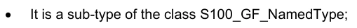

它是S100_GF_NamedType类的一个子类型;

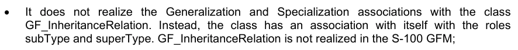

它没有实现与类GF_继承关系(Class GF-100 GFM)的通化和专门化协会,相反,该类与自己的角色有子Type和超级Typ的关系. GF_遗产关系在S-100GFM中没有实现; 与"超"关系(GFS-10-100),即"超能"关系.


超级Type的多为0.1来代表一个特性最多可能有一个超级Type的概念,这是为了防止S-100中的多位继承;

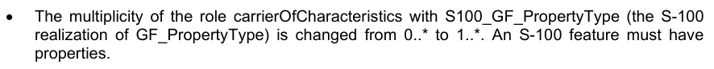

S100_GF_PropertyType(GF_PropertyType的S-100实现)中的角色OfCharacteristics的多面性由0..*改为1.*. S-100特性必须具有

## 官方 PDF 第 116 页

```text
Table 3-3— S100_GF_FeatureType
```

角色名称描述。 类型

S100_GF_FeatureType A类,用于抽象地表现真实世界现象

```text
-
-
```

角色超音速类型 此特性类型来源于的更通用的特性类型

```text
0..1
S100_GF_Feature
Type
```

角色子 Type 从此特性类型衍生出更具体的要素类型

```text
0..*
S100_GF_Feature
Type
```

角色链接 Between A 连接到指定一个特性类型与同一个或另一个特性类型之间的关系的特性关联

```text
0..*
S100_GF_Feature
AssociationType
```

描述要素类型要素的属性和作用

```text
1..*
S100_GF_Property
Type
```

```text
3-5.2.7
S100_GF_PropertyType
```

S100_GF_PropertyType 类是ISO 19109 类 GF_PropertyType 的一种实现,它与 ISO 类有以下不同:

1) 与 S100_GF_FeatureType 关联的多相性从 1 被更改为 1..*,这一变化代表了 S-100 要素目录中描述要素和属性的方式. 属性类型定义可以用于一个或多个要素类型定义; 属性类别定义可以使用 .

2)与S100_GF_FeatureType关联的关联类型,由于上述多相性的变化而由组成改变为聚合.

表3-4——S100_GF_财产公司

角色名称描述。 类型

S100_GF_PropertyType 特性类型所有属性的抽象基础类。这些属性和角色

```text
-
-
```

属性成员Name 属性或角色的名称 1 字符串

属性定义 描述要素类型的属性或作用

```text
1
CharacterString
```

角色受限 角色指定对财产施加限制

```text
0..*
S100_GF_Constraint
```

```text
3-5.2.8
S100_GF_AttributeType
```

S100_GF_属性Type 类是 GF_属性Type 的 S- 100 实现。 它与 ISO 19109 类基本相同,但有如下不同:

1)关联属性OfAtproject在S-100 GFM中没有实现. S-100转而引入了复杂属性的概念. 复杂属性在ISO 19109子clause 7.4.

## 官方 PDF 第 117 页

```text
Table 3-5— S100_GF_AttributeType
```

角色名称描述。 类型

S100_GF_属性Type 特性类型所有属性的抽象基类。在这个模型中有两个子类:主题属性和空间属性

```text
-
-
```

属性值 Type 属性值的数据类型 1 字符串

属性域 OffValues 描述一组值。 对于代码列表类型来说,这可能是一个识别词典或“vocabulary”的URI

```text
1
CharacterString
```

特性类型单一实例可能相关的属性实例数

```text
1
S100_Multiplicity
```

```text
3-5.2.9
S100_GF_AssociationRole
```

S100_GF_AssociationRole级是ISO 19109 Class GF_AssociationRole的S-100实现.

表3-6——S100_GF_协会

角色名称描述。 类型

S-100_GF_协会在社团中使用的角色

关联内可能相关的对象数量

```text
1
S100_Multiplicity
```

```text
3-5.2.10
GF_Operation
```

S-100 GFM中没有实现类GF_操作,因为S-100只支持数据传输模型. Dataset不能包含操作.

```text
3-5.2.11
S100_GF_AssociationType
```

S100_GF_AssociationType 类是 ISO 19109 类 GF_ AssociationType 的 S-100 实现。 它与 ISO 19109 类有如下不同:

1)ISO 19109 GFM 型号 GFS_ AssociationType 是以 GF- FeatureTyope 类的子类型,这样做的原因在 ISO 19 109. 条款 7.3.9. 的注1中列出. S-100 型没有将该类作为 S100_GF_FeaturalTy Pe 的子类型的模型. S-1100 特性类型之间的关联不被视为真实世界现象的抽象. 这种GFM建模方法的结果是,唯一可以拥有的属性协会是主题属性.

2)角色的多称是0.2而不是1.*. 下限为0,表示角色是默认角色"来源"或"目标"之一,这一点从应用Schema的语义学中可以明显看出协会类型的名称以及参与的要素或信息类的名称. 上限表示S-100不允许拥有两个以上参与类的协会.

```text
Table 3-7— S100_GF_AssociationType
```

角色名称描述。 类型

S100_GF_协会Type文摘基础课 专题协会和信息协会

```text
-
-
```

描述关联的主题属性

```text
0..*
S100_GF_ThematicAttributeType
```

角色角色Name 描述协会目的的角色

```text
0..2
S100_GF_AssociationRole
```

## 官方 PDF 第 118 页

```text
3-5.2.12
S100_GF_InformationType
```

S100_GF_InformationType是S-100内部信息类型的类. 信息类型是一个可以识别的对象,它可以和特性相联,以便携带与相关特性相相特异的信息. 一种信息类型的示例可能是"图表注释". 消息类型也可以互相相联. 可以在有与信息类型相关的进一步补充资料或需要翻译信息时这样做,例如,带有图表注释的主要信息对象可能包含英文文本,而相关的补充信息对象也可能包含德语文本。

信息类型的特点只能由主题属性类型来携带。因此,S100_GF_信息Type只与S100-GF-主题属性Tyke相关,而不是更通用的S100 _GF:PropertyTy Pe类。信息类型关联的模型是S100型信息协会Tyope。

表3-8-S100_GF_信息类型

角色名称描述。 类型

```text
Class
S100_GF_Information
Type
```

带有其他物体补充资料的可识别物体的类型

```text
-
-
```

角色超主题 此信息类型来源的更通用的信息类型

```text
0..1
S100_GF_ InformationType
```

角色子 Type 此信息类型衍生出更具体的信息类型

```text
0..*
S100_GF_ InformationType
```

角色链接 Between A 链接到指定一个对象类型与这个信息类型之间关系的信息协会

```text
0..*
S100_GF_Information
AssociationType
```

描述信息类型特征的主题属性

```text
1..*
S100_GF_Thematic
AttributeType
```

作用 社团对提供补充资料的其他信息类型的作用

```text
0..*
S100_GF_AssociationRole
```

```text
3-5.2.13
S100_GF_FeatureAssociationType
```

S100_GF_Feature AssociationType类并非从ISO 19109中实现,而是专门为S-100 GFM引入. 原因在于在S- 100中区分了两类协会:要素会和信息会。它们都与模型有明显不同,也不同。这一类描述要素相通。 要素关联是描述要素类型两个实例之间的关系,可以被主题属性所所所取为要素,通常具有两个角色. 角色描述关系的结束,因为这种关系通常不相对.

## 官方 PDF 第 119 页

```text
Table 3-9— S100_GF_FeatureAssociationType
```

角色名称描述。 类型

```text
Class
S100_GF_Feature
AssociationType
```

用于描述两种要素类型之间关系的类

```text
-
-
```

角色超Type 这个特性关联来源于的更通用的特性关联

```text
0..1
S100_GF_Feature
AssociationType
```

角色子Type 由此特性关联衍生出更具体的要素关联

```text
0..*
S100_GF_Feature
AssociationType
```

角色包括这个关系包含的要素类型

```text
1..*
S100_GF_FeatureType
```

```text
3-5.2.14
S100_GF_InformationAssociationType
```

S100_GF_信息协会Type类并非从ISO 19109中实现,而是专门为S-100 GFM引入的. 原因在于在S- 100中区分了两类协会:要素协会和信息协会。它们都与模型不同,而且各不相同。这一类描述信息协会 。 信息关联是指描述任意对象与为该对象提供额外信息的信息类型之间的关系,这种关系可以被主题属性和角色所所所取为.

```text
Table 3-10— S100_GF_InformationAssociationType
```

角色名称描述。 类型

```text
Class
S100_GF_Information
AssociationType
```

用于描述对象与信息类型之间关系的类

```text
-
-
```

角色超Type 信息关联来源于此的更通俗的信息关联

```text
0..1
S100_GF_
InformationAssociationType
```

角色子Type 由此特性关联衍生出更具体的要素关联

```text
0..*
S100_GF_
InformationAssociationType
```

角色包括关系中包含的信息类型

```text
1..*
S100_GF_InformationType
```

角色信息 信息协会中作为客户对象的对象类型

```text
1..*
S100_GF_ObjectType
```

```text
3-5.2.15
S100_GF_Constraint
```

S100_GF_Controlint是ISO 19109 Class GF_Controlint 的一种实现,它与S100_GF_NamedType的关联,而不是ISO 19109的关联到GF_Feature_Type.

```text
Table 3-11— S100_GF_Constraint
```

角色名称描述。 类型

S100_GF_ 约束可能与指定类型或其属性相关的约束类

```text
-
-
```

自然语言和/或正式标记中描述的制约

```text
1
CharacterString
```

## 官方 PDF 第 120 页

3-5.3 要素类型的属性

3-5.3.1 引言

这一条款更详细地描述了要素属性和信息类型的作用.

图 3-2 — 属性

```text
3-5.3.2
S100_GF_ThematicAttributeType
```

S100_GF_ThematicAttizeType 类是ISO 19109 Class GF_ Thematic阿特普的实现. 主题属性类型带有ISO 19 109. 条款7.4.3–7.4.7所指定对象以外的对象的描述性特征. 这一类在以下方式上与ISO 1910 类不同: 主题特性类型 主题类型 :

1) GF_理论属性Type在ISO 19109被定义为混凝土类. S-100 GFM实现是一个抽象类,有两个混凝土子类——S100_GF_SimpleAt属性Type和S100_GF_ComplexAt属性Type.

## 官方 PDF 第 121 页

2) 时间信息必须具有其价值类型,由使用原始时间类型的组合的各类类型来定义:日期、时间、日期时间、S100_TruncatedDate或复杂结构。

```text
Table 3-12— S100_GF_ThematicAttributeType
```

角色名称描述。 类型

```text
Class
S100_GF_
ThematicAttributeType
```

空间属性以外的所有属性的抽象基类

```text
-
-
```

```text
3-5.3.3
S100_GF_ComplexAttributeType
```

S-100 GFM中引入了S100_GF_ComplexAppilityType类. 复杂属性是其他属性的构成,要么简单要么复杂.

```text
3-5.3.4
S100_GF_SimpleAttributeType
```

类 S100_GF_SimpleAttizeType 是在 S-100 GFM 中引入的. 一个简单的属性类型带有一个被命名类型的描述性特征.

```text
3-5.3.5
S100_GF_SpatialAttributeType
```

S100_GF_空间属性Type 是ISO 19109 类 GF_ 空间属性 Type 实现。空间属性类型必须以 GM_Object作为其值类型。 GM-Obition及其子类型的定义在空间学主题S-100 第7部分中被定义.

注:S-100第5部分描述的要素目录和第十部分描述的编码中,S-100_GF_空间属性Type类别只得到部分执行.

```text
Table 3-13— S100_GF_SpatialAttributeType
```

角色名称描述。 类型

```text
Class
S100_GF_
SpatialAttributeType
```

代表空间属性的类别,用于表达要素类型的空间要素

```text
-
-
```

最小尺度的分母,用于要素类型的例子(例如,用于描述)

```text
0..1
PositiveInteger
```

属性缩放( maximum) 最大缩放的分母, 引用的几何可以用于要素类型的实例( 例如, 用于描述)

```text
0..1
PositiveInteger
```

描述要素类型实例的几何对象

```text
1
GM_Object
```

显示被遮盖或被截断的空间原始物或物体的参考文献

```text
0..*
S100_MaskReference
```

遮盖或调出必须提供被遮盖的原始或调出的原始物的识别符,以及说明被引用的原始物是否被遮罩或调取为遮罩参考物属性。遮罩参照物属性的结构由S100_GF_MaskReference类型定义,如下表3-14所示.

不同S-100格式的遮罩引用的实施情况,在相应的数据格式规范中有所规定(ISO 8211数据格式为10a部分,GML格式为 10.b部分),并可能使用核心规格所构建的构件. 例如,S-100 GML格式使用GML类型ReferenceType,对xlink:href和xlin克:role属性的允许值有限制;ISO 8211格式使用无符号整数,包含一个空间物体的记录标识符和遮罩指示值的数值编码.

遮盖属性所引用的空间物体必须是构成空间属性同一实例所引用的空间物体的GM_对象的组成部分之一.

## 官方 PDF 第 122 页

它们可能是任何层次的组件,例如组件等的组件(即被遮盖或被截断的几何必须成为空间属性特定实例几何的一部分. ) .

产品规范应把遮盖的使用限制在特定的空间类型,例如,限制在曲线。

```text
Table 3-14— S100_GF_MaskReference
```

角色名称描述。 类型

类 S100_GF_ MaskReference 引用被遮盖或被截断的空间原始。模型基于 gml: reference 但限制允许的属性, 并强制标识符和角色

```text
-
-
```

```text
Attribute
spatialRef
```

(别名xlink:href)

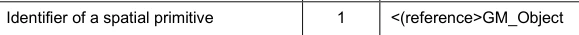

```text
Attribute
maskIndicator
```

(别名 xlink: 作用)

表示一个空间原始是被数据集限制所掩盖还是被截断

1 编号 S100_GF_任务指示器Ty pe

```text
Table 3-15— S100_GF_MaskIndicatorType
```

名称描述代码注释

编号 S100_GF_任务指示器 Type 表示数据集限制的遮盖或调取

```text
-
-
```

在数据集限制下, 空间原始被截取

```text
1
```

空间原始的显示被压制

```text
2
```

```text
3-5.3.6
GF_TemporalAttributeType
```

ISO 19109类GF_Temperal AttizeType在S-100 GFM中并未明确实现. Temperary信息必须使用主题属性类型S100_GF-ThematicAttisticTyke来进行模型化(详见第36-4.4条)。

```text
3-5.3.7
GF_MetadataAttributeType
```

ISO 19109 类 GF_Metadata 属性Type 在 S-100 GFM 中未明确实现. 元数据类型必须使用复杂的主题属性来进行模型化,这些属性实现类型来自 S- 100 部分 4a 元数据的组件. 复杂主题属性必须在一个要素目录中定义.

```text
3-5.3.8
GF_QualityAttributeType
```

ISO 19109 类 GFQ-质量属性Type 在 S-100 GFM 中没有明确实现. 质量元数据类型必须使用复杂的主题属性来进行模型,这些属性实现类型来自 S- 100 部分 4c 附录 4 C-A 数据质量. 复杂主题属性必须在一个要素目录中定义.

```text
3-5.3.9
GF_LocationAttributeType
```

ISO 19109 类 GF_Location 属性Type在S-100 GFM中未实现.

```text
3-5.3.10
S100_TruncatedDateAttributeType
```

S100_TruncedDatePriticalType 类是用于模拟日期值,其中省略了一个或多个较重要的组件。这允许部分日期,例如用于重复期。

```text
3-5.3.11
S100_GF_CodelistAttributeType
```

S100_GF_Codelist 属性Type 类在 S-100 GFM 中被引入,用于模拟 S-100 代码列表。代码列表属性必须和任意一个计数相关联(对于开放的计数)

## 官方 PDF 第 123 页

代码列表)或字典(用于开口和闭口字典代码列表),但两者不兼而有之. 字典的结构由外部的规格来定义.

```text
Table 3-16— S100_GF_CodelistAttributeType
```

角色名称描述。 类型备注

```text
Class
S100_GF_
CodelistAttributeType
```

S100_代码列表属性的抽象基础类

```text
-
-
-
```

标签代码列表 Type 代码列表类型 1 字符串必须包含: 开放式目录 开放式词典 封闭词典

Tag URI 为打开或关闭的字典代码列表识别词典

0.1 只为打开或关闭的字典代码列表设置字符串

额外值的标记编码提示

0.1 字符串只用于打开的引用或打开的字典代码列表

```text
3-5.3.12
S100_GF_EnumerationType
```

S100_GF_EnumerationType和S100_FFU_EnumerantClass 一起模型,用于定义一个点数属性的允许值及其语义。一个点取类型的实例可以定义一个出点或代码列表属性的一组允许值,或者两者兼有。

3-5.4 所命名类型之间的关系

3-5.4.1 引言

本子语句更详细地描述对象类型之间的关系,关系分类如下:

1) 要素类型和信息类型的通论/专业.

2) 要素类型与信息类型之间的关联。

```text
3-5.4.2
GF_InheritanceRelation
```

类GF_继承关系在S-100 GFM中并未实现,但通过在类S100_GF-FeatureType和类S 100_Gf_IntelligenceTy Pe上使用一个相同的关联来允许对象继承(见图3-3). 关联的超Typ端的多端性使得子类型可能只有一个超类型,这是为了防止多位继承的建模. 继承关系协会是仿制混凝土类,而不是抽象类S100_GF_NamedType。这阻止了从信息类型继承的要素类型,反之亦然。

继承关联只存在于被命名类型(类)之间,而不存在于被命名类型实例(即在一个数据集中发生的实体)之间.

## 官方 PDF 第 124 页

图3-3——专业和普通化协会

```text
3-5.4.3
S100_GF_AssociationType
```

关联由S100_GF_协会Type类定义,有两种角色和定义. ISO 19109类 GF_AggregationTy Pe, GF-Sparatical AssociationTye, 和 GFS- 100 GFM 中未明确实现。 这些类别只有在允许协会携带属性的情况下才能使用。 ISO 19.109 GFm 允许这样做, 因为 GFL_协会 Type 是 GF _ FeatureTyope 的子类型 。 然而,S100_GF_AssociationType并不是S100_GF_FeatureType的子类型.

3-5.4.4 信息类型的联系

S- 100 GFM 中引入了 S100_GF_ObjectType 和 S100 _GFL_ InformationTy Pe 之间的关联。 角色附加信息是 S-100 GFm 中该关联的默认, 并意味着对一个被命名的类型有额外的信息 。

3-5.4.5 关联目的默认名称

必须用程序Schemas可以指定关联目的的名称(作用名). 如果未明确提供名称,则使用下列默认值.

(1) 如果只给一个协会的一端以“<作用名>”的明确名称,则另一端必须有一个默认名称“inv- ⁇ rolename>”。

2)如果协会的两端都没有被赋予明确的名称,默认的角色名称为""目标类名"",其中目标类从源类中被引用.

3)上述规则可能不会导致每个关联端在应用程序Schema中产生一个单独的名称,因此产品规范在必要时可以定义不同的规则或附加规则.

4)如果需要标准名称,可以使用下列默认名称来代替上列的.

a. “额外信息”是社团从功能到功能的默认角色名称。

b. 要素/地貌或信息/信息协会,仅可通航于一种

方向可以使用“源”和“目标”的默认端名。“关联”的名称可以在双向协会的两端使用。

## 官方 PDF 第 125 页

产品规范可能将个别的默认和标准默认混合在一起,但必须明确适用于任何特定关联端的名称。

3-5.5 要素类型的行为

要素类型的行为由可能发生在或可能发生在要素类型上的操作来描述. 操作仅适用于互操作性模型,不适用于数据传输模型.

3-5.6 约束

限制通过具体说明允许或不允许的数据组合来限制必须用中防止产生错误数据的自由,必须用程序Schema应明确确定限制。

只有被命名的种类和属性可能存在限制.

3-6 应用模式规则（ISO 19109 第 8 条）

3-6.1 应用建模过程(ISO 19109 第8.1条)

应用Schema有两个目的:

1)它实现了对特定应用领域内数据内容和结构的共同而正确的理解.

2) 第二,它可能提供一个计算机可读的Schema,用于应用自动数据管理机制。

这两个角色意味着创建应用程序Schema的分步进程。步骤可以简单描述为:

1) 调查预期应用领域的要求(未完成论述)

2) 以GFM中定义的概念为应用的概念模型,这项任务包括确定要素类型、特性和制约因素。

3)必要时用正式的建模语言描述必须用程序Schema的元素. S-100必须用程序Schemas必须按照S-100的这一部分所定义的规则使用UML进行描述.

4)将正版应用Schema与其他标准化的Schemas,(Spacial Schema,Quality Schema等)整合为一个完整的应用Schema.

3-6.2 施埃马案(ISO 19109 第8.2条)

36.2.1 应用Schemas的概念学语言

如果使用概念语言来设计一个S-100必须用程序Schema,那么这一定是UML.

3.6.2.2 主要规则

必须用程序Schema的数据结构应仿照必须用程序Schema。

应用程序 Schema 中用于数据传输的所有类都是可即时使用的。 这意味着整合类不得被定型的 QQ接口 。

-6.2.3 确定应用程序Schemas

1) 每一必须用程序Schema的识别必须包括名称和版本。

## 官方 PDF 第 126 页

必须用程序Schema描述特定数据集的内容。必须定义一个S-100必须用程序Schemas的独特名称和版本定义系统。

2) 在UML中,必须用Schema必须在PACKAGE中描述,其中应标有必须用Schema的名称和PACKAGE文件所记载的版本.

3.6.2.4 应用程序Schema的文档

1) 必须用Schema必须加以记录,必须界定S-100必须用Schemas的用法,以确保S-100产品规范的一致性。

2) UML 中的应用程序Schema的文档可以使用用于创建应用程序Schema的软件工具中的文档设施,如果可以输出这些信息的话.

3) 如果CLAS或其他UML组件与要素目录中的信息相对应,则该目录的参考文献必须被记录.

4)必须用程序Schema中要素类型的文档必须收录在从GFM中衍生出的结构的目录中,例如按照S-100 第5部分编成的目录,这可以采用文本格式或XML并附有用于创建文本版本的样式表(XSLT).

3-6.3 《统一仲裁示范法》中施以舍马规则(ISO 19109 第8.3条)

3-6.3.1 主要规则(ISO 19109 第8.3.1条)

UML中的应用Schemas的主要规则是:

1) S100_GF_NamedType的例子应作为CLAS来执行.

2) S100_GF_ObjectType的例子应作为CLAS来执行.

3) S100_GF_FeatureType的例子应作为CLAS来执行.

4) S100_GF_InformationType作为CLAS执行的例子.

5) S100_GF_Feature AssociationType的一个例子,在与作为CLASS执行的S100_FEtatureTy Pe的事例相关联时,可以起到链接Between的作用. 它应作为下列案例之一执行: a)案例1:与任何案例无关的S 100_FeiatureAssociatype的事例.

S100_GF_理论属性Type的例应作为这些分类之间的ASSOCION执行。 b) 案例2:与一个或一个相关联的S100_Feature协会Type的例。

更多的S100_GF_主题属性图案应作为ASOCIATION CLAS执行;相关的S100_GF_主题属性图案应作为ASOCIATIBUTES执行.

6) S100_GF_信息协会Type 的例子具有信息链接的作用,与作为CLASES执行的S100_ GF_FeatureTy Pe 或S100-GF-信息协会的情况有关。它应执行以下情况之一:(a) 案例1:与任何信息协会无关的S 100_信息社团Tyke的例子

S100_GF_主题属性Type的例子应作为这些分类之间的ASSOCION执行。 b) 案例2:与一个或一个相关联的S100_信息协会Type的例子。

更多的S100_GF_主题属性图案应作为ASOCIATION CLAS执行;相关的S100_GF_主题属性图案应作为ASOCIATIBUTES执行.

7) S100_GF_属性Type的示例应作为ATTRIBUTE执行.

8) S100_GF_SimprojectType的例子应作为ATTRibUTE执行.

## 官方 PDF 第 127 页

9) S100_GF_ComplexAtriptitionType 实例应作为 CLAS 执行. 即时CLAS必须有 S100-GF-Simptributype和/或 S-100-FF_complex阿特利布特 的一个或多个实例。

10) 社团继承关系的例子应以UML一般关系为代表。

3-6.4 统一马列标准Schemas的域名简介(ISO 19109 第8.4条)

3.6.4.1 在标准Schema中添加信息的规则

标准Schemas不得在应用Schemas中扩展. 标准Schemas是S-100中记载的,例如空间Schema,Feature Catalogue Schema等.

限制使用标准Schemas

对于一些标准Schemas,例如S-100 第7部分(Spatial Schema),可以重新定义Sche马,这样只有部分ScheMa才会被使用,并且只能使用部分类别和关系的定义.

1)标准Schema的限定配置规格必须在新的UML包中进行描述,从标准Sjema中复制实际定义(类和关系). 类别内属性和操作可以省略.

2) 标准Schema的削减应符合实际标准的符合条款。

36-6.4.3 元数据Schema的使用规则(ISO 19109 第8.5条)

S100 Part 4 定义的元数据 Schema 是元数据组的应用程序 Scheme. 元数据是描述并记录数据的数据. 地理学数据元数据通常提供其识别,范围,质量,空间和时间方面,空间参考和分布的信息.

元数据类型应作为实现S100 第4部分要素的复杂属性加以实施,因此元数据属性必须为主题属性类型.

暂行规则(ISO 19109 第8.6条)

S-100不包括ISO 19108的配置. 时间属性必须使用日期,时间或日期时间, S100_TrunctedDate, 或使用这些时间类型组合的复杂属性来进行模型化, 这些类型的使用使属性成为S100_GF_SimpleAttizitionType或S100-GF-ComplexAtizedTyope的示例, 酌情进行.

3-6.5 空间规则(ISO 19109 第8.7条)

3.6.5.1 一般空间规则(ISO 19109 第8.7.1条)

空间属性类型的值域应符合S-100 第7部分给出的规格,该部分提供概念Schemas来描述要素的空间要素并有一套与这些Schemas相符合的空间操作员.

S-100 第7部分明确排除了地貌原始人,因此,ISO 19109第8.7条中规定的地貌规则与本专用配置无关。

3.6.5.2 空间属性

1) 要素的空间要素必须用一个或多个空间属性来描述. 在必须用学中,要素属性的空间属性是要素要素属性的子类型(见5.3),其值的分类学在S-100 第7部分中被定义.

2) 空间属性应以两种方式之一在必须用程序Schema中得到体现:(a) 案例1:作为代表要素的UML CLAS的ATTRibUTE,在这种情况下

ATTRIBUTE应取取空间中确定的一个空间物体,即ISO 19107,作为其价值的数据类型;或

## 官方 PDF 第 128 页

(b) 案例2:作为代表要素的类别之间的UML协会,

由"空间学"所定义的空间物体之一,ISO 19107.

3)空间属性必须取一个空间物体作为其价值. 空间物体被归类为几何物体,被子分类为原始物体,复合物或聚合物(指几何对象). 太空属性的价值类型必须是第七部分所描述的种类或其子类型.

空间质量

空间物体的定位质量必须采用一种方式描述,即与S100_GF_InformationType相联,后者与带有定位精度的S100_GF_ThematicAttizeType相接。

3-6.5.4 代表要素空间属性的几何集合和复合体

3-6.5.4.1 引言

许多要素的空间配置不能由单一的几何原始来表示. GM_Aggregate和GM_Complex 类型支持对要素等要素进行表示.

3-6.5.4.2 几何总和

S-100的空间剖面只支持GM_多点几何集合类型. GM_多点应被作为代表要素的空间属性值作为一组点.

3.6.5.4.3 几何复合体

几何复合体用于代表一个要素的空间要素,作为一组相通的几何原始物. 此外, GM_Complex 的实例允许不同要素的相通性共享几何原物. GM-Primitives在GM_complex中并没有明确的联系; GM同Primmitives之间的连接可以从坐标数据中推导出来.

1) GM_Complex 用作代表一个要素的空间属性的值,作为连接的 GM-Objects 集合,除其边界外,它们是脱节的. GM__Compless 的子类可以被指定来限制 GM–Complce 用于代表特定空间配置的结构.

2) 具有几何要素的要素应作为GM_Complex在更大的GM_Complex内具有亚复合物的要素来表示.

3.6.5.4.4 几何复合材料

几何复合体是一款具有几何原始体所有特性的几何综合体,除了由同类型较小的几相原始体所组成外,几何合成体被用来代表由同等几何体组成的更小的几分天体所组成的复杂要素. 一种GM_复合物必须用来代表具有几何原始几何特性的复杂要素。

3.6.5.4.5 分享几何要素

不同的要素在似乎占据相同位置时可以部分或完全共享相同的几何. 要共享一个共同的几何要素,空间要素属性必须共享一个或多个GM_Objects.

共享几何有两种方式。 当两个要素实例都采用GM_Object与空间属性值相同的实例时, 完全共享就会发生。 可以通过在应用程序Schema中说明限制, 而要求或排除这种情况。 如果没有这种限制, 必要时可以这样做 。

1) 必须用程序Schema可能要求两个或两个以上要素类型的实例完全分享其几何要素,包括代表这些要素的GM_对象必须平等的制约。

## 官方 PDF 第 129 页

2) 应用程序Schema可能排除两个或两个以上要素类型的实例,因为其中包含一个限制,即代表这些要素的GM_对象不相等。

3-6.6 分类规则(ISO 19109 第8.8条)

3-6.6.1 导言(ISO 19109 第8.8.1条)

要素目录是一个描述对特定领域具有重大意义的真实世界现象的存储器。要素目录方法提供了代表这些现象的数据分类的详细组织情况,这样所产生的信息就尽可能明确、可理解和有用。

根据要素目录(ISO 19109 第8.8.2条)提出的施特马申请

S-100必须用程序Schema必须完全由执行S-100要素目录描述的要素目录提供的定义来构建.

3-6.6.3 字符编码

数据集中使用的字符编码必须在必须用程序Schema中定义。如果使用了多个字符编码,必须用程序Schema应记录数据集如何使用这些编码。

3-6.7 编码清单

使用代码列表类型属性的必须用程序Schemas必须包括下面表3-17所指定的带有标记的CLAS. 代码列表类型在第一部分中描述.

表 3-17——代码列表类型的标记

代码列表类型标记和值

打开计数码列表Type=打开计数

编码=其他: [某

已关闭词典代码列表Type=已关闭词典

```text
URI=<dictionary URL>
```

打开词典代码列表Type=打开词典

```text
URI=<dictionary URL>
```

编码=其他:[某 编码的规范形式必须是以下格式的字符串:

以 " other " 二字后加上一个结号和一个空格字符(即 " other: " ),然后用一个空格分隔出一个或多个字母字符串。

规范模式中指定了以下“其他:”部分(使用XML Schema 1.0/1.1模式):

```text
[a-zA-Z0-9]+( [a-zA-Z0-9]+)*
```

注意左括号后为一空格,图案以星号结尾.

实例:

表3-18——代码列表属性的"外"值示例.

```text
other: loxodromic
allowed
```

其他: 不允许使用( 包含字符 ⁇ )

```text
other: German Shipping Regulations
allowed
```

## 官方 PDF 第 130 页

```text
other: German  Shipping Regulations
not allowed (2 consecutive spaces)
```

```text
German Shipping Regulations
not allowed (does not begin with “other: “)
```

```text
other: 287
allowed
```

其他: 1,3,5-Trinitroperhydro-1,3,5-三 ⁇ 不允许使用(连字符和逗号字符不在允许的集合中)

3-7 覆盖数据的应用模式（资料性）

3-7.1 引言

用于应用Schemas的这个规则集针对面向要素数据的应用Schemas。但是,应用Schemas也可能被定义为覆盖。

本节包括应用程序Schemas如何定义图像和网格数据的例子。应用程序Sjemas的组件在ISO 19123中定义,而不是ISO 19109。但是,覆盖可能基于要素类型要素,在这种情况下,其概念上类似于要素收集。下面讨论这些面向要素的覆盖。

3-7.2 文字数据

此应用程序 Schema 定义了与关联元数据相连接的四边网格覆盖。 元数据被泛指到 ISO 19115-1和 19115-2。 此Schema 中没有对元数据进行特定选择 。 此 Schemma 可以同时用于“ 矩阵” 和“ raster” 数据, 并且可以按照所选的元数据 。

被网格化的数据由单一的特性——"图像"或"矩阵"以及取自MD_Metatadata(或MI_Mettata)的相关元数据组成. CV_Coverage(即其相关子类型,例如CV_ ContinentrilatoralGridCoverge)是被网克化数据集的空间属性,它定义了覆盖函数所"覆盖"的一个区域. 对于此应用程序 Schema 定义的连续覆盖, 覆盖函数会根据插值函数返回覆盖区域每个点的值。 网格值矩阵是一组驱动插值功能的值, 它就是通过线性扫描( x,y) 横向规则所穿越的格子。 空间参考由坐标参考系定义 。

此模板应用程序Schema支持大多数图像和被网格化的数据应用程序.

## 官方 PDF 第 131 页

图3-4 – 四边网格覆盖的模板应用程序Schema

3.7.3 可变单元格大小网格

此应用程序Schema 描述一个可变单元格大小的网格( ISO 19123) 。 转录顺序是Morton 顺序, 以便支持三个( 或更多) 维度。 这对水道测量数据特别有用, 因为大量的声纳数据导致3D 网格中覆盖了广泛的底部, 但同样深度的网块可以很容易地被聚合起来。

## 官方 PDF 第 132 页

图3-5 — Reimann 网格覆盖的模板应用程序Schema

3-7.4 面向要素的影像

所有被格网化的数据集都是面向要素的,因为覆盖是要素的子类型,这意味着整个被格法化的数据收集集可以被认为是单一的要素,一个要素结构可以两种不同的方式应用于被格地化的数据,首先,一个离散覆盖可以携带一个要素代码作为属性. 例如,与邮政编码系统相对应的覆盖将包含每个邮政编码的离散值,但仍完全覆盖国家. 应用程序Schema中唯一的区别是离散覆盖和要素之间的关系.

下图3-6中的应用软件Schema模板既描述了“分点”又描述了“相克网点”的覆盖类别。 典型的产品规范将视需要的覆盖类型选择一种或另一种(或两种)。

## 官方 PDF 第 133 页

图3-6-面向要素的离散覆盖

建立要素结构的第二种方法是开发包含许多单独但相邻的覆盖的复合数据集,覆盖可能是连续的或离散的,这与每个要素都有自己几何和属性的"媒介"数据集的构成方式非常相类似,事实上矢量数据可能与同一组数据集的覆盖数据相混合. 应用程序 Schema 仅允许多个特性实例 。

网格等几何元素可能由多个要素共享,而要素可能通过ISO 19109通用要素模型允许的成分或其他关系来相联. 复杂的要素可能既包括连续网格覆盖,也包括多边边界等矢量数据. 面向要素的数据集既可以包含声纳所收集的海洋连续覆盖,也可以包含与导航辅助物相适应的点和线要素。地形原始可能涉及所有要素,从而可以有一些有趣而有用的结构。 光栅纳通图可能包含额外的矢量数据,描述导航辅助器,危险和危险区,这些区域不是"可被"地"地,因为它们没有被描绘出,而是活跃于使用光栅能纳通相图,因此航海家可以确定一艘船是否在危险区内,或者履行其他ECDIS功能.

3-8 S-100 时间框架

3-8.1 时间定义

S-100不包括ISO 19108的完整配置. 时间属性必须使用原始类型 Date; 时间或日期 Time; S100_TruntedDate; S 100_IndicenteDate ; 或使用这些时间类型组合的复杂属性来进行模型化. 这些类型的使用使属性成为S100_GF_SimpleAtroductedType的实例或S100-GF-ComplexAtrictTy Pe的组件, 酌情.

时间即时通常定义为协调世界时或当地时间,使用Gregorian日历标准地抵消到协调世界分会或时区. 因此,S-100不执行任何ISO 19108 第5.3节 Tempolar Reference Systems的规定.

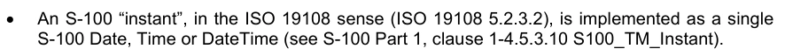

ISO 19108意义(ISO 19108 5.2.3.2)中的S-100 “即时”作为单一S-100日期、时间或日期时间执行(见S-100第一部分第1-4.5.3.10 S100_TM_即时)。

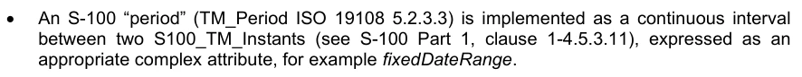

S-100“期”(TM_Period ISO 19108 5.2.3.3)作为两个S-100_TM_Instants之间的连续间隔执行(见S- 100 Part 1 第1至4.5.3.11条),作为一个适当的复杂属性,例如固定距离。

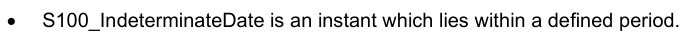

S100_ 不确定时间是位于一个规定期限内的瞬间 。

## 官方 PDF 第 134 页

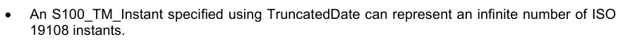

使用 TrncatedDate 指定的 S100_TM_ 即时可以代表无限数量的 ISO

3-8.2 时间关系

S-100没有完全执行ISO 19108的时间地貌的规定,也没有执行时间相对位置;然而,必须使用ISO 19 108. TM_Relatitial Patition 值来界定和描述两个S-100即时和/或期值A和B之间的关系,如下表3-19所显示。 只有标有 (______) 的条目才能在 S100_TM_Instant 是 S100_IndicenteDate 时被有意义地定义,它以有界限的起始或结尾的不确定格式表示.

表3-19——时间值之间的关系(来自ISO 19108 5.2.3.5 TM_Relative)

职位)

A~B A (单 S100_TM_即时) A (单 S100_TM_Period) (单 S100-即时) A (单 S100_TM_Period) (单 S100-即时)

```text
B (Single
S100_TM_Instant)
```

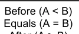

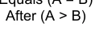

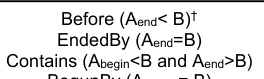

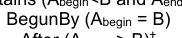

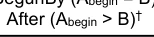

```text
B (Single
S100_TM_Period)
```

```text
Before (A<Bstart)†
```

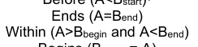

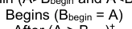

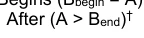

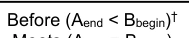

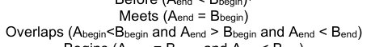

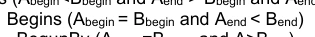

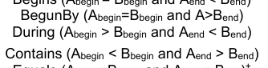


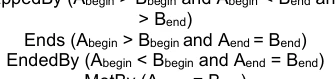

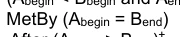

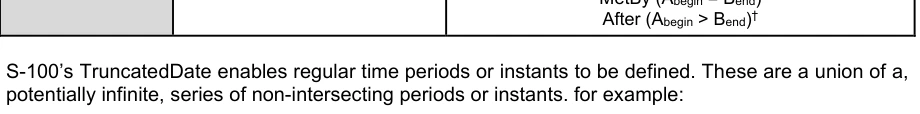

```text
“2021---05” = { 2021-01-05, 2021-02-05, 2021-03-05, 2021-04-05, 2021-05-05, 2021-06-05, 2021-07-
05, 2021-08-05, 2021-09-05, 2021-10-05,2021-11-05,2021-12-05}
```

截断日期可以定义一系列的时段. 以特长格式(B)定义的一组日期(即关系A-B)的单一TM_Instant或TM_Period(A)之间的关系在下文表3-20中界定(限定词“'”指“为所有人”,并指B内部的所有TM_ Periods(注意某些关系(在B之前/之后)),当B是一组没有限定的正常时间段时,可能不加以界定)。

表3-20——时间值与缩短日期之间的关系

A~B A (单机TM_即时) A (单机TM_Period)

```text
Bn (Multiple
TM_Periods)
```


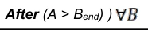


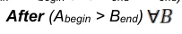

3-8.3 时间间隔和期间模型的解释

周期的起止瞬间(和间隔)必须包括在周期(或间隔)中,除非产品规范具体说明了不同的解释。这是基于ISO 8601:2004§ 2.1.3,该分节将时间间隔定义为“由两个瞬间所分出的时间轴部分”,并规定“A”

## 官方 PDF 第 135 页

时间间隔包括两个限制瞬间之间的所有瞬间,除非另有说明,两个限制即时本身”。 不允许使用“在”或“在“之后”的属性进行间隔。起始和结束瞬间由最小颗粒度的日期/时间组成部分来定义。 例如,如果月份是结束瞬间给出的最小组件,则结束瞬后是整个月份,而间隔则会于月中最后一天结束。例如: 使用此选项来使用降低的准确度表示或切换的Date类型来编码间隔,则导致表3-21. 该表格还说明如何处理跳跃年的特殊情况。

表3-21——期间实例

```text
<S100_TruncatedDateAttributeType>
```

```text
periodStart
```

----01-0000 1月1日至2月29日24:00跳跃年和2月28日跳跃年和2月28日跳跃年

未编码的年份和天数

```text
<S100_TruncatedDateAttributeType>
```

```text
periodEnd
```

```text
----02--
```

未编码的年份和天数

```text
<S100_TruncatedDateAttributeType>
```

```text
periodStart
```

--0101 000 000,每年1月1日至2月28日24:00,没有编码

```text
<S100_TruncatedDateAttributeType>
```

```text
periodEnd
```

```text
----0228
```

未编码的年份

```text
<S100_DateAttributeType>
```

```text
dateStart
```

2012.01050000:2012年1月5日-2012年6月18日24:00 <S100_DateAttroducationType> 互联网档案馆的存檔,存档日期2012-12-05.

```text
dateEnd
```

```text
20120618
```

3-9 截短日期使用的格式专用类型

数据格式可以使用该格式支持的特定类型,以便包含切入值。如果出现这种情况,格式描述必须指定S100_TrunctedDatePatroductionType值和格式特定类型的值之间的映射。

示例:基于 XML 的编码可以使用 gMonthDay 简单的属性类型( 这是一种 XML Schema 内置类型) 作为“ 每年12月 17 日” 的等同表示 :

```text
xs:gMonthDay: --12-17
```

这相当于 ----1217数据格式中严格遵循S-100的值.

3-10 实例标识符

实例识别器应使用海洋资源名称概念和命名空间,MRN名称空间由国际灯塔当局协会通过其海洋资源名称网页进行管理,该网页还载有适用于MRM概念的整套规则的参考文献。 最顶端的名称空间urn:mrn 仍然固定,后续的名称空间由冒号分隔出,并通过应用程序程序在网站上解释。任何希望发布MRN符合标识符的组织都应该向IALA申请名称空间,或者已经注册了名称空间的组织申请名称.

例如,IHO申请命名空间,随后在urn:mrn:iho命名空间下给予所有成员国一个子名空间;对于NOAA来说,这可以是urn:mrn:iho:us和用于CHS.

## 官方 PDF 第 136 页

这可以是骨灰:mrn:iho:ca. NOAA和CHS随后将根据需要并在MRN规则范围内管理各自的命名空间.

以下规则适用于MRN命名空间.

所有使用"mrn" NID的URN的命名空间特定字符串(NSS)必须具有以下结构: 1.

```text
<URN>   ::= "urn:mrn:" <OID> ":" <OSS>
<OID>   ::= 1*(ALPHA / DIGIT) ; Organizational ID
<OSS>   ::= <OSNID> ":" <OSNS> ; Organizational specific string
<OSNID> ::= 1*(ALPHA / DIGIT / "-") ; Organizational specific namespace ID
<OSNS>  ::= 1*<URN chars> ; Organizational specific namespace string

DIGIT   ::= %x30-39 ; 0-9
ALPHA   ::= %x61-7A ; a-z

Basics of the ABNF notation used:
```

" 字元(tterminal ch字符串);引文中不包含的词为非terminars / 备选案文 ()表示一个序列组,作为单个的替代物使用,或作为单个重复组 <a ⁇ b> 表示下个词或组至少可以重复<a>,最多重复"b";默认值分别为0和无穷;注释.

整个URN都是对案例不敏感.

```text
<URN chars>
As defined in RFC2141
```

指定独特的组织ID的过程由IALA管理. 详情和申请过程可以参见IALA的"海洋资源名"(MRN)网页.

3-10.1 利用实例识别资料

当它需要能够发现产品之间相同事物的事例时,无论是同一产品规范还是不同产品规范之间,都需要至少使用一个实例标识符。在需要共同识别的要素类型或信息类型的所有类别实例中,此实例标识码必须是一个属性。 属性必须称为互操作性识别器并必须是URN类数据.
