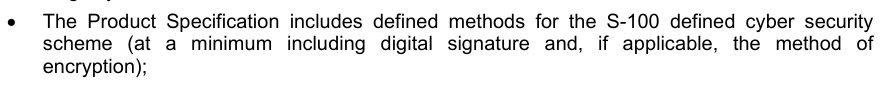
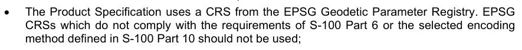

# S-100 5.2.1 · 第 4a 部分 · 元数据

非官方机器翻译参考稿，尚未逐条人工校订。公式与代码保留原文，解释以英文规范为准。

## 官方 PDF 第 137 页

S-100 – 第4编a

元数据

## 官方 PDF 第 138 页

5.2.1版实质性变动摘要

已生效的概要条款

## 官方 PDF 第 139 页

中文目录（可用上方目录直接跳转）

4a-1 范围 · 官方 PDF 141
4a-2 符合性 · 官方 PDF 141
4a-2.1 本专用配置与其他标准相一致 · 官方 PDF 141
4a-2.2 后向相容性 · 官方 PDF 142
4a-3 与本专用配置的符合性 · 官方 PDF 142
4a-4 规范性引用文件 · 官方 PDF 142
4a-4.1 专用配置定义 · 官方 PDF 142
4a-4.2 资料性参考文献 · 官方 PDF 142
4a-5 要求 · 官方 PDF 142
4a-5.1 商业目的和预期用途 · 官方 PDF 142
4a-5.2 描述地理数据和其他资源的元数据 · 官方 PDF 144
4a-5.3 义务/条件 · 官方 PDF 144
4a-5.4 最低元数据要求 · 官方 PDF 145
4a-5.5 S-100合同类别 · 官方 PDF 151
4a-5.5.1 第1类 - IHO S-100物体型号符合要求 · 官方 PDF 151
4a-5.5.2 第2类 -- -- 符合非标准编码的IHO S-100 · 官方 PDF 151
4a-5.5.3 第3类 -- -- IHO S-100符合标准编码 · 官方 PDF 151
4a-5.5.4 第4类 -- -- 国际海道测量组织S-100和海事组织统一显示 · 官方 PDF 151
4a-5.6 建议用于地理数据集的元数据 · 官方 PDF 151
4a-5.7 变化和偏好 · 官方 PDF 154
4a-5.7.1 元数据元素元数据识别符 · 官方 PDF 154
4a-5.7.2 元数据元素母元数据 · 官方 PDF 154
4a-5.7.3 数据集的地理范围 · 官方 PDF 154
4a-5.7.4 数据和日期 时间信息 · 官方 PDF 154
4a-5.7.5 元数据扩展信息 · 官方 PDF 154
4a-5.8 服务元数据 · 官方 PDF 155

## 官方 PDF 第 140 页

本页特意留空

## 官方 PDF 第 141 页

4a-1 范围

第4a、4b和4c部分所述的S-100元数据专用配置为描述、验证和交换海道测量组织共同制作的地理数据集的元数据提供了一个规格。 其目的是建立元数据记录,提供关于识别、空间和时间范围、质量、应用Schema、空间参考系统以及数字地理数据分布的信息,适用于数据集的编目、信息交换所活动以及地理和非地理资源的全面描述。 虽然它主要是为了描述数字地理数据,但也可用于描述其他资源,如图表、地图、图像、文字文件和非地理资源,它规定了属性、属性类型、要素、要素类型、特性类型、收集硬件、收集会议、数据集、数据集系列、非地理数据、财产类型、字段会议、软件和服务。 需要注意的是,这个配置并不限于ISO 19115-1代码列表MD_ScopeCode QQCodeColist *=(ISO 191115-1-B.3.28)所列出的资源,如果需要,可以扩展以包括额外资源.

这个专用配置基于ISO 19115-1元数据以及19115 第2部分 — 图像和网格数据元数据。它也考虑到了ISO/TS 19115-3元数据 — XML Schema执行基本概念。

ISO 19115-1提供了一个抽象的结构,通过定义元数据元素和建立一套通用的元数据术语,定义,扩展程序来描述数字地理信息. ISO/TS 19115-3提供了一种eXtensable Markup Language(XML) ISO 19.115-1的应用,并指导了剖面图和扩展.

该文件针对元数据应用程序的开发者和实施者,提供了对地理信息标准化的原则和总体要求的基本理解,应与第4a-4条-规范性参考条款下的标准一并使用。

下列相关文件载有关于S-100元数据实施、编码和质量原则的进一步资料:

(1) S-100 第4b部分 -- -- 图像学元数据扩展和网格数据;

(2) S-100 第4c部分 -- -- 元数据质量原则;

3) 附录4a-C -- -- 元数据执行。

4a-2 符合性

4a-2.1 本专用配置与其他标准相一致

除了ISO 19115-1所列出的元素外,该剖面图还采用了所有相关的19115-1义务和条件,但元数据识别元素除外,该元素已从可选性改为强制性. 这样做是为了通过确定重复的元数据记录实例,以及界定儿童元数据的记录与其母元数据纪录的关系,促进元数据数据的落实和管理,任何元数据等级关系的细节将在产品规范中详细介绍。

考虑到上述变化,以及ISO 19106:2004中记录的要求,本剖析满足了符合第11类的要求. 剖析是ISO 19115-1的群相剖析2,并包括了基准标准3允许的扩展.

这个配置包括了父元数据作为地理数据集的核心元数据元素。如果数据集元数据记录有母元数据记录,则这个元素成为强制性的,因此

1 符合第2节所描述的符合第1类和附录B.3 具有特殊性特征的描述实例(ISO 19106:2004). 2 单一基准标准的描述可包含一个子集,相当于整个基准标准,即一个子组可以等于整体(106:2005, 第15页). 3 这符合附件C(ISO 19.115-1:2014)所包括的规则.

## 官方 PDF 第 142 页

有关 XML 执行情况的指导载于附录4a-C。

4a-2.2 后向相容性

根据ISO 19115-1:2014,ISO继续提供由ISO 19115:2003/Cor 1:2006产生的UML模型供使用. 后向相容性将使用变相服务提供.

4a-3 与本专用配置的符合性

声称符合本专用配置的任何元数据应:

(1) 内容符合ISO 19115-1附件B中的数据词典定义(包括ISO 1915-1 修正案1:2018所要求的修改),但具有强制性义务的元数据要素元数据识别符除外;

(2) 验证XML文件实例以证明符合S-100元数据专用配置Schemas,这些实例可在国际海道测量组织网站的Profiles查阅。

此配置文件的所有产品特定执行必须提供可扩展样式表语言(XSL)转换文件/资源,可以将 XML 文件实例翻译为S-100元数据配置文件 XMl 格式。这些生成的 XMR 文件实例必须使用 ISO/TS 19115-3 XSD 验证.

4a-4 规范性引用文件

本文件的应用需要下列参考文件:关于注明日期的参考文件,仅适用所引用的版本;关于未注明日期的文件,适用所参考文件的最新版本(包括修正案)。

4a-4.1 专用配置定义

用于定义S-100元数据配置的参考文献如下:

ISO 19115-1:2014,"地理信息-元数据" 第1编-基本原理.

ISO 19115-1/Amdt01:2018,地理信息-元数据-第一部分-基本原理(修正案1)

ISO 19115-2:2009,地理信息-元数据- 第2部分:图像和网格数据的扩展

ISO 19119:2016, 地理信息–服务

ISO/TS 19115-3:2016,地理信息-元数据-基本概念的XML计划实施

4a-4.2 资料性参考文献

ISO 19115:2003, 地理信息-元数据

ISO 19115:2003/Cor.1:2006,地理信息-元数据(技术更正1)

ISO/TS 19139:2007, 地理信息-元数据-XML schema执行.

4a-5 要求

4a-5.1 商业目的和预期用途

元数据可以满足一些用途:

## 官方 PDF 第 143 页

1)数据发现 - 内容和质量的简要说明,联系方式,线下分布和线上参考(URL)供线上取景.

2) 数据的使用 -- -- 关于数据覆盖面、维护、内容和数据创建细节的更广泛信息,包括更多的联系、分发和质量细节。

3) 数据适配性 — — 更多关于使用、限制、格式、年龄和范围的细节。这一级元数据帮助用户确定数据是否适合使用。

4) 数据共享 - 关于数据内容,传输格式和空间代表的进一步细节.

5)数据管理 — — 最详细的元数据层次,包括数据质量制度和数据质量测试结果的信息。 有时,当数据在组织之间交换时,这类信息很重要。

图4a-1-商业目的

以上图4a-1说明了不同用户群需要的元数据类型之间的关系,以及本剖面图的范围. 每个基于S-100的产品规范将描述支持数据使用,数据共享和数据管理所需的源和要素级元数据. 对综合元数据的要求更高(如图4a-1中的“Doers”所说明),需要进一步的归属,以便进行源头选择和要素分析。

ISO 19115-1没有提供描述图像所需的全部元数据,这已经包含在ISO 191115的第二部分中,其中包含了描述图像和网格数据所需的元素. ISO 19130 – “图像和被网格化的数据的传感器和数据模型”是与ISO 19115 第2部分有关的重要标准,因为它具体规定了支持可地理参照图像地理定位所需的信息,包括传感器模型定义的传感器描述和相联物理信息、配位功能和地面控制点。 它描述了传感器测量和地理学信息如何逻辑地联系在一起,特别是ISO 19130描述了水道测量声纳要求的传感器和数据模型以及相关的元数据,这将在相关的产品规范中加以描述。

ISO 19115-1的XML执行,它描述了ISO 19115-1中抽象的UML模型如何被转换为XML,在ISO出版物ISO/TS 19115-3中被记录.

虽然这一专用配置主要基于上述标准,但还需要提及其他标准(见第4a-4节)。

此配置文件定义 :

## 官方 PDF 第 144 页

(1) 强制性和有条件的元数据部分、元数据实体和元数据要素;

2) 任何资源的最低元数据要素集,以便符合本专用配置;

3) 地理数据集的核心元数据;

4) 可选元数据要素,以便能对资源进行更广泛的标准描述;以及

5) 扩大《专用配置》以满足专门需要的选择。

专用配置的实施基于ISO/TS 19115-3:2016,包括:

(1) 使用ISO/TS 19115-3:2016 XSD;

2) XML 包含执行ISO 19115-1:2014代码列表的词典文件(ISO 19115-1:2014代码列表格式的XML数据词典);以及

3) S-100地理学界识别码列表的XML数据词典 4.

虽然UML类S100_Metadata特别类MD_Metatadata,但该专有类只涉及母类的限制,因此,为了XML的执行目的,MD-Metatata元素应被用于支持与其它ISO 19100地理信息标准的互操作性.

4a-5.2 描述地理数据和其他资源的元数据

该剖析法确定了描述数字地理数据和资源所需的元数据,并适用于独立的数据集,数据集汇总,地理要素,要素类别和属性. 元数据通过创建XML文档实例来记录,这些实例根据S-100元数据剖析XSDs验证,以及相关的代码列表和引用.

如果产品规范扩展了本剖面图的元数据,则必须遵循附录4a-D中的规则,产品规范必须提供元数据Schema来验证元数据.

元数据记录必须包含符合本专用配置所必需的最低限度核心要素(见第4a-5.3条),还确定了为发现目的需要的一些额外要素,附录4a-C对此作了说明。

质量信息对于评估数据集或资源是否适合使用十分重要,因此,质量元数据已在第4c部分被记录下来。

4a-5.3 义务/条件

已列出义务说明,以说明元数据实体或要素是否必须加以记录,或是否有条件或无条件留给元数据编码器斟酌决定,这一说明可能具有以下价值:M(强制性)、C(有条件)或O(任择性)。

强制性(M)义务是指必须记录元数据类别或元数据要素。

有条件的(C)义务规定了一种电子管理条件,即至少必须有一个元数据类别或元数据要素。

1) 表示两个或两个以上选项之间的选择,至少一个选项是强制性的,必须记录在案。

4 引用要提供的地理标识符代码列表,它们并不出现在ISO 19115 代码列表中. 5 Enuction:一个固定的已命名文字值的有效标识符列表. 被枚举类型的属性只能取自此列表的值(出自:ISO 19136:__,地理信息-地理标记语言 (GML)).

## 官方 PDF 第 145 页

2) 如果已记录到另一个元件,则记录一个元数据类或元数据元素.

3) 如果记录了另一个元数据要素的特定值,则记录一个元数据要素。

如果对条件的答案是肯定的,那么元数据实体或元数据元素必须是强制性的.

可选(O)义务是指元数据类或元数据元素可能被记录或没有记录. 可选的元数据类别和可选元数据要素已被定义,为那些想要完整记录其数据的人提供指南. (使用这组共同的被定义要素将有助于促进全世界地理数据用户和制作者之间的互操作性. )如果不使用可选类别,该类别内包含的要素(包括强制性要素)也将不使用.可选类别的可能具有强制性要素;这些要素只有在使用可取实体时才成为强制性要素.

4a-5.4 最低元数据要求

记录元数据的最低要求包括一些必须完成的元素,以便符合本配置文件,必须指出,这一义务并非对所有元素都具有强制性,但某些有条件的元素在某些条件下(例如资源Type)可能成为强制性的.

表4a-1列出了数据集和其他资源应完成的最低限度元数据要素,这些要素也构成表4a-2所列地理数据集最低限度元数据的一部份。

## 官方 PDF 第 146 页

本页特意留空

## 官方 PDF 第 147 页

表4a-1——地理数据集和其他资源的最低元数据

名称路径数据集 其他资源

元数据文件标识符 MD_Metadata.metadata 标识符 > MD_标识符.code M

元数据语言 MD_Metadata.default Locale > PT_locale. language

```text
C
```

(如果编码过程没有定义则有文件记录)

C(与数据集相同)

元数据字符集 MD_Metadata.default Locale > PT_locale.character Encoding

C(如果ISO 10646-1没有使用,也没有被编码过程所定义,则有文件证明)

C(与数据集相同)

元数据文件父标识符 MD_Metadata.parentMetadata > CI_Citation.identifer

C(如果存在较高层次的等级,则加以记录)

C(与数据集相同)

负责元数据信息的一方

MD_Metadata. contact > CI_Responsibility.CI_Individual (表4a-2) 或 MD_Metadata. contact > CI_Responsibility.CI_Organization (表4a-3) 互联网档案馆的存檔,存档日期2013-12-11.

M(必须记录组织或个人)

M(与数据集相同)

与元数据 MD_Metadata.dateInfo > CI_Date相關的日期

M(规定设定日期,可能提供其他日期)

M(与数据集相同)

资源标题 MD_Metadata. identificationInfo > MD_DataIdentification. 引用 > CI_Citation.title M (见注2)

资源参考日期

MD_Metata. identificationInfo > MD_DataIdentification. 引用 > CI_Citation.date > CI_Date.date.

管理(见附注2)

资源参考日期类型

MD_Metadata. identificationInfo > MD_DataIdentification. 引文使用过时参数coauthors (帮助) CI_Citation.dateType > CI_DateTypeCode

管理(见附注2)

描述资源MD_Metadata. identificationInfo > MD_DataIdentification.abstract M (见注2) 的摘要

## 官方 PDF 第 148 页

名称路径数据集 其他资源

资源默认语言

MD_Metata. identificationInfo > MD_DataIdentification.default Locale > PT_locale. language.

```text
M
```

C( 仅在使用 MD_ DataIdentification 时使用)

资源默认字符集

MD_Metadata. 身份识别Info > MD_数据识别.default Locale > PT_local.character Encoding (中文(简体) ).

C(未使用UTF-8的文档)

C(未使用UTF-8的文档)

主题类别 MD_Metadata. 识别Info > MD_数据识别. topicCategory M

C(如果资源Type = " 系列 " 专题是强制性的)

资源的地理位置(按说明)

MD_Metadata. 身份识别Info > MD_DataIdentification.extent > EQXXXXGraphicDescription.geographic Identification > MD_IDification.code.

C(见附注3和4)

O(见附注4)

西经度

MD_Metata. 识别Info > MD_DataIdentification.extent > EQXXXGraphic BoundingBox. WestBondLongitud e (中文(简体) ).

C(见附注3和4)

O(见附注4)

东经

MD_Metadata. 识别Info > MD_DataIdentification.extent > EQXXXGraphic BoundingBox. EastBondLongitud e (中文(简体) ).

C(见附注3和4)

O(见附注4)

南纬

MD_Metadata. 身份识别Info > MD_DataIdentification.extent > EQXX外接 EQQGraphic BoundingBox. SouthBondLat自相通.

C(见附注3和4)

O(见附注4)

北纬

MD_Metadata. 识别Info > MD_DataIDentification.extent > EQQX外接 EQQGraphic BoundingBox. NorthBondLatth

C(见附注3和4)

O(见附注4)

提供元数据的资源范围/类型名称

MD_Metadata.metadataScope > MD_MetadataScope.resourceScope > MD_ScopeCode(代码列表-ISO 19115-1) 互联网档案馆的存檔,存档日期2013-12-22.

M (默认 = “数据集”) M

提供元数据的资源范围说明

MD_Metadata.metadataScope > MD_MetadataScope.name O

## 官方 PDF 第 149 页

注1 ISO 10646-1 - 信息技术-通用多管编码字符集(UCS).

注2 如果等级等级级=`服务',则可以使用MD_服务标识来代替MD_数据标识。

注3 地理数据集包括地理边界框(西经、东经、南纬和北纬)的元数据或地理描述标识符(建议使用地理界限框 -- -- 见条款4a-5.7.3)。

注4 如果存在西经、东经、南纬或北纬的任何一种,其余三种也必须完成。

表4a-2——个人

名称路径数据集 其他资源

个人名称 CI_ dividual.name

C(如果 " 位置名称 " 和 " 未记录的 " 当事方识别符 " ,则有文件证明)

C(与数据集相同)

个人在组织中的地位 CI_Individual.positionName

C(如果 " 名称 " 和 " 未记录的 " 缔约方识别符 " 有文件证明)

C(与数据集相同)

个人联系信息 CI_dividual > contactInfo > CI_Contact M(见附注6)

M(见附注6)

CI_dividual. Party 的识别符

C(如果 " 姓名 " 和 " 位置 " 没有文件,则有文件证明)

C(与数据集相同)

## 官方 PDF 第 150 页

表4a-3——组织

名称路径数据集 其他资源

组织名称。

C(如果 " 位置名称 " 没有记录,请见注5)

C(与数据集相同)

个人在组织组织中的地位. 位置Name

C(如果 " 姓名 " 没有文件记载,见注5)

C(与数据集相同)

CI_Organization. contactInfo > CI_Contact M(见附注6)的联系信息

M(见附注6)

在命名的组织中的个人 CI_Organization.个人 > CI_Individual M M

CI_Organization. Party Identifer 政党的识别符

C(如果 " 姓名 " 和 " 位置 " 没有文件,则有文件证明)

C(与数据集相同)

注5 S-100对ISO 19115-1作了限制,因为记录CI-Organization的 " logo " 属性不足以省略 " 名称 " 和 " 位置名称 " 。

注 6. CI_Contact属性电话/地址/在线资源/联系指令中至少有一个必须记录在案。

## 官方 PDF 第 151 页

4a-5.5 S-100合同类别

在执行S-100支持时,不同的系统可能对S- 100产品有不同的要求,并且它们遵守S- 100. 框架. ECDIS可能需要非常高的遵守程度;而报告系统则可能要求较低的遵守程度,例如不需要S- 99. 为了便于交流产品规范的意图,以及由此产生的产品,可以宣布S-100遵守类别,界定了四个类别。

4a-5.5.1 第1类 - IHO S-100物体型号符合要求

产品规范中包含一个物体模型,该模型作为要素目录从IHO S-100 GI注册处获得,并符合S-100空间模型(S-100 Parts 7 and 8).

4a-5.5.2 第2类 -- -- 符合非标准编码的IHO S-100

产品规范符合S-100 第11部分的最低要求,产品规范规定了S- 100 第10部分编码方法中的哪一种;或者规定了另一种编码,包括它如何将它映射到S- 100. GFM. 元数据按照S-1000 第4部分是第4部分的剖面图,或者按照第4分规则的扩展.

4a-5.5.3 第3类 -- -- IHO S-100符合标准编码

作为二级,有下列限制:


产品规范只使用S-100 第10部分所定义的编码方法.

4a-5.5.4 第4类 -- -- 国际海道测量组织S-100和海事组织统一显示

作为第三级,有下列限制:


元数据是根据S-100第4部分或第4部分元数据的专用配置;


产品规范包括一个取自IHO S-100 GI的相接目录



产品规范包括S-100定义的网络安全计划的定义方法(至少包括数字签名,如果适用的话,包括方法)。


测试材料被嵌入产品规范或测试材料中,单独装入包件中,测试案例和相关材料至少可以与IHO相比.



产品规范使用来自EPSG大地测量参数登记册的CRS. EPSG CRS不符合S-100 第6部分的要求或S- 100 第10部分所定义的选定编码方法不应使用;


产品规范酌情包括国际海道测量组织S-100GI登记处提供的警报和指示目录;以及


如果适当,产品规范符合国际海道测量组织S-100GI登记处提供的互操作性目录。

4a-5.6 建议用于地理数据集的元数据

虽然ISO 19115-1定义了广泛的元数据要素,但只使用其中的一个子集,但是,数据集必须保留最低限度的元数据元素(见表4a-1),但在描述地理数据集时,建议使用额外的元数据元数据内容(除地理数据集的最低要求外)。 这套元数据包括最低限度的元数据和一些额外的可选要素,被称为推荐元数据. 表4a-4列出了描述数据集所需的推荐元数据和通常为目录目的的元数据。本列表包含解答下列问题的元数据的元数据: 元数据 元元数据

(1) “是否存在关于某一具体专题的数据集(“什么”)?”

2) `具体地点(“何处”)?

3) `特定日期或期间(“何时”)?

## 官方 PDF 第 152 页

4)`了解更多数据集或订购数据集的联络点(“谁”)?”

通过使用下文所描述的核心元数据,互操作性将得到加强,潜在用户应能毫不含糊地理解地理数据集或资源的特点。

表4a-4——推荐的地理数据集元数据

名称路径义务

此元数据记录的独特标识符

```text
MD_Metadata.metadataIdentifier >
MD_Identifier.code
```

```text
M a
```

元数据语言 MD_Metadata.default Locale > PT_locale.language C b

元数据字符集 MD_Metadata.default Locale > PT_locale.character Encoding

```text
C c
```

元数据文件父标识符

```text
MD_Metadata.parentMetadata >
CI_Citation.identifier
```

```text
C d
```

负责元数据信息的一方

MD_Metata. contact > CI_Responsibility.CI_Dividual或MD_Metata. contact > CI_Responsibility.CI_Organization 互联网档案馆的存檔,存档日期2013-12-02.

```text
M
```

与元数据 MD_Metatadata.dateInfo > CI_Date M有关的日期

元数据标准名 MD_Metadata.metadataStandard > CI_Citation.title O

元数据标准版本 MD_Metadata.metadataStandardVersion O Dataset标题 MD_Metadata. identificationInfo > MD_DataIdentification. 引文使用过时参数coauthors (帮助) CI_Citation. title.

```text
M
```

数据集参考日期MD_Metadata. identificationInfo > MD_DataIdentification. 引文使用过时参数coauthors (帮助) CI_Citation.date

```text
M
```

资源标识符 MD_Metatadata. identificationInfo > MD_DataIDentification. 引用 > CI_Citation.identifer > MD_IDentification.code.

```text
O
```

数据摘要

```text
MD_Metadata.identificationInfo >
MD_DataIdentification.abstract
```

```text
M
```

资源联系点 MD_Metadata. identificationInfo > MD_DataIDentification.point Of Contact > CI_责任

```text
O
```

空间表示类型 MD_Metadata. identificationInfo > MD_DataIDentification.spatialRepresentation Type

```text
O
```

数据集的空间分辨率

MD_Metata. identificationInfo > MD-DataIDentify.spatialSecretion > Md_Secondate. sparatesement. speakers. sarread. 或 MD _Se克勒. sariel. 等同比例或 Md _Shelp.vertical 或MD_Shollect.angularDistance 或 mD_shoel.le.film.

```text
O e
```

数据集语言 MD_Metadata. 识别Info > MD_DataIdentification. language.

```text
M
```

数据集字符集 MD_Metadata. identificationInfo > MD_DataIDentification.default Locale > PT_locale.character 编码

```text
C f
```

数据集主题类别 MD_Metadata. identificationInfo > MD_IDentification.topicCategory

```text
M
```

## 官方 PDF 第 153 页

名称路径义务

数据集的地理位置(以4个坐标或说明表示)

MD_Metadata. 身份识别Info > MD_IDentification.extent > EQXXXXXXGraphic BroundingBox或EQXGraphicDescription

```text
C g, h
```

数据集的时间范围信息

MD_Metadata. 身份识别Info > MD_IDination.extent > EQQExtent.timorElement

```text
O
```

数据集的垂直范围信息

MD_Metadata. 身份识别Info > MD_DataIdentification.extent > EQQX外向.vertical Element > EQQVERTCAL外向

```text
O
```

线性 MD_Metadata.resourceLineage > LI_Lineage O

参考系统 MD_Metadata. 参考系统SystemInfo > MD_ReferenceSystem. 参考系统Systemdentifer > RS_IDifier

```text
O
```

发行格式 MD_Metata.distributeInfo > MD_分送 > MD_格式

```text
O
```

在线链接到资源 MD_Metata.distributeInfo > MD_Distribute > MD_Digital Transfer Option.onLine > CI_OnlineResource

```text
O
```

资源获取和使用方面的制约因素

MD_Metadata. 身份识别Info > MD_数据识别 > MD_Controlints.useLimitations and/或MD_Legal Controls and/或MD_Sense Controls

```text
O
```

提供元数据的资源范围/类型名称

```text
MD_Metadata.metadataScope >
MD_MetadataScope.resourceScope
```

```text
C i
```

(a) 《专用配置》对元数据要素元数据识别符规定了强制性义务。

(b) 语言:如果编码过程没有定义,则用文件记录。

c) 字符编码:如果UTF-8没有使用且没有由编码定义,则记录

进程。

(d) 如果存在更高层次的等级级别(例如,地理 " 数据集 " ),则记录

”是“系列”的一部分。

(e) 偏好距离,而不是等同的尺度,因为比额在下列时间段会发生变化:

屏幕上的大小不同。如果有的话,必须记录距离或等同的大小。

f)字符集:如果ISO 10646-1没有被使用,则记录.

(g) 包括地理边框(范围)或地理描述(是)

建议使用地理界限框----见第4a-5.7.3条。

(h) 如果有西经、东经、南纬或北纬的任何一处存在,则

其余三个也必须完成。

(一)如果资源Scope不等于"数据集",则名称是强制性的.

资料来源:改编自表3 -- -- 地理数据集核心元数据(ISO 19115:2005)。

强制性属性是可忽略的。

## 官方 PDF 第 154 页

4a-5.7 变化和偏好

4a-5.7.1 元数据元素元数据识别符

元数据元素元数据识别符的义务在ISO 19115-1中是“可选的 ” , 但是这个配置文件适用更严格的义务,并定义了扩展,使该义务成为“强制性的 ”。 每个产品规范将为创建文件标识符提供规则。

例如,这可以支持父母与孩子元数据记录之间的联系. 儿童母元数据/CI_Citation.identifer元素的标识码与父母元数据识别符元素的识别码相同,从而支持了元数据的记录之间的分级关系.

4a-5.7.2 元数据元素母元数据

元数据元素父元数据(有条件的义务)作为描述剖析中地理数据集的推荐元数据要素被列入其中,在某些情况下,这个元数据元数据是强制性的,例如,在某些情况下数据集元数据可能是数据集序列的一部分,在这种情况下,母元数据必须被包含在内.

元数据范围的概念允许在一个以上的元数据记录中描述数据集。数据集可能是集合的一部分,在这种情况下,数据集可以在两个元数据的记录中描述:作为自身数据集和集合的一部分。数据集也可能是比较离散的。例如,一个图表可以单独描述,也可以作为集合或(图集)的一部分描述。 有关组织可选择为每一图表制作元数据记录并收集元数据(图表系列),关于元数据范围及其实施情况的进一步资料载于ISO 19115-1附件D和附件E。

4a-5.7.3 数据集的地理范围

ISO 19115-1的空间范围条件决定,如果资源范围是 ' 数据集 ' 那么地理界限框或地理描述是强制性的(ISO 191115-1表B.3),为了使空间搜索更加有效,建议将范围描述为地理界限盒,而不是地理描述。 仅仅完成地理描述代码可能无法满足空间搜索的需要,因为范围可能模糊不清(例如,`法国 ' 可能只指大陆,也可能包括所有外部领土 ) 。 但是,在其他情况下,地理描述被明确界定,并且能够提供更有效的描述手段。 因此,产品规范必须具体说明数据集的地理范围如何描述。

4a-5.7.4 数据和日期 时间信息

元数据和实际数据的日期必须提供。在 MD_Metadata 中,元数据有一个日期戳。在作为 MD-IDnation 的一部分提供的引用中,数据集有制作、发布或修订日期。这些日期不一定相同。 在某些情况下,可以提供一组元数据,用于多组数据,这些数据可能在不同时间已经制作、发布或修订,对相关来源日期的需要不限于数字或地理数据,通过再处理数据获得结果的用户需要知道他们使用的数据的版本。

4a-5.7.5 元数据扩展信息

S100_Metadata类特别 MD_MeTadata 类,将元数据识别器的义务从可选限制为强制. 表4a-5和4a-6提供了S100_Metata扩展的相关信息. 附录4a-A提供了修改后UML图,数据词典的修改值在附录4A-B(表B-1 - 数据词条ISO 19115的修改)中提供.

表4a-5——S100_Metadata的元数据扩展名

```text
MD_MetadataExtensionInformation
```

```text
MD_ExtendedElementInformation
```

```text
name
S100_Metadata
```

MD_Metatadata 的 S- 100 元数据专用配置

## 官方 PDF 第 155 页

强制性

条件

```text
dataType
specifiedClass
```

```text
maximumOccurrence
1
```

```text
domainValue
```

```text
parentEntity
MD_Metadata
```

规则新类

MD_Metadata 扩展理由,包括更改文件标识符的义务

来源组织Name 国际海道测量组织角色拥有者

概念名称,项目名称(在IHO GI 登记簿中)

代码语言中性标识符(编码在 IHO GI 注册处)

表4a-6- S100_Metadata 元数据扩展名

```text
MD_MetadataExtensionInformation
```

```text
MD_MetadataElementInformation
```

```text
name
metadataIdentifier
```

ISO 19115-1:2014 表B.2

义务强制

条件

```text
dataType
Class
```

```text
maximumOccurrence
1
```

```text
domainValue
MD_Identifier
```

```text
parentEntity
S100_Metadata
```

将义务改为强制性

确保文件标识符总是被输入

来源组织Name 国际海道测量组织角色拥有者

概念名称,项目名称(在IHO GI 登记簿中)

代码语言中性标识符(编码在 IHO GI 注册处)

4a-5.8 服务元数据

用于发现服务的元素列表为表4a-7. 元素与数据集的元素相似,只是SV_ServiceIDentification取代了MD_DataIDentation,在文档中增加了两个条件元素,用于记录服务与数据集之间的耦合(如果有的话).

此版本的S-100服务元数据配置文件不记录服务提供的操作,因此,该配置文件省略了ISO 19115-1中定义的与操作信息相关的可选元数据元素和属性.

表4a-7——用于发现服务的元数据

名称路径义务

此元数据记录的独特标识符

```text
MD_Metadata.metadataIdentifier >
MD_Identifier.code
```

```text
M a
```

## 官方 PDF 第 156 页

名称路径义务

元数据语言 MD_Metadata.default Locale > PT_locale.language C b

元数据字符集 MD_Metadata.default Locale > PT_locale.character Encoding

```text
C c
```

元数据父标识符 MD_Metadata.parentMetadata > CI_Citation.identifer

```text
C d
```

负责元数据信息的一方

MD_Metata. contact > CI_Responsibility.CI_Dividual或MD_Metata. contact > CI_Responsibility.CI_Organization 互联网档案馆的存檔,存档日期2013-12-02.

```text
M
```

与元数据相关的日期(创建日期) MD_Metata.dateInfo > CI_Date M

元数据标准名 MD_Metadata.metadataStandard > CI_Citation.title O

元数据标准版本 MD_Metadata.metadataStandard > CI_Citation.edition O

服务标题 MD_Metadata. identificationInfo > SV_ServiceIdentification. 引用 > CI_Citation.title.

```text
M
```

用于识别服务的日期

MD_Metadata. identificationInfo > SV_ServiceIdentification. 引用 > CI_Citation.date.

```text
M
```

资源标识符 MD_Metadata. identificationInfo > SV_ServiceIdentification. 引用 > CI_Citation.identifier > MD_IDification

```text
O
```

资源抽象 MD_Metadata. 识别Info > SV_ServiceIDination.abstract

```text
M
```

责任方 MD_Metadata. identificationInfo > SV_ServiceIdentification. point Of Contact > CI_责任

```text
O
```

空间表示类型 MD_Metadata. identificationInfo > MD_DataIDentification.spatialRepresentation Type

```text
O
```

数据集的空间分辨率

MD_Metata. identificationInfo > MD-IDentify.spatialSecretion > Md_Secondate. sparates. speakers 或 MD"决议"的距离,等同"比例"或"MD"的分辨率. 垂直"或MD_Sholution.angularDistance"或 "MD-Shelp-Sechineter.level"的缩写.

```text
O e
```

数据集语言 MD_Metadata. identificationInfo > MD_DataIdentification.default Locale > PT_locale. language.

```text
M
```

数据集字符集 MD_Metadata. identificationInfo > MD_DataIDentification.default Locale > PT_locale.character 编码

```text
C f
```

服务主题类别 MD_Metadata. identificationInfo > SV_ServiceIdentification.topicCategory

```text
M
```

服务的地理位置(按四个坐标或说明)

MD_Metadata. 身份识别Info > SV_ServiceIdentification.extent.geographic Element > EQQGraphicExtent > EQQGraphic BroundingBox或EQQGraphicDescription

```text
C g, h
```

服务的时间范围

MD_Metadata. 身份识别Info > SV_ServiceIDification.extent > EQXext.temperal Element

```text
O
```

## 官方 PDF 第 157 页

名称路径义务

数据集的垂直范围信息

MD_Metadata. 识别Info > SV_ServiceIDentification.extent > EQQX外向.vertical Element > EQXVERTCAL外向

```text
O
```

线性 MD_Metadata.resourceLineage > LI_Lineage O

参考系统 MD_Metadata. 参考系统SystemInfo > MD_ReferenceSystem. 参考系统Systemdentifer > RS_IDifier

```text
O
```

发行格式 MD_Metata.distributeInfo > MD_分送 > MD_格式

```text
O
```

在线链接 MD_Metadata. identificationInfo > SV_ServiceIDentification. 引用 > CI_Citation. 在线资源 > CI_在线资源

```text
O
```

资源获取和使用方面的制约因素

MD_Metadata. 身份识别Info > SV_ServiceIDentification > MD_约束.useLimitations and/或MD_ligal Controls and/或MD_security Controls

```text
O
```

资源范围 MD_Metadata.metadataScope > MD_Scope.resourceScope

```text
C i
```

运行的数据集

MD_Metata > SV_ServiceIDentification. 已操作的Dataset > CI_Citation

```text
C j
```

运行于 MD_Metadata > SV_ServiceIDination. opeersOn > MD_IDinfer

```text
C j
```

(a) 专用配置对元数据要素元数据识别器规定了强制性义务

(b) 语言:如果编码过程没有定义,则用文件记录。

c) 字符编码:如果未使用且未被编码所定义的 UTF-8 则记录

进程。

(d) 如果存在更高层次的等级级别,则有文件证明(例如,如果地理`数据集 ' )

”是“系列”的一部分。

(e) 偏好距离,而不是等同的尺度,因为比例表在提交时会有所变化,

屏幕上的大小不同。如果有的话,必须记录距离或等同的大小。

f)字符集:如果未使用UTF-8,则记录.

(g) 包括地理界限框(范围)或地理描述(是)

建议使用地理界限框----见第4a-5.6.3条。

(h) 如果存在西经、东经、南纬或北纬的任何一种,则

其余三个也必须完成。

(一) 对非数据集的资源实行强制性规定。

(j) 提及服务运行的资源。对任何一种资源,要么使用 " 运行的数据集 " ,要么使用 " 运行的数据集 " (即不得将两者用于同一资源)。

## 官方 PDF 第 158 页

本页特意留空

## 官方 PDF 第 159 页

附录4a-A 元数据Schema类信息

(规范)

S-100元数据专用配置中包含的元数据结构,参照UML图来定义,这些图可以识别ISO 19115-1:2014中包含的各种元数据包和类别(并被"修正案"1"ISO 1915-1:2018"进一步修改.

新的分类S100_Metadata显示了与MD_Metadata及其相關的元数据类的关系. 为本Profile元数据Schema类取代了ISO 19115-1中的等同图4.

资料来源:根据ISO 19115-1:2014调整。

图4a-A-1-元数据Schema类

## 官方 PDF 第 160 页

本页特意留空

## 官方 PDF 第 161 页

附录4a-B

数据词典

(规范)

ISO 19115-1:2014附件B中的数据词典(并被ISO 191115-1: 2014/Amdt1:2018进一步修改)描述了ISO 1915-1中包含的UML包图所识别出元数据的特点.

表4a-B-1列出了数据词典的修改,这些修改是为了确认本专用配置中引入的元数据元素元数据识别符的延伸。 该表所载资料取代或补充了B.2附件B、ISO 19115-1:2014和ISO 1915-1: 2014/Amdt1:2018中提供的信息。

表4a-B-1——数据词典的修改 ISO 19115-1:2014

名称/ 角色名称定义 Ob Max Occ 数据类型注释

1 MD_ 元数据根实体, 定义资源或资源的元数据

M 1 类 见B.2,附件B,ISO 19115-1:2014

1.1 S100_Metadata 根实体,用于定义资源或资源的元数据

M 1 类专业 MD_ Metata 类

2 元数据标识符 此元数据文件的独有标识符

M 1 字符串自由文本( 已更改)

从任择义务到强制性义务)

Ob = 义务/条件; Max Occ = 最大发生量

## 官方 PDF 第 162 页

本页特意留空

## 官方 PDF 第 163 页

附录4a-C 元数据实施

(规范)

背景 ISO 19115-1:2014 定义了一组元数据元素的内容,定义,数据类型和固有依赖关系. 元数据逻辑模型指定了内容而不是执行形式或列报形式. 资源管理中的首要目标是获取元数据及其描述的相关资源的能力. 这需要使用通用编码方法的软件实施来实现元数据的业务使用.

需要执行"配置"以证明符合. ISO/TS 19115-3:2016是ISO 19115-1:2014的XML Schema执行,可以用来证明部分遵守ISO 191115-1: 2014和S-100元数据配置. IHO已经制定了额外的Schematron规则来强制实施元数据识别元素的额外限制. 通过验证XML文件实例,对照ISO/TS 19115-3:2016 XML Schema定义(XSD)和S-100 Schematron元数据规则,证明遵守了这个配置文件.

虽然S100_Metadata类专门使用MD_Metatadata等,但该专业仅涉及限制元数据识别器从可选到强制. 因此,S-100元数据的S-ML实例必须使用Md_Medata根元,而不是S- 100元数据的 S-Ml 实例,以确保与ISO标准和软件工具的互操作性.

所支持的地理数据外观:将一组相关文件编目在一个可发现的系列中的概念是地图目录的常见做法,有了数字空间数据,数据集的定义就更成问题,并反映了原组织的机构环境和软件环境。 常见的元数据可以被衍生出一系列相关的地理数据集,而这种元数据一般是相关的,也可以被每个数据集实例所继承. 用于支持目录系统内地理数据的这种元数据的继承的软件可以简化数据输入,更新和报告.

执行元数据收集时可以使用可重复使用的元数据有潜在的分级。通过创建几个抽象层次,链接的分级可以帮助过滤用户查询或将用户查询锁定到所要求的详细层次。分级并不一定应该被解释为需要在线管理多个元数据副本。 相反地,一般元数据的定义可以由空间特定元数据加以补充,在被询问时,这些元数据要么继承要么超越一般情况。

通过使用指针,这种方法可以减少一个站点管理的元数据的冗余,并提供用户对持有量的不同看法。这些"指针"由XLink属性在XSD中执行.

元数据文档元素和其他元数据文件中元素之间的依赖可能存在,允许元数据在分级层次之间继承. 元数据的文档元素和标准注册簿的资源之间可能存在依赖,允许不复制内容而再使用标准资源. 无论是出于何种目的,都可以通过使用XLink属性来明确依赖性,这些属性在XML 表示式中大多数属性元素上都有所存在. XLink:href用于指向被再使用的资源. X Link:arcrole用于表示被再利用的类型. XC:作用用于指出被再使用的资源的性质.

## 官方 PDF 第 164 页

本页特意留空

## 官方 PDF 第 165 页

附录 4a-D 元数据扩展

(规范) 这些规则是对ISO 19115-1:2014附件C中规定的元数据扩展规则的修改,这些规则意在作为如何扩展S-100元数据的共同规则,旨在创建一个给实施者提供可预测性的共同进程.

扩展类型

允许下列类型的延期:

1) 增加一个新的元数据包;2) 创建一个新的元数据的编码列表来取代一个已被列为域值的"自由文本"的现有元数据元件的域;3) 建立新的元数据编码列表元件(扩展一个编码列表);4) 添加一个新的元件元件;5) 新增一个新的元项目类; 6) 对现有元数据要素规定更严格的义务;7)对现有元数据要素规定更严格的领域。

创建扩展名时

在扩展元数据创建之前,必须仔细审查ISO 19115-1内部现有的元数据,以确认不存在合适的元数据。如果ISO 19115/1内部存在合适的元数据的,那么必须使用它。对于每个扩展元数据的包,类和(或)元素,必须定义名称,定义,义务,条件,最大发生量,数据类型,以及域值. 关系应加以界定,以便确定一个结构和Schema。关系必须足够明确,以便清楚扩展元数据与S-100的各个组成部分,包括用于创建扩展元数据的产品的现有元数据的关系。

创建扩展的规则

1) 扩展元数据要素不得用于改变已存在要素的名称,定义或数据类型.

(2) 扩展元数据可被定义为类别,并可能包括扩展元数据要素和现有的元数据要素作为组成部分。

(3) 允许延长,以对现有元数据要素规定比标准要求更严格的义务。 (标准中可选的元数据要素在延长时可能是强制性的)。

(4)允许扩展包含域比标准限制性更强的元数据元素。 (其域在标准中具有自由文本的元数据的元素可能在配置文件中有一个封闭的合适值列表.

5)允许扩展以限制标准允许的域值的使用. (如果标准包含已存在的元数据元素域中的5个值,扩展可以指定其域由3个域值组成. 扩展需要用户从3个被域值中选择一个值. )

6) 允许扩展以扩大编码列表或所列举列表中的数值数量; 禁止扩展编码列表,甚至禁止在配置图中扩展所列举的列表; 当必须扩展时,应注意尽量减少其他条目的数量; 此外,扩展编码清单或所列出的列表应公布或以其他方式提供。

7) 延期不得允许任何S-100所不允许的行为。

8) 文件的参考材料在格式化后必须为URI型.

## 官方 PDF 第 166 页

注:对于S-98所述S-100 ECDIS中使用的产品规范,这些扩展规则不适用于S- 100 第17部分所述的交易所目录专用配置,因为这些产品的第17部分只能限制在产品规范一级。
