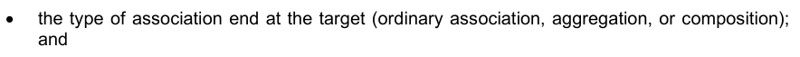

# S-100 5.2.1 · 第 5 部分 · 要素目录

非官方机器翻译参考稿，尚未逐条人工校订。公式与代码保留原文，解释以英文规范为准。

## 官方 PDF 第 201 页

S-100 – 第5编

要素目录

## 官方 PDF 第 202 页

5.2.1版实质性变动摘要

已生效的概要条款

更正了表5-A-7和表5-A-8中的备注,以反映S100_FC_InformationType和S100_FC_FeatureType出自S100_FC_ObjectType,与图5-A-1一致.

附录5-A

## 官方 PDF 第 203 页

中文目录（可用上方目录直接跳转）

5-1 范围 · 官方 PDF 205
5-2 符合性 · 官方 PDF 205
5-3 规范性引用文件 · 官方 PDF 205
5-4 主要要求 · 官方 PDF 206
5-4.1 要素目录 · 官方 PDF 206
5-4.2 信息要素 · 官方 PDF 206
5-4.2.1 引言 · 官方 PDF 206
5-4.2.2 已命名类型 · 官方 PDF 206
5-4.2.3 属性 · 官方 PDF 209
5-4.2.4 要素协会 · 官方 PDF 209
5.4.2.5 约束 · 官方 PDF 209
5-4.2.6 定义和资料来源参考 · 官方 PDF 211
5-4.2.7 完整性 · 官方 PDF 212

## 官方 PDF 第 204 页

本页特意留空

## 官方 PDF 第 205 页

5-1 范围

本部分为一组地理数据中真实世界现象的分类的组织和报告提供了标准框架,界定了要素类型分类方法,并具体规定了它们如何编为一个要素目录,并提交给一组地理数据的用户。 这种方法适用于在以前未编目的域中创建要素类型目录,并用于修订现有的要素目录以遵守标准惯例,适用于以数字形式表示要素类型的目录,其原则可以被扩展至其他地理数据形式的目录.

每一产品规范应规定一个要素目录。

这一部分适用于类型层面的地理要素定义,但不适用于每种类型个案的表述。

5-2 符合性

此剖面符合ISO 19106:2004中的相容性第2类. 以下是描述该剖面与ISO 19110不同的专业和通称的简要说明.

1)引入了新的抽象类,S100_FC_Project,S100_FC_NamedType,和S100_FC_ObjectType.

2) 引入了新类,S100_FC_InformationType.

3)新类 S100_FC_FeatureBinding,S100_FC_InformationBinding和S100_FC_AttroductionBinding被引入.

4)引入了新类,S100_CD_属性约束.

5) 类FC_FeatureAttize是专为抽象类S100_FC_Attize.

6) 引入了新类,S100_FC_SimpleAttization和S100_FC_ComplexAttization.

7) FC_继承关系类,FC_ feature Operation类,FC_Binding类,FC_Control类和FC_BoundFeatureAttropt类不使用.

以下案文酌情进一步提及或解释上述改动。

5-3 规范性引用文件

本文件的应用需要下列参考文件:关于注明日期的参考文件,仅适用所引用的版本;关于未注明日期的文件,适用所参考文件的最新版本(包括修正案)。

ISO 19110:2005, 地理信息-要素编目方法

## 官方 PDF 第 206 页

5-4 主要要求

5-4.1 要素目录

基于 S-100 的要素目录将一对或多组地理数据中所代表的现实抽象化作为定义的现象分类. 要素分类目录中的基本分类层次是要素类型. 特有和属性绑定在一个要素名录中. 所取要素和属性的定义取自要素概念词典. 任何包含要素的一组地理数据,都必须有电子形式(例如XML)的要素目录,要素分类表也可以遵守S-100中这一组成部分的规格,而不受任何现有的要素数据组的影响。

5-4.2 信息要素

5-4.2.1 引言

以下条款对要素目录信息元素规定了一般和具体的要求. 要素分类目录一般包括一个被命名类型列表,一个被指名类型属性列表,以及两个类型如何连通的信息,此外,它还包含一个定义的来源列表. 该模型主要以ISO 19110标准为基础,但这一模型既有扩展也存在差异.

要素类型有两大扩展:信息类型和复杂属性。要在一个数据集内实现数据建模的更大灵活性,就必须定义信息复杂的结构。两个扩展允许创建这些结构。虽然复杂属性定义了一个被命名类型的复杂要素,但信息类型可以共享。

与要素类型不同,它们只是真实世界现象的抽象,信息类型只是可共享的结构化信息。在一个地理数据集中,它们会与要素类别或其他信息类型相联。这两种类型:要素和信息,都有许多共同的要素。这都是通过从一个共同的抽象基础类别:命名类型来适应的。

复杂的属性是其他属性的集合,这些属性可能简单或复杂.

内容的安排可能因格式不同而不同,例如被打印出的文件,XML,超文本等.

5-4.2.2 已命名类型

5-4.2.2.1 共同特点

特性和信息类型从抽象类S100_FC_NamedType继承(见下文第5-4.2.2条)。该类描述所有共同的特性,例如名称和相应的类型的定义。此外,必须定义该类型的代码。此代码日后将用于在地理数据集中识别一个被命名类型的实例。 如果该定义取自也给出的要素概念词典.

要素和信息类型可以来自其他要素或信息类型,包括一些类型是抽象的,这意味着在一个数据集中不能出现此类类型的情况。命名类型可以具有属性要素,与之相關的信息类型也可以提供补充信息。 前者由属性约束所定义,而后者由信息约束所实现。

5-4.2.2 继承

在数据建模中,继承是使用已经定义的种类形成新类型的一种方法. 被称作衍生类型(或子类型)的新类型,接管(或继承)原有类型属性,被称作基类型(或者超类型). 衍生类型可能定义新的额外属性,但也改变已存在的属性,后者被称作压倒性. 用于指定像名称和定义这样的子类型具有独特的属性值,但是,仅包含超类型中的共同特性,则避免将像属性绑定这样的特性凌驾于一切之上。在要素目录的范畴中,特性和信息类型都可以从其他特性或信息类型中衍生出来。但是特性类型无法被衍生出来 。

## 官方 PDF 第 207 页

从信息类型或反之亦然。为超级类型定义的属性和关联也将属于子类型。子类型的定义通常被重新定义。在这个标准继承的背景下,将永远是简单的,这意味着每个类型不能从一个以上的超级类型中产生。

EXAMPLE 1 红外线和横向浮标可能取自(抽象)型浮标。超型已经定义了颜色、形状、名称和相联性等属性,以示灯光或上方标记。衍生类型只添加对专业类型有效的特殊信息,例如红外線或横向标记。

继承构建了等级结构,如果结构过于复杂或不够成熟,就可能难以管理,一般来说,让继承树的深度尽可能地浅出是良好的设计做法。 另一方面,有时继承树通过分组来简化模式,这些类型来源于相同的基本概念,具有相同的特征,因此即使在多层次的继承也应酌情使用.

要素目录中类型之间的继承关系一般对应"应用舍马"中的继承关系. 确定何时使用继承以及信息建模问题在什么程度和级别上都是问题,应用Schema设计师和项目团队应当考虑到应用Shema和要素目录复杂度,维护,应用要求等因素加以解决.

EXAMPLE 2 在ENC产品规范的信息模型中,所有地理要素类型都与信息类型相接并具有与地图要素文本协会相接的功能。为所有地理要素定义一个通用的超级类型,可以使这两个约束对超类型进行,而不是在每个地理要素类别中重复。

EXAMPLE 3: 在“导航辅助”产品规范应用软件Schema中,定义不同类型信标的类别具有许多相同的属性,另外,定义不同类型的浮标的类别的类别具有相同的特性,因此,对超型通用布依和通用比取进行了定义。 此外,浮标和信标都可以作为结构对象,还有其它要素也可以发挥结构对象的作用,因此对通用结构要素引入了另一种超型. AidsToNavigation, Structure Object, CommonBuoy, and CommanBeacon都是抽象类. 结构/设备协会是在结构与设备类之间形成的,适用于这些类的所有子类型,例如,任何Credin Buy都可以在结构/装备协会中与任何子类型的设备担任母角色。

## 官方 PDF 第 208 页

图5-1 – 继承实例

5-4.2.2.1. 产品规范的考虑(说明)

一般来说,随着越来越多的概念可以归入更高一级的概念,或者随着类似类型之间共有更多的特征,或者即使几种不同类型具有某些特征,继承的需要也随之增加。

将继承排除在要素目录之外的优点主要是结构简化(并因此更简单的处理),因为抽象类型和继承等级不需要实施;在S-100基于产品规范中,被继承的被列举属性可以有不同子类型允许的数值的不同列表. 缺点包括(可能)要素目录的体积增加,特别是许多要素或信息类型具有共同属性或关联,维护的复杂性也增加(名义上绑定于超类型的属性的更新必须在各级对每个子类型进行,在要素分类目录发布前必须检查). 另外,继承是面向对象编程中常见的范例,对于执行来说可能不是一个重要问题.

5-4.2.2.3 要素类型

要素类型是要素目录中分类的基本层次,除了共同的要素外,它们还定义了要素使用类型来分类它们。要素类型可能通过要素关联与其他要素类型相关联。这将通过要素约束来定义,该约束将指定关联关系以及用于与另一个要素类型关系的作用。

## 官方 PDF 第 209 页

5-4.2.2.4 信息类型

信息类型是数据集中复杂的信息块,可以由许多其他要素或信息类型共享. 关于它们的结构,也可以看作是没有几何属性的要素类型,其结构与要素类型相类似,被归类为单独的项目类型.

5-4.2.3 属性

5-4.2.3.1 共同特征

要素和信息类型属性是属性和关联角色,尽管后者仅适用于要素类型,共同的要素包括名称,定义,注释等. 可能定义一个要素概念词典的参考.

5-4.2.3.2 属性

属性带有特性和信息类型的特性。 与信息类型不同, 它们不能在不同实例之间共享。 也就是说, 属性的一例属于一个特性或信息类型。 在这个标准中, 有两种不同的属性: 简单和复杂 。 简单属性携带值本身,而复杂的属性是其他属性的集合来达到复杂而分级的数据结构.

5-4.2.3 简单属性

简单的属性被设计为带有一个值。 在要素目录中, 值的域名必须指定。 所有属性值都是值类型。 部分 2a-4.2. 9 包含完整的值类型及其定义列表。 如果该值类型是“ 开放式目录” 类型, 则将定义“ 已存在的值” 的编码列表 。 对于开口或闭口字典的编码清单,将提供一个URI,以表示“词典”(或“vocabulary”)的定义。

此外,价值域还可能受到下列因素的限制:

1) 案文长度;

(2) 结构化文本的格式规格;

3)一个数值范围.

详情见附录5-A。

5-4.2.3.4 复杂属性

复杂属性是指其他属性的组合,既简单又复杂,通过属性绑定来定义.

5-4.2.3.5 协会的作用

关联角色描述从一个要素类型到另一个要素类型关系的性质。在这个标准中,每个关联都有两个完全相同的角色。 两者中任何一个或两个都可能是默认的。 必须用程序 Schemas 的文档必须指定默认名称所用的规则 。 默认名称的不同规则可能适用于同一必须用程序Schema中的不同协会,但每个角色都必须有一个明确的名称,无论是明确的角色名称还是默认的角色名称.

5-4.2.4 要素协会

要素相關會描述要素類型之间的关系. 地要素所關接有名,定義,註解等. 每個相關会使用两个角色来定义对关系的直接使用. 任一或两个角色可能都是第三部分所描述的默认.

EXAMPLE 1 Structure – Equipment 是一个具有两个角色的关联的例子.

EXAMPLE 2 The Authority – ContactDetails是类管理局和ContactDetails之间关联的一个例子,它使用两个默认角色.

5.4.2.5 约束

5-4.2.5.1 属性约束

属性约束存在下列使用案例:

## 官方 PDF 第 210 页

1. 界定要素类型的属性;

2. 界定信息类型的属性;

3. 界定特色协会的属性;

4. 界定信息协会的属性;

5. 界定复杂属性的属性汇总。

绑定指定了目标属性和属性的多相性。 多相性表示可以使用多少个属性实例。 绑取用于定义属性是强制的( 1..n) 还是可选的( 0. n)。 如果多相相性允许不止一个属性实例, 布尔旗表示属性序列是否具有意义 。

如果属性是一个简单的属性,具有"Enumeration"的数据类型,则可以指定一个允许值列表. 空列表表示,在"要素目录"中定义的属性的所有值都是有效的.

5-4.2.5.2 要素装订

特性约束描述两种特性类型之间的关联。每个特性约束包含在要素目录中“源”特性类型的类型定义中,并描述特性类型(“目标”)与来源特性类型的关系。特性约束指定:


专题协会的名称;


目标要素类型相对于源要素的作用(“作用”是指目标上关联端的名称);


目标(普通联系、汇总或组成)的关联类型;


目标要素类型的多面性。

EXAMPLE:交通分离Scheme 特性类型与交通分离schemeLanePart 特性相接,由交通分离斯chemeAgregation协会负责,这个关联是一个聚合,在下图5-2 UML图中被描绘: 交通分离-SchemleLane Part 要素 : 与交通隔离Schemale-Aggrecation 关联的功能 .

图5-2 – 交通分离计划 交通分离计划 交通分离计划 交通分离计划 交通分离计划 交通分会 交通分会 交通分会 交通分会 交通分会 交通分会 交通分会 交通分会 交通分会

根据UML公约,在交通分离计划(TrafficSeparationScheme)端的钻石是指交通分离计划中的"整体"或"集装箱",而交通分离SchemleLanePart是"部分"或 "集装箱". XML要素目录中各要素类型中的要素绑定有: .

```text
In the TrafficSeparationScheme:
```

## 官方 PDF 第 211 页

```text
<S100FC:featureBinding roleType="association">
```

```text
<S100FC:multiplicity>
```

```text
<S100Base:lower>0</S100Base:lower>
<S100Base:upper xsi:nil="true" infinite="true"/>
</S100FC:multiplicity>
<S100FC:association ref="TrafficSeparationSchemeAggregation"/>
<S100FC:role ref="consistsOf"/>
<S100FC:featureType ref="TrafficSeparationSchemeLanePart"/>
</S100FC:featureBinding>
```

```text
In TrafficSeparationSchemeLanePart:
```

```text
<S100FC:featureBinding roleType="aggregation">
```

```text
<S100FC:multiplicity>
```

```text
<S100Base:lower>0</S100Base:lower>
<S100Base:upper xsi:nil="false" infinite="false">1</S100Base:upper>
</S100FC:multiplicity>
<S100FC:association ref="TrafficSeparationSchemeAggregation"/>
<S100FC:role ref="componentOf"/>
<S100FC:featureType ref="TrafficSeparationScheme"/>
</S100FC:featureBinding>
```

请注意,数据格式可能会对绑定是否在数据集中任何一个参与的要素实例中实际被编码造成限制.

5-4.2.5.3 信息约束

约束信息描述一个要素与信息类型或两个信息类型之间的关联。每个约束信息包含在要素目录中“源”要素或信息类型的类型定义中,并描述一个信息类型(“目标”)与源类型的关系。


信息协会的名称;


目标信息类型相对于源特性或信息类型的作用(“作用”是指目标所在的关联端的名称);



目标(普通联系、汇总或组成)的关联类型;


目标信息类型的多重性。

XML要素目录中的结构与第5-4.2.5.2条的例子相类似,只是其中一种或两种类型都将是信息类型,而XML将用于“信息Binding”而不是“featureBinting”。

至于要素约束,数据格式可能会对约束是否在数据集中任何一个参与的要素实例中实际被编码施加限制(例如,对于将要素与信息类型相连接的信息关联,约束仅在要素实例中得到编码,因此"要素目录"可能不包括在信息类型中,仅包含要素类型中的约束).

5-4.2.6 定义和资料来源参考

5-4.2.6.1 定义来源

这是用于“要素目录”定义的源文档列表, 它们是用引用信息给出的。 通常, 定义来自“ 要素概念词典”, 但其他来源是可能的。 定义来源于“ 物物目录 ” 也是有效的; 在这种情况下, 将不提及定义来源 。

5-4.2.6.2 定义参考

这些信息带有定义源的链接,它指向定义源,并通过标识符定义该源的位置。如果源是作为注册符保存的特性概念词典,则此参考符将是项目标识符。

## 官方 PDF 第 212 页

5-4.2.7 完整性

以下模型(附录5-A(规范),图5- A.1)中指定了要素分类信息的代表模板。 根据本模板编写的要素目录应记录特定地理数据组中的所有要素类型和信息类型。要素目录必须包括指定的识别信息。 要素目录必须包括数据所包含所有要素和信息类型的定义和描述,包括与每个要素类型相通的数据所包含的任何要素属性和要素关联. 为确保不同应用的要素目录内容的可预测性和可比性,建议要素分类目录只包括下文附录5-A(规范)所显示的表格中指定的要素.

## 官方 PDF 第 213 页

附录5-A 要素目录模型

(规范)

本附录介绍S-100要素目录. 图5-A-1是模拟于UML的S- 100要素分类目录,表5- A-1至5-a-20则以所显示的模型来说明要素列表的结构.

## 官方 PDF 第 214 页

本页特意留空

## 官方 PDF 第 215 页

图5-A-1 – 要素目录-UML模型

## 官方 PDF 第 216 页

表5-A-1——S100_FC_FeatureCatalogue 互联网档案馆的存檔,存档日期2013-12-22.

角色名称 名称描述 :

S100_FC_FeatureCatalogue A要素目录包含其识别和联系信息,以及一些要素类型的定义和这些定义所需的其他信息

```text
-
-
-
```

此要素目录 1 字符串的属性名称

属性范围 本要素目录所定义的要素类型主题域

```text
1
CharacterString
```

属性字段( Of) 描述此要素目录可能用于何种用途

```text
0..1
CharacterString
```

属性版本 此要素目录的版本号, 它可能既包括主要版本号或字母, 也包括一个小发布号或信件的序列, 如 “3. 2. 4a ”。 此属性的格式可能因目录编制部门而异 。

```text
1
CharacterString
```

属性版本 Date 本要素目录 1 的生效日期

属性产品 Id 用于目录的产品标识

```text
1
CharacterString
```

对本要素目录的知识内容负有主要责任的个人或组织的名称、地址、国家和电信地址

1 CI_责任 CI_责任>CI_Indiv idual 或

```text
CI_Responsibility>CI_Org
anisation
```

角色项 由此要素目录定义的项目列表; 项目为要素类型,信息类型,要素关联,信息关联,属性,以及角色

```text
1..*
S100_FC_Item
Aggregation
```

角色定义 来源 由此要素目录所定义的项目和所列出的值定义的来源列表。 这些来源通常为特性数据词典

```text
0..*
FC_DefinitionSource
Aggregation
```

## 官方 PDF 第 217 页

角色分类 要素目录分类0.1 MD_分类码 1 未分类码 2 限制 3 保密 4 密 5 高密 6 敏感而未分类 7 被官方使用 仅8 被保护 9 受限分发

表5-A-2——FC_定义来源

角色名称 名称描述 :

FC类_定义来源类,指定定义的来源 - - -

来源 来源的实际引用,足以识别文件以及如何获取文件

```text
1
CI_Citation
```

表5-A-3-FC_定义参考

角色名称 名称描述 :

FC 类_ 定义参考类, 将数据实例与定义源链接

```text
-
-
-
```

属性源标识符 信息 查找源文档中的定义。 此信息的格式针对源文档的结构

1 字符串 包括词典类型代码列表属性使用的在线词典或“vocabularys”

角色定义来源 定义的来源 1 FC_定义来源

表5-A-4——S-100_FC_项目

角色名称 名称描述 :

S100_FC_项目摘要基础类,定义了要素目录中所有项目的共性;项目是要素类型,信息类型,要素关联,信息关联,属性和角色.

- 文摘类

## 官方 PDF 第 218 页

属性名称 : 1 字符串

属性定义 自然语言中命名类型的定义 1 字符串

要素目录中唯一识别命名类型属性代码

```text
1
CharacterString
```

关于项目0.1的属性注释 进一步解释

属性别名 0. * 字符串

角色定义 参考 定义源的链接 0.1 FC_定义参考

表5-A-5 — S100_ FC_ NamedType

角色名称 名称描述 :

S100_FC_Named Type 抽象基础类,用于定义要素类型和信息类型的共同属性

- 文摘类

属性 isAbstract 表示在地理数据集中是否可以存在这种命名类型的实例。摘要类型不能被即时化,而是作为其他(非抽象)类型的基础类。

1 布尔

角色属性 Binding 描述此命名类型特征的属性绑定列表

```text
0..*
S100_FC_AttributeBinding
Aggregation
```

表5-A-6 — S100_FC_ObjectType

角色名称 名称描述 :

S100_FC_ObjectType 抽象基础类,用于定义要素类型和信息类型的共同属性

- 摘要类;取自S100_FC_NamedType

角色信息 Binding 可以通过信息协会与该对象类型相链接的信息类型绑定列表

```text
0..*
S100_FC_InformationBinding
Aggregation
```

## 官方 PDF 第 219 页

表5-A-7——S100_FC_信息泰普

角色名称 名称描述 :

定义信息类型所有属性的 S100_FC_信息类型类

- 衍生自S100_FC_ObjectType

角色超类型表示信息类型, 并会从它的超类型中继承所有属性 : 名称、 定义和代码通常会被子类型所覆盖, 尽管子类型中可能添加新的属性 。

```text
0..1
S100_FC_InformationType
```

角色子类型( Type) 表示从信息类型得到的信息类型

```text
0..*
S100_FC_InformationType
```

表5-A-8——S100_FC_FeatureType (中文(简体) ).

角色名称 名称描述 :

S100_FC_FeatureType 类,定义一个要素类型的所有属性 - - 从 S100_FC_ObjectType 中衍生出来的

属性特性 UseType 此特性的用法类型为 1 S100_CD_ FeatureUseType

特性类型允许的 0 或 以上空间原始物的组合

```text
0..*
S100_FC_SpatialPrimitiveType
```

角色要素 Binding 要素类型绑定列表,通过要素协会可以与该要素类型相通

```text
0..*
S100_FC_FeatureBinding
Aggregation
```

角色超类型表示特性类型, 其特性类型将继承其超级类型的所有属性: 名称、 定义和代码通常会被子类型所覆盖, 尽管子类型可能添加新的属性

如果允许的初级体在子类型中存在,它会凌驾于任何超级类型的允许初级体中

```text
0..1
S100_FC_FeatureType
```

作用子类型 表示从特性类型中衍生出来的特性类型

```text
0..*
S100_FC_ FeatureType
```

示例:如果超型允许点和地段原始人,而子型只允许曲线原始人时,子型的实例必须说明有曲线空间对象的位置. 子型的子型将只取行原始人取用线性原始人除非他们指定了自己的允许原始人.

## 官方 PDF 第 220 页

表5-A-9——S100_FC_信息协会

角色名称 名称描述 :

S100_FC_Information Association Association An information 描述对象(地貌或信息类型)与信息类型之间的关系

- 从S100_FC_NamedType个人产品规范中衍生出来,可能会限制方向性

角色角色 协会角色 0.2 S100_FC_ ole 默认角色名缺失时

产品规范可进一步限制

角色超Type 表示信息关联的出自信息关联。子类型将继承其超类型的所有属性: 名称、定义和代码通常被子类型所覆盖, 尽管子类型中可能添加新的属性 。

```text
0..1
S100_FC_InformationAssociation
```

角色分类是指信息协会衍生的信息协会.

```text
0..*
S100_FC_InformationAssociation
```

表5-A-10——S100_FC_Feature协会

角色名称 名称描述 :

类 S100_FC_Feature Association 特性关联描述两种特性类型之间的关系

要素关联是双向的,每个方向都有单独的作用

```text
-
-
```

作用 协会的作用 . 2. S100_FC_Role

角色超类型表示特性关联, 由此产生特性关联。 子类型将继承其超级类型的所有属性 : 名称、 定义和代码通常会被子类型所覆盖, 尽管子类型可能添加新的属性 。

```text
0..1
S100_FC_FeatureAssociation
```

角色子Type指由特写协会衍生出来的特写协会.

```text
0..*
S100_FC_FeatureAssociation
```

## 官方 PDF 第 221 页

表5-A-11——S100_FC_Role (中文(简体) ).

角色名称 名称描述 :

S100_FC_Role 类 A 角色,可用于主题协会或信息协会

- 摘自S100_FC_项目

表5-A-12——S100_FC_属性

角色名称 名称描述 :

类 S100_FC_属性 两类属性的抽象基础类: 简单属性和复杂属性。属性带有命名类型的特性 。

- 摘自S100_FC_项目摘要

表5-A-13——S100_FC_简单属性

角色名称 名称描述 :

S100_FC_带有值的简单属性属性 - 从S100_FC_属性衍生出来

属性值 Type 此特性属性的值类型 1 S100_CD_ 属性瓦卢特普

用于此特性属性值的计量单位属性uom

```text
0..1
S100_UnitOfMeasure
```

数量规格: 0.1 S100_CD ⁇ 数量规格

作用约束 可能适用于属性0.1 S100_CD_属性约束 组成

列出的属性域上列表的值的值组

```text
0..*
S100_FC_ListedValue
Composition.
```

仅在值为编号或S100_代码列表(带有代码列表Type=打开的计数)时才适用.

表5-A-14——S100_FC_复合属性

角色名称 名称描述 :

类 S100_FC_ComplexAtize 复杂属性 由列表的子属性组成,这些属性既可以是简单又复杂的属性.

- 衍生自S100_FC_属性

作用子属性Binding 子属性绑定列表 1.. * S100_FC_属性Binding 聚合

## 官方 PDF 第 222 页

表5-A-15——S100_FC_挂牌牌牌坊

角色名称 名称描述 :

类 S100_FC_ListedValue 已列出属性域的值,包括其代码和定义

```text
-
-
```

特性标签 说明性标签,唯一地识别特性属性的一个值

```text
1
CharacterString
```

自然语言上所列值的定义

```text
1
CharacterString
```

属性代码 数字代码,用于对相应的要素属性唯一识别上市值

```text
1
PositiveInteger
```

属性注释 关于上列数值的进一步解释 0.1 字符串

属性化名此列表值的等同名称 . * 字符串

角色定义 参考 定义源的链接 0.1 FC_定义参考

```text
Table 5-A-16— S100_FC_AttributeBinding
```

角色名称 名称描述 :

S100_FC_属性Binding 类,用于描述一个属性如何绑定在特定命名类型或复杂属性上的具体特征

```text
-
-
```

属性 多重 定义属性可有多少个实例成为命名类型或复杂属性的一部分

```text
1
S100_Multiplicity
```

属性顺序描述属性序列是否有意义

1 布尔只应用到可能不止一次发生的属性

属性 可见度 表示一个属性在终端用户系统中的预期能见度

```text
0..1
S100_FC_AttributeVisibility
```

角色允许属性的可允许值

0.* S100_FC_ListedValue 仅适用于数据类型计数的属性

角色属性 绑定在项目或复杂属性上的属性

```text
1
S100_FC_Attribute
```

## 官方 PDF 第 223 页

表 5-A-17——S100_FC_InformationBinding (中文(简体) ).

角色名称 名称描述 :

S100_FC_InformationBinding 类描述信息类型使用命名类型

```text
-
-
```

定义目标信息类型可链接到一个命名类型的实例的多功能

```text
1
S100_Multiplicity
```

属性角色 Type 关联结束的性质 1 S100_FC_RoleType

角色角色 用于约束的角色,必须是用于约束的社团的一部分,并定义了社团的终结.

```text
0..1
S100_FC_Role
```

角色协会 用于约束的协会; 也界定角色

```text
1
S100_FC_InformationAssociation
```

角色信息 Type 目标信息类型 1.. * S100_FC_InformationType

表5-A-18——S100_FC_FeatureBinding (中文(简体) ).

角色名称 名称描述 :

S100_FC_FeatureBinding 类通过特性关联描述从一个特性类型到另一个特性类型的关系

```text
-
-
```

属性多向性 定义目标要素类型中有多少例可以与源要素类型中的一个实例相链接

```text
1
S100_Multiplicity
```

属性角色 Type 关联结束的性质 1 S100_FC_RoleType

角色要素 Type 目标要素类型 1.. * S100_FC_FeatureType

角色角色 用于约束的角色,必须是用于约束的社团的一部分,并定义了社团的终结.

```text
1
S100_FC_Role
```

角色协会 用于约束 1 S100_FC_ Feature Association 的协会

## 官方 PDF 第 224 页

表5-A-19——S100_FC_RoleType 互联网档案馆的存檔,存档日期2013-12-20.

项目名称说明

编号 S100_FC_RoleType 定义关联端的类型(即“作用”)

相通端是一个普通的链接。 (在UML术语中,角色类型是"aggregationKind=普通",图中的链接没有菱形)

此端的对象可能是参加普通协会、集合或组成

相通端是一个 UML 相通端(在UML 术语中,角色类型是 “相通端” , 相通端的相通端有一个未填入的相通端) 。

这一端的客体是集合协会中的“所有人”、“整体”或“集装箱”

相接端是一个 UML 聚合(在UML 术语中,角色类型是 “ 相接基德=相接基” , 相接端的相接端有一个已填充的相接基德) 。

这一端的客体是组成协会中的“所有人”、“整体”或“集装箱”。

注:如果协会的一端是“综合”或“组合”,则另一端必须编码为“协会”。

表5-A-20——S100_FC_空间初级型

项目名称说明

编号 S100_FC_Spaceal Primmitive Type 指定允许使用带有要素实例的空间原始物

字形点 空间原始 GM_ 点

字形点 Set 点集 空间原始 GM_多点

线性曲线 曲线 空间 原始 GM_ Orientable Curve

表面空间原始 GM_ 生态可碎面

覆盖空间原始 CV_封面

字面上没有图形 要素类型与实例位置的空间原始无关

在某些情况下,需要明确声明实例位置没有空间原始物。参见S100_FC_FeatureType中的子类型和超级类型的规则

表5-A-21——S100_FC_可视性

项目名称说明

S100_FC_属性 表示一个属性在终端用户系统中的预期能见度

生产系统应被视为有别于终端用户系统,不得以与终端用户系统相同的方式限制属性能见度

所有用途的可视性特性可见度

## 官方 PDF 第 225 页

在某些用途中保护可视性特性的能见度。产品规范中要定义的细节

个人可视性特性的能见度是私人的,不应在生产环境之外显示。

## 官方 PDF 第 226 页

本页特意留空
