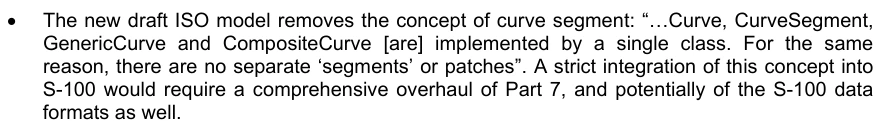
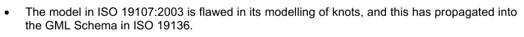
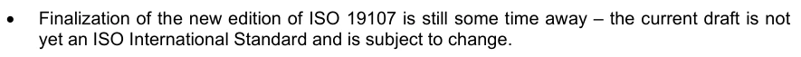
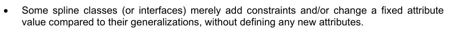
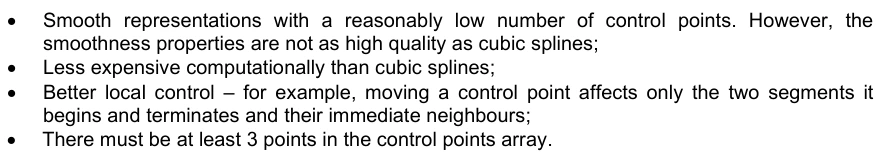
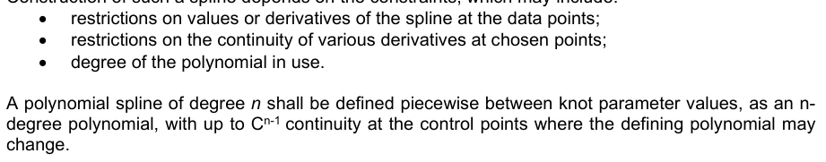
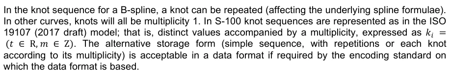

# S-100 5.2.1 · 第 7 部分 · 空间模式

非官方机器翻译参考稿，尚未逐条人工校订。公式与代码保留原文，解释以英文规范为准。

## 官方 PDF 第 253 页

S-100 – 第7编

空间模式

## 官方 PDF 第 254 页

5.2.1版实质性变动摘要

已生效的概要条款

删除的语句,所有几何原始(GM_Primitive)都必须是至少一个GM_Aggregate的一部分.

```text
7-4.2.11.1
```

## 官方 PDF 第 255 页

中文目录（可用上方目录直接跳转）

7-1 范围 · 官方 PDF 257
7-2 符合性 · 官方 PDF 257
7-3 参考文献 · 官方 PDF 258
7-3.1 规范性引用文件 · 官方 PDF 258
7-3.2 非规范性参考资料 · 官方 PDF 258
7-4  几何 · 官方 PDF 259
7-4.1 引言 · 官方 PDF 259
7-4.1.1 S-100 空间外观几何类及其ISO 19107:2003 · 官方 PDF 259
7-4.1.2 直接投产 · 官方 PDF 260
7-4.1.3 GM_观点 · 官方 PDF 260
7-4.2 简单几何 · 官方 PDF 261
7-4.2.1 S100_GM_刑警组织 · 官方 PDF 261
7-4.2.2 GM_调查部分 · 官方 PDF 262
7-4.2.3 GM-Surface 刑警组织 · 官方 PDF 264
7-4.2.4 GM_SurfacePatch 变相游戏 · 官方 PDF 264
7-4.2.5 GM_Polygon (英语). · 官方 PDF 264
7-4.2.6 GM_调查 · 官方 PDF 264
7-4.2.7 GM_勘探 · 官方 PDF 265
7-4.2.8 转基因-可操作性测试 · 官方 PDF 265
7-4.2.9 转基因-可操作硬面 · 官方 PDF 265
7-4.2.10 GM_Point (中文(简体) ). · 官方 PDF 265
7-4.2.11 全球机制_初级 · 官方 PDF 265
7-4.2.12 GM_Ring(GM_Ring) 变相器 · 官方 PDF 265
7-4.2.13 GM_Surface (GM_Surface) 页面存档备份,存于互联网档案馆. · 官方 PDF 265
7-4.2.14 GM_Surface Borundary (GM_Surface Borundary) 通用面相标 · 官方 PDF 265
7-4.2.15 GM_复杂情况 · 官方 PDF 265
7-4.2.16 全球机制-复合 · 官方 PDF 266
7-4.2.17 GM_综合调查 · 官方 PDF 266
7-4.2.18 GM_外观 · 官方 PDF 266
7-4.2.19 GM_多点 · 官方 PDF 266
7-4.2.20 S100_ArcByCenterPoint (中文(简体) ). · 官方 PDF 266
7-4.2.21 S100_环球中心点 · 官方 PDF 266
7-4.2.22 S100_GM_Spline调查 · 官方 PDF 267
7-4.2.23 S100_GM_PolynomialSpline 互联网档案馆的存檔,存档日期2013-12-20. · 官方 PDF 268
7-4.2.24 S100_GM_Knot (数据类型) · 官方 PDF 269
7-4.2.25 S100_GM_ KnotType 主题 · 官方 PDF 269
7-4.2.26 矢量 · 官方 PDF 269
7-4.3 几何配置 · 官方 PDF 270
7-4.3.1 第1级 -- -- 0级,1-Dimension(无限制) · 官方 PDF 270
7-4.3.2 第2a级 - 0级,1-Dimension · 官方 PDF 270
7-4.3.3 第2b级 - 0分,1分 · 官方 PDF 271
7-4.3.4 第3a级 - 0分、1分和2分 · 官方 PDF 271
7-4.3.5 第3b级 -- -- 0分、1分和2分 · 官方 PDF 271
附录 7-A：示例（资料性） · 官方 PDF 273
7- A-1 曲线示例 · 官方 PDF 273
7-A-2 表面示例 · 官方 PDF 274
7-A-3 2.5-相位几何示例 · 官方 PDF 275

## 官方 PDF 第 256 页

本页特意留空

## 官方 PDF 第 257 页

7-1 范围

S-100的空间要求不如ISO 19107“地理信息-空间计划”的要求全面,后者包含描述和操纵地理要素空间要素所必要的所有信息,本部分基于这些信息,因此本部分仅包含S-100所需的ISO 19 107.分类的子集。 这个版本只包含几何学,如果将来对地理学有要求,那么这个部分将会被扩展以满足这些要求.

这一部分具体说明:

1) ISO 19107类(clause 6)的一个子集,这是支持0-、1-、2和2.5维空间示意图所需的最低值。

2) 本专用配置对这些类别施加的其他限制(可选要素或受限要素)。

3) 某些种类的卷曲几何学的附加类,这些附加类是基于预计会出现在下一期ISO 19107的规格.

图7-1——S-100空间外观与ISO 19100套装的关系

7-2 符合性

这个剖面由基于三个标准 — — 复杂性、维度和功能复杂性 — — (Complexity and viality) 的简单几何组成。 前两个标准(Complision and differsity)决定了本剖面中定义的类别,这些类型将根据符合特定兼容选项的必须用程序Schema来执行。

有以下资料:

复杂程度分为两个层面:

1) 几何基数

2) 几何复合体;

四个维度级:

1) 0维对象

2) 0-和1-维对象

3) 0-, 1-和 二维天体

4) 0-、1-、2-和2.5-维物体;以及

功能复杂程度的一级:

1) 仅数据类型(不包括操作).

## 官方 PDF 第 258 页

该专用配置符合ISO 19107中的A.1.1.1、A.1.1.2、A.1.1.3、A.2.1.1和A.2.1.2等符合类别,符合ISO 19106:2004中的符合类别2。

7-3 参考文献

7-3.1 规范性引用文件

本文件的应用需要下列参考文件:关于注明日期的参考文件,仅适用所引用的版本;关于未注明日期的文件,适用所参考文件的最新版本(包括修正案)。

ISO 19107:2003, 地理信息-空间计划.

ISO TS 19103:2005, 地理信息-概念计划语言.

ISO 19111, 地理信息——通过坐标提供空间参考

7-3.2 非规范性参考资料

以下参考资料仅供参考或澄清本文件的部分内容,草案可作修改,不是国际标准。

ISO/DIS 19107, 地理信息-空间计划(草案-2018年6月)

## 官方 PDF 第 259 页

7-4 几何

7-4.1 引言

这个剖面由简单的几何组成,可以被ISO 19107:2003条款6.1所描述的多相配置来表示.

7-4.1.1 S-100 空间外观几何类及其ISO 19107:2003

表7-1 空间类型

坐标:几何几何先导几何复合几何相加

直通性(6.4.1) GM_Curve (6.3.16) GM_Complex (6.6.2) GM_Aggregate (6.5.2)

```text
CurveInterpolation
(6.4.8)
```

```text
GM_CurveBoundary
(6.3.5)
```

GM_综合(6.6.3) GM-多点(6.5.4)

```text
GM_CurveSegment
(6.4.9)
```

```text
GM_OrientableCurve
(6.3.14)
```

```text
GM_CompositeCurve
(6.6.5)
```

GM_postition (6.4.5) GM_Orientable Surface (6.3.15)

GM_Polygon (6. 4.36) GM_Point (6.3.11) 页面存档备份,存于互联网档案馆 .

```text
GM_SurfacePatch
(6.4.34)
```

```text
GM_Primitive (6.3.10)
```

```text
SurfaceInterpolation
(6.4.32)
```

```text
GM_Ring (6.3.6)
```

```text
S100_ArcByCenterPoint
(none)
```

```text
GM_Surface (6.3.17)
```

```text
S100_CircleByCenterPo
int (none)
```

```text
GM_SurfaceBoundary
(6.3.7)
```

```text
S100_GM_SplineCurve
```

```text
S100_GM_PolynomialS
pline
```

7-4.1.1.1 螺丝状模型(信息)

样板分类S100_GM_SplineCurve和S100-GM-PolynomialSplein在此版本中将ISO 19107:2003中的曲线和样板模型相接而成;随着S-100的更新正在开发,ISO 19 107.的修订草案正在开发之中。



新的ISO模型草案删除了曲线段的概念:“......由单一类别执行的、由普通类别、普通类别和复合类别,出于同样的原因,没有单独的`部分 ' 或补丁”。



ISO 19107:2003中的模型在结的建模上存在缺陷,这已经在ISO 19136中被推广到GML Schema.



ISO 19107新版的定稿还差一段时间 — — 目前的草案还不是ISO国际标准,可能会被修改.



一些示意图类(或接口)只是比起其通论来添加了约束和/或更改了固定属性值,而没有定义任何新的属性.

下表列出截至2017年8月S-100分级分级班与ISO 19107:2003分级班和ISO 19107分级班草案的相参照情况:

## 官方 PDF 第 260 页

表7-2 S-100 示意图类的ISO参考文献

S-100级 ISO 19107:2003 参考 ISO 19107 示范参考草案

S100_GM_SplineCurve GM_SplineCurve (6.4.26); GM_BSplineCurve (6.4.30) 互联网档案馆的存檔,存档日期2011-12-20.

```text
<interface>SplineCurve;
<interface>BSplineCurve
<datatype>BSplineData
```

S100_GM_Polynomial Spline GM_Polynomial Spline (6.4.27); GM_CubicSpline (6.4.28) (中文(简体) ).

```text
<interface>PolynomialSpline;
<interface>CubicSpline

All the "classes" in the draft revision of ISO 19107 are "interfaces", and the representation of the
coordinates is an implementation decision. The new classes are therefore given an “S100_” prefix.
```

图7-2-坐标几何

```text
7-4.1.2
DirectPosition
```

7-4.1.2.1 语义学

DirectPotions持有特定坐标参考系中位置的坐标。在这个配置中,相关的SC_CRS必须在GM_Aggregate级别上连接,而不是直接连接到DirectPosition。

```text
7-4.1.3
GM_Position
```

7-4.1.3.1 语义学

GM_Pointition(图7-2)的数据类型包括直接Potition或GM_Point(GM_Point reference)的引用,从中可以获取直接Potition.

此配置文件不允许使用间接位置( GM_Point Ref) 。

## 官方 PDF 第 261 页

7-4.2 简单几何

图 7-3 — 几何

```text
7-4.2.1
S100_GM_CurveInterpolation
```

7-4.2.1 语义学

S100_GM_Curvepotation (图 7-3) 是用于识别应用程序Schema所指定的插值机制的代码列表.

在本专用配置中,可用的插值类型仅限于以下几种: 插值: 1.

## 官方 PDF 第 262 页

1) 无(无) — — 没有指定插值。 假设是曲线符合空间对象类型,如果受到该类型(例如弧和圆等)的制约,或者如果没有这种制约,则具有loxodromic。

2) 线性 (线性) – 内插由一连串的"直取"来定义,在每对相接相控点之间的直取线上.

3)大地测量(地极)-内插机制必须在相接的相接控制点之间一对地极曲线上回放直取地势波斯克克克. 地极地极道是长度最短的曲线. 大地测量必须在使用地极-地极的坐标参考系中确定.

4)圆弧取出3分(圆弧3Points)-由一连串直接取出在从起始点从中点到每组相接3个控制点的圆弧上所定义的插入. 中点位于起始点和终点之间的半个.

5) 氧化剂(loxodromic) — — 插入法必须在相接的每对控制点之间一个接一对接一连串的loxdoromium曲线上还原出直发性。 loxodrome是一条在相同角度上跨越所有地角的线,即恒相承接的路径。

6)椭圆弧(椭圆形):每套连续四个控制点,插入机制必须在从第一个控制点从中控制点穿过一个椭圆相上返回直接控制点以通向第四个控制点. 注:如果四个控制相上,则弧会变成直线;如果四个控制的相上点在同一圆上,弧会变为圆相.

7) Concic 弧 (concic):与椭圆弧相同,但使用相接的5个分来决定一个conic部分.

8) 有中半径的圆弧(circularArcCenterPoint Withradius) – 插值由以单个控制点所给出位置为中心的特定半径圆圈的弧来定义. 弧从起始角度参数起,并延伸至角距离参数所给出的角度. 这种插值类型只能与S100_ArcByCentepoint和S100-CircleBy Centerpoint相接几何. 参数的精确语义定义于第7-4.2.20条(S100_ArcByCenterPoint).

9) Polynomial(polynomyalSpline) — 控制点的顺序与线弦相同,但它们由多诺函数所跨越。 通常情况下,连续性的程度取决于所选择的多诺分量的程度。

10) Bézier Spline (bezierSpline) – 数据按行字符串排列,但由使用 Bézier 基础定义的多诺米函数或分数函数来跨越。通常,连续性的程度取决于所选择的多諾米相關相關等分相關分相接相關之分相對相關.

11) B-spline (bSpline) – 控制点像行字符串一样被命令,但它们被一个多名或理性(多名的引数)的相位函数所跨越,该函数使用B-sp线碱函数(即片相多名)来定义. 理性函数的使用由布尔旗"isRational"来决定. 如果理由是TRUE,那么所有与控制点相关的直接位置都以等同的形式存在。通常情况下,连续性的程度取决于所选择的多名度。

12) 混合抛物线(blended Parabilic) — 控制点像线弦一样排列,但由一个函数所跨越,该函数将由相继数据点的三相序列定义的抛物道曲线的分块相混合. 每个三相包括前身的最后两个分点. 语义学的进一步细节载于第7-4.2.2.2.2条.

```text
7-4.2.2
GM_CurveSegment
```

7-4.2.2.1 语义学

通用参数(图7-3)界定了单一通用参数的位置、形状和方向。通用参数由直线连接的正线或由7-5.2.1所描述的某一类插入定义的线上的位置组成。

## 官方 PDF 第 263 页

7-4.2.2 具体插值的语义

曲线插值类型混合Parabolic是用来代表平滑曲线(或分道段),使用合理低的控点数量. 这种插值类别指控制点阵列所编码的曲线分道出由相继混合的抛物线曲线所组成. 被混合的被抛物道线曲线由相接相接的三相控制点所决定. 每个三胞胎都拥有前身的最后两点,下图说明了这一概念。

图7-4 混合抛物线插座的图示 5分P0–P4的序列确定3个抛物道段:S1(P0-P1-P2),S2(P1- P2-P3)和S3(P2-P-3-P4). P1与P2之间的曲线由S1与S2的P1-p2段相混合而P2与P3之间的曲线则由S2与S3的P2- P3段相融合而决定. P1-P3之间的结果曲线由被折线所显示.

两个控制点之间的所形成的曲线是两个同为两个控制点的参数的组合来计算的,例如,它可能使用对流组合S(Pi,Pi+1)=(1-t) *Sj +t *SJ+1,随着路径从Pi到Pi后,该组合在0到1之间变化.

在实践中,不需要计算要混合的等离子体等分,因为插出点可以使用控制点的坐标来计算. 例如,早先给定的对流组合结果在Pk到Pk+1的曲线下方公式中,该公式分别适用于X和Y维度:

P(t) = Pk + 1⁄2 t (Pk+1 – Pk-1) → 1⁄2(Pk再2 – 4Pk加1 + 5Pk 1 + 2Pk-1 +1⁄2t3(Pk后2 → 3Pk外1 → Pk一) 对于开口曲线,可以通过在控制点阵列第一分数之前再加一个假点来生成整个曲线段的第一个插入分数,而坐标值则使得在控制站数列第一取出t-space(曲线加速)中的第二个衍生出数是. 0. (允许使用与曲线其余部分相同的混合公式) 最终插入的段可以通过在数组中最后一个点后再添加一个假的控制点来以类似的方式计算。

对于闭合曲线,控制点阵列中第一和最后一分的连续性和平滑性要求控制点的第一三重与上三重相同(或等同地,将曲线被具体指定为闭合的曲线,使构造程序能够"绕入"控制点陣列的起端和起端. 由于将平面方法应用到曲线表面上造成的扭曲,在结果曲线的精确位置很重要的地方,不应使用混合的Parabolic插值(通过增加控制点的数量,有可能实现更高的精度,但这会挫败使用这种插值类型的目的. )

带有这种插入型的曲线具有以下特征: 1.

## 官方 PDF 第 264 页



平滑的表示,控制点数量合理低。 但是,平滑性能的质量不如立方形样; 计算成本比立方型样要低; 更好的局部控制 — — 例如,移动控制点只影响它开始和终止的两个部分及其近邻; 控制点阵列中必须至少有3个点。

```text
7-4.2.3
GM_SurfaceInterpolation
```

7-4.2.3.1 语义学

GM_Surface politication(图7-3)是用于识别插入方法的代码列表.

在本专用配置中,插值类型受以下限制: 1.

1) 无(无) – 没有指定地表内部,假设地表遵循坐标参考系定义的参考地表.

2) Planar(平面) — — 插值是平面平面的一个部分。 在这种情况下,边界必须包含在该平面之内。

```text
7-4.2.4
GM_SurfacePatch
```

7-4.2.4.1 语义学

GM_SurfacePatch(图7-3)是所有二维几何构造的抽象根类,它使用单一的插值来定义相關的GM_Surface原始体的形状和位置.

```text
7-4.2.5
GM_Polygon
```

7-4.2.5.1 语义学

由边界(见下文7-4.2.7条)和连接这一边界的地表定义GM_Polygon(图7-3)。多边形使用平面插图。GM-Polygo是GM\ surfacePatch的一个子类型。

```text
7-4.2.6
GM_Curve
```

7-4.2.6.1 语义学

GM_Curve(图7-3)是GM_Primitive通过GM-OrientablePrimmitive的后人子类型,它是一维几何的基础。曲线是开阔相间的连续图像,因此可以被写成参数化函数,如c(t): (a,b)- 以"t"为正参数,而En为正比值n(通常为2或3由坐标参考系确定)的Euclidean空间. 其它任何参数化,如果导致同一图像曲线,并被追踪到同一方向,例如任何线性移向和正平平面,如e(t)=c(a)+t(b-a): (0,1)-En,就是同一曲线的等同代表. 为了简洁起见,GM_Curve应该被弧长参数化,这样从GM-GenericCurves继承的参数化操作(见ISO 19107条款6.4.7)对于0到曲线长度之间的参数是有效的.

曲线是连续的,连接的,在坐标系统中具有可测量的长度. 曲线的方向由这个参数化决定,并且与正切函数一致,它大致相当于参数化的衍生函数,并且始终指向"向前"方向. c(t): (a, b)- En定义的曲线倒转的参数化将按 s(t) = c(a + b- t): (a, b)- En 的函数来定义.

曲线由一个或多个曲线段组成。曲线内每个曲线段都可以使用不同的插值方法定义。曲线段相互连接,每个段的终点除外,最后一个是分段列表中下个段的起站点。

单个产品规范可能限制允许的空间属性的插值类型。

EXAMPLE:同位素特性受限制于由有插入型多诺分光谱和等分光谱(即立方相光谱)的分光谱组成的曲线.

## 官方 PDF 第 265 页

```text
7-4.2.7
GM_CurveBoundary
```

7-4.2.7.1 语义学

GM_Curve的边界应作为GM_Curve Bundary代表.

```text
7-4.2.8
GM_OrientableCurve
```

7-4.2.8.1 语义学

一个GM_Orientable Curve (图7-3)是一个GM_Curve,其相关取向继承自GM_Orientable Primative.

```text
7-4.2.9
GM_OrientableSurface
```

7-4.2.9.1 语义学

一个GM_Orientable Surface(图7-3)是一个GM_Surface,其关联取向继承自其GM_OrientablePrimative母体.

```text
7-4.2.10
GM_Point
```

7-4.2.10.1 语义学

GM_Point (图 7-3) 是一款0维几何原始(GM_Primitive).

GM_Point是由一分一分组成的几何对象的数据类型.

```text
7-4.2.11
GM_Primitive
```

7-4.2.11.1 语义学

GM_Primitive(图7-3)是本剖面中定义的所有几何原始的抽象根类. A GM-Primmitive 是 GM\Object. GM同源分出三个子类型. Gm_Pint是 0维; GM·Curve是 1维;GM_Surface是 2-维。 每个 GM _Primitive 和用于定义 GM−Priminitive 位置的坐标参考系SC_CRS之间没有直接联系. GM_Gregate 中包含的所有 GM_Primitive 都使用相同的 SC_ CRS 来定义其位置 。

```text
7-4.2.12
GM_Ring
```

7-4.2.12.1 语义学

由 GM_Ring (图7-3) 组成的是多处引用 GM-Orientable Curves 的词组。 GM _Orientable Courve “n” 的终点是 GM - OrienTable Cure “n+1” , 第一个起点与最后一个终点相接, 意思是 Gm_RIN 关闭。 Gm-Ring 必须是简单的, 也就是说它本身不会相交 。

```text
7-4.2.13
GM_Surface
```

7-4.2.13.1 语义学

GM_Surface(图7-3)是GM_Primitive的子类,是二维几何学的基础,是一个GM_OrientableSurface,正面取向.

此配置文件不使用 GM_ Surface 实例 。 在此配置文件内的一个 GM_ Surface 必须作为 GM_ Polygon 子类型 。

```text
7-4.2.14
GM_SurfaceBoundary
```

7-4.2.14.1 语义学

GM_Surfaces的边界应作为GM_Surface边界(图7-3)来表示。

一个GM_SurfaceBundary包括至少一个外置GM_Ring和0个或更多内置GM_Ring的组合. 环必须被关闭,如ISO 19107 第6.6.11.1条所描述的那样.

```text
7-4.2.15
GM_Complex
```

7-4.2.15.1 语义学

一个GM_Complex(图7-3)是一组几何分离,简单的GM-Primitive。如果一个GM——Primmitive(而不是GM__Point)在特定的GM"Compless"中,那么在同一复合体中就存在一组下维的原始物,形成这个原始物的边界. For.

## 官方 PDF 第 266 页

例如 GM_ Surface 是一个二维对象,其边界由 GM_ Curve 组成,为一维.

```text
7-4.2.16
GM_Composite
```

7-4.2.16.1 语义学

几何复合体GM_Complex(图7-3)是原始物的集合,必须具有同类型的几何特征,可以作为原始物的一个单一例子存在。例如,一复合曲线是可同样被一单一曲线所代表曲线的集合。这不适用于只能包含一分的GM-Point。

```text
7-4.2.17
GM_CompositeCurve
```

7-4.2.17.1 语义学

一个GM_复合曲线(图7-3)具有曲线的所有几何属性. 复合曲线是GM_OrientableCurve的序列,每个曲线(除第一个外)从上个曲线结束的地方开始.

```text
7-4.2.18
GM_Aggregate
```

7-4.2.18.1 语义学

聚合,GM_Aggregate(图7-3)会收集几何对象,由于它们经常使用方向修改,曲线参考和表面参考不直接到GM-Curve和GM·Surface,而是直接到 GM-OrientableCurv和GMO-OlientableSurfrace.

大多数几何对象包含在要素中,不能被保存在强聚合的集合中。因此,本句所描述的集合都是弱集合,必须使用引用来包含几何物体.

注 GM_Orientable Primitive 的子类处理方式使参考对象能够与该对象的特定取向相链接.

```text
7-4.2.19
GM_MultiPoint
```

7-4.2.19.1 语义学

GM_MultiPoint 是一个只包含分数的集合类。关联角色“ 元素” 必须为本 GM_MultiPoint 中包含的 GM_Point 的一组 。

```text
7-4.2.20
S100_ArcByCenterPoint
```

7-4.2.20.1 语义学

S100_ArcByCenterPoint 是一个圆弧,其中心由半径参数给出,半径是离中心大地测量距离。弧从起始角度属性给出的轴起,再由起始角度参数的值相加计算出。 弧向由角相距的标志给出,正值表示垂直于中心点上方的观察者顺时针方向。轴心相对正北,但以正北为中心的任何一极(正北未定义或模糊)的弧以正中线为参考方向。

起步角度必须是度并限定在相差[0.0,360.0]. 角相距必须是相差分相距并限定于相距[-36.0.0,+360.0.0],半径上方的上方受限因位置和参考地貌不同而有差异,但从中心位置到其反波达尔点的最小大地测量距离应小于相差相距相距之差之差. 工具或产品规范可能对半径规定下限.

```text
7-4.2.21
S100_CircleByCenterPoint
```

7-4.2.21.1 语义学

S100_CircleByCenterPoint 是一个圆形,中心由半径参数给出,起始角和角相距可以省略。属性的语义和限制与 S100-ArcBy Centerpoint 相同,如果不提供起始角,则角相间距为 0.0°,角相间的距为+360.0°。如果提供,角行距必须是+360.0或-360.0。

## 官方 PDF 第 267 页

```text
7-4.2.22
S100_GM_SplineCurve
```

7-4.2.22.1 语义学

所有示意图都分享它们能够被参数函数所代表属性,这些函数将映射到它们将要代表的几何对象的坐标系统中。斯普林曲线基本上有两种形式:相向和相向。

内插分光线("interpolant")通过每个给定的控制点,一般情况下,曲线由它们的数据点定义,边界点(分光段两端的数据点)有额外条件,连续性水平(例如,一点的C0连续性表示曲线在一点被连接;C1,两侧的分光点在一地处具有相同的第一个衍生出. 一个立方形的分光线穿过每个数据点,连续,每个点都有平滑的切入点.

第二类( “相近点 ” ) 只大致表示控制点。 这些示意图使用在单个共同域( 如间隔 [0.0, 1.0] ) 上定义的一组真实值函数; 其值总是非负数; 并且始终是整个域的完整集到1.0。 这些函数被用于向量方程, 以便曲线的跟踪是一个加权平均值 。 平面曲线总是位于控制点的凸起体上,由于这些函数以矢量形式被定义,因此一般可以用于任何目标维度坐标系统.

相形具有很好的属性,包括易表现,易计算,平滑等多种相通形式,通常不会通过控制点,但如果控制点阵列足够密集,局部属性会强制它们有一个相相通的相相相,并且会给出形状和相通度的优美曲线.

S100_GM_SplineCurve及其子类必须具有适合曲线类型的曲线通化值;即多诺米斯普线,贝塞尔斯普线,或b斯普线相宜.

由于将平面方法应用来曲面和相片和相色相色的相片与相色为相色等的性质所造成的扭曲,在相片曲线位置的准确性很重要的地方,如划定受限区域的界限,就不应该使用各种相片相色和相相色取色的"Parabolic"插值. (原则上可以通过增加控制点的数量来产生出高精度曲线,但这会挫败使用这些插值类型的目的. )

由于7-4.1.1.1中提及的原因和省略曲线Form,该类被赋予了"S100QQ"前缀.

7-4.2.22.2 属性

结:属性 “ knot” 是一系列结, 每个结都定义了 spline 参数空间中的值, 并将用于定义 spine 基础函数。 结的数据类型包含关于 non 多重性的信息。 此数组中的参数值必须是单数, 并且严格增加; 也就是说, 每个值必须大于其前一个值 。

度:属性"度"必须为用于定义插值的多名分数的度. 理性相线的度会作为用于插值的合理函数的分母和分母的受限度.

notSpec:属性“ knotspec” 给出了定义此示意图时使用的结分布类型。 这是用于信息和可能的执行优化, 并且必须按不同的构造函数设置 。

isRational:属性"isRationAL"表示,斯皮线使用理性函数来定义曲线。这样做的方式是在同位坐标上创建多诺分线,并在所有计算完成后投射回正定坐标。如果并且只有在斯皮条的控制点处于同位相线坐标,每个点都有权重,那么属性"ISRationale"必须是"TRUE".

ISO 19107属性"curveForm"没有被使用,因为它只用于信息,用来捕捉原始意图.

## 官方 PDF 第 268 页

7-4.2.22.3 特定品种的语义学

B-spline是按控制点和基础函数描述的片面偏移多诺米或理性曲线。如果节点Spec不在场,那么节点Type是统一的,而节点的间距均匀,除前者和最后的多出=1. 结尾处的节点为多出相=度+1. 如果节点是统一的则无需指定. B-splines必须设置为 bSpline 的曲线Poltication. B-splines 的基础功能取决于学位,并在数学,计算机图形,以及计算机辅助几何设计的教科书中被定义.

B-spline曲线是一块具有分件性的贝塞尔曲线,如果它是准一式的,但内部结有属性多 1 = “度”而不是多相多相取出。在这个子类型中,结间距必须为1.0,从0.0起算。一个片面的贝塞尔曲面只有两个节,即0.0和1.0,每个多相分取(度+1),相当于一个简单的贝塞尔通向曲线。

贝塞尔分型是多诺分型,使用贝塞尔或伯恩斯坦分型来进行插入。这些多诺相在数学、计算机图形和计算机辅助几何设计中的教科书中都有定义。贝塞尔相型必须设置曲线通航来进行贝塞尔Spline。

```text
7-4.2.23
S100_GM_PolynomialSpline
```

7-4.2.23.1 语义学

聚诺线是穿过控制点阵列中点的多诺线曲线。这样的线条的构造取决于制约因素,其中可能包括:



对数据点上线条的值或衍生物的限制; 对选定点上各种衍生物的连续性的限制; 使用的多诺分量的多诺相度。 在一个多诺同度的分量相干时,n度的多数分量应被以n-度多诺为单位,在定义多诺中可能存在的控制点上, 最多具有Cn-1相接性

这一连续性水平由属性数外接控制,默认为(度-1).

建构参数可能包括对多诺米子在每个结上多达"度- 1"的衍生物的限制.

多诺分泌分泌物,B-分泌相生相生等分泌子和贝济尔分泌的分泌活相生分泌的主要区别在于多诺相生子通过它们的控制点,使得控制点和样本点数组完全相同.

7-4.2.23.2 属性

衍生出AtStart,衍生出(vector):属性"衍生出"必须为在分线起点此曲线中用于插入的初始出自(至地平线-地平道-地相)所使用的数值. 属性"开发出自"必须为在本曲线中该分线端用于插出的最终出自 (至地(至去向-地)所使用的数值. 这些属性用于确保前导和后继曲线(如果有的话)的连续性和平滑性;例如,如果这个曲线段是曲线段的序列之一,或者如果曲线是复合曲线的一部分. numberDerivations Internal (Integer):属性"number Derivations Internecover"是内结(即从第一个到最后一个结之间)所需的连续衍生出的数量. 属性"numberDerivatives Internal"指定了保证内到曲线的连续性类型. "0"的值指C0连续性(这是强制性的最低连续性水平),"1"的数值指C1连续性等.

7-4.2.23.3 特定品种的语义学

立方形分型为多诺分型分型分型分相,分级为等分相=3. 控制点阵列中点数必须是3 * N+1,其中N为立方块数.

1 这是GM_Knot 类的“多重”属性

## 官方 PDF 第 269 页

```text
7-4.2.24
S100_GM_Knot (DataType)
```

7-4.2.24.1 语义学

结是来自一个建构参数空间的曲线,表面和固体2的域的值. 每个结序用于参数空间 ki = {u0,u1,u2...}的维度. 因此,在地表使用B-spline等功能插值,会有两个结序,每个参数一个,ki,j = (ui,vj).



在B-spline的结序中,可以重复一个结(影响下方的分线公式). 在其它曲线中,结会全部是多数 1. 在S-100节序列中,按照多数在ISO中表示),如果数据格式所依据的编码标准要求,则可以接受数据格式.

7-4.2.24.2 属性

值 (Real):属性 “值”是相接结上参数的值。相接结的值必须是单调增加的。

多相(英語:Integr):属性"多相"是结的多相.

```text
7-4.2.25
S100_GM_KnotType
```

7-4.2.25.1 语义学

如果并且只有在所有节由多节组成,且与上节的正常数相异时,B-spline是统一的。如果并且只有在节由多个(度+1)在尾端,在其他地方的多节,且它们与上个节的平分常数不同时,A-spine是准统一的。这个点用来描述各种分节的参数空间中的节的分布。 可能的值是:

1) 统一(统一):鼻孔等空相,均多相取一.

2)非统一型(非统一型):鼻孔有不同的间隔和多相.

3) 等离子体(quasiUniform):内接结是统一的,但第一个和最后一个有比分线(p+1)多出一个.

4) 平分贝塞尔:下方的相向线形式为贝塞尔相向,但多结总是相向的相相向度,但最末端为相向(p+1). 这种相向是其相向结之间的纯贝塞尔分相向.

7-4.2.26 矢量

数据类型“ 维克托” 必须与几何参考urface上的点( 例如地表)相接, 要定义清楚。 矢量的属性也指定了矢量“ 起始位置 ” 。

7-4.2.26.1 属性

源: DirectPosition – 属性 “源” 是矢量为切入点的几何参考urface 上点的位置。直接位置与坐标系统相关;这决定了矢量的坐标系统。直接的位置的空间维度决定了向量的维度。

偏差: Real [1. *] — 属性“ 偏移” 使用直取位置的坐标系统,并代表局部坐标差的正切矢量。偏移值是沿每个坐标轴的矢量的大小。

维度:整数 – 属性 “dimension”是来源的维度,因此是矢量的局部切入空间的维度.

坐标系统:属性"坐标系统"与发源地的坐标系统相同.

2 S-100中未执行固态.

## 官方 PDF 第 270 页

对于曲线空间类型,由来将是确定向量的点;相抵将是纬度和经度差,这些差合起来表示向量的规模和方向;相比为2,以经纬度编码的控制点的曲线;相坐标与由来相同的坐标是没有编码的.

7-4.3 几何配置

图7-3描绘出一个尺寸适合所有几何模型,在维度和复杂性方面都可能进一步受限,分为5个基本层面。

7-4.3.1 第1级 -- -- 0级,1-Dimension(无限制)

一组孤立的点和曲线原始. 曲线不参考点(无边界),点和曲线可能相通. 区域由闭合的曲线回路来代表.

7-4.3.2 第2a级 - 0级,1-Dimension

一组有以下限制的点和曲线原始:

1) 每种曲线必须参考起站点和起站点(它们可能相同).

2) 曲线不能像图7-5所显示的那样自相交织.

3) 区域以一个共同点开始和结束的曲线闭环来表示.

4)对于有孔的区域,所有内部边界必须完全被控制在外接边界之内,内部边界不得相接或外接的相接. 内部边界可以不近地(即一分)地触碰其他内部边界或外出边界,如图7-6所显示.

5)地表外接线必须顺时针方向(地上到曲线右侧)和曲线方向正向. 地表内接线必须是逆时针的方向(地下到曲线正向)和图7-7所示的曲线方向负向.

图7-5 自相虫实例(无效地貌)

## 官方 PDF 第 271 页

图7-6 地区洞(Valid Geometries)

图7-7——边界方向

7-4.3.3 第2b级 - 0分,1分

一组点和曲线原始。二级a的制约条件加以下条件:

1) 每一组原始人必须组成几何复合体;

2) 曲线不得相交而不提及相交点;

3) 相通几何相接相接被禁止.

7-4.3.4 第3a级 - 0分、1分和2分

一组点,曲线和地表原始物,适用第2a级的限制.

7-4.3.5 第3b级 -- -- 0分、1分和2分

一组点、曲线和地表原始。二级a和二级b的制约条件加以下条件:

1) 地表必须相互排斥,并提供详尽无遗的覆盖。

## 官方 PDF 第 272 页

本页特意留空

## 官方 PDF 第 273 页

附录 7-A：示例（资料性）

7- A-1 曲线示例

图7-A-1——曲线示例

以下描述曲线示例的几何元素(图7-A.1)。

C1 (GM_Curve)由CS1, CS2和 CS3(GM-Curves Egment)组成. CS1使用大地测量插值, C S2 线性并 CS3 圆弧形点. SP (起始点)和 EP (终点)是C1的起站点和终点,也可以间接地用作点要素的0维位. 每个段的控制点阵列由上图所示的SP,EP和顶点等组合而来. C1的取向由SP到EP为+(向后).

## 官方 PDF 第 274 页

7-A-2 表面示例

图7-A-2 – 表面示例

以下描述地表示例的几何元素(图7-A.2).

S1 (GM_Surface)由表面补丁P1 ( GM_Polygon) 代表,其边界由外环和内环组成. 外环 CC1 (CM_ComplicCurve)是C1,C2,C3(GM-Curve),内环 C4是简单的GM·Cur活.

## 官方 PDF 第 275 页

7-A-3 2.5-相位几何示例

图7-A-3 - 2.5D

在描述的示例中,构成GM_Polygon外接线的曲线由一阵三维控制点组成。请注意地表插值必须是“无 ” , 这意味着内部点的位置没有确定。 “平面”插值只有在所有点都位于平面上时才被接受。

## 官方 PDF 第 276 页

本页特意留空
