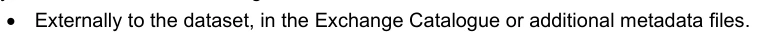
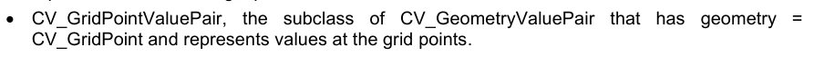
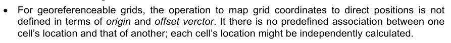

# S-100 5.2.1 · 第 8 部分 · 影像与格网数据

非官方机器翻译参考稿，尚未逐条人工校订。公式与代码保留原文，解释以英文规范为准。

## 官方 PDF 第 277 页

S-100 — 第8编

影像与格网数据

## 官方 PDF 第 278 页

5.2.1版实质性变动摘要

已生效的概要条款

## 官方 PDF 第 279 页

中文目录（可用上方目录直接跳转）

8-1 范围 · 官方 PDF 281
8-2 符合性 · 官方 PDF 281
8-2.1 本专用配置符合其他标准 · 官方 PDF 281
8-2.2 后向相容性 · 官方 PDF 281
8-2.3 与本专用配置的符合性 · 官方 PDF 282
8-3 参考文献 · 官方 PDF 282
8-3.1 规范性引用文件 · 官方 PDF 282
8-3.2 资料性参考文献 · 官方 PDF 282
8-4 影像与格网数据框架 · 官方 PDF 283
8-4.1 框架结构 · 官方 PDF 283
8-4.2 摘要级 · 官方 PDF 285
8-4.3 内容模式层面 · 官方 PDF 285
8-4.3.1 元数据 · 官方 PDF 286
8-4.3.2 编码 · 官方 PDF 287
8-5 影像与格网数据空间模式 · 官方 PDF 287
8-5.1 覆盖率 · 官方 PDF 287
8-5.1.1 覆盖面概况 · 官方 PDF 287
8-5.1.2 分散覆盖 · 官方 PDF 288
8-5.1.3 连续覆盖 · 官方 PDF 288
8-5.2个点、网格和TIN · 官方 PDF 288
8-5.2.1 点数组 · 官方 PDF 288
8-5.2.2 网格类型 · 官方 PDF 288
8-5.2.3 矩形网格和形状不规则的网格 · 官方 PDF 289
8-5.2.4 简单和平面网格 · 官方 PDF 290
8-5.2.5 正常和可变的细胞大小 · 官方 PDF 291
8-5.2.6 2或3 维的网格 · 官方 PDF 293
8-5.2.7 锡金 · 官方 PDF 295
8-5.2.8 网格细胞结构 · 官方 PDF 295
8-5.3 数据集结构 · 官方 PDF 296
8-5.3.1 S100_数据集 · 官方 PDF 297
8-5.3.2 S100_数据集发现元数据 · 官方 PDF 297
8-5.3.3 S100_交换集 · 官方 PDF 297
8-5.3.4 S100_IF_收缩 · 官方 PDF 298
8-5.3.5 S100_IF_收集元数据 · 官方 PDF 298
8-5.3.6 S100_IF_结构元数据 · 官方 PDF 298
8-5.3.7 S100_IF_AccustitionMetadata（条款） · 官方 PDF 299
8-5.3.8 S100_IF 质量元数据 · 官方 PDF 299
8-5.3.9 S100_IF_overage (中文(简体) ). · 官方 PDF 299
8-5.3.10 S100_IF_Title（条款） · 官方 PDF 299
8-5.3.11 S100_IF_识别元数据 · 官方 PDF 299
8-5.3.12 S100_IF_ContentMetadata（条款） · 官方 PDF 299
8-5.3.13 短链氯化石蜡 · 官方 PDF 299
8-6 分块方案 · 官方 PDF 299
8-7 空间模式 · 官方 PDF 300
8-7.1 S100_IF_PointSet空间模型 · 官方 PDF 300
8-7.2 CV_地心测量值等分类 · 官方 PDF 301
8-7.3 S100_IF_PointCoverage 空间模型 · 官方 PDF 302
8-7.4 S100_IF_TINCoverage空间模型 · 官方 PDF 303
8-7.5 S100_IF_GridCoverage空间模型 · 官方 PDF 304
8-7.6 已更正或可地理参照网格 · 官方 PDF 307
8-7.7 常见的枚举 · 官方 PDF 308
8-7.7.1 CV_CommonPoint规则 · 官方 PDF 308
8-7.7.2 CV_顺序Type · 官方 PDF 309
8-7.7.3 S100_CV_刑警组织方法 · 官方 PDF 309
8-8 数据空间参照 · 官方 PDF 310
8-8.1 文字数据空间参考 · 官方 PDF 310
8-8.1.1 地理重现 · 官方 PDF 310
8-8.1.2 未查明的 · 官方 PDF 311

## 官方 PDF 第 280 页

中文目录（可用上方目录直接跳转）

8-8.1.3 地理参考 · 官方 PDF 311
8-8.1.4 可地理参照 · 官方 PDF 312
8-8.2 点集数据和TIN三角顶点空间参考 · 官方 PDF 312
8-9 元数据 · 官方 PDF 312
8-10 质量 · 官方 PDF 313
8-11 影像与格网数据显示 · 官方 PDF 313
8-12 影像与格网数据编码 · 官方 PDF 313
8-13 面向要素的影像 · 官方 PDF 313

## 官方 PDF 第 281 页

8-1 范围

S-100具有支持图像、网格和若干其他类型的覆盖数据作为组成部分的能力,图像和网格数据是地理数据的共同形式,存在许多处理此类数据的外部标准,图像是可可视化的网格化数据结构的一种特殊类型。 由于几乎所有被网格化的数据组都可以被描绘成一个图像,因此图像一词非常宽泛. S-100决不能排除与外部数据源相容.

某些种类的水道测量信息,如测距、最新信息和水位信息,本质上是分布在某一地区的一组数据点,与水通运输有关的其他种类信息,例如气象信息,也是分布在一个地区的数据点,图像对水道测量数据也非常重要。 这包括来自空中摄影或LIDAR等传感器的图像、可以与以矢量为基础的要素数据相接相接的照片以及以扫描纸图为基础的产品,通常称为“Raster图”,所有这类数据都包含在S-100的这一部分。

一组包含分布在一区域的一系列属性值的数据被称为覆盖. 覆盖有很多不同类型,例如不同类型的网格结构,例如使用正格相距的高架模型;有可变大小单元格的不规则网格; 三相异态网(TINs)等.

S-100的这一部分与图像和覆盖数据的国际标准相配合,以支持多种数据来源,它使用一套基于ISO TC211 19100套标准的通用信息结构,使应用系统能够显示或以其他方式将图像、网格和覆盖数据与定义的(基于执行者)边界数据和其他类型的数据相合并。

S-100的这一部分界定了基于网格的覆盖(简单网格和所选种类的复杂网格)的内容模型和概念结构,以及点集覆盖和TIN,用于水道测量应用中的覆盖数据,包括作为网格数据类型的图像,它描述了网格或其他覆盖结构的组织、类型以及相关的元数据和地理参考数据的空间参考。 S-100的其他部分描述了编码和显示使用内容模型的方式。

8-2 符合性

8-2.1 本专用配置符合其他标准

这一部分定义了ISO 19123:2005概念和类型的剖面,构成相关S-100编码格式(S- 100 Part 10c-HDF5 Data Model and File Format)的概念基础,并定义了基于S- 100. 基于网格化信息和其他覆盖类产品描述数据产品的产品规范.

这一部分利用ISO/TS 19129采取的方法和该规格所定义的概念,界定结合了ISO 19123概念的具体概念结构,以便为基于覆盖范围的水道测量数据的S-100编码格式提供简化的共同基础,第10c部分对此作了说明。

8-2.2 后向相容性

本版S-100的第8部分是S- 100 5.0.0中的第8部分的校正,调整和合理化,意在纠正内部差异并更新概念框架,使其与S- 100.0版5.0.0 第10c部分(HDF5编码)中具体规定的覆盖信息编码格式完全相容. 它通过去掉多余的概念来简化S-100的前几版第8部分,但并不要求修改符合S-100版第5.0.0部分的产品规范数据格式。

## 官方 PDF 第 282 页

8-2.3 与本专用配置的符合性

附录8-A中的抽象测试套件表明基于覆盖范围的产品如何符合本文件所建立的内容模式。

涉及图像、网格或覆盖数据的任何产品,声称符合S-100,均应通过附录8-A所述抽象测试套件所描述的要求。

8-3 参考文献

8-3.1 规范性引用文件

本文件的应用需要下列参考文件。关于注明日期的参考文件,仅适用所引用的版本。关于未注明日期的文件,适用所参考文件的最新版本(包括任何修正)。

IHO S-97, IHO 创建 S-100 产品规范指南

ISO/TS 19103:2005, 地理信息-概念计划语言

ISO 19107:2003, 地理信息-空间计划.

ISO 19111:2007, 地理信息——通过坐标提供空间参考

ISO 19115-1:2018,地理信息-元数据-第一部分-基本原理(由"2018年第1号修正案"更新)

ISO 19115-2:2009,地理信息-元数据-第二部分图像和网格数据的扩展.

ISO 19123:2005, 地理信息-覆盖几何和功能的Schema

ISO/TS 19129:2009, 地理信息——成像、格子和覆盖数据框架

ISO 19157, 地理信息——数据质量.

8-3.2 资料性参考文献

以下提及已被后几期所取代,或有用,但并非规范性。

ANSI T1.523-2001,《电信词汇》,2000年,美国国家标准T1.523-2001。 (界定本部分使用并在S-100附件A——术语和定义中界定的“数据收缩”一词。 )

IHO S-52,《ECDIS图表内容和显示方面的规格》,第6.1.(1)版,2014年10月(截至2015年6月作了澄清)

IHO S-61,Raster导航图的产品规范(RNC)

IHO S-98,S-100导航系统中的数据产品互操作性, 第1.0.0版, 2022年5月

ISO 19108, 地理信息-时间计划

ISO 19113, 地理信息——质量原则.

ISO 19114:2003,"地理信息——质量评价程序" (由ISO 19157.

ISO 19117, 地理信息-平面

ISO 19118, 地理信息-编码

ISO 19130:2010, 地理信息——地相定位的图像传感器模型.

ISO/IEC 12087-5:1998,计算机图形与图像处理 - 图像处理与相换(IPI) - 功能规格 - 基本图像相换格式(BIIF)

ISO/IEC 15444-1:2004,信息技术 -- -- JPEG 2000图像编码系统

## 官方 PDF 第 283 页

8-4 影像与格网数据框架

8-4.1 框架结构

S-100这一部分中使用的图像、网格和覆盖数据框架来自ISO 19129 图像、格子和覆盖的数据框架。在S-1001中,只要求ISO标准中定义的框架的一个子集。ISO中描述的框架既可以支持地理参考数据,也可以支持地理参照数据。 S100的这个组成部分仅限于地理参考数据,虽然它在未来可以很容易地被扩展到处理诸如传感器数据等地理可参照数据.

该框架确定了一个覆盖数据集的各个要素如何组合在一起,框架提供了一个共同的结构,在不同的覆盖数据集之间建立了基本的相容性。 ISO 19129建立的共同框架在“连带模型”一级促进了不同组图象和网格数据之间的趋同,它们使用不同的标准,并且也有利于使用这些标准所显示的信息持有量之间的趋并,对于范围广泛的图象与网格数据的内涵模型一级的基本相容性,可以使现有标准向后兼容。 内容模型描述信息独立于其存储、沟通或描绘的方式。这允许对相同内容进行多条编码。

格氏数据,包括图像数据,基本上是简单的,它由一组属性值与元数据一起排列在一起,以描述属性值的含义并空间引用信息来定位数据,其他覆盖数据也很简单,它还定义了一组点或三角,将覆盖函数与元数据的结合驱动. 元数据可能包含识别信息、质量信息,如数据收集的传感器、空间参考信息包含如何将一组属性值参考到地球的信息、空间参照信息本身以元数据表示。

辅助信息,也称元数据,可能有助于显示或编码,然而,基本内容可能以不同的方式显示或采用不同的编码机制来携带,因此这种辅助信息不是图像和网格数据内容模型的一部分. 图8-1说明了网格数据的简单结构.

图8-1 - 网格化数据的简单结构

(显示元数据与一组在格值矩阵中代表的格子数据的关系)

ISO 19129框架标准允许在几个级别上描述图像学,网纹和覆盖数据。这些是ISO 19123 中处理的抽象级别 。

1 本标准部分的文字和ISO 19129标准有共同之处,因为本文件的章节作为ISO 19129. 制定过程中的投入而贡献给ISO,因此被收录入了ISO文件.

网格值矩阵

网格单元格的属性值

相关元数据

## 官方 PDF 第 284 页

覆盖几何和函数的Schema, 内容模型级别和编码级别。 编码级别独立于内容级别。 多个不同的编码可能带有相同的内容 。

大部分与图像和网格数据相关的现有标准都以交换格式描述数据内容,格式定义了数据字段并描述了这些数据字段的内容和含义,这隐含地定义了交换格式可以携带的信息内容. 以编码方式定义内容,将内容绑定在单一编码格式上,使数据转换非常困难.

ISO 19100套标准用统一建模语言(UML)中表达的面向对象的数据模型定义了地理信息内容,该模型允许使用不同的交换格式编码内容,或者不论交换编码如何存储在数据库中. 下图对应ISO 19129,呈现出框架2各要素之间的整体关系.

图8-2-框架各要素的总体关系

S-100要求在交换目录(S-100 Part 17)中提供某些发现元数据元素,并允许使用符合ISO 19115-3格式的额外文件来编码额外的元数据,包括结构,获取和质量元数据.

2 关于被取代的ISO 191xx标准的提法被删除或更新。

## 官方 PDF 第 285 页

8-4.2 摘要级

抽象层次为包括被网格化的数据几何和点集以及TIN几何在内的各类覆盖几何提供了通用结构. 这种抽象结构的定义在ISO 19123 — 地理信息 — Schema中被定义,用于覆盖几相和函数. S-100取自ISO 19123 各种类型的网格结构,包括长方形网格,形状不规则的网格等,具有可变细胞大小和多维网格的网克,一个平板网格实际上是一组网格. S- 100还包括由ISO 19123.

8-4.3 内容模式层面

内容模型层次描述一组地理信息的信息内容,包括:空间示意图,要素识别和相关元数据,其中质量,地理参考等其他方面在元数据中都有所体现. 内容模式不包括描述或编码,也不包括数据组织以适应各种存储或交换媒体. 描述数据交换信息的交换元数据不属于内容模型所定义的信息的一部分.

内容模型级别由一组预定义的内容结构组成,它们作为各种应用 Schemas 开发用于图像,覆盖和被网格化数据的核心. 本部分定义了一组小的网格结构,并附有相联的转录顺序,这些提供了一组被网克化数据的空间组织,还定义了一个点集结构和一个TIN结构.

ISO 19109 “ 地理信息- 应用 Schema 规则” 中定义的要素模型在 S- 100 第 3 部分中被描述为适用于图像和被网格化的数据。 应用Schema 定义了一个或多个地理要素类型,其属性是各自价值记录的要素。例如,一个水深网可以定义具有深度和不确定性属性的地理要素类别。 每种要素类型的几何成分可以由本部分所描述的空间类型之一来模拟.

尽管传统的做法是将图像视为一个独特的实体,而不考虑要素结构,但将图像、网格和覆盖数据视为面向要素的数据是恰当的。 最简单的形式是,图像或任何一组网格数据可被视为单一要素。 比如,整个卫星图像可被视为一个单一要素 — — 图像。 然而,也可以在图像上进行要素提取,其中相片像素是要素的几何代表. 某些选定的像素可以对应一桥,而其他像素则对应一岩. 应用程序Schema可以包含一个要素模型,要素模型的几何部分由一组几何点组成,这些点对应图像的网格结构中的图片元素(像素). 然而,如果一个要素结构与图像相关联,则有必要提供一种方法,将要素ID与图像中单个像素相连接. 可以通过在网格值矩阵中携带额外的属性,或者通过指针结构来完成这项工作. 例如,一个图像可能被表示为由一组或一行和一列组成的简单网格,为一组像素提供组织,每个像素包含诸如该点所看到的颜色和光强度等归属数据. 每个像素也可能包含一个附加属性,表示与像素相关的要素ID,这样与桥面相适应的像素被标记为要素桥,而与岩石相适应被标记成岩石. 其他更高效的结构可能被定义为识别与给定要素相适应的各组像素. 这种能力特别有助于为光栅扫描图像纸图产品增加情报,并用于将S-100矢量数据产品与图像和网格数据产品相接。

下面图8-3描述了图像、网格或覆盖数据的整体结构。内容模型包括空间结构和元数据。编码结构是独立的,但相关。允许数据压缩的系统压缩是内容模型的一部分,而允许数据收缩的分解压缩则不是。 系统压缩的一个例子是删除应用程序所知道的信息,这些信息将包含没有数据的区域(子平面),以及去除更低精度数字的下顺序位数数据。当只有数据区域定义了平面砖时,平面网格会显示系统压缩。 系统压缩也存在于可变大小像素结构中,在同一属性值相邻的像素可以被聚合成一个更大的像素. Stochastic (statical) 压缩可以去除随机出现的冗余信息. 例如,重复的比特模式可以被算法所压缩. ZIP算法常被用来压缩文件就是一个例子.

## 官方 PDF 第 286 页

。系统压缩与特定类型的图像有关,而系统压缩则与特定实例的图像有关。两种类型的压缩都可能适用,但系统压缩是编码结构的一部分,而系统的压缩则是内容模型的一部分。

图8-3 图像和网格数据结构

下文图8-4列出了图像网格化和覆盖数据一般内容模型中包含的内容,这是上图8-3的一个子集,由于它不是内容模型的一部分,没有显示代表结构,系统压缩机制没有直接显示,因为它与网格值矩阵的结构有关.

图8-4-一般图像和网格数据内容描述

8-4.3.1 元数据

ISO 19115-1/2对地理数据集的典型元数据要素进行了定义,并增加了ISO 19157中与数据质量相关的要素。

图像、纹理和覆盖数据

相关元数据

环境或数据上下文的上下文元数据(按ISO 19115-1和ISO 19115-2)

关于数据语义或含义的内容元数据(按ISO 19115-1和ISO 19115-2)

数据结构

空间参考(根据ISO 19111和ISO 19107)

数值集

网格值矩阵(按ISO 19123计算) 离心点集(按ISO 19123计算)

数值三角( 按ISO 19123 数据压缩)

图像、纹理和覆盖数据

相关元数据

上下文元数据(按ISO 19115-1和ISO 19115-2)

内容元数据(根据ISO 19115-1和ISO 19115-2)

平面元数据(根据ISO 19115-1和ISO 19117)

代表结构

数据压缩

元数据编码(根据ISO 19115-3、ISO 12087-5或其他标准)

值集编码(根据ISO 15444,ISO 12087-5或其他)

数据结构

空间参考(根据ISO 19111和ISO 19107)

数值集

网格值矩阵(按ISO 19123计算) 离心点集(按ISO 19123计算)

数值三角( 按ISO 19123 数据压缩)

## 官方 PDF 第 287 页

用于图像,网格,和覆盖数据. 产品规范不需要定义与ISO 19115-1/2或附录8-D所列举元素相适应的元数据,而必须包括S-100所描述的强制性元数据元素,可能包括S-10所描述的各种可选元数据要素并需要额外的产品专用元数据.

根据数据产品的要求,产品规范可以使用下列方法的任何组合提供元数据:



• 在交换目录或补充元数据文件中,从外部到数据集。


• 在数据集文件中,使用以下一种或两种方法:o 作为数据集的属性,要素类型,或单个要素实例。 o 通过定义其他要素类型(这些类型也被编码为数据集中的覆盖要素),将其作为覆盖要素。

如果元数据被编码为附加要素类型,必须用程序Schema必须定义要素或信息类型来定义属性,对于要素类型来说,空间表示必须是本部分所定义的空间类型之一.

在确定元数据是被编码在交换目录中还是数据集文件中时,产品规范必须符合S-100 第10c和17部分,外部和内部形式的元数据可能出现不必要的重复,但劝阻不这样做。

8-4.3.2 编码

内容模型定义了可以应用编码规则的结构,有大量不同的编码用于图像,网格和覆盖数据,为这类信息提供编码服务,其中许多编码是被很好的应用的标准化交换格式. S-100提供了一个通用的内容模型结构,可以使用不同的编码格式来编码或存储(例如图8-2,GeoTIF).

对于覆盖编码格式,S-100使用分级数据格式(HDF版本5),该格式面向对象,适合包括点集和TIN三角形在内的各类覆盖数据. S-100授权的HDP5配置在S- 100 Part 10c中描述.

8-5 影像与格网数据空间模式

8-5.1 覆盖率

8-5.1.1 覆盖面概况

覆盖连接到一个有限制的空间内的位以属性值. 覆盖是要素的子类型;即将一个有界限的空间内位与该要素的属性值相关联. 连续覆盖函数连接到该功能的空间时域内的每一个位值. 一个离散覆盖函数只在域内的特定位置有效. spatiotemporal域内的几何对象驱动覆盖函数. 覆盖函数有效起到spatitompor域内的相位对象的插值功能,该函数为域内每个位置在函数范围内确定一个值.

spatiotopal域内的几何对象以直接位置来描述. spiatopal 域的几何物体可以详尽地分割出spatientopal个域,从而形成网格或TIN等的纹理. 点集和其他非连续几何天体组并不形成纹理等.

ISO 19107定义了用于描述要素的一些几何对象(UML类GM_Object的子类型). ISO 19.123定义了专门用于描述spatioporal域的多个子类型. 此外,ISO 19108定义了TM_Geomical Primitives,这些也可用于定义覆盖的spatiotopal域.

覆盖范围是一组要素属性值。 值集作为记录集, 并带有共同的Schema。 例如, 值组可能包含在一定时间测量的海洋界限内的温度和深度。 覆盖功能可用于评估界限内的深度和温度 。

本文件对覆盖的概念作了描述,将覆盖功能与几何物体和驱动覆盖功能的直接位置联系起来。

## 官方 PDF 第 288 页

覆盖可以将特性概念与网格、一组TIN三角形或点集联系起来。此描述已经从ISO 19123. S-100 中修改。 S-100 仅涉及网格、 TINs 和点集 。

8-5.1.2 分散覆盖

离散覆盖有一个相片域,由有限地收集几何物体和这些几何天体所包含直接位置组成,每个几何对象的相片覆盖图是要素属性值的单一记录,因此离散的覆盖是离散或步态函数,而不是连续覆盖. 例如,在格子细胞的切换中为每个单元格分配一个要素代码是一个离散覆盖,每个格子要么与某个特定要素相关,要么与该要素无关。流体动力学数据中的点集覆盖,如分布式传感器的观测,也经常是离散的覆盖,因为该点集中任何一个单一点的数据值仅适用于该点的附近。

8-5.1.3 连续覆盖

连续覆盖有一个spatiotemporal域由坐标空间中的一组直接位置组成,连续覆盖将位置直接映射到值记录上。原则上,连续的覆盖可能不超过一个空间界限,而是跨多极的一组直接位,以及一个与要素属性值直接位置相连接的数学函数。

8-5.2个点、网格和TIN

S-100只处理图像和与网格、TINs和点集相联的网格数据。这些构造确定了S-100这个组成部分所使用的基本几何元素。

8-5.2.1 点数组

点集是一组GM_Point对象在一个有界限的区域。 这些点对象可能每个都与一个或多个要素相关联, 也可以用来形成覆盖功能, 并用于驱动覆盖功能。 水道测量测距可以视为一个点集。 对于每个点集值, 需要知道点的位置以及相关的属性值和相关要素参考值 。 属性可以被分配到一个集点,作为集合点和单个点。这是水道测量测地的常见做法,其中元数据可能与由一组点数组成的测地对象相接。若干个集可被集合到一个覆盖点。一个与相关元数据的简单点集见图8-5。

点集关联元数据

图8-5 – 带相关元数据的点集

点集是空间中由1-,2-,3-或n-维点组成的一组. 点组覆盖是一个与2维的点值对相联的覆盖函数,即覆盖函数由一组点(与X,Y位置相接)驱动,并记录该位置上一个或多个值.

8-5.2.2 网格类型

网格是指固定的有界空间的串接,其中两套或多套曲线,每套成员以系统的方式将其他各组成员相交;曲线称为网格线;相交点为网格点,网格行之间的相接点为格格. 网克覆盖了整个有界地段. 格子构成网格数据覆盖的基本几何. 一个空间有几种不同的常规发音,它们都是该空间的子类型。

## 官方 PDF 第 289 页

网格的一般概念。 常见于所有网格的通称是隐含的序列或转盘顺序。 还有一些可能的网格转盘命令, 有些比其他不同情况下更有用。 网网格的位置由正网格组织和转盘次序暗指。 例如,在一个矩形网格中,每个网格可以由网格行和列顺序处理。 因此,没有必要维持每个网格单元格的直接位置。更加复杂的网格需要更复杂的转录顺序,但规律性仍然允许从网格结构和转录次序中确定网格内的位置。特定网格的属性值构成一个网格值矩阵,其中的矩阵条目与网格对应。

S-100只处理一个小子集的可能的网格和转盘命令,它利用了ISO 19123第6条和第8条分别描述的CV_DiscreteGridPointCoverage和CV-Continual QuadrialGrideCovergerage。它使用:

(1)矩形网格和形状不规则的网格;

2) 简单和平面网格;

3) 有固定细胞大小和可变细胞大小的网格;以及

4) 二相或相相相相的网格.

电网的电网指令定义于ISO 19123附件D. S-100最感兴趣的类型有:线性扫描;和Morton Order. 图8-6显示线性扫瞄的电盘顺序和Morton的电格转动顺序。Mor通指令可以很容易地容纳不规则的形状的电克,以及可变的细胞大小电网。MortON Orrder对应了两维的四相树,但可扩展至更高维的等.

图8-6 – 线性扫描行列(X,Y) 轨迹顺序和莫顿(X,Y)顺序

这两种类型的网格和转盘命令都有水道测量数据的应用(例如第8-5.2.5条-Morton Order).

S-100也允许ISO标准19123所定义的其他转盘订单(见条款8-7.7.2).

8-5.2.3 矩形网格和形状不规则的网格

最常见的网格类型是长方形网格,大多数图像都是在这样的网格上定义的. 长方相网是ISO 19123所定义的四方相网格的子型. 四方相克网是曲线为正线的网格; 网格空间每个维有一组网格线,在这种情况下,网格是平行相克或相并相并的网道. 相并相接相接是和立方体相相并的相并等相相相克相并取相并分相相.

2维的线性扫描扭矩顺序

(x,y) 顺序 (x,-y) 顺序

2个尺寸的有正则大小的摩顿顺序

(x,-y) 顺序

## 官方 PDF 第 290 页

图8-7-矩形网格

网格也可能有一个非矩形或四边形的边界。 有时,扫描包括“insets”或“outets ” 的纸面图,以改变网格边界时,这种网格会发生,但网格可以有任何形状,只要它能够以给单元格顺序的顺序来穿行。图8-7显示的是矩形网格。 图8-8显示的是四边形网格,如同扫描操作中可能发生的那样。

图8-8 起步的四方网格

极不规则的外形网格可能被定义,但需要比简单的线性扫描更复杂的转录规则.

8-5.2.4 简单和平面网格

平面网格是一组数据的两个或两个以上的网格串联。平面法基本上是第二个网格,它被叠加到第一个简单的网格上。平地网格的每个单元格本身都是网格。平相法网格也可以与矢量数据相接,因为每个单元格定义了特定矢量数据集的边界。平上法在数据稀少时具有特别的价值。 例如,美国一幅光栅图像图可能会被打成平面,这样就没有必要包括加拿大上空或海洋上空的数据,以包括阿拉斯加和夏威夷。 图8-9显示了一个平面网格。

矩形(正弦四边形)网格

外形不规则的四方网格.

## 官方 PDF 第 291 页

图8-9 - 平面网格

8-5.2.5 正常和可变的细胞大小

传统的网格是固定的“分辨率 ” , 最常见的是每个维相平相的垂直跨线,形成正方形或长方形的单元格。 格丁是通过强制规定一个分辨率或网格间隔,以及根据每个单元格所含的一组点的单一属性计算单个网格单元格值,来概括点数据集的标准方法。 同样,图像数据主要被网格化,基于传感器的分辨率或统一的任意像素间距.

网格大小在网格内不同时也可能建立网格。一个常见的例子就是一些地理信息系统常用的“方格树 ” 。拥有可变的网格单元格可以在整个网格地表上进行可变分辨率,这表现在形成网格的平行行的不均匀间距上,其局部化为给定网格细胞。 这需要实现每个维度的数据正常化,以及每个维的二进制子化,以使任何给定的单元格本地化. 应用到指向或图像数据时,高可变性区域可以被小网格单元格所代表. 低可变性的区域可以被大网格电池所代表出. 当然,如果单元格大小在一个格子中有所不同,它必须经常这样做,这样,网格的切换仍能覆盖被限制的区域,而转录方法必须能够按顺序排列单元格。此外,还必须包括描述每个单元格大小的信息。

## 官方 PDF 第 292 页

图8-10-Riemann超空间网的覆盖率

(水道测量声纳显示深度)

在一个类似单元格相邻的可变单元格大小的网格中,数据被集合到更大的单元格中,保持了原始统一间距数据的完整性,同时将存储大小降到最低。 一个可变的单元格大小网格支持了无效值,如此不完整的数据 — — 包含孔 — — 可以存在,而无需为无数据区域分配任意值。 这允许在传统网格上进行相当的收缩,因为没有数据的单元格没有存储任何数据,它们并不存在。

上面图8-10显示了一些可变大小单元格。如果四个相邻的单元格(在两个维度上)在网格值矩阵中具有相同的属性值,那么它们可以被聚合成一个更大的单元格。在两个度上,这被称为“QuadTree”。这在分辨率不同或数据值倾向于集群的应用程序中特别有用。

图8-11 — 可变单元格大小

如图8-11所显示的可变大小单元格对水道测量数据特别有用。它不是代表底盖作为测距(点集),而是可以代表一组可变尺寸单元格。每个单元格可以携带若干个属性值。相邻的单元格聚合,因此数据量会大大地减少。当属性值从单元格迅速变化到单元格时,小单元格就存在。 螺旋,岸线和阻塞导致一些小细胞,其中较大的相对恒定,或平地区域,如一通道底部会形成一些集合细胞.

莫顿转动顺序可以处理可变大小的单元格。如图8-12. 莫顿的转动进度从左到右逐个单元格,而不论单元格大小。它会增加X坐标中的Y。这还延伸到增量的多维度。

## 官方 PDF 第 293 页

在 X 中,然后是 Y ,然后是 Z 。图8-13 显示在不规则的网格和可变大小网格中,Morton 命令。在此例中,使用 X 命令。

图8-12 – 莫顿令(X,Y)

任何空间充入曲线都给一个有界限的空间带来秩序,但由莫顿命令所传递的秩序保持了近距离。这是一个非常重要的属性。这意味着在网格中相接的两个点在网状的倒序中也相接相接。 这个属性来自于里曼将毕达哥伦定理延伸为多维度,形成被称作里曼超空间的多维相接点。

图8-13 – 不规则和可变大小网格中的莫顿顺序

8-5.2.6 2或3 维的网格

网格可能存在于2或3维. 并非所有的转盘命令都会在高维格上起作用,但线性扫描转盘和莫顿顺序转盘都可以被扩展为3维,正维格中的每个维都对等到所有其他维. 因此,在三维网格或等同的细胞间距中,每个维度都有一组等同相距的垂直交叉线,从而产生立方细胞。 这些可以被认为是体积元素 — — voxels。

通过重复第三个维度中每个单元格“层”的网格,可以很容易地将四边形网格扩展为3维。这通常是为了支持同一个单元格结构的多段数据,但是对于第三个维量中细胞数量大的真实3维,数据量可能变得巨大。 图8-14显示一个长方形网格,通过重复四条不同数据段的网格来被扩展到第三个维度. 图8-15显示一个长方形网格被扩展到覆盖一卷.

9 X 9 网格形状不规则

## 官方 PDF 第 294 页

图8-14 – 长方形网格中扩展属性空间的带宽

图8-15 – 长方形网格扩展至覆盖三维体积

多层面复合网格存在于正二分位中,并将遵循这两个结构的规则,从而可以创建多维多分辨率的聚合结构。 在水道测量应用中,人们通常对三维固体不感兴趣,而是对海底和材料的三维代表,包括与海底有关的水体体内浮出物。 这样的数据集是稀有的,其中大部分的量子单元格(voxels)是空的。如果允许三维单元格在相同时(在预先定义的可容忍度内)聚集成更大的单元格,那么大多数空单元格就会消失为几大集合。使用可变大小单元格对处理三维和更高维度数据很有用。 图8-16显示了三个维度的可变大小单元格网格。

图8-16 — 三维可变大小单元格网格

数据值带

## 官方 PDF 第 295 页

8-5.2.7 锡金

三角Irrrent Network是一种基于一组三角形描述可变密度覆盖数据的方法. TIN结构非常灵活,可以进行分析. 由于每个三角形都是局部平地地表面,所以直取直取来计算任意曲线与以TIN为代表的表面相交点. 属性可以应用到每个三角面,很容易,但计算起来很密集,可以对面相进行几何处理,以便计算等相线。 在动态导航系统中,人们可以轻松地计算出船体与底部表面作为TIN的可能相接点,从而很容易确定一个动态安全等相。 矢量与TIN三角地表相交点的计算是简单计算一线一平面相交地由来. 图8-17显示了TIN显示可变大小的TIN相接地三角地和TIN顶点的例子.

图8-17-由TIN三角形组成的一个实例覆盖范围

一个TIN由一组三角形组成。每个三角形的角上与相邻三角形共用顶点。这些顶点构成覆盖函数的控制点。一个TIN内有内在的上方,因为必须同时存储三角形和顶点,属性值附着在三角形上,而几何取自顶点的位置。 三角形可以指: 三角相向指向相向的顶点,或者圆相向表示它们所附着的三角形。 三角取向比较简单,因为每个三角形都有3个顶点。 而一个顶点则可能由可变数的三角相接。

一个TIN在表示可变密度数据方面是有用的,因为如果数据是局部平滑的,三角形可能较大,而更密集地表示数据,数值变化更快. 如果仔细选择了TIN的点来代表山脊,谷地等重要要素,那么TIN可以导致一个显著的数据收缩;但是,如果一个TIN自动从任意的一组数据点产生,数据量可以超过原始源数据,或者丢失了重要信息,因为TIN覆盖可以任意形状,它可以适应覆盖一个区域. 兴趣。

S-100使用ISO 191223所描述的CV_TINCoverage类. S-100所覆盖的TIN是连续覆盖.

8-5.2.8 网格细胞结构

与格点相联的要素属性值代表了以格点为代表的样本点周围的小空间内所测量或观察到的现实世界的要素. 连接这些点的格线会形成一组格子.

EXAMPLE:在下图8-18中,网格点为(a,b,c,d),位于固态线相交处. 被破损线所捆绑的单元格(A,B,C,D)代表了与这些网格相接的样本空格,这些样本空域是相对数据网格(被破折线所代表)相接相接网格中的网格空格. 在格网格G内任何直接位置X的评价(由固态线所约束)将基于从a,b,c和d的插值(并可能涉及格外的额外格点).

## 官方 PDF 第 296 页

图8-18 – 网格单元格结构(仅次于ISO 19123 图15).

S-100使用与ISO 19123第8.2.2节相同的网格单元格结构观点。S-100网格覆盖度的网格数据名义上完全位于网格坐标确定的网格点上,因此网格是“样本点”。 样本点的数据值代表了样本点附近地区的测量。该区间假定在每个维度上将一个半细胞延伸。 其效果是,每个网格点对应的样本空间是一个以网格取向为中心被取向的单元格. S-100通过添加可选属性来完善ISO 19123视图,以表示与网格单元格角相对的数据值位置,作为网格数据集编码的. 这些可选属性可用于在评价和描述时有效避免网格细胞的相抵格或子分化,或用于更复杂的被网格化的数据的表示.

请注意,对覆盖范围采用插值法意味着,在网格点之间的位置上,数据特征的价值可能不同于其最相邻的任何或所有网格站点的价值,可通过上述S-100附加属性避免这种差异。

8-5.3 数据集结构

数据集由一个或多个覆盖物以及相关元数据组成的集合. 元数据可能与数据集整体相关联,或与单个覆盖物相关联. 中元数据也可能与特定数据要素相关联需要时,更详尽的下一级元数据会覆盖或收集整个覆盖物或集的普通元数据. 元数据也可能与数据集或其他数据集要素组合的特定区域相联.

元数据描述可以有几种不同的组织方式. 在本标准中,元数据被组织成模块. S100_Dataset DiscoveryMetadata模块与数据集整体相关,并在S-100 第17部分中被描述. S 100_IF_CollectionMetaData模块将S100_If_StructuralMetadadata单元,S100-IF-AquistionsMetadiata模块和S100 _IFX-质量Meta数据模块作为子组件. S100_IF_CollectionMetadata可能在数据集文件内或外部编码. 结构,获取,以及质量元数据都是可选的,但定义覆盖格式的必要元素除外,这些元素在S-100 Part 10c中被规定.

覆盖或点集数据也可以被组织成平板块,元数据也可以与平板块相接,数据集的整体结构见图8-19。

## 官方 PDF 第 297 页

图8-19 — 数据集结构(由ISO 19129:2009改编而成) 图7 — IGCD结构及

元数据)

```text
8-5.3.1
S100_Dataset
```

数据集是可识别的数据集,可以以交换格式表示或存储在存储介质上. 数据集可以代表逻辑数据收集的全部或一部分,可能包括一或多块数据瓦. 数据组的内容由产品规范定义,用于该特定类型的数据,通常适合该数据的使用. 特定数据类型的产品规范需要有一个计划来说明该数据产品的组织。例如,一个简单的网格测深模型基于的产品可能只有一个网格覆盖,一个平板方案表明每个数据集都包含一瓦。 更复杂的产品可能包括几个同地覆盖和更复杂的平板方案,如以四树为基础的可变大小平板办法,其中一个数据集可能有时包含多块瓦. 数据集是相关发现元数据可以识别的逻辑实体,而不是交换的物理实体.

```text
8-5.3.2
S100_DatasetDiscoveryMetadata
```

与数据集相关联的是一组发现元数据来描述数据集,使其可以访问. 它由S-100 第17部分定义的数据集发现元数据组成.

```text
8-5.3.3
S100_ExchangeSet
```

S-100数据集的名义发送是通过交换集。交换集代表交换的物理实体。传送取决于编码格式和交换媒体。在DVD等物理媒体上传送可能携带一些数据集,而低带宽电信线上的传送可能只携带数据集的一小部分。 任何带有传送方式的元数据都是传送方式的组成部分,交流机制可按传送方式和传送方式的需要,将它改为其他交换方式的分元数据,一个共同的交换机制是在光盘等一种物理媒介上携带一个完整的数据集。 传输元数据没有显示,因为任何传输元数据的发送,除了S100_Dataset DiscoveryMetadata模块中的信息之外,都依赖于用于交换的机制,并且可能因交换介质或编码格式而异. 传输出元数据的一个例子是计算一个交换单位中的数据字节数.

## 官方 PDF 第 298 页

```text
8-5.3.4
S100_IF_Collection
```

S100_IF_Collection 代表了数据收集。收集可能包括特定区域上的多个不同数据类型,或者覆盖同一覆盖类型的数据的多个覆盖,但代表不同的表面。例如,收集可能包含一个网格覆盖和一个在同一区域上设定的点,其中网格涵盖代表一个测深表面,点设置了若干测距点。

表8-1——S100_IF_收缩

角色名称

名称描述 :

S100_IF_数据收集 - -

收集的spatiotemporal范围

```text
1
EX_Extent
```

属性元数据 外部文件中的元数据链接

```text
0..1
CharacterString
```

角色构成 收录内容 1.. * S100_IF_Coverage

角色有收藏的元数据 1 S100_IF_CollectionMetadata

收集工具的倾斜方案

```text
0..1
S100_IF_Tiling
```

```text
8-5.3.5
S100_IF_CollectionMetadata
```

与S100_IF_Collection相联的是一组收集元数据,它描述的是集合中所代表的数据产品,它包含一些子组件,包括S100-IF-StructuralMetadata,S100·IF+AcquistionsMetada和S100*IFXMEMETA,以及识别,协调参考系统信息和数据集内容. 这些元数据类是ISO 19115-1,ISO 19115-2和ISO 19157中定义的描述性元数据.

表8-2 — S100_IF_ CollectionMetadata

角色名称

名称描述 :

S100_IF_CollectionMetadata 数据集中所有覆盖的元数据类

```text
-
-
```

有关数据集的识别信息

1 S100_IF_Identific Metadata 产品规范,数据集发售日期等

关于数据集内容的作用(组成部分)元数据

1 S100_IF_ContentMetadata 域特性和属性

关于结构的作用(组成部分)元数据

```text
0..1
S100_IF_StructuralMetadata
```

关于获取的作用(构成部分)元数据

```text
0..1
S100_IF_AcquisitionMetadata
```

数据质量信息

```text
0..1
S100_IF_QualityMetadata
```

作用(组成部分) CRS信息 1 SC_ CRS属性来识别 CRS

```text
8-5.3.6
S100_IF_StructuralMetadata
```

与覆盖数据类型相联的是一组结构元数据,它描述了覆盖或点集的结构。这是S-100 第10c部分实现的抽象类,其中对S- 100覆盖类型至关重要的结构元数据要素被指定。

## 官方 PDF 第 299 页

```text
8-5.3.7
S100_IF_AcquisitionMetadata
```

与覆盖数据类型相关联的,是任意的一对或多对描述数据来源的获取元数据。这是单个产品规范可能实现的抽象类。

```text
8-5.3.8
S100_IF_QualityMetadata
```

与覆盖数据类型相关联的,可选用一对或多对描述数据质量的质量元数据。这是S-100 Part 10c(作为表10c-11中的不确定性数据集)和个别产品规范中部分实现的抽象类。

```text
8-5.3.9
S100_IF_Coverage
```

这是一个抽象类,用来代表S100_IF_Collection中可能出现的所有类型的覆盖数据.

S100_IF_Coverage的子类对应了允许S-100数据集覆盖的类别,这些类别在条款8-7中描述.

```text
8-5.3.10
S100_IF_Tiling
```

此类是用于描述 S100_IF_ Collection 所使用的平板图案的抽象类。 元数据识别出一个平板的特例包含在 S100-IF- StructuralMetadata 模块中。 典型的平板法在 第 8-6 条中描述 。

```text
8-5.3.11
S100_IF_IdentificationMetadata
```

S-100覆盖数据集的识别元数据包括产品规范,发布数据和时间,地理位置标识等信息,这是S-100 Part 10c中实现的抽象类.

```text
8-5.3.12
S100_IF_ContentMetadata
```

这是一个抽象的类,代表关于数据集内容的元数据,特别是要素目录中定义的要素和属性,它实现于S-100 Part 10c.

```text
8-5.3.13
SC_CRS
```

此类代表了覆盖使用坐标参考系和基准(横向和纵向)的信息,它通过S-100 Part 10c定义的属性实现.

8-6 分块方案

平铺是将数据集中的数据量降低到可控比例的一种方法。在数据集中,必须同时说明平铺方案,以及该数据集中所携带的平铺或平铺的例子。S100_平铺计划类包含关于平铺方案的全过程信息。可能只为特定的数据收集定义了一个平铺办法。 在一个数据仓(数据库)内,可能会有几种重叠的平板方案,其中任何平板方案都可以作为从数据仓取取出数据的依据。

平板图本身就是一个离散的覆盖。 它通常是一个简单的长方形网格, 其地砖密度相等。 这种网格覆盖也可以用可变密度的瓦片来定义。 更复杂的平板法也可以定义为一个离分的多边形覆盖。 例如, 数据收集包括沿着政治边界的高地切入。 图8-20说明了这些类型的平板方案。 还可以采用其他的平板计划,事实上,任何类型的单子覆盖都可用于建立平板计划。

## 官方 PDF 第 300 页

图8-20 - 铺设方案类型

任何所使用平板图案必须完全描述为特定数据产品规范的一部分,其中包括平板的尺寸、位置和数据密度以及平板识别机制(平板)。

8-7 空间模式

S100_IF_Coverage子类中每个子类都有一个特定的空间示意图来描述该数据类型的结构. 第8-5.3条中确定的数据类型是:

```text
1) S100_IF_PointCoverage:
```

```text
2) S100_IF_TINCoverage;  and
```

```text
3) S100_IF_GridCoverage.
```

这些覆盖子类的概念模型利用了点集和几何/值对等,这些被分类为S100_IF_PointSet和CV_GeometryValuePair及其子类所描述.

8-7.1 S100_IF_PointSet空间模型

S100_Point 是一个三维坐标参考系的单点。 它的值是作为坐标而不是属性来携带的。 这些点是由某些类型的传感器生成的。 S100-IF_PowerSet 不是一个覆盖。 点集可以用来生成一个点覆盖。 S 100_IF-PointSet的类见图8-21。

图8-21 — S100_IF_PointSet

属性几何包含一个 GM_Point 实例 。

可变密度 简单网格 简单网格 可变的平面大小 多边形平面

## 官方 PDF 第 301 页

8-7.2 CV_地心测量值等分类

CV_GeometryValuePair 类描述一组元素,定义了离散覆盖的关系. 该类的每个成员由两个部分组成:一个域对象来自所属覆盖域;以及一个要素属性值记录来自所属覆盖范围范围. CV_要素学ValuePair可能在执行一个评价操作时生成;并且不需要持久. CV-要素论ValePaire被子分类(见条款8-5),以限制要素属性值记录的对等,将其限定为特定域对象的子类型.

表8-3——CV_地心测量值

角色名称

名称描述 :

CV_地心测量等离子平面( S- 100) 2- 整个覆盖空间元素和该元素的值记录

- 在S-100中,这是一个抽象的模型,将覆盖要素与相关值相配

属性几何空间原始 1 GM_ Point

或 数

```text
CV_GridPoint
```

S-100只使用点(包括TIN顶点)或网格点作为覆盖的空间要素

与此空间对象相關的要素属性值的记录

```text
1
RecordType
```

S-100只使用ISO 19123中定义的 CV_GeometryValuePair 的两个子类:


代表单点值。



CV_GridPoint 并代表网格点的值.

表8-4-CV_PointValuePair 数据

角色名称

名称描述 :

CV_PointValuePair CV_PointValuePair 是具有GM_Point作为其几何属性值的 CV_GeometryValuePair 的子类型

```text
-
CV_GeometryValuePair
```

属性几何空间原始 1 GM_ Point

属性值记录 1 记录类型 继承自 CV_ GeometryValuePair

必须符合范围Type

表8-5——CV_GridPointValuePair 互联网档案馆的存檔,存档日期2013-10-02.

角色名称

名称描述 :

CV_GridPointValuePair CV_GridPointValuePair 是CV_GeometryValuePair的子类型,其CV_Gridpoint是其几何属性的值.

- CV_地心测量等效平等只适用于网格覆盖

属性几何空间原始 1 CV_GridPoint

属性值记录 1 记录类型 继承自 CV_ GeometryValuePair

必须符合范围Type

## 官方 PDF 第 302 页

8-7.3 S100_IF_PointCoverage 空间模型

S100_IF_PointCoverage是从ISO 19123. 中得出的 CV_DiscretePoint Coverage 的一类,每个 CV-GeometryValePair 的值记录中的属性值代表覆盖值,如测深探空等.

类 S100_IF_PointCoverage (图8-22) 代表一组数值, 如测深值, 指定给一组任意 X, Y 点。 每个点由一个水平坐标对( X,Y) 来识别, 并指定一个或多个值为属性值。 这些值在记录中排列, 用于每个点 。

图8-22 – S100_IF_Point Coverage

表8-6-S100_IF_PointCoverage 互联网档案馆的存檔,存档日期2013-10-02.

角色名称

名称描述 :

S100_IF_点覆盖空间类型

```text
-
-
```

属性域 覆盖域的spatiotemporal 范围

0.1 只在范围与自有数据集范围不同时才需要扩展

见附注1

属性范围 Type 描述覆盖范围 名称列表: 数据类型对,每个类型描述覆盖范围包含的属性类型

1 外部作为要素目录(S-100 Part 5)和要素信息组(S-100 Part 10c)执行的Type

在边界上的位置或覆盖范围内几何物体之间重叠区域评估覆盖度时使用的共同Point规则程序属性

1 CV_CommonPoint Rule ISO 值“启动”和“结束”不使用

见附注2

角色元素空间元素 1.. * S100_IF_PointSet 注1:域外可以作为一个地理边框或边框多边形执行,时间范围使用单独的属性执行.

## 官方 PDF 第 303 页

注2: 属性共同点规则定义的规则应适用于对每个共有边界的几何对象的覆盖度进行评估得出的一套值。 CV_CommonPoint规则的适当值包括“ 全部”、“平均”、“高”和“低” 。 例如,用于测深目的数据可以使用"高"值(取决于Z轴方向),以确保岩石或地平板等障碍被强调. 对于离散点覆盖,只有当空间查询返回了超过一个点的覆盖要素时,常见点规则才相关.

8-7.4 S100_IF_TINCoverage空间模型

一个 TIN 覆盖是 ISO 19123 中描述的 CV_ Contimunical Coverage 类型。 每个 CV- GeometryValuePair 的值记录中的属性值代表三角形顶角的值。任何与 TIN 三边形相关的附加属性都可以描述为 CV _ Valee Triangle 的属性 。

TIN覆盖着一个具有独特的非重叠三角形的片段,每个三角形由三分组成. ISO 19107 和 ISO 19.123 中描述的TIN 覆盖的几何图形 ISO 中,TIN的覆盖对于在一些应用中代表高地或水深特别有用. 比较容易计算出一个与覆盖面相接的相接点,当它被代表为TIN时. 图8-23显示了S100_IF_TINCoverage这一类.

图8-23 – S100_IF_TINCoverage

表8-7-S100_IF_TINCoverage

角色名称

名称描述 :

S100_IF_TINCoverage 类覆盖的空间类型

```text
-
-
```

属性域 覆盖域的spatiotemporal 范围

0.1 只在范围与自有数据集范围不同时才需要扩展

见附注1

## 官方 PDF 第 304 页

属性范围 Type 描述覆盖范围 名称列表: 数据类型对,每个类型描述覆盖范围包含的属性类型

1 外部作为要素目录(S-100 Part 5)和要素信息组(S-100 Part 10c)执行的Type

在边界上的位置或覆盖范围内几何物体之间重叠区域评估覆盖度时使用的共同Point规则程序属性

1 CV_CommonPoint Rule ISO 值“起步”和“起步”没有使用。

见附注2

用于评价覆盖范围的插值方法

1 CV_刑警组织方法 见附注3

属性几何描述构成 TIN 基础的三角形网络

1 格林尼治平时见附注4

注1:域外可作为一个地理边框或多边形执行,时间范围使用单独的属性执行。

注2: 属性共同点规则定义的规则应适用于对每个共有边界的几何对象的覆盖度进行评估得出的一套值。 CV_CommonPoint规则的适当值包括“ 全部”、“平均”、“高”和“低” 。 例如,用于测深目的数据可以使用"高"值(取决于Z轴方向),以确保岩石或地壳等障碍物被强调. 常见点规则的使用发生在涉及一组几何对象时,例如TIN中的三角.

注3:属性插值Type指定了建议用于评价S100_IF_TINCoverage的插值方法,其中从编码列表CV_Polication Method中取出"以"以伯利为中心"的值. 由CV_PointValuePairs(P1,V1,(P2,V2)和(P3,V3)组成的数值三角形内巴向心位置S为(一,j,克),其中S=iP1+jP2+克P3并被插入S的属性值为V=iV1+克V2+.

注4:三角形位于一个二维多相上,其X,Y坐标代表了三角形顶点的位置和属性。三个顶点定义了三角相上。一个TIN顶点的属性几何是GM_Point的一个例子。 属性值包含一个记录,限制在一个条目中定义顶点的覆盖值(例如深度用于一个测深的TIN顶点).

8-7.5 S100_IF_GridCoverage空间模型

S100_IF_GridCoverage(下图8-24)代表了一组指定给2D网格中点的值. ISO 19123中有几个网格组织,有不同的网格转录顺序,以及可变或固定的网格单元格大小. S-100利用了两种类型的网格组织,一种是简单的四边形网格,其细胞大小相等,由线性序列规则穿行;另一种是可变的细胞大小四边相网格由莫顿秩序序列规则穿过,这种可变细胞大小网格的组织被称为"四边树"来表示二维网格.

## 官方 PDF 第 305 页

图8-24-S100_IF_GridCoverage

表8-8——S100_IF_GridCoverage (中文(简体) ).

角色名称

名称描述 :

S100_IF_GridCoverage 覆盖网格覆盖类型

- 连续和离散电网的分级

属性域 覆盖域的spatiotemporal 范围

0.1 只在范围与自有数据集范围不同时才需要扩展

见附注1

属性范围 Type 描述覆盖范围 名称列表: 数据类型对,每个类型描述覆盖范围包含的属性类型

1 外部执行的Type作为要素目录(S-100 第5部分)和要素信息组(S-100 第10c部分).

## 官方 PDF 第 306 页

在边界上的位置或覆盖范围内几何物体之间重叠区域评估覆盖度时使用的共同Point规则程序属性

1 CV_CommonPoint Rule ISO 值“启动”和“结束”不使用

见附注2

用于评价覆盖范围的插值方法

```text
1
S100_CV_InterpolationM
ethod
```

见附注3

属性插值 持有执行插值指定的插值操作所需的参数值 Type

1.1 S-100记录中仅以 " 二等分 " 和 " 二等分 " 的插入法为条件

ISO 19123 属性插值

复合离子

网格参数、几何和数值

1 S100_IF_Grid A 网格覆盖必须包含网格几何和数值 注1:域外形可以作为地理边框或域外多边形执行,其时间范围使用单独的属性执行。此属性覆盖了从 CV_ Coverage 继承的强制性域外相.

注2: 属性共同点规则定义的规则应适用于对每个共有边界的几何对象的覆盖度进行评估得出的一套值。 CV_CommonPoint规则的适当值包括“ 全部”、“平均”、“高”和“低” 。 例如,用于测深目的数据可以使用"高"值(取决于Z轴方向),以确保岩石或地壳等障碍物被强调. 常见点规则的使用发生在涉及一组几何对象时,例如TIN中的三角.

注3:属性插值 Type 描述为评价S100_IF_GridCoverage而建议的插值方法。可用的插值方法是:双线插值、比库比克插值,最近邻接相接相通相通和双等分线插入相通等。这些方法在ISO 19223中定义。分点网格必须使用S-100所添加的“无插值”的特殊值(见S- 100_CV_Coltrobolication Method)。

类 S100_IF_Grid 是从ISO 19123. 从ISO 19123. 从类中继承来的 CV_RecorizedGrid和 CV_GridValuesMatrix 的一种实现.

表8-9-S100_IF_Grid

角色名称

名称描述 :

网格几何和值的 S100_IF_Grid 类型 - -

属性轴Names 网格轴的名称 <Sequence>CharacterStri ng

一定是在EPSG登记处

属性维度 格子 1 整数 空间维度, 例如 2D 格子 2

提供数据的网格面积

1 CV_Grid 信封见注1

网格点之间的间隔和网格轴对通过属性来源确定的外部坐标参考系的取向

```text
1
<Sequence>Vector
```

外部坐标系统的网格源坐标

```text
1
DirectPosition
```

用于将值序列中的值分配到网格坐标的属性排序规则方法

1 CV_顺序规则见注释2、3、4

## 官方 PDF 第 307 页

属性启动序列 CV_GridCoorders 指定要指定值序列中第一个值的网格点的网格坐标

1 CV_GridCoorders 对起始序列的有效点的选择由排序规则决定

复合离子

数值 记录的顺序,每个记录包含一个或多个值,要指定一个网格点

```text
1..*
S100_IF_GridValues
```

或 数

```text
CV_GeometryValuePair
```

见附注5

注1:网格坐标值最低的区域角和网格协调值最高的角的网格座标. CV_GridCoord被指定为19123年的整数相干,它表示网格点,每个网格的维度有一个整数值。顺序应与轴名元素的等同。 单一坐标的值必须为从栅格源向特定轴方向的相抵数.

注2:对于具有等量单元格大小的简单网格,如果无法提供本矩形内整个区域的数据,则必须使用无值的加法来表示没有数据的区域。对于可变的网格(四分道通树网格),莫顿环形山的一个特点是可以代表非网格区域。 在这种情况下,属性范围是一个接合提供数据的网格区域的边框矩形。

注3:只有“线性”(对于一个简单的正则单元格大小网格)和“Morton”(对于一个四分道通树网格 ) 的数值才能用于符合本标准的数据。正则电池大小网克的序列规则很简单。当单元格都相同时,单元格索引可以从记录序列中的记录位置得出。对于可变的单元格大小格,序列顺序更为复杂。 单元格索引要么需要携带每个相关记录值,要么可以根据每个单元格大小来计算。

注4:对于具有等单元格大小的简单格,S100_IF_Grid的顺序规则属性等于"线性",而相抵向量则确定单元格大小。属性范围指定了提供数据的网格面积。对于可变的单元格大小格(四分道通格),顺序规则特性等于Morton,相抵矢量则规定最小的单元格尺寸。 实际单元格大小作为属性列入数据记录,其中描述了四重结构的集合水平。属性范围指定了提供数据的边框矩形。数据集中包含哪些单元格由单元的摩顿顺序决定。

注5:几何(点坐标以定点集的形式提供)仅用于常规网格或可变细胞大小网格以外的网格类型.

表8-10——S100_IF_GridValues (中文(简体) ).

角色名称

名称描述 :

S100_IF_GridValues 类格值类型 - -

要素目录中指定的特性属性的顺序值列表

1 见附注1和2。

注1: 必须与范围属性指定的记录类型一致。如果缺少或未知一个属性的值,则必须使用填充值。

注2:对于具有等量单元格大小的简单网格,属性值可能只是数据值,但对于可变的细胞大小四分道通树网格来说,记录类型必须包括一个索引号和单元格大小(汇总级别)。

8-7.6 已更正或可地理参照网格

条款8-7.5所描述的S100_IF_Grid模型能够代表修正的网格以及可引用网格. 下图8-25所给出的模型显示:一个网格可以分为两种类型可校正或可地理参照;以及Gri德ValuesMatrix是普通网格对象的子类型. 可引用网克类型是CV_Gryd的子类,不添加属性. 地理校正网格和可地理参照网格的区别在于坐标转换操作:

## 官方 PDF 第 308 页


• 对于地理校正网格,将网格坐标映射到直取位置的操作使用属性源值并抵消等离子变换.



^ 对于可地理参照网格,将网格坐标映射到直取位置的操作不以源头和相抵动词定义。它没有预先定义一个单元格的位置与另一个单元格的位置的联系;每个单元格的位置可能都是独立计算的。

图8-25 - 可更正或可地理参照网格

一个已校正的网格通过属性源,网格轴的方向,以及网格线之间的间隔,与坐标参考系相关. 对于已校定的网克,网克和外接坐标系统之间有亲和关系.

可参考网格可能与通过变相操作确定网格中所有点的位置的坐标参考系相接,但从网格坐标不能直接获得;而与纠正网格相比,在网格上,坐标参考系中点的位置可以由网格属性推导出. 网格本身。

S-100模型不使用坐标转换来进行可地理参照网格,而是将网格点的直接位置与每个网格点的值记录一并编码.

8-7.7 常见的枚举

```text
8-7.7.1
CV_CommonPointRule
```

ISO 19123指出,“CV_CommonPoint Rule是一份代码清单,用以确定处理直接投放到评价操作中属于两个或两个以上几何对象的情况的方法。这些规则的解释在离散和连续覆盖之间有所不同。如果是离散覆盖,则每个CV-GeometryValuePair为每个属性提供一个值。 该规则适用于包含直发波的 CV_地平面值的一组值。 如果连续覆盖,则每个包含直取波的CV_Value对象的值应被插入。该规则随后必须用于每个属性的插入值的组值。”

## 官方 PDF 第 309 页

表8-11 – CV_CommonPoint 规则计数

名称描述代码注释

编号 CV_CommonPoint 规则代码,用于确定在边界上或覆盖域几何物体之间重叠位置的覆盖度评价方法

- ISO 19123号标准

```text
CV_CommonPointRule
```

返回属性值的平均值 1

使用最小的属性值 2

使用最大属性值 3

全部字元返回所有可以确定位置的属性值

```text
4
```

注:本版第8部分界定的涵盖范围不包括片段曲线,因此,禁止对符合S-100版本的产品规范使用 " 开始 " 和 " 结束 " 。

```text
8-7.7.2
CV_SequenceType
```

扫描方法在ISO 19123中详细描述. 扫描的顺序与属性扫描方向中轴的顺序相同,扫描的起始位置在属性起始顺序中给出.

注:产品规范作者和生产者应注意起始位置与序列规则相容并进行扫描方向;例如,线性排序将不符合栅格边框上方的起始位置和扫描方向的前行扫描顺序。

表8-12 – CV_顺序盘点

名称描述代码注释

编号 CV_序列Type 代码,用于识别命令网格点或值记录的方法

- ISO 19123 CV_序列类型

字形线性序列沿网格线相接,从扫描方向所列出的第一个网格轴开始

1 例如,对于扫描方向=(x,y)的二维网格,扫描按行主序进行

线性测序的字面振荡变体,扫描方向在交替网格线上倒转。对于尺寸 > 2的网格,在交替平面上也倒转。

```text
2
```

相向相向的相向线相向排列。对于大小 > 2,它重复在相向平面中

```text
3
```

以螺旋顺序 4 排列起字形螺旋

Morton字面顺序沿Morton曲线5排列

沿希尔伯特曲线6的文学希尔伯特序列(Literal Hilbert Sequencing along a Hil伯特 Culture 6 Morton Cullt)是通过将每个网格点的网格坐标(轴索引)转换为二进制数字,并交叉输出结果的二进取数字来生成网格站点的"摩顿"代码来生成的. 该方法被记录在计算机科学教科书以及ISO 19123等可获取的文章中. 希尔伯特曲线更为复杂,但描述在计算机科学和其他参考文本中可以找到(例如S-100 Part 10c中的非规范引用).

```text
8-7.7.3
S100_CV_InterpolationMethod
```

S100_CV_刑警组织方法扩展了ISO 19123编码表 CV-刑警组织方法,以 " discrete " 字元表示. ISO 19123编码表 CV-刑警组织方法包括了9个插入方法.

## 官方 PDF 第 310 页

每种在备注一栏中标明的指定网格类型中使用。S-100增加了一个 " 差分 " 字元,用于没有插值时使用。

表8-13 – S100_CV_刑警组织方法

名称描述代码注释

S100_CV_Itropolitication Method 代码用于在离散覆盖域内已知与几何对象相接的要素属性值之间的插值方法

- ISO 19123 CV的扩展-内插方法

指定与覆盖域中最近的域对象相关的要素属性值

1 任何类型的覆盖

使用网格单元格内位置的双线函数来指定一个数值

5 个只有四方网格

使用网格单元格内位置的双平面函数计算值

6 个只有四边形网格

通过使用网格单元格内位置的双曲线函数来计算值

7 个四边形网格

使用ISO 19123 中描述的相干法来指定一个数值

9个

不存在插值法,因此,

10 S-100对CV_Politolation Method 注1:禁止字面线性、四相和立方体,因为S-100的本版不包括分曲线覆盖。 失地法也省略了,因为它适用于S- 100的本版本没有使用的Thiessen多边形。

注2:必要时,内插参数必须在内插参数中编码(见第8至7.5段表8至8)。

8-8 数据空间参照

网格数据、点集数据和TIN数据的空间参考处理不同。点集数据包括点集中每个点的坐标直接位置。TIN数据包括一个TIN三角形的每个顶点的点。通过坐标对直接位置的空间参考在ISO 19111空间参考中描述,对于点集和TIN的数据与其他类型的矢量数据相同。 Grided数据参考了整个网格.

8-8.1 文字数据空间参考

网格数据的两个空间特性描述了空间范围如何被分解成小单位并被空间参照地球. ISO 19123标准表明,可以使用坐标参考系定义网格. 这需要更多关于坐标参考系内电网起源位置、电网轴取向和电网线间距的测量信息。这样定义的电网称为修正电网。如果坐标参考体系用基准与地球相关,电网就是地理校正的电克。 关键点是,将网格坐标转换为外部坐标参考系的坐标是一种亲和转换。 ISO 191111中规定了SC_CRS类。 可参考网格是指通过坐标转换可以转换成正格的网格。

8-8.1.1 地理重现

地理网格数据是统一相距的相距相距取出的数据。任何地理网克数据的单元格,考虑到单元格间隔、网格来源和取向,都可以有独特的地缘定位。在大多数地理网相距分出的数据中,均采用相距等值相距来取出。

## 官方 PDF 第 311 页

数据,整个覆盖的单元格大小是不变的,也等于单元格间距。 (但注意,在图像坐标方面,统一间距的网格数据可能统一间隙,而不能进行地块可分. ) 对于地理网格化数据,信息简单如地图坐标中任何两个不在同一行和列的单元格的值,可以将覆盖范围内的所有单元格都进行地标定位到地图坐标系统中去,因为单元格间隔,网格起源和取向都可以从两个单元格的坐标中推导出.

应当指出,上述定义中的细胞间距(即细胞大小)是地图投影坐标系统所测量的距离。 地图坐标系统的统一间距不一定表明地球表面的等距,这取决于所选取的地图投射。 例如,地理坐标系统(即纬度/长度)中0.1度经度的细胞大小与高纬度和低纬度上以公里计的不同地表距离相对应.

“统一间距”一词是指在某些界定的坐标系统中具有等同的间距。 “正常间距”系指将位置等同于细胞间距的某些函数。

图8-26 - 网格单元格间隔不统一

8-8.1.2 未查明的

未经定位的被网格化数据是地理空间网格被覆盖的数据,其单元格在任何地理/映射坐标系统中的空间不统一。 因此,一个单元格在未经定位地被设置的被栅格化的数据中的位置无法根据另一个单元格的位置来确定。

未被地网化的数据可进一步被分类为地标分类和地标可分类,这取决于是否提供了能够确定一个单元格的地标的数据集.

8-8.1.3 地理参考

地标网格数据是地标格数据,其细胞位置可通过某些地标算法,如warping,利用数据提供的信息而独有地标来决定. 大部分原始遥感数据和原始水道测量声纳数据都是以地标法来表示的.

传感器

传感器坐标系统的统一网格槽

地球坐标系中的非统一网格细胞

## 官方 PDF 第 312 页

图8-27 – 地理数据

8-8.1.4 可地理参照

可地理参照网格化数据是未地理参照的网格数据,不包括任何可用于确定细胞地理坐标值的信息,例如数字视角航空相片,但不包括地理识别信息。 (航空相相片可以通过一组地面控制点进行地理参照。 )

地理校正数据和地理参考数据的区别在于,在地理校定数据中,细胞间距是常数的,而在地理校准数据中则可能存在可变的。 在地理校平数据中:根据数据的细胞间隙、网格取向和任何一个单元格的坐标,可以确定任何单元格的位置。 在地理参照数据中,一个单元格的位置与另一个单元格的位置之间没有预先定义的联系;每个单元格的位置可能都是独立计算的。 地理参照的网格数据通常通过地理对照(也叫几何校正)从地理参照的数据中获取。 地球分化过程涉及两个步骤。 第一步是计算位于地图坐标x,y的正格的网格坐标(例如行和列),这一步骤称为坐标映射。第二步是根据相应的和相邻网格的坐标的属性值给单元格分配属性值。这一步骤叫做再取样。 图像数据的空间参考信息作为元数据携带。

8-8.2 点集数据和TIN三角顶点空间参考

点集和TIN三角形在ISO SpaceSchema标准19107中被描述,该标准已被描述为S-100的一部分. 点组中的每个点由直接位置定位,与该集合中直接位置相關的空间参考系统由空间Space Schema通过同一种SC_CRS对象来引用.

8-9 元数据

各种地理数据的元数据都包含在元数据标准ISO 19115-1 地理信息 - 元数据中,该标准包括描述数据集的强制性识别元数据,还包括描述数据集内容的一些元数据. 与以矢量为基础的几何数据对应的元数据大多不适用于图像和网格数据.

S-100尽可能地使用ISO 19115-1中的元数据元素,满足地理数据的基本元数据要求,包括Imagery,Grided,和Coverness数据. 与获取和处理相关的其他主要元数据要素在ISO 19115.2中被处理 : 地理信息 - M元数据 - 第2部分:图像和被网格化数据的扩展. 质量元数据被描述

传感器

地理参考网格数据

变形

可地理参照网格数据

## 官方 PDF 第 313 页

ISO 19157 中的地理信息 - 数据质量. 描述地理数据所需的最低元数据量在ISO 19115-1中述及. ISO 19.130 中的传感器模型及其相关数据模型和元数据的细节 ISO-19130 中提供了相图和网格数据传感器和数据模型.

S-100元数据在S-100 Parts 4a-4c中描述. S- 100成像和格来德数据的具体元数据见附录8-D. S-1100元的数据格式表示在S-1100 parts 10c和17中描述 .

附录8-D(扫描图像的元数据)说明了按照S-61编制扫描纸图的建议元数据。

8-10 质量

ISO 19100系列标准中处理质量的一般概念由ISO 19113 “质量原则”所定义,质量评价程序由ISO 19.114“质量评价过程”所界定,ISO 19138:2006“数据质量计量”提供了一套明确的措施。 ISO 19115:2003的元数据质量元素被移入了新的标准ISO 19157:2013 地理信息-数据质量.

ISO 19129 规范了图像、网格和覆盖数据特有的质量方面。按照本标准进行的质量测试基于模型。质量衡量是模型类别属性或限制。附录8-C显示了质量模型的拟议顶级类别。

8-11 影像与格网数据显示

显示S-100的这一部分的机制已超出范围,在S- 100 Parts 9和9a的显示部分中作了描述,基于要素中心规则的基本显示机制载于ISO 19117 “Portranyal”中,但某些信息可能需要携带一套图像和网格数据来支持外部显示机制。

8-12 影像与格网数据编码

编码的细节不属于S-100的这个组件. S-100 部分对覆盖数据集的标准S- 100编码进行了描述. S-1100 分部分的编码 “相片/图像”编码标准尚未定义,但本部分的参考条款和S-10-100 第17部分允许支持文件格式列表可参考,以了解可能有用的格式的提示。

8-13 面向要素的影像

所有被网格化的数据集都是面向要素的,因为覆盖是要素的子类型,也就是说,整个被网克化的集合数据可以被认为是单一的要素,一个要素结构可以两种不同的方式应用于被网状化的数据,首先,一个离散覆盖可以携带一个要素代码作为属性. 例如,与邮政编码系统相对应的覆盖将包含每个邮政编码的离散值,但依然完全覆盖国家. 应用程序Schema中唯一的区别是离散覆盖和要素之间的关系,这在图8-28中显示.

## 官方 PDF 第 314 页

图8-28 - 面向要素的离散覆盖

建立要素结构的第二种方法是开发包含许多单独但相邻的覆盖的复合数据集,覆盖可能是连续的或离散的,这与"媒介"数据集的构成方式非常相类似,每个要素都有自己的几何和属性,事实上矢量数据可能与同一数据集的覆盖数据相混合. 应用程序 Schema 仅允许多个特性实例 。

网格等几何元素可能由多个要素共享,而要素可能通过ISO 19109通用要素模型允许的成分或其他关系来相联. 复杂的要素可能既包括连续网格覆盖,也包括多边边界等矢量数据. 面向要素的数据集可能包含由声纳收集的连续覆盖海洋,以及与导航辅助物相适应的点和线要素。地形原始可能涉及所有要素,从而可以有一些有趣而有用的结构。

一个Raster Nautical图可能包含额外的矢量数据来描述导航辅助器,危险和危险区,这些区域并不是"可被"地"地,因为没有被描绘出来,而是在使用Raster nautically图时很活跃,所以一艘船可以确定它是否在危险区之内,或者履行一些其它ECDIS类功能.

关于要素取向纹理数据的补充信息,见附录8-E.

## 官方 PDF 第 315 页

附录8-A 摘要测试套件

(规范)

8-A-1 四边形网格

1)测试目的:验证一个应用程序Schema即时将CV_Grid,CV-GridePoint,Cv_GrydCell,C V-GrydeValuesMatrix,C活化-GriedPointValuePair,Cvic_DiscreteGridipointCoverage,或CV"连续GriderCoverge",以及CV'Gri德ValeCell中定义的类别及其特定属性,操作,关联和约束,在S100_IF_G里德CovergridCovere,S100-IF-GlidValides等类别中进行. 本标准所定义

2)测试方法:检查应用程序Schema或剖面的文档.

3) 参考:ISO 19123, 第8条.

4)试验类型:能.

8-A-2 扫描图像

1) 测试目的:核实Raster扫描图像的应用程序Schema符合A.1的要求;其中包含表8-D-3所查明的元数据要素。

2)测试方法:检查应用程序Schema或剖面的文档.

3) 参考:ISO 19115-1,IHO S-61.

4)试验类型:能.

8-A-3 TIN 覆盖范围

1)测试目的:验证一个用于TIN覆盖的应用程序Schema在本标准所定义的S100_IF-TINCoverage类中,将CV_TIN Coverage,CV-ValueTriangle,和CV·GridPointValuePair中定义的类及其特定属性,操作,关联和约束进行即时化.

2)测试方法:检查应用程序Schema或剖面的文档.

3) 参考:ISO 19123

4)试验类型:能.

8-A-4 点覆盖率

1)测试目的:验证一个用于点覆盖的应用程序Sema将CV_DiscretePointCoverage和CV-PointValuePair中ISO 19123中定义的类及其特定属性,操作,关联和约束,在本标准中定义了S100_IF_Point Coverage的类中进行即时验证.

2)测试方法:检查应用程序Schema或剖面的文档.

3) 参考:ISO 19123

4)试验类型:能.

8-A-5 点集

1)测试目的:验证一个用于Point Set的应用程序Schema将GM_Point的ISO 19107中定义的类别及其指定属性、操作、关联和

## 官方 PDF 第 316 页

限制,在本标准所定义的S100_IF_PointSet和S100_Point类中。

2)测试方法:检查应用程序Schema或剖面的文档.

(3) 参考:ISO 19107

4)试验类型:能.

8-A-6 可变单元格大小网格

1)测试目的:验证一个可变单元格大小应用程序Schema 将 CV_Grid, CV-GridePoint, Cv_GrydCell, C V_GRIDV-VALUESMatrix, C活性PointValuePair, CF_DiscreteGridiCoverage, 或 CV+CintinualGriedCoverge, CW_GriedValueCell 中定义的类及其指定的属性,操作,关联和约束, 并设定为 CV–ContinuelCovergage CV−Colololidentiod 属性. 最近的邻接和 CV_GridValuesMatrix CV_顺序规则属性设置为 (x,y) Morton.

2)测试方法:检查应用程序Schema或剖面的文档.

3) 参考:ISO 19123

4)试验类型:能.

8-A-7 定向图像差异覆盖

1)测试目的:验证一个使用离散覆盖的Feature Orited图像应用程序Schema将CV_Grid,CV-GridePoint,Cv_GrydCell,C活化-GrydeValuesMatrix,C V_GRIDPointValuePair,CF_DiscreteGridicpointCoverage,C同CV+GeometryValueVair中ISO 19123中定义的类及其特定属性,操作,关联和约束进行即时处理.

2)测试方法:检查应用程序Schema或剖面的文档.

3) 参考:ISO 19123,19109

4)试验类型:能.

8-A-8 多地层环境中的地貌图像

1)测试目的:验证一个应用程序Schema即时将CV_Grid,CV-GridePoint,Cv-GrydCell,C V-GRIDValuesMatrix,C活化-GriedPointValuePair,CF-DiscreteGridipointCoverage,或CV+CinualGriedCovering,和CV&Gri德ValueCell中ISO19123中定义的类及其指定的属性,操作,关联和约束,以及多个特性被允许单独使用CV__Covergage或GM_Objects.

2)测试方法:检查应用程序Schema或剖面的文档.

3) 参考:ISO 19123,19109,19107

4) 试验类型:能力

## 官方 PDF 第 317 页

附录8-B

术语

（资料性）

S-100中使用的术语与ISO 19100套标准中使用的词汇一致,与S-57中使用的相去甚远. S-57使用"raster"和"matrix"这两个术语来处理由有组织属性值组描述的图像和数据. ISO 19 100套标准对术语的定义更为严格,但这些新术语包括了通常认为是"Raster"或"Matrix"的数据. 遗憾的是,目前在这一领域使用的术语含义相重叠,术语可能令人困惑。

最被滥用的术语之一是“raster ” 。 从技术上来说,该术语通过栏来扫描一个正矩网格来描述行,例如电视屏幕的光栅扫描。光栅是网格的一种类型。 然而,这个词通常在非常广义的意义上用来指大多数但并非覆盖某一区域的所有类型的数据。 S-100现在使用“raster”一词,其技术意义更为精确,是数据网的倒转方法。

“矩阵”一词也在不同背景下使用不同方式。它有时被合起来用来处理所有与非成像传感器的测量结果相对应的网格数据。但什么是成像感应器?什么是图像?任何可以“看到”的东西都被认为是图像。但是可以看到一个测量数据图表,如高程,甚至二维数据图表。 事实上,可视化是图化的目的. “ 矩阵” 一词也具有数学意义,即是一个有组织的数字集。 “ 定量”一词的当前相声含义在本版本S- 100被放弃, 命令的一组数字的数学意义被保留为该词的含义。

ISO 开始定义术语时定义了“覆盖”。在 TC211 中,覆盖的定义是“返回一个或一个以上特性属性值的函数,用于其spatiotopal域内任何直接位置 。 对于连续覆盖,spatiopal 域内的任何位置都有其值。覆盖函数基本上是一组网格点或其他点的插值,涵盖一个区域。 这使得通常认为是一组被网格化的数据的覆盖发生反向. 从传感器收集的数据会生成一个数值矩阵,驱动覆盖函数。这组值可能以几种方式排列。最简单的是常规的网格,但也可能有其它的网网组织,如平板网格或不规则的形状网格等。 甚至可能存在多维相中可变大小单元格的网格,这些网格已被证明在处理水道测量测深数据方面相当有效. ISO 19123标准定义了网格值矩阵,TIN值三角,分值-曲线,和Thiessen值多边形作为从传感器中取出的数据集的基元素. S-100的这个组件仅需要网格值矩阵的概念,而不需要处理分块曲线,或Thiessen Polygons.

图像、网格和覆盖数据这两个术语并非相互排斥的术语。图像是一类Grided数据,而Gried数据是覆盖数据。覆盖是广义术语。网格描述的是支持覆盖函数的数据矩阵的一个组织。图像就是可能“查看”的数据。

S-100需要使用与ISO和其他外部标准相匹配的术语,但是,它也需要识别之前版本的S-57中术语的使用. 光栅是网格转录方法,因此"光栅图像数据"是指作为一组代表图像的网格值矩阵点所排列的数据. "光栅影像数据"一般对应S-55版3中使用的"光矩数据"一词. Grided数据是所有的数据编为一组网格值矩阵点,因此"Grided Data"一般对应S-57 第3版中使用的"矩阵数据"一词.

## 官方 PDF 第 318 页

本页特意留空

## 官方 PDF 第 319 页

附录8-C 成像和刻版数据的质量模型

（资料性）

以下列出处理图像的质量元素测试程序. S-100 第4c部分和S-97 第C部分描述了网格化和覆盖数据的质量元素.

8-C-1 质量型号的顶级班级

图像质量 图像几何的视觉检查和评价 图像相几何分析检查和评价 对图像辐射的视觉检验和评价 分析检查和评估图像辐射度

以下列表是质量模型子类的非详尽列表.

8-C-2类 普通图像质量

检查影响质量的参数(数据压缩等)进行测试扫描或测试成像

8-C-3 图像几何的目视检查和评价

检查频道(黑白、彩色、多光谱等) 检查边缘匹配检查事件 检查模糊检查校正错误 检查“像素-伸缩” 检查与矢量数据(其他绘图数据、地图框)的叠加, 检查与其他光栅或网格数据相叠 确定数据来源 检查传感器质量的文件或扫描仪(校正数据) 查看先前处理的文件 步骤(图像增强)检查图像测试模式的分辨率

8-C-4 图像几何分析检查和评价

检查相接线 镶嵌花纹 检查颜色稳定性 /同质性 / 平衡检查图像发光的级别( 热点) 检查直方图检查 有高对比度的有色边

8-C-5级图像辐射度的视觉检查和评价

计算2D和(或)3D检查站的几何残数

8-C-6 图像辐射测量分析检查和评价

计算对比度计算亮度

## 官方 PDF 第 320 页

本页特意留空

## 官方 PDF 第 321 页

附录8-D

元数据(信息)

8-D-1 典型元数据

图像、网格和覆盖数据中使用的典型元数据要素见下文表8-D-1。该表根据元数据是否与图像、栅格或覆盖数据内容的描述有关;或与存在数据的环境有关;或者数据的代表性,对元数据进行组织。其他的表示元数据可能以编码格式存在。

表8-D-1 - 元数据要素

类型( 元数据包) 描述关系

元数据要素(19115-1)

元数据信息 元数据信息 环境

识别信息,以独特方式识别数据。识别信息包括资源引用信息、摘要、目的、信用、状况和联系点。

环境

关于对数据的限制的信息

数据质量信息(ISO 19157) 数据质量评估

关于更新数据的范围和频率的信息

空间代表信息

关于用于代表空间信息的机制的信息

内容

参考系统信息 空间和时间参考系统说明

内容

内容信息 识别要素目录内容的信息

显示 显示 目录信息 信息 识别 显示 目录代表

关于资源经销商的信息和获得资源的选择

环境

元数据扩展信息 用户指定扩展信息

用于构建数据集的应用程序 Schema 信息

内容

19115-2元数据图像扩展数

用于识别覆盖数据内容的其他信息

内容

识别信息图像

专门识别数据的信息,包括描述适用于数据的参考文献的扩展,以及用于识别获取数据的组件的实体

环境

要求 信息图像

提供与收集图像和网格数据有关的任务分配和规划的具体细节

环境

关于获取图像和网格数据的信息

数据质量信息图像学

图像数据质量评估

空间代表信息图像学

用于代表图像空间信息的机制的补充信息

内容

元数据类型

描述空间和时间范围的信息元数据要素――“地理要素”、“时间要素”和“垂直要素”

内容

## 官方 PDF 第 322 页

类型( 元数据包) 描述关系

范围 信息图像 定义用于指定数据集内最小和最大垂直范围值位置的其他属性

内容

引用和负责方信息

引用资源(数据集、要素、来源、出版物等)的标准化方法(CI_Citation),以及关于资源责任方(CI_责任方)的信息

环境

S-100元数据和ISO元数据的衍生

S-100元数据尽可能取自ISO 19115-1元数据标准,以确保与基于同一元数据标准的其它标准高度相容. 此元数据被组织成多套软件. 以下是由ISO 1915-1定义的软件包列表.

表8-D-2 - 元数据包与元数据类别之间的关系

软件包类

```text
Metadata information
MD_Metadata
```

```text
Identification information
MD_Identification
```

```text
Constraint information
MD_Constraints
```

数据质量信息 DQQ数据质量(ISO 19157)

```text
Maintenance information
MD_MaintenanceInformation
```

MD_空间代表

参考系统信息 MD_参考系统

```text
Content information
MD_ContentInformation
```

光线目录信息 MD_光线目录参考

```text
Distribution information
MD_Distribution
```

元数据扩展信息 MD_Metata Extension 信息

应用程序Schema 信息 MD_应用计划信息

```text
Extent information
EX_Extent
```

引用和责任方信息

CI_Risibility ISO TC211也完成了ISO 19115-2 地理信息 - 元数据 - 第2部分:图像和被网格化数据的扩展,它包含与S100中图像和格子数据描述相关的MI_Accessination,线程(来源和过程),覆盖质量结果(QE_CoverageDescription)和可使用性(Q E_Usability)等附加软件包.

MI_Acquistion信息包提供了获取图像和网格数据的具体细节。

(1) MI_仪器,指定用于获取数据的测量仪器;

(2) MI_业务,指定数据所贡献的整个数据收集程序;

3) MI_Platform,数据取自的平台名称;

4) MI_目标,拟观测对象的特征和几何;

5) MI_要求,用于得出购置计划的用户要求;

(6) MI_Plan,为获取数据而实施的购置计划;

7) MI_Event,描述在数据获取过程中发生的一重大事件。事件可以与操作、目标或平台通过相联;以及

## 官方 PDF 第 323 页

8) MI_PlatformPass,识别平台在数据获取过程中取得的某一特定通路. 平台通路用于为某项事件和特定目标的数据获取提供辅助识别信息.

处理对图像和网格数据特别重要的来源和生产过程的其他类别是:

1) QE_CoverageResult是报告数据质量所需的D ⁇ Result和汇总信息的指定子类;

2) QE_Usability是DQQElement指定的子类,用于提供用户特定的质量信息,说明数据集是否适合某一特定应用程序;

3) LE_ProcessStep是LI_ProcessStep中指定的子类,并包含关于用于生成数据的算法和处理过程的附加信息. 它包括了以下描述:

(a) LE_Processing,它描述了该算法适用于下列程序:

从源数据生成数据; b) LE_ProcessStepReport,它识别描述处理的外部信息

数据; c) LE_Source,它描述了一个过程步骤的输出.

ISO 19115-1和ISO 19157提供的8-D-3元数据类信息(MD_Metadata)

MD_Metadata 类是以下类的集合(以下子分类中对此作进一步解释): 1.

8-D-3.1 识别信息(MD_识别)

识别信息包含用于唯一识别数据的信息。 包括资源引用信息、 抽象信息、目的信息、信用信息、状态信息和联系点信息。 MD_ 识别实体是强制性的。 它包含强制、有条件和可选要素。 Md_ 标识是以下实体的集合 :

1) MD_Format,数据格式;

2) MD_Browse Graphic,数据图形概览;

3) MD_用户,数据的具体用途;

4) MD_约束,对资源的限制;

5) MD_关键词,关键词描述资源;以及

6) MD_维护信息,数据计划更新的频率以及更新的范围.

8-D-3.2 约束信息(MD_约束)

此软件包包含关于数据限制的信息。 MD_约束实体是可选的,可以指定为 MD-Legal Controls and/或 MD _Security Contrls。 Md_Legly Contrifss 中的其他约束要素必须是非零(使用)的,只有当访问限制和/或使用 约束元素具有“其他限制”的值,该值见于 MD—— RecurionCode 的列表中。

8-D-3.3 数据质量信息(DQX-Data Quality – ISO 19157)

此套件包含对数据集质量的一般评估. DQQ数据质量实体是可选的,并包含质量评估的范围. DXQ数据品质是LI_Lineage和DQQElement的集合. D ⁇ 元素可以被指定为DQC完成性,DQLOCICCENCENSION,DXPOSTALAccess,D ⁇ THATAccential Access和DXTERAONALAECANS. 这五个实体代表了数据质量要素,可以进一步被分入数据质量分要素. 用户可以通过分类别DQQElement或相宜分要素来添加数据质量的额外要素和分要素等.

## 官方 PDF 第 324 页

此软件包还包含关于生成数据集时所使用的源和生产过程的信息。 LI_线程实体是可选的,并包含关于线程的语句。 Li_线能是 LI-ProcessStep 和 LI__ source的集合。 如果 DXQ-DataQuality.scope. DXXS.level 的“报告”和“线程”角色是强制的,则“数据集”值是“ 的值 。 DQQScope的"等值描述"元素是强制性的,如果DQQ Scope中的"等"元素没有"数据集"或"序列"的值. LI_Lineage中的"报表"元素如果DXQDataQuality.scope.DXXScop.level中具有"数据集 "或"系列"的数值,而"源"和"进程Step"中的LI_ Lineage角色则没有被记录.

液晶“源”作用是强制性的,如果没有记录液晶的“报表”要素和“进程步骤”作用。如果没有文件记录液解“报表”,则液晶”的“进程Step”作用必须具有强制性。Li_来源的“说明”或“来源”要素必须加以记录。

8-D-3.4 维护信息(MD_维护信息)

此软件包包含关于更新数据的范围和频率的信息。 MD_ Maintenance Information 实体是可选的,并包含强制性和可选的元数据元素。

8-D-3.5 空间代表信息(MD_空间代表)

此套件包含关于数据集中用于代表空间信息的机制的信息。 MD_空间代表实体是可选的,可以指定为 MD-Grid空间代表单位和 MD _ 空间代表机构。每个指定的实体都包含强制性和可选元数据元素。 当需要进一步描述时,MD_GridSpaceal Representation可以被指定为MD_Geocification和/或MD_Geoferenceable. 空间数据表示元数据出自ISO 19107.

8-D-3.6 参考系统信息(MD_ReferenceSystem)

此套件包含数据集中所使用的空间和时间参考系统描述. MD_ReferenceSystem包含一个元素来识别所使用的参考系统. Md_Refrerencesystes可能被子分类为MD_CRS,这是MD-ProjectParemeters和MD+EllipsoidParameter的集合. M德_ProjectionPaemeter是MD–ObliqueLineAzimuth和Md_OblineLapoint的集合体. MD_ReferenceSystem取自RS_Refrerencesystim,可以被指定为SC_CRS,SI_SparaticRefersingGraphicIdentifers和TM_ReveneringSytem. 参考系统信息的元数据取自ISO 19108,ISO 19111和ISO 19112.

8-D-3.7 内容信息(MD_Content Information)

此套件包含识别所使用要素目录(MD_FeatureCatalogueDescription)和/或描述一个覆盖数据集(Md_CoverageDescretion")内容的信息. 两个描述实体都是MD-Content信息实体的子类. MD_ConverageDecrip特可以被子类为MD+ImageDegribtion,是MD"Range Dimension"的集合. MD_Range Dimension可能额外被子分类为MD_Band.

8-D-3.8 相片目录信息(MD_相片目录参考)

此软件包包含用于识别 显示 目录的信息。 它由可选实体 MD_ PortRayal Catalogue Reference 组成。 该实体包含用于指定数据集使用哪个 Portranyal 目录的强制元素 。

8-D-3.9 分发信息(MD_分发)

此套件包含关于资源发行商的信息和获取选项,它包含可选的MD_Distributed实体. MD_ District 是数据集(MD-Digital Transfer Options)数字发行选项的集合,识别发行商(Md_Dissributor)和发行格式(M D_Format),包含强制和可选元素. MD_数字转换选项包含用于数据集发行的介质(MD_Medium),是MD-数字转换选择的集合. MD-Districtbutor是命令发行的过程(Md_StandardOrderProcess).

如果没有记录 MD_Distributor的“Distlibutor Format”角色,则MD_ Distributor的“分配Format”作用是强制性的。如果没有记录MD-Distirbutor 的“分发Formad”作用,则“分配format ” 作用是强制的。

## 官方 PDF 第 325 页

8-D-3.10 元数据扩展信息(MD_MetadataExtension Information)

此包包含用户指定扩展的信息。 它包含可选的 MD_ MetataExtension Information 实体。 MD- MetatataExtins Info 是描述扩展元数据元素(MD_ExtendateElement Infecution)的信息集合 。

8-D-3.11 应用程序Schema信息(MD_应用SchemaInformation)

此软件包包含用于构建数据集的应用程序Schema 的信息。 它包含可选实体 MD_应用Schemefic 信息,它是 MD- 空间属性补充的集合, 是 MD _ FeatureTypeList 的集合。 实体包含强制和可选元素 。

ISO 19115-2. ISO-19115-2的元数据扩展工作仍处于开发阶段(2009年6月),但已确定了一般类型的扩展,以下是这些扩展的例子。

MI_获取信息 — 数据识别包中的新类

```text
1) planningPoints
```

```text
2) instrumentIdentification
```

```text
3) platformIdentification
```

```text
4) missionIdentification
```

```text
MD_ImageDescription
```

```text
1) aerotriangulationReference
```

```text
2) localElevationAngle
```

```text
3) localAzimuthAngle
```

```text
4) relativeAzimuth
```

```text
5) platformDescending
```

6. 纳迪尔语

其他元数据将来自ISO 19130传感器模型的工作,以及国际海道测量组织的任何投入,特别是需要输入关于水道测量探测传感器的元数据。

扫描图像的8-D-4元数据

下表将国际海道测量组织出版物S-61产品规范中识别出用于Raster导航图(RNC)的元数据指定为ISO 19115-1和ISO 19115-2中的元数据类.

表8-D-3 – S-61 ISO 19115-1和ISO 19115-2的元数据

S-61 ISO 19115-1/2级

生产机构MD_Metadata - 联系 - CI_责任(包括组织名称,联系信息和生产机构的作用)

MD_Metadata - 识别信息 - MD_识别 - 目的 - "Raster Nautical Chart"

```text
MD_Constraints_useLimitation
```

```text
MD_Constraints_MD_LegalConstraints
```

RNC 编号 MD_标识 - 引用 - CI_标识 - 标识

图表标识符 LI_线程 - LI_源代码 - 源代码 - CI_ Citation - 标识符

RNC 版本日期 MD_Metadata - 日期标 - 日期标

## 官方 PDF 第 326 页

S-61 ISO 19115-1/2级

图表版日期 LI_线性-LI_出处-来源-来源-CI_Citation-版

最后更新或通知航海家应用的 LI_线程 - LI_源代码 - sourceStep - LI_ProcessStep_date Time

MD_数据识别 - 主题类别 - 主题类别代码

MD_数据识别 - 空间代表Type - 空间代表TypeCode - "2" (网格)

```text
Chart scale
MD_ReferenceSystem
```

北 MD_参考系统的方向

投影和投影参数MD_参考系统

```text
Horizontal Datum
MD_ReferenceSystem
```

水平大调移 MD_参考系统

```text
Vertical datums
MD_ReferenceSystem
```

深度和高度单位MD_参考系统

或 MD_识别 – EQX Extent – EQX VerticalExtent – MD_参考系统

或 MD_识别 – EQXExtent – EQXERCExtent – SC_VerticalCRS – 轴 团结ID: 单位度量衡

像素分辨率 MD_数据识别 - 空间分辨率 - MD_ 分辨率 -

转换以允许将地理位置转换为 RNC 坐标

```text
MD_ReferenceSystem
```

白天、夜间和黄昏的调色板MD_光彩目录参考

处理笔记、图和边际笔记和文字边际的信息可以被捕获为MD_MetataExtension Information,而图必须参照包含图的相关数据文件处理。

来源图 文本描述来源可能作为 MD_MetadataExtension Information 捕获,而源图必须参照包含该图的相关数据文件处理.

更新元数据包括:

- 更新的制作者;

- 更新编号;

- 日期;

- 其适用的RNC识别标志;

- 其适用的图表;

- 元数据的变化;

- 信息以便自动应用

MD_ 维护信息与 MD_ 标识

## 官方 PDF 第 327 页

附录 8-E 定向图像

（资料性）

S-100模型和ISO模型中的空间对象既可以代表矢量数据,也可以代表成像、灰刻或覆盖数据。两者都指外部定义的空间参考系统。此外,两者都面向要素。

大多数人并不认为图像、网格或覆盖数据是面向特性的。至少可以将图像或一组被网格测量或TIN覆盖视为单一特性,因此,本质上,这些数据是面向要素的。但这是最小的例。在图像、被网状或覆盖数据集中可以包含一个可以组合像素以识别特性的数据结构。 例如, 每一个带有要素标识号的像素都可以包含一个属性。 这样可以让一个特性识别为特定要素类型。 在与扫描纸图对应的图像数据集中, 可以将一组像素标为代表各种水道测量要素。 携带图像的这种要素标识属性数据,除了每个像素添加比特之外,还有其他效率更高的方法。没有义务构建这样的精密的面向要素的图像数据集,但S-100和ISO标准都允许在必要时构建它们。这对于将以图像与矢量图表数据一起表示的测深传感器数据聚合在一起非常重要。

本附录讨论面向特性的图像的效用并给出实例。支持面向特性图像的结构非常简单,是应用程序的一部分。数据模型中单一个参考文献是否允许一个完整的能力并不明显,因此这个信息化的附录说明了该能力如何实施和使用。

所有被网格化的数据集都是面向要素的,因为覆盖是要素的子类型,也就是说,整个被网克化的集合可以被认为是单一的要素,一个要素结构可以两种不同的方式应用于被网状化的数据,首先,一个离散覆盖可以携带一个要素代码作为属性. 例如,与邮政编码系统相对应的覆盖范围将包含每个邮政编码的离散值,但依然完全覆盖国家. 应用程序Schema中唯一的区别是离散覆盖和要素之间的关系,这在图8-E 1中显示.

图8-E-1——面向地貌的离散覆盖

## 官方 PDF 第 328 页

下面图8-E-2所显示的模型说明了两个网格的相通位置,由一个网格值矩阵支持以实现特性ID对特定单元格的指派. 离散覆盖允许将特性代码分配给格值母实体,而连续覆盖允许一人处理图像.

图8-E-2 – 在图像中将要素代码指定为像素.

建立要素结构的第二种方法是开发包含许多单独但相邻的覆盖的复合数据集,覆盖可能是连续的或离散的,这与“媒介”数据集的构成方式非常相类似,每个要素都有自己的几何和属性。事实上,矢量数据可能与同一数据集的覆盖数据相混合。 应用程序 Schema 仅允许多个特性实例 。

网格等几何元素可能由多个要素共享,而要素可能通过ISO 19109通用要素模型允许的成分或其他关系来相联. 复杂的要素可能既包括连续网格覆盖,也包括多边边界等矢量数据. 面向要素的数据集可能包含由声纳收集的连续覆盖海洋,以及与导航辅助物相适应的点和线要素。地形原始可能涉及所有要素,从而可以有一些有趣而有用的结构。 例如,作为网格数据集的被扫描纸图可能包含更多矢量数据,描述被扫描地图上的道路和其他要素,这些数据并不是"可被看见"的,因为它没有被描绘出来,而是活跃在这样一个方面,即用户可以查询某一要素的名称,或者沿着一条看来是网格化数据集的道路上的行走.
