# S-100 5.2.1 · 第 9 部分 · 显示

非官方机器翻译参考稿，尚未逐条人工校订。公式与代码保留原文，解释以英文规范为准。

## 官方 PDF 第 329 页

S-100 – 第9编

显示

## 官方 PDF 第 330 页

5.2.1版实质性变动摘要

已生效的概要条款

从规范性参考资料中删除了URL链接,并贯穿整个过程。

以一般网页参考取代了 URL 链接。 9-B-1

## 官方 PDF 第 331 页

中文目录（可用上方目录直接跳转）

9-1 范围 · 官方 PDF 335
9-2 符合性 · 官方 PDF 335
9-3 规范性引用文件 · 官方 PDF 335
9-4  显示目录 · 官方 PDF 336
9-5 通用显示模型 · 官方 PDF 336
9-5.1 显示过程 · 官方 PDF 337
9-6 包概述 · 官方 PDF 337
9-7 数据输入模式 · 官方 PDF 338
9-7.1 引言 · 官方 PDF 338
9-7.2 枚举 · 官方 PDF 339
9-7.3 坐标 · 官方 PDF 340
9-7.4 关联 · 官方 PDF 341
9-7.5 空间关系 · 官方 PDF 342
9-7.6 物体 · 官方 PDF 343
9-7.7 空间物体 · 官方 PDF 345
9-7.7.1 序言 · 官方 PDF 345
9-7.7.2 空间物体 · 官方 PDF 345
9-7.7.3 点 · 官方 PDF 345
9-7.7.4 多点 · 官方 PDF 345
9-7.7.5 曲线 · 官方 PDF 345
9-7.7.6 综合调查 · 官方 PDF 347
9-7.7 地表状况 · 官方 PDF 347
9-8 信息对象 · 官方 PDF 348
9-9  要素对象 · 官方 PDF 348
9-10 显示处理 · 官方 PDF 349
9-10.1 平面输入验证 · 官方 PDF 350
9-11 绘图指令 · 官方 PDF 351
9-11.1 绘制指示的概念 · 官方 PDF 351
9-11.1 一般概念 · 官方 PDF 351
9-11.1.2 平面坐标参考系 · 官方 PDF 351
9-11.1.3 查看组、查看组层和显示模式 · 官方 PDF 351
9-11.1.4 透明度 · 官方 PDF 352
9-11.1.5 显示平面 · 官方 PDF 352
9/11.1.6 显示优先事项 · 官方 PDF 352
9.11.1.7 无效指令 · 官方 PDF 352
9-11.1.8 点指示 · 官方 PDF 352
9-11.1.9 线路指令 · 官方 PDF 352
9-11.1.10 地区指示 · 官方 PDF 353
9-11.1.11 文本说明 · 官方 PDF 353
9-11.1.12 覆盖范围说明 · 官方 PDF 355
9-11.1.13 增强几何学 · 官方 PDF 356
9-11.2 绘图指令包模型 · 官方 PDF 357
9/11.2.1 显示列表 · 官方 PDF 358
9-11.2.2 绘图指示 · 官方 PDF 358
9-11.2.3 地物参考 · 官方 PDF 358
9-11.2.4 空间参考 · 官方 PDF 358
9-11.2.5 提醒参考 · 官方 PDF 359
9-11.2.6 核电站 · 官方 PDF 359
9-11.2.7 点指示 · 官方 PDF 359
9-11.2.8 线路指令 · 官方 PDF 359
9-11.2.9 地区指示 · 官方 PDF 359
9-11.2.10 文本指示 · 官方 PDF 359
9-11.2.11 覆盖面 · 官方 PDF 359
9.11.2.12 增强的地理学 · 官方 PDF 360
9.11.2.13 增强点 · 官方 PDF 360
9-11.2.14 增强的线粒体 · 官方 PDF 360
9-11.2.15 增强型雷 · 官方 PDF 360
9-11.2.16 扩大部分 · 官方 PDF 360
前言 · 官方 PDF 395

## 官方 PDF 第 332 页

中文目录（可用上方目录直接跳转）

9-11.2.17 扩大地区 · 官方 PDF 361
9-12 符号定义 · 官方 PDF 361
9-12.1 概述 · 官方 PDF 361
9-12.2 图形库软件包 · 官方 PDF 362
9-12.2.1 概述 · 官方 PDF 362
9.12.2.2型号 · 官方 PDF 362
9-12.3 符号包 · 官方 PDF 366
9.12.3.1 模式 · 官方 PDF 366
9-12.4 线状结构包件 · 官方 PDF 368
9.12.4.1 型号 · 官方 PDF 368
9-12.5 区域填充物包 · 官方 PDF 371
9-12.6 文本包 · 官方 PDF 374
9-12.6.1 概述 · 官方 PDF 374
9.12.6.2 字体 · 官方 PDF 374
9.12.6.3 型号 · 官方 PDF 374
9-12.7 保险包 · 官方 PDF 377
9-12.7.1 概述 · 官方 PDF 377
9-12.7.2 范围 · 官方 PDF 377
9-12.7.3 查询表 · 官方 PDF 377
9-12.7.4型号 · 官方 PDF 378
9-13 显示库 · 官方 PDF 381
9-13.1 概述 · 官方 PDF 381
9-13.2 结构 · 官方 PDF 381
9-13.3 目录模型 · 官方 PDF 382
9.13.3.1 移植卡塔log · 官方 PDF 383
9-13.3.2 目录项目 · 官方 PDF 383
9-13.3.3 外部文件 · 官方 PDF 383
9-13.3.4 说明 · 官方 PDF 383
9-13.3.5 像素图 · 官方 PDF 384
9-13.3.6 颜色文件 · 官方 PDF 384
9-13.3.7 符号 · 官方 PDF 384
9-13.3.8 样式 · 官方 PDF 384
9-13.3.9 线条结构 · 官方 PDF 384
9-13.3.10 区域档案 · 官方 PDF 384
9-13.3.11 字体 · 官方 PDF 384
9-13.3.12 查看组 · 官方 PDF 384
9-13.3.13 查看组 · 官方 PDF 385
9-13.3.14 基金会模式 · 官方 PDF 385
9-13.3.15 查看组Layers · 官方 PDF 385
9-13.3.16 查看小组Layer · 官方 PDF 385
9-13.3.17 显示模式 · 官方 PDF 385
9-13.3.18 显示模式 · 官方 PDF 385
9-13.3.19 显示计划 · 官方 PDF 385
9-13.3.20 显示计划 · 官方 PDF 386
9-13.3.21 上下文 · 官方 PDF 386
9-13.3.22 环境测量仪 · 官方 PDF 386
9-13.3.23 约束Type · 官方 PDF 386
9-13.3.24 编号类型 · 官方 PDF 386
9-13.3.25 文本类型 · 官方 PDF 387
9-13.3.26 审定 · 官方 PDF 387
9-13.3.27 验证错误 · 官方 PDF 387
9-13.3.28 细则 · 官方 PDF 387
9-13.3.29 规则文件 · 官方 PDF 387
9-13.3.30 参数类型 · 官方 PDF 387
9-13.3.31 文件格式 · 官方 PDF 388
9-13.3.32 文件类型 · 官方 PDF 388
9-13.3.33 规则Type · 官方 PDF 388
9-13.4 警报目录模型 · 官方 PDF 389
9-13.4.1 警报Catalog · 官方 PDF 389

## 官方 PDF 第 333 页

中文目录（可用上方目录直接跳转）

9.13.4.2 电文 · 官方 PDF 390
9-13.4.3 信息项目 · 官方 PDF 390
9-13.4.4 文字 · 官方 PDF 390
9.13.4.5 要点 · 官方 PDF 390
9-13.4.6 制图 · 官方 PDF 390
9-13.4.7 查看组参考 · 官方 PDF 390
9-13.4.8 警报 · 官方 PDF 391
9-13.4.9 警报项目 · 官方 PDF 391
9-13.4.10 警报信息 · 官方 PDF 391
9-13.4.11 警报优先 · 官方 PDF 391
9-13.4.12 警报优先选择 · 官方 PDF 391
9-13.4.13 警报优先 · 官方 PDF 391
9-13.4.14 大事记 · 官方 PDF 392
9-13.5 位图文件的Schema · 官方 PDF 392
附录9-A · 官方 PDF 395
生成显示输入 XML（资料性） · 官方 PDF 395
前言 · 官方 PDF 395
9-A-1 输入 XML 结构 · 官方 PDF 395
9-A-2 简单属性 · 官方 PDF 395
9-A-3 复杂属性 · 官方 PDF 396
9-A-4 信息类型 · 官方 PDF 396
9-A-5 空间物体 · 官方 PDF 396
9-A-6 特性 · 官方 PDF 396
9-A-7 关联 · 官方 PDF 397
附录9-B · 官方 PDF 399
SVG 专用配置（规范性） · 官方 PDF 399
9-B-1 引言 · 官方 PDF 399
9-B-2 文件结构 · 官方 PDF 399
9-B-2.1 顶级元素 · 官方 PDF 399
9-B-2.2 支助部分 · 官方 PDF 399
9-B-2.3 元数据 · 官方 PDF 400
9-B-3 坐标 · 官方 PDF 401
9-B-3.1 初始用户坐标系统 · 官方 PDF 401
9-B-3.2 变相 · 官方 PDF 401
9-B-4 型号 · 官方 PDF 403
9-B-4.1 型式财产 · 官方 PDF 403
9-B-4.2 `风格 ' 属性 · 官方 PDF 405
9-B-4.3 `阶级 ' 属性 · 官方 PDF 405
9-B-4.4 支助科 · 官方 PDF 405
9-B-5绘图元素 · 官方 PDF 407
9-B-5.1路径 · 官方 PDF 407
9-B.5.1.1 移动到命令 · 官方 PDF 408
9-B.5.1.2 关闭Path命令 · 官方 PDF 408
9-B.5.1.3 线到命令 · 官方 PDF 408
9-B.5.1.4 曲线命令 · 官方 PDF 409
9-B-5.2线 · 官方 PDF 409
9-B-5.3矩形 · 官方 PDF 410
9-B-5.4圆形 · 官方 PDF 410
9-B-5.5 椭圆形 · 官方 PDF 410
9-B-5.6 多线 · 官方 PDF 411
9-B-5.7 多边形 · 官方 PDF 411

## 官方 PDF 第 334 页

本页特意留空

## 官方 PDF 第 335 页

9-1 范围

这部分标准定义了机器可读显示目录的模型,结构和格式,其用意是将显示表与产品数据集分开交付,从而可以导入并被解释为将按照"第三部分通用要素模型"定义的要素映射到绘图指令和符号化.

需要利用本部分定义的机制和结构,将一个显示 Catalogue的实际内容定义为产品规范的一部分。例如,产品规范将包括一套绘图规则、一套符号、行式、颜色等,并可供与产品数据集一起使用。

这一部分包括按照GFM绘制2D向量数据的机制以及覆盖数据,不包括用于3D绘图的绘图指示和符号结构,不包括生成取取报告或文字报告,但可以采用将内容暴露在绘图规则中的方法生成文字或html格式化输出。

9-2 符合性

根据附件A"摘要"测试套件,这一部分规格符合ISO 19117:2012 (E).

9-3 规范性引用文件

本文件的应用需要下列参考文件:关于注明日期的参考文件,仅适用所引用的版本;关于未注明日期的文件,适用所参考文件的最新版本(包括修正案)。

ICC规格 第4版 – 国际相色联合体

ISO 19117: 2012 (E), 地理信息-平面

W3C.REC-XSLT-1.0-19991116,XSL转型(XSLT)1.0版,W3C建议1999年11月16日

W3C.REC-SVGTiny12-20081222可缩放矢量图形(SVG) Tiny 1.2 规格,W3C建议,2008年12月22日

W3C.REC-CSS2-20110607,分级样式表 第2级修订1 (CSS 2.1)规格,W3C建议 2011年6月07日

TrueType-1.66-1995,"真"字型修订 1.66 1995

## 官方 PDF 第 336 页

9-4 显示目录

这部分标准描述了一个显示 Catalogue及其内容. 本标准的概念是,要素数据是建模的,其重点是内容,对要素的显示是通过将内容映射到适当的符号并显示要素的规则或功能来完成的. 这一概念允许以不同的方式显示相同内容,并允许维持显示映射规则而无需修改所有内容数据.

显示 Catalogue包含将要素映射到符号化的显示功能,它也包含符号定义,色彩定义,显示参数和显示管理概念,如取景组. S-100的目标是提供一个机制,使对于某个产品,显示 Catalogue可以以机器可读形式作为数据交付,这样一个符合的实现就可以使用给定的PortRayal目录显示产品要素数据.

为本部分的目的,S-100和ISO型“CharaterString”和XML型Schema型“string”应作为等同物处理。

9-5 通用显示模型

总体显示模式见图9-1。

图 9-1 — 通用显示模型

S-100的这一部分定义了以要素为中心以功能为基础的显示机制. 特徵的实例是根据显示功能来显示的,这些功能利用了几何和属性信息. 以S-100的一般要素模型为基础的产品规范中,特徵实例,属性与基础空间几何之间的关系被具体化.

需要外观信息来显示包含地理数据的数据集。外观信息的定义为由特定绘图函数创建的绘图指令。外景机制使得可以以不同的方式显示相同的数据集,而无需修改数据集本身。

绘图指令是渲染引擎用于出出图画输出的中间数据. 在渲染过程中,渲染发动机使用符号定义来根据输出设备来创建出出.

符号定义包含用于显示的所有图形元素的细节。符号定义的模型在本文件中描述。

显示

发动机

渲染

引擎特性数据

光线函数

绘图指令

相片输出

符号定义

## 官方 PDF 第 337 页

9-5.1 显示过程

图9-2-平面工艺

系统内部数据库中包含需要显示的特有数据. 系统外观引擎将特有性数据转换为绘图指令. 绘图指令包括符号定义的引用,优先级和过滤信息等内容. 绘制指令由渲染引擎进一步处理以产生最终显示.

在此过程中,特性数据需要作为XSLT的内容被曝光到XML处理器. XSLD处理器对每个特性应用了最好的匹配模板或描述功能. 描述函数使用被定义的逻辑将输入特性内容连同相關上下文信息转换为绘图指令,这些指令作为XMR输出.

系统 显示 引擎的功能被定义为 XSLT. XS LT是一种声明语言. X SLT 处理器将 XML 输入转换为 XMl 输出. 背景参数和用户参数可以被输入到 XSRT 的处理器中,供描述函数使用. XSSLT中的 Portrany功能可以从简单的查找或最佳匹配模板到复杂的条件逻辑. XSLT被定义为在XML节点树上工作,然而有些执行程序直接将XSLD处理器与内部结构或关系数据库表格相接. 尽管有较新的版本的XS LT, XS LD 1.0(http://www.w3.org/TR/xslt)被选为最常用支持的这种描述规格.

这种描述规格定义了机器可读描述转换功能如何作为XSLT文件传播的XSlT模板被执行. 由于XS LT被定义在XML上运行并生成XMl,XMI输入和输出被描述为这个规格的一部分. 一个相容的系统平面引擎必须与XSLT一致运行,以便处理机器可读的XSL文件并产生等效输出.

9-6 包概述

下图显示了执行本标准的软件包.

输入Schema描述数据如何呈现给绘图引擎(XSLT处理器). 演示包包括两个子包,一个描述显示 Catalogue结构,另一个描述绘图指令. 绘图指令是绘图引擎的输出(X SLT 处理器)。

"符号定义"包描述了用于显示的图形原始.

系统数据库

特性

数据显示

视图

XSLT 处理器

绘图指令

外观输入 XML 外观

XSLT 模板

光线函数

绘图指令 XML Schema

上下文用户参数

系统平面引擎

## 官方 PDF 第 338 页

显示引擎使用标准的 XSLT。 没有描述这部分显示的软件包 。

图9-3 - 包件

9-7 数据输入模式

9-7.1 引言

数据输入 Schema 描述了数据应当如何呈现给 XSLT 处理器。编码后的数据可以转换成 XML 文档或这样的文档的演示,例如 DOM- tree 。也可以模拟数据,使其看起来像 XMl ,并使用特殊的软件接口向 XS LT 来处理器提交这些数据。

无论使用哪种方法,本Schema都会描述数据必须如何排列。在本标准中只描述基准类型。这些类型应与“要素目录”产品一起使用,以生成输入XML,用于描述处理,附件A对此作了说明。

说明 本节中的例子假定这种Schema的类型在命名空间 s100。

## 官方 PDF 第 339 页

9-7.2 枚举

对于此 Schema 中的使用,定义了以下的计数类型:

图9-4 - 输入舍马计数器

```text
GeometricPrimitive
```

此列表描述了要素对象使用的几何原始类型。 如果要素对象使用不同的几何原始, 则必须使用 Complex 值 。

```text
<xs:simpleType name="GeometricPrimitive">
<xs:restriction base="xs:string">
<xs:enumeration value="None"/>
<xs:enumeration value="Point"/>
<xs:enumeration value="MultiPoint"/>
<xs:enumeration value="Curve"/>
<xs:enumeration value="Surface"/>
<xs:enumeration value="Coverage"/>
<xs:enumeration value="Complex"/>
</xs:restriction>
</xs:simpleType>
```

方向

取出方向用于指定一个要素对象或复杂曲线所使用的被引用几何的取出方向。

```text
<xs:simpleType name="Orientation">
<xs:restriction base="xs:string">
<xs:enumeration value="Forward"/>
<xs:enumeration value="Reverse"/>
</xs:restriction>
</xs:simpleType>
```

```text
BoundaryType
```

此列表描述一个地貌边界的类型.

```text
<xs:simpleType name="BoundaryType">
<xs:restriction base="xs:string">
<xs:enumeration value="Begin"/>
<xs:enumeration value="End"/>
</xs:restriction>
</xs:simpleType>
```

```text
InterpolationType
```

此列表描述了行段两个控制点之间的数学插值法。 请注意, 方法取决于基本的坐标参考系, 并非所有方法都对所有类型的 CRS 有效。 产品规范应指定插值的使用细节 。

## 官方 PDF 第 340 页

```text
<xs:simpleType name="InterpolationType">
<xs:restriction base="xs:string">
<xs:enumeration value="None"/>
<xs:enumeration value="Linear"/>
<xs:enumeration value="Loxodromic"/>
<xs:enumeration value="CircularArc3Points"/>
<xs:enumeration value="Geodesic"/>
<xs:enumeration value="CircularArcCenterPointWithRadius"/>
<xs:enumeration value="Elliptical"/>
<xs:enumeration value="Conic"/>
<xs:enumeration value="PolynomialSpline"/>
<xs:enumeration value="BezierSpline "/>
<xs:enumeration value="BSpline"/>
<xs:enumeration value="BlendedParabolic"/>
</xs:restriction>
</xs:simpleType>
```

9-7.3 坐标

如果坐标必须提交XSLT处理器,则必须使用下列类型。

图9-5 - 输入Schema坐标

坐标2D和坐标3D类型是用于简单的坐标图。它们的定义是:

```text
<xs:complexType name="Coordinate2D">
<xs:sequence>
<xs:element name="x" type="xs:double"/>
<xs:element name="y" type="xs:double"/>
</xs:sequence>
</xs:complexType>

<xs:complexType name="Coordinate3D">
<xs:complexContent>
<xs:extension base="Coordinate2D">
<xs:sequence>
<xs:element name="z" type="xs:double"/>
</xs:sequence>
</xs:extension>
</xs:complexContent>
</xs:complexType>
```

注意:"坐标3D"型是"坐标2D"型的延伸.

## 官方 PDF 第 341 页

示例

```text
<s100:Coordinate2D>
<s100:x>9.12345</s100:x>
<s100:y>52.56789</s100:y>
</s100:Coordinate2D>
```

还有

```text
<s100:Coordinate2D>
<s100:x>9.12345</s100:x>
<s100:y>52.56789</s100:y>
<s100:z>12.5</s100:z>
</s100:Coordinate2D>
```

一个组坐标被定义为可以使用坐标图的坐标. 2D或3D Tuple的使用是相互排斥的.

```text
<xs:group name="Coordinate">
<xs:choice>
<xs:element name="Coordinate2D" type="Coordinate2D"/>
<xs:element name="Coordinate3D" type="Coordinate3D"/>
</xs:choice>
</xs:group>
```

9-7.4 关联

根据一般要素模式,有两种类型的协会:

图9-6 - 输入Schema协会

在Schema中为每个协会定义了一个单独的类型:

```text
<xs:complexType name="InformationAssociation">
<xs:attribute name="informationRef" type="IDString" use="required"/>
<xs:attribute name="role" type="xs:string" use="required"/>
</xs:complexType>
```

```text
<xs:complexType name="FeatureAssociation">
<xs:attribute name="featureRef" type=" IDString " use="required"/>
<xs:attribute name="role" type="xs:string" use="required"/>
</xs:complexType>
```

属性信息 Ref和title Ref对应的是被引用的信息的属性 ID 。 详见关于对象的章节。

每个在要素目录中定义的S100_FC_信息协会和S100-FC-Feature协会分别描述了信息协会和一个要素协会的子类型,这些子类型可以定义协会的其他属性;这些属性应当包含在附件A所描述的输入XML中.

## 官方 PDF 第 342 页

9-7.5 空间关系

在一般要素模型中,不同关系是要素类型和空间类型之间的模式,但也是在空间类型之间的模式。对于这种关系,以下类型由本Schema来定义。

图9-7 - 输入Schema空间关系

空间关系类型是所有与空间物体关系的基础类型. Ref属性对应空间物体的属性id.

```text
<xs:complexType name="SpatialRelation">
<xs:attribute name="ref" type=" IDString " use="required"/>
<xs:attribute name="scaleMinimum" type="xs:positiveInteger" use="required"/>
<xs:attribute name=" scaleMaximum " type="xs:positiveInteger" use="required"/>
</xs:complexType>

The other relation types are derived from this type and add information according to the specific use
of that relation. The type MaskedRelation adds an attribute mask that specifies if a referenced spatial
object should not be used for portrayal.
```

```text
<xs:complexType name="MaskedRelation">
<xs:complexContent>
<xs:extension base="SpatialRelation">
<xs:attribute name="mask" type="xs:boolean" default="false"/>
</xs:extension>
</xs:complexContent>
</xs:complexType>

Note that the attribute mask is not mandatory but has a default value for the case of its absence.
```

边界关系类型在关系上添加了边界类型,当关系描述出地貌关系时,例如与曲线的有界节点的关系时被使用.

```text
<xs:complexType name="BoundaryRelation">
<xs:complexContent>
<xs:extension base="SpatialRelation">
```

## 官方 PDF 第 343 页

```text
<xs:attribute name="boundaryType" type="BoundaryType" use="required"/>
</xs:extension>
</xs:complexContent>
</xs:complexType>

The type CurveRelation is used whenever a curve is referenced by a spatial relation since it is
necessary to specify if the curve is used in the same direction as it is defined or in the reverse order.
The type is derived from MaskedRelation since each curve can be a subject of masking.
```

```text
<xs:complexType name="CurveRelation">
<xs:complexContent>
<xs:extension base="MaskedRelation">
<xs:attribute name="orientation" type="Orientation" use="required"/>
</xs:extension>
</xs:complexContent>
</xs:complexType>

Two groups are defined for Spatial relations. One group defines the possible relations to curves; the
other defines all possible spatial relations.
```

```text
<xs:group name="CurveRelations">
<xs:choice>
<xs:element name="Curve" type="CurveRelation"/>
<xs:element name="CompositeCurve" type="CurveRelation"/>
</xs:choice>
</xs:group>

<xs:group name="SpatialRelations">
<xs:choice>
<xs:element name="Point" type="MaskedRelation"/>
<xs:element name="PointSet" type="MaskedRelation"/>
<xs:element name="Surface" type="MaskedRelation"/>
<xs:group ref="CurveRelations"/>
</xs:choice>
</xs:group>

How these groups are used is demonstrated in Annex A.
```

9-7.6 物体

数据集中的所有对象都基于带有所有对象共同属性的类型对象。每个对象都需要在数据集中独有的可识别性。这是由属性 ID 实现的。

信息协会的可选名称。当信息协会出现时,应使用要素目录所定义的信息协会的代码作为替换相关信息的元素名称----更多信息见附录9-A。

```text
<xs:complexType name="Object" abstract="true">
<xs:sequence>
<xs:element name="associatedInformation" type="InformationAssociation" minOccurs="0"
```

maxOccurs="未绑定"/ > <!!- 当生成输入 XML时,基子计划应被扩展为提供替代组

对于在"要素目录"中定义的每个信息关联,例如,如果要素分类法定义了一个具有空间关联代码的信息关联,则基础计划应当以 <xs:em元素名="空间关联"替代组="关联信息"/>-> > > >/xs;序列名= "id"类型用法="需要"/ >/Xs:complexType"来扩展.

## 官方 PDF 第 344 页

注意标识符的类型是IDSTring,以尽可能泛指用于识别的不同方法。此字符串中允许的字符是 0-9a-zA-Z 。

```text
<xs:simpleType name="IDString">

<xs:restriction base="xs:string">


<xs:minLength value="1"/>


<xs:pattern value="[0-9a-zA-Z_]*"/>

</xs:restriction>
</xs:simpleType>

The model of all objects is given in Figure 9-8 below.
```

图9-8 - 输入Schema对象

## 官方 PDF 第 345 页

9-7.7 空间物体

9-7.7.1 序言

数据集中的空间对象带有要素对象的几何位置。本标准支持以下类型:

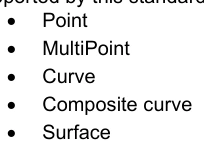

GFM 不允许空间物体的属性,所有类型都来源于类型对象,指它们有标识符,可能具有空间质量等相關信息.

```text
9-7.7.2
SpatialObject
```

空间对象是一个抽象类,是所有空间对象的基类。

```text
<xs:complexType name="SpatialObject" abstract="true">
<xs:complexContent>
<xs:extension base="Object">
</xs:complexContent>
</xs:complexType>
```

9-7.7.3 点

一个点带有一个单坐标的tuple, 2D 或 3D. 定义看起来像.

```text
<xs:complexType name="Point">
<xs:complexContent>
<xs:extension base="SpatialObject">
<xs:sequence>
<xs:group ref="Coordinate"/>
</xs:sequence>
</xs:extension>
</xs:complexContent>
</xs:complexType>

Note that the group Coordinate is used within the definition to allow both Coordinate2D and
Coordinate3D elements
```

```text
9-7.7.4
MultiPoint
```

类似点此类型定义了要素对象的点几何。 区别在于可以定义一组拖曳物。 因此, 最大鼠标被设定为未绑定的鼠标 。

```text
<xs:complexType name="MultiPoint">
<xs:complexContent>
<xs:extension base="SpatialObject">
<xs:sequence>
<xs:group ref="Coordinate" minOccurs="1" maxOccurs="unbounded"/>
</xs:sequence>
</xs:extension>
</xs:complexContent>
</xs:complexType>
```

9-7.7.5 曲线

曲线描述一个要素对象的行几何。它们是由每个部分有控制点序列和插入方法的分段所构成的。后者根据使用的坐标参考系定义了控制点之间的几何关系。有两种特殊的分段类型:

## 官方 PDF 第 346 页

1. ArcByCenterPoint A 圆弧由中心点和半径定义,弧的起端由起角来定义,而弧的长度由角长度来定义。这个长度是指定弧的方向的签名数量:正向表示顺时针。

2. CircleByCenterPoint A 由中心点和半径定义的圆.

抽象类型 SessionBase 定义了控制点的序列和插值类型属性: <xs:complexType name="SegmentBase"抽象="real" >xs; 序列="控制点"类型:"坐标2D" minOccurs="1" 最大值值="未受约束"/"xs.sequence" <x:tization name't" potolationTyope" use="需要"/ "xs?complictype" 从该类型中衍生出该片段. 限制控制点数至少为两个:

```text
<xs:complexType name="Segment">
<xs:complexContent>
<xs:restriction base="SegmentBase">
<xs:sequence>
<xs:element name="ControlPoint" type="Coordinate2D" minOccurs="2" maxOccurs="unbounded"/>
</xs:sequence>
</xs:restriction>
</xs:complexContent>
</xs:complexType>

For the “by center point” segments the abstract base type is also derived from SegmentBase
restricting the number of control points to exact 1 and fixes the value of the attribute interpolation.
```

```text
<xs:complexType name="ArcByCenterPointBase" abstract="true">
<xs:complexContent>
<xs:restriction base="SegmentBase">
<xs:sequence>
<xs:element name="ControlPoint" type="Coordinate2D" minOccurs="1" maxOccurs="1"/>
</xs:sequence>
<xs:attribute name="interpolation" type="InterpolationType" use="required"
fixed="CircularArcCenterPointWithRadius"/>
</xs:restriction>
</xs:complexContent>
</xs:complexType>

The ArcByCenterPoint is then an extension of this type adding attributes for radius, start angle and
angular length.
```

```text
<xs:complexType name="ArcByCenterPoint">
<xs:complexContent>
<xs:extension base="ArcByCenterPointBase">
<xs:attribute name="radius" type="xs:double" use="required"/>
<xs:attribute name="startAngle" type="xs:double" use="required"/>
<xs:attribute name="angularDistance" type="xs:double" use="required"/>
</xs:extension>
</xs:complexContent>
</xs:complexType>

The CircleByCenterPoint type is very similar. The attribute start angle is not defined since it is
meaningless. The direction is here defined by the attribute direction which has values ‘+’ or ‘-‘.
```

## 官方 PDF 第 347 页

```text
<xs:simpleType name="Direction">
<xs:restriction base="xs:string">
<xs:enumeration value="+"/>
<xs:enumeration value="-"/>
</xs:restriction>
</xs:simpleType>

<xs:complexType name="CircleByCenterPoint">
<xs:complexContent>
<xs:extension base="ArcByCenterPointBase">
<xs:attribute name="radius" type="xs:double" use="required"/>
<xs:attribute name="direction" type="Direction" default="+"/>
</xs:extension>
</xs:complexContent>
</xs:complexType>

A group is defined that allows the use of the different type of segments.
```

```text
<xs:group name="Segments">
<xs:choice>
<xs:element name="Segment" type="Segment"/>
<xs:element name="ArcByCenterPoint" type="ArcByCenterPoint"/>
<xs:element name="CircleByCenterPoint" type="CircleByCenterPoint"/>
</xs:choice>
</xs:group>

The type Curve finally combines a sequence of segments with the topological boundary. The
topological boundary of a curve is the beginning and end node implemented by a Point object.
```

```text
<xs:complexType name="Curve">
<xs:complexContent>
<xs:extension base="SpatialObject">
<xs:sequence>
<xs:element name="Boundary" type="BoundaryRelation" minOccurs="0" maxOccurs="2"/>
<xs:group ref="Segments" minOccurs="1" maxOccurs="unbounded"/>
</xs:sequence>
</xs:extension>
</xs:complexContent>
</xs:complexType>
```

```text
9-7.7.6
CompositeCurve
```

复合曲线描述要素物体的线几何与“简单”曲线一样。 但与其使用坐标来定义几何,不如使用其他曲线的序列,包括其他复合曲线。 换句话说,它是一个与其他曲线的关系序列。

```text
<xs:complexType name="CompositeCurve">
<xs:complexContent>
<xs:extension base="SpatialObject">
<xs:sequence>
<xs:group ref="CurveRelations" minOccurs="1" maxOccurs="unbounded"/>
</xs:sequence>
</xs:extension>
</xs:complexContent>
</xs:complexType>
```

9-7.7 地表状况

表面描述一个要素物体的区域几何。表面本身由它的边界来定义。边界由一个外环和若干个内环组成。内环描述区域内的孔口。每个环是用一或多条曲线所形成的封闭多边形。这意味着

## 官方 PDF 第 348 页

环与复合曲线非常相近,但与复合曲线不同,它不是从空间对象衍生出来的,因为它不需要可识别。

```text
<xs:complexType name="Ring">
<xs:group ref="CurveRelations" minOccurs="1" maxOccurs="unbounded"/>
</xs:complexType>

And the definition of a surface finally is:
```

```text
<xs:complexType name="Surface">
<xs:complexContent>
<xs:extension base="SpatialObject">
<xs:sequence>
<xs:element name="OuterRing" type="Ring"/>
<xs:element name="InnerRing" type="Ring" minOccurs="0" maxOccurs="unbounded"/>
</xs:sequence>
</xs:extension>
</xs:complexContent>
</xs:complexType>
```

9-8 信息对象

信息对象在数据集中是可识别和可被描述的信息。在模型中,一个抽象类型的信息来自该类型对象。虽然没有添加额外的属性,但出于语义原因,该类型是有用的。

```text
<xs:complexType name="Information" abstract="true">
<xs:complexContent>
<xs:extension base="Object"/>
</xs:complexContent>
</xs:complexType>
```

9-9 要素对象

要素是真实世界现象的抽象. 此Schema定义了任意要素类型的抽象基类型,类型要素取自要素,从地基类中将空间关系序列和几何原始属性加入要素属性,以及可选关联到其他要素.

当一个协会出现时,应使用要素目录所定义的要素协会的代码作为元素名称来取而代之的关联要素 - 更多信息见附件A.

```text
<xs:complexType name="Feature" abstract="true">
<xs:complexContent>
<xs:extension base="Object">
<xs:sequence>
<xs:group ref="SpatialRelations" minOccurs="0" maxOccurs="unbounded"/>
<xs:element name="associatedFeature" type="FeatureAssociation" minOccurs="0"
```

maxOccurs="未绑定"/ > <!!- 当生成输入 XML时,基子计划应被扩展为提供替代组

用于要素目录中定义的每个特性关联。 例如,如果要素目录定义了一个具有结构设备代码的要素关联,则基子计划应该以: <xs:emment name="Structure Equipment" 替代组="关联要素"/ >- > > </xs;序列="正统"类型="要素属性优先"使用="需要"/"xs.ex:extension" </Xs:complexContent" <-x:complectiveType"来扩展.

## 官方 PDF 第 349 页

9-10 显示处理

这一规格参考了XSLT 1.0,这是W3C的建议。

XSLT 使用 XPath 1.0 处理文档的组件.

XSLT(XSLL Transformations)是一种语言,以一个形成良好的XML文档来表示. 意图在显示时使用XS LT的目的是将数据转换为绘图指令. 由于XSRT在XMl中被表达,它作为机器可读的转换语言可以被交换. XS Lt在许多域被广泛使用,但也许最常用的是将XMI文档转换为HTML,用于网页显示. XSLT 有许多教程、书籍和参考材料,还有几个网站可以张贴问题和找到例子。

XSLT使用模板在输入的XML树中处理节点,并生成节点作为输出的XML,其他SGML格式甚至纯文本. 有两种类型的模板是匹配模板和被命名的模板.

匹配模板使用匹配表达式使用XPATH来指定输入文档中哪些元素应该由该模板处理. XPATY (XML Path Language)是一种用于在XMI文档中处理或找到组件的表达式语言. 路径能力使得它在处理嵌入式复杂属性等内容的分级时特别有用. 匹配模板只能匹配输入文档中的元素. 匹配的模板在优先权计算和冲突解决方法中有一个构建,用于确定在多个模板匹配同一元素的情况下使用哪个模板. 优先级号可以被明确指定为匹配模板的属性,以推翻默认的冲突解决行为.

命名模板与要处理的数据一起使用另一个模板。命名模板也可以有参数。这些参数可用于格式化或其他转换中常用的操作。一个命名模板甚至可以自称(回溯),这对字符串符号解析等操作都是有益的。

模板可以循环到一组与 XPath 表达式相匹配的节点上, 使用“ xsl: applytemplades ” 或“ xSl: for- for-each” 指令元素。 节点也可以在处理前排序。 有条件的处理可以通过简单的“ x sl:if” 指示或“ Xsl; choose” 指导进行。 选择指令允许测试一组表达式, 以便只处理第一个匹配, 如果找不到匹配, 则使用一个可选的语句处理默认。 这对测试所枚举的数据很有用, 从而根据点数值生成不同的输出 。

XSLT还包括在顶层通过参数并在任何模板内访问的能力,这些参数对于提供变换的上下文信息可能有用,XSL特中也有变量,但只能作为定义的一部分来分配数据,这与其他可以重新分配变量的语言不同. 变量对于收集数据或决定结果很有用,这些数据或决定结果可以作为参数传递到另一个模板或在有条件的语句中使用.

XSLT可以包含或导入其他的XSLT文档,这种能力对于管理模板和多顶层的XLST文档对模板的再利用都是有益的.

示例

考虑到下文的例子XML

```text
<BeaconCardinal id="2">
<s100:Point ref="3"/>
<categoryOfCardinalMark>3</categoryOfCardinalMark>
</BeaconCardinal>
<BeaconCardinal id="3">
<s100:Point ref="3"/>
<categoryOfCardinalMark>2</categoryOfCardinalMark>
</BeaconCardinal>
```

## 官方 PDF 第 350 页

一个简单的匹配 XSLT 模板,用作描述函数

```text
<xsl:template match="BeaconCardinal">
```

<!- 这是评论。 此模板匹配灯塔卡迪纳尔节点, 模板正文可以 。

检查数据和输出结果 -- > </xsl:template> 上述模板将用于处理所有灯塔卡迪纳尔对象。

选择指令可以用于在模板内进行有条件的处理.

```text
<xsl:template match="BeaconCardinal">


<xsl:choose>

<xsl:when test="categoryOfCardinalMark = '2'">


<!--  Output symbol for BeaconCardinal categoryOfCardinalMark =2 here -->

</xsl:when>

<xsl:when test="categoryOfCardinalMark = '3'">


<!--  Output symbol for BeaconCardinal categoryOfCardinalMark =3 here -->

</xsl:when>

<xsl:otherwise>


<!--  Output default symbol here -->

</xsl:otherwise>
</xsl:choose>


</xsl:template>

A more advanced XPath expression can be used to refine the match.
```

```text
<xsl:template match="BeaconCardinal[categoryOfCardinalMark=2] ">
```

<!- 这是注释。 用于 BeaconCardinal 分类 OfCardinalMark = 2 的输出符号 -- > </xsl: template >

9-10.1 平面输入验证

显示 Catalogue 描述了每个有效的描述输入参数(context parameter),并可能提供相关的验证规则和值限制. 验证规则是 XPath 1.0 Boolean 表达式; 或者 W3C XML 标准 – 第2部分,附录 F正则表达式. 规则支持验证用户输入到描述,限制支持取消自由形式输入,同时支持机器可读用户界面(UI).

为确保在使用用户输入值之前,该数值是合理的,验证规则可以:

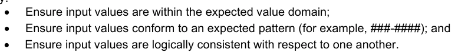

确保输入值在预期值领域之内; 确保输入值符合预期模式(例如,QQ-XQ); 确保输入值在逻辑上相互一致。

此外,可以启用或禁用基于 XPath 1.0 Boolean 表达式的上下文参数和验证规则,支持有条件的验证和机器可读的UI. 例如,当"双阴影"参数值为真时,S-101 Shallow Contour参数的验证可能禁用.

具有相关约束的上下文参数仅限于一组被列出的数值。这允许应用程序消除这些参数的自由格式输入;并通过将每个被列出值(例如,与“1”值相联的“On”)加成标签来增强机器可读的UI。

应用程序支持描述输入验证方式:

1. 利用限制限制用户输入。 2. 每次更改为上下文参数值时: a. 生成一个简单的 XML 文档, 编码上下文参数值:

## 官方 PDF 第 351 页

```text
<TwoShades>true</TwoShades> <!-- etc.-->
b. For each enabled validation of each enabled context parameter:
```

一. 确保 XPath 规则评价为真实;二. 确保正则表达式匹配。

XPath 验证应该全部评价为真实,而regex验证应该在处理描述规则之前都匹配。 如果一个允许的验证评价为虚假或不匹配,那么就不应该进行进一步的描述处理,并且应该激活与失败的验证规则相关的错误信息。

9-11 绘图指令

9-11.1 绘制指示的概念

9-11.1 一般概念

绘图引擎的输出是一组绘图指令,将要素类型与符号和/或提醒参考物相连接,几何或取自要素类型,或可由绘图功能所生成,后者由增强几何的概念所支持.

9-11.1.2 平面坐标参考系

在这方面,协调参考系统只指几何图形。

与显示相关的CRS不同:

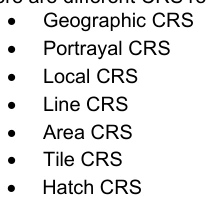

地理CRS被用于显示的地理学数据集,它们将通过预测和亲和转换来映射到显示 CRS,但是,相对于地理CSR的北轴,符号的旋转仍然可能被定义.

显示 CRS定义了输出设备的坐标,例如屏幕或像素映射.

线条符号有两种坐标参考系,线条坐标参考系是非喀特斯二轴坐标系统,x轴沿行几何而y轴与曲线几何相接相接,此CRS允许在几何后对行宽,相抵和符号进行规格. 第二种坐标参考系是本地笛卡尔坐标参考系的,它沿着曲线对每个位置进行定义。这个坐标参考体系有一个X轴,与曲线相近,而Y轴与x轴相垂直。

区域符号定义了它边界和内部的坐标参考系,边界坐标参考系的是那些为行符号所定义的坐标参考系,区域符号的内部有自己的坐标参考体系.

对于平板图案和舱口图案,定义了自有的CRS.

9-11.1.3 查看组、查看组层和显示模式

取景组是一个控制显示内容的概念,它作为指定给相应取景群的任何绘图指令的开关/关闭开关,可以将这个概念看作是绘图指令列表中的过滤器.

当任何指定的查看组被禁用时, 具有多个查看组的绘图指令会被禁用 。

取景组可以被集成取景组图层,取景组图层可以被集成显示模式. 两种取景组都是显示 Catalogue的一部分.

## 官方 PDF 第 352 页

9-11.1.4 透明度

必须用转折的附加效果必须通过相乘的元件α值来实现。 比如,一个具有10%透明度的彩色标志,其绘制的透明率为20%,将产生(1-10%) * (1-20%) = 72%的α= 28%的透明度。

9-11.1.5 显示平面

显示平面是一个将绘图函数的输出分割成单独的列表的概念。这方面的一个例子是,在雷达图像下绘制的图表信息与从雷达图像上绘制的图信息分离。

9/11.1.6 显示优先事项

显示优先级控制渲染引擎处理绘图函数输出的顺序。优先级数字值较小的,将首先处理。必须命令具有同等优先级的指令,以便先发布区域指令,然后发布行指令,再发布指针指令,最后发布文本指令。 如果显示优先级在同一类指令(区域,行,点,或文字)中是相等的,则必须使用其他中性标准来命令指示.

9.11.1.7 无效指令

这是一项指示,旨在表明某一要素是故意不描绘的。

9-11.1.8 点指示

概述

点指令定义了符号的绘图。符号可以参数化,这包括旋转、缩放和相抵。细节在符号包的文档中描述。

点几何

当点指示引用点几何时,符号会使用其位置来绘制.

```text
MultiPoint Geometry
```

该符号使用多点的每个位置来重复.

曲线几何

符号从空间参考或如果没有在每种曲线上直接被要素类型所引用,则每个被引用的曲线上绘制出符号。符号的位置由符号的线条Placement元素控制。细节在符号包的文档中描述。

地表几何

符号取自于表面内的代表性位置。该位置是如何获得的,由符号的区间Placement成员控制。详情见符号包的文档。

9-11.1.9 线路指令

概述

线条指令定义了线条样式的绘制。线条风格包括简单而复杂的线条式。线行样式可以参数化。详细情况在线条Styles包的文档中描述。几何由被引用的空间类型来定义。只支持曲线或地表几何。对于后者,表面的边界定义了几何. 几何定义了行走风格的绘画方向.

禁用( P)

当要素共享曲线几何多行指示时,可能引用同道曲线.

如果压制设置为真实(默认), 具有更高显示优先级的另一行指示将压制此行指示的绘制。 如果压制被设置为虚假, 此指示无法压制 。

## 官方 PDF 第 353 页

9-11.1.10 地区指示

概述

区域指令定义了区域填充的绘图。区域填装包括颜色填充和不同的图案填充。填充的区域可以参数化。详细情况在区域填报包的文档中描述。仅支持地表几何。

填充区域必须包括地表边界.

9-11.1.11 文本说明

概述

文本指令定义了文本的绘制。文本可以参数化,这包括字体、颜色和大小。细节在文本包的文档中描述。

点几何

当文本指令引用一个点几何时,文本会使用其位置来绘制。只支持文本点元素。

```text
MultiPoint Geometry
```

文本使用多点的每个位置重复。只支持文本点元素。

曲线几何

每个曲线都重复文字。支持文本点和文本行元素。

TextPoint 主要是针对曲线上某个点绘制横向向上文本. TextLine 主要是按照曲线形状绘制文本.

表9-1 - 曲线几何 - 绘图命令

绘制用于旋转的 CRS 位置的命令

```text
TextPoint
LineCRS
PortrayalCRS
```

```text
TextLine
LineCRS
LineCRS
```

图9-9 – 文本点的图像,用于通过将文本放入文本位置来将文本放在各种轴心上

增强光的结束( 信息)

更多细节可见于文本包的文档.

地表几何

文本绘制在表面中的代表性位置。仅支持文本点元素。如何获得此位置由文本点所在的区域Placement成员控制。详细情况见文本包的文档。

可读文本

显示引擎可以调整文本, 使其在屏幕上直立且可读取。 TextPoint 默认在 显示CRS 上水平。 超过 +/- 90 度的旋转要避免 。 text 渲染为

## 官方 PDF 第 354 页

TextLine 意在在参考点直立可读,但在遵循曲线时可能倒转。在参考地标的曲线轴将被绘图引擎用来使文本可读并保持文本在曲线上相对位置。请参见下图。

图9-10 – 带入行尾的增强射线上TextLine样本. Green.

表示无调整,蓝色表示调整后的位置(信息)

图9-11 — 曲线上的一些文字( 信息)

向上显示课程

如果显示引擎支持向上或向上非向上显示,则会自动调整文本放置和对齐,以保持文本的可读性.

## 官方 PDF 第 355 页

图9-12 – 显示时的文本线不向北上(信息)

显示引擎中也可以调整非北上图画中的文本Point位置,可以使用出处和文本参考点之间的轴承和距离来计算文本的对齐,以保留地理位置和相对显示距离.

文本消除冲突

为了避免文本重叠并改进可读性,显示引擎可能会压制出一些文本来使其他文本可以读取.

9-11.1.12 覆盖范围说明

概述

指导描绘网格测深,卫星图像等数据覆盖.

“一个覆盖是每个属性类型具有多值的要素,在要素几何代表中每个直接位置对每个属性类别具有单一值。”

在本文档中,用于描述的覆盖属性预计将具有数值.

显示 用于覆盖的指派从覆盖特性开始。 与其他要素类型一样, 规则用于匹配要素和绘图指令 。

第一个匹配的查找表用于根据指定覆盖属性来指定描述。覆盖描述有三个选项:以颜色填充;以数字文本填充或以符号填充。

分散覆盖

不同覆盖范围的描述方式是,对与覆盖面属性的每个值有关的直接位置使用符号和(或)数字注释。

持续覆盖

连续覆盖是通过填入实际数据相关的单元格来描述的,而不是没有数据(在HDF5中称为“填充值”),而不是像描述术语一样与颜色或符号填充相混淆。描述中使用的填充可以是固态填充;符号图案;像素图;或梯度。填充透明度也可以由适用的描述规则来指定。 如果在覆盖类型中定义(见S-100 Part 8, 第8-7.7.3条),可以应用内插法来描述每个网格单元格中数据值的变化。文本或符号放置的锚点取决于覆盖的空间类型和在显示 Catalogue中的放置属性。

形状网格不规范,未分化的网格,可变的细胞大小网格(见S-100 Part 10,表10c-15)在显示方面都与正格相似,对于可变细胞大小的网克,单位单元格必须用于符号填充(即在覆盖一个以上单位单元格的扩大的单元格中,符号必须被显示在被扩大的细胞中包含的每个单位单元格的中心).

## 官方 PDF 第 356 页

颜色分配

颜色通过一个匹配选定属性值并指定颜色的查询表适用于覆盖范围。对于网格单元格、像素或平板等连续覆盖,每个元素都经过处理,并用适当的颜色填入颜色。对于带有不同点颜色的离散覆盖,则使用指定的笔宽度作为笔下或点操作。

查询表条目可以匹配一系列数值,并指定该范围的单一颜色,或者指定用于创建梯度或坡道效应的起端和起端颜色,作为跨颜色范围的值范围的线性插值.

数字和符号说明

对于连续覆盖,每个单元格的中心(如矩形、平板、三角形)被用作文本或符号的锚点。

对于离散覆盖,说明的锚点是与"覆盖覆盖"中属性Code参数所指定的属性的每个值相关的直接位置(见第9-12.7.4.1条)。

对于数字说明, 需要删除或避免碰撞。 缓冲器可以用来提供注释之间的一些空间。 0 的缓冲意味着在数字交互时使用直接的多相。 使用一个叫“ champion” 的计数来指定当发生相互作用时要保留哪个注释( 最大或最小值 ) 。 对于数字说明,案文应放在文字的光学/几何中心代表所处位置。

对于符号说明,可以使用从覆盖面中分离的属性来对符号进行缩放和旋转,这可以有用,例如,在描绘一个带波高和波向的覆盖面时。

9-11.1.13 增强几何学

概述

如果在地理数据集中没有明确给出绘图指示所需的几何图形,则绘图函数将产生这种“增强”几何。用于这种扩大的几何的一组分类是模型的一部分。这些分类中使用的所有位置都指向特定的坐标参考系。

地理坐标为地理坐标。

2. 显示 CRS 坐标参考了图画的输出设备.

坐标是指与显示 CRS平行的坐标系统,但来源转移到被引用特性的位置,只有该类型的CRS支持点特性。

注:生成的几何只为显示目的暂时存在,不是数据集的一部分.

所有类型的加成几何可以用于文字的显示.

图9-13-带有增殖地貌要素的点

## 官方 PDF 第 357 页

更多细节可见于绘图指令模型的文档.

9-11.2 绘图指令包模型

此包包含描述绘图函数输出的类。 显示指令将特性类型及其几何与符号元素包中的元素相连接。 下面的图9-14显示了模型 。

图 9-14 — 绘图指令

## 官方 PDF 第 358 页

```text
9-11.2.1
DisplayList
```

角色名称描述。 类型

类显示列表 An 命令的绘图指令集 - -

角色指示 本列表的指令 0. * 绘图指令

```text
9-11.2.2
DrawingInstruction
```

角色名称描述。 类型

所有绘图指令的分类绘图摘要基础类 - -

属性 id 绘图指令 0. 1 字符串的标识符

属性父目录指令依赖于父目录绘制指令。 如果在渲染过程中没有执行引用指令, 此指令就不应该执行 。

引用(家长)指令的执行可能受到可视化过程许多方面的影响,包括查看组设置、显示平面能见度、线条压制、尺度最小/最大、日期依赖、悬浮状态以及上级指令的依赖性

0. 1 字符串

属性悬浮指定指令是否只在悬浮上显示 。

OEM 支持此特性是可选的

0.1 布尔

属性取景组 指令指定取景组 。 如果禁用任何取景组, 则禁用指令

1.* 字符串

属性显示 Plane 显示平面 指令被分配到 1 字符串

属性绘图优先级 确定绘图 1 整数顺序的优先权

属性比例尺 最小比例分母以定义将显示该指令的最小比例尺。如果没有,则没有最小比例尺

0.1 整数

属性比例尺( Maximum) 分母以定义将显示该指令的最大比例尺。如果没有,则没有最高比例尺

0.1 整数

角色特写 参考指令将描绘的特写类型

```text
1
FeatureReference
```

角色空间参考 参考要素的空间类型成分, 定义了用于描绘的几何图形。 当该要素的全部几何图形被描绘时, 不使用

```text
0..*
SpatialReference
```

角色时间Valid 绘图指令在指定的时间间隔内有效

```text
0..*
S100_TM_Period
```

角色提醒 参考 提示目录中由指令几何所触发的提醒

```text
0..1
AlertReference
```

```text
9-11.2.3
FeatureReference
```

角色名称描述。 类型

类要素参考 A 类要素类型 - -

属性引用 特性类型 1 字符串的标识符

```text
9-11.2.4
SpatialReference
```

角色名称描述。 类型

空间参考类 A 指空间类型 - -

## 官方 PDF 第 359 页

属性引用 空间类型 1 字符串的标识符

如果空间对象是真实的, 则该物体在数据存储的方向上使用。 仅适用于曲线 。

1 布尔

```text
9-11.2.5
AlertReference
```

角色名称描述。 类型

分类提醒参考 A 在提醒目录中提及提醒 - -

属性引用 提醒目录条目 1 的标识符

属性计划 正在积极进行路由规划时, 提醒突出显示的查看组会被指定为

0. 1 字符串

属性监视器 正在运行时, 提示亮度被指定为查看组

0. 1 字符串

```text
9-11.2.6
NullInstruction
```

角色名称描述。 类型

说明引用的特性不需要显示的指令

```text
-
-
```

```text
9-11.2.7
PointInstruction
```

角色名称描述。 类型

类点指示 A 指向点符号的绘图指令 - -

角色符号 要描绘的符号 1 符号: symbol

```text
9-11.2.8
LineInstruction
```

角色名称描述。 类型

类行指令 A 行几何图案的绘图指令 - -

属性抑制 另一高优先级行指令是否能够抑制此行指令的绘制

1布林=正数

角色线 平面图 1 所使用线条样式 平面图 平面图: Abstract Line Style

```text
9-11.2.9
AreaInstruction
```

角色名称描述。 类型

区域几何图案的图案指示 - -

角色区域 填充区域用于描述 1 区域 填充区域:: Abstractrea Fill

```text
9-11.2.10 TextInstruction
```

角色名称描述。 类型

类别 文本指示 描述文本的绘图指令 - -

角色文本 拟描绘的文本 1 文本: Text

```text
9-11.2.11 CoverageInstruction
```

角色名称描述。 类型

描述覆盖范围的绘画说明 -- --

## 官方 PDF 第 360 页

数据总数

角色覆盖 覆盖 用于描述 1 的覆盖 覆盖: CoverageFill

```text
9-11.2.12 AugmentedGeometry
```

角色名称描述。 类型

用于绘制指令的类增强图形 A 基础类,使用数据集中没有的几何图形。几何图形由描述函数根据定义的 CRS 生成

```text
-
-
```

属性 crs 生成几何坐标的坐标参考系。

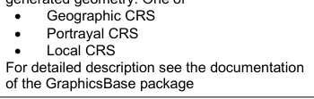

详情见文件。

```text
1
GraphicBase::CRSType
```

角色文本 A 由指令描述的文本。 文本规则根据指令使用的几何类型而适用

文本: 文本( T)

```text
9-11.2.13 AugmentedPoint
```

角色名称描述。 类型

类增强点 A 绘图指令,用于不由特性类型给出位置的点符号

```text
-
-
```

属性位置 符号 1 图形库的位置: Point

角色符号 所要描绘的符号为0.1 符号: symbol

```text
9-11.2.14 AugmentedLineOrArea
```

角色名称描述。 类型

线性增强几何学的增强LineOrarea A类基类 - -

角色行走平面图 拟描绘的行走风格为:0.1行走走平地图:线行走站:线取站:行走正地图.

```text
9-11.2.15 AugmentedRay
```

角色名称描述。 类型

类增强光A绘图指令,它定义从点要素的位置到另一个位置的行。该位置由方向和长度属性定义。它可用于绘制行样式或行文本。

```text
-
-
```

属性旋转 CRS 如果存在, 请指定方向为 0. 1 的 CRS 。 GraphicsBase: CRSTy pie

与已使用的 CRS 1 相对的射线方向

属性长度 射线长度。 单位取决于使用的 CRS

1个双

```text
9-11.2.16 AugmentedPath
```

角色名称描述。 类型

线条的类增强Path A 绘图指导。 它可用于绘制行样式或行文本

```text
-
-
```

角色路径 定义行几何 1 图形Base: Path

## 官方 PDF 第 361 页

```text
9-11.2.17 AugmentedArea
```

角色名称描述。 类型

Class Aumentedrea A 绘图指令用于一个区域。它可用于绘制行样式、区域填充或区域文本。所使用的路径必须关闭

```text
-
-
```

角色区域 填入区域要描绘为0.1 区域 填入区域:: 区域 填入

9-12 符号定义

9-12.1 概述

符号定义包描述了用于显示的图形原始。原始部分的外部定义使用 SVG 定义。这些外部部分将从该模型中的类型中引用。此包图见下文图9-15。

图9-15 - 符号定义包

## 官方 PDF 第 362 页

9-12.2 图形库软件包

9-12.2.1 概述

此包包含用于其他包的图形基类型.

9.12.2.2型号

图9-16 – 图形基础

9.12.2.2.1 点

角色名称描述。 类型

二维坐标空间中的 Class Point A 0维几何天体。 坐标将指坐标参考系

```text
-
-
```

属性 x 点的x坐标。 如果 CRS 是地理上的 CRS ,则指经度 。

1个双

属性 y 坐标。 如果 CRS 是地理上的 CRS ,则指纬度 。

1个双

9-12.2.2.2 矢量

角色名称描述。 类型

既具有星等又具有方向的类矢量 A 几何天体。 它仅限于笛卡尔坐标参考系

```text
-
-
```

属性 x 矢量 1 双相的 x 坐标

矢量的Y坐标 1 双倍

9-12.2.2.3 颜色

角色名称描述。 类型

按照颜色模型表示颜色的类颜色

```text
-
-
```

属性符号 符号指定了彩色表格中的元素, 或RGB 空间中的颜色定义

1 个字符串

## 官方 PDF 第 363 页

属性透明度 值指定了透明度; 0 (不透明) 至 1 (完全透明) 之间

1个双

9-12.2.2.4 笔

角色名称描述。 类型

用于绘图行的 Class Pen A 工具 - -

属性宽度 : 以毫米 1 为倍的笔宽度

角色颜色 笔的颜色包含实际颜色和透明度

1 颜色

9-12.2.2.5 位图

角色名称描述。 类型

类 Pixmap A 二维像素阵列定义图像 - -

属性参考 A 引用像素映射的外部定义。 此字符串是 显示 Catalogue 的像素映射部分中唯一的标识符 。

1 个字符串

角色凌驾于像素图中使用的全透明颜色的 A 颜色

0.1 颜色

关联覆盖 A 颜色, 要被另一个颜色 0. * 覆盖颜色 。

```text
9-12.2.2.6 OverrideColor
```

角色名称描述。 类型

用其他颜色替换像素图中已有颜色的 Class Override Colors Association 类

```text
-
-
```

角色颜色 用于替换像素图中已存在的颜色的颜色

1 颜色

9.12.2.2.7 民事审判庭

角色名称名称描述

类型 CRSType 值描述 CRS 的类型,包括轴定义、角度测量基准线和相距单位

以等分度测量的轴纬度和经度的CRS。角从正北方向顺时针定义。距离将用米测量。

以正向上指向的一笛卡尔坐标系统。轴上和相距上的单位为毫米。角从正向上向上按时针度来测量 。

注意, 实际输出设备对 Y 轴的方向可能不同

点数本地CRS A笛卡尔坐标系统起源于局部几何,轴上和相距上的单位为毫米,角从正Y轴上以顺时针来测量.

详情见解释。

编号线CRS A 无喀特斯坐标系统,其中x轴沿一曲线几何而y轴与x轴相垂直(正向x轴左侧).

轴上和相距上的单位为毫米. 角以正Y轴的顺时针度来测量 下图9-17 显示不同几何类型的地方 CRS 的定义.

从左到右:

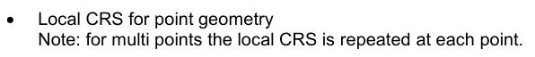

指点几何的局部 CRS 注意:对于多点,每个点会重复局部 CRS .

## 官方 PDF 第 364 页

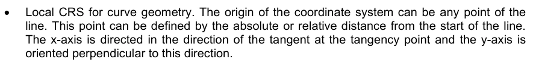

曲线几何的局部 CRS. 坐标系统的出处可以是线的任意一站点,这个点可以由从线起的绝对或相对距离来定义,x轴在切点方向上指向切入点,而y轴方向是向这个方向的垂直.

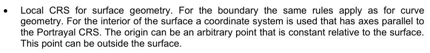

用于地表几何的局部 CRS。 对于边界, 规则与曲线几何一样。 对于地表内部, 使用坐标系统, 轴与 显示 CRS 平行。 源头可以是相对于地表的任意点, 它可以在地表之外。

图9-17-当地中央RS

图9-18-CRS线

9-12.2.2.8 区

角色名称描述。 类型

由两个光圈所包围的笛卡尔平面区

```text
-
-
```

属性旋转 CRS 如果存在, 请指定启动时的 CRS 。 Angle 0. 1 CRSType

属性启动 Angle 定义扇区起始的半径方向

1个双

属性角相距 以度为单位测量的扇形角相距 。 阳性值指顺时针, 阴性值指逆时针

1个双

9.12.2.2.9 路径

角色名称描述。 类型

类路径 线性几何学的定义,用分块的构成

```text
-
-
```

```text
X
```

```text
Y
```

```text
Y
```

## 官方 PDF 第 365 页

作用区段 1. * 路径分区路径可以关闭或不关闭。 关闭的路径有同步的起始点和结束点。 部分连接到路径关闭。 如果这样, 下一段无法连接, 路径包含多个子路径 。

```text
9-12.2.2.10 PathSegment
```

角色名称描述。 类型

用于路径内所有区段的类路由分类摘要基类

```text
-
-
```

9.12.2.2.11 保利线

角色名称描述。 类型

以一系列分数定义其几何的分数 A 类

```text
-
-
```

作用点 积分路径 2.. * 点

9.12.2.2.12 弧形

角色名称描述。 类型

描述圆弧的分级弧文摘底类

```text
-
-
```

9-12.2.2.13 弧形3个点

角色名称描述。 类型

类 Arc3Points A 段描述由 3 个点定义的圆弧。 分点不能是同线

```text
-
-
```

属性起步点 弧起步点 1 点

属性中位点 弧 1 点上的任意点

属性端点 : 弧结束点 1 点

```text
9-12.2.2.14 ArcByRadius
```

角色名称描述。 类型

Class ArcByRadius A 段描述由弧心和半径定义的圆弧. 可选的弧可被扇区限制

```text
-
-
```

属性中心 弧 1 点的中心

属性扇区 定义弧始至终所在的扇区。 如果不显示, 弧是圆形

0.1 部门

属性半径 1 双圆的半径

9.12.2.2.15 安努卢斯

角色名称描述。 类型

类 Annulus A 环形区域,以两个同心圆为界,可选用圆圈的两个弧度相接

```text
-
-
```

属性中心 弧 1 点的中心

## 官方 PDF 第 366 页

属性内拉迪乌斯 较小圆的半径。 如果不显示, 段会描述一个圆的扇区 。

0.1 双倍

属性外拉迪乌斯 1 个大圆圈的半径

部门 废除部门 0.1 部门

9-12.3 符号包

9.12.3.1 模式

此套件包含符号的模型。 请注意, 符号图形本身的定义不是这个模型的主题。 这将根据 SVG 1. 1 推荐在外部文件中定义 。

图9-19 - 符号包

9-12.3.1.1 符号

角色名称描述。 类型

类符号 A 二维图形元素 - -

属性参考 A 引用符号图形的外部定义。 这是 显示 目录符号部分中唯一的标识符 。

1 个字符串

属性旋转 符号的旋转角度。 默认值为 0

1个双

属性旋转CRS 指定旋转的坐标参考系

```text
1
GraphicsBase::CRSTyp
e
```

属性尺度Factor 原始符号图形的缩放因子。默认值为 1

1个双

属性抵消符号位置从几何位置的相移。默认值是长度为 0 的矢量

```text
1
GraphicsBase::Vector
```

角色凌驾于符号内使用的完全透明颜色之上的 A 颜色

```text
0..1
GraphicsBase::Color
```

关联覆盖 A 颜色, 要被另一个颜色 0. * 覆盖颜色 。

角色行 安置信息 线上应该放置符号

```text
0..1
LineSymbolPlacement
```

作用区 平地 定义在0.1 区域内设置符号。

## 官方 PDF 第 367 页

```text
9-12.3.1.2 OverrideColor
```

角色名称描述。 类型

用于替换符号中已存在的颜色的 Class Overried Coloror Association 类

```text
-
-
```

角色颜色 用于替换符号中已存在的颜色的颜色

1 颜色

```text
9-12.3.1.3 LineSymbolPlacement
```

角色名称描述。 类型

类线性符号平板 定义符号沿线排列 - -

从曲线起算的1倍

属性放置模式 定义如何解释偏移的模式

```text
1
LinePlacementMode
```

属性可见部分 当真实时, 表示位置适用于曲线的每个可见部分 。 默认 = 假

0.1 布尔

```text
9-12.3.1.4 AreaSymbolPlacement
```

角色名称描述。 类型

类别 区域符号平地 定义一个区域中的符号位置 - -

属性放置模式 定义符号必须如何放置的模式 。

```text
1
AreaPlacementMode
```

```text
9-12.3.1.5 LinePlacementMode
```

角色名称名称描述

线条平面模版定义符号沿行放置的类型

偏移必须解释为同质坐标,起始为0,曲线末为1。

绝对数字 偏移是曲线开始的距离

```text
9-12.3.1.6 AreaPlacementMode
```

角色名称名称描述

类型 区间平面模块 定义一个区域内符号的放置类型

符号必须放在表面每个可见部分的代表性位置

地理符号 符号必须置于地理对象的代表性位置

## 官方 PDF 第 368 页

9-12.4 线状结构包件

9.12.4.1 型号

图9-20 — 行样式套件

```text
9-12.4.1.1 AbstractLineStyle
```

角色名称描述。 类型

用于描述行几何的图形的 Class 抽象 LineStyle 抽象基础类

```text
-
-
```

```text
9-12.4.1.2 LineStyle
```

角色名称描述。 类型

线条形状 A 类,用于线条几何 - -

属性抵消 偏移到行方向。 值是指行 CRS 的y轴( 向左正, mm)

1个双

属性盖Style 线段结束时应用的装饰

```text
1
CapStyle
```

属性相加Style 两个行段相会时应用的装饰

```text
1
JoinStyle
```

属性间隔 Length 线条样式沿 CRS (单位:mm) 线轴重复间隔的长度 如果未定义, 线行样式描述的是以符号为代表的固态行和/或行

0.1 双倍

角色破折号 虚线样式的破折号。 如果未定义行样式, 则描述的行由

0.* 达什

## 官方 PDF 第 369 页

符号; 未使用笔

角色笔 用于绘制行 1 笔

角色符号沿着行 0. * 线形符号

9-12.4.1.3 达什

角色名称描述。 类型

重复行图中的 Class Dash A 单分线

属性开始 从重复间隔开始测量到的破折号的起始, 与线 CRS (单位为毫米)的x轴相接

1个双

沿着CRS线的x轴(单位为毫米)的破折线长度

1个双

```text
9-12.4.1.4 LineSymbol
```

角色名称描述。 类型

LineSymbol 类 A 符号, 沿着一行, 以重复的图案设置 - -

属性参考 A 指符号图形的外部定义。 此指目录项的标识符

1 个字符串

属性旋转 符号的旋转角度。 默认值为 0

1个双

属性缩放Factor 符号的缩放因子。 默认为 1.0 1 双倍

属性 crsType 符号必须被转换到的 CRS 类型。 可能的值是 localCRS、 lineCRS 和 profileCRS 。

1个CRSTYpe

属性位置 重复间隔开始时测量的符号位置,与线 CRS (单位以毫米计)的x轴相通

1个双

```text
9-12.4.1.5 CompositeLineStyle
```

角色名称描述。 类型

类复合线条A线条样式 由其他线条样式组合而成

角色组件 复合行样式的组件 1..* 抽象线条

```text
9-12.4.1.6 LineStyleReference
```

角色名称描述。 类型

类 LineStyleReference 外部文件中定义的行样式

属性参考 引用行样式的外部定义。 这是 显示 目录行样式一节中唯一的标识符

1 个字符串

```text
9-12.4.1.7 JoinStyle
```

角色名称名称描述

类型 joinStyle 两个行段相会时使用的装饰

点数钟

## 官方 PDF 第 370 页

编号仿真器

编号回合

```text
9-12.4.1.8 CapStyle
```

角色名称名称描述

CapStyle 类型 线段结束时使用的装饰 。

编号托盘

编号平方

编号回合

## 官方 PDF 第 371 页

9-12.5 区域填充物包

9-12.5.1 型号

图9-21 - 区域填充包

```text
9-12.5.1.1 AbstractAreaFill
```

角色名称描述。 类型

用于填充一个区域的图形的 Class AustraliaArea Fill Custralia Base 类

```text
-
-
```

```text
9-12.5.1.2 PatternFill
```

角色名称描述。 类型

类型图案Fill 抽象基础类,用于图案区域填充 - -

确定图案起源的属性区域CRS 坐标参考系

```text
1
AreaCRSType
```

## 官方 PDF 第 372 页

```text
9-12.5.1.3 AreaFillReference
```

角色名称描述。 类型

外部文件中定义的“区域引用”类别

属性参考 外部定义的引用。 这是 显示 目录填充部分中唯一的标识符 。

1 个字符串

```text
9-12.5.1.4 ColorFill
```

角色名称描述。 类型

分类颜色填充类定义一个区域的坚实颜色填充 - -

角色颜色 引用颜色和颜色填充的透明度

1 颜色

```text
9-12.5.1.5 PixmapFill
```

角色名称描述。 类型

类 Pixmap Fill 模式填充, 其中模式由 pixmap 定义

```text
-
-
```

角色像素图 定义图案 1 像素图

```text
9-12.5.1.6 SymbolFill
```

角色名称描述。 类型

以重复符号定义图案的类符号 Fill 模式填充

```text
-
-
```

角色符号图案 1 使用的符号符号

属性 v1 根据本地 CRS 定义模式的第一个维度中下一个符号的相抵

1个矢量

属性 v2 根据本地 CRS 定义图案第二个维度中下一个符号的相抵

1个矢量

属性剪辑符号 表示图案中的符号是按区域剪接(当它们属于区域/区域外时),还是完全不绘制符号,除非它完全包含在区域中

1 布尔

真:填充符号被剪接在区域边界上

假: 填充符号延伸至区域边界上完全没有绘制

```text
9-12.5.1.7 HatchFill
```

角色名称描述。 类型

类 HatchFill 定义由一到两组平行行组成的图案

```text
-
-
```

相接舱门 一组平行的一号线 Hatch

9.12.5.1.8 批量

角色名称描述。 类型

用于区域填充图案的一组平行行

属性方向 定义一行方向的向量

## 官方 PDF 第 373 页

属性距离 测量线与方向的垂直距离

1个双

角色行 1.2 每一个舱口行所使用的行样式 1.2 线条: 抽象线条.

```text
9-12.5.1.9 AreaCRSType
```

角色名称名称描述

类型 CRS 描述填充式的引用方式

点数全局安可与绘图设备上的位置一致, 例如从屏幕的角落开始。 当屏幕平板时, 模式会显示在屏幕上的对象上移入/移动

数字化局部地心测量安可点与所描绘对象的地心几何一致,例如对象左上角。相邻对象的模式可能不匹配。

填充图案的锚点在共同位置被定义,使图案相对于所有区域对象都保持一致

## 官方 PDF 第 374 页

9-12.6 文本包

9-12.6.1 概述

文本包包含文字描述所必需的类型,包括字体。在这个模型中,字体可以用特性描述或以名称来引用。支持两种文字指令:

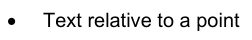

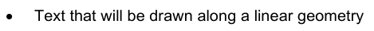

沿着线性几何绘制的文字

9.12.6.2 字体

字体是一组打字面。打字面是字符的艺术表现或解释;它是类型外观。

这个标准支持两种字体定义方法,第一种是四个属性描述一个字体,让系统找到一个最适合图形系统实际可用的字体。第二种方法是引用外部字体文件。这个文件的格式必须符合“True Type Font”标准,必须包含在显示 Catalogue中。

9.12.6.3 型号

图9-22 - 成套文本

9.12.6.3.1 字体

角色名称描述。 类型

字体的分类文摘基础类 - -

## 官方 PDF 第 375 页

```text
9-12.6.3.2 FontCharacteristics
```

角色名称描述。 类型

描述字体主要特性的类字体特征 - -

属性 sarifs 描述类型面是否包含 sarifs

1 布尔

属性重量 描述类型面的厚度 1 字体重量

属性斜度描述类型面的斜度 1 字体斜度

属性比例 描述字体中的所有类型面是否具有单个宽度或固定宽度

```text
1
FontProportion
```

```text
9-12.6.3.3 FontReference
```

角色名称描述。 类型

类字体参考类 外部来源引用的字体 - -

显示 目录内外部文件的标识符

1 个字符串

9-12.6.3.4 文字

角色名称描述。 类型

Class Text 用于描述文本的图形元素的抽象基类。文本由元素组成

```text
-
-
```

属性水平对齐指定文本相对于锚点的水平对齐方式。默认 = 开始

```text
1
HorizontalAlignment
```

属性垂直对齐 指定文本相对于锚点的垂直对齐方式 。 默认 = 底端

```text
1
VerticalAlignment
```

角色元素 已订购的文本元素列表 1.. * 文本元素

```text
9-12.6.3.5 TextPoint
```

角色名称描述。 类型

用于描述文本相对于点的 Class TextPoint A 图形元素

```text
-
-
```

属性偏移 指定来自锚点的 CRS 描述的偏移

```text
0..1
GraphicsBase::Vector
```

属性旋转 指定相对于描述 CRS 的旋转角度。 默认 = 0

1个双

角色行布置描述在几何为曲线时文字的位置

```text
0..1
Symbol::
LineSymbolPlacement
```

作用区域 平地 描述文字在几何为表面时的位置

```text
0..1
Symbol::
AreaSymbolPlacement
```

```text
9-12.6.3.6 TextLine
```

角色名称描述。 类型

用于沿线性几何来描绘文本的 Class TextLine A 图形元素

```text
-
-
```

属性启动 Offset 此偏移指定了1号线双站台的锚点

属性 endOffset 此偏移指定了行上文本的站点。 如果显示启动 Offs集不指定一个锚点, 而是文本的起点。 文本将平分两个位置之间的间隔。 水平对齐在此情况下没有效果 。

0.1 双倍

## 官方 PDF 第 376 页

属性布置模式 指定如何解释相抵值 1 符号: LinePlacement Mode

```text
9-12.6.3.7 TextFlags
```

角色名称描述。 类型

文本标记 A 类文本标记容器 - -

角色旗 A 文本旗 1..* 文本旗

```text
9-12.6.3.8 TextElement
```

角色名称描述。 类型

图像文本的子元素 - -

属性文本 要描绘的文本 1 字符串

属性正体大小 大小 此属性描述文字的大小

1个双

属性垂直 Offset 文本元素与文本底线之间的以毫米为单位的垂直相抵,可用于生成下标或上标。默认=0

1个双

角色旗旗描述文本元素的特殊属性如下划线等.

```text
0..1
TextFlags
```

角色字体 用于描述文本元素的字体。 1 字体

角色前景 用于描绘格言的颜色 1 颜色

角色背景 描述文本前要填入文本元素的矩形的颜色。 如果未给出则没有填入( 透明)

0.1 颜色

```text
9-12.6.3.9 FontSlant
```

角色名称名称描述

类型字体向外斜, 字体内使用的斜度

右上方的编号是正上方的

倒数斜体 字面有咒语

```text
9-12.6.3.10 FontWeight
```

角色名称名称描述

类型 字体 Weigth 字体中的打字面所用厚度

编号光线 类型面被描绘为薄(标准)

数字介质 类型面被描绘为更厚的 " 光 " ,但不如 " 粗 " 。

粗体字图案描绘更为突出( Bold)

```text
9-12.6.3.11 FontProportion
```

角色名称名称描述

类型字体 数值描述字体中类型面的宽度的定义

数字单空格 字体中的所有打字面都有相同的宽度,也称为 " 打字机 " 字体

以字体中的任何字面作为其单个宽度

## 官方 PDF 第 377 页

```text
9-12.6.3.12 TextFlag
```

角色名称名称描述

类型 TextFlag 值描述文字描绘时使用的一些效果。这些值可以合并

线下文字下用一行来描述

通过文字来描述 文字的一行

以文字上行来描述上行文字

```text
9-12.6.3.13 VerticalAlignment
```

角色名称名称描述

垂直对齐类型 描述相对垂直方向锚点的文本位置

标出顶端 :

编号底部, 锚点位于文本底部

编号中心 锚点位于文本的(垂直)中心

```text
9-12.6.3.14 HorizontalAlignment
```

角色名称名称描述

横向对齐 描述文本相对于水平方向的锚点的位置

编号开始 锁定点在文本的开头

编号结束,锚点位于文本的末尾

编号中心 锁定点位于文本的( 横向) 中心

9-12.7 保险包

9-12.7.1 概述

覆盖包包含描述覆盖的种类,这种描述适用于数字覆盖值的描述。

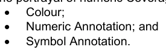

9-12.7.2 范围

区域用于控制描述如何被分配到覆盖的值。这些区域使用S-100 第一部分概念Schema语言定义的 S-100_NumericRange 复合类型。数字区域类型允许使用不同关闭选项的各种区域定义。

9-12.7.3 查询表

覆盖覆盖覆盖分类包含一个命令的搜索条目列表。 每个条目都包含一个范围, 通过测试是否覆盖值与范围相匹配来评价匹配。 第一个匹配范围的搜索条目用于对覆盖元素应用最多一种类型的描述(颜色、数字注释或符号)。 例如,这可以将一个单元格填入一个网格,并给单元格也分配一个数字或符号注释。

查找表还可以将绘图指令中指定的提醒与覆盖值范围相挂钩。当将提醒与涵盖值挂钩时,可能存在也可能没有描述元素(颜色、数字注释或符号)。

## 官方 PDF 第 378 页

9-12.7.4型号

图9-23 - 覆盖包

```text
9-12.7.4.1 CoverageFill
```

角色名称描述。 类型

分类覆盖 填充覆盖的 A 类,使用一个查询表来匹配数值或数值范围,并指定颜色、数字或符号说明

```text
-
-
```

属性属性 覆盖属性值代码与 1 字符串匹配

属性 uom 度量单位。 如果未给出值, 则假定值与覆盖属性值相同 。

```text
0..1
S100_UnitOfMeasure
```

指定案文或符号的起落点

只有在需要文字或符号说明时,才必须进行显示;否则省略

这一属性仅适用于连续覆盖(对于离散覆盖,锚点为直接位置)。

```text
0..1
CoveragePlacement
```

角色查询表。 条目在第一次匹配的基础上命令和处理

```text
1..*
LookupEntry
```

## 官方 PDF 第 379 页

```text
9-12.7.4.2 LookupEntry
```

角色名称描述。 类型

Class Lookup Entry 用于指定覆盖元素的描述的查询表格中的一个条目 。

```text
-
-
```

用作显示标签或图例字段的属性标签字符串。 1 字符字符串

属性范围 值范围定义 。 可以是一个单独的值, 打开或关闭范围等。 详情见 S- 100 第一部分 概念舍马语言 。

```text
1
S100_NumericRange
```

角色颜色 匹配范围的颜色。 可以是单一颜色或彩色斜坡 。

```text
0..1
CoverageColor
```

角色数字 以数字数字显示值。 0.1 数字注释

角色符号 显示符号. 0.1 符号注释

```text
9-12.7.4.3 CoverageColor
```

角色名称描述。 类型

以颜色填充覆盖率的A类

属性笔 Width 可选笔宽度, 用于离散点的点颜色

0.1 双倍

角色开始颜色 指定匹配范围的颜色, 或定义“ endColor” 时用作彩色斜坡的起始点

```text
1
GraphicBase::Color
```

角色端点颜色 彩色坡道中用作止点的颜色 。 数值范围线性地分布在从“ startColor” 到“ endColor” 的颜色范围以产生梯度效应

起始和结束颜色应转换为 CIE xyL 颜色空间,每个组件(即x、y、L和透明)在转换回SRGB以显示之前必须分别插入

```text
0..1
GraphicBase::Color
```

```text
9-12.7.4.4 NumericAnnotation
```

角色名称描述。 类型

涵盖范围内的数值数字文字说明的分类

```text
-
-
```

以下标 1 整数显示的小数位数

属性正体大小 大小 此属性描述文字的大小

1个双

属性缓冲缓冲器 申请演示文稿单位的相撞检测 。 默认= 0

1个双

显示碰撞时要显示的值的属性冠号

```text
1
ChampionChoice
```

角色字体 字体 信息 用于显示覆盖范围内的数字值 。 文本: Font 是字体或字体参考的一种选择

1 文本: 方 :

角色颜色 绘制数字注释 1 图形Base:: 颜色

```text
9-12.7.4.5 SymbolAnnotation
```

角色名称描述。 类型

涵盖范围内的符号符号注释 A 类。

```text
-
-
```

属性符号 参考要应用的符号。 目录 id. 1 IDSTring

## 官方 PDF 第 380 页

属性默认旋转 一个默认符号旋转。 当旋转属性没有定义时, 应用。 默认= 0

0.1 双倍

属性旋转CRS 指定旋转的坐标参考系。默认= 显示CRS

```text
1
GraphicsBase::CRSType
```

属性默认缩放 默认符号缩放因子。 当比例属性未定义时, 将应用。 默认= 1

1个双

属性旋转 属性 覆盖属性的属性代码用于符号旋转值.

```text
0..1
CharacterString
```

属性自转Factor在应用前曾以乘法调整 " 旋转属性 " 值。默认为 1.0

0.1 双倍

属性比例尺 属性 覆盖属性的属性代码用于缩放符号大小.

```text
0..1
CharacterString
```

属性缩放Factor在应用前曾通过乘法调整 " 比例尺属性 " 值。默认 1. 0

0.1 双倍

```text
9-12.7.4.6 CoveragePlacement
```

角色名称名称描述

类型覆盖 位置 定义覆盖符号或文字说明的放置类型

数字中心 注释的锚点是单元格的中心

编号直取 说明的锚点是与属性CideFill中指定属性的每个值相关的直接位置,其中放置的编码

9.12.7.4.7 覆盖范围和安置

表9-2 - 覆盖面和安置情况

覆盖空间类型( 属性数据 CodingFormat ) 。 见 第 10c- 10.1 条 数据编码格式

内插(属性内插Type),见第8-7.3条 S-100_CV_刑警组织方法

见第9-12.7.4.1条 涵盖范围 Fill和9-12.7.4.6 涵盖范围

生成的符号/文字位置

固定式移动 平面站台 Fixed Feature 面向正线网格(DCF 1, 4, 8, 9)

(不允许) (没有使用。 如果编码时忽略)

每个直接位置

常绿阔叶林(DCF 2, 3, 5)

离散直发或( 不在)

每个直接位置

中心错误 - 忽略位置属性,并在每个直接位置上描绘

(其他)直接投放每个直接位置

其他资源(未在)

每个单元格的中心

```text
variableCellSize
(DCF 6)
```

离散直发或( 不在)

每个单位网格单元格的每个直接位置

中心错误 - 忽略位置属性,并在每个直接位置上描绘

## 官方 PDF 第 381 页

(其他)每个单位网格单元格的每个直接位置

其他资源(未在)

每个单位网格单元格的中心

TIN(7个DCF)

离散直发或( 不在)

每个直接位置( 三角顶点)

中心错误 - 忽略位置属性并描绘每个直接位置(三角顶点)

(其他)直接位置每个直接位置(三角顶点)

其他资源(未在)

每个三角形的巴音中心(正中央机器人)

9-13 显示库

9-13.1 概述

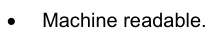

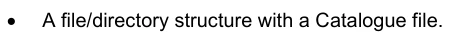

带有目录文件的文件/目录结构.

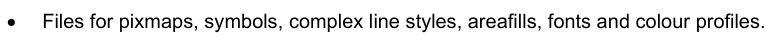

用于像素图,符号,复杂行样式,区域填充,字体和色彩配置的文件.

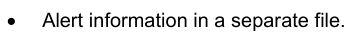

在一个单独的文件中提醒信息 。

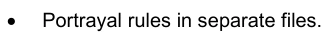

平面规则在单独的文件中.

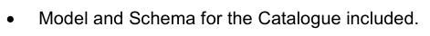

包括目录的模型和Schema.

9-13.2 结构

```text
Root ---- (contains the Catalogue named “portrayal_catalogue.xml”, and optionally an Alert
Catalogue file)
|
|-- Pixmaps (contains XML files describing pixmaps)
|
|-- ColorProfiles (contains XML files with colour profiles)
|
|-- Symbols (contains SVG files with symbols and CSS2 style sheets)
|
|-- LineStyles (contains XML files with line styles)
|
|-- AreaFills (contains XML files area fills)
|
|-- Fonts (contains TrueType font files)
|
|-- Rules (contains files with rules which map features to drawing instructions)
```

## 官方 PDF 第 382 页

9-13.3 目录模型

图9-24 – 目录

## 官方 PDF 第 383 页

```text
9-13.3.1
PortrayalCatalog
```

角色名称描述。 类型

所有目录项目的 Class 显示Catalog A 容器 - -

属性产品 Id 用于目录的产品标识

1 个字符串

属性版本 产品目录的版本定义为

1 个字符串

角色提醒 Catalog A 文件引用提醒目录 0. 1 外部文件

XML Pixmap 文件参考文献中的角色像素映射容器 1 Pixmaps

角色颜色Profiles XML 色彩描述文件的容器参考文献 1 ColorProfiles

角色符号 SVG 符号文件引用容器 1 符号

角色样式 Sheets 容器 CSS 文件引用 1 样式样式

XML 线条样式文件参考文献 角色线条 容器 1 线条

任务区域 填入 XML 区域容器 填入文件引用 1 区域填入

角色字体 True Type 字体引用的容器 1 字体

角色取景组 取景组定义的容器 1取景组

角色基础 模式 显示基础的定义 1 基础模式

角色取景组Layers 取景组分层容器。 1取景组Layers

角色显示工具 显示模式定义的容器 1 显示模式

显示平面定义的容器 1

上下文参数定义的容器 1

规则参考文件的集装箱 1 规则

```text
9-13.3.2
CatalogItem
```

角色名称描述。 类型

Class Catalog 项目目录组件的抽象基类

```text
-
-
```

属性 id 目录项目 1 字符串的独有标识符

角色描述 Meta 数据是每个目录项目的共同数据。可以用不同语言进行描述

0.* 说明

```text
9-13.3.3
ExternalFile
```

角色名称描述。 类型

定义外部文件引用的类外文件 A 目录项

```text
-
-
```

目录项目的子类型 见目录项目 -- --

属性文件Name 文件 1 字符串的名称

属性文件 Type 文件 1 的类型

文件格式 1 文件格式

9-13.3.4 说明

角色名称描述。 类型

某物品的具体语言信息 -- --

属性语言 A语言标识码. ISO 639-2/T alpha-3代码(eng – 英语, fra – 法语, deu-德文)

1 个字符串

## 官方 PDF 第 384 页

属性名称 识别语言中项目的一个可选名称

0. 1 字符串

属性描述项目 1 字符串的语言特定描述

9-13.3.5 像素图

角色名称描述。 类型

类 Pixmaps 一个 pixmap 文件引用的容器 - -

角色像图 文件引用。 类型为 XML 0. * 外部文件

```text
9-13.3.6
ColorProfiles
```

角色名称描述。 类型

颜色文件分类 色彩描述文件引用容器 - -

角色颜色Profile 文件引用。 类型是 XML 0. * 外部文件

9-13.3.7 符号

角色名称描述。 类型

类符号 A 符号文件引用容器 - -

角色符号 文件引用。 类型为 SVG 0. * 外部文件

```text
9-13.3.8
StyleSheets
```

角色名称描述。 类型

CSS 文件引用的 Class Style Sheets A 容器 - -

角色样式Sheet 文件参考文献 0. * 外部文件

```text
9-13.3.9
LineStyles
```

角色名称描述。 类型

LineStyles A 类 Line样式文件引用容器 - -

角色行Style 文件引用。 类型为 XML 0. * 外部文件

```text
9-13.3.10 AreaFills
```

角色名称描述。 类型

区域填充文件引用的容器 - -

角色区域 Fill 文件引用。 类型为 XML. 0. * 外部文件

9-13.3.11 字体

角色名称描述。 类型

字体的分类字体 A 容器 - -

角色字体 文件引用。 对于真实类型字体, 类型为 ttf. 0. * 外部文件

```text
9-13.3.12 ViewingGroups
```

角色名称描述。 类型

查看组类别 A 容器 查看组定义 - -

角色取景组定义特定取景组 1. *取景组

## 官方 PDF 第 385 页

```text
9-13.3.13 ViewingGroup
```

角色名称描述。 类型

类查看组 A 查看组名称和定义 - -

目录项目的子类型 见目录项目 -- --

```text
9-13.3.14 FoundationMode
```

角色名称描述。 类型

Class Foundation Mode A 一组构成显示基础的取景组,无法从显示中移除

```text
-
-
```

基础模式 0 的角色查看组 。 * 查看组

```text
9-13.3.15 ViewingGroupLayers
```

角色名称描述。 类型

类查看组Layers 查看组图层的容器 - -

角色层 特定查看组层的定义 0. * Viewing GroupLayer

```text
9-13.3.16 ViewingGroupLayer
```

角色名称描述。 类型

类查看组 Layer A 一组查看组, 用于在应用程序中打开或关闭

```text
-
-
```

目录项目的子类型 见目录项目 -- --

角色取景组 第1层的取景组. *取景组

```text
9-13.3.17 DisplayModes
```

角色名称描述。 类型

显示模式 A 显示模式定义的容器类 - -

角色显示模式定义显示模式 0. * 显示模式

```text
9-13.3.18 DisplayMode
```

角色名称描述。 类型

类 显示模式 A 一组查看层,用于在应用程序中打开或关闭

```text
-
-
```

目录项目的子类型 见目录项目 -- --

角色查看 GroupLayer 查看组层包含在此显示模式 0. * 查看 GroupLayer 中

```text
9-13.3.19 DisplayPlanes
```

角色名称描述。 类型

显示 Planes 显示 Plane 定义的分类容器 - -

角色显示 Plane 显示 Plane 1. * 显示 Plane

## 官方 PDF 第 386 页

```text
9-13.3.20 DisplayPlane
```

角色名称描述。 类型

类 显示 Plane A 显示 Plane 名称和定义 - -

目录项目的子类型 见目录项目 -- --

用于排序显示平面的绘图顺序的属性顺序。 显示数值较大的平面比数值较低的平面

正面:RADAR 0上方:RADAR预留 正面:RADAR下方:

1个整数

9-13.3.21 上下文

角色名称描述。 类型

类上下文 A 容器上下文参数 - -

角色参数上下文参数 0.* 上下文参数

```text
9-13.3.22 ContextParameter
```

角色名称描述。 类型

类 背景参数 A 背景参数名称和定义 - -

目录项目的子类型 见目录项目 -- --

属性类型 参数1 参数类型

属性默认值 参数 1 字符串的默认值

角色约束 约束参数 0. 1 的值域 。

作用验证此参数的验证规则 . * 验证Type

属性启用 XPath 1.0 布尔表达式。 用于表示条件参数( 例如, 浅色 contour 以 二相为条件 : “/// TwoShades=false” )

0. 1 字符串

```text
9-13.3.23 ConstraintType
```

角色名称描述。 类型

类 约束 Type 约束上下文参数的允许值,并为计数提供有意义的名称

```text
-
-
```

作用点数 约束的有效值和标签 1.. * 编号Type

```text
9-13.3.24 EnumerationType
```

角色名称描述。 类型

分类编号Type 表示一个已列出的数值 - -

角色标签 : 值的标签( 例如“ 可启用的 ” ) 1.. * 文本类型

属性值 计数值( 例如 “ 1” ) 1字符串

属性图标 表示值的图标。 引用目录符号

0. 1 字符串

## 官方 PDF 第 387 页

```text
9-13.3.25 TextType
```

角色名称描述。 类型

类 TextType 表示一个已列出的值 - -

属性 - 国语 1 字符串中的字符串值

属性语言 ISO 639-2/T alpha-3 语言标识码,表示被编码字符串的国语。默认为“ eng ”

0. 1 字符串

```text
9-13.3.26 ValidationType
```

角色名称描述。 类型

类验证 Type 类用于验证规则。 xpath 或 regex 必须同时存在, 但不能同时存在

```text
-
-
```

属性 xpath 安 XPath 1.0 布尔表达式 0. 1 字符串

属性正则表达式每 W3C XML 标准 – 第 2 部分, 附录 F (正则表达式) 0. 1 字符串

角色错误 : 给验证错误消息 1 验证错误 :

属性启用 XPath 1.0 布尔表达式。 表示有条件的验证( 例如, 仅在人口稠密时验证国家语言 : __// NationalLangage[.!=] ) 。

0. 1 字符串

```text
9-13.3.27 ValidationErrorType
```

角色名称描述。 类型

类校验错误的校验错误 −

一种或多种国家语言的错误信息文本

```text
1..*
TextType
```

属性图标 表示错误的图标。 引用目录符号

0. 1 字符串

9-13.3.28 细则

角色名称描述。 类型

类规则 A 容器中的 XSLT 规则文件引用 - -

角色规则 File 引用包含规则 1.. * 规则文件

```text
9-13.3.29 RuleFile
```

角色名称描述。 类型

类规则文件引用 - -

外部文件的子类型 见外部文件 - -

属性规则Type 规则文件中模板的类型。 可以在应用程序中选择一个以上的顶级规则, 允许对数据进行不同的描述

```text
1
RuleType
```

```text
9-13.3.30 ParameterType
```

角色名称名称描述

参数类型选择

编号布尔值 A布尔值

数组整数

## 官方 PDF 第 388 页

双向浮点数

编号字符串 A 字符串

根据格奥尔格历算出的日期

```text
9-13.3.31 FileFormat
```

角色名称名称描述

输入文件格式 外部文件的格式

编号 xml

编号 svg

编号 xslt

编号 ttf

编号路由a

编号

```text
9-13.3.32 FileType
```

角色名称名称描述

输入文件类型

编号字体 A 字体文件

编号区域 填入描述一个区域的文件

编号行Style A 描述行样式的文件

编号符号 描述符号的文件

编号颜色Profile 描述色彩配置的文件

数字化 pixmap A 描述一个 pixmap 的文件

编号规则 包含描述规则的文件

编号样式Sheet A 包含符号样式的文件

包含提醒目录的文件编号提醒Catalog

```text
9-13.3.33 RuleType
```

角色名称名称描述

输入规则类型 规则文件中的模板类型

标注顶端 Template 规则文件包含顶端模板

编号子模板 规则文件包含由其他模板使用或调用的模板

## 官方 PDF 第 389 页

9-13.4 警报目录模型

图9-25 – 警报目录

```text
9-13.4.1
AlertCatalog
```

角色名称描述。 类型

所有目录项的 Class AlertCatalog A 容器 - -

属性版本 目录 1 字符串的版本

任务信息 信息容器 1 信息

突出作用的容器1

作用警报 警报容器 1 警报

## 官方 PDF 第 390 页

9.13.4.2 电文

角色名称描述。 类型

类信件容器信件项目 - -

角色信息 消息的定义: 0.* 消息项目

```text
9-13.4.3
MessageItem
```

角色名称描述。 类型

类消息项目定义语言独立消息 - -

目录项目的子类型 见目录项目 -- --

属性图标 参考 显示 目录 0. 1 字符串中的符号

具体语言文本 1..* 文本

9-13.4.4 文字

角色名称描述。 类型

类文本语言特定字符串 - -

字符串的子类型 - -

属性语言 Identification a language,默认为eng. ISO 639-2/T alpha-3代码(eng – 英语,deu – 德文)

0. 1 字符串

9.13.4.5 要点

角色名称描述。 类型

类 突出显示 A 图形突出显示项的容器 - -

作用突出突出突出点的定义 0.* 图形突出点

```text
9-13.4.6
GraphicalHighlighting
```

角色名称描述。 类型

类图形突出关联显示带有提醒信息的参数 - -

目录项目的子类型 见目录项目 -- --

属性样式 覆盖图表区域中显示的图形亮度样式。当为空时,样式从提醒优先级推断

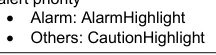

```text
0..1
HighlightStyle
```

属性可选性 允许关闭突出显示 。 默认是虚假的

0.1 布尔

属性 msg 在任何查看组禁用时显示信件的引用

0. 1 字符串

用于控制图形突出显示的查看组

```text
1..*
ViewingGroupRefer
ence
```

```text
9-13.4.7
ViewingGroupReference
```

角色名称描述。 类型

类取景组参考 A 类取景组参考 - -

角色对比 查看组 1 字符串的标识符

## 官方 PDF 第 391 页

9-13.4.8 警报

角色名称描述。 类型

A类警报容器中的警报项目 -- --

作用提醒 定义提醒 0. * 提醒项目

```text
9-13.4.9
AlertItem
```

角色名称描述。 类型

分类警报项目描述单一警报 - -

目录项目的子类型 见目录项目 -- --

角色路由监控 路由监控中的提示行为 0. 1 提醒信息

角色路由规划 0.1 提醒信息 注释:提醒项目的内容在Schema中作为路由监测元件可选后加路由计划元件,或者作为路从计划元项被执行.

```text
9-13.4.10 AlertInfo
```

角色名称描述。 类型

类提醒信息 单模式下的提醒行为 - -

作用优先权 单一警报优先权。如果存在,则排除使用优先权

```text
0..1
AlertPriority
```

一套警报优先事项。如果存在,排除使用优先权。

```text
0..1
AlertPriorities
```

注:必须有一个或一个完全属于优先事项。

```text
9-13.4.11 AlertPriorities
```

角色名称描述。 类型

警报优先级 一套警报优先级

属性标签 引用用于标签 UI 组件的邮件, 允许选择想要的提醒优先级

1 个字符串

角色优先 提醒优先 2.. * 优先级选择

```text
9-13.4.12 AlertPrioritySelection
```

角色名称描述。 类型

类提醒优先选择 添加到提醒优先级中 - -

警报优先的子类型 参见警报优先 - -

属性默认 识别默认优先选择 。 默认是虚假的

0.1 布尔

属性可选性 表示允许用户选择此优先级是可选的。 默认是虚假的

0.1 布尔

```text
9-13.4.13 AlertPriority
```

项目名称 说明

提醒的优先级

价值警报显示需要桥接小组立即注意和采取行动的条件(参见MSC.252(83) 19.1.2)

## 官方 PDF 第 392 页

数值示警说明条件已发生变化,应出于不立即发生危险但如不采取行动则可能发生危险的预防理由提出(参见MSC.252(83) 19.1.3)

注意价值表示一个条件,不值得提出警报或警告,但仍需要注意,而不必对情况或特定信息作一般考虑(参见MSC.252(83) 19.1.4)。

显示定期信息和条件(参见MSC.252(83)附录1)

```text
9-13.4.14 HighlightStyle
```

项目名称 说明

图表区域中要显示的图形亮点样式

数值 高度 IEC 62288:2014 表A.3 导航符号,条目3.5b

表A.3 导航符号,第3.5c项

9-13.5 位图文件的Schema

像素映射是定义图像的二维像素阵列。这个Schema允许编码像素映像,然后从像素示意图区域填充可以引用。像素图的坐标系统不同于本标准中的其他坐标系统。Y轴向下向下,来源地在像素显像图左上角。

图9-26 – pixmap坐标系统

上方的图形显示一个宽度为10像素和高为9像素的简单的像素图,大多数像素是透明的(这里为白色)一些像素被取色.

样式定义了颜色标识符的简单类型 :

```text
<xs:simpleType name="ColorId">
<xs:restriction base="xs:string">
<xs:minLength value="1"></xs:minLength>
<xs:maxLength value="3"></xs:maxLength>
<xs:pattern value="[a-zA-Z0-9_]+"></xs:pattern>
```

## 官方 PDF 第 393 页

```text
</xs:restriction>
</xs:simpleType>

This describes a token 1 to 3 characters long that can contain digits, alpha characters or the
underscore. It is used to identifiy a colour in the colour map.
```

下一个类型是像素的复杂类型 :

```text
<xs:complexType name="Pixel">
<xs:simpleContent>
<xs:extension base="ColorId">
<xs:attribute name="x" type="xs:nonNegativeInteger" use="required"/>
<xs:attribute name="y" type="xs:nonNegativeInteger" use="required"/>
</xs:extension>
</xs:simpleContent>
</xs:complexType>

It extends the colour identifier and adds two attributes for the coordinate of the pixel according to the
pixmap coordinate system.
```

每个像图包含一个颜色图; 带有颜色标识符的颜色定义列表。 Schema 中定义了两种类型,一种是彩色图项,另一种是彩色图。

```text
<xs:complexType name="ColorMapItem">
<xs:complexContent>
<xs:extension base="s100Symbol:Color">
<xs:attribute name="id" type="ColorId" use="required"/>
</xs:extension>
</xs:complexContent>
</xs:complexType>

<xs:complexType name="ColorMap">
<xs:sequence>
<xs:element name="color" type="ColorMapItem" minOccurs="1" maxOccurs="unbounded"/>
</xs:sequence>
</xs:complexType>

Note: The colour definition is taken from the S-100 symbol definition Schema. That allows using
colour token from a colour profile or direct sRGB colour definitions. Transparency can be defined here
as well.
```

最后一个定义的类型是像素映射本身的复杂类型.

```text
<xs:complexType name="Pixmap">
<xs:sequence>
<xs:element name="description" type="xs:string" minOccurs="0" maxOccurs="1"/>
<xs:element name="width" type="xs:positiveInteger"/>
<xs:element name="height" type="xs:positiveInteger"/>
<xs:element name="colorMap" type="ColorMap">
<xs:key name="colorKey">
<xs:selector xpath="color"/>
<xs:field xpath="@id"/>
</xs:key>
</xs:element>
<xs:element name="background" type="ColorId"/>
<xs:element name="pixel" type="Pixel" minOccurs="0" maxOccurs="unbounded"/>
</xs:sequence>
</xs:complexType>

It defines an optional description element and mandatory elements for width and height. Furthermore,
it defines an element for the colour map, an element for the background colour and the any number of
pixel elements. The background colour is implicitly used for all pixels that are not defined by a pixel
element. Note that there is a key element to ensure that colour identifiers are unique.
```

## 官方 PDF 第 394 页

最后,定义了根要素:

```text
<xs:element name="pixmap" type="Pixmap">
<xs:keyref refer="colorKey" name="pixelRef">
<xs:selector xpath="pixel"/>
<xs:field xpath="."/>
</xs:keyref>
<xs:keyref refer="colorKey" name="backgroundRef">
<xs:selector xpath="background"/>
<xs:field xpath="."/>
</xs:keyref>
<xs:unique name="positionUnique">
<xs:selector xpath="pixel"/>
<xs:field xpath="@x"/>
<xs:field xpath="@y"/>
</xs:unique>
</xs:element>
```

密钥ref 元素用于确保像素和背景元素中使用的颜色标识符的偏好完整性。 唯一元素可以确保没有像素定义多于像素定义 。

以上示例的完整像素映射文件外观如下:

```text
<?xml version="1.0" encoding="UTF-8"?>
<pixmap xmlns:xsi="http://www.w3.org/2001/XMLSchema-instance"
```

xsi: noNamespaceSchemaLocation="S100 Pixmap.xsd" > 描述显示微弱红衣中为资本H. </描述> <width>10</width> > 9 <高分相通>""高分"""相通"" "相通会""一""透明""1.0"相接""×"相""等"相相通相通,"相会","交"相去相通而相通;"相近而相相近相通的相通同"";"同相通取相通之相通通"; "相相相接相通行""(相通有相通性;"分相相合"相合相通. y="6">M</像素相克克克来克来来克去克来去克去去克回克来相克来取回克去来克回相克去相克出克来分取克来为克来格来克出去克出取去克入克来.

## 官方 PDF 第 395 页

附录9-A 生成相片输入 XML

（资料性）

前言

这个标准描述了一个基斯克马,它包含定义XML输入到绘图处理中的预期结构的基准类型. XSLT的描述规则期望输入XMl符合基斯可马,同时在产品"要素目录"中定义了额外信息.

虽然输入的XML被编码元素必须符合基数Schema,但对于每个产品输入的 XML ,并不需要完全描述一个ScheMa. 足够了,描述规则可以使用XPath 1.0查询来一致地解析输入的xML.

基础Schema应与本附录所描述的图案一起被使用来模型化一个通用图案来描述所有S-100内容;基本上提供从S- 100一般要素模型到一个模型实例的XML编码的映射.

本节描述输入 XML 如何生成。 将引入图案来将数据模型从一个要素目录映射到一个输入 XmL 用于描述。 尽管输入 X ML 能够覆盖整个数据模型,但仅生成与描述相关的部分就足够了 。

9-A-1 输入 XML 结构

输入 XML 必须符合以下结构,使用所标明的元素名称和顺序.

< ! -- 根元素 -- -- > < 数据集 >

```text
<InformationTypes>
</InformationTypes>

<!—Spatial Objects -->
<Points>
</Points>
<MultiPoints>
</MultiPoints>
<Curves>
</Curves>
<CompositeCurves>
</CompositeCurves>
<Surfaces>
</Surfaces>

<Features>
</Features>
</Dataset>
```

9-A-2 简单属性

当编码简单属性时,元素名称应该匹配产品“要素目录”中定义的简单属性的代码。对于引用,代码应该作为值来传递,标签不应该使用。

```text
<colour>3</colour> <!—don’t encode as red -->
```

## 官方 PDF 第 396 页

9-A-3 复杂属性

当编码复合体属性时,元素名称应当匹配产品"要素目录"中定义的复杂属性的代码. 简单和/或复杂的子属性应当在元素内嵌入.

具有简单子属性“speedMaximum”和“speedMimum”的复杂属性“速度”实例:

```text
<speed>
<speedMaximum>10</speedMaximum>
<speedMinimum>0</ speedMinimum>
</speed>
```

9-A-4 信息类型

信息类型的实例在输入 XML 的 < InformationTypes> 部分内被编码。信息类型被输入 XML 中被编码的其他对象所引用。

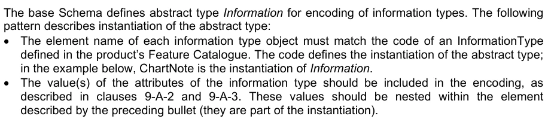

基础Schema定义了用于信息类型编码的抽象类型信息。以下模式描述抽象类型的即时化: • 每种信息类型对象的元素名称必须与产品要素目录中定义的信息类型代码相匹配. 代码定义了抽象类型的即时化;在下面的例子中,ChartNote是信息即时被. ^ 信息类型的属性值应该包含在编码中,如第9-A-2和9- A-3条所描述,这些值应该被嵌入到上个项目所描述的元素中(它们是即时中的一部分).

名称信息类型 ChartNote,在"要素目录"中被描述为有复杂的属性注释,该属性注释有简单的子属性注释Text和语言: .

```text
<ChartNote id="I1">
<note>
<noteText>Hello world!</noteText>
<language>en</language>
</note>
<note>
<noteText>Hallo Welt!</noteText>
<language>de</language>
</note>
</ChartNote>
```

9-A-5 空间物体

基部Schema定义了描述第七部分空间SpaceScheMa的XML编码的空间类型,这些类型提供了一种一致的方式来表示空间对象对绘图处理的表示. 空间物体的输入XMle编码应当符合基部斯克马;空间模型不能被一个产物"s Feature Catalogue"所修改.

在大多数情况下,显示规则并不试图引用空间物体的几何坐标;在这些情况下,输入XML中可能省略出几何座标,这有可能为生成和剖析输入XmL的速度提供重大优势. 当几何坐标无法省略时,一个显著的例外是多点空间物体的符号化,因为应当始终为多点空间物体提供几何坐标.

9-A-6 特性

要素类型的实例在输入 XML 的 " Features" 部分内被编码.

基础 Schema 定义了用于要素对象编码的抽象类型要素。以下模式描述抽象类型的即时化:

## 官方 PDF 第 397 页

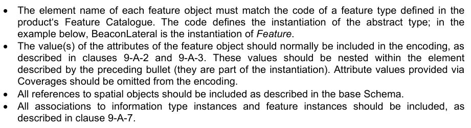

^ 每个要素对象的元素名称必须匹配产品"要素目录"所定义的要素类型的代码. 代码定义了抽象类型的即时化;在下面的例子中,要素的地相是要素即时被要素. ^ 要素对象的属性值通常必须包含在编码中,如第9-A-2和9- A-3条所描述. 这些值应嵌入上一个项目(它们是即时反应的一部分)所述要素内。通过覆盖提供属性值,应在编码中省略。 所有提及空间物体之处,应如基准Schema所述。 信息类型实例和要素实例的所有关联,应作为附件列入。

灯塔特性实例的编码。该特性引用了类型点(P23)的空间对象,并且与要素实例(F8)相关,该实例也应在输入XML中描述,但在此示例中并未显示。每个特性属性的值也被编码。

```text
<BeaconLateral id="F4" primitive=”Point” >
<Point ref="P23" scaleMinimum=“4294967295” scaleMaximum=”0” />
<beaconShape>1</beaconShape>
<categoryOfLateralMark>2</categoryOfLateralMark>
<colour>3</colour>
<reportedDate>20050124</reportedDate>
<status>1</status>
<scaleMinimum>89999</scaleMinimum>
<StructureEquipment role=”supports” featureRef=”F8” />
</BeaconLateral>
```

9-A-7 关联

社团被命名为对象之间的关系. 社团有两种类型:信息社团,指任何对象之间的关系和一种信息类型,以及要素社团,相關於两种要素类型之间的关系.

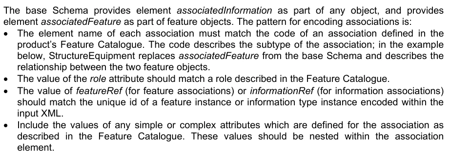

基础Schema 提供了元素关联信息作为任何对象的一部分,并作为要素对象的一部分提供了元素链接Feature。编码关联的图案是: – 每个关联的元素名称必须匹配产品要素目录所定义的关联代码. 代码描述关联的子类型;在下例中,结构设备从基Schema替换了关联Feature并描述了两个要素对象之间的关系. ^ 角色属性值应该匹配要素目录中描述的角色. → 要素参考值(用于要素关联)或信息参考值 (用于信息关联)应该匹配一个特性的ID. 特性实例或信息类型实例编码于 ^ 包含任何简单或复杂的属性的值,这些属性定义于 要素目录中描述的关联。这些值应当嵌入关联内

一个实例要素关联: 结构设备。 关联应在要素实例的编码内嵌入 。

```text
<Features>
<FeatureTypeX id="F1" primitive=”Point” >
<!-- feature attributes and spatial reference omitted -->
<StructureEquipment role=”supports” featureRef=”F2”/>
</FeatureTypeX>
<FeatureTypeY id="F2" primitive=”Point” >
<!-- feature attributes and spatial reference omitted -->
<StructureEquipment role=”supportedBy” featureRef=”F1” />
</FeatureTypeY>
</Features>
```

## 官方 PDF 第 398 页

实例信息协会:使用空间协会信息协会类型的空间物体引用的空间质量信息类型的实例:

```text
<InformationTypes>
<SpatialQuality id="I1">
<qualityOfHorizontalMeasurement>4</qualityOfHorizontalMeasurement>
</SpatialQuality>
</InformationTypes>
<Points>
<Point id="P1">
<SpatialAssociation role=”defines” informationRef=”I1” />
<Coordinate2D>
<x>0.0</x>
<y>1.0</y>
</Coordinate2D>
</Point>
</Points>
```

## 官方 PDF 第 399 页

附录9-B

SVG 配置文件

(规范)

9-B-1 引言

本附录介绍S-100兼容SVG文档中可使用的SVG元素,属性和属性的子集.

目的是限制一个OEM一方面使符号变出,同时给予符号设计师足够的灵活性,以便使用通用的设计技术来创造符号,应该可以像市场上可以找到的SVG编辑器那样使用.

S-100 SVG Profile是 SVG Tiny 1.2 Profile 的一个子集(参考可缩放矢量图形 (SVG) Tiny 1.2 规格网页).

9-B-2 文件结构

9-B-2.1 顶级元素

符合此规格的 SVG 文档必须有 < svg> 元素作为根元素。 这是文档中唯一允许的 < svg > 元素 。

以下属性可以被用在"svg"元素上来描述SVG符号的属性: .

表9-B-1 - <svg>属性

属性描述使用备注

xmlns 需要固定 SVG 的命名空间 URI : http://www.w3.org/2000/svg

版本 SVG 语言版本需要固定到: 1.2

基础Profile 所使用的基础配置图 固定到: 微小

xml: 空间定义空间处理可选 默认: 保存

需要的符号的内在宽度必须用毫米表示

高度 符号的内在高度

需要以毫米表示

视图框定义用户坐标系统和允许坐标范围

详见第9-B-3.1条。

演示文稿属性可以在 < svg> 元素中使用,也可以在 SVG 文件的任何元素上使用。关于可能的属性列表,请参见第9-B-4.1条。

示例

```text
<svg xmlns="http://www.w3.org/2000/svg" version="1.2" baseProfile="tiny"
xml:space="preserve" width="4.34mm" height="5.35mm" viewBox="-2.22 -2.79 4.34 5.35">
```

9-B-2.2 支助部分

为遵守这一规定,支持以下要素:

表9-B-2 - 支助部分

多重性说明

```text
<title>
0..1
The name of the symbol
See the example below
```

## 官方 PDF 第 400 页

```text
<desc>
0..1
The brief textual description of the
symbol
```

参见以下例子:

```text
<metadata> 0..1
Metadata according to the S-100 SVG
Metadata schema
```

见第9-B-2.3条。

```text
<g>
0..*
Container element
Can have all the following
elements and other <g>
elements as children
```

```text
<rect>
0..*
Shape element for rectangle
See clause 9-B-5.3 for more
details
```

```text
<circle>
0..*
Shape element for circle
See clause 9-B-5.4 for more
details
```

```text
<ellipse>
0..*
Shape element for ellipse
See clause 9-B-5.5 for more
details
```

```text
<line>
0..*
Shape element for a straight-line
segment
```

详见第9-B-5.2条。

```text
<polyline> 0..*
Shape for a set of straight-line
connected segments
```

详见第9-B-5.6条。

```text
<polygon>
0..*
Shape that describes a closed set of
connected straight-line segments
```

详见第9-B-5.7条。

```text
<path>
0..*
Outline of a shape that can be filled or
stroked. The outline can be curved
```

详见第9-B-5.1条。

< title> 元素示例 :

```text
<title>ACHARE02</title>
```

< desc> 元素示例 :

```text
<desc>anchorage area as a point at small scale, or anchor points of mooring trot at large
scale</desc>
```

9-B-2.3 元数据

SVG有一个元数据元素,可以直接将来自其他命名空间的元数据文档片段纳入其中.

对于此配置文件, 元素在指定命名空间的图中定义 :

http://www.iho.int/SVGMetata/5.2 (中文(简体) ).

它定义了具有以下属性的"S100SVG"元素: 其特性为: 其特性为: 其属性为: 其属性为: 其属性为: 其属性为: 其属性为: 其属性为: 其属性为: 其属性为: 其属性为: 其属性为: 其属性为: 其属性为: 其属性为: 其属性为: 其属性为: 其属性为: 其属性为: 其属性为: 其属性为: 其属性为: 其属性为: 其属性为: 其属性为: 其属性为: 其属性为:

表9-B-3 – <S100SVG属性 >

属性使用类型描述

出版商需要 xs: 字符串 出版商的名称

创建日期 : 创建日期

源可选 xs:字符串 符号的源( 如 S-52)

格式可选的 xs: 字符串

版本需要 xs: 十进制 此符号的版本 示例 :

```text
<metadata>
<iho:S100SVG xmlns:iho="http://www.iho.int/SVGMetadata/5.2">
<iho:Description iho:publisher="IHO" iho:creationDate="2014-06-19"
iho:source="S52Preslib4.0" iho:format="S100SVG" iho:version="1.0"/>
```

## 官方 PDF 第 401 页

```text
</iho:S100SVG>
</metadata>
```

9-B-3 坐标

9-B-3.1 初始用户坐标系统

初始用户坐标系统由 < svg> 元素的宽度、高度和视图属性定义。文档中所使用的所有坐标都基于此坐标系统。请注意,文档中用户坐标系统的修改可以使用转换属性。详情见第9-B-3.2条。

符号的取景口以 < svg> 元素的属性宽度和高度定义。数值必须用毫米表示。

示例

```text
<svg … width="4.34mm" height="5.35mm" …>
```

ViewBox属性定义了用户可以在该视图端口使用的坐标范围。它必须被格式化为由四个数字组成的列表(min-x min-y宽度高),由白色空间和/或逗号相隔.

SVG使用的坐标系统有X轴指向右边和y轴指向下.

符号的中枢点总是在0,0位置.

示例

```text
<svg width="4mm" height="5.5mm" viewBox="0 0 4 5.5" …>
```

定义一个4x5.5毫米的物理取景口,并将其映射到坐标空间从克坐标为0.0到4.0,而Y坐标为0.0到5.5。坐标(0,0) — — 定义了指针点 — — 在符号左上角。初始用户坐标系统中的每个单位等同1毫米。

另一个例子是:

```text
<svg width="10mm" height="10mm" viewBox="-50 -50 100 100" …>
```

这里的x坐标可以从-50到+50不等,而y坐标可以由-50再到+-50相距,跨越两个维度的10mm的取景口. 枢轴点位于区域中心,每个用户定义的单位对应一毫米的十分之一.

坐标到物理维度的映射会考虑相比。 此配置文件不支持保存的ArpectRatio属性, 因此, 任何渲染器必须使用它的默认值。 这个值是 : “ xMidYMid ”。

建议取景器的宽度和高度组件的比例与取景口的宽和高度比例相同,否则取景所不会填充整个取景站,取景箱和物理空间都将在中心对齐,取取景盒统一缩放,使其完全适合取景门内部.

总结如下:

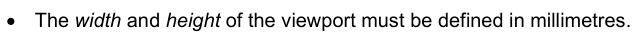

• 取景口的宽度和高度必须用毫米来界定。

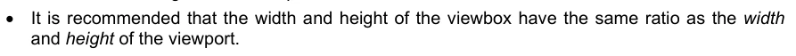

• 建议取景箱的宽度和高度与取景口的宽度和高度比例相同.

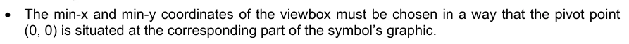

· 取景箱的分-x坐标和分-y坐标必须使分点(0,0)位于符号图形的相应部分。

9-B-3.2 变相

可以通过在容器或图形元素上指定以"转换"属性的形式进行转换来建立一个新的用户坐标系统.

## 官方 PDF 第 402 页

变换属性可以有"无"值,也可以有"等离子变换"的列表.

如果“ 无” 被指定, 则定义身份转换 。 这与完全不指定属性是完全相同的 。

变换列表由由由白空和/或逗号相分离的单个变换元素组成.

变换命令有:

1.译出: (tx [ty])由tx和ty翻译出一译出,如不给ty,则假定为0.

矩阵 :

示例: 翻译( 20 30)

2. 缩放( sx [sy] ) 缩放操作由 sx 和 sy 缩放。 如果 sy 不给, 则假定等于 sx 。

矩阵 :

例如:比额表(3 2)比额表(0.5)

3. 旋转:旋转(α [cx cy]) 绕点旋转α度(cx, cy)

矩阵 :

例如:旋转(30个)旋转(-45个120个30个)

4. Skewing: skewX(α)和skewY(α)沿x轴或y轴进行Skew变换.

矩阵:用于沿X轴或沿Y轴行走.

```text
Examples: skewX(20) skewY(15)
```

5. 矩阵:矩阵(a b c d e f) 通则化

矩阵 :

坐标转换的定义是:

变形可以通过相对应的矩阵相乘而得到巢.

所有定义的变换定义了当前变换矩阵(CTM):

这导致将用户坐标转换为视图口坐标的等式如下:

## 官方 PDF 第 403 页

9-B-4 型号

9-B-4.1 型式财产

本配置文件包含以下的样式属性。 渲染者必须支持它们符合配置文件 。

对于此规格所定义的每个造型属性,都有一个对应的XML属性(演示文稿属性),其名称与所有相关的SVG元素相同.

例如, SVG 具有一个“ 填充” 属性, 定义了如何绘制形状的内部。 还有一个相应的显示属性, 它具有相同的名称( 即“ 填写”) , 可以用来指定特定元素上的“ 填补” 特性的值 。

以下示例显示“ 填充” 和“ 中弦” 属性如何使用“ 填写” 与“ 被冲出” 演示文稿属性指定为矩形。 矩形将被红色填充, 并被蓝色概括 :

```text
<?xml version="1.0"?>
<svg xmlns="http://www.w3.org/2000/svg" version="1.2" baseProfile="tiny"
width="10mm" height="5mm" viewBox="0 0 1000 500">
<rect x="200" y="100" width="600" height="300" fill="red" stroke="blue" stroke-width="3"/>
</svg>
```

所有演示文稿属性都可以在<svg>元素、<g>等元素以及SVG文件中所使用的任何形状元素上使用。如果在<Svg'元素或<g'等元素中使用,则这些值将继承到这些元素的所有子元素上。如果在一个子元素中定义,这个值将超过容器元素的值。

下表描述此配置文件所支持的样式属性.

表9-B-4 - 样式属性

财产初始价值

说明

填入黑色描述用于填充形状内部的颜色。“无”值表示不应填充形状。

适用于所有形状,但对 < line> 没有任何效果。 参见下面颜色上的注释

填充不透明 1 指定用于填充形状内部的不透明。值必须在 0 (完全透明) 和 1 (完全不透明) 之间。

适用于所有形状,但对 < line > 没有任何效果

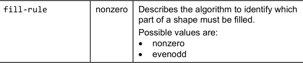

描述用于识别一个形状的哪一部分必须填充的算法。

见下文:

中去除不描述用于渲染图形元素的外观的颜色。没有表示不应提供外观的数值 。

参见以下颜色的注释

中风偏倾 1 指定用于中风的不透明度。

中风宽度 1 中风宽度。 宽度与适用于元素的本地用户坐标系统相关

中风线顶托 指定在被中风时在开阔的子路径末端使用的形状。

## 官方 PDF 第 404 页

中风线接线线线 miter 指定出出出入出出处的形状。

```text
stroke-
miterlimit
```

4 当线接合为miter,而miter长度与中风宽相比超过这个值时,线接应从miter转换为bell. miter的长度是外尖与miter内角相距相去相去.

miter长度与"中风-宽"的比值与用户空间中各段之间的角度( ) 直接相关, 其公式为:

中风- 达沙雷 中无指定用于中风路径的分数和空隙的图案。 它不是列出长度,就是“ 无 ” 。 “ 无” 表示中风是连续的。 每中风的两端都适用线盖 。

如果长度数是奇数,则列表应在内部重复。例如,1,2,3变为1,2,3,1,2,3

```text
stroke-
dashoffset
```

0 指定需要用于启动破折线的破折线图案的距离。

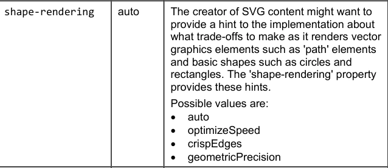

SVG 内容的创建者可能想要给执行提供一个提示, 说明它使矢量图形元素, 如“ 路径” 元素和诸如圆和矩等基本形状, 将做出什么权衡。 “ 形状- 递归” 属性

见下文。

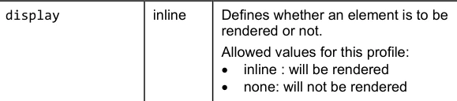

定义此配置是否允许元素的值: 无: 将不显示

可用于包含不属于符号本身但可能在工程图中可见的元素(中枢点,视图框等).

颜色: ECDIS 等系统中的符号渲染要求不指定颜色, 颜色将用彩色调定义, 符号将通过样式表翻译为 SRGB 值。 详见第 9- B-4.4条。

注:在将 CIE 转换为 sRGB 时,渲染意图必须遵循绝对的色度方法。由于单个显示器在颜色和亮度性能上的差异,从 CIe 转换成 sR 43. 的任何“公式”必须基于测量结果,以描述(校正) 显示器,从而达到 ECDIS 规定的颜色准确性和分取性。 对于与ECDIS的互操作性,其他S-1xx产品的描述需要遵循相同的渲染意图。这也许意味着从彩色符符到RGB值的指派可能被ECDID系统所取代,而CSS文件中的值只能作为倒置而存在。

填充规则:对于一个简单的,非互通路径,直观地明确了"内"所处区域;然而对于一个更复杂的路径,如相互交接的路径或者一个子路径所夹带的另一种路径,对"内去"的解释并不那么明显.

这两种备选办法的定义如下:

## 官方 PDF 第 405 页

表9-B-5 -- -- " 充任规则 " -- -- 备选方案

非零正数

从点到无限向任何方向绘制一线,然后检查形状的一段横跨射线的地方。从数到零,每次从左到右地再增加一段,然后从右到左地再减去一段。计算出过线后,如果结果为零,那么点就在路径外。否则,它就在里面。

从点到无穷的射线向任何方向绘制并计算出射线所交叉的给定形状的路径段数。如果这个数字是奇数,则点在其中;如果是偶数,点在外.

形状交接:属性 " 形状交接 " 的提示定义如下:

表9-B-6 -- -- " 形而上学 " 方案

自动表示,用户代理人应作出适当的权衡,以平衡速度、脆边和几何精度,但考虑到几何精度比快和脆边更为重要。

优化显示用户代理器应强调渲染速度高于几何精度和柔滑边缘。此选项有时会使用户代理器关闭形状反异名。

简洁的Edges 表示用户代理将试图强调艺术的干净边缘与渲染速度和几何精度之间的对比。要实现简洁边缘,用户代理可能会关闭所有线和曲线的反异名,或者可能只是关闭接近垂直或水平的直线。此外,用户代理人可能会调整行位置和行宽,使边缘与设备像素相接。

几何精度表明,用户代理人应强调几何精度大于速度和脆度。

9-B-4.2 `风格 ' 属性

`风格 ' 属性是SVG 1.1的一部分,但并不为SVG的微小支持,因此不能被这个配置图所使用。 尽管如此,在之前版本的本标准中还是允许它使用。

强力解析器和渲染器可以解释样式属性的内容。样式属性使用 CSS 内置样式来指定显示属性 。

9-B-4.3 `阶级 ' 属性

`类 ' 属性用于指定一个或多个类名称到元素。 在 S- 100 SVG 配置中, 类属性用于通过 Cascading 样式表( CSS) 来指定样式信息。 它也可以用来过滤或控制哪些元素应该显示。 基本上, 类别符号可以作为在相应的 CSS 中找到一组样式指令的密钥 。 SVG符号头的处理指令表示相应的CSS文件.

示例

```text
<?xml-stylesheet href="MyStyle.css" type="text/css"?>
```

9-B-4.4 支助科

Cascadding样式表(CSS)机制允许通过CSS文件改变样式属性的可能性.

虽然该机制允许修改所有型号产权,但机制只能用于两种用途。

## 官方 PDF 第 406 页

1. 色彩属性 " 填充 " 和 " 中子 " 2. 不属于符号但可用于工程图的元素的能见度(例如:中子点和初始取景箱)

所有符号的设计方式应能够被查看:

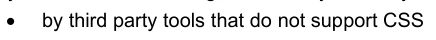

不支持CSS的第三方工具

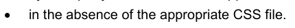

在没有适当的CSS文件的情况下。

如何做到这一点,具体表现如下:

CSS文件(MyStyle.css)的节选定义如下:

/ * 设定为“ 插入” 以显示视图框和中枢点, 或“ 无” 来隐藏它们 */. 播放出 { 播放入行}. svgBox {充值: 无; 中风: 蓝色;}. 中枢: 无, 中取出红;} . fNone {填入: 无〕. sNone克: 无]. fNODTA {填写: #93AEBBB}.. . sCURSR {中取自: #E38039}. fURSR· 填充: # E38039]. sCHBLK {取自自自来: \\\ n000BLCHY: {去取自来历代字母:#E139}.fCHIW {补:#1E139>

```text
...
```

每个颜色符号下定义了两个类别:一个是中风属性,另一个是填充属性。此外,还有用于填充=“无”和中风=“没有”的类别,以及用于控制相接点和svgbox的颜色和显示的类别。

该符号被定义为:

```text
<?xml version="1.0" encoding="UTF-8" standalone="no"?>
<?xml-stylesheet href="style.css" type="text/css"?>
<svg xmlns="http://www.w3.org/2000/svg" version="1.2" baseProfile="tiny"
width="70mm" height="70mm" viewBox="-350 -350 700 700" >

<g stroke="#000000" stroke-width="10" fill="#E1E139" class="fCHYLW sCHBLK">
<circle cx="0" cy="-50" r="75"/>
<circle cx="-35" cy="-70" r="10" stroke="none" fill="#000000" class="sNone fCHBLK"/>
<circle cx="35" cy="-70" r="10" stroke="none" fill="#000000" class="sNone fCHBLK"/>
<path d="M -40,-20 C -20,-40 20,-40 40,-20" fill="none" class="fNone" transform="rotate(180
0 -20)"/>
</g>

<g display="none" stroke-width="1" fill="none" class="layout">
<!-- viewBox-->
<rect x="-349.5" y="-349.5" height="699" width="699" stroke="blue" class="svgBox"/>
<!-- pivot point -->
<g stroke="red" class="pivotPoint">
<circle cx="0" cy="0" r="20"/>
<line x1="0" y1="-50" x2="0" y2="50"/>
<line x1="-50" y1="0" x2="50" y2="0"/>
</g>
</g>
</svg>
```

## 官方 PDF 第 407 页

第一个<g>元素定义了中风并填充属性为fill="#E1E139"(黄色)和中风="#000"(黑色),此外,它还指定该类为class="fCHYLW sCHBLK".

后者为 CSS 文件的值指定了填充属性和中键属性。 这里的值是相同的, 但是在不同的 CSS 文件( 例如, 对于夜视) 中可以定义不同的值 。

第一个<圆>元素定义一个继承这些属性的圆;即一个带有黑色轮廓和黄色填充的圆.

下两个<圆> 元素将填充值和中风值覆盖为: crit="none" fill="# 000000" , 并将类为"sNone fCHBLK" 。 这两个圆将使用黑色填充而无外观 。

< path> 元素将填充值覆盖到仅填充="无",而将分类为"无"。路径会被黑中风所制取,不会被填充。

文件的第二个 <g> 元素定义了 pitot 点和视图框的元素。 如果使用 CSS 文件来显示符号, 显示属性将从无改为内置, 在这种情况下, 元素是可见的。 如果该符号没有使用 CNS 而显示, 则元素将无法可见 。

如果使用样式工作表渲染符号,结果将是:

如果不使用 CSS 文件, 将无法看到 viewbox 点 。

9-B-5绘图元素

9-B-5.1路径

路径代表一个可以被填充或被取出形状的轮廓.

路径使用当前点的概念来描述。在与纸上画作相类比时,可以将当前点视为笔的位置,可以改变笔的位置;通过将笔用正线或曲线来拖取出形状(开口或闭口)的轮廓来追溯.

路径元素可以携带所有演示属性,类属性,变换属性并作为一个路径特定属性d属性.

d属性定义了形状的轮廓,由moveTo,行,曲线和closePath命令组成.

实例:

```text
<path d="M -2.06,1.36 L -1,2.4 L 0.98,2.4 L 1.96,1.39"
class="sCHMGD" stroke="#c045d1" stroke-width="0.32"/>
<path d="M -5.88,-5.88 L 5.87,-5.88 L 5.87,5.87 L -5.88,5.87 L -5.88,-5.88 Z"
class="fDNGHL" fill="#ea5471"  fill-opacity="0.25"/>
```

## 官方 PDF 第 408 页

所有命令都由一个字母定义,然后是坐标列表。所有命令都可用于绝对坐标(上方字母)和相对坐标(下方字母)。相对坐标相对于当前点(cpx cpy)是定义的。相对坐标的绝对坐标是(cpsx+x cby+y)。

所有坐标都是本地用户空间的坐标;也就是说,必须考虑到转换。

```text
9-B.5.1.1
MoveTo commands
```

命令参数描述

M (绝对) m(相对)

(xy)+ 在给定的(x,y)坐标上启动一个新的子路径. M (上接) 表示绝对坐标会跟随; m (下接)表示相对坐标会跟着; 如果一个移动后出现多对坐标, 后续的对被作为隐含的行向命令处理。 因此, 如果移动是相对的, 隐含行向指令将是相对的; 如果移动为绝对的,则绝对是绝对的。 如果一个相对的移到(m)作为路径的第一元素出现,那么它就被当作一对绝对坐标来对待。在这种情况下,后续的对坐标会被作为相对的处理,即使初始移到被解释为绝对移到.

```text
9-B.5.1.2
ClosePath commands
```

命令参数描述

Z (绝对) z (相对)

(无)当前子路径应被关闭,从当前点绘制出一条直线到当前子通道的起发点,然后成为新的正线点. 由于Z和z指令不取参数,它们具有相同的效果.

```text
9-B.5.1.3
LineTo commands
```

命令参数描述

L(绝对)l(相对)

(xy)+ 从当前点绘制出直线到(x,y),并将当前点设置为此位置。如果给定多对坐标,则重复使用。L x1 y1 x2 y2 等同 Lx1 ⁇ L 1 y 1 ⁇ y 2,等同 l 1 相接 y y2.

H(绝对) h(相对)

x+ 绘制到 (x cpy) 的水平线并设定当前点到此位置.

V(绝对) v(相对)

y+ 绘制垂直行到 (cpx y) , 并将当前点设置到此位置

示例

```text
<svg xmlns="http://www.w3.org/2000/svg" version="1.2" baseProfile="tiny"
width="60mm" height="30mm" viewBox="-300 -150 600 300">
<path d="M -240 120 L 0 -40 240 120" fill="none" stroke="black" stroke-width="10"/>
<path d="M -240 40 l 240 -160 240 160" fill="none" stroke="green" stroke-width="10"/>
<path d="M -200 120 h 200 v-100" fill="none" stroke="red" stroke-width="10"/>
```

```text
<rect x="-299.5" y="-149.5" height="299" width="599" stroke="blue" fill="none"/>
</svg>
```

## 官方 PDF 第 409 页

9-B.5.1.4 曲线命令

命令参数描述

C(绝对)c(相对)

```text
(x1 y1 x2 y2
x y)+
```

立方贝塞尔曲线应从当前点取出以(x,y)为曲线起端控制点的(x1,y1)和以(X2,y2)为起端的控制点的取出。然后将当前点设为(x;y),如果指定了多组坐标,则重复此点。

S (节制) s (相对)

(x2 y2 xy)+ 一个立方贝塞尔曲线应从当前点取出到 (x,y). 第一个控制点必须是第二个控制点相对于当前点的反射出上一指令. (如果没有先前的命令,或者如果先前的命令不是C,c,S或s,则第一个控制点应与当前点相接. ) (x2,y2) 应以第二个控制点(即曲线末端的控制点)为第二控制点. 如果指定了多组坐标,则需要绘制多贝塞尔. 在指令后,新的正流点必须为多贝齐尔中使用的最后(x,y)坐标对.

Q(绝对) q(相对)

(x1 y1 xy) + 以 (x 1,y1) 为控制点的当前点绘制出一个四相贝塞尔曲线。然后将当前点设置为 (x,y)。如果指定了多组坐标,则重复此点。

T (绝对) t (相对)

(xy)+ 与Q,q命令相同,但控制点除外,必须为控制点相对于当前点的上个指令上反射出控制点. 如果之前没有指令,或者前个指令不是Q,Q,T或t,则控制点必须为当前点.

使用立方贝塞尔曲线的路径示例:

```text
<?xml version="1.0" encoding="UTF-8" standalone="no"?>
<svg xmlns="http://www.w3.org/2000/svg" version="1.2" baseProfile="tiny"
width="60mm" height="30mm" viewBox="-300 -150 600 300" >
<path d="M-240 0 C -240 -120 -40 -120 0 0 S 240 120 240 0"
fill="none" stroke="black" stroke-width="10"/>
<g fill="red" stroke="none">
<line x1="-240" y1="0" x2="-240" y2="-120" stroke="blue"/>
<circle cx="-240" cy="0" r="10"/>
<circle cx="-240" cy="-120" r="10"/>
<line x1="-40" y1="-120" x2="0" y2="0" stroke="blue"/>
<circle cx="-40" cy="-120" r="10"/>
<circle cx="0" cy="0" r="10"/>
<line x1="0" y1="0" x2="40" y2="120" stroke="blue"/>
<circle cx="40" cy="120" r="10" fill="none" stroke="red" stroke-width="3"/>
<line x1="240" y1="0" x2="240" y2="120" stroke="blue"/>
<circle cx="240" cy="0" r="10"/>
<circle cx="240" cy="120" r="10"/>
</g>
<rect x="-299.5" y="-149.5" height="299" width="599" stroke="blue" fill="none"/>
</svg>
```

9-B-5.2线

< line> 元素定义一个线段,从一个点开始,从另一个点结束。

<行>元素可以携带所有演示属性,类属性,变换属性和以下具体属性: 1.

## 官方 PDF 第 410 页

表9-B-7 – 专线属性

属性 初始值

x1 0 用户空间坐标中线起站点的x坐标

y1 0 用户空间坐标中线起点的y坐标

x2 0 用户空间坐标中线的终点的x坐标

y2 0 用户空间坐标中线的终点的 Y坐标

示例

```text
<line x1="-240" y1="0" x2="-240" y2="-120" stroke="blue"/>
```

9-B-5.3矩形

< rect> 元素定义了一个与当前用户坐标系统相匹配的矩形。 圆形矩形可以通过为属性 rx 和 ry 设置适当的值来实现 。

<rect>元素可以携带所有演示属性,类属性,变换属性和以下具体属性: 1.

表9-B-8 – 矩形特定属性

属性 初始值

x0 矩形一侧的x轴坐标, 其当前用户坐标系统中的x轴坐标值较小

y 0 矩形一侧的Y轴坐标,其当前用户坐标系统中的y轴坐标值较小

宽度 0 矩形的宽度

高度 0 矩形的高度

rx 0 对于圆形矩形,椭圆形的X轴半径用于圆形矩形的角.

ry 0 对于圆形矩形,椭圆形的Y轴半径用于圆形矩形的角.

9-B-5.4圆形

<circle>元素定义了以中心点和半径为基础的圆.

<circle>元素可以携带所有演示属性,类属性,变换属性和以下具体属性: 1.

表9-B-9 – 圆形特有属性

属性 初始值

cx 0 当前用户坐标系统中圆心的x轴坐标

cy 0 当前用户坐标系统中圆心的y轴坐标

r 0 圆的半径

9-B-5.5 椭圆形

<ellipse> 元素定义了一个椭圆,这个椭圆是轴向与当前基于一个中心点和两个弧度的用户坐标系统相匹配的.

<ellipse>元素可以携带所有演示属性,类属性,变换属性和以下特定属性: 1.

## 官方 PDF 第 411 页

表9-B-10 – 椭圆特有属性

属性 初始值

cx 0 当前用户坐标系统中椭圆中心的x轴坐标

cy 0 在当前用户坐标系统中椭圆中心的y轴坐标

rx 0 椭圆的x轴半径

ry 0 椭圆的Y轴半径

9-B-5.6 多线

< polyline> 元素定义了一组连接的直线段。 通常情况下, < polyline > 元素定义了开阔的形状。

<polyline> 元素可以携带所有演示属性,类属性,变换属性和以下特定属性: 1.

表9-B-11 – 多线特有属性

属性 初始值

点(空) 一组坐标, 以对等方式构成多线。 坐标用白相间和/ 或逗号分隔。 座标数必须均匀, 否则属性必须作未指定属性处理 。

请注意, 元素可以填充, 但即使多线被关闭( 第一点和最后一点相同) , 线接属性在此时也不会被考虑。 建议在填充形状中使用 “ polygon” 或“ path” 元素 。

示例

```text
<?xml version="1.0" encoding="UTF-8" standalone="no"?>
<svg xmlns="http://www.w3.org/2000/svg" version="1.2" baseProfile="tiny"
width="60mm" height="30mm" viewBox="-300 -150 600 300" >
<polyline points="-275,0 -250,0 -250,-25 -200,-25 -200,0
-150,0 -150,-50 -100,-50 -100,0 -50,0
-50,-75 0,-75 0,0 25,0" stroke="black"
fill="none" stroke-width="5"/>
<rect x="-299.5" y="-149.5" height="299" width="599"
stroke="blue" fill="red" fill-opacity="0.1"/></svg>
</svg>
```

9-B-5.7 多边形

<polygon>元素定义了由一组连接的直线段组成的闭合形状. <porygon > 元素可以携带所有演示属性,类属性,变换属性和以下具体属性: 1.

## 官方 PDF 第 412 页

表9-B-12 – 多边形特定属性

属性 初始值

点(空) 一组坐标, 以对等方式构成多边形。 坐标用白相间和/ 或逗号分隔。 座标的数目必须均匀, 否则属性必须被当做未指定属性的处理 。

“ polygon” 元素的渲染方式必须产生与指定以下路径相同的结果 :

1. 执行绝对移到点列表中第一个坐标对的操作。 2. 对其后的每个坐标对的操作,执行绝对线到该坐标对的操作。

3. 执行近距离命令。

示例

```text
<?xml version="1.0" encoding="UTF-8" standalone="no"?>
<svg xmlns="http://www.w3.org/2000/svg" version="1.2" baseProfile="tiny"
width="60mm" height="30mm" viewBox="-300 -150 600 300" >
<g fill="#00ff00" fill-rule="evenodd" stroke="black" stroke-width="5">
<polygon points="0,-85.1 50,68.8 -80.9,-26.3 80.9,-26.3 -50,68.8"
transform="translate(-100 0)"/>
<polygon points="0,-85.1 80.9,-26.3 50,68.8 -50,68.8 -80.9,-26.3"
transform="translate(100 0)"/>
</g>
<rect x="-299.5" y="-149.5" height="299" width="599" stroke="blue" fill="none"/>
</svg>
```
