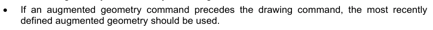
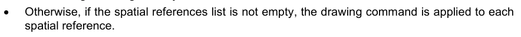
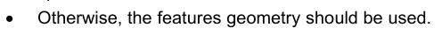
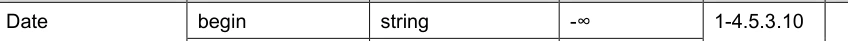
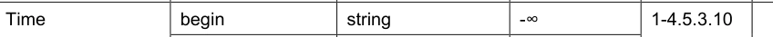
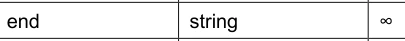
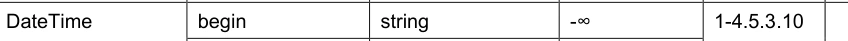

# S-100 5.2.1 · 第 9a 部分 · 显示（Lua）

非官方机器翻译参考稿，尚未逐条人工校订。公式与代码保留原文，解释以英文规范为准。

## 官方 PDF 第 413 页

S-100 – 第9编a

显示（Lua）

## 官方 PDF 第 414 页

5.2.1版实质性变动摘要

已生效的概要条款

从规范引用中删除了 URL 链接. 9a-3

## 官方 PDF 第 415 页

中文目录（可用上方目录直接跳转）

9a-1 范围 · 官方 PDF 417
9a-2 符合性 · 官方 PDF 417
9a-3 规范性引用文件 · 官方 PDF 417
9a-4   显示目录 · 官方 PDF 418
9a-5  通用显示模型 · 官方 PDF 418
9a-5.1 光圈进程 · 官方 PDF 418
9a-5.2 Lua平面工艺 · 官方 PDF 419
9a-5.2.1 平面初始化 · 官方 PDF 420
9a-5.2.2 生成相片 · 官方 PDF 420
9a-6  包概述 · 官方 PDF 421
9a-7  数据输入模式 · 官方 PDF 421
9a-8  信息对象 · 官方 PDF 421
9a-9  要素对象 · 官方 PDF 421
9a-10  显示处理 · 官方 PDF 421
9a-11  绘图指令 · 官方 PDF 422
9a-11.1 绘制指示的概念 · 官方 PDF 422
9a-11.1 一般概念 · 官方 PDF 422
9a-11.2 绘图指示模式 · 官方 PDF 422
9a-11.2.1 绘图命令 · 官方 PDF 422
9a-11.2.2 国家指挥机构 · 官方 PDF 425
9a-12  符号定义 · 官方 PDF 442
9a-13  显示库 · 官方 PDF 442
9a-14  显示领域专用函数 · 官方 PDF 442
9a-14.1 显示域特定目录函数 · 官方 PDF 442
9a-14.1.1 布尔显示Main(字符串[]特性ID) · 官方 PDF 442
9a-14.1.2 空出显示集成相册(ContextParemeter[]上下文相册) · 官方 PDF 442
9a-14.1.3 上下文Parameter 显示 Create ContextParameter(上下文ParameterId,上下文ParameterType,上下文默认值) · 官方 PDF 443
9a-14.1.4 空出相接相接器(相接上下文ParemeterId,字符串值) · 官方 PDF 443
9a-14.2 显示域特定主机函数 · 官方 PDF 443
9a-14.2.1 布尔主机 显示Emit(串接特性ID,弦图指示,弦图观测等) · 官方 PDF 443

## 官方 PDF 第 416 页

本页特意留空

## 官方 PDF 第 417 页

9a-1 范围

这一部分界定了S-100 第9部分的修改,以使用S- 100 第13部分所定义的脚本机制来实施显示,其中具体规定使用本部分所描述的显示目录的产品也必须要求执行S- 100. 第13分部分.

9a-2 符合性

这一部分规格与S-100 第13部分一致。

9a-3 规范性引用文件

本文件的应用需要下列参考文件:关于注明日期的参考文件,仅适用所引用的版本;关于未注明日期的文件,适用所参考文件的最新版本(包括修正案)。

5.1 参考手册

## 官方 PDF 第 418 页

9a-4 显示目录

第九编描述目录概述没有变化。

9a-5 通用显示模型

第九编一般显示模型没有变化,Lua的显示遵循了9-5所描述的一般显示模型,图9a-1说明了一般显示模型。

9a-5.1 光圈进程

如图9a-2所示,卢阿图画需要对第9部分第9至5.1段所描述的并载于表9a-1的图画过程作如下修改:

表9a-1 - 显示过程的改变

第九编 第九编a

显示函数用XSLT编程语言来写.

显示函数用Lua编程语言来书写.

主机提供XSLT执行. 主机提供Lua解释器或Lua虚拟机.

要素数据通过XML文档与描述功能相接,该文件必须描述所有要描述的要素,以及所有归属、空间关系、信息关联和所有其它可能用于描述功能的信息。

要素数据最初并不暴露在绘图功能上。 相反, 主机提供了要显示的要素标识列表; 地要素描述功能将请求归属,空间关系,信息关联, 以及所有需要的其他信息通过主机回调功能.

绘图指令作为XML文档被还给主机,这是应用到输入特性数据的XSL转换的结果.

绘图指令通过主机回调函数Host显示Emit返回主机.

显示

发动机

渲染

引擎特性数据

光线函数

绘图指令

相片输出

符号定义

图 9a-1 — 通用显示模型

## 官方 PDF 第 419 页

9a-5.2 Lua平面工艺

本节详细描述"第九编a"的显示过程,并指明"第九编"有变化的地方. Lua的显示过程见图9a-3.

图9a-3-Lua 显示进程

图9a-2 – 平面过程

## 官方 PDF 第 420 页

9a-5.2.1 平面初始化

在调用Lua绘图功能之前,主机必须加载一个绘图目录 ToplevelTemplate 规则文件(一个LuA脚本文件)来注册域特有脚本目录功能. 为了防止名称在显示Main上相撞,每次更改Topleallate时,主機都得即时进行并初始化一个新的Luah运行时环境. 或者,主机可以维持多段Lua运行时段,每个顶级Template各一个.

注册脚本目录函数后,主机呼叫显示 Initize ContextParameters,在名称上传递了由 portrayealSet ContentParameter 定义的每个描述上下文参数的默认值. 描述上上下文的参数值与给定数据集相关,并一直有效,直到脚本会话结束,或通过 PortrayaalSET ContactParaemeter 更改了数值.

9a-5.2.2 生成相片

平面脚本功能 显示Main(参见第9a-14.1.1.1条)用于生成一组要素实例的绘图指令。主机以一组要素ID通过 Porttrayal Main; 绘图脚本将覆盖要素ID并生成每个要素的绘图指示。

随着每个特性实例的处理,绘图引擎将调用标准主机函数,以请求属性、空间或其他必要的信息。在特性实例处理完毕后,绘图机将调取Host显示Emit(见条款9a-14.2.1)并为主机应用程序提供该特性的绘图指示。

当调用 显示Main 返回时, 给定的 S100_ Dataset 的描述完成 。 如果图像成功完成, Portranyal Main 将返回真实, 否则 Porttrayalmain 则返回错误, 并带一个信息显示为何描述没有运行到完成 !

主机可以在处理所有特性实例之前终止一个描述,方法是从Host显示Emit中返回虚假.

使用 显示 Main 调用所有特定数据集的特性ID 将生成整个数据集的绘图指令。 数据集子集的绘图指示可以通过传递与子集相应的特性ID来生成( 重生) 。 当主机需要重生一组缓存绘图指令时, 或者当主机正在显示一个数据集的子集, 如单一的 S100_ DataCoverage 时, 这样做是有用的 。

9a-5.2.2.1 实施一个显示缓存

为了加快渲染过程,主机可以选择执行一个绘图缓存。一个绘图快取用于缓存来自绘图输出的绘图指令。为每个特性实例缓存绘图指令,使主机可以在不重生成其绘图的情况下重新发送要素实例。 缓存绘图指令仅当用于生成绘图指令变化的一个或多个上下文参数时需要重新生成.

绘图脚本返回一个要素实例的绘图指示时,它们还返回一个“可观察”绘图上下文参数清单(见9a-14.2.1条)。

图9a-4显示一个名义描述缓存。要执行,主机应该将已观测到的上下文参数的值与生成的绘图指令一起缓存,并将两者都与特性实例联系起来。请注意,特性实例可能有被观测到的任何数量上下文的参数,包括零。

上下文参数的任何修改都要求主机对所有要素实例重新生成绘图指令,并配以匹配的上下文变量。或者,主机可能使用缓存绘图指令。该指令是先前为已修改上下文的参数的新值生成的。在发布新的绘图目录之前,没有已观察到参数的特性可以在缓存中持续存在。

## 官方 PDF 第 421 页

图9a-4 - 口腔口腔缓存

9a-5.2.2.2 预处理一幅显示

执行一个绘图缓存, 主机可以预先生成对一组或几组上下文参数的绘图指令。 这通常将作为主机数据导入功能的一部分执行 。

9a-6 包概述

虽然大部分的软件包由于被删除了显示输入方案而被9a部分所未使用,但对"第九编"软件包概览没有变化.

9a-7 数据输入模式

这一部分不使用第九部分第9-7段定义的数据输入方案,数据在第十三部分描述的9a绘图和主机之间传递。

9a-8 信息对象

第9部分所描述的信息对象在第9a部分没有使用,而与拟描绘的要素有关的信息则如第13部分所描述的那样获得。

9a-9 要素对象

第九编所描述的要素在第九编a中未被使用。相反,所有要素都像第十三编所描述的那样从主机取回.

9a-10 显示处理

第9部分第9-10段所描述的XSLT处理被第13部分所描述的Lua所取代.

## 官方 PDF 第 422 页

9a-11 绘图指令

如第13部分第13至6.1分段所述,向主机提供绘图指示。 单一绘图指示相当于单一的DEF元素。

本节介绍绘制指令的模型和计划.

9a-11.1 绘制指示的概念

9a-11.1 一般概念

和第九编一样,绘图引擎的输出是一组绘图指示。这些指示通常将要素实例与符号和/或提醒参考相链接。几何或取自要素类型,或可由绘图函数生成。后者得到第九编第9至11.1.13分段所述的增强几何概念的支持。

Part 9a绘图指令的概念模型是命令驱动的状态机器,这个模型既符合SVG,也符合S-52 DAI,但不同于使用无国籍绘图指令的Part 9.

要执行第9a部分绘图指令,主机在执行给定要素实例的绘图指令时必须保持状态。例如,如果绘图指令设置了笔色,则笔色也必须用于后续绘图指令。在为每个要素实例执行绘图指令之前,必须重置状态。

9a-11.2 绘图指示模式

如第九编中,本节描述绘图函数的输出。一个单一的域特定脚本主机函数,见条款9a-14.2.1 Host显示Emit,为每个特性实例提供绘图指示。

每个绘图指令都以DEF 部分第13-6.1段描述的DEF元素编码,绘图指令是一对命令和参数列表所组成的命令。命令被编码为DEF项,命令参数被编码为一个DEF参数列表。

表9a-2 – 绘图指令的DEF编码

外观项目DEF 编码示例

绘图指令元素填充颜色:CHBRN, 0

```text
Command
Item
FillColor
```

参数列表 CHBRN, 0

参数CHBRN

每个绘图指令包含一个单一的大小写敏感命令。每个命令有零或更多参数 。

命令有两种类型:绘图命令和状态命令。绘图命令指示主机渲染图形。国家命令指示主机设置状态用于后续绘图命令。

每一个命令及其参数在以下小节中描述,按目的分类。在后面的表格中,类型栏与第13部分表13-7中描述的相同。X-Ref栏指对应的第9部分绘图指令概念。第9部分参考文献可能包含相关信息,如预期值或单位的范围等。

9a-11.2.1 绘图命令

绘图命令用于渲染图形。它们类似于第九部分条款9-11.2绘图指示类的实现。绘图命令列于表9a-3,每个命令在下页中描述。

## 官方 PDF 第 423 页

表9a-3 - 绘图命令

命令参数 参数类型 第9部分

点指示符号串 9.11.2.7 9.11.2.13

线路指令线 斯图尔弦 9-11.2.8 9-11.2.15 9-11.2.16

线路指令解析 线条字符串 9.11.2.8 9.11.2.15 9.11.2.16

彩色覆盖托肯字符串 9.11.2.9 9.12.5.1.4 9.11.2.17 透明双人

地区参考字符串 9.11.2.9 9.12.5.1.3 9.11.2.17

Pixmap Fill 参考字符串 9-11.2.9 9.-12.5.1.5 9.-11.2.17

符号符号串 9.11.2.9 9-12.5.1.6 9.-11.2.17 v1 矢量

v2 矢量

```text
clipSymbols
boolean
```

矢量 9.11.2.9 9.12.5.1.7 9.11.2.17 相距双倍

```text
lineStyle
string
```

文本指示文本字符串

覆盖 覆盖 覆盖 覆盖 覆盖 覆盖 覆盖 覆盖

放置字符串

指导 - 9-11.2.6

每个绘图命令的图形渲染可以通过先前的状态命令来修改,如第9a-11.2.2条所描述.

```text
PointInstruction:symbol
```

指示主机绘制一个显示 Catalogue符号,设置如下:

表9a-4-指示符号放置

几何类型符号位置

点, 然后应用本地 Offset

线由线由平地线沿线行走,然后应用本地Offset

## 官方 PDF 第 424 页

Area CRS 区域,然后应用 LocalOffset。请注意,这会导致符号绘制在多个位置

```text
LineInstruction:lineStyle[,lineStyle,…]
```

指示主机使用指定的行样式来打出一行或一行的几何.

主机必须确保在绘制出具有较高绘图优先度的相通行段时会被压制(不是被划出).

每个行式参数要么指在"显示 Catalogue"中定义的行式,要么指由前作"LineStyle"命令所创建的行式.

注: 第10部分 第10a-5.10.1条定义了被遮蔽的空间元素如何被编码在一个数据集中。在执行此指令时,主机必须压制被遮蔽的空间元素的显示。

```text
LineInstructionUnsuppressed:lineStyle[,lineStyle,…]
```

指示主机使用指定的行样式来打出一行或一行的几何.

线段的划定不应顾及相通线段。

每个行式参数要么指在"显示 Catalogue"中定义的行式,要么指由前作"LineStyle"命令所创建的行式.

注: 第10部分 第10a-5.10.1条定义了被遮蔽的空间元素如何被编码在一个数据集中。在执行此指令时,主机必须压制被遮蔽的空间元素的显示。

```text
ColorFill:token[,transparency]
```

指示主机使用给定的颜色符号和透明来填充一个区域。如果不给出透明度,则假定值为零。

```text
AreaFillReference:reference
```

指示主机使用 显示 Catalogue 定义的区域Fill(第9部分第9-13.3.10条)来填充区域.

```text
PixmapFill:reference
```

指示主机使用 显示 目录中定义的像素映射(第9部分 第9.13.3.5条)来填充区域.

之前的AreaCRS命令可以设定图案的出处.

```text
SymbolFill:symbol,v1,v2[,clipSymbols]
```

指示主机使用 显示 目录中定义的符号来填充一个区域. AreaCRS 命令之前可以设置图案的出处.

符号符号,用于图案的符号v1 根据本地 CRS. v2 的图案第一维度的下个符号相抵。如果符号是真实的(或缺失的),则在区域边界上被剪接。如果是虚假的,则符号

横跨区域边界的地带完全没有划出。

```text
HatchFill:direction,distance,lineStyle[,lineStyle]
```

指示主机使用显示 Catalogue中定义的舱口符号来填充一个区域. 方向和距离按照第九编第9-12.5.1.8条所定义.

## 官方 PDF 第 425 页

每个行式参数要么指在"显示 Catalogue"中定义的行式,要么指由前作"LineStyle"命令所创建的行式.

之前的AreaCRS命令可以设定图案的出处.

方向 矢量 定义线组的方向。 距离 线组之间的相距 测量垂直到方向的相距 。 线条Style A 指每条舱门线所用的行样式。

```text
TextInstruction:text
```

指示主机绘制所指定的文字如下:

表9a-5- 文本指示初始位置

几何类型 初始位置

相对点

相对线由线道所决定的线道

区域相对于区域CRS。请注意,这会导致文本绘制在多个位置

一旦确定初始定位,文本将被州指令LocalOffset和TextVerticalOfset所指定的文本所抵消。文本被州指令TextigAlignHorizontal和T文本AlingnVerticalt所指定的对齐。

如果在字体参考命令之前有字体参考指令, 字体将按 显示 目录中指定的格式。 否则, 主机应该使用前方的字体颜色、 字体尺寸、 字型移植、 取出字体威克、 相通、 和字体设计命令 来构建字体 。

文本中要显示的文本。

```text
CoverageFill:attributeCode[,uom[,placement]]
```

指示主机使用通过 LookupEntry 状态命令创建的搜索表条目来填补覆盖。完成后,主机必须清除覆盖的搜索列表 。

属性代码指定了用于查找的特性属性。 uom 如果存在, 指定查找表的幅度值的计量单位。 如果不存在, 范围值和属性值共享与要素目录中定义的相同的计量单位, 位置如果存在, 请指定符号/ 文字注释的放置。

注:当警报与覆盖值相联系时,覆盖物查找列表中可能存在也可能没有描述要素。

```text
NullInstruction
```

用于显示一个要素的,并非故意描绘的。可以将警报与未描绘的要素或几何相连接,或者其预警几何与所描绘的几何相异。

9a-11.2.2 国家指挥机构

用于设置或修改用于绘制以下命令的状态。 要执行描述, 主机应该将状态命令的每个参数与变量连接起来; 每个状态命令修改其中一个或多个变量的值 。

主机应该按照以下小节的表格中所示设置初始状态。 在每个特性实例执行绘图指令之前, 状态应该重置 。

对于以下分节所列出的每一个状态命令,都给出了适用性;这表示哪个命令使用状态命令所设置的变量.

表9a-6显示不同类型的国家指令.

## 官方 PDF 第 426 页

表9a-6-国家指挥机构的类型

命令类型

可见度查看组修改绘图命令的可见度和绘图顺序

```text
DrawingPriority
```

```text
ScaleMinimum
```

```text
ScaleMaximum
```

编号

父母亲

缓冲

将本地 Offset 转换为绘图命令所绘制的元素

```text
AreaPlacement
```

```text
AreaCRS
```

旋转

```text
ScaleFactor
```

线条样式 LineStyle 定义线条样式,通过绘制命令使用 LineSymbol

达西

文字样式字体颜色通过绘图命令修改所绘制文字的外观字体Size

```text
FontProportion
```

```text
FontWeight
```

```text
FontSlant
```

```text
FontSerifs
```

```text
FontUnderline
```

```text
FontStrikethrough
```

```text
FontUpperline
```

```text
FontReference
```

```text
TextAlignHorizontal
```

```text
TextAlignVertical
```

```text
TextVerticalOffset
```

色彩覆盖 色彩覆盖 色彩覆盖 符号或像素映射中定义的颜色, 以绘图命令 覆盖 全部

几何空间参考 定义新的几何( 缩放几何) 或限制绘图命令所用的几何

```text
AugmentedRay
```

## 官方 PDF 第 427 页

```text
AugmentedPath
```

复线

Arc3 点

```text
ArcByRadius
```

安努卢斯

```text
ClearGeometry
```

覆盖查找 Entry 定义可被覆盖过滤绘图命令引用的搜索条目

```text
SymbolAnnotation
```

```text
CoverageColor
```

时间日期 定义时间间隔

时间

```text
DateTime
```

```text
TimeValid
```

```text
ClearTime
```

带有提醒目录条目的提醒参考协会地理美图

9a-11.2.2.1 可见命令

可见性命令会影响所有后作绘图命令的能见度和绘图顺序,它们对应了第九部分条款-9.11.2.2绘图指令类的属性.

表9a-7 - 可见命令

命令参数类型 初始状态 第9部分 注

查看组查看组字符串[]"- 9.11.1.3 例如: 21000...

```text
viewingGroupN
```

显示 Plane 显示 Plane 字符串 "" 9-11.1.5 例如: overRadar

绘图优先 绘图优先 0 9.11.1.6

最小规模 最小整数 最大整数

缩放 Maximum 缩放 Maximum 整数 min 整数 9/ 11.2.2

Id 字符串“”

父字符串“”

Hover 悬浮布尔 假的9 -11.2.2

```text
ViewingGroup:viewingGroup[,viewingGroup2[,…]]
```

设置用于绘图命令的取景组。如果禁用任何取景组,则禁用取景命令。

适用性:所有绘图命令

## 官方 PDF 第 428 页

```text
DisplayPlane:displayPlane
```

设置用于绘制后续命令的显示平面。

适用性:除努尔指示外,所有绘图命令

```text
DrawingPriority:drawingPriority
```

设置绘图命令的绘图优先级。

适用性:除努尔指示外,所有绘图命令

```text
ScaleMinimum:scaleMinimum
```

设置比例分母,定义用于绘制后续命令的最小比例。

适用性:除努尔指示外,所有绘图命令

```text
ScaleMaximum:scaleMaximum
```

设置比例分母,定义绘图命令的最大比例。

适用性:除努尔指示外,所有绘图命令

Id [:id] (英语).

设置用于绘制后续命令的标识符。当没有参数时,将重排为默认的无标识符状态。

id 绘图命令的标识符

适用性:所有绘图命令

父 [:id]

绘制命令的可见度取决于引用的绘图命令。 如果在渲染过程中没有执行引用的绘画命令, 则不应执行所依赖的绘图指令 。

为了表达跨要素依赖性,引用的绘图命令可能与当前要素实例以外的要素示例相关;在确定母要素绘图命令时,检查所有要素的绘图指令.

引用(家长)绘图指令的执行会受可视化过程的许多方面的影响,包括查看组设置,显示平面能见度,行压制,尺度最小/最大,日期依赖,悬浮状态和家长绘图指令的依赖性.

当没有参数存在时,将重排为不依赖父程序的默认状态 。

id 父绘图命令的标识符

适用性:除努尔指示外,所有绘图命令

绕道:绕道

指定绘图命令的能见度是否取决于悬浮。 OEM 执行对该特性的支持是可选的。

徘徊着

真能见度取决于悬浮

假可见度不取决于悬浮

适用性:除努尔指示外,所有绘图命令

9a-11.2.2.2 变形命令

变形命令对符号等元素应用变形,由后续的适用绘图命令所制取.

## 官方 PDF 第 429 页

表9a-8 – 变换命令

指令参数类型 初始状态 第9部分

本地 Offset xOffsetMM 双打 0 9.12.2.2.7

```text
yOffsetMM
double
0
```

相邻的 9.12.3.1.5线 相邻的平地线 相邻的平地线

页:1

```text
endOffset
double
nil
```

```text
visibleParts
boolean
false
```

面积 面积 面积 面积 面积 面积 面积 面积

区域CRS 区域CRSType 字符串 全球测量学 9.12.5.1.9

旋转 CRS 弦式显示 CRS 9.12.2.2.7 9.12.3.1.1 9.12.41.4 9.12.6.3.5

旋转双打 0

缩放式 缩放式 缩放式

```text
LocalOffset:xOffsetMM,yOffsetMM
```

指定使用本地 CRS 来应用到后续绘图命令的地理位置的偏移。

适用性:指针、符号填充、文本指示

```text
LinePlacement:linePlacementMode,offset[,endOffset][,visibleParts]
```

通过随后的绘图命令,指定符号或文本输出在行上的位置。

```text
linePlacementMode
```

相对偏移在同位坐标中, 0 表示起始, 1 表示曲线的末端。 绝对偏移指定了曲线起移的距离。 抵消从曲线起动的偏移。 如果指定了端点, 则表示任意文本指令的起始点。 端点偏移如果存在, 表示任何文本指令所绘制的文字都沿线性几何线被描绘 。 如果存在并包含一个值, 请进一步指示任意文本指令的终点。 水平对齐在此情况下没有效果 。 可见部分如果存在和真实, 则显示位置适用于该指令的每个可见部分 。

曲线。可适用性:指针、文本指针

```text
AreaPlacement:areaPlacementMode
```

指定符号或文本输出在区域内的位置,并使用后继绘图命令。

区域平地模型 — — 其中一个:

符号或文本应置于表面每个可见部分的代表位置上。

地理对象。

```text
Applicability: PointInstruction, TextInstruction
```

## 官方 PDF 第 430 页

```text
AreaCRS:areaCRSType
```

指定如何通过后续绘图命令来完成图案输出。

区域CRSTYpe — 其中一个:

Global 锚点与绘图设备上的位置一致;例如,从屏幕的一角开始。当屏幕平面时,图案会显示在屏幕上对象的上下移/移动。LocalGeometry 锚地与对象的局部几何一致。

中,例如对象左上角。相邻对象的模式可能不匹配。GlobalGeometry

因此,相对于所有区域对象而言,模式保持不变。

适用性: 区域引用、 位图过滤、 符号过滤、 HatchFill、 文本指令

```text
Rotation:rotationCRS,rotation
```

指定符号或文本输出的旋转角度,通过随后的绘图命令。

旋转 CRS – 其中之一 :

A 地理上的 CRS,以下列方式测量:

旋转的定义是:从正向北方向顺时针。 显示CRS A Cartesian 坐标系统, 并用正向上指向上。 旋转是从正向Y轴顺时分定义的。 本地CRS a Carteesian 协调系统起源于本地几何。 即是 。

以正向正向相向的正向向相距。线由正向的相距相距为正向取出。线从正向Y轴向相径向相接处,X轴向向行走几何方向行走,而y轴向行行走的相径相距取出正向行跑的相间相距,轴上和相距的相隔相距单位为毫米。角从正朝Y轴顺向相差相距时相距测出相距等相距之相距分。

详情见第9部分第9-12.2.2.7条。

适用性:指针、符号、文本、覆盖

```text
ScaleFactor:scaleFactor
```

指定一个比例尺因子,通过随后的绘图命令适用于符号或文本输出。

适用性:指针、符号、文本、覆盖

9a-11.2.2.3 线条样式命令

线条样式命令创建了线条样式,以后的绘图命令可以引用这些命令。这些命令是第9部分条款9-12.4所描述的线条样式包功能的一部分。

表9a-9 - 线条样式命令

命令参数类型 初始状态 第9部分 注

Dash 启动双- 9.12.4.1.3 个单位:毫米

长度双倍 -

线性符号参考字符串 - 9.-12.4.1.4

双相位置 -

旋转双打 0

```text
crsType
CRSType
LocalCRS
```

```text
scaleFactor
double
1.0
```

## 官方 PDF 第 431 页

线条式名称字符串 - 9.12.4.1.1 9.12.4.1.2

```text
intervalLength
double
-
```

宽度双倍 -

符号字符串 -

透明度为双倍 0

```text
capStyle
string
Butt
```

```text
joinStyle
string
Miter
```

页:1

Dash: 启动, 长度

为之后的 LineStyle 命令指定一个破折号模式。可以重复指定多个破折号模式适用于单一的 LineStyle 命令。

注:此命令不为任何绘图命令设置状态;它只为 LineStyle 命令设置状态。

开始线由线由CRS(单位为毫米)的x轴起算的线由来开始。线由 CRS(分单位为米)的X轴起计算时,长度为线由去去去来。

```text
Applicability: LineStyle
```

```text
LineSymbol:reference,position[,rotation[,crsType[,scaleFactor]]]
```

指定对后继的 LineStyle 命令使用符号。可以重复指定多个符号适用于 LineStyle 命令。

引用符号图形的外部定义。这里指的是一个描述目录项的标识符。从重复间隔开始测量的符号位置,沿着行 CRS (单位以毫米计)的x轴。旋转符号的旋转角度。 crsType 符号必须转换的 CRS 类型。 可能的值有:LocalCRS,LineCRS和显示CRS. SmaxFactor 符号的缩放因子.

```text
Applicability: LineStyle
```

```text
LineStyle:name,intervalLength,width,token[,transparency[,capStyle[,joinStyle[,offset]]]]
```

创建一个命名的行样式,供后续绘图命令使用。在命令前可以使用零或多个Dash和/或LineSymbol命令,这些命令适用于行样式。如果在LineStyle命令之前没有Dash命令,则创建一个固态行。

名称 指定到行样式并用来从行指令中引用行样式。 如果一个 显示 目录行样式和一个 LineStyle 命令之间发生名称相撞, 则 LineStyle 指令优先。 间隔 Length 线样式沿行x轴重复间隔的长度

CRS( 以毫米为单位的单位)。 如果定义了一个固件, 可以省略。 用于绘制此行样式的宽度 。 符号指定了绘制此线样式所用的颜色 。透明指定了用于绘制该行样式的透明度 。 capStyle 线段结束时使用的装饰 。 其中之一为 Butt、 Square或圆 。 参见 第9部分 第9-12.4.1.8条 CapStyle. joinStyle 两种行段相会时使用的装饰. Bevel, Miter, 或 round 中的一个. 见 第9部分 第9-12.4.1.7条 joinStyle.

## 官方 PDF 第 432 页

折抵 偏上线方向的偏上值。该值是指线CRS的y轴(正向左,毫米)。

适用性:行指令,行指令不压缩,HatchFill

9a-11.2.2.4 文本样式命令

文本样式命令修改由后作绘图命令所绘制的文本的外观.

表9a-10 - 文本样式命令

命令参数类型 初始状态 第9部分 注

字体彩色符号字符串 "" 9.12.6.3.8 9.12.2.2.3 不透明

透明度为双倍 0

FontBackground Cororor 符号字符串 "" 9.12.6.3.8 9.12.2.2.2.3 透明

透明度双 1

字体大小 双倍 10 9.12.6.3.8

字体比例字符串

字体重量字符串 中型 9.12.6.3.10

字体向上斜弦向上

字体Serifs serifs boolean 假的 9/-12.6.3.2

字体下划线图案假布尔 9.12.6.3.12

字体断接通过布尔断接 假冒 9/12.6.3.12

字体上行布尔假

字体参考字体 字体参考字符串 "" 9.-12.6.3.3

文本对齐水平对齐字符串 开始 9.12.6.3.14

文本对齐垂直对齐字符串底部 9-12.6.3.13

文字变形器 垂直变形器 双相 0 9.12.6.3.8

```text
FontColor:token[,transparency]
```

指定由后续绘图命令绘制的格子的颜色和透明度。

```text
Applicability: TextInstruction
```

```text
FontBackgroundColor:token[,transparency]
```

指定用于填充由后续绘图命令所绘制的文字的矩形的颜色和透明度。

```text
Applicability: TextInstruction, CoverageFill
```

```text
FontSize:bodySize
```

指定由后一绘图命令绘制的文本的点大小。

```text
Applicability: TextInstruction, CoverageFill
```

```text
FontProportion:proportion
```

指定一个字体比例,用于随后绘制命令所绘制的文字。

比例 - 其中之一:

应当选择所有字型相片的宽度相同的单空字体。 也称为“ 字体” 。

## 官方 PDF 第 433 页

比例 : 字体, 每个字型的宽度不同。 适用性: 文本指示、 覆盖覆盖

```text
FontWeight:weight
```

指定由后一绘图命令绘制的文字的字体厚度。

重量 - 其中一个:

浅型相片被描绘为薄(标准). 中型相片被描绘出比浅型更厚,但比粗体更厚. 粗体相片被描绘得更出名(粗体).

```text
Applicability: TextInstruction, CoverageFill
```

```text
FontSlant:slant
```

指定用于绘制随后绘图命令所绘制的文字的斜面。

斜-其中之一:

直立的打字面为正上方,斜体打字面为向右斜.

```text
Applicability: TextInstruction, CoverageFill
```

```text
FontSerifs:serifs
```

指定后续绘图命令所绘制的文字所使用的字体是否应当包含serifs。

```text
Applicability: TextInstruction, CoverageFill
```

```text
FontUnderline:underline
```

指定是否应当下划线来绘制随后的绘图命令所绘制的文字。

```text
Applicability: TextInstruction
```

```text
FontStrikethrough:strikethrough
```

指定是否应当用行线通过文字中心来描绘由后一绘图命令绘制的文字。

```text
Applicability: TextInstruction
```

```text
FontUpperline:upperline
```

指定是否应当用文字上方的行来描绘由后一绘图命令绘制的文字。

```text
Applicability: TextInstruction
```

```text
FontReference:fontReference
```

指定由后续绘图命令所绘制的文字,应当使用 显示 目录中指定的字体来显示。字体参考是 显示 目录中外部文件的标识符。

```text
Applicability: TextInstruction
```

```text
TextAlignHorizontal:horizontalAlignment
```

指定与水平方向上锚点相对的文本位置,用于后续绘图命令。

水平对齐 — 其中一个 :

## 官方 PDF 第 434 页

开始起锚点位于文本起锚地上,中心起锚点位于文本的(横向)中心上,结束起锚点位于文本起锚地上.

```text
Applicability: TextInstruction
```

```text
TextAlignVertical:verticalAlignment
```

指定垂直方向上相对于锚点的文本位置,用于后续绘图命令。

垂直对齐 – 其中一个 :

上起锚点位于文本的上方,中起锚点位于文本的(垂直)中心. 下起锚点位于em文本的下方.

```text
Applicability: TextInstruction
```

```text
TextVerticalOffset:verticalOffset
```

指定在随后的文本指令所绘制的文本锚点上方以毫米为单位的垂直抵消。用于生成下标或上标。

```text
Applicability: TextInstruction
```

9a-11.2.2.5 色彩覆盖命令

色彩覆盖命令修改符号和像素图的颜色,这些颜色由后续的绘图命令所绘制.

表9a-11 - 色彩覆盖命令

命令参数类型 初始状态 第9部分 注

覆盖彩色托肯字符串 N/A 9.12.2.2.6 9.12.3.1.2

```text
colorTransparency
double
N/A
```

```text
overrideToken
string
N/A
```

```text
overrideTransparency
double
N/A
```

覆盖所有符号字符串 N/A 9.12.2.2.5 9.12.3.1.1

透明双份无标记

```text
ClearOverride
```

```text
OverrideColor:colorToken,colorTransparency,overrideToken,overrideTransparency
```

指定一个覆盖颜色,用于替换通过绘图命令所渲染的符号或像素图中的原始颜色。此命令可以多次发布,以指定多个颜色替换。

适用性:指针、区域纵览、等图纵览、符号纵览

```text
OverrideAll:token,transparency
```

以给定的颜色取代所有不透明的颜色。此命令将覆盖任意的 Color 命令。

适用性:指针、区域纵览、等图纵览、符号纵览

```text
ClearOverride
```

删除所有颜色替换。

适用性:指针、区域纵览、等图纵览、符号纵览

## 官方 PDF 第 435 页

9a-11.2.2.6 几何指令

通常,这是要素的几何学(与第九编条款9.11.2.2的几相类似) 。 主机使用在通过9a-14.2.1 条款所描述的Host显示Emit从绘图中返回指令时提供的几何法确定要素的多相。 本节所定义的几何指令允许将正常的行为凌驾于之上.

压倒正常行为的一种方法是限制绘图命令,使其可以参考一个要素的单个几何元素;或者数据集所定义的任何其他几何美分(与第九编第9.11.2.2段的绘图指示:空间参考)相类似.

第二种压倒正常行为的方法是使用几何指令创建增生几何(第九部分分出9-11.1.13个增生多相几何). 当数据集中未显示要引用的空间时会使用增生数,由几何命令所创建的增生出几何,会被后续的绘图指令所使用,以几何要素为上等.

这一部分没有像第9部分那样定义单独的增强绘图指令,而是所有绘图命令在具备增强几何时都使用增强几何.

要阻断绘图命令所用的几何:



如果在绘图命令之前添加了几何指令,则应使用最近定义的增强几何。



否则, 如果空间引用列表不是空的, 绘图命令将应用到每个



否则,应使用地貌几何.

执行扩展路径, 主机应该保留一个段列表, 将由 Polyline、 Arc3Points、 ArrcByRadius 和 Annulus 命令创建的几何列表放置在其中。 此列表将保持几何创建的顺序 。

应用的几何指令通过 ClearGeometry 命令被去除,该命令也清除了段列表。使用 CleanGeomtry 可以将要素几何、 增强几何和空间参考之间的相干切换。

几何指令列于下表. 类型点表示一对双相被传递为参数.

表9a-12 - 几何命令

命令参数类型 初始状态 第9部分 注

空间参考字符串 - 9-11.2.4

向前布尔正则

CRSTYP-9-11.2.13 增强点

x 点 -

```text
y
-
```

CRSTYPE - 9-11.2.15 增强光线光圈

双向 -

```text
crsLength
CRSType
-
```

长度双倍 -

扩大的Path crsPation CRSTYpe - 9-11.2.16

(原始内容存档于2019-09-31) (英语). cersAngle CRSType - 9.11.2.16

(原始内容存档于2019-09-29) (中文(简体) ). CRSType - 9-11.2.16

聚线点1 点[] - 9.12.2.2.11

## 官方 PDF 第 436 页

```text
…
```

```text
pointN
```

Arc3Points startPointX Point - 9-12.2.2.13 (英语).

```text
startPointY
```

```text
medianPointX
Point
-
```

```text
medianPointY
```

```text
endPointX
Point
-
```

```text
endPointY
```

ArcByRadius CentreX 点 - 9.-12.2.2.14.

```text
centerY
```

半径双倍 -

```text
startAngle
double
0
```

```text
angularDistance
double
360
```

安努卢斯中心X点-9.12.2.2.15

```text
centerY
```

```text
outerRadius
double
-
```

```text
innerRadius
double
outerRadius
```

```text
startAngle
double
0
```

```text
angularDistance
double
360
```

清除图形 - - - -

```text
SpatialReference:reference[,forward]
```

指定用于定义绘图命令的图形图形的特性的空间类型组件的引用。当该特性的全部几何图形被描绘时,不使用。每次调用此命令时,都会在主机维护的空间参考列表中添加一个新的空间参考。空间参考清单可以通过调用 ClearGeometry来清除。

引用 第十三部分第13-8. 段定义的空间类型的标识符。如果空间对象真实使用在数据存储的方向,则只适用于曲线,所有其他空间类型都应被忽略。

适用性:所有绘图命令

```text
AugmentedPoint:crs,x,y
```

指定一个位置。清除任何活动的增强光和增强光谱指令。

crs – 其中之一 :

地理学上CRS A地理上CSRS,以度为分轴的纬度和经度测量. 显示CRS 一种带y轴向上指向的笛卡尔坐标系统,轴上和相距上的单位为毫米. LocalCSRs A笛卡尔的坐标系统起源于一地地平面几何. Units on the electric.

轴和相距为毫米. x,y 坐标.

适用性:指示、文本指示、努尔指示

## 官方 PDF 第 437 页

```text
AugmentedRay:crsDirection,direction,crsLength,length
```

增强点要素的几何。指定从点要素位置到另一个位置的行。该位置由方向和长度属性定义。清除任何活动增强点和增强点指示。

cersDirection and cersLength – 每一个:

GeographCRS 角度从正向北方向顺时针定义。 距离将以米来测量。 显示CRS A Cartesian 坐标系统, 并用 Y 轴向上指向。 轴上和相距上的单位为毫米。 角度以正向正向轴的顺时尺来测量 。 localCSS A Cartersian坐标系统源于本地几何。 单位 。

轴和相距为毫米。角从正向正向的正向以顺时针方式测量。射线相对于指定的中央RS的方向。射出线的长度取决于指定的中央RS单位。

适用性:行指令,行指令解析,文本指令,努尔指令.

```text
AugmentedPath:crsPosition,crsAngle,crsDistance
```

指示主机将所有先前由多线、Arc3Points、ArceByRadius和Annulus命令创建的区段集合起来,将它们组合成一个单一的增强几何。然后主机必须清除区段列表。清除任何活动的增强点和增强线指令。

执行扩展路径, 主机必须保留一个分区列表。 每次呼叫 Polyline、 Arc3Points、 ArrcByRadius 和 Annulus 都会使主机将几何设置在分区列表上。 这些要添加到分区列表中的项目定义了扩展路径 。

CRS是针对位置,角度和距离分别规定的.

cersposition, cersAngle和cersDistance – 每一个:

以度为单位测量轴向和经度的地理CRS。角从正向北方向顺时针定义。距离将用米测量。显示CRS A Cartesian坐标系统,以正向上指向Y轴。轴向上和相距上的单位为毫米。角由正向Y-轴顺时取度测量。 本地CRS A笛卡尔坐标系统起源于本地几何。

轴和相距为毫米。角以正Y轴的顺时针来测量。

适用性:除点指令外,所有绘图命令

```text
Polyline:positionXstart,positionYstart,positionXto,positionYto[,positionXto,positionYto…]
```

指示主机在段列表中添加多线.

位置Xstart,位置Ystart,位置Xto,位置Yto 坐标为多线段.

```text
Applicability: AugmentedPath
```

```text
Arc3Points:startPointX,startPointY,medianPointX,medianPointY,endPointX,endPointY
```

指示主机在段列表中添加由三分定义的弧.

startPointX, startPointY 弧起点。中点X,中点PointY 弧上任意点. endPointX, endPointY 弧起点。

```text
Applicability: AugmentedPath
```

## 官方 PDF 第 438 页

```text
ArcByRadius:centerX,centerY,radius[,startAngle,angularDistance]
```

指示主机将半径定义的弧添加到分块列表中.

CentralX, CenterY 弧心. 半径为圆形的半径. start Angle, angularDistance. 扇区定义了弧形的起止地。如果不显示弧形,则表示为圆形。

```text
Applicability: AugmentedPath
```

```text
Annulus:centerX,centerY,outerRadius[,innerRadius[,startAngle,angularDistance]]
```

指示主机在片段列表中添加一个取消符。 取消符是一个以两个同心圆为界的环形区域, 它可以选择以两个圆的弧度为界 。

注意: start Angle 和 angularDistance 参数的存在并不意味着内拉迪乌斯必须存在. 以下是一个有效的命令: Annulus: 0, 1, 2.34, 56, 78

中心X, 中心Y 废除的中心。 外部Radius 更大的圆圈的半径。 内Radiuss 较小圆圈取出半径, 如果不呈现, 则描述一个圆圈的一个扇区。 start Angle, angularDistance 。

```text
Applicability: AugmentedPath
```

```text
ClearGeometry
```

清除任何先前的几何命令并空出段和空间参考列表。

```text
Applicability: AugmentedPath, SpatialReference
```

9a-11.2.2.7 覆盖范围指挥

覆盖命令定义了“覆盖过滤”绘图命令所引用的搜索项。这些命令属于第九部分第9至12.7段描述的覆盖包功能的一部分。覆盖命令列于下文表9a至13。

表9a-13 - 覆盖命令

命令参数类型 初始状态 第9部分 注

数字小数点整数-9.12.7.4

```text
championChoice
ChampionChoice
-
```

缓冲双0

符号注释符号参考字符串 - 9.12.7.4.5

```text
rotationAttribute
string
-
```

```text
scaleAttribute
string
-
```

```text
rotationCRS
CRSType
PortrayalCRS
```

```text
rotationOffset
double
0
```

```text
rotationFactor
double
1
```

```text
scaleFactor
double
1
```

覆盖彩色开始Token字符串 - 9.12.7.4.3

```text
startTransparency dDouble
0
```

```text
endToken
string
-
```

```text
endTransparency
double
0
```

## 官方 PDF 第 439 页

```text
penWidth
double
0
```

搜索 Entry 标签字符串 - 9.12.7.4.2 1-4.5.3.4

下双倍 -

上双倍 -

```text
closure
S100_IntervalType
-
```

```text
NumericAnnotation:decimals,championChoice[,buffer]
```

指定覆盖指令的数值表示。在执行“覆盖覆盖”绘图命令时,应当使用当前定义的字体来绘制数字值。但是,不应使用字体颜色,而是使用“覆盖颜色”。

下标中要显示的小数位数。 viewChoice – 其中一个 :

在相撞情况下显示最大值。 在相撞情况下显示最小值。 缓冲缓冲器将申请在绘图单元中进行相撞检测 。

```text
Applicability: LookupEntry
```

```text
SymbolAnnotation:symbolRef,rotationAttribute,scaleAttribute[,rotationCRS,rotationOffset[,rot
ationFactor[,scaleFactor]]]
```

指定覆盖指示的符号。

符号 指由 显示 目录绘制的符号 。 旋转 属性 覆盖属性的属性代码用于符号旋转值 。

大小。 旋转 CRS 指定旋转的坐标参考系。 旋转套件用于在应用前通过添加来调整 " 旋转属性 " 值 。

旋转后应用了 。 如果未给出旋转属性, 此值代表用于符号的旋转值。 0 的值表示没有调整。 旋转属性在应用前通过乘法调整了 `旋转属性 ' 值。 此因子在旋转组合前应用 。 1 的值表示没有调整。 比例尺Factor 用于应用前用乘法调整 " 比例尺属性 " 值。 1 的值表示没有调整 。

EXAMPLE:假设覆盖具有风速和方向属性,图像图想绘制一箭来显示风向,其长度与风速成正比。在这个例子中,风向指示了风从何处来的方向,图像想指示风向的方向。 此外,图画需要用绘制出正常比例的箭来表示20节风速。在这种情况下,图写需要将箭头旋转180度,将箭口缩放1/20。以下命令可以用来完成箭头的显示:

```text
SymbolAnnotation:ARROW,windDirection,windSpeed,PortrayalCRS,180,1.0,0.05;
LookupEntry:Wind,0,360,closedInterval;
CoverageFill:windDirection
```

```text
Applicability: LookupEntry
```

```text
CoverageColor:startToken,startTransparency[,endToken,endTransparency][,penWidth]
```

指定用于覆盖指令的颜色范围。如果未指定端端和端端透明,则使用单一颜色。

## 官方 PDF 第 440 页

定义“ end Color” 时, 指定匹配范围的颜色或用作颜色坡道上起步点的颜色。 如果给出了 endToken, endColorne, 则将使用颜色作为coluor坡道的止站点。 数值范围将线性地分布在从“ start Collor” 到“ 端 Colore” 的颜色范围中, 以产生梯度效应 。 起始和结尾颜色应转换为 CIE xyL 颜色空间,每个组件(即x、y、L和透明)在转换回SRGB用于显示之前应分别插入。PinWidth Pen宽度用于必须用离散点所用的点颜色。

```text
Applicability: LookupEntry
```

```text
LookupEntry:label,lower,upper,closure
```

创建一个查找项,供后续的“覆盖”绘图命令使用。此指令用于将数字注释、符号注释和覆盖颜色命令之前的“搜索”命令与单一的查找表条目相连接。

注:不要求将警告与描述、数字说明、符号说明或覆盖颜色命令等不同的覆盖值联系起来。

注:随后的“搜索 Entry”命令需要重新定义“数字注释”、“符号注释”和“覆盖颜色”;例如,其他覆盖命令的状态应在处理“搜索Entri”之后重新设置。

标签字符串用作显示标签或图例字段。查找范围的下限值。查找范围的上限值。关闭区域间关闭。见第一部分第1-4.5.3.4条。

```text
Applicability: CoverageFill
```

9a-11.2.2.8 时间命令

时间命令将时间间隔用于绘制随后的命令。时间间隔以起始和结束日期和时间来描述。时间命令列于表9a-14。

表9a-14 - 时间命令

命令参数类型 初始状态条款说明











时间瓦利德关闭 S100_IntervalType - 1-4.5.3.11 9.11.2.2

清除时间 - - -

日期: [开始][,结束]

指定一个时间间隔的开始和/或结束日期。必须有一个开始或结束。

开始间隔。 A S100_ Trunated Date, 见第一部分表1-2. 结束间隔。 A S100_ Trunated Date, 见第一部分表1-2. 适用性: TimeValid

## 官方 PDF 第 441 页

时间: [开始][,结束]

指定一个时间间隔的开始和/或结束时间。必须有一个开始或结束。

开始间隔。时间,见第一部分表1-2。结束间隔。时间,见第一部分表1-2。适用性:时间变量

```text
DateTime:[begin][,end]
```

指定一个时间间隔的开始和/或结束日期和时间。必须有一个开始或结束。

开始间隔。日期时间,见第一部分表1-2. 结束间隔。日期时间,见第一部分表1-2. 适用性:时间变量

```text
TimeValid[:closure]
```

创建一个时间间隔, 适用于后面的绘图命令。 Intervals 累积到通过 ClearTime 命令清除为止 。

如果任何间隔与绘图的取景日期(或其他适当的选择者)相接,则绘图命令及其相联的信息(例如提醒)是有效的,否则命令及其所相联信息被禁用.

时间间隔的起始和/或结束值由先前的日期,时间,或日期时间命令设定.

关闭指定 S100_IntervalType 的字符串。请参见第一部分条款1-4.5.3.4。如果不指定,则默认为关闭Interval。

注:指定了单一值间隔,以起始=结束;关闭=闭合。

注:主机在完成此命令时必须清除先前日期、时间和日期时间命令所设定的状态。

适用性:所有绘图命令

```text
ClearTime
```

清除所有累积的时间间隔和以前的时间命令设定的所有状态。

适用性:所有时间命令,所有绘图命令

9a-11.2.2.9 警报命令

警报命令将警报信息与绘图指令的几何学联系起来。

表9a-155 — 警报命令

命令参数类型 初始状态 第9部分 注

提醒参考提醒 参考字符串 - 9.11.2.2 9.11.2.5

计划字符串 -

监视器字符串 -

```text
AlertReference[:alertReference[,plan[,monitor]]]
```

指定与绘图指示的几何相联的提醒信息。

提醒参考 A 在提醒目录中提及提醒。 如果未提供, 则清除任何先前应用的提醒参考。 计划显示在路由规划中活动时, 提醒提示组会被指定。 如果不提供, 没有指定查看组, 且提示不能被禁用 。

## 官方 PDF 第 442 页

监视器 显示器 显示器 显示器 显示器

适用性:所有绘图命令

9a-12 符号定义

第九编第9-12段所描述的符号定义在《绘图指示范本》(见第9a-11.2段)内得到实施。

9a-13 显示库

第九编第9-13.2分款所定义的显示库的组织结构没有变化,第九编 第9-第13.2节所定义"规则"文件夹XSLT内容被替换为Lua脚本文件. FileType: Rules in Dision 9-13.3.32分款中描述的LuA脚本文件中的每一个文件都用于识别.

9a-14 显示领域专用函数

Lua的描述是一个第13部分脚本域的例子. 下文描述的功能是这个脚本领域特有的;它们是与第13部所详述的标准函数一起使用的特定域函数.

9a-14.1 显示域特定目录函数

以下条款上列出的功能在显示 Catalogue规则文件中被执行,它们可以被主机调用,并增强第13部分所描述的标准目录功能.

9a-14.1.1 布尔显示Main(字符串[]特性ID)

返回值 :

成功完成了真实的 显示 。

假的显示被主机终止了(主机从Host显示Emit返回了假的).

参数:

```text
featureIDs: String[]
```

包含生成绘图指令的特性的ID的数组。 如果此参数为零( 或缺失) , 绘图将生成数据集中所有特性的绘图指令 。

备注:

此功能被主机调用, 以启动数据集实例的绘图进程。 随后, 绘图脚本会反复调用主机显示Emit, 为主机提供每个被显示的特写实例的绘制指令 。

函数在绘图脚本运行到完成后返回; 错误被抛出; 或主机从 Host显示Emit 中返回虚假 。

如果使用第9a-5.2.2.1条所描述的绘图缓存,主机只需通过未标记的特性ID,或与值已经改变的上下文参数相连接的特性ID.

9a-14.1.2 空出显示集成相册(ContextParemeter[]上下文相册)

返回值 :

无效

参数:

```text
contextParameters: ContextParameter[]
```

## 官方 PDF 第 443 页

一组背景参数对象。

备注:

提供 显示 目录中定义的每个描述上下文参数的默认值的描述脚本。 PortranyalCreate ContextParemeter 用于创建每个条目。主机负责从 Portramyal Cataly 目录中检索描述上上下文的参数。

9a-14.1.3 上下文Parameter 显示 Create ContextParameter(上下文ParameterId,上下文ParameterType,上下文默认值)

返回值 :

上下文Paremeter 将默认的Value 与上下文ParemeterId相存储 。

参数:

```text
contextParameterId: String
```

描述上下文参数的ID。 有效的ID在 显示 目录中定义 。

```text
contextParameterType: String
```

描述上下文参数的类型。 有效的值是 Boolean、 Integer、 Real、 Text and Date 。

```text
defaultValue: String
```

描述上下文参数的默认值。 此值按第 13 部分第 13- 8. 1 个句所描述的编码 。

备注:

创建背景Paremeter 对象,供脚本环境内使用。

9a-14.1.4 空出相接相接器(相接上下文ParemeterId,字符串值)

返回值 :

无效

参数:

```text
contextParameterId: String
```

描述上下文参数的标识 。

值: 字符串

描述上下文参数的新值。 此值按第 13 部分第 13- 8. 1 个段落所描述的编码 。

备注:

允许主机修改描述上下文参数的值。在修改前,必须先通过 显示 Initialize ContextParemeters 创建上下文参数。

9a-14.2 显示域特定主机函数

主机必须执行以下条款所描述的功能,以支持描述。此功能来自描述域特定目录函数,并会增强第13部分所描述的标准主机功能。

9a-14.2.1 布尔主机 显示Emit(串接特性ID、弦图指示、弦图观测等)

返回值 :

True Crew 脚本处理。 绘图引擎将继续处理特性实例 。

False Termination 脚本处理。 描述引擎不会处理额外的特性实例 。

## 官方 PDF 第 444 页

参数:

```text
featureID: String
```

被主机用来独占要素识别实例 。

```text
drawingInstructions: String
```

为特性ID所识别的要素实例生成的所有绘图指令。 此字符串在数据交换格式(DEF)中, 如第13部分所描述的那样 。

```text
observedParameters: String
```

此特性的绘图指令生成过程中观察到的上下文参数。 此字符串为 DEF 。

备注:

此功能从 显示 Catalogue 中调用,每次每个特性实例都可以向主机提供绘图指示.

主机可以选择使用所观测到的上下文参数来进行绘图指令缓存.
